## 第1章： ARM64 体系结构基础知识

### 1. ARM 发展简史与商业模式
*   **商业模式：** ARM 公司不生产芯片，而是向客户授权处理器 IP（如 Cortex-A72）或体系结构（如 ARMv8），构建了庞大的生态系统。
*   **版本演进：** 介绍了从 ARMv1 到 ARMv9 的演进历程。重点在于 **ARMv8**（2011年发布），这是 ARM 历史上第一个支持 64 位的架构，引入了 AArch64 状态和 A64 指令集。
*   **处理器系列：** 介绍了 Cortex-A（高性能应用）、Cortex-R（实时）、Cortex-M（微控制器）三大系列。

### 2. ARMv8 体系结构核心概念
*   **执行状态 (Execution State)：**
    *   **AArch64：** 64 位执行状态，使用 A64 指令集，支持 64 位通用寄存器，提供超大虚拟地址空间（64位）。
    *   **AArch32：** 32 位执行状态，兼容旧的 ARMv7 代码，使用 A32/T32 指令集。
*   **异常等级 (Exception Levels, EL)：** 定义了处理器的特权级别，类似 x86 的 Ring。
    *   **EL0：** 用户特权，运行普通应用程序。
    *   **EL1：** 系统特权，运行操作系统内核（如 Linux）。
    *   **EL2：** 虚拟化特权，运行虚拟机监控器（Hypervisor）。
    *   **EL3：** 安全监控特权，运行 Secure Monitor（TrustZone）。
*   **数据宽度：** 支持字节（8位）、半字（16位）、字（32位）、双字（64位）和四字（128位）。

### 3. ARMv8 寄存器 (重点)
这一部分是理解汇编编程的基础：
*   **通用寄存器 (General Purpose Registers)：**
    *   提供 **31 个** 64 位通用寄存器：`X0` - `X30`。
    *   低 32 位可以通过 `W0` - `W30` 访问。
    *   **关键寄存器：** `X29` (FP, 栈帧指针), `X30` (LR, 链接寄存器，保存返回地址)。
    * 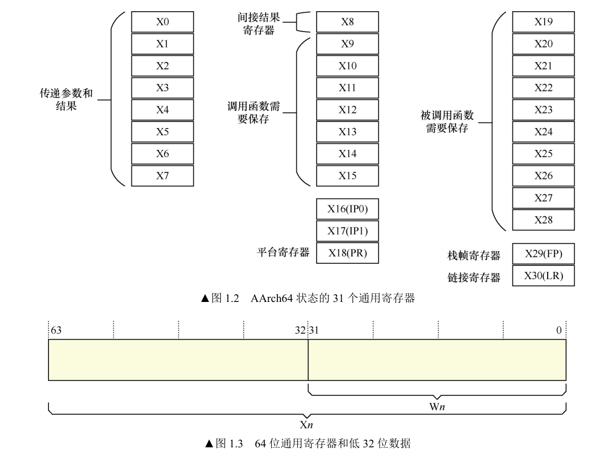
*   **特殊寄存器：**
    *   **零寄存器 (XZR/WZR)：** 读取时为 0，写入时被忽略。
    *   **PC (Program Counter)：** 程序计数器，不能直接通过指令访问。
    *   **SP (Stack Pointer)：** 栈指针，每个异常等级（EL0-EL3）都有独立的 SP 寄存器 (SP_ELx)。
    *   **SPSR (Saved Program Status Register)：** 发生异常时，用于保存当前的 PSTATE 状态。
    *   **ELR (Exception Link Register)：** 发生异常时，用于保存返回地址。
*   **处理器状态 (PSTATE)：** 包含 N、Z、C、V（条件标志位）以及中断屏蔽位（DAIF）等信息。
  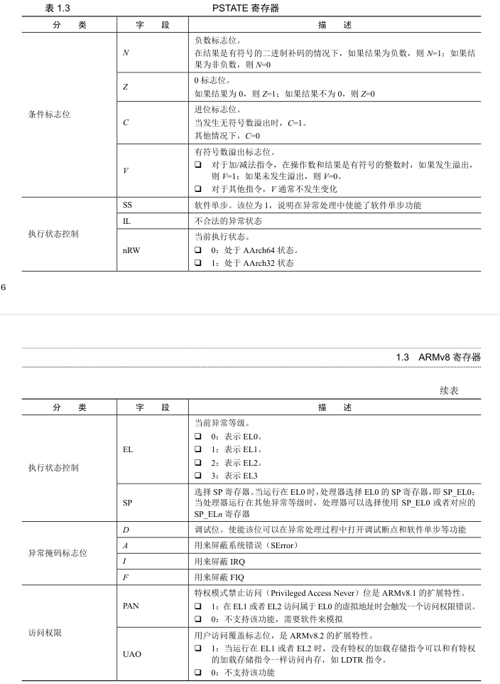
*   **系统寄存器：** 控制处理器行为（如 MMU、缓存等），通过 `MSR` 和 `MRS` 指令访问。

## 第3章：A64 指令集 1——加载与存储指令

ARM是**加载/存储架构（Load/Store Architecture）**，CPU无法直接在内存中处理数据，必须先将数据加载到寄存器，处理完后再存储回内存。

### 1. 核心概念与指令集概览
*   **指令特点：** A64指令集的指令宽度固定为 **32位**，但支持 **64位** 的数据处理和地址寻址。
*   **汇编语法：** 介绍了A64汇编的基本格式，如操作码、目标寄存器、源操作数等。

### 2. 加载与存储指令 (LDR/STR) —— 本章核心
这一部分详细讲解了如何将数据在寄存器和内存之间搬运。最基本的指令是 `LDR` (Load Register) 和 `STR` (Store Register)。

书中重点讲解了 **寻址模式**，这是理解ARM64汇编的难点：
*   **基地址模式 (Base Register)** ：
	* `LDR X0, [X1]` —— 以X1的值为地址读取数据。
	* `STR Xt, [Xn]` —— 将Xt存储到以Xn的寄存器地址。
*   **基地址加偏移量模式 (Offset)** ：
	* `LDR X0, [X1, #8]` —— 以X1+8为地址读取数据。
	* `STR Xt, [Xn, #8]` —— 把 Xt 寄存器的值存储到以 Xn 寄存器的值加8表示的内存地址中。
*   **变基模式 (Base Updated / Indexed)** —— *非常有特色且重要*：
    *   **前变基 (Pre-index)** ：`LDR X0, [X1, #8]!` —— 先把地址X1加8，用新地址取数据，**并且把新地址写回X1** 。
    *   **后变基 (Post-index)** ：`LDR X0, [X1], #8` —— 先用X1的旧地址取数据，取完后**再把X1加8** 。
*   **PC相对地址模式** ：`LDR X0, Label` —— 用于读取代码段中的常量或地址，范围通常在±1MB内。
*   **LDR 伪指令** ：`LDR X0, =0x12345678` —— 当立即数太大，`MOV`指令放不下时，汇编器会把数据放在文字池（Literal Pool），然后生成一条PC相对加载指令来读取它。

### 3. 指令变种与扩展
介绍了针对不同数据类型和场景的专用指令：
*   **不同位宽：** `LDRB`/`STRB` (8位字节)、`LDRH`/`STRH` (16位半字)、`LDRSW` (32位带符号字扩展为64位)。
*   **多字节/成对访问 (LDP/STP)** :
    *   `LDP X0, X1, [SP]`：一次加载两个64位寄存器（共128位）。
    *   `STP X29, X30, [SP, #-16]!`：一次存储两个寄存器。这是ARM64中优化性能和栈操作的关键指令。
*   **非特权访问** :`LDTR`/`STTR`，用于在EL1（内核态）访问EL0（用户态）的数据。
*   **独占访问** :`LDXR`/`STXR`，用于实现原子操作（Atomic Operations）和锁机制（在后续章节会深入，这里做基础介绍）。

### 4. 栈操作 (Stack Operations)
ARM64 **没有** `PUSH` 和 `POP` 指令。本章详细解释了如何使用 `LDP`/`STP` 配合变基寻址来实现栈操作：
*   **入栈 (Push)** :通常使用前变基存储。例如 `STP X29, X30, [SP, #-16]!`（先让SP减16，腾出空间，再存入数据）。
*   **出栈 (Pop)** :通常使用后变基加载。例如 `LDP X29, X30, [SP], #16`（先读出数据，再让SP加16，回收空间）。

### 5. 数据搬移 (MOV)
*   介绍了 `MOV` 指令在寄存器之间搬移数据，以及加载立即数。
*   **陷阱** :`MOV` 指令无法加载任意的64位立即数（受限于指令编码长度）。如果立即数很大，编译器会报错或生成多条指令，通常建议使用 `LDR` 伪指令。

### 6. 常见陷阱 (Pitfalls)
书这部分总结了初学者容易犯的错误：
*   **地址对齐** :在未开启MMU或设备内存上，进行非对齐访问（如用 `LDR` 读一个非8字节对齐的地址）会导致异常。
*   **大立即数加载** :混淆 `MOV` 和 `LDR` 伪指令的用法。
*   **PC相对寻址范围** :标号太远导致编译错误。

**总结一句话：**
第三章是ARM64汇编的入门砖，重点在于掌握**LDR/STR的各种寻址模式（特别是变基寻址）**以及**如何利用LDP/STP手动管理栈帧**，这是理解后续函数调用标准和异常处理的基础。

## 第4章：A64指令集2——算术与移位指令

### 1. 核心基础：条件标志位 (Condition Flags)
这是理解ARM64程序控制流（如if-else跳转）的基础。
*   **PSTATE 寄存器中的标志位：**
    *   **N (Negative)** :运算结果为负。
    *   **Z (Zero)** :运算结果为0。
    *   **C (Carry)** :进位标志（无符号数溢出或进位）。
    *   **V (Overflow)** :溢出标志（有符号数溢出）。
*   **指令后缀 `S`** :ARM64的算术指令默认不更新标志位（例如 `ADD`）。如果需要根据计算结果更新标志位，必须加上 `S` 后缀（例如 `ADDS`）。
* 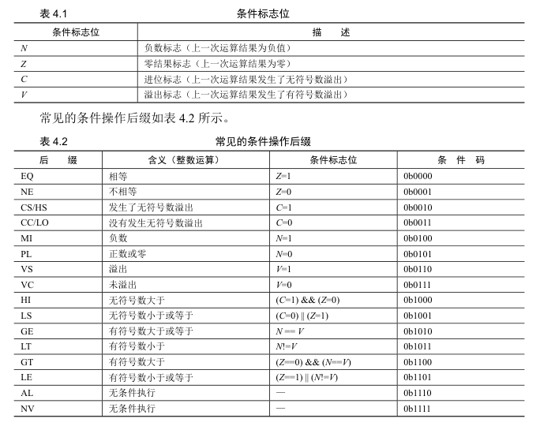

### 2. 算术运算指令
*   **加法与减法：**
    *   `ADD` / `SUB`：普通的加减法。
    *   `ADDS` / `SUBS`：执行加减法并更新 PSTATE 标志位。
    *   **进位运算** :`ADC` (Add with Carry) 和 `SBC` (Subtract with Carry)。这两个指令在处理超过64位的大数运算（如128位整数加法）时非常关键，它们会将上一条指令产生的进位/借位纳入计算。
*   **比较指令 (CMP)** :
    *   `CMP` 本质上就是一条 **不保存计算结果** 的 `SUBS` 指令。它只更新标志位，用于后续的条件跳转（如 `B.EQ`, `B.GT` 等）。
    *   同理，`CMN` (Compare Negative) 相当于 `ADDS` 指令但丢弃结果。

### 3. 移位与逻辑运算
*   **移位操作：**
    *   **LSL** (逻辑左移)：低位补0。
    *   **LSR** (逻辑右移)：高位补0。
    *   **ASR** (算术右移)：**保留符号位**，用于处理有符号数的除法（除以2的n次幂）。
    *   **ROR** (循环右移)。
    *   *特色*：在ARM64中，移位往往可以作为算术指令的一部分直接执行（例如 `ADD X0, X1, X2, LSL #2`），这被称为“移位操作数”，效率极高。
*   **逻辑运算：**
    *   `AND` (与), `ORR` (或), `EOR` (异或)。
    *   `BIC` (Bit Clear)：位清除指令（相当于 `AND NOT`），在清除寄存器特定位时非常常用。
    *   `CLZ` (Count Leading Zeros)：计算前导零的个数，常用于算法优化。

### 4. 位段操作指令 (Bitfield Instructions) —— *极具ARM特色*
这部分对于**驱动开发**和**解析硬件寄存器**非常重要，因为硬件寄存器往往把不同的控制位塞在一个32位或64位数据中。
*   **位段提取：**
    *   `UBFX` (Unsigned Bit Field Extract)：从寄存器中提取一段连续的位，并将其右对齐放入目标寄存器（高位补0）。例如从 `X1` 的第8位开始提取4位放到 `X0`。
    *   `SBFX` (Signed Bit Field Extract)：同上，但进行符号扩展。
*   **位段插入：**
    *   `BFI` (Bit Field Insert)：将一个寄存器的低位数据插入到另一个寄存器的指定位置。

### 总结一句话
**第四章教会了你如何“算数”和“玩位”：它不仅涵盖了基础的加减乘除，更重要的是通过位段指令（UBFX/BFI）和移位操作，赋予了开发者高效处理底层硬件寄存器和优化算法的能力。**

## 第5章：A64指令集3——比较指令与跳转指令

### 1. 比较指令 (Comparison Instructions)
这部分指令用于更新 PSTATE 中的标志位（N, Z, C, V），为后续的跳转做准备。
*   **基础比较** :`CMP`（Compare）本质上是做减法但不保存结果，只更新标志位。
*   **负数比较** :`CMN`（Compare Negative）本质上是做加法但不保存结果。例如 `CMN X0, #10` 实际上是看 `X0 + 10` 的结果，用于判断 X0 是否等于 -10。

### 2. 条件选择指令 (Conditional Select) —— *ARM64 的一大特色*
这是 ARM64 为了**减少分支预测失败（Branch Misprediction）**带来的性能损失而设计的一组指令。它们允许在不跳转的情况下实现简单的 `if-else` 逻辑（即无分支编程）。
*   **CSEL (Conditional Select)** :`CSEL Xd, Xn, Xm, cond`。如果条件 `cond` 成立，结果为 `Xn`，否则为 `Xm`。
*   **CSET (Conditional Set)** :如果条件成立，将寄存器置 1，否则置 0。
*   **变种** :`CSINC` (选择并加1), `CSINV` (选择并按位取反), `CSNEG` (选择并取负)。
    *   *应用场景*：例如 `a = (b > c) ? b : c;` 这种三目运算符，编译器会优化成一条 `CSEL` 指令，而不是用跳转指令，流水线效率更高。

### 3. 跳转指令 (Branch Instructions)
控制程序执行流的改变，分为无条件跳转和有条件跳转。
*   **直接跳转** :
    *   `B` (Branch)：无条件跳转到标号（PC相对寻址，范围较大）。
    *   `B.cond` (如 `B.EQ`, `B.GT`)：条件跳转，依赖 PSTATE 标志位。
*   **函数调用与返回** :
    *   **BL (Branch with Link)** :跳转并**链接** 。这是函数调用的核心指令。它在跳转的同时，会将下一条指令的地址（返回地址）保存到 **X30 (LR, Link Register)** 寄存器中。
    *   **RET** :子函数返回指令。它默认跳转到 **X30** 寄存器中保存的地址。
*   **寄存器跳转** :
    *   `BR Xn`：跳转到寄存器 `Xn` 中存储的地址（用于函数指针、跳表）。
    *   `BLR Xn`：跳转到寄存器地址并保存返回地址到 LR。

### 4. 专门的测试并跳转指令 (Compare & Branch)
为了提高循环和指针检查的效率，ARM64 提供了一些“二合一”指令：
*   **CBZ / CBNZ** :比较寄存器是否为 **零** 并跳转。常用于空指针检查（`if (ptr == NULL)`）。
*   **TBZ / TBNZ** :测试寄存器的 **某一位** 是否为 0 或 1 并跳转。常用于位图检查。

### 5. 陷阱与难点：函数调用中的 LR 保存
本章重点分析了一个初学者极易犯的错误——**“BL 指令覆盖 LR 寄存器导致死循环或崩溃”** 。
*   **场景** :函数 A 调用了函数 B。
*   **问题** :当 A 执行 `BL B` 时，CPU 会自动将 A 的返回地址写入 `X30 (LR)`。如果 A 之前没有把 `X30` 里的旧值（即 A 的调用者地址）保存到栈里，那么 A 执行完 B 后，LR 里存的是 B 的返回地址（即 A 内部的某个位置）。当 A 试图执行 `RET` 返回时，它不会返回给 A 的调用者，而是跳回了 A 自己内部，导致死循环。
*   **解决** :**非叶子函数（Non-leaf function，即调用了其他函数的函数）必须在入口处将 X30 (LR) 和 X29 (FP) 压栈保存，在出口处出栈恢复。**

### 6. 实验环节
本章的实验主要目的是掌握控制流和栈帧管理：
*   **比较指令实验** :验证 `CMP` 和 `CMN` 对标志位的影响。
*   **条件选择实验** :使用 `CSEL` 替代跳转指令实现绝对值计算等功能，体验无分支编程。
*   **函数嵌套调用实验** :编写汇编实现 `main -> func1 -> func2` 的调用链，手动处理栈帧（Stack Frame）的入栈和出栈，观察如果忘记保存 LR 会发生什么。

### 总结一句话
**第5章教会了你如何控制程序的“走向”：通过跳转指令实现循环和函数调用，通过条件选择指令实现高效的逻辑判断，并深刻理解了 LR 寄存器在函数嵌套调用中的关键作用。**

## 第6章：A64指令集4——其他重要指令

### 1. PC 相对地址加载指令 (ADR/ADRP) —— *重中之重*
这是ARM64中生成**位置无关代码 (PIC, Position Independent Code)** 的核心机制。
*   **`ADR Xd, label`** :加载一个相对于当前 PC 值的标签地址。
    *   范围小：$\pm 1$ MB。
    *   精度高：精确到字节。
*   **`ADRP Xd, label` (Page)** :加载一个相对于当前 PC 值的标签所在的**4KB页面基地址** 。
    *   范围大：$\pm 4$ GB。
    *   精度：**4KB 对齐** 。
    *   **常见用法** :通常 `ADRP` 和 `ADD`（加低12位偏移）配合使用，用来在内核中寻址全局变量或函数。

### 2. LDR伪指令 vs ADRP —— *经典的面试题/陷阱*
书中专门对比了 `LDR X0, =Label` 和 `ADR/ADRP X0, Label` 的区别，这对于理解**重定位 (Relocation)** 至关重要：
*   **`LDR X0, =Label`** :加载的是**链接地址（Link Address）** 。如果程序运行在链接脚本指定的地址上，没问题；但如果程序被搬运了（比如Bootloader阶段），这个指令读到的地址可能就是错的。
*   **`ADR/ADRP`** :计算的是**运行地址（Run Address）** 。它是基于当前 PC 动态计算的，所以无论代码被搬运到哪里，只要相对偏移没变，计算出的地址就是当前实际运行的地址。

### 3. 内存独占访问指令 (Exclusive Access)
这是实现**原子操作（Atomic Operations）**和**自旋锁（Spinlock）**的硬件基础。
*   **指令对** :`LDXR` (Load Exclusive) 和 `STXR` (Store Exclusive)。
*   **工作原理** :利用**独占监视器 (Exclusive Monitor)** 。
    *   `LDXR` 读取内存并标记该地址为“独占”。
    *   `STXR` 尝试写入。如果期间没有其他核修改过该地址，写入成功（返回0）；如果被修改过，写入失败（返回1）。
*   **多字节变种** :`LDXP` / `STXP`，可以一次性原子操作128位数据（两个寄存器）。

### 4. 异常处理指令 (Exception Handling)
用于在不同的异常等级（EL）之间切换，请求高特权级的服务。
*   **`SVC #imm`** (Supervisor Call)：用户态 (EL0) 呼叫内核 (EL1)，即**系统调用** 。
*   **`HVC #imm`** (Hypervisor Call)：呼叫虚拟化管理器 (EL2)。
*   **`SMC #imm`** (Secure Monitor Call)：呼叫安全监控器 (EL3，TrustZone)。

### 5. 系统寄存器访问指令
ARM64中，通用寄存器（X0-X30）不能直接操作控制系统的寄存器（如页表基址 `TTBR`、状态寄存器 `SCTLR` 等）。
*   **`MRS Xt, SysReg`** :读系统寄存器到通用寄存器。
*   **`MSR SysReg, Xt`** :将通用寄存器写入系统寄存器。
*   *例子*：读取当前异常等级 `MRS X0, CurrentEL`。

### 6. 内存屏障指令 (Memory Barrier)
这部分只是引入，后续第18章会深入。
*   **`DMB`** (Data Memory Barrier)：保证内存访问的数据一致性顺序。
*   **`DSB`** (Data Synchronization Barrier)：更严格，保证前面的访存指令执行完毕。
*   **`ISB`** (Instruction Synchronization Barrier)：冲刷流水线，确保取指一致性（常用于修改页表或系统配置后）。

### 7. 实验环节
本章的实验非常硬核，侧重于底层机制的验证：
*   **`ADRP` vs `LDR` 陷阱实验** :通过修改链接脚本地址，观察在重定位场景下，这两条指令获取到的地址差异。
*   **原子操作实验** :编写汇编代码使用 `LDXR`/`STXR`，模拟多核竞争或验证独占监视器的行为。

### 总结一句话
**第6章为你补齐了底层系统编程的最后一块拼图：如何通过 `ADRP` 实现代码位置无关，如何通过 `MRS/MSR` 控制CPU状态，如何通过 `SVC` 进行系统调用，以及如何通过 `LDXR` 实现原子锁。**

## 第7章：A64 指令集的陷阱

这一章的核心主题是：**汇编指令的行为不仅取决于指令本身，还取决于硬件环境（MMU、内存属性、总线约束）。**

### 1. 核心陷阱案例分析

#### 案例 7-1 & 7-2：内存对齐引发的死机 (Alignment Fault)
*   **场景** :试图使用 `LDR` 指令加载一个宏定义的标签地址，或者加载一个字符串。
*   **问题** :
    *   ARM64 处理器在 **MMU 关闭** 的情况下，通常将所有内存视为 **设备内存 (Device Memory)** 。
    *   **设备内存** 对访问对齐有严格要求。如果你使用 `LDR X0, [X1]`（加载64位数据），但 `X1` 指向的地址不是 **8字节对齐** 的（例如字符串随意定义的地址），CPU 会直接触发 **对齐异常 (Alignment Fault)** 导致死机。
*   **解决** :
    *   在定义数据时使用 `.align` 伪指令确保对齐。
    *   或者使用 `LDRB` (字节加载) 这种不受对齐限制的指令逐字节读取。

#### 案例 7-3：读写寄存器位宽不对导致死机 (Register Width Mismatch)
*   **场景** :在树莓派 4B（BCM2711 芯片）上配置外设寄存器。
*   **问题** :
    *   许多外设寄存器（如串口、GPIO）在硬件设计上只支持 **32位访问** 。
    *   如果程序员为了省事，使用 `STR X0, [X1]`（64位写）去写一个32位的硬件寄存器，总线可能会报错，或者高32位数据会覆盖相邻的寄存器，导致系统崩溃或行为异常。
*   **解决** :**严谨地使用 `W` 寄存器**（如 `STR W0, [X1]`）来操作32位的外设寄存器。

#### 案例 7-4：LDXR/STXR 与内存属性的冲突 (Atomic & Memory Attributes)
*   **场景** :在 MMU 未开启的情况下，尝试使用 `LDXR/STXR`（独占访问指令）来实现自旋锁或原子操作。
*   **问题** :
    *   `LDXR/STXR` 依赖于硬件的 **独占监视器 (Exclusive Monitor)** 。
    *   在许多 ARM 实现（如 Cortex-A72）中，独占监视器通常工作在 **Cache** 系统中。
    *   如果 **MMU 未开启**，内存被视为 **不可缓存 (Non-cacheable)** 的设备内存，独占监视器无法工作，执行这些指令会导致不可预测的行为（通常是死锁或异常）。
*   **解决** :在未开启 MMU 和 Cache 之前，不要使用原子指令；或者必须先初始化页表开启 MMU，并将内存属性配置为 **普通内存 (Normal Memory)** 。

### 2. 综合汇编大作业

这一章不仅仅是排错，还安排了两个综合性很强的作业，用于串联前几章的知识：

*   **作业 7-1：汇编实现串口输出 (UART)**
    *   **目标** :不依赖 C 语言环境，纯汇编点亮串口并打印字符。
    *   **考察点** :
        *   地址计算（`ADRP` + `ADD`）。
        *   寄存器读写（注意 32位宽度）。
        *   位操作（`UBFX` / `ORR` 配置 GPIO 引脚复用）。
        *   循环与跳转指令的使用。

*   **作业 7-2：分析 Linux 5.0 启动汇编**
    *   **目标** :阅读真实的生产级代码。
    *   **考察点** :
        *   理解 Linux 内核入口（`head.S`）如何处理 Bootloader 传参。
        *   如何检查 CPU ID、处理 Cache 无效化。
        *   如何创建早期的页表并开启 MMU。

### 总结一句话
**第7章用血淋淋的“死机”案例告诉你：在底层开发中，你必须关注“内存对齐”、“寄存器位宽”以及“MMU对指令行为的影响”，否则代码逻辑再对，硬件也不会买账。**
## 第8章：GNU 汇编器

这一章重点介绍了 **GNU AS (GAS)** 汇编器的语法、伪指令以及编译链接流程，这是编写 BenOS 或阅读 Linux 内核汇编代码（如启动代码 `head.S`）的必备语法基础。

### 1. 编译流程与 ELF 文件
*   **工具链流程** :详细拆解了 GCC 的编译步骤：预处理 (`cpp`) -> 编译 (`cc1`) -> **汇编 (`as`)** -> 链接 (`ld`)。
*   **ELF 文件结构** :
    *   解释了目标文件（Object File, .o）和可执行文件（Executable）的内部结构。
    *   **关键段 (Section)** :
        *   `.text`：代码段。
        *   `.data`：已初始化数据段。
        *   `.bss`：未初始化数据段（不占文件空间，只占内存）。
        *   `.rodata`：只读数据段（如字符串常量）。
    *   **符号表 (Symbol Table)** :链接器用来“对暗号”的地方，记录了函数和变量的地址信息。

### 2. 汇编语法核心 (Syntax)
*   **注释** :支持 `//` (单行) 和 `/* ... */` (多行)。
*   **符号 (Symbol)** :
    *   **全局符号** :`.global main`，可以被其他文件引用（如 C 语言调用）。
    *   **本地标签** :以数字开头（如 `1:`），配合 `b 1f` (forward, 向前跳) 或 `b 1b` (backward, 向后跳) 使用。这在循环和简单跳转中非常常用，避免起名字的烦恼。

### 3. 常用伪指令 (Pseudo-ops)
伪指令不是 CPU 执行的，而是**指挥汇编器干活**的命令。
*   **对齐** :`.align n`。**注意：在 ARM64 中，n 表示 $2^n$ 字节对齐**（例如 `.align 3` 表示 8 字节对齐），这与其他架构不同，是一个常见陷阱。
*   **数据定义** :
    *   `.byte` (8位), `.short` (16位), `.word` (32位), `.quad` (64位)。
    *   `.string` / `.asciz`：定义字符串（自动带 `\0` 结束符）。
    *   `.zero` / `.space`：预留空间。
*   **段管理** :
    *   `.section`：切换段。
    *   `.pushsection` / `.popsection`：非常灵活的段切换方式，常用于 Linux 内核的异常表或替代指令功能（将代码片段放到特殊的段中，然后再跳回来）。

### 4. 汇编宏 (Macros) —— *阅读内核源码的钥匙*
Linux 内核大量使用汇编宏来简化代码（如 `kernel_entry`, `kernel_exit`）。
*   **定义** :`.macro 宏名 参数1, 参数2` ... `.endm`。
*   **参数引用** :使用 `\参数名`。
*   **特殊语法** :`\()` 用于分割参数和字符串，防止产生歧义。

### 5. AArch64 特有的语法特性
*   **重定位操作符** :
    *   在使用 `ADRP` 加载地址时，通常配合 `:lo12:Label` 来获取低12位的偏移量。这是手动编写位置无关代码的标准写法。
*   **LDR 伪指令** :
    *   `LDR X0, =0x12345678`：如果立即数太大，汇编器会自动在内存（文字池）里分配一个位置存这个数，然后生成一条 PC 相对加载指令把它读出来。

### 总结一句话
**第8章是你从“读懂指令”进阶到“能写工程代码”的桥梁，它教你如何用伪指令排兵布阵（管理内存布局），如何用宏简化操作，以及如何让 C 语言和汇编语言通过符号表互相“认识”。**
## 第9章：链接器与链接脚本

这一章重点讲解了如何通过 **链接脚本 (Linker Script, .ld)** 来控制程序的内存布局，以及如何处理 **重定位 (Relocation)** 这一底层开发中的核心难题。
### 1. 链接器与链接脚本基础
*   **链接器的作用** :将编译生成的多个目标文件（.o）合并成一个最终的可执行文件（.elf）。
*   **链接脚本语法** :
    *   **`SECTIONS { ... }`** :核心命令，用于描述内存布局。
    *   **`.` (Location Counter)** :当前位置计数器。它代表当前的内存地址，通过给它赋值（如 `. = 0x80000`），可以控制后续段（Section）的存放位置。
    *   **段映射** :如何将输入文件的 `.text`（代码）、`.data`（数据）、`.bss`（未初始化数据）映射到输出文件的内存空间。
    *   **`ENTRY(symbol)`** :指定程序的入口点（第一条执行指令的位置）。

### 2. VMA 与 LMA —— *本章最核心的概念*
理解这两个地址的区别是做底层搬砖（Bootloader）的前提：
*   **VMA (Virtual Memory Address / Run Address)** :**运行地址** 。程序在运行时应该位于的地址。链接器在计算符号地址（如函数调用跳转目标）时，使用的是 VMA。
*   **LMA (Load Memory Address)** :**加载地址** 。程序在被加载器（如烧录到 Flash 或由上一级 Bootloader 加载）时实际存放的地址。
*   **`AT()` 关键字** :在链接脚本中，使用 `AT()` 可以指定 LMA。
*   **应用场景** :嵌入式系统中，代码通常存储在 **ROM/Flash (LMA)** 中，但为了运行速度，需要在启动时搬运到 **RAM (VMA)** 中运行。此时 LMA $\neq$ VMA。

### 3. 符号 (Symbols) 的交互
*   **在脚本中定义符号** :可以在链接脚本中定义符号（如 `_text_start`, `_bss_end`）。
*   **在 C 语言中引用符号** :
    *   C 语言通过 `extern char _text_start[];` 来引用这些符号。
    *   **注意** :链接脚本定义的符号代表的是**地址**，而不是变量的值。所以在 C 语言中要取其地址（`&_text_start`）或者将其声明为数组。
*   **用途** :常用于清零 BSS 段、计算代码段大小、或在重定位时确定搬运的源和目的地址。

### 4. 重定位 (Relocation)
这是系统启动代码（Startup Code）必须完成的任务：
*   **代码搬运** :如果 LMA $\neq$ VMA（例如从 ROM 搬到 RAM），启动汇编代码必须手动将 `.data` 段和 `.text` 段（如果不在 Flash 运行）从 LMA 复制到 VMA。
*   **BSS 清零** :C 语言规定未初始化的全局变量必须为 0，这需要启动代码根据链接脚本提供的 BSS 起止地址，手动将这块内存清零。
*   **BenOS 案例** :书中展示了 BenOS 如何通过链接脚本定义 VMA（链接到高地址或 RAM 地址），并通过汇编代码在启动阶段完成自我搬运。
*   **Linux 内核案例** :简要分析了 Linux 内核（`vmlinux.lds.S`）如何处理复杂的内核段布局。
### 总结一句话
**第9章教你做内存空间的“总设计师”：通过编写链接脚本，精准控制代码和数据在内存中的物理位置（LMA）和逻辑位置（VMA），并掌握系统启动时的“搬家”（重定位）和“打扫房间”（BSS清零）技术。**
## 第10章：GCC 内嵌汇编代码

在系统编程（如 Linux 内核开发）中，我们经常需要在 C 代码中直接插入汇编指令来**访问特殊寄存器**（如 `MSR`/`MRS`）、**实现原子操作**或**手动优化关键路径** 。这一章详细讲解了 GCC 提供的内嵌汇编语法规则及其实战技巧。

### 1. 内嵌汇编的两种形式
*   **基础内嵌汇编 (Basic Asm)** :
    *   格式：`asm("指令");`
    *   特点：不带参数，编译器不做处理，直接塞入汇编代码。通常仅用于无副作用的指令（如 `nop`）。
*   **扩展内嵌汇编 (Extended Asm)** —— *本章重点*：
    *   格式：`asm volatile ("汇编指令模板" : 输出部分 : 输入部分 : 损坏部分);`
    *   特点：允许 C 语言变量与汇编寄存器进行交互，编译器会自动负责寄存器分配和数据传递。

### 2. 关键修饰符与语法结构
*   **`volatile`** :告诉编译器**不要优化**这段代码（不要删除，不要随意重排顺序）。对于访问硬件或系统寄存器，这是必须的。
*   **操作数引用** :
    *   **数字引用** :使用 `%0`, `%1` 等按顺序引用参数。
    *   **符号引用** :使用 `[name]`（如 `%[val]`）来引用参数，极大地提高了代码可读性。

### 3. 约束符 (Constraints) —— *难点与重点*
约束符告诉编译器如何处理变量（是放在寄存器里？还是内存里？还是立即数？）。
*   **通用约束** :
    *   `r`：通用寄存器（X0-X30）。
    *   `m`：内存操作数。
    *   `i`：立即数。
*   **输出修饰** :
    *   `=`：只写（Write-only）。
    *   `+`：读写（Read-Write）。
    *   `&`：**早变（Early Clobber）** 。告诉编译器这个输出寄存器在输入数据被读取之前就会被修改，防止编译器复用寄存器导致逻辑错误。
*   **ARM64 特有约束** :
    *   **`Q`** :表示一个**没有偏移量**的内存地址。**这是实现 `LDXR/STXR` 原子操作时的关键约束**，防止编译器生成带有偏移量的地址（如 `[x0, #8]`），导致独占访问指令执行失败（因为 `LDXR` 不支持偏移寻址）。

### 4. 损坏部分 (Clobber List)
*   **`"memory"`** :**内存屏障** 。告诉编译器这段汇编可能会修改内存，编译器在生成代码时不能假设内存值不变（即不能缓存内存变量到寄存器），并且不能跨越这个屏障进行指令重排。
*   **`"cc"`** :告诉编译器这段汇编改变了标志位（PSTATE），编译器需要重新计算条件跳转。

### 5. 高级用法：Goto 与 宏
*   **`asm goto`** :允许汇编代码直接跳转到 C 语言定义的标签（Label）。这在 Linux 内核的 **Tracepoint（追踪点）** 和 **Static Keys（静态键）** 优化中被大量使用。
*   **宏结合** :利用 C 语言预处理器的字符串化功能（`#`），将 C 宏的值传递给汇编指令。

### 6. 案例分析：原子加法与自旋锁
本章通过分析 Linux 内核中的原子操作代码，展示了内嵌汇编的威力：
*   **错误示范** :使用通用内存约束 `"m"` 配合 `LDXR`，可能导致编译器生成错误的地址寻址模式。
*   **正确示范** :使用 `"Q"` 约束确保生成单纯的基址寻址。
*   **系统寄存器访问** :演示了如何封装 `read_sysreg()` 和 `write_sysreg()` 宏，通过内嵌汇编读写 `CurrentEL` 或 `TTBR0_EL1` 等寄存器。
### 总结一句话
**第10章是“C语言与汇编语言的通天塔”，它教会了你如何利用 GCC 的规则，安全、高效地在 C 代码中穿插汇编指令，这是编写操作系统内核和底层驱动的必备技能。**
## 第11章：异常处理
在ARM64中，“异常（Exception）”是一个广义的概念，中断（Interrupt）、系统调用（System Call）、故障（Fault）都属于异常。这一章详细阐述了 CPU 从用户态切换到内核态（或从低特权级到高特权级）的硬件机制和软件流程。以下是主要内容总结：

### 1. 异常的基本概念
*   **异常分类** :
    *   **同步异常 (Synchronous)** :由当前执行的指令直接触发，如访问非法地址（Data Abort）、未定义指令、系统调用（SVC/HVC/SMC）、断点等。
    *   **异步异常 (Asynchronous)** :与当前指令执行无关，通常由外部硬件触发，主要是 **中断 (IRQ/FIQ)** 和 **系统错误 (SError)** 。
*   **异常等级 (EL)** :复习了 EL0 (用户) 到 EL3 (安全监控) 的层级。异常通常会会导致 CPU 进入更高或同级的 EL。

### 2. 异常处理流程 (Hardware Behavior) —— *核心机制*
当异常发生时，**硬件（CPU）会自动完成**以下动作（软件不可干预）：
1.  **保存状态** :将当前的 `PSTATE` 保存到目标 EL 的 **`SPSR_ELx`** 寄存器。
2.  **保存返回地址** :将当前的 `PC` 值（或下一条指令地址）保存到目标 EL 的 **`ELR_ELx`** 寄存器。
3.  **屏蔽中断** :将 `PSTATE` 中的 `DAIF` 位（调试、S Error、IRQ、FIQ）置 1，关闭中断，防止嵌套干扰。
4.  **切换栈指针** :通常自动切换使用目标 EL 的 **`SP_ELx`**（也可以配置使用 `SP_EL0`，但 Linux 内核通常使用 `SP_EL1`）。
5.  **跳转** :根据异常类型和来源，跳转到 **异常向量表 (Vector Table)** 的对应入口执行。
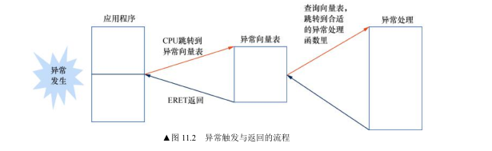
**异常返回** :软件执行 **`ERET`** 指令，硬件会自动将 `SPSR` 恢复到 `PSTATE`，将 `ELR` 恢复到 `PC`，从而跳回原来的代码继续执行。
**异常返回地址** :X30 寄存器（又称为LR），存放的是子函数的返回地址，一般是用于完成函数调用的，可以使用RET指令来返回父函数。ELR_ELx，存放的异常返回的地址，即发生异常那一瞬间的地址，它可能是在用户空间中的地址，也可能是在内核空间中的地址，不管它在哪个空间，执行ERET指令就可以返回异常现场。
### 3. 异常向量表 (Exception Vector Table) —— *与ARM32的重大区别*
*   **基地址** :由 **`VBAR_ELx`** (Vector Base Address Register) 指定。
*   **表结构** :不再是简单的 4字节跳转指令列表。ARM64 的向量表包含 **16 个条目**，每个条目大小固定为 **128 字节**（可以存放 32 条指令，足够写一段小的跳转代码）。
*   **4组入口** :向量表根据“异常来源”和“当前栈指针选择”分为 4 组：
    1.  **Current EL with SP_EL0** :当前层级发生异常，且使用 SP_EL0（Linux 不用）。
    2.  **Current EL with SP_ELx** :当前层级发生异常，使用 SP_ELx（如内核态发生缺页异常）。
    3.  **Lower EL using AArch64** :从低层级（64位）陷入（如用户态 App 系统调用陷入内核）。
    4.  **Lower EL using AArch32** :从低层级（32位）陷入（兼容 32 位 App）。

### 4. 异常现场 (Context)
*   **保存现场 (Save)** :进入异常处理程序（Handler）的第一件事，就是把通用寄存器 (`X0`~`X30`)、`SP`、`PC`、`PSTATE` 等保存到栈上，形成 `pt_regs` 结构体。
*   **恢复现场 (Restore)** :处理完异常后，从栈上恢复这些寄存器，最后执行 `ERET`。

### 5. 同步异常解析 (Syndrome Parsing)
当发生同步异常（如缺页、非法访问）时，内核如何知道具体原因？依靠 **`ESR_ELx` (Exception Syndrome Register)** 。
*   **EC (Exception Class)** :异常的大类（如数据中止、SVC调用等）。
*   **ISS (Instruction Specific Syndrome)** :具体的错误信息。
*   **`FAR_ELx` (Fault Address Register)** :记录导致错误的**虚拟地址**（例如访问了哪个非法地址导致了 Segfault）。
* 可以参考网站 https://esr.arm64.dev/ 来解析里面的字段

### 6. 案例与实验
本章提供了非常底层的实战案例：
*   **EL2 到 EL1 的切换** :分析了 BenOS（或 Bootloader）如何从启动时的 EL2 降级到 EL1 并初始化系统配置（设置 `HCR_EL2`、`SCTLR_EL1` 等）。
*   **指令对齐异常** :手动制造一个非对齐访问，观察 `ESR` 和 `FAR` 寄存器的值，验证异常捕获机制。
*   **编写向量表** :在汇编中实际编写一个向量表并加载到 `VBAR`。

### 总结一句话
**第11章揭示了操作系统的“急诊室”工作原理：当程序出错或请求服务时，CPU 如何通过 SPSR/ELR 自动保存现场，如何通过 VBAR 表跳转到内核代码，以及内核如何通过 ESR/FAR 诊断病情并“治愈”（处理）异常。**
## 第12章：中断处理

这一章以树莓派4B为平台，详细讲解了从硬件触发中断到软件处理中断的全过程。以下是核心内容总结：

### 1. 中断系统的硬件基础
*   **物理信号** :介绍 CPU 核上的 **nIRQ** 和 **nFIQ** 引脚。这是中断信号进入 CPU 的最终大门。
*   **PSTATE 控制** :复习了 `PSTATE` 中的 **I** 位（屏蔽 IRQ）和 **F** 位（屏蔽 FIQ）。只有当这些掩码位被清除（Unmask）时，CPU 才能响应中断。
*   **中断控制器** :
    *   本章主要介绍了树莓派 4B 上的 **传统中断控制器 (Legacy Interrupt Controller)**（特定于博通 BCM2711 芯片）。
    *   *注：标准的 GIC（通用中断控制器）放到了第13章详细讲，本章先用简单的 Legacy 控制器上手。*

### 2. ARM 通用定时器 (Generic Timer)
这是本章实验的主要中断源（"闹钟"）。
*   **架构要求** :ARMv8 强制要求实现通用定时器，它独立于 CPU 频率，提供稳定的时间基准。
*   **关键寄存器** :
    *   **`CNTP_CTL_EL0`** :控制寄存器（使能/关闭）。
    *   **`CNTP_TVAL_EL0`** :倒计时数值（Timer Value）。当减到 0 时触发中断。
    *   **`CNTP_CT`** :当前的计数值。

### 3. 中断现场 (Interrupt Context) —— *软件核心*
这是编写操作系统中断处理程序最关键的部分。中断发生是异步的，CPU 可能正在执行任何代码，因此必须保存**完整的**现场。
*   **`pt_regs` 结构体** :定义了一个与栈布局完全对应的 C 语言结构体，用于存放：
    *   通用寄存器 `X0` ~ `X30`。
    *   特殊寄存器 `SP` (栈指针), `PC` (程序计数器/ELR), `PSTATE` (状态/SPSR)。
*   **保存现场 (`kernel_entry`)** :
    *   一段汇编宏。在进入中断向量（`el1_irq`）后立即执行。
    *   利用 `STP` 指令将寄存器成对压入内核栈。
*   **恢复现场 (`kernel_exit`)** :
    *   中断处理完成后执行。
    *   利用 `LDP` 指令从栈中弹出数据恢复寄存器，最后执行 `ERET` 返回被中断的程序。

### 4. 案例分析：实现定时器中断
本章通过一个完整的案例串联了所有知识点：
1.  **初始化** :
    *   初始化异常向量表 (`VBAR_EL1`)。
    *   初始化通用定时器（设置倒计时，使能）。
    *   在中断控制器中“解除屏蔽”定时器中断。
    *   在 CPU PSTATE 中“解除屏蔽”IRQ (`msr daifclr, #2`)。
2.  **中断路由** :
    *   中断发生 -> 跳转到向量表 -> 执行 `kernel_entry` 保存现场。
    *   调用 C 语言函数 `irq_handle()`。
3.  **中断处理 (C语言)** :
    *   查询中断控制器状态，确认是定时器中断。
    *   **清除中断** :重置定时器的倒计时（否则中断会一直触发，导致死机）。
    *   执行业务逻辑（如打印 Log 或闪烁 LED）。
4.  **返回** :
    *   执行 `kernel_exit` 恢复现场 -> `ERET`。

### 5. 实验环节
*   **实战定时器** :在 BenOS 上编写代码，让系统每隔一秒打印一次 "Timer interrupt received"。
*   **调试技巧** :如果中断不触发，如何检查 `DAIF` 位、控制器状态寄存器以及向量表地址是否正确。

### 总结一句话
**第12章教会了你如何让 CPU “一边干活一边听电话”：通过配置通用定时器产生信号，利用栈帧结构体（pt_regs）完美地保存和恢复现场，从而实现一个最基本的抢占式中断处理系统。**
## 第13章：GIC-V2
GIC-V2 正式引入了现代ARM SoC中标准的中断管理组件——**通用中断控制器 (Generic Interrupt Controller, GIC)** 。

相比于第12章介绍的树莓派专用“传统中断控制器”，GIC 是为**多核处理器**设计的标准架构，能够处理复杂的路由、优先级和虚拟化需求。本章重点讲解了广泛使用的 **GICv2** 规范。

### 1. GIC 基础与分类
*   **为何需要 GIC** :传统中断控制器难以应对多核（SMP）环境下的中断分发（Routing）和核间通信（IPI）需求。
*   **中断源分类 (Interrupt ID)** :
    *   **SGI (Software Generated Interrupt, ID 0-15)** :软件触发中断。专门用于核间通信（IPI），例如一个核唤醒另一个核。
    *   **PPI (Private Peripheral Interrupt, ID 16-31)** :私有外设中断。每个 CPU 核独有的，例如第12章讲的通用定时器中断。
    *   **SPI (Shared Peripheral Interrupt, ID 32-1019)** :共享外设中断。所有 CPU 核共享的外部设备中断（如 UART, DMA, 网络）。
*   **中断状态机** :
    *   **Inactive** :无效/未触发。
    *   **Pending** :等待中（已触发但 CPU 尚未响应）。
    *   **Active** :活跃中（CPU 正在处理）。
    *   **Active and Pending** :正在处理一个中断，同时该中断源又触发了新的中断。

### 2. GICv2 内部架构
GICv2 逻辑上分为两大组件，这是理解 GIC 编程的关键：
*   **分发器 (Distributor, GICD_*)** :
    *   **系统的“总管”** 。全局只有一个。
    *   负责所有中断的优先级仲裁、启用/禁用、以及**路由**（决定把 SPI 中断发给哪个 CPU 核）。
*   **CPU 接口 (CPU Interface, GICC_*)** :
    *   **CPU 的“秘书”** 。每个 CPU 核都有一个。
    *   负责将分发器发送过来的最高优先级中断信号传递给 CPU 核心。
    *   软件通过读写这里的寄存器来**确认中断 (ACK)** 和 **结束中断 (EOI)** 。
* 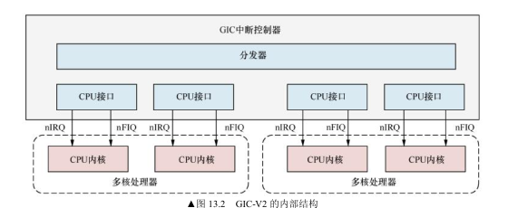
### 3. 标准中断处理流程 (Software Flow)
本章详细描述了驱动程序处理 GIC 中断的标准步骤：
1.  **读取 IAR (Interrupt Acknowledge Register)** :
    *   CPU 响应异常进入处理函数后，读取 `GICC_IAR`。
    *   **作用** :获取当前中断号（ID），并将中断状态从 Pending 变为 Active。
2.  **执行 ISR** :根据 ID 调用具体的设备中断处理函数。
3.  **写入 EOI (End of Interrupt Register)** :
    *   处理完后，将 ID 写入 `GICC_EOIR`。
    *   **作用** :通知 GIC 该中断处理完毕，状态从 Active 变为 Inactive，允许 GIC 发送下一个低优先级中断。

### 4. 树莓派 4B 的 GIC-400
*   树莓派 4B 使用博通 BCM2711 芯片，它内部其实有两套中断控制器：
    *   一套是第12章讲的 Legacy Controller（为了兼容旧版树莓派）。
    *   一套是标准的 **GIC-400 (GICv2)** 。
*   **地址映射** :介绍了 GICD 和 GICC 寄存器在内存中的基地址（这对于裸机编程至关重要）。
*   **中断号映射** :树莓派的外设中断（如 UART, PCIe）是如何映射到 GIC 的 SPI 中断号上的。

### 5. 实验环节
本章的实验是将第12章的定时器实验“升级”到 GIC 环境：
*   **初始化 GIC** :编写代码初始化 Distributor 和 CPU Interface（设置优先级、使能开关）。
*   **实现中断处理** :
    *   在异常向量中调用 C 函数。
    *   C 函数中读取 `IAR` 获取 ID。
    *   根据 ID 判断是定时器中断，执行操作。
    *   写入 `EOI` 结束中断。
*   **系统定时器 (System Timer)** :除了通用定时器，还额外实验了树莓派特有的 System Timer，展示了不同外设中断的接入方法。

### 总结一句话
**第13章是驱动开发的分水岭，它教会了你如何驾驭现代多核处理器的“交通指挥官”——GICv2，掌握了如何配置中断路由（Distributor）以及标准的中断响应握手流程（IAR -> EOI）。**
## 第14章：内存管理
**第14章“内存管理”** 是全书最核心、最复杂的章节之一。它解释了操作系统如何通过硬件机制（MMU）构建出“每个进程都拥有完整内存”的幻象。这一章从基础的内存管理理论出发，深入剖析了 ARM64 的 **页表结构（Translation Tables）**、**地址转换过程** 以及 **内存属性** 。

### 1. 内存管理基础理论
*   **演进历史** :简述了从单道程序（直接物理寻址）、静态分区到 **分段（Segmentation）** 和 **分页（Paging）** 的发展历程。
*   **虚拟内存的核心作用** :
    1.  **隔离性** :每个进程有独立的地址空间，互不干扰。
    2.  **抽象** :让程序认为自己拥有连续的内存，无需关心物理碎片的实际分布。
    3. 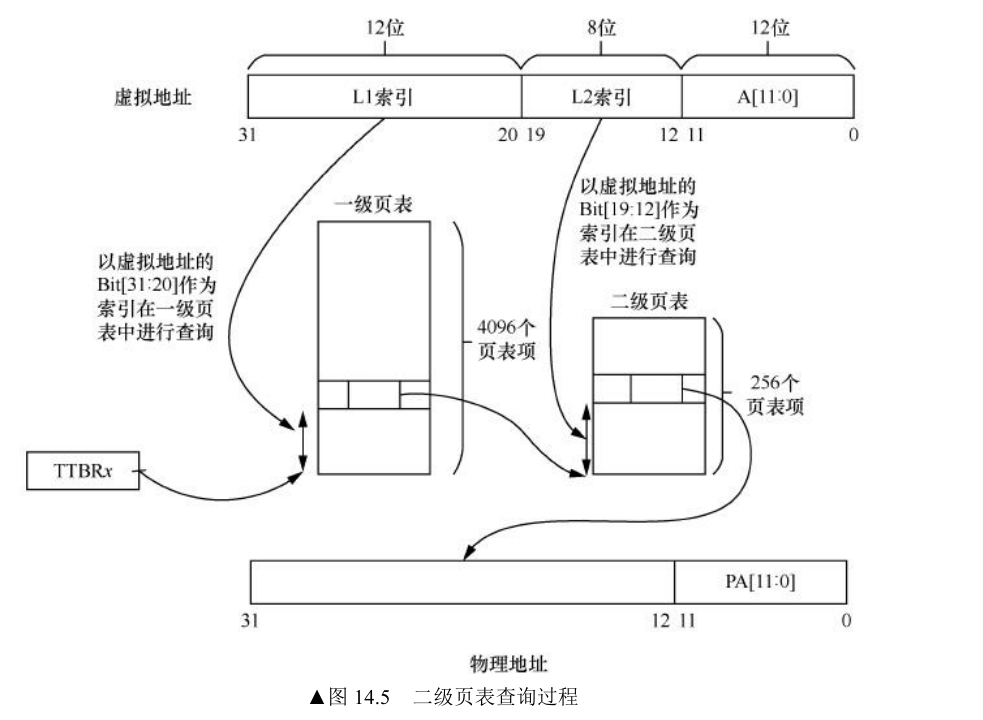

### 2. ARM64 页表机制 (Translation Process) —— *重中之重*
ARM64 使用 **多级页表** 来将虚拟地址（VA）映射到物理地址（PA）。
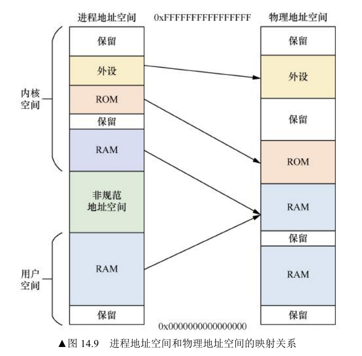
*   **地址划分** :ARM64 采用双页表基址设计（Two-level structure）：
    *   **TTBR0_EL1** :负责低地址空间（User Space, 0x0000...），用于应用程序。
    *   **TTBR1_EL1** :负责高地址空间（Kernel Space, 0xFFFF...），用于操作系统内核。
*   **4级页表结构** :以标准的 4KB 页大小、48位虚拟地址为例，详细拆解了 L0 -> L1 -> L2 -> L3 的查找过程：
    *   **PGD (Page Global Directory)**
    *   **PUD (Page Upper Directory)**
    *   **PMD (Page Middle Directory)**
    *   **PT (Page Table)**
    * 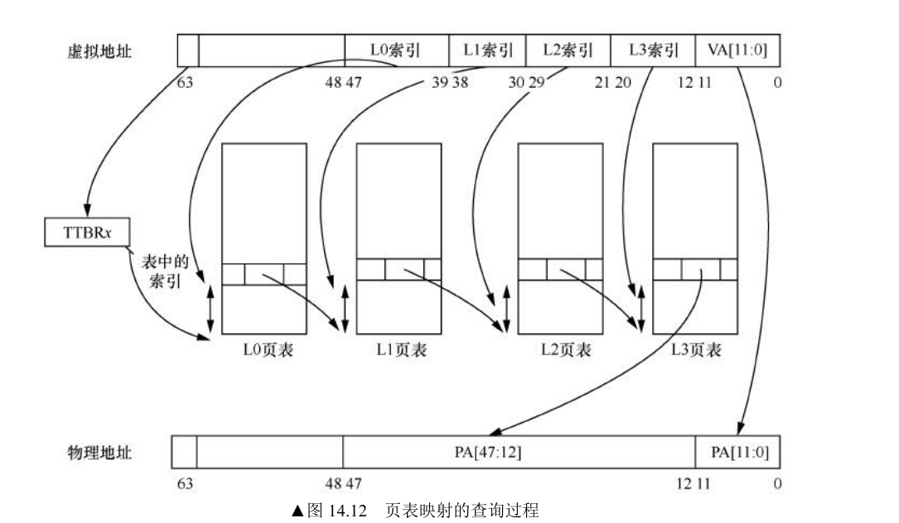
*   **页表项 (Descriptor)** :详细解析了 64位页表项的格式，区分了 **块描述符 (Block Entry)**（直接映射大块内存，如 2MB/1GB）和 **表描述符 (Table Entry)**（指向下一级页表）。
	* 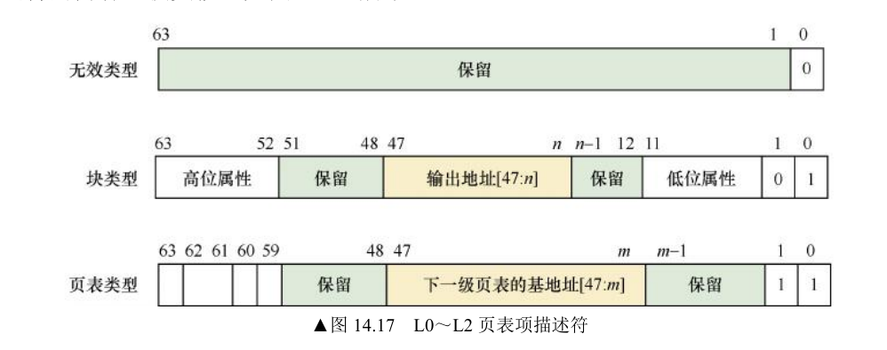 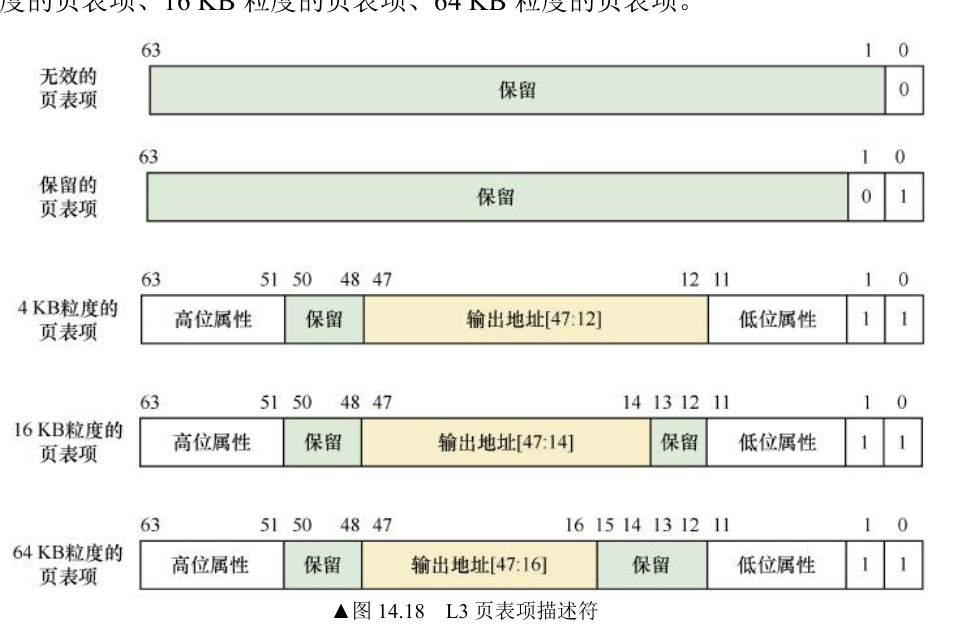

### 3. 页表属性 (Attributes) —— *驱动开发必须掌握*
页表项不仅仅存地址，还存储了非常关键的内存属性，决定了 CPU 如何访问这段内存：
*   **内存类型 (Memory Type)** :
    *   **Normal Memory** :普通内存（RAM），支持推测读取、乱序执行，性能最高。
    *   **Device Memory** :设备内存（寄存器），严格保序，不能缓存，用于外设操作（如 nGnRnE）。
*   **访问权限 (AP)** :控制读写权限（RO/RW）以及特权级访问限制（EL0/EL1）。
*   **执行权限 (XN/PXN)** :
    *   **UXN** (Unprivileged Execute-never)：禁止用户态执行（防止 shellcode）。
    *   **PXN** (Privileged Execute-never)：禁止内核态执行用户态代码（防止 ret2usr 攻击）。
    * 
*   **共享属性 (Shareability)** :控制多核之间的一致性范围（Inner Shareable / Outer Shareable）。
*   **访问标志 (AF)** :Access Flag，用于操作系统实现页面置换算法（LRU）。

### 4. 硬件管理特性 (Hardware Management)
介绍了 ARMv8.1 引入的硬件特性（TTHM）：
*   **硬件管理 AF 和 Dirty Bit** :以前需要操作系统通过缺页异常来软件模拟“脏位”（Dirty Bit），现在硬件可以直接更新页表项，大幅提升了写时复制（CoW）等机制的效率。

### 5. 关键系统寄存器
*   **TCR_EL1 (Translation Control Register)** :控制地址宽度（T0SZ/T1SZ）、页面大小（TG0/TG1）、物理地址范围（IPS）等。
* **SCTLR** 是与系统相关的控制寄存器，其中有3个字段与地址转换和高速缓存相关。
	* M字段：用来打开MMU地址转换。若设置字段为1，表示要打开地址转换；0表示关闭
	* C字段：表示打开和关闭数据高速缓存。
	* I字段：表示打开和关闭指令高速缓存。
* **TTBR** ：用来存储页表的基地址
*   **MAIR_EL1 (Memory Attribute Indirection Register)** :定义内存属性的索引表（例如 Index 0 是设备内存，Index 1 是普通缓存内存）。页表项只存储索引值。

### 6. 实战案例：恒等映射 (Identity Mapping)
本章通过 BenOS 的代码展示了如何**手动构建页表**并**开启 MMU** 。这是系统启动最惊险的一步：
*   **恒等映射** :在开启 MMU 的瞬间，PC 指针发出的地址会突然被当作虚拟地址解析。为了防止“踩空”（取指异常），必须先建立一段 VA = PA 的映射（idmap）。
*   **代码实现** :
    1.  配置 TCR 和 MAIR。
    2.  在内存中分配页表空间，填入 PGD/PUD/PMD/PTE 条目。
    3.  设置 TTBR0/TTBR1。
    4.  **开启 MMU**（设置 SCTLR_EL1.M 位）。
    5.  使用屏障指令（ISB）确保生效。
### 总结一句话
**第14章是操作系统的“魔法书”：它揭示了虚拟地址如何一步步变成物理信号，教会了你如何配置页表属性来保护内核安全，以及如何亲手开启 MMU 让 CPU 进入全速运行模式。**
## 第15章：高速缓存基础知识

这一章详细解释了 CPU 为了弥补与内存速度差异而引入的 **Cache（高速缓存）** 机制。对于底层软件工程师（特别是驱动和内核开发者）来说，理解 Cache 的**映射方式**、**层级结构**以及**维护指令**，是解决“数据不一致”和“DMA传输错误”等疑难杂症的前提。

### 1. 为什么需要 Cache？
*   **速度差异** :CPU 的速度远快于主内存（DDR），Cache 作为中间层（SRAM），用于缓解这种速度不匹配，减少 CPU 流水线的停顿。
*   **访问延时** :列举了 L1（约4周期）、L2（约10周期）、L3（约40周期）到 DDR（约100ns）的巨大延时差异。

### 2. Cache 的核心结构与映射
*   **基本组成** :组（Set）、路（Way）、行（Line）、标记（Tag）、索引（Index）、偏移（Offset）。
	* 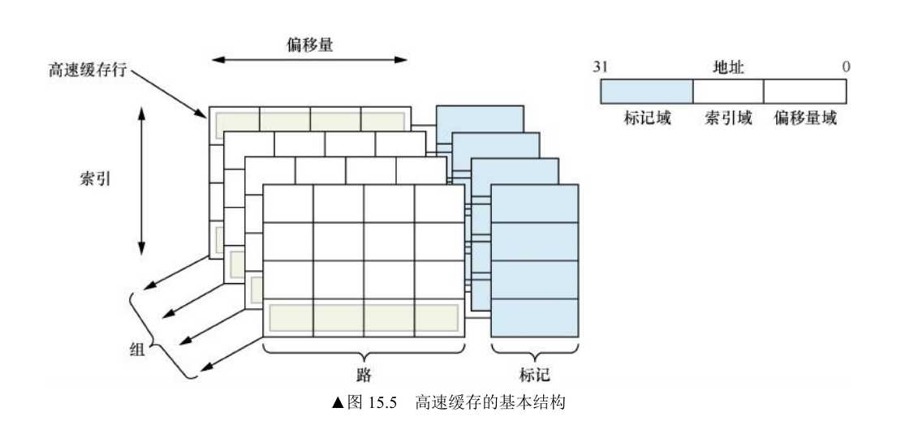
*   **映射方式** :
    *   **直接映射 (Direct Mapping)** :容易发生冲突（颠簸）。
    *   **全相连映射 (Fully Associative)** :硬件成本太高。
    *   **组相连映射 (Set Associative)** :现代处理器的主流选择（如 4路或8路组相连），平衡了成本与冲突率。

### 3. 虚拟 vs 物理 Cache (VIPT/PIPT) —— *难点*
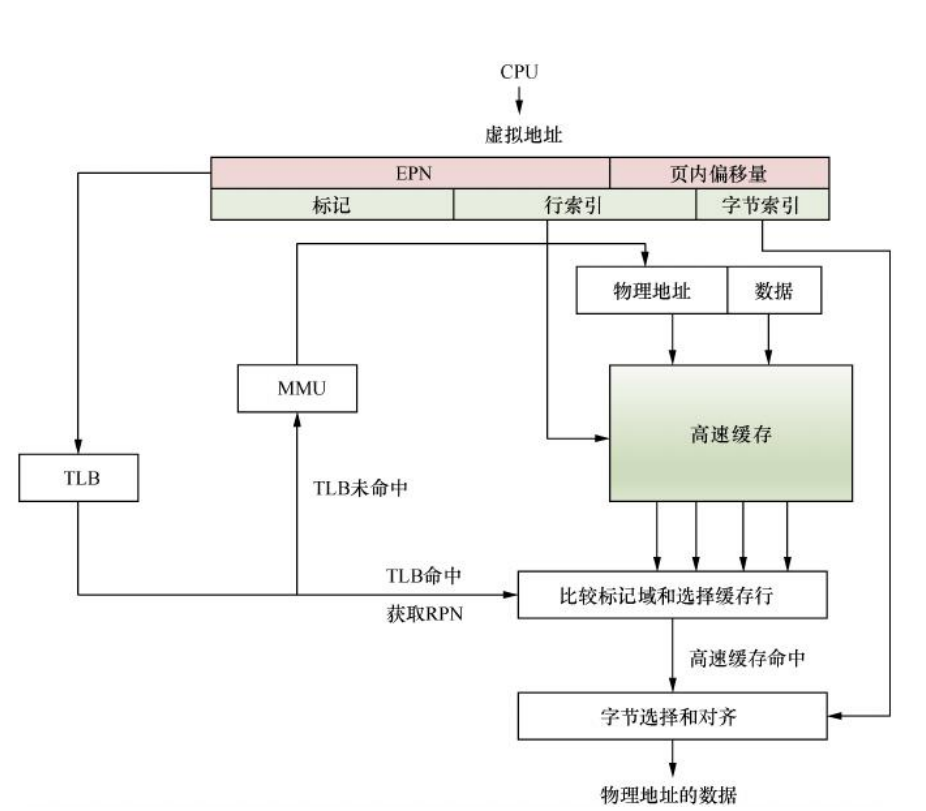
这部分解释了 Cache 是使用虚拟地址（VA）还是物理地址（PA）来查找数据，这直接关系到**软件是否需要手动管理 Cache** 。
*   **VIVT** (Virtual Index Virtual Tag)：早期的 ARM 处理器使用，速度快但有严重的**重名（Aliasing）**和**同名（Homonyms）**问题，进程切换时必须清空 Cache，效率低。
*   **PIPT** (Physical Index Physical Tag)：**ARM64 数据 Cache (D-Cache) 的标准实现** 。硬件完全负责地址转换，软件无须担心别名问题，但查找速度受限于 TLB 查找。
*   **VIPT** (Virtual Index Physical Tag)：**ARM64 指令 Cache (I-Cache) 的常见实现** 。利用虚拟地址的 Index 并行查找，利用物理地址的 Tag 进行比对。
    *   **重名问题 (Aliasing)** :多个虚拟地址映射到同一个物理地址。书中指出，如果 Cache 的 Way Size 小于页大小（Page Size），VIPT 不会有重名问题；否则需要硬件或软件处理。

### 4. Cache 策略 (Policies)
*   **写策略** :
    *   **回写 (Write-Back)** :数据先写到 Cache，标记为 Dirty，只有被替换时才写回内存。**这是现代高性能 CPU 的默认模式** 。
    *   **直写 (Write-Through)** :数据同时写到 Cache 和内存。
*   **分配策略** :
    *   **写分配 (Write-Allocate)** :写未命中时，先从内存加载到 Cache，再修改。通常配合回写模式使用。

### 5. 共享属性与一致性视角 (PoU vs PoC) —— *ARM64 特有概念*
这是理解后续 Cache 维护指令的关键：
*   **PoU (Point of Unification, 统一点)** :**指令 Cache 和数据 Cache** 看到同一份数据的点。
    *   *场景*：**自修改代码 (Self-modifying code)** 。当你修改了代码段的数据后，需要清理 D-Cache 并失效 I-Cache 到 PoU，确保 CPU 取指时拿到最新指令。
*   **PoC (Point of Coherency, 一致点)** :**所有总线主控设备（如 CPU, DMA, GPU）** 看到同一份数据的点，通常是主内存。
    *   *场景*：**DMA 传输** 。在 DMA 读取内存前，CPU 需要将 Cache 中的脏数据刷回内存（Clean to PoC）。

### 6. Cache 维护指令
ARM64 提供了专用的指令来手动干预 Cache 状态：
*   **指令分类** :
    *   **`IC`** (Instruction Cache)：通常用于失效（Invalidate）。
    *   **`DC`** (Data Cache)：用于清理（Clean/Write-back）或失效（Invalidate）。
*   **操作动作** :
    *   **Invalidate (I)** :丢弃数据（用于 DMA 写内存后，CPU 读取前）。
    *   **Clean (C)** :将脏数据写回内存（用于 CPU 写数据后，DMA 读取前）。
    *   **Clean & Invalidate (CI)** :写回并丢弃。
*   **指令格式** :`DC &lt;操作&gt;&lt;范围&gt;, &lt;地址&gt;`，例如 `DC CVAC` (Clean by VA to PoC)。

### 7. 实验环节
*   **枚举 Cache** :读取 `CLIDR_EL1` 和 `CCSIDR_EL1` 寄存器，打印出当前 CPU 的 Cache 层级、Line 大小和组相连路数。
*   **Cache 清理** :编写汇编函数 `flush_cache_range`，通过循环执行 `DC` 指令来清理一段内存区域。

### 总结一句话
**第15章解剖了 CPU 的“短期记忆”——Cache，详细阐述了它在物理/虚拟地址上的映射难题，并重点区分了 PoU（核内一致性）和 PoC（系统一致性）这两个关键概念，为编写 DMA 驱动和自修改代码打下基础。**
## 第16章：缓存一致性
在多核时代，如果不能理解缓存一致性，写出的并发程序可能会出现莫名其妙的数据错误，或者性能极差。这一章主要探讨了硬件如何通过协议自动维护一致性，以及软件在什么情况下需要手动干预。

### 1. 为什么需要缓存一致性？
*   **问题根源** :在多核系统中，每个 CPU 核心都有自己私有的 L1 Cache。如果 Core A 修改了变量 `X`（存放在 Core A 的 Cache 中，标记为 Dirty），而 Core B 也读取了 `X`（可能是旧的内存值，也可能是 Core B Cache 中的旧副本），就会导致数据不一致。
*   **目标** :确保系统中所有观察者（CPU、GPU、DMA）看到的数据视图是一致的。

### 2. 硬件协议：MESI 与 MOESI —— *核心理论*
这是硬件自动维护一致性的基础。书中详细讲解了 Cache Line 的状态机转换：
*   **MESI 协议** :
    *   **M (Modified)** :已修改。数据是脏的（Dirty），只存在于当前 Cache，与内存不一致。
    *   **E (Exclusive)** :独占。数据是干净的（Clean），与内存一致，且只存在于当前 Cache。
    *   **S (Shared)** :共享。数据是干净的，可能存在于多个 CPU 的 Cache 中。
    *   **I (Invalid)** :无效。
*   **MOESI 协议**（优化版）：
    *   引入了 **O (Owned)** 状态。允许在多个 CPU 共享脏数据（Shared Dirty），而无需先把数据写回主内存。这大大减少了写回内存的带宽消耗，提高了性能。

### 3. 硬件实现：SCU 与 CCI
*   **SCU (Snoop Control Unit)** :位于 CPU 簇（Cluster）内部，负责协调簇内不同核心之间（如 Cortex-A72 的 4 个核）的 L1 Cache 一致性。
*   **CCI/CCN (Cache Coherent Interconnect/Network)** :位于总线上（如 CCI-400/500），负责协调不同簇之间（如大小核架构）甚至 CPU 与 GPU 之间的一致性。
*   **ACE 协议** :介绍 AMBA 总线中用于实现硬件一致性的扩展协议。

### 4. 软件陷阱 1：伪共享 (False Sharing) —— *性能杀手*
这是多核编程中极其常见但难以发现的性能问题。
*   **现象** :两个无关的变量（如变量 A 和变量 B）恰好位于**同一个 Cache Line**（通常是 64 字节）中。
*   **后果** :Core 0 修改变量 A，Core 1 修改变量 B。虽然逻辑上互不干扰，但物理上它们在争夺同一个 Cache Line 的所有权（MESI 状态在 M 和 I 之间反复横跳），导致严重的**颠簸 (Thrashing)**，性能急剧下降。
*   **解决** :使用**字节填充 (Padding)** 或 **对齐 (Alignment)** 技术，确保频繁修改的竞争变量位于不同的 Cache Line 中。

### 5. 软件陷阱 2：DMA 一致性
*   **问题** :DMA 直接访问主内存（DDR），不经过 CPU 的 Cache。
    *   **CPU -> DMA** :CPU 写了数据在 Cache（Dirty），DMA 搬运内存时搬的是旧数据。-> **解决：Clean Cache** 。
    *   **DMA -> CPU** :DMA 搬运新数据到内存，CPU 读的时候命中了 Cache 中的旧数据。-> **解决：Invalidate Cache** 。
*   **硬件一致性** :书中也提到了如果 DMA 设备连接到了 CCI 总线（支持 ACE-Lite），硬件可以自动处理一致性，无需软件维护。

### 6. 软件陷阱 3：自修改代码 (Self-Modifying Code)
*   **问题** :指令 Cache (I-Cache) 和 数据 Cache (D-Cache) 通常是不一致的。当你修改了代码（作为数据写入 D-Cache）后，I-Cache 里可能还是旧指令。
*   **解决** :必须执行标准的维护序列：Clean D-Cache -> Invalidate I-Cache -> ISB (屏障)。

### 总结一句话
**第16章揭示了多核协作的幕后机制：硬件通过 MESI 协议自动搞定了大部分一致性问题，但软件工程师必须警惕“伪共享”导致的性能崩塌，以及在 DMA 和自修改代码场景下手动维护一致性。**
## 第17章：TLB 管理
**TLB（Translation Lookaside Buffer，旁路转换缓冲）**（存储在CPU内部）。

如果说第14章（内存管理）讲的是“如何建立映射”，那么这一章讲的就是**“如何高效地使用和维护映射”** 。对于内核开发者来说，理解 TLB 的刷新（Invalidation）机制和 ASID 是实现高效进程切换和避免“玄学”Bug 的关键。
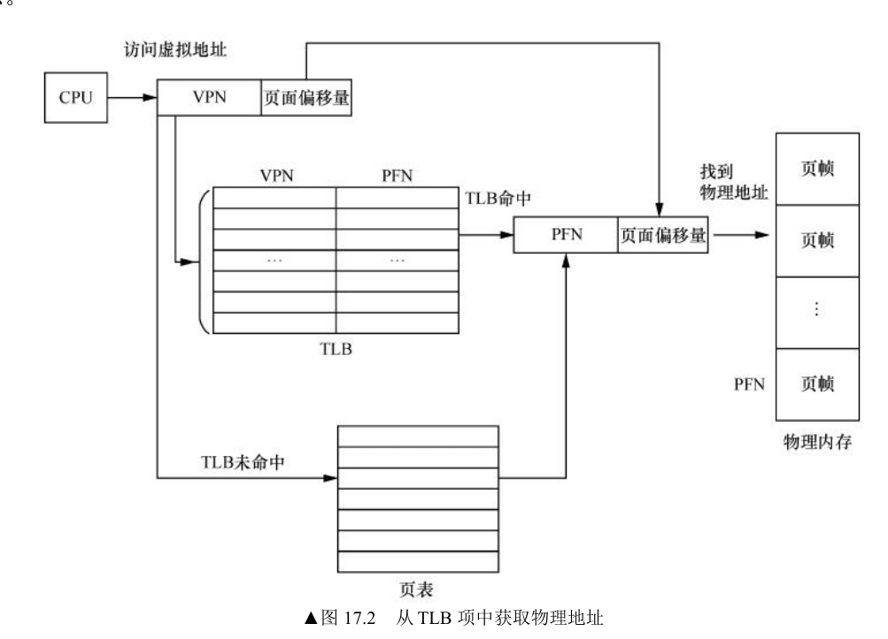
### 1. TLB 基础知识
*   **什么是 TLB** :它是 MMU 内部的一个专用 **高速缓存（Cache）**，用于存储“虚拟地址（VA）到物理地址（PA）”的翻译结果。
*   **为什么需要 TLB** :查询内存中的多级页表（Table Walk）非常耗时（4级页表需要访问4次内存），TLB 命中可以直接返回物理地址，极大提升性能。
*   **结构** :类似于数据 Cache，TLB 也是组相连结构，分 L1 TLB（指令/数据分离）和 L2 TLB（统一）。

### 2. TLB 的“同名”问题 (Homonyms)
这是多进程操作系统必须解决的核心问题：
*   **问题描述** :进程 A 和进程 B 可能都有虚拟地址 `0x1000`，但它们映射到不同的物理地址。切换进程时，如果不清理 TLB，进程 B 可能会错误地命中进程 A 留下的 `0x1000` 映射。
*   **笨办法** :每次进程切换（Context Switch）都 **冲刷（Flush/Invalidate）** 整个 TLB。缺点是性能开销极大（冷启动效应）。
*   **解决方案** :引入 **ASID (Address Space ID)** 。

### 3. ASID (Address Space ID) —— *性能优化的关键*
*   **原理** :在 TLB 表项（Entry）中增加一个 tag，记录该条映射属于哪个 ASID（通常对应进程 ID）。
*   **硬件支持** :`TTBRx_EL1` 寄存器的高位存储当前运行进程的 ASID。
*   **效果** :CPU 在查找 TLB 时，不仅对比 VA，还对比 ASID。**进程切换时无需刷新 TLB**，不同进程的相同 VA 可以共存在 TLB 中互不干扰。
*   **VMID** :虚拟化场景下，还有一个 VMID（虚拟机 ID），用于区分不同虚拟机。

### 4. TLB 管理指令 (TLBI)
软件不能直接读写 TLB，只能通过指令让其 **失效 (Invalidate)** 。
*   **指令格式** :`TLBI &lt;操作类型&gt;&lt;范围&gt;`。
*   **操作类型** :
    *   **VMALL** :所有条目失效。
    *   **ASID** :指定 ASID 的条目失效。
    *   **VA** :指定虚拟地址的条目失效。
*   **广播机制 (Broadcasting)** :在多核系统中，`TLBI` 指令通常带有 `IS` (Inner Shareable) 后缀（如 `TLBI VMALLE1IS`）。**这会通过硬件总线广播到其他 CPU 核**，让它们也同步清理 TLB。软件不需要手动发 IPI（核间中断）去通知。
*   **同步屏障** :执行 `TLBI` 后，必须跟一条 **`DSB`** 指令，确保所有核都完成了刷新，再执行后续指令。

### 5. 软件维护原则：BBM 机制 (Break-Before-Make)
这是修改页表项（PTE）时的标准规范，违反它可能导致 CPU 发生不可预知的行为（如多重命中）：
1.  **Break** :将页表项设置为无效（Invalid）。
2.  **Invalidate** :执行 `TLBI` 刷新对应 TLB，并执行 `DSB` 等待完成。
3.  **Make** :写入新的页表项。
4.  **Sync** :执行 `DSB` 和 `ISB`。

### 6. Linux 内核案例分析
*   **ASID 管理** :Linux 内核如何使用位图（Bitmap）分配 8位或16位的 ASID，以及当 ASID 耗尽（Rollover）时如何处理（必须全刷 TLB）。
*   **KPTI (内核页表隔离)** :为了防御熔断漏洞（Meltdown），内核和用户态使用不同的页表，这导致 TLB 管理变得更加复杂（需要分别为用户态和内核态分配不同的 ASID，通常是 PCID 机制）。

### 总结一句话
**第17章教会了你如何维护内存映射的一致性：通过 ASID 技术避免了进程切换时的 TLB 频繁刷新，同时严格遵守 BBM（先破后立）规则和使用 TLBI 广播指令，确保在多核环境下修改页表是安全的。**
## 第18章：内存屏障指令

ARM64 采用的是 **弱一致性内存模型 (Weakly Ordered Memory Model)**，这意味着为了性能，CPU 和编译器会疯狂地对读写指令进行**重排 (Reordering)** 。这一章详细解释了这种“乱序”的硬件根源，并给出了驯服它们的工具——内存屏障。

### 1. 为什么会有内存乱序？
*   **编译器优化** :编译器为了提高效率，可能改变代码的执行顺序。
*   **硬件优化（核心原因）** :
    *   **存储缓冲区 (Store Buffer)** :CPU 写数据时，先写入私有的 Store Buffer 就继续执行下一条指令了，导致写入操作对其他核“不可见”会有延迟。
    *   **无效队列 (Invalidate Queue)** :处理 Cache 一致性消息（如使其他核的 Cache 失效）需要时间，CPU 会先把消息放入队列就回复“已完成”，导致实际的 Cache 失效操作滞后。
    *   **乱序执行** :现代超标量 CPU 会动态调度指令顺序。

### 2. ARM64 的三大内存屏障指令
这是本章的核心工具箱：

#### A. DMB (Data Memory Barrier) —— *“排队指令”*
*   **作用** :**只保证访存指令的顺序** 。
*   **行为** :DMB 之前的内存访问指令，一定比 DMB 之后的内存访问指令先被观察到。
*   **特点** :**不阻塞 CPU**，CPU 可以继续执行算术等非访存指令。
*   **场景** :多核之间通过共享内存传递消息（例如：先写 Payload，再写 Flag）。

#### B. DSB (Data Synchronization Barrier) —— *“等待指令”*
*   **作用** :**同步指令** 。比 DMB 更严格。
*   **行为** :CPU 会**暂停执行**（Stall），直到：
    1.  DSB 之前的所有显式内存访问都执行完毕。
    2.  DSB 之前的 Cache、TLB、分支预测维护指令都执行完毕。
*   **场景** :
    *   DMA 操作：写完内存数据后，必须用 DSB 确保数据真正落盘，再去写 DMA 控制寄存器启动传输。
    *   中断处理：在修改中断屏蔽位后，用 DSB 确保修改生效。

#### C. ISB (Instruction Synchronization Barrier) —— *“刷新指令”*
*   **作用** :**冲刷流水线 (Flush Pipeline)** 。
*   **行为** :废弃流水线中已经预取的指令，重新从指令 Cache 或内存中读取。
*   **场景** :**上下文更改 (Context Changing)** 。例如修改了页表基址寄存器（TTBR）、开启了 MMU、修改了系统控制寄存器后，必须立即执行 ISB，确保后续指令使用新的配置执行。

### 3. 单向屏障：加载-获取 / 存储-释放
ARMv8 引入了更高效的轻量级屏障机制，用于替代全功能的 DMB，常用于实现锁。
*   **Load-Acquire (LDAR)** :**“只许进，不许出”** 。该指令**后面**的读写操作，不能重排到该指令**前面** 。用于**加锁**（Lock）。
*   **Store-Release (STLR)** :**“只许出，不许进”** 。该指令**前面**的读写操作，不能重排到该指令**后面** 。用于**解锁**（Unlock）。
*   **优势** :相比 DMB，它们允许部分方向的乱序，性能更高。

### 4. 屏障的作用域 (Shareability Domain)
屏障指令可以带参数，指定生效范围：
*   **ISH (Inner Shareable)** :**最常用** 。影响同一个 SMP 系统中的所有 CPU 核（通常是跑 Linux 的那些核）。
*   **OSH (Outer Shareable)** :影响到外部设备（如 DMA、GPU）。
*   **SY (Full System)** :全系统范围。

### 5. 经典案例分析
本章通过多个经典并发场景演示了屏障的用法：
*   **自旋锁 (Spinlock)** :利用 `LDAXR` (Load-Acquire Exclusive) 和 `STLR` (Store-Release) 实现高效自旋锁，配合 `WFE` (Wait For Event) 指令降低功耗。
*   **消息传递 (Message Passing)** :
    *   发送者：`写数据 -> DMB ISHST (写屏障) -> 写Flag`。
    *   接收者：`读Flag -> DMB ISHLD (读屏障) -> 读数据`。
*   **DMA 一致性** :
    *   CPU 准备数据 -> `DC Clean` (刷Cache) -> **`DSB`** (确保刷完) -> 启动 DMA。
*   **自修改代码** :
    *   写指令数据 -> `DC Clean` -> **`DSB`** -> `IC Invalidate` -> **`DSB`** -> **`ISB`** (确保取指正确)。

### 总结一句话
**第18章是并发编程的“交通法规”：它揭示了硬件乱序执行的真相，并教你如何使用 DMB（保顺序）、DSB（保完成）和 ISB（保上下文）来强制 CPU 按照程序员的意图执行关键代码。**
## 第19章：合理使用内存屏障指令
**第19章“合理使用内存屏障指令”** 是第18章的进阶篇。如果说第18章介绍了“有什么工具（DMB/DSB/ISB）”，那么第19章则是从**微架构原理**和**Linux内核实战**的角度，深度解析“为什么要用”以及“怎么用才对”。这一章的核心价值在于它揭开了**内存乱序的物理根源**（不仅仅是“CPU乱序执行”这么简单），并分析了 Linux 内核中复杂的同步原语实现。

### 1. 内存乱序的微架构根源
除了编译器优化和CPU流水线乱序，本章重点介绍了两个导致多核一致性问题的硬件组件：
*   **存储缓冲区 (Store Buffer)** :
    *   **现象** :CPU 执行写指令时，为了不等待慢速的 Cache/内存，会将数据先写入私有的 Store Buffer，然后立即执行下一条指令。
    *   **后果** :导致 **“写操作延后生效”** 。对于其他核来说，虽然本核代码写了数据，但它们还看不见。
    *   **对策** :**写内存屏障 (Write Memory Barrier, `smp_wmb`)** 。它强制 CPU 在执行后续写操作前，必须先把 Store Buffer 里的数据刷入 Cache。
*   **无效队列 (Invalidate Queue)** :
    *   **现象** :当 CPU 收到“使 Cache 失效”的消息（MESI 协议）时，为了快速响应，它会立即回复“已完成”，但实际上只是把消息放入了无效队列，稍后处理。
    *   **后果** :导致 **“读操作读到旧数据”** 。CPU 读取数据时，Cache 本该失效但还没来得及处理，导致 CPU 读到了旧值。
    *   **对策** :**读内存屏障 (Read Memory Barrier, `smp_rmb`)** 。它强制 CPU 在读取数据前，必须处理完无效队列中的所有消息。

### 2. ARM64 内存屏障指令的细分
本章详细解释了 ARM64 指令与 Linux 内核通用屏障 API 的对应关系：
*   **`smp_mb()`** (全屏障) $\rightarrow$ `DMB ISH` (Inner Shareable, 读写都保序)。
*   **`smp_rmb()`** (读屏障) $\rightarrow$ `DMB ISHLD` (Load-Load, 只保序读)。
*   **`smp_wmb()`** (写屏障) $\rightarrow$ `DMB ISHST` (Store-Store, 只保序写)。
*   *关键点*：在 SMP（多核共享内存）场景下，通常只需要使用 **`DMB`** 指令，不需要使用开销更大的 `DSB`。

### 3. 经典案例：Linux 内核中的屏障应用
这一部分非常硬核，通过剖析 Linux 内核源码，展示了屏障在复杂场景下的应用：

#### A. 唤醒机制 (`try_to_wake_up`)
这是 Linux 调度器中最复杂的并发场景之一。
*   **场景** :CPU A 唤醒正在 CPU B 上睡眠的进程。
*   **问题** :CPU A 修改进程状态（Condition）和 CPU B 检查进程状态之间存在竞争。如果不加屏障，CPU B 可能在 CPU A 修改状态前就读取了旧状态，导致无限睡眠（死锁）。
*   **解决** :
    *   **写端**（唤醒者）：`写数据 -> smp_wmb() -> 写状态`。
    *   **读端**（睡眠者）：`读状态 -> smp_rmb() -> 读数据`。
    *   利用成对的 `rmb/wmb` 保证顺序，这就是经典的 **“Store-Release / Load-Acquire”** 模式的变体。

#### B. 自旋锁中的屏障 (`smp_mb__after_spinlock`)
*   **问题** :虽然 `LOCK` 操作（如 `LDAXR`）本身隐含了 Acquire 语义（后面的指令不能排到前面），但它**不保证前面的指令不能排到后面** 。在某些极端情况下（如 `STORE -> LOCK`），前面的写操作可能会“掉进”临界区内，虽然不破坏锁的互斥性，但可能破坏特定的逻辑依赖。
*   **解决** :Linux 内核定义了 `smp_mb__after_spinlock()`，在 ARM64 上它通常被优化为空（因为 ARM64 的 `LDAXR` 已经足够强），或者是简单的 `DMB`，用于确保严格的时序要求。

### 4. 读写屏障的成对使用原则
本章反复强调了一个黄金法则：**内存屏障必须成对使用** 。
*   如果 CPU A 使用了 **写屏障** 来保证写入顺序（A 先于 B）。
*   那么 CPU B 必须使用 **读屏障** 来保证读取顺序（读到 B 后，再去读 A）。
*   单方面使用屏障通常是无效的。

### 总结一句话
**第19章透视了“Store Buffer”和“Invalidate Queue”这两个导致乱序的硬件元凶，并结合 Linux 内核调度器和锁的源码，手把手教你如何用 DMB 指令构建正确的“读写屏障对”，是进阶内核并发编程的必修课。**
## 第20章：原子操作
**“原子操作”** 深入探讨了在多核（SMP）环境下如何保证数据修改的完整性和安全性。这是实现操作系统同步原语（如自旋锁、信号量、互斥量）以及无锁编程（Lock-free programming）的基石。这一章从传统的 **LL/SC（连接加载/条件存储）** 机制讲起，一直涵盖到 ARMv8.1 引入的高效 **LSE（大系统扩展）** 原子指令。

### 1. 原子操作的基本概念
*   **什么是原子操作** :指一系列操作（如“读-改-写”）在执行过程中不可被中断。要么全部执行成功，要么全都不执行，中间状态对其他观察者不可见。
*   **为什么需要** :在多核系统中，简单的 `i++` 包含读、改、写三个步骤。如果两个核同时执行，会发生竞态条件（Race Condition），导致数据出错。

### 2. 独占访问指令 (LDXR/STXR) —— *ARMv8.0 标准实现*
这是 ARM64 实现原子操作的基础机制，基于 **LL/SC (Load-Link / Store-Conditional)** 模型。
*   **`LDXR` (Load Exclusive Register)** :从内存读取数据，并**在硬件的独占监视器中标记该地址为“独占”** 。
*   **`STXR` (Store Exclusive Register)** :尝试写入数据。
    *   写入时会检查监视器的状态。
    *   如果期间没有其他核修改过该地址（监视器状态仍为独占），则写入成功，返回状态 0。
    *   如果期间有其他核修改了该地址（监视器状态被清除），则写入失败，返回状态 1。
*   **软件流程** :软件必须在一个循环中检测 `STXR` 的返回值，如果失败则重新执行 `LDXR`，直到成功为止。

### 3. 硬件核心：独占监视器 (Exclusive Monitor)
本章揭示了 `LDXR/STXR` 背后的硬件魔法。
*   **本地监视器 (Local Monitor)** :处理不共享内存的原子操作。
*   **全局监视器 (Global Monitor)** :处理多核间共享内存的原子操作。
*   **工作状态** :分为 **开放状态 (Open Access)** 和 **独占状态 (Exclusive Access)** 。任何对被监视地址的普通写操作（如 `STR`）都会将监视器复位为开放状态，导致后续的 `STXR` 失败。
*   **粒度 (Granule)** :独占监视器通常以 **ERG (Exclusive Reservation Granule)** 为单位工作（通常是一个 Cache Line 大小）。这意味着锁住一个字节，其实是锁住了这一整行数据。

### 4. LSE 原子指令 (Large System Extensions) —— *ARMv8.1 新特性*
随着服务器核心数的增加，`LDXR/STXR` 的重试循环机制会导致严重的性能问题（活锁、总线争用）。ARMv8.1 引入了 LSE 指令集进行优化。
*   **原理** :将原子操作（如加法、位运算）发给远端的 **缓存控制器 (L3 Cache/互连总线)** 执行，而不是把数据读回 CPU 核。这被称为 **远端原子操作 (Far Atomic)** 。
*   **常用指令** :
    *   **`LDADD`** :原子加法。
    *   **`CAS` (Compare and Swap)** :比较并交换。
    *   **`SWP`** :交换。
*   **优势** :在竞争激烈的场景下（如大锁竞争），LSE 比 LDXR/STXR 性能高出数倍，且没有重试循环。

### 5. 比较并交换 (CAS)
CAS 是无锁编程（Lock-free）中最核心的原语（`cmpxchg`）。
*   **逻辑** :`if (*ptr == old) { *ptr = new; return true; } else { return false; }`。
*   **实现** :本章展示了如何用旧的 `LDXR/STXR` 模拟 CAS，以及如何直接使用新的 LSE `CAS` 指令。

### 6. 自旋锁的优化 (WFE/SEV)
在等待锁时，如果 CPU 一直空转（Spinning），会白白消耗电力和总线带宽。
*   **WFE (Wait For Event)** :让 CPU 进入低功耗睡眠状态。
*   **SEV (Send Event)** :唤醒睡眠的 CPU。
*   **硬件联动** :在 ARM64 中，执行 `STLR` (Store-Release) 释放锁时，会自动触发一个事件，唤醒因 `WFE` 睡眠的核。因此，标准的自旋锁实现通常是：**“获取失败 -> WFE -> 被唤醒 -> 重试”** 。

### 总结一句话
**第20章深入剖析了并发同步的底层实现：从基础的 `LDXR/STXR` 独占访问机制，到进阶的 `LSE` 远端原子指令，再到利用 `WFE` 优化自旋锁功耗，为你构建高性能并发系统提供了完整的硬件原语支持。**
## 第21章：操作系统相关话题

在前几章分别搞定了启动、内存、中断、锁之后，这一章将它们串联起来，重点讲解了如何在 BenOS（书中的教学操作系统）中实现**进程管理**和**系统调用** 。这是理解 Linux 内核核心原理的“微缩版”教程。

### 1. C 语言编程陷阱 (C Pitfalls)
在编写内核级代码时，C 语言的某些特性可能导致严重的移植性问题，本章首先扫清了这些障碍：
*   **数据模型 (Data Model)** :
    *   **LP64** :Linux/Unix 使用的模型。`int` 是 32 位，`long` 和 `pointer` 是 64 位。
    *   **ILP32** :32 位系统模型。
    *   *陷阱*：在移植代码时，不要假设指针是 4 字节，也不要混用 `int` 和 `long` 存储地址。
*   **整型提升 (Integer Promotion)** :C 语言在表达式运算时，会自动将 `char` 或 `short` 提升为 `int`。在位操作（如取反 `~`）时，这会导致高位出现意外的 1 或 0，引发 Bug。

### 2. 函数栈布局 (Stack Layout)
深入分析了 ARM64 下的 **AAPCS64** 调用标准在栈帧上的具体体现，这是调试内核崩溃（Kernel Panic）和实现 `backtrace`（栈回溯）的基础：
*   **栈帧结构** :
    *   **Frame Pointer (FP/X29)** :指向栈上保存的上一个函数的 FP。
    *   **Link Register (LR/X30)** :保存当前函数的返回地址。
    *   这两个寄存器通常成对保存在栈顶，形成一个单向链表，调试器正是利用这个链表层层回溯调用栈的。

### 3. 进程控制块 (PCB)
操作系统如何管理进程？核心是 **`task_struct`** 结构体。
*   **结构体设计** :定义了包含 `state`（状态）、`counter`（时间片）、`priority`（优先级）、`pid`、`cpu_context`（硬件上下文）等关键成员的结构体。
*   **内核栈与 PCB 的关系** :通常将 `task_struct` 放在内核栈（Kernel Stack）的**底部**（低地址处），这样通过栈指针（SP）做对齐运算就能快速找到当前进程的 PCB（类似于 Linux 的 `current` 宏）。

### 4. 进程创建 (Process Creation)
*   **0号进程 (Idle Task)** :系统启动时的第一个进程，通常是静态定义的，负责在系统空闲时运行（执行 `wfi` 省电）。
*   **`do_fork` 实现** :
    *   分配新的内核栈和 PCB。
    *   复制父进程信息。
    *   **设置上下文** :关键是将新进程的 `LR` 指向 **`ret_from_fork`** 汇编函数，这样新进程被调度时，就会“伪装”成从 fork 函数返回一样开始执行。

### 5. 进程上下文切换 (Context Switch) —— *核心难点*
这是操作系统最迷人的部分：如何让 CPU 停下一个任务，去执行另一个任务？
*   **`switch_to` 函数** :
    *   **保存 (Save)** :将当前进程（Prev）的 **Callee-saved 寄存器**（X19-X28, FP, SP, LR）保存到它的 `cpu_context` 结构中。
    *   **恢复 (Restore)** :从下一个进程（Next）的 `cpu_context` 中加载这些寄存器。
    *   **切换瞬间** :当 `ret` 指令执行时，CPU 加载了 Next 进程的 LR，也就跳转到了 Next 进程的代码流中，至此切换完成。

### 6. 简易调度器 (Scheduler)
*   **调度策略** :实现了一个基于优先级的简单时间片轮转调度算法（类似于 Linux 0.11）。
*   **调度时机** :
    *   **自愿调度** :进程主动调用 `schedule()`（如等待资源）。
    *   **抢占调度** :定时器中断触发，在中断返回前检查时间片是否耗尽，如果耗尽则强行调用 `schedule()`。

### 7. 系统调用 (System Call)
用户态程序如何请求内核服务？
*   **SVC 指令** :用户态执行 `SVC #0`，触发同步异常，陷入内核态 (EL1)。
*   **异常处理** :内核的异常向量表捕获 SVC 异常，跳转到 `el0_sync`。
*   **分发** :根据 **X8 寄存器** 中的系统调用号（Syscall Number），查表（`sys_call_table`），跳转到具体的内核函数（如 `sys_malloc`, `sys_fork`）。
*   **参数传递** :用户态通过 X0-X7 传递参数，内核处理完后将结果放入 X0 返回。

### 总结一句话
**第21章是本书理论落地的“终极实战”：它手把手教你编写了一个微型操作系统的核心骨架——从定义 PCB、创建进程、实现上下文切换，到构建调度器和系统调用接口，彻底揭示了 OS 内核是如何“跑”起来的。**
## 第22章：浮点运算与 NEON 指令

这一章不再局限于通用的整数运算，而是介绍了 ARM64 强大的 **SIMD（单指令多数据流）** 扩展——**NEON** 。这是图像处理、视频编解码、信号处理以及深度学习推理等场景的核心加速技术。

### 1. 硬件基础：寄存器与数据模型
*   **寄存器文件** :ARM64 引入了一组全新的 **32 个 128位** 寄存器，命名为 `V0` ~ `V31`。
    *   **复用机制** :这组寄存器是浮点运算（FP）和 NEON 共享的。
    *   **别名访问** :可以通过不同的名字访问不同长度的部分。例如 `Qn` (128位), `Dn` (64位), `Sn` (32位), `Hn` (16位), `Bn` (8位)。
*   **SIMD 概念** :一条指令同时处理多个数据。例如，一个 128 位的寄存器可以被看作是：
    *   `Vn.16B`：16 个 8 位整数。
    *   `Vn.4S`：4 个 32 位整数（或浮点数）。
    *   `Vn.2D`：2 个 64 位双精度浮点数。
*   **通道 (Lane)** :矢量寄存器被切分成的每一个小数据单元称为一个通道。

### 2. 浮点运算 (Floating Point)
*   **IEEE 754** :介绍了浮点数在计算机中的存储格式（符号位+阶码+尾数）。
*   **FP指令** :
    *   基础运算：`FADD`, `FSUB`, `FMUL`, `FDIV`。
    *   **FMLA (Fused Multiply-Add)** :融合乘加指令（$a = a + b \times c$），只进行一次舍入，精度更高，速度更快。
    *   **FPCR/FPSR** :浮点控制寄存器（控制舍入模式等）和状态寄存器（记录溢出等标志）。

### 3. NEON 加载与存储指令 —— *数据搬运的艺术*
这是 NEON 编程中最具技巧性的部分，特别是**结构化加载/存储 (Structured Load/Store)** :
*   **`LD1` / `ST1`** :普通的连续加载/存储。
*   **`LD2`, `LD3`, `LD4` (Interleaving Load)** :**自动解交错加载** 。
    *   *场景*：图像通常以 RGBRGB... 格式存储。
    *   *功能*：使用 `LD3` 可以一次性将内存中的 RGB 数据拆分，把所有的 R 放入寄存器 `V0`，G 放入 `V1`，B 放入 `V2`。这省去了手动拆分通道的巨大开销。
*   **后变基寻址** :NEON 的加载指令通常支持后变基（例如 `[x0], #48`），加载完自动更新指针，极其适合循环处理数组。

### 4. NEON 数据处理指令
*   **算术运算** :支持整数和浮点数的矢量加减乘除。
*   **数据重排 (Permutation)** :在寄存器内部调整数据顺序，无需访问内存。
    *   **`MOV`** :矢量传送。
    *   **`REV`** :反转字节序。
    *   **`TRN` (Transpose)** :矩阵转置（行列交换）。
    *   **`ZIP` / `UZP`** :压缩与解压缩（数据交织与分离）。
    *   **`TBL` (Table Lookup)** :查表指令，用于极其灵活的乱序重排。

### 5. 实战案例 1：RGB24 转 BGR24
这是一个经典的图像处理案例：
*   **C语言做法** :通过指针运算逐字节读写，甚至需要位移操作。
*   **NEON做法** :
    1.  **`LD3`** :将 RGB 数据加载并分离到三个寄存器（R队列, G队列, B队列）。
    2.  **`MOV`** :直接交换 R 和 B 寄存器的内容。
    3.  **`ST3`** :将寄存器内容写回内存（自动交织为 BGRBGR...）。
*   **结果** :汇编代码极其简洁，且性能相比纯 C 语言提升巨大。

### 6. 实战案例 2：4x4 矩阵乘法
这是 3D 图形学和 AI 推理的基础：
*   **技巧** :利用 **FMLA 的“标量广播”模式** 。即用一个矢量寄存器（一行数据）乘以另一个寄存器中的某一个**标量**（通道），然后累加。
*   **NEON 内建函数 (Intrinsics)** :本章还展示了如何使用 C 语言层面的 NEON Intrinsics（如 `vld1q_f32`, `vfmaq_laneq_f32`）来编写代码，既保留了 C 的可读性，又获得了 SIMD 的性能，且由编译器负责寄存器分配。

### 总结一句话
**第22章为你打开了并行计算的大门：通过学习 NEON 寄存器布局和结构化加载指令（如 `LD3`），你可以像做“流水线工厂”一样批量处理数据，极大地加速图像和数学运算任务。**
## 第23章：

**第23章“可伸缩矢量计算与优化”** 介绍了 ARM64 在高性能计算（HPC）和 AI 领域的大杀器——**SVE (Scalable Vector Extension，可伸缩矢量扩展)** 。

如果说第22章的 NEON 是固定长度（128位）的“冷兵器”，那么 SVE 就是长度可变、智能感知的“现代火器”。这一章不仅介绍了新指令，更引入了一种全新的编程思维——**VLA (Vector Length Agnostic，矢量长度无关)** 编程。

### 1. SVE 的核心理念：VLA 编程
*   **NEON 的局限** :NEON 寄存器固定为 128 位。如果硬件升级到 256 位或 512 位，软件必须重新编译甚至重写代码。
*   **SVE 的突破** :
    *   **可变长度** :SVE 硬件的矢量长度可以是 128 到 2048 位（128的倍数）。
    *   **VLA 模型** :程序员编写代码时**不需要知道**硬件具体的矢量长度。一套汇编代码可以在支持 128 位 SVE 的手机芯片上运行，也可以在支持 512 位 SVE 的超级计算机（如富岳 Fugaku）上运行，自动享受硬件升级带来的性能红利。

### 2. SVE 寄存器架构
*   **`Zn` (Z0-Z31)** :**数据寄存器** 。长度可变，低 128 位与 NEON 的 `Vn` 寄存器共享。
*   **`Pn` (P0-P15)** :**断言寄存器 (Predicate Register)** 。这是 SVE 的灵魂。
    *   **作用** :作为“掩码”控制 `Zn` 中每个通道（Lane）是否处于活跃状态。
    *   **意义** :可以轻松处理非对齐数据或循环尾部（Leftover）数据，无需像 NEON 那样编写复杂的边界处理代码。
*   **`FFR` (First Fault Register)** :**首次错误寄存器** 。用于支持推测性加载（Speculative Load），防止越界访问触发异常。
*   **`ZCR_ELx`** :控制寄存器，用于限制 SVE 的有效长度。

### 3. SVE 特有的编程模式
本章详细讲解了如何利用 SVE 指令实现 VLA 循环：
*   **循环控制 (`WHILELT`)** :
    *   `WHILELT P0.S, X0, X1`：比较索引 `X0` 和边界 `X1`，根据硬件矢量长度自动生成一个掩码 `P0`。如果还剩很多数据，`P0` 全是 1；如果到了循环尾部，`P0` 只有部分是 1。
*   **指针/计数器更新 (`INC`)** :
    *   `INCB/H/W/D X0`：让 `X0` 增加“当前硬件矢量长度能容纳的元素个数”。代码里不需要写死 `add x0, x0, #16` 这种固定值。
*   **断言操作 (`/Z`, `/M`)** :
    *   **零断言 (/Z)** :不活跃的通道填 0。
    *   **合并断言 (/M)** :不活跃的通道保持原值。

### 4. 高级内存访问特性
*   **聚合加载 (Gather Load) / 离散存储 (Scatter Store)** :
    *   允许使用一个矢量寄存器中的**一组偏移量**作为地址，一次性从不连续的内存地址加载数据（例如 `A[i] = B[Indices[i]]`）。这在稀疏矩阵计算中非常有用。
*   **第一异常加载 (`LDFF1`)** :
    *   **场景** :处理字符串（如 `strcmp`）时，不知道字符串何时结束。如果一次加载 256 位，可能会越界访问到非法内存页导致 Segfault。
    *   **机制** :`LDFF1` 尝试加载一个矢量，如果第一个元素加载失败，触发异常；如果后续元素加载失败（比如跨页了），**不触发异常**，而是通过 `FFR` 寄存器标记加载失败，让软件知道只加载了一部分。

### 5. 实战案例
本章通过与 NEON 代码对比，展示了 SVE 的强大：
*   **`strcmp` 优化** :利用 `LDFF1` 安全加载未知长度字符串，利用 `BRKB` (Break Before) 指令快速找到第一个不相等的字符。这是 SVE 相比 NEON 最大的逻辑优势（NEON 很难处理这种不确定长度的数据）。
*   **RGB 转 BGR** :展示了 SVE 的 `LD3` / `ST3` 结构化加载，虽然逻辑与 NEON 类似，但 SVE 版本能自动适应更宽的硬件。
*   **矩阵乘法** :展示了 SVE 的浮点运算能力。

### 6. 实验环境
由于树莓派 4B（Cortex-A72）硬件不支持 SVE，本章指导如何使用 **QEMU** 的用户态模拟功能（`qemu-aarch64 -cpu max,sve=on`）来运行和调试 SVE 代码。

### 总结一句话
**第23章展望了 ARM64 的未来：SVE 通过引入“断言（Predicate）”和“VLA 编程模型”，彻底解决了 SIMD 编程中让人头疼的“循环尾部处理”和“代码移植性”问题，是高性能计算的必备知识。**