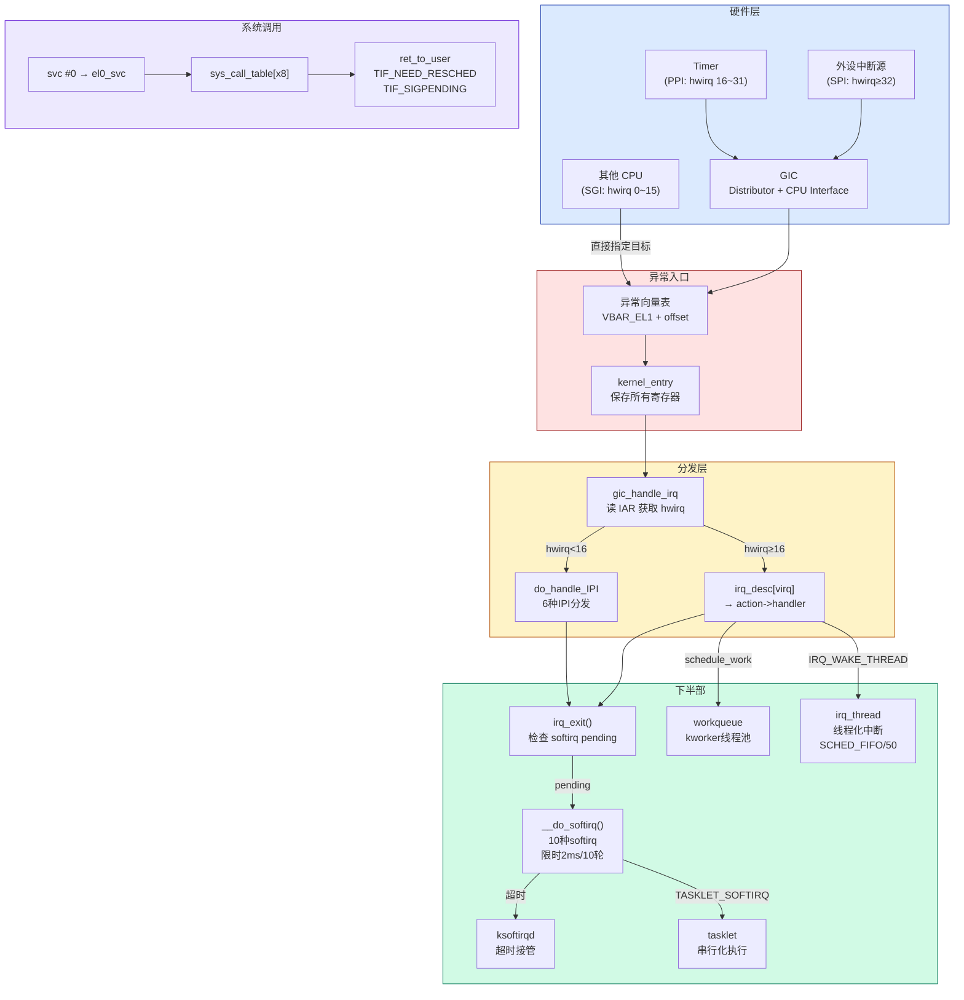

# 📖 《Linux内核深度解析》第4章 中断、异常和系统调用 — 读书笔记

> 📅 2026-07-31 | 🏷️ ARM64 / 中断 / GIC / softirq / tasklet / workqueue / 系统调用 / IPI | 📊 难度：中高

---

## 🎯 一句话概括

本章回答"硬件事件如何通知 CPU 并被分层处理"：从 ARM64 异常向量表的硬件入口，到 GIC 中断控制器的路由分发，再到内核的三级下半部机制（softirq/tasklet/workqueue），最后到系统调用的进入和返回路径——形成了一条完整的从硬件到用户态的事件处理链路。

---

## 📚 内容梳理

### 4.1 ARM64 异常处理

#### 核心知识点

- **异常级别 (EL)**：ARM64 处理器定义 4 个异常级别，EL0（用户态）→ EL1（内核态）→ EL2（Hypervisor）→ EL3（安全监控器）。级别越高权限越大。普通内核运行在 EL1。

- **异常分类**：
  - 同步异常：由当前执行的指令直接产生
    - (1) 系统调用 svc → 进入 EL1
    - (2) 数据中止 → 访问数据时页错误（虚拟地址没映射或没权限）
    - (3) 指令中止 → 取指时页错误
    - (4) 对齐异常
    - (5) 未定义指令
    - (6) 调试异常（断点/监视点）
  - 异步异常：不由当前指令产生
    - IRQ：普通中断
    - FIQ：快速中断
    - SError：系统错误（如硬件 ECC 错误）

- **异常向量表**：

```
// arch/arm64/kernel/entry.S
// VBAR_EL1 指向异常向量表基地址
// 共 4 组 × 4 种异常类型 = 16 个入口，每入口 128 字节 (32条指令)

偏移        来源                      异常类型
─────────────────────────────────────────────────────
+0x000      当前 EL, SP_EL0 使用      同步异常
+0x080      当前 EL, SP_EL0 使用      IRQ
+0x100      当前 EL, SP_EL0 使用      FIQ
+0x180      当前 EL, SP_EL0 使用      SError

+0x200      当前 EL, SP_ELn 使用      同步异常   ← 内核态异常入口
+0x280      当前 EL, SP_ELn 使用      IRQ        ← 内核态中断入口
+0x300      当前 EL, SP_ELn 使用      FIQ
+0x380      当前 EL, SP_ELn 使用      SError

+0x400      低 EL (AArch64)          同步异常   ← 用户态→内核态(系统调用/缺页)
+0x480      低 EL (AArch64)          IRQ        ← 用户态时中断
+0x500      低 EL (AArch64)          FIQ
+0x580      低 EL (AArch64)          SError

+0x600      低 EL (AArch32)          同步异常   ← 32位进程兼容
+0x680      低 EL (AArch32)          IRQ
+0x700      低 EL (AArch32)          FIQ
+0x780      低 EL (AArch32)          SError
```

- **异常处理完整流程**：

```
硬件中断/异常触发
  │
  ├─ 硬件自动执行：
  │   (1) 保存 PSTATE → SPSR_EL1
  │   (2) 保存返回地址 → ELR_EL1
  │   (3) 禁止中断 (PSTATE.I=1 / PSTATE.F=1)
  │   (4) 跳转到 VBAR_EL1 + 偏移（根据来源和类型选择入口）
  │
  ├─ 软件入口（kernel_entry 宏）：
  │   (1) 保存所有通用寄存器 x0~x30 到内核栈 (struct pt_regs)
  │   (2) 保存 SP_EL0（用户栈指针）
  │
  ├─ 异常分发：
  │   (1) 读取 ESR_EL1 寄存器获取异常综合信息
  │   (2) ESR_EL1 的 Bit[31:26] (EC字段) 标识异常类型
  │   (3) 根据 EC 跳转到对应处理函数：
  │       EC=0b010101 (SVC) → el0_svc (系统调用)
  │       EC=0b100100 (数据中止, 低EL) → el0_da → do_page_fault
  │       EC=0b100101 (数据中止, 当前EL) → el1_da
  │       EC=0b100000 (指令中止, 低EL) → el0_ia
  │
  └─ 异常返回（kernel_exit 宏）：
      (1) 恢复通用寄存器
      (2) 执行 eret 指令
          → 硬件自动恢复 SPSR_EL1 → PSTATE
          → 硬件自动恢复 ELR_EL1 → PC
          → 继续执行被打断的程序
```

**[6.1 变化]**：Linux 6.1 中 ARM64 的异常入口已从旧的 `el1_irq`/`el0_irq` 改为使用 C 函数入口 `el1h_64_irq_handler()`/`el0t_64_irq_handler()`（通过 `arch/arm64/kernel/entry-common.c`），不再是纯汇编分发。但底层的向量表结构和硬件行为不变。

#### 重要结论

- 向量表的 4×4 布局是 ARM64 硬件固定的，理解它是分析一切异常/中断处理的入口
- 异常处理是"硬件保存最少 + 软件保存剩余"的协作模式
- `eret` 是唯一的异常返回指令，原子地恢复 PSTATE 和 PC

#### FAQ

**Q: 内核正常运行时使用的是向量表的哪一组？**
第 2 组（+0x200~+0x380，当前 EL 使用 SP_ELn）。内核使用 SP_EL1 而非 SP_EL0 作为栈指针。

**Q: 用户态发生中断时用哪个入口？**
第 3 组（+0x400~+0x580，低 EL AArch64）。对 32 位进程则是第 4 组。

**Q: SPSR_EL1 和 ELR_EL1 是何时保存的？**
硬件自动保存，在跳转到向量表之前就完成了。软件不需要显式保存这两个寄存器。

---

### 4.2 中断

#### 核心知识点

- **GIC（Generic Interrupt Controller）**：ARM64 标准中断控制器

```
GIC 架构（以 GIC v2 为例）：

┌──────────────────────────────────────────────────────────────────┐
│                          GIC                                      │
│                                                                  │
│  ┌─────────────────────────────────────────────────┐              │
│  │            Distributor (分发器)                    │              │
│  │  - 管理所有中断源的优先级和路由                    │              │
│  │  - 决定中断发送到哪个 CPU Interface                │              │
│  │  - GICD_* 寄存器组                                │              │
│  └────────┬────────────┬───────────────┬────────────┘              │
│           │            │               │                          │
│  ┌────────▼──┐  ┌──────▼────┐  ┌───────▼───┐                     │
│  │CPU Interface│  │CPU Interface│  │CPU Interface│                  │
│  │  CPU 0      │  │  CPU 1      │  │  CPU 2      │                  │
│  │ GICC_* 寄存器│  │            │  │            │                  │
│  └────────────┘  └────────────┘  └────────────┘                  │
└──────────────────────────────────────────────────────────────────┘

中断类型：
  hwirq 0~15:  SGI (Software Generated Interrupt) → IPI (核间中断)
  hwirq 16~31: PPI (Private Peripheral Interrupt) → 每CPU私有(timer/PMU)
  hwirq 32+:   SPI (Shared Peripheral Interrupt) → 共享外设中断
```

- **中断核心数据结构关系**：

```
┌────────────────────────────────────────────────────────────────────────┐
│                    中断子系统数据结构关系                                │
│                                                                        │
│  struct irq_domain                  struct irq_desc (每个Linux中断号一个)│
│  (每个中断控制器一个)                ┌─────────────────────────────────┐ │
│  ┌──────────────────────┐           │ irq_data                        │ │
│  │ name                  │           │   ├── irq (Linux中断号)          │ │
│  │ ops (domain操作)      │           │   ├── hwirq (硬件中断号)         │ │
│  │ host_data (GIC私有)   │    映射    │   ├── chip → struct irq_chip    │ │
│  │ hwirq_max            │──────────►│   └── domain → irq_domain      │ │
│  │ revmap[] (反向映射)    │           │ handle_irq (流处理函数)          │ │
│  │ parent (级联)         │           │ action → struct irqaction 链表   │ │
│  └──────────────────────┘           │ lock                            │ │
│                                     │ affinity_hint (亲和性)           │ │
│  struct irq_chip                    └──────────┬──────────────────────┘ │
│  (中断控制器操作抽象)                           │                        │
│  ┌──────────────────────┐                      │ action 链表            │
│  │ irq_mask()            │                      ▼                        │
│  │ irq_unmask()          │           struct irqaction                   │
│  │ irq_ack()             │           ┌─────────────────────────────┐   │
│  │ irq_eoi()             │           │ handler → 上半部处理函数     │   │
│  │ irq_set_affinity()    │           │ thread_fn → 线程化处理函数   │   │
│  │ irq_set_type()        │           │ thread → irq_thread 内核线程 │   │
│  └──────────────────────┘           │ flags (IRQF_SHARED 等)       │   │
│                                     │ name ("eth0" 等)              │   │
│                                     │ next → 下一个 irqaction      │   │
│                                     │ dev_id (设备私有数据)         │   │
│                                     └─────────────────────────────┘   │
└────────────────────────────────────────────────────────────────────────┘
```

源码定义：

```c
// include/linux/irqdesc.h
struct irq_desc {
    struct irq_data         irq_data;       // 中断数据(hwirq/chip/domain)
    irq_flow_handler_t      handle_irq;     // 流处理函数(handle_edge/level_irq)
    struct irqaction        *action;        // 处理函数链表
    unsigned int            depth;          // 嵌套禁用深度
    raw_spinlock_t          lock;
    const struct cpumask    *percpu_affinity; // 亲和性掩码
    // ...
};

// include/linux/interrupt.h
struct irqaction {
    irq_handler_t       handler;        // 上半部 handler
    irq_handler_t       thread_fn;      // 线程化 handler
    struct task_struct  *thread;         // 对应的 irq_thread
    struct irqaction    *next;          // 共享中断链表
    unsigned int        irq;            // Linux 中断号
    unsigned int        flags;          // IRQF_SHARED / IRQF_ONESHOT 等
    const char          *name;          // 在 /proc/interrupts 中显示的名字
} ____cacheline_internodealigned_in_smp;
```

- **完整中断处理流程**（从硬件到软件）：

```
外设触发中断信号 → GIC Distributor 路由到目标 CPU
  │
  ├─ CPU 跳转到向量表: VBAR_EL1 + 0x280 (内核态IRQ) 或 +0x480 (用户态IRQ)
  │
  ├─ 异常入口 kernel_entry: 保存所有寄存器到 pt_regs
  │
  ├─ 调用 handle_arch_irq (全局函数指针, GIC初始化时设为 gic_handle_irq)
  │   │
  │   ├─ gic_handle_irq():
  │   │   (1) 读 GICC_IAR 寄存器 → 获取 hwirq (确认中断)
  │   │   (2) 判断 hwirq 类型:
  │   │       hwirq < 16 → SGI (IPI) → handle_IPI()
  │   │       hwirq 16~1019 → SPI/PPI → handle_domain_irq()
  │   │
  │   ├─ handle_domain_irq():
  │   │   (1) irq_enter() → 标记进入硬中断上下文 (preempt_count += HARDIRQ_OFFSET)
  │   │   (2) 通过 irq_domain 将 hwirq 映射到 Linux virq
  │   │   (3) generic_handle_irq(virq)
  │   │       → irq_desc[virq]->handle_irq() (如 handle_fasteoi_irq)
  │   │         → 遍历 irq_desc->action 链表
  │   │           → action->handler(irq, dev_id)  ← 上半部执行
  │   │           → 返回 IRQ_HANDLED / IRQ_WAKE_THREAD / IRQ_NONE
  │   │   (4) 写 GICC_EOIR 通知 GIC 处理完成 (EOI)
  │   │   (5) irq_exit()
  │   │       → preempt_count -= HARDIRQ_OFFSET
  │   │       → 如果有 pending 的 softirq → invoke_softirq() ← 软中断在此执行!
  │   │
  │   └─ handle_IPI() → do_handle_IPI(ipinr):
  │       switch(ipinr):
  │         IPI_RESCHEDULE  → scheduler_ipi()   调度通知
  │         IPI_CALL_FUNC   → generic_smp_call_function_interrupt()
  │         IPI_CPU_STOP    → local_cpu_stop()
  │         IPI_TIMER       → tick_receive_broadcast()
  │         IPI_IRQ_WORK    → irq_work_run()
  │         IPI_WAKEUP      → CPU唤醒(ACPI parking)
  │
  └─ kernel_exit: 恢复寄存器 → eret 返回
```

- **ARM64 IPI 类型**（源码 `arch/arm64/kernel/smp.c`）：

| IPI 编号 | 名称 | 用途 | 与 CPU 隔离的关系 |
|---|---|---|---|
| 0 | IPI_RESCHEDULE | 通知目标 CPU 重新调度 | 负载均衡时发送，isolcpus 后应该很少收到 |
| 1 | IPI_CALL_FUNC | 在目标 CPU 执行函数 | TLB shootdown 等使用，无法完全避免 |
| 2 | IPI_CPU_STOP | 停止目标 CPU | panic/kexec 时 |
| 3 | IPI_TIMER | 时钟广播 | nohz_full 的"远程 tick"就是这个! |
| 4 | IPI_IRQ_WORK | 延迟工作 | perf/printk 等 |
| 5 | IPI_WAKEUP | ACPI 唤醒 | CPU 热插拔 |

- **中断线程化**：

```c
// 注册线程化中断
request_threaded_irq(irq, handler, thread_fn, flags, name, dev_id);

// 执行流程:
// (1) 硬中断: handler() 快速执行 → 返回 IRQ_WAKE_THREAD
// (2) 内核唤醒 irq_thread 内核线程
// (3) irq_thread 以 SCHED_FIFO 优先级50运行 thread_fn()
//     → 可以被更高优先级的实时任务抢占!
//     → 可以睡眠!

// IRQF_ONESHOT 标志: 在 thread_fn 完成之前不会重新使能该中断线
// → 防止中断风暴
```

#### 重要结论

- 软中断在 `irq_exit()` 中执行（硬中断返回时），不是在硬中断上下文内
- IPI 是无法通过 `smp_affinity` 控制路由的（它直接由发送方指定目标 CPU）
- 中断线程化让中断处理变成可抢占的普通线程，是实时性的关键技术

#### FAQ

**Q: irq_domain 解决了什么问题？**
ARM 系统可以有多个中断控制器级联（如 GIC → GPIO 控制器 → 子中断控制器），每个控制器有自己的硬件中断号空间。irq_domain 为每个控制器建立 hwirq→virq 的独立映射，内核其余部分只使用 virq，不关心具体的硬件编号。

**Q: handle_fasteoi_irq 和 handle_edge_irq 的区别？**
- `handle_fasteoi_irq`：用于电平触发中断，处理完 action 后自动发 EOI
- `handle_edge_irq`：用于边沿触发中断，收到 ACK 后立即 mask，处理完再 unmask
边沿触发需要特殊处理防止中断丢失（处理期间如果又来一个边沿）。

**Q: 为什么 IPI 不能通过 `/proc/irq/N/smp_affinity` 控制路由？**
IPI 是 SGI（hwirq 0~15），由发送方通过写 GICD_SGIR 寄存器直接指定目标 CPU 列表。它不经过 Distributor 的路由逻辑，所以 affinity 设置对它无效。这就是为什么 isolcpus 无法完全屏蔽 IPI 干扰。

---

### 4.3 中断下半部

#### 核心知识点

- **三种下半部机制对比**：

| 机制 | 运行上下文 | 能否睡眠 | 并发性 | 延迟 | 适用场景 |
|---|---|---|---|---|---|
| softirq | 软中断上下文 | 不能 | 同一 softirq 多 CPU 可并行 | 最低 | 网络/块设备/调度器 |
| tasklet | 基于 softirq | 不能 | 同一 tasklet 串行化 | 低 | 简单驱动 |
| workqueue | 内核线程 | **能** | worker 线程调度 | 较高 | 需要睡眠的操作 |
| threaded IRQ | 内核线程 | **能** | 每中断一个线程 | 中等 | 需抢占性的中断处理 |

#### 4.3.1 软中断 (softirq)

```c
// include/linux/interrupt.h
enum {
    HI_SOFTIRQ = 0,         // 高优先级 tasklet
    TIMER_SOFTIRQ,           // 定时器
    NET_TX_SOFTIRQ,          // 网络发送
    NET_RX_SOFTIRQ,          // 网络接收
    BLOCK_SOFTIRQ,           // 块设备
    IRQ_POLL_SOFTIRQ,        // I/O 轮询
    TASKLET_SOFTIRQ,         // 普通 tasklet
    SCHED_SOFTIRQ,           // 调度器负载均衡 ← 你的isolcpus实验相关!
    HRTIMER_SOFTIRQ,         // 高精度定时器(逐步废弃)
    RCU_SOFTIRQ,             // RCU 回调处理
    NR_SOFTIRQS              // = 10
};
```

**softirq 执行路径**：

```
irq_exit()  ← 硬中断返回时
  │
  ├─ preempt_count -= HARDIRQ_OFFSET
  │
  ├─ if (local_softirq_pending() && !in_interrupt())
  │   └─ invoke_softirq()
  │       │
  │       ├─ [非RT内核] __do_softirq()  在当前上下文执行
  │       │   (1) 禁用本CPU中断下半部 (__local_bh_disable)
  │       │   (2) 循环：取 pending 位图，逐位调用 softirq_vec[nr].action()
  │       │   (3) 限制：单次最多执行 10 轮 或 2ms (MAX_SOFTIRQ_TIME)
  │       │   (4) 超限 → wakeup_softirqd() 唤醒 ksoftirqd 线程继续处理
  │       │   (5) 恢复中断下半部
  │       │
  │       └─ [RT内核] wakeup_softirqd()  总是交给ksoftirqd线程
  │
  └─ 如果不在中断上下文且preempt被禁用，可能触发调度
```

**关键：** SCHED_SOFTIRQ 是负载均衡的触发器。`scheduler_tick()` → `trigger_load_balance()` → `raise_softirq(SCHED_SOFTIRQ)` → `run_rebalance_domains()` 执行实际的负载均衡。isolcpus 的 domain 隔离阻止了该 CPU 参与负载均衡域。

#### 4.3.2 tasklet

```c
// include/linux/interrupt.h
struct tasklet_struct {
    struct tasklet_struct *next;     // 链表
    unsigned long state;             // TASKLET_STATE_SCHED / TASKLET_STATE_RUN
    atomic_t count;                  // 0=使能, >0=禁用
    bool use_callback;
    union {
        void (*func)(unsigned long data);
        void (*callback)(struct tasklet_struct *t);
    };
    unsigned long data;
};
```

- `tasklet_schedule(t)` → 加入本 CPU 的 tasklet_vec 链表 → 触发 TASKLET_SOFTIRQ
- **串行保证**：通过 `TASKLET_STATE_RUN` 位实现——只有 `test_and_set_bit` 成功的 CPU 才执行，其他 CPU 跳过。同一个 tasklet 绝不会在两个 CPU 上同时运行。
- **[6.1 变化]**：tasklet 被视为逐步废弃的 API。新代码推荐用 threaded IRQ 或 workqueue 替代。

#### 4.3.3 工作队列 (workqueue)

```
工作队列的分层架构：

┌───────────────────────────────────────────────────────────────┐
│  workqueue_struct (如 system_wq)                               │
│  ┌────────────────────────────────────────────┐               │
│  │ 管理 work_struct 的分发                      │               │
│  └───────────────────┬────────────────────────┘               │
│                      │ 提交到                                  │
│  ┌───────────────────▼────────────────────────┐               │
│  │  worker_pool (每CPU bound + unbound)        │               │
│  │  ┌─────────────────────────────────────┐    │               │
│  │  │ worklist: 待处理的 work 链表          │    │               │
│  │  │ nr_running: 运行中的 worker 数        │    │               │
│  │  │ idle_list: 空闲 worker 链表           │    │               │
│  │  └──────────────────┬──────────────────┘    │               │
│  │                     │                       │               │
│  │  ┌──────────────────▼──────────────────┐    │               │
│  │  │  worker (内核线程 kworker/N:M)        │    │               │
│  │  │  循环: 取 work → 执行 work->func()   │    │               │
│  │  │  空闲超时 300s → 自毁                 │    │               │
│  │  └──────────────────────────────────────┘    │               │
│  └─────────────────────────────────────────────┘               │
└───────────────────────────────────────────────────────────────┘
```

**预定义工作队列**：

| 工作队列 | 特点 | CPU 隔离影响 |
|---|---|---|
| `system_wq` | 通用，bound | worker 绑定各 CPU，隔离 CPU 上也有 |
| `system_highpri_wq` | 高优先级 | 同上 |
| `system_long_wq` | 长时间任务 | 同上 |
| `system_unbound_wq` | **不绑定 CPU** | worker 可能被调度到任何 CPU 包括隔离 CPU! |
| `system_freezable_wq` | 可冻结 | 休眠时冻结 |

**编程接口**：
```c
// 定义和提交工作
DECLARE_WORK(my_work, my_func);           // 静态定义
schedule_work(&my_work);                  // 提交到 system_wq
queue_work(my_wq, &my_work);             // 提交到指定工作队列
schedule_delayed_work(&my_dwork, HZ);    // 延迟 1 秒后执行
flush_work(&my_work);                    // 等待工作完成
cancel_work_sync(&my_work);              // 取消并等待
```

#### 重要结论

- softirq 在 `irq_exit()` 中触发执行，时间限制 2ms / 10 轮，超限交给 ksoftirqd
- SCHED_SOFTIRQ 是负载均衡的执行载体，isolcpus 通过不参与调度域来避免
- unbound workqueue 的 worker 线程**不受** cpuset 和 isolcpus 的自动限制，可能跑到隔离 CPU 上

#### FAQ

**Q: 为什么 softirq 不能睡眠？**
softirq 运行时 `preempt_count` 的 SOFTIRQ 位域非零（`in_softirq()` 为真），此时如果调用 `schedule()` 内核会检测到"在原子上下文中调度"触发 `BUG: scheduling while atomic`。本质原因是 softirq 可能在中断返回路径上执行，此时没有可调度的进程上下文。

**Q: ksoftirqd 以什么优先级运行？**
SCHED_NORMAL，nice=0（默认优先级）。这意味着在高负载系统中，ksoftirqd 可能和普通进程竞争 CPU 时间。如果 softirq 处理被 ksoftirqd 接管，网络包等处理会有额外延迟。

**Q: 如何确认隔离 CPU 上是否有不期望的 kworker 线程？**
`ps -eo pid,comm,psr | grep kworker | awk '$NF==5'` 查看 CPU5 上的 worker。特别关注 `kworker/u*` (unbound) 和 `kworker/5:*` (bound to CPU5) 线程。

---

### 4.4 系统调用

#### 核心知识点

- **ARM64 系统调用入口**：

```
用户态: x8 = 系统调用号, x0~x5 = 参数
         执行 svc #0

内核入口 (arch/arm64/kernel/entry.S → entry-common.c):
  el0_svc() / el0t_64_sync_handler()
    │
    ├─ (1) 读取 pt_regs->regs[8] → 系统调用号 (x8)
    │
    ├─ (2) 检查合法性: nr < __NR_syscalls ?
    │       不合法 → 返回 -ENOSYS
    │
    ├─ (3) 查表: sys_call_table[nr] → 获取处理函数地址
    │       (表定义在 arch/arm64/kernel/sys.c)
    │
    ├─ (4) 调用处理函数: ret = func(x0, x1, x2, x3, x4, x5)
    │
    ├─ (5) 返回值存入 pt_regs->regs[0] (x0)
    │
    └─ (6) ret_to_user 路径:
          检查 thread_info.flags:
            TIF_NEED_RESCHED → schedule() 做进程调度!
            TIF_SIGPENDING   → do_signal() 处理信号
            TIF_NOTIFY_SIGNAL→ tracehook 通知
            TIF_UPROBE       → uprobe 用户空间探针
```

- **ARM64 vs x86_64 系统调用对比**：

| 维度 | ARM64 | x86_64 |
|---|---|---|
| 触发指令 | `svc #0` | `syscall` |
| 调用号寄存器 | x8 | rax |
| 参数寄存器 | x0~x5 | rdi,rsi,rdx,r10,r8,r9 |
| 返回值寄存器 | x0 | rax |
| 用户栈指针保存 | SP_EL0 (硬件自动) | 手动保存到 per-CPU 区域 |

#### 重要结论

- 系统调用返回用户态前检查 `TIF_NEED_RESCHED` 是调度的关键时机之一
- 如果进程不做系统调用（纯 CPU 计算），在非抢占内核中不会被调度出去（只有 tick 中断可以设置 TIF_NEED_RESCHED，但需要等到下次系统调用返回才检查）

---

### 专题：irq_domain 深入解析 — 级联与分层

#### 为什么需要 irq_domain？

```
问题场景：一个 SoC 上有多个中断控制器

  ┌──── GIC (主中断控制器) ────┐
  │ hwirq 0~1019               │
  │ 其中 SPI 32~1019 接外设    │
  └──────┬─────────┬───────────┘
         │         │
         │ SPI 72  │ SPI 100
         │         │
  ┌──────▼────┐  ┌─▼─────────────┐
  │GPIO 控制器 │  │ PCIe MSI 控制器 │
  │hwirq 0~191│  │ hwirq 0~2047   │
  └────────────┘  └────────────────┘

  问题：GPIO 的 hwirq=5 和 GIC 的 hwirq=5 和 PCIe MSI 的 hwirq=5 是完全不同的中断！
  但内核的 irq_desc 数组用一个统一的 Linux virq 编号 (0~NR_IRQS)。
  → 需要一个机制把每个控制器的"本地 hwirq"映射到"全局 virq"
  → 这就是 irq_domain
```

#### irq_domain 的核心功能

```
irq_domain 本质上是一个翻译表：

  ┌─────────────────────────────────────────────────────────┐
  │  irq_domain ("GIC domain")                               │
  │                                                         │
  │  hwirq   →  virq                                        │
  │  ─────      ─────                                       │
  │    32   →    32    (GIC SPI 0 → Linux IRQ 32)           │
  │    33   →    33                                          │
  │    ...                                                   │
  │    72   →    72    (连接到 GPIO 控制器的级联线)            │
  │    ...                                                   │
  └─────────────────────────────────────────────────────────┘

  ┌─────────────────────────────────────────────────────────┐
  │  irq_domain ("GPIO domain")                              │
  │                                                         │
  │  hwirq   →  virq                                        │
  │  ─────      ─────                                       │
  │    0    →   200    (GPIO pin 0 → Linux IRQ 200)         │
  │    1    →   201                                          │
  │    ...                                                   │
  │    5    →   205    (GPIO pin 5 → Linux IRQ 205)         │
  │    ...                                                   │
  │   191   →   391                                          │
  └─────────────────────────────────────────────────────────┘

  驱动注册中断时用的是 virq (如 request_irq(205, handler))
  irq_domain 负责维护 hwirq ↔ virq 的双向映射
```

#### 数据结构 (Linux 6.1)

```c
// include/linux/irqdomain.h
struct irq_domain {
    struct list_head link;           // 全局 irq_domain 链表
    const char *name;                // 域名称 (如 "GIC-0", "gpio-tegra186")
    const struct irq_domain_ops *ops; // 操作回调
    void *host_data;                 // 控制器私有数据 (如 GIC 的 gic_chip_data)
    unsigned int flags;

    struct irq_domain *parent;       // 父域 (分层 domain 的关键!)

    irq_hw_number_t hwirq_max;       // 最大硬件中断号
    unsigned int revmap_size;        // 线性反向映射表大小
    struct radix_tree_root revmap_tree; // 基数树反向映射 (hwirq 太大时)
    struct irq_data __rcu *revmap[]; // 线性反向映射表 (hwirq→irq_data)
};

struct irq_domain_ops {
    // === 非分层 (flat) 域的操作 ===
    int (*match)(...);    // 匹配设备树节点
    int (*map)(...);      // 建立 hwirq→virq 映射时调用
    void (*unmap)(...);   // 删除映射
    int (*xlate)(...);    // 从设备树属性翻译出 hwirq 和触发类型

    // === 分层 (hierarchy) 域的操作 ===
    int (*alloc)(...);    // 分配中断 (向上递归调用父域)
    void (*free)(...);    // 释放中断
    int (*activate)(...); // 激活中断 (配置硬件)
    void (*deactivate)(...);
    int (*translate)(...); // 翻译 firmware 规格到 hwirq
};
```

#### 两种 irq_domain 模型

**模型 1：扁平级联 (Legacy/Flat, Linux 4.x 之前常用)**

```
设备树描述级联关系：
  gic: interrupt-controller@... {
      interrupt-controller;
      #interrupt-cells = <3>;
  };

  gpio: gpio@... {
      interrupt-controller;
      #interrupt-cells = <2>;
      interrupt-parent = <&gic>;      ← GPIO 的父中断控制器是 GIC
      interrupts = <GIC_SPI 72 ...>;  ← GPIO 级联到 GIC 的 SPI 72
  };

扁平级联的工作方式：
  (1) GIC 域 和 GPIO 域各自独立管理 hwirq→virq 映射
  (2) GPIO 控制器注册一个级联 handler 到 GIC 的 virq=72：
      irq_set_chained_handler(72, gpio_cascade_handler)
  (3) 当 GIC SPI 72 触发时：
      gic_handle_irq() → irq_desc[72]->handle_irq → gpio_cascade_handler()
        → 读 GPIO 控制器的 pending 寄存器 → 得到 GPIO hwirq (如 5)
        → 调用 irq_find_mapping(gpio_domain, 5) → 得到 virq=205
        → generic_handle_irq(205) → irq_desc[205]->action->handler()

  两层独立的 domain，通过"级联 handler"连接：
  ┌─────────┐   virq=72    ┌──────────────┐   virq=205   ┌──────────┐
  │ GIC     │──(级联handler)──►│ GPIO 控制器  │──(真正handler)──►│ 设备驱动 │
  │ domain  │              │ domain       │              │          │
  └─────────┘              └──────────────┘              └──────────┘
```

**模型 2：分层 domain (Hierarchy, Linux 4.x+ 推荐)**

```
分层 domain 是新方案，domain 之间形成父子关系：

  ┌─────────────────────────────────────────────────────────────────┐
  │                    分层 irq_domain                                │
  │                                                                 │
  │  每个 virq 在每一层都有对应的 irq_data：                            │
  │                                                                 │
  │  virq = 205                                                     │
  │  ┌──────────────┐      ┌──────────────┐      ┌──────────────┐  │
  │  │ irq_data     │      │ irq_data     │      │ irq_data     │  │
  │  │ (最外层)     │──────│ (中间层)     │──────│ (最内层)     │  │
  │  │              │parent│              │parent│              │  │
  │  │ domain=GPIO  │ irq  │ domain=GIC   │ irq  │ domain=root  │  │
  │  │ hwirq=5     │ data │ hwirq=72     │ data │ hwirq=72     │  │
  │  │ chip=gpio_chip│     │ chip=gic_chip │     │              │  │
  │  └──────────────┘      └──────────────┘      └──────────────┘  │
  │                                                                 │
  │  关键：一个 virq 对应一条 irq_data 链，从叶子域到根域                │
  └─────────────────────────────────────────────────────────────────┘

分层域的中断分配过程 (alloc)：
  设备驱动请求 GPIO pin 5 的中断
    → GPIO domain 的 alloc() 被调用
      → GPIO domain 确定 hwirq=5 对应 GIC 的 hwirq=72
      → 递归调用 irq_domain_alloc_irqs_parent() → GIC domain 的 alloc()
        → GIC domain 分配 virq，配置 GIC 硬件
      → GPIO domain 在自己这层配置 irq_data (chip=gpio_chip, hwirq=5)
    → 返回 virq=205 给驱动

分层域的中断处理过程：
  GIC 收到 hwirq=72
    → gic_handle_irq() → 找到 virq=205 (通过 GIC domain 的 revmap)
    → irq_desc[205]->handle_irq() 
      → 调用最外层 (GPIO) 的 chip 操作 (mask/ack/unmask)
      → 调用 action->handler() (设备驱动的处理函数)
    → irq_chip_eoi_parent() 递归调用父域的 eoi (通知 GIC 完成)

分层的优势：
  (1) 无需级联 handler 函数 — 硬件中断路由直接映射到最终 virq
  (2) irq_chip 操作可以级联调用 (mask/unmask 会递归到父域)
  (3) 支持 MSI/MSI-X — PCIe 设备的 MSI 中断天然是分层的
  (4) 更好的 irq affinity 支持 — 叶子域可以透传亲和性设置到根域
```

#### 实际例子：GIC v3 + ITS + 设备 (NVIDIA Thor 可能的架构)

```
Thor/Orin 的中断架构可能类似：

                          ┌──────────────────┐
                          │ GIC v3 (根 domain)│
                          │ hwirq: SPI/PPI/SGI│
                          └────┬─────────┬───┘
                               │         │
                     ┌─────────▼──┐   ┌──▼──────────────┐
                     │ GIC-ITS     │   │ GPIO domain     │
                     │(MSI domain) │   │ hwirq: pin 0~N  │
                     │hwirq: DevID+│   │ parent: GIC     │
                     │      EventID│   └─────────────────┘
                     └──────┬──────┘
                            │
               ┌────────────┼────────────┐
               │            │            │
          ┌────▼───┐   ┌───▼────┐  ┌────▼───┐
          │PCIe dev│   │PCIe dev│  │PCIe dev│
          │MSI #0-3│   │MSI #0-7│  │MSI #0-1│
          └────────┘   └────────┘  └────────┘

GIC-ITS (Interrupt Translation Service)：
  - GICv3 的 MSI 控制器组件
  - 每个设备有一个 DeviceID + 多个 EventID
  - ITS 把 (DeviceID, EventID) 翻译成 (Collection, LPI) → 路由到目标 CPU
  - irq_domain 层次：device MSI domain → ITS domain → GIC domain
  - 分配过程：
    pci_alloc_irq_vectors()
      → msi_domain_alloc_irqs() (MSI domain)
        → its_irq_domain_alloc() (ITS domain)
          → 分配 LPI 编号
          → 配置 ITS 设备表和中断翻译表
          → irq_domain_alloc_irqs_parent() → GIC domain
```

#### irq_domain 的反向映射 (revmap)

```
正向：驱动知道 hwirq，想得到 virq
  virq = irq_find_mapping(domain, hwirq)
  → 查 domain->revmap[hwirq] (线性表, O(1))
  → 或查 domain->revmap_tree (基数树, O(log n), hwirq 很大时)

反向：中断来了，GIC 给出一个 hwirq，怎么找到 virq？
  在中断处理路径中：
  gic_handle_irq()
    → 读 IAR → hwirq
    → irq_find_mapping(gic_domain, hwirq) → virq
    → generic_handle_irq(virq) → irq_desc[virq]->handle_irq()

  对于分层域，只需要在根域做一次映射即可
  因为分配时已经建立了 GIC hwirq → virq 的映射
```

#### 设备树中的中断描述如何翻译到 irq_domain

```c
// 设备树中设备的中断描述：
//   interrupts = <GIC_SPI 72 IRQ_TYPE_LEVEL_HIGH>;
//
// 解析流程：
//   of_irq_parse_one() → 解析设备树 interrupts 属性
//     → 得到 {parent=gic_node, args=[0, 72, 4]}
//   irq_create_fwspec_mapping()
//     → 找到 gic_node 对应的 irq_domain
//     → 调用 domain->ops->translate() 或 ->xlate()
//       → 解析参数: intspec[0]=0(SPI) → hwirq = intspec[1] + 32 = 104
//                  intspec[2]=4 → type = LEVEL_HIGH
//     → irq_domain_alloc_irqs() → 分配 virq + 建立映射
//     → 返回 virq 给驱动使用
```

#### FAQ

**Q: 扁平级联和分层 domain 可以混合使用吗？**
可以。Linux 6.1 中两种模式共存。旧驱动可能还用扁平级联（chained_handler），新驱动推荐用分层 domain。GIC 驱动本身支持作为分层域的根。

**Q: 为什么 GICv3+ITS 必须用分层 domain 而不能用扁平级联？**
因为 MSI 中断没有固定的"硬件线"可以级联。MSI 中断通过写内存触发（设备写 ITS 的 GITS_TRANSLATER 寄存器），ITS 动态翻译成 LPI 发送给 GIC。整个过程是软件配置的动态映射，不是固定的"GPIO pin X 连到 GIC SPI Y"。分层 domain 的 alloc/free 回调天然适合这种动态分配。

**Q: 对于 CPU 隔离，irq_domain 的哪一层控制中断亲和性？**
最终控制亲和性的是根域（GIC domain），因为 GIC 硬件负责将中断路由到具体 CPU。`irq_set_affinity()` 会通过 `irq_chip->irq_set_affinity()` 递归调用到根域的 GIC chip，写 GICD 的目标 CPU 寄存器。叶子域（GPIO/ITS）通常只是透传 `irq_chip_set_affinity_parent()`。

**Q: Thor 上 `isolcpus=managed_irq` 影响的是哪一层？**
影响的是 `irq_setup_affinity()` 中的默认亲和性计算。当 managed_irq 标志被设置时，内核在计算中断默认 affinity 掩码时会排除隔离 CPU。这作用在最终写入 GIC 硬件寄存器之前，所以不管经过多少层 domain，最终路由结果都不会包含隔离 CPU。但 IPI（SGI）不经过 irq_domain 机制，所以 managed_irq 对 IPI 无效。

---

### 专题：中断下半部各线程的调度优先级全景

#### 核心问题

内核中有多种"延迟执行"机制的线程/上下文，它们的优先级直接决定了：
- 哪些工作能抢占你的实时任务？
- 哪些工作会被你的实时任务饿死？
- 在 CPU 隔离场景中，哪些线程的存在可能造成意外延迟？

#### 优先级全景表

| 线程/上下文 | 调度策略 | 优先级 | 内核创建方式 | 能被实时任务抢占？ |
|---|---|---|---|---|
| **硬中断上下文** | 无（不可调度） | 最高（不可抢占） | 硬件触发 | ❌ 不能 |
| **软中断上下文**（irq_exit 中） | 无（不可调度） | 高于所有线程 | `irq_exit()` 触发 | ❌ 不能 |
| **中断线程 (irq_thread)** | SCHED_FIFO | 优先级 50 (= MAX_RT_PRIO/2) | `request_threaded_irq()` | ✅ 可被 prio>50 的 RT 任务抢占 |
| **ksoftirqd/N** | SCHED_NORMAL | nice=0 (默认普通优先级) | `smpboot_register_percpu_thread()` | ✅ 可被任何 RT 任务抢占 |
| **kworker/N:M (普通 bound)** | SCHED_NORMAL | nice=0 | worker_pool 动态创建 | ✅ 可被任何 RT 任务抢占 |
| **kworker/N:MH (高优先级 bound)** | SCHED_NORMAL | nice=-20 (最高普通优先级) | `system_highpri_wq` | ✅ 可被任何 RT 任务抢占 |
| **kworker/u*:M (unbound)** | SCHED_NORMAL | nice=0 | `system_unbound_wq` | ✅ 可被任何 RT 任务抢占 |
| **rescuer 线程** | SCHED_NORMAL | nice=-20 | 每个 workqueue 的救援线程 | ✅ 可被任何 RT 任务抢占 |

#### 源码验证 (Linux 6.1)

**1. 中断线程化线程优先级**

```c
// kernel/irq/manage.c
static int irq_thread(void *data)
{
    // ...
    sched_set_fifo(current);    // ← 设置为 SCHED_FIFO
    // ...
}

// kernel/sched/core.c
void sched_set_fifo(struct task_struct *p)
{
    // MAX_RT_PRIO = 100, 所以 sched_priority = 50
    struct sched_param sp = { .sched_priority = MAX_RT_PRIO / 2 };
    sched_setscheduler_nocheck(p, SCHED_FIFO, &sp);
}

// 结论: 所有 irq_thread 的实时优先级 = 50 (rt_priority=50, 内核prio=49)
// 用户态可以通过 chrt -f -p <prio> <pid> 调整
```

**2. ksoftirqd 优先级**

```c
// kernel/softirq.c
static struct smp_hotplug_thread softirq_threads = {
    .store          = &ksoftirqd,
    .thread_should_run = ksoftirqd_should_run,
    .thread_fn      = run_ksoftirqd,
    .thread_comm    = "ksoftirqd/%u",
    // 注意: 没有设置特殊的调度策略和优先级!
};
// smpboot_register_percpu_thread() 创建线程后默认: SCHED_NORMAL, nice=0

// 结论: ksoftirqd 是普通优先级的 CFS 进程
// 任何 SCHED_FIFO/SCHED_RR 进程都能抢占它
```

**3. workqueue worker 优先级**

```c
// kernel/workqueue.c

// 普通 worker pool (每 CPU 两个: 普通 + 高优先级)
int std_nice[NR_STD_WORKER_POOLS] = { 0, HIGHPRI_NICE_LEVEL };
// HIGHPRI_NICE_LEVEL = MIN_NICE = -20

// 创建 worker 时设置 nice 值:
static struct worker *create_worker(struct worker_pool *pool)
{
    // ...
    set_user_nice(worker->task, pool->attrs->nice);
    // 普通 pool: nice=0
    // 高优先级 pool: nice=-20
}

// rescuer 线程 (工作队列的"救急"线程):
// RESCUER_NICE_LEVEL = MIN_NICE = -20

// 结论:
//   kworker/0:1   → SCHED_NORMAL nice=0  (普通 worker)
//   kworker/0:1H  → SCHED_NORMAL nice=-20 (高优先级 worker)
//   kworker/u16:1 → SCHED_NORMAL nice=0  (unbound worker)
//   所有 worker 都是 CFS 进程，任何 RT 任务可以抢占
```

#### 优先级层次图

```
高 ─────────────────────────────────────────────── 低

  │ 硬中断          不可抢占，不参与调度
  │ (上半部)        在任何任务之上执行
  │
  │ 软中断          不可抢占（在 irq_exit 中执行时）
  │ (irq_exit中)   但有时间限制 (2ms/10轮)
  │
  ├── SCHED_FIFO 99   ← 用户可设置的最高 RT 优先级
  │
  │   ...
  │
  ├── SCHED_FIFO 50   ← irq_thread (中断线程化)
  │                     所有内核创建的 FIFO 线程默认在此
  │
  │   ...
  │
  ├── SCHED_FIFO 1    ← sched_set_fifo_low() 创建的线程
  │                     (如某些特殊内核线程)
  │
  ├── SCHED_NORMAL nice=-20  ← kworker/H (高优先级 worker)
  │                            rescuer 线程
  │
  ├── SCHED_NORMAL nice=0    ← ksoftirqd (!!!)
  │                            kworker (普通 worker)
  │                            大部分内核线程
  │
  ├── SCHED_NORMAL nice=19   ← 低优先级后台任务
  │
  └── SCHED_IDLE            ← 最低优先级

注意:
  SCHED_FIFO 1 > SCHED_NORMAL nice=-20
  任何 RT 优先级都高于任何 CFS 优先级!
```

#### 对实时性的影响分析

**场景：你的实时任务在 CPU5 上以 SCHED_FIFO/90 运行**

```
能否抢占你的任务？
  硬中断:       是! IPI 和设备中断会直接打断你 (不可避免)
  softirq:      是! 在 irq_exit 中执行时不可抢占 (但限时 2ms)
  irq_thread:   否! 你的 prio=90 > irq_thread 的 prio=50
  ksoftirqd:    否! 你是 RT, ksoftirqd 是 CFS
  kworker:      否! 你是 RT, kworker 是 CFS

会被你饿死的线程？
  ksoftirqd:    是! 如果你一直跑不让出 CPU, ksoftirqd 永远得不到调度
                → 后果: 网络包堆积、定时器延迟、RCU 宽限期无法结束!
  kworker:      是! 同理
  irq_thread(50): 是! 如果你的优先级高于 50

关键风险:
  (1) 如果 softirq 的 2ms 限制到期 → 唤醒 ksoftirqd → 但 ksoftirqd
      是 CFS 优先级 → 你的 FIFO/90 会把它饿死 → softirq 永远得不到处理!
      → 网络停滞、RCU 死锁风险

  (2) 解决方案:
      a. 你的实时任务周期性调用 cond_resched() 或有短暂睡眠
      b. 提升 ksoftirqd 的优先级: chrt -f -p 49 $(pgrep ksoftirqd/5)
      c. 使用 RT 内核 (所有 softirq 在 ksoftirqd 中以可配置优先级执行)
```

#### PREEMPT_RT 内核中的变化

```
标准内核:
  硬中断上下文:  不可抢占  → 直接影响延迟
  softirq:       不可抢占  → 在 irq_exit 中执行, 最多 2ms
  ksoftirqd:     SCHED_NORMAL → 可能被 RT 任务饿死

PREEMPT_RT 内核:
  硬中断:        线程化!  → 中断变成 irq_thread, SCHED_FIFO/50
                 只有极少量不可线程化的中断在硬中断上下文 (如 timer)
  softirq:       全部在 ksoftirqd 中执行 → 不再在 irq_exit 中执行
                 ksoftirqd 可以被提升为 RT 优先级
  spinlock:      变成 rt_mutex → 可睡眠 + 优先级继承

  效果:
    标准内核最坏延迟: 硬中断时间 + softirq 时间 (不可控)
    RT 内核最坏延迟:  极短的硬中断 + 可被抢占的 irq_thread (可控)
```

#### 在 Thor 平台上的实践建议

```bash
# 查看当前所有内核线程的调度策略和优先级
ps -eo pid,comm,cls,rtprio,ni,psr | grep -E "ksoftirq|kworker|irq/" | sort -k6n

# 查看 CPU5 上的线程优先级
ps -eo pid,comm,cls,rtprio,ni,psr | awk '$6==5'

# 提升 ksoftirqd/5 的优先级 (如果需要保证 softirq 不被饿死)
chrt -f -p 49 $(pgrep "ksoftirqd/5")

# 查看中断线程的优先级
ps -eo pid,comm,cls,rtprio | grep "irq/"
# 示例输出:
#   123 irq/72-eth0    FF    50    ← SCHED_FIFO 优先级 50

# 调整特定中断线程的优先级 (如果你的实时任务 prio=90)
chrt -f -p 49 $(pgrep "irq/72-eth0")  # 降到 49, 确保不会抢占你

# 或者提升你的任务优先级确保始终在中断线程之上
chrt -f -p 90 <your_realtime_pid>     # 90 > 50, 不会被 irq_thread 抢占
```

#### FAQ

**Q: 为什么内核把所有 irq_thread 都设为 SCHED_FIFO/50？**
内核注释（`sched_set_fifo` 上方）明确说明：内核不知道哪个中断更重要，只能给一个统一的默认值（MAX_RT_PRIO/2=50），把具体优先级配置留给系统管理员。管理员需要根据实际系统需求用 `chrt` 调整。

**Q: ksoftirqd 为什么不是 RT 优先级？**
设计选择。如果 ksoftirqd 是 RT，它处理 NET_RX_SOFTIRQ（网络收包）时可能持续占用 CPU 处理大量网络包 → 饿死普通进程。用 CFS 优先级让 ksoftirqd 和普通进程公平竞争，但代价是可能被 RT 任务饿死。这是吞吐量和实时性的 trade-off。

**Q: 如果我的实时任务优先级设为 SCHED_FIFO/50（和 irq_thread 相同），谁先运行？**
SCHED_FIFO 同优先级是 FIFO 顺序——先入队的先运行，不会互相抢占。所以如果 irq_thread 先醒来，它会一直运行直到完成或主动让出。建议你的实时任务设为 50 以上（如 80~90），避免和 irq_thread 同级竞争。

**Q: PREEMPT_RT 内核中 softirq 的优先级可以配置吗？**
在 RT 内核中，所有 softirq 在 ksoftirqd 线程中执行（不在 irq_exit 中）。ksoftirqd 的优先级可以用 `chrt` 调整。RT 发行版（如 Red Hat RT）通常会把 ksoftirqd 设为 SCHED_FIFO/1~20（低于应用 RT 任务但高于 CFS），通过 `rtctl` 或 `tuna` 工具配置。

---

### 专题：中断处理对 CPU 隔离的影响链路

对于 Thor 平台 CPU5 隔离场景的完整影响分析：

```
中断对隔离 CPU 的 4 种干扰路径：

(1) 硬件中断直接路由到 CPU5
    ├─ 原因: 设备中断的 smp_affinity 包含 CPU5
    ├─ 影响: 上半部在 CPU5 执行 → 打断隔离任务
    └─ 解决: isolcpus=managed_irq → 内核设置 affinity 时排除隔离 CPU
             或手动: echo 0x3f > /proc/irq/N/smp_affinity (排除bit5)

(2) IPI 发送到 CPU5
    ├─ 原因: 负载均衡/TLB shootdown/RCU 催促/远程 tick
    ├─ 影响: 无法通过 affinity 屏蔽，直接打断 CPU5
    └─ 部分缓解:
         isolcpus=domain → 减少负载均衡 IPI_RESCHEDULE
         rcu_nocbs=5     → 减少 RCU 催促 IPI
         nohz_full 本意减少 timer IPI 但引入了远程 tick IPI (得不偿失)

(3) softirq 在 CPU5 上执行
    ├─ 原因: CPU5 收到硬中断后 irq_exit() 时检查 pending → 执行 softirq
    ├─ 影响: SCHED_SOFTIRQ/RCU_SOFTIRQ/TIMER_SOFTIRQ 都可能在 CPU5 执行
    └─ 解决: 如果 CPU5 不收硬中断，就不会触发 softirq
             但 IPI 也会触发 irq_exit → 可能触发 pending 的 softirq

(4) kworker 线程被调度到 CPU5
    ├─ 原因: unbound workqueue 的 worker 不受 isolcpus 限制
    ├─ 影响: 内核工作可能在 CPU5 上执行，抢占隔离任务
    └─ 解决: cpuset 控制 → 确保 CPU5 的 cpuset 只允许指定任务
```

---

## 🧠 费曼解读

### 一、中断上下半部拆分

**用大白话说：**
CPU 正在做重要工作（运行你的实时任务），突然外面有人敲门（中断来了）。你不能不开门，但也不能在门口聊天半小时。正确做法是：开门→签收快递→关门（上半部，几微秒），然后把拆包裹的活安排到等会儿空闲时做（下半部）。

加一层细节：下半部也分三种"等会儿"的方式：
- softirq：关门后立刻在走廊做（快，但不能坐下来慢慢做）
- tasklet：和 softirq 类似，但保证同一个快递只有一个人拆
- workqueue：回到工位再做（可以坐着慢慢来，但要排队等工位）

**类比：**
急诊医院的分诊体系：
- **门卫 (GIC)**：谁来了先登记，判断该去哪个科室
- **分诊护士 (上半部)**：10 秒内评估严重程度，贴标签，不做治疗
- **急诊室 (softirq)**：不能离开急诊室，快速处理，5 分钟内完成
- **住院部 (workqueue)**：可以做手术、等检查结果、睡觉休息

**为什么重要：**
你的 cyclictest 测量的延迟 = 中断响应时间 + 调度延迟。如果中断上半部太长，会直接增加最坏延迟。`isolcpus=managed_irq` 就是不让硬中断直接打扰隔离 CPU。而中断线程化让后续处理变成可被实时任务抢占的普通线程。

**关键细节：**
- softirq 不是在硬中断处理函数"里面"执行的，而是在 `irq_exit()` 时执行——此时硬中断已经结束（HARDIRQ_OFFSET 已减），但还没恢复到进程上下文
- `__do_softirq()` 有 2ms 时间限制，超过后不是丢弃未处理的 softirq，而是唤醒 ksoftirqd 内核线程继续处理
- RT 内核中，所有 softirq 都交给 ksoftirqd 线程处理（不在 `irq_exit()` 中执行），这样可以被实时任务抢占

**理解自测：**
如果一个网卡驱动在上半部（handler）中完成了所有收包处理而不使用 NAPI 的 softirq 机制，对 cyclictest 延迟和网络吞吐量分别有什么影响？

---

### 二、IPI 与 CPU 隔离的矛盾

**用大白话说：**
你在家办公（CPU5 隔离做实时任务），告诉所有人"别打电话给我"（isolcpus）。普通快递员（硬件中断）确实不来了。但你的同事（其他 CPU）还是会给你发微信（IPI）："帮我查个东西"（IPI_CALL_FUNC）、"你该换班了"（IPI_RESCHEDULE）、"时间到了"（IPI_TIMER）。这些微信你没法设置免打扰，因为它不走门卫（GIC 路由），是点对点直达的。

**类比：**
电话和传呼机的区别：
- 硬件中断 = 通过总机转接的电话 → 可以告诉总机"这个号不转给我"（smp_affinity）
- IPI = 对讲机直呼 → 对方直接喊你的名字，没有中间人可以拦截

**为什么重要：**
这直接解释了你之前 nohz_full 实验中的问题！nohz_full 想减少 timer tick，但引入了"远程 tick"机制——其他 CPU 通过 IPI_TIMER 定期通知隔离 CPU。反而增加了 IPI 干扰。**最好的 IPI 是不存在的 IPI**——通过减少产生 IPI 的原因来解决，而不是试图拦截它。

**关键细节：**
- IPI 通过写 GIC 的 GICD_SGIR 寄存器（GICv2）或 ICC_SGI1R_EL1（GICv3）发送
- 发送方在寄存器中直接指定目标 CPU 的 bitmask，完全不经过 Distributor 的路由逻辑
- ARM64 Linux 6.1 中有 6 种 IPI 类型，其中 IPI_RESCHEDULE 和 IPI_CALL_FUNC 最频繁
- `isolcpus=domain` 让隔离 CPU 不参与调度域 → 大幅减少 IPI_RESCHEDULE
- `rcu_nocbs=5` 让 RCU 回调在其他 CPU 处理 → 减少 RCU 相关的 IPI_CALL_FUNC

**理解自测：**
TLB shootdown（一个 CPU 改了共享页表后通知其他 CPU 刷 TLB）也通过 IPI_CALL_FUNC 实现。如果隔离 CPU 和其他进程共享地址空间（如同一个进程的多个线程），TLB shootdown 能避免吗？

---

### 三、softirq 与实时性

**用大白话说：**
softirq 是内核里的"急事快办"通道。网络包来了、定时器到了、调度器要均衡了——这些事不能等太久，但也不能在硬中断里做（怕阻塞其他中断）。所以在硬中断结束的那一刻（`irq_exit()`），内核检查有没有待处理的急事，有的话立即执行。

问题来了：如果你的实时任务正在 CPU5 上跑，一个 IPI 来了（很短），IPI 处理完后 `irq_exit()` 发现有 pending 的 SCHED_SOFTIRQ → 立即执行负载均衡代码 → 这可能耗时几十到几百微秒！你的实时任务被"偷走"了 CPU 时间。

**类比：**
你正在考试（实时任务），监考老师说"有人找你签个字"（IPI，几微秒）。你签完字转头准备继续考试，监考老师又说"顺便把这摞卷子批了"（softirq）。批卷子可能要好几分钟，你的考试时间就被占了。

**为什么重要：**
在你的 Thor 平台上，即使成功隔离了所有硬件中断，只要 CPU5 还收到 IPI，`irq_exit()` 路径上的 softirq 处理就可能引入延迟。这也是 PREEMPT_RT 内核把所有 softirq 都交给 ksoftirqd 线程处理的原因——让 softirq 变得可被实时任务抢占。

**关键细节：**
- softirq pending 是 per-CPU 的位图，任何时候 `raise_softirq()` 都只设本 CPU 的 pending
- 但如果 CPU5 上有 timer 到期了，TIMER_SOFTIRQ 就会在 CPU5 上 pending
- `nohz_full` 减少 timer tick → 减少 TIMER_SOFTIRQ → 但引入 IPI_TIMER 副作用

**理解自测：**
在 PREEMPT_RT 内核中，softirq 由 ksoftirqd 线程处理。如果你的实时任务优先级为 SCHED_FIFO/90，ksoftirqd 默认优先级为 SCHED_NORMAL/nice0，那 softirq 还能影响你的实时任务吗？在什么情况下会影响？

---

## 🔗 知识图谱



---

## ❓ 启发性发问

### 理解层

1. 硬中断执行期间，本 CPU 上的 softirq 可以执行吗？为什么 softirq 要等到 `irq_exit()` 才执行而不是在硬中断内部执行？

2. 同一个 softirq 类型（如 NET_RX_SOFTIRQ）可以在多个 CPU 上同时执行，而同一个 tasklet 不行。这个"不行"是靠什么机制保证的？有没有性能代价？

### 应用层

3. 在 Thor 平台上确认 CPU5 的中断隔离效果时，除了看 `/proc/interrupts` 的计数增量，还应该看什么？（提示：`/proc/softirqs` 和 IPI 行）

4. 如果你发现 CPU5 上 `kworker/u16:2`（unbound worker）在运行，如何把它迁移走并防止它再回来？

### 追问层

5. RT 内核中把所有 softirq 都交给 ksoftirqd 线程处理，这解决了实时性问题。但如果 ksoftirqd 以 SCHED_NORMAL 运行，当系统满载时网络包处理会被饿死——这就是著名的"RT 网络延迟"问题。如何在保证实时性的同时不饿死网络处理？

6. `irq_exit()` 中如果检测到 softirq pending 但当前在嵌套中断中（`in_interrupt()` 为真），会怎样处理？最外层中断退出时才执行 softirq 对延迟有什么影响？

### 关联层

7. 之前的 nohz_full 实验中，IPI_TIMER（远程 tick）通过 `do_handle_IPI()` → `tick_receive_broadcast()` 处理后，`irq_exit()` 会触发 TIMER_SOFTIRQ 吗？这是否是延迟恶化的一个隐藏路径？

8. cgroup v2 的 cpu.max 带宽限制通过 CFS bandwidth throttling 实现，而 throttling 检查在 `scheduler_tick()` 中。如果 CPU5 被 nohz_full 关掉了 tick，带宽限制还能正常工作吗？

---

## 💡 个人洞察

1. **IPI 是 CPU 隔离最后的"盲区"**。通过本章学习，完整理解了为什么 IPI 无法被 smp_affinity 拦截（SGI 不走 Distributor 路由），也理解了 nohz_full 实验失败的深层原因——它用一种 IPI（远程 tick）替代了另一种 IPI（本地 timer tick），净效果是更多的跨核通信而非更少。

2. **`irq_exit()` 是理解延迟构成的关键节点**。硬中断本身可能很短（几微秒），但 `irq_exit()` 中的 softirq 处理可能引入数十微秒的额外延迟。这就是为什么之前 cyclictest 测出的毛刺远大于硬中断时间——它包含了 softirq 的处理时间。

3. **PREEMPT_RT 的核心洞察是"让一切可抢占"**。标准内核中 hardirq 不可抢占、softirq 不可抢占，RT 内核把它们都变成可抢占的线程。代价是吞吐量下降（线程调度开销），收益是最坏延迟可预测。Thor 平台如果追求确定性延迟，应该评估 RT 内核。
