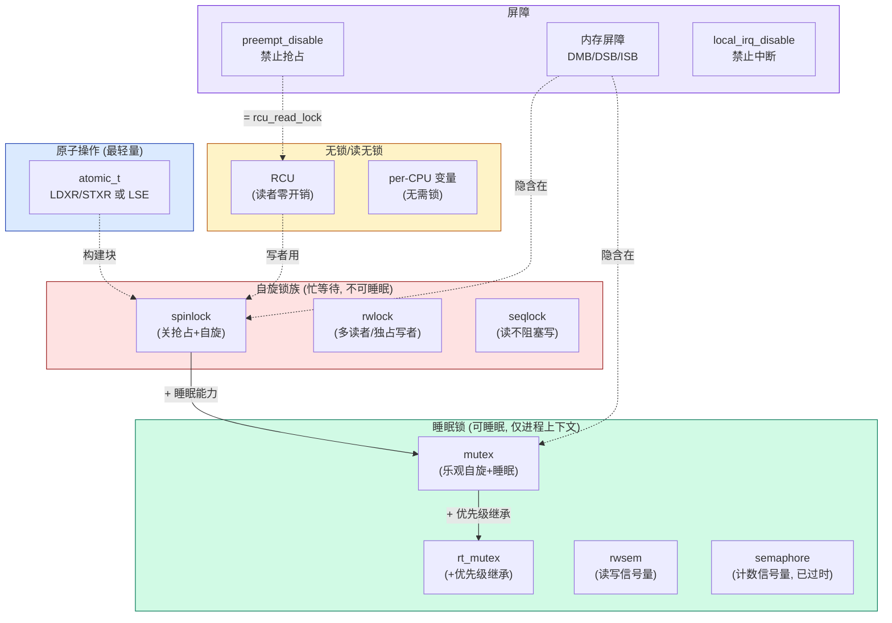

# 📖 《Linux内核深度解析》第5章 内核互斥技术 — 读书笔记

> 📅 2026-07-31 | 🏷️ ARM64 / spinlock / mutex / RCU / 原子操作 / 内存屏障 / 信号量 | 📊 难度：高

---

## 🎯 一句话概括

本章系统讲解了 Linux 内核中从最轻量（原子操作）到最重量（互斥锁）的完整并发控制工具链，以及它们在中断上下文、进程上下文、多处理器场景下的适用规则和实现原理。

---

## 📚 内容梳理

### 5.1 信号量

#### 核心知识点

- **信号量 (semaphore)**：允许多个持有者的睡眠锁，计数器 > 0 时可获取，= 0 时获取者睡眠等待
- 编程接口：`down()`（获取，可能睡眠）、`up()`（释放）、`down_interruptible()`（可被信号打断）
- 现代内核中**几乎不再使用**信号量，已被 mutex 取代（mutex 有更好的性能和调试支持）

```c
// include/linux/semaphore.h
struct semaphore {
    raw_spinlock_t lock;
    unsigned int count;      // 计数器
    struct list_head wait_list;  // 等待者队列
};
```

### 5.2 读写信号量

- `down_read()` / `up_read()`：多个读者可同时持有
- `down_write()` / `up_write()`：写者独占
- 适用场景：读多写少的共享数据保护

### 5.3 互斥锁 (mutex)

#### 核心知识点

- **mutex** 是最常用的可睡眠锁：同一时刻只有一个持有者
- 申请锁被其他进程持有 → 当前进程睡眠等待
- **不能在中断上下文使用**（因为可能睡眠）

```c
// include/linux/mutex.h
struct mutex {
    atomic_long_t owner;      // 持有者的 task_struct 指针 + 标志位
    spinlock_t wait_lock;     // 保护等待队列的自旋锁
    struct list_head wait_list; // 等待者链表
    // ...
};
```

- **编程接口**：`mutex_lock()`、`mutex_unlock()`、`mutex_trylock()`、`mutex_lock_interruptible()`
- **优化**：mutex 有三条路径——快速路径（cmpxchg 原子设置 owner）、中速路径（乐观自旋 osq）、慢速路径（加入等待队列睡眠）

#### FAQ

**Q: mutex 和 semaphore(count=1) 有什么区别？**
虽然功能类似，但 mutex 有：(1) owner 追踪 → 死锁检测 (2) 优先级继承支持 (3) 乐观自旋优化 (4) 只有 owner 能 unlock。信号量没有这些。

### 5.4 实时互斥锁 (rt_mutex)

- 实现**优先级继承 (priority inheritance)**，解决优先级反转问题
- 当低优先级进程持有 rt_mutex 时，如果高优先级进程等待该锁，低优先级进程临时提升到高优先级
- PREEMPT_RT 内核中，普通的 mutex/spinlock 底层都替换为 rt_mutex

```c
// include/linux/rtmutex.h
struct rt_mutex {
    raw_spinlock_t wait_lock;
    struct rb_root_cached waiters;  // 红黑树组织的等待者（按优先级排序）
    struct task_struct *owner;
};
```

### 5.5 原子变量

- **原子操作**：不可被打断的读-修改-写操作，不需要锁
- ARM64 实现方式：
  - 旧方式：LDXR/STXR（Load-Exclusive/Store-Exclusive）循环重试
  - 新方式（ARMv8.1 LSE）：`stadd`/`ldadd`/`cas` 等硬件原子指令，性能更好

```c
// arch/arm64/include/asm/atomic_ll_sc.h (旧方式)
static inline void atomic_add(int i, atomic_t *v) {
    unsigned long tmp;
    int result;
    asm volatile(
    "1: ldxr %w0, %2\n"         // 独占加载 v->counter
    "   add %w0, %w0, %w3\n"    // 加 i
    "   stxr %w1, %w0, %2\n"    // 独占存储（如果被抢占则失败）
    "   cbnz %w1, 1b"           // 失败则重试
    : "=&r"(result), "=&r"(tmp), "+Q"(v->counter)
    : "Ir"(i));
}

// arch/arm64/include/asm/atomic_lse.h (LSE 新方式)
static inline void atomic_add(int i, atomic_t *v) {
    asm volatile(
    "   stadd %w[i], %[v]\n"    // 单条指令完成原子加！
    : [v] "+Q" (v->counter)
    : [i] "r" (i));
}
```

- **[6.1 变化]**：6.1 内核通过 ALTERNATIVE 宏在启动时检测 CPU 是否支持 LSE，动态选择实现版本。

### 5.6 自旋锁 (spinlock)

#### 核心知识点

- **自旋锁**：忙等待锁，持有者运行在关抢占/关中断的环境中
- 不能睡眠，持锁时间应极短
- **变体**：

| 函数 | 行为 | 适用场景 |
|---|---|---|
| `spin_lock()` | 关抢占 + 自旋 | 只在进程上下文使用，不涉及中断 |
| `spin_lock_bh()` | 关软中断 + 关抢占 + 自旋 | 与软中断共享数据 |
| `spin_lock_irq()` | 关硬中断 + 关抢占 + 自旋 | 与硬中断共享数据（确知中断开着） |
| `spin_lock_irqsave()` | 保存中断状态 + 关中断 + 关抢占 | 不确定当前中断状态 |

- ARM64 实现：基于 ticket spinlock 或 queued spinlock (qspinlock)
- **[6.1 变化]**：6.1 ARM64 默认使用 qspinlock，公平性好（FIFO 顺序获取），避免了经典 ticket lock 在大规模 SMP 下的缓存行颠簸问题。

#### FAQ

**Q: 自旋锁在单核系统上还有用吗？**
有用但退化为仅禁用抢占（`preempt_disable()`）。因为单核没有其他 CPU 在并行运行，真正需要保护的是本核上的中断和抢占。

**Q: 为什么持有自旋锁时不能睡眠？**
自旋锁持有期间禁用了抢占，如果睡眠则当前 CPU 无法调度其他进程。而其他 CPU 如果在自旋等待这个锁，会永远等下去（因为持有者不会被调度回来执行 unlock）→ 死锁。

### 5.7 读写自旋锁 (rwlock)

- `read_lock()` / `write_lock()`：多读者并发，写者独占
- 写者饥饿问题：如果读者持续持有，写者可能永远获取不到锁
- 现代内核更推荐使用 RCU（读无锁）或顺序锁

### 5.8 顺序锁 (seqlock)

#### 核心知识点

- **顺序锁**：读者不加锁，写者有自己的自旋锁
- 读者通过版本号（序列号）检测是否被写者打断，如果被打断则重试读取
- 适用场景：**读操作远多于写操作，且读不能阻塞写**（与 rwlock 相反）

```c
// include/linux/seqlock.h
typedef struct {
    struct seqcount seqcount;  // 序列号（偶数=无写者，奇数=写者正在写）
    spinlock_t lock;           // 写者的自旋锁
} seqlock_t;

// 读者使用方式：
do {
    seq = read_seqbegin(&seqlock);  // 读取当前序列号
    // ... 读取共享数据 ...
} while (read_seqretry(&seqlock, seq));  // 如果序列号变了就重试

// 写者使用方式：
write_seqlock(&seqlock);   // 获取锁 + 序列号变奇数
// ... 修改共享数据 ...
write_sequnlock(&seqlock); // 释放锁 + 序列号变偶数
```

- **典型用途**：`jiffies` 的更新、`xtime`（系统时间）的读写

### 5.9~5.13 禁止内核抢占与处理器变量

- `preempt_disable()` / `preempt_enable()`：禁止/允许内核抢占
- 进程上下文中禁止内核抢占等效于保护 per-CPU 数据
- `local_irq_disable()` / `local_irq_save()`：禁止本处理器中断
- `local_bh_disable()`：禁止本处理器软中断
- **per-CPU 变量**：每处理器独立副本，无需锁保护，只需禁止抢占

### 5.14 内存屏障

- 编译器屏障：`barrier()` 阻止编译器重排
- 处理器屏障：`smp_mb()`/`smp_rmb()`/`smp_wmb()` 阻止 CPU 乱序
- ARM64 三条指令：DMB/DSB/ISB（详见第 1~2 章笔记）
- 隐含内存屏障：获取锁 = acquire 屏障，释放锁 = release 屏障

### 5.15 RCU (Read-Copy-Update)

#### 核心知识点

- **RCU 核心思想**：读者无锁、无等待、无开销；写者先创建副本修改，等所有旧读者退出后（宽限期结束）释放旧数据
- **三个关键概念**：
  - 读侧临界区：`rcu_read_lock()` ~ `rcu_read_unlock()`（仅禁止抢占，极轻量）
  - 宽限期 (Grace Period)：从调用 `synchronize_rcu()` 开始，到所有 CPU 都经历过一次调度（静止状态）为止
  - 回调：`call_rcu(&head, func)` 注册宽限期结束后执行的回调函数

```
RCU 工作原理：

  写者：                          读者：
  (1) new = kmalloc()             rcu_read_lock()
  (2) 复制旧数据到 new            读取指针 → 访问旧数据
  (3) 修改 new                    rcu_read_unlock()
  (4) rcu_assign_pointer(p, new)  
  (5) synchronize_rcu() 或        ← 等待所有读者退出
      call_rcu(&old->rcu, free_func)
  (6) 释放旧数据                  此时旧数据已无读者引用

宽限期检测：
  每个 CPU 发生一次上下文切换 → 说明该 CPU 上没有 RCU 读者了
  所有 CPU 都切换过一次 → 宽限期结束 → 可以安全释放旧数据
```

- **RCU 链表操作**：`list_add_rcu()`、`list_del_rcu()`、`list_for_each_entry_rcu()`
- **四种 RCU 变体**：
  - 经典 RCU（rcu_preempt）：读者可被抢占的 RCU
  - RCU-bh：以软中断结束为静止状态
  - RCU-sched：以调度为静止状态
  - SRCU（可睡眠 RCU）：读侧临界区可以睡眠

#### FAQ

**Q: RCU 读者真的完全没有开销吗？**
几乎没有。`rcu_read_lock()` 在非 PREEMPT_RT 内核中只是 `preempt_disable()`（一个 preempt_count 加法），没有任何锁、原子操作或内存屏障。

**Q: `rcu_dereference(p)` 和直接读指针有什么区别？**
`rcu_dereference` 包含一个编译器屏障和 `READ_ONCE`，防止编译器优化掉对指针的读取或重排到 `rcu_read_lock()` 之前。在 Alpha 以外的架构上不产生额外指令。

**Q: 为什么 RCU 对 CPU 隔离很重要？**
RCU 宽限期检测需要每个 CPU 报告静止状态。如果隔离 CPU 上没有调度（nohz_full），RCU 可能向它发 IPI 催促报告 → 这就是 `rcu_nocbs` 参数的作用：让隔离 CPU 的 RCU 回调在其他 CPU 上处理。

### 5.16 可睡眠 RCU (SRCU)

- 读侧临界区可以睡眠（经典 RCU 不行）
- 每个使用场景需要独立的 `struct srcu_struct`
- 代价：比经典 RCU 读者开销大（需要 per-CPU 计数器操作）

### 5.17 死锁检测工具 lockdep

- 内核的运行时锁依赖检测工具
- 检测 ABBA 死锁（两个锁的获取顺序不一致）
- 检测持自旋锁时睡眠等非法操作
- 配置：`CONFIG_LOCKDEP=y`

#### 重要结论

- 中断上下文只能用 spinlock（不能睡眠的锁）
- 进程上下文优先用 mutex（可睡眠，有优先级继承）
- 读多写少用 RCU（读无开销，写者延迟释放）
- ARM64 LSE 原子指令让无锁算法性能大幅提升
- RCU 宽限期检测是 CPU 隔离场景中 IPI 干扰的来源之一

---

### 专题：RCU 工作原理与实现深度剖析（基于 Linux 6.1 Tree RCU）

> 5.15 节从概念层面介绍了 RCU（宽限期、静止状态、回调）。本专题深入 `kernel/rcu/` 源码，完整剖析 Tree RCU 的实现：三大核心数据结构、宽限期状态机、静止状态上报路径、回调的分段管理与执行、加速宽限期，以及与 CPU 隔离直接相关的 NOCB 机制。

#### 一、总体架构：读侧近乎零成本，复杂度全在写侧状态机

```
┌──────────────────────────────────────────────────────────────────┐
│ ① 读侧 (read side) —— 几乎零开销                                   │
│    rcu_read_lock() = preempt_disable()（非 PREEMPT_RCU 时）        │
│    rcu_dereference(p) = READ_ONCE(p) + 编译器屏障                  │
│    不碰任何全局共享变量 → 没有缓存行争用，读者之间完全无交互          │
├──────────────────────────────────────────────────────────────────┤
│ ② 发布侧 (publish side) —— 一对内存屏障                            │
│    rcu_assign_pointer(p, v) = smp_store_release()                 │
│    保证"新对象的初始化内容"先于"指针更新"对其他 CPU 可见             │
├──────────────────────────────────────────────────────────────────┤
│ ③ 宽限期状态机 (GP machinery) —— Tree RCU 的全部复杂度所在           │
│    要回答的问题：什么时候"所有旧读者"都退出了？                      │
│    方法：等每个 CPU 都经过一次静止状态 (quiescent state, QS)         │
└──────────────────────────────────────────────────────────────────┘
```

**逻辑基石**：为什么"CPU 经历了上下文切换/进入用户态/idle"就能推断"该 CPU 上没有 RCU 读者"？因为 `rcu_read_lock()` 的本质是禁止抢占——持有它的任务不可能被换下 CPU；而用户态/idle 根本不在内核中，更不可能处于读临界区。整个宽限期检测就建立在这个推断之上。

**[6.1 变化]**：历史上的 RCU-sched / RCU-bh / RCU-preempt 三种"风味"在 5.x 已合并为单一 Tree RCU 实现，全系统只有一个 `struct rcu_state`。`CONFIG_PREEMPT_RCU` 决定读侧是否可被抢占（可抢占版本实现更复杂，见下文 blkd_tasks）。

#### 二、三大核心数据结构

##### 1. struct rcu_state —— 全局唯一（kernel/rcu/tree.h:307）

```c
// kernel/rcu/tree.h:307
struct rcu_state {
    struct rcu_node node[NUM_RCU_NODES];      // 层级树本体（dense array，"堆式"布局）
    struct rcu_node *level[RCU_NUM_LVLS + 1]; // 每层首节点指针

    /* —— 以下字段由根 rcu_node 的 lock 保护 —— */
    unsigned long gp_seq;             // 宽限期序列号（全局单调递增，偶数=无 GP 进行）
    struct task_struct *gp_kthread;   // 宽限期状态机线程（名为 rcu_sched/rcu_preempt）
    struct swait_queue_head gp_wq;    // gp_kthread 睡眠的等待队列
    short gp_flags;                   // 命令位：FLAG_INIT / FLAG_FQS / FLAG_OVLD
    short gp_state;                   // 状态机当前状态（诊断追踪用）

    /* —— 加速宽限期 —— */
    unsigned long expedited_sequence; // 加速 GP 序列号
    atomic_t expedited_need_qs;       // 还没签到的 CPU 计数

    unsigned long jiffies_force_qs;   // 下次强制 QS 扫描 (FQS) 的时刻
    unsigned long jiffies_stall;      // CPU stall（停滞）检测时刻
    ...
};
```

- `gp_flags` 三个命令位（tree.h:385）：`RCU_GP_FLAG_INIT`（需要启动新 GP）、`RCU_GP_FLAG_FQS`（需要做强制 QS 扫描）、`RCU_GP_FLAG_OVLD`（回调积压过载，立即扫描）
- `gp_state` 九个状态（tree.h:390）：`RCU_GP_IDLE → WAIT_GPS → DONE_GPS → ONOFF → INIT → WAIT_FQS → DOING_FQS → CLEANUP → CLEANED`，可通过 tracepoint `rcu_grace_period` 观察

##### 2. struct rcu_node —— 层级树的节点（kernel/rcu/tree.h:45）

```c
// kernel/rcu/tree.h:45（节选关键字段）
struct rcu_node {
    raw_spinlock_t lock;      // 每个节点独立的锁 ← 层级化的意义所在
    unsigned long gp_seq;     // 本节点已知的 GP 编号副本
    unsigned long qsmask;     // ★ 位图：还没报告 QS 的 CPU(叶子)/子组(非叶子)
    unsigned long qsmaskinit;      // 每个 GP 开始时 qsmask 的初值（处理热插拔）
    unsigned long qsmaskinitnext;
    unsigned long expmask;    // 加速 GP 的同构位图
    unsigned long grpmask;    // 本节点在父节点 qsmask 中对应的位（仅 1 bit）
    int grplo, grphi;         // 覆盖的 CPU 编号区间
    u8 grpnum;                // 在上一层中的组号
    u8 level;                 // 层级（root = 0）
    struct rcu_node *parent;  // 父节点
    struct list_head blkd_tasks;  // 阻塞在 RCU 读临界区内的任务（可抢占 RCU）
    struct list_head *gp_tasks;   // 第一个阻塞当前 GP 的任务
    ...
} ____cacheline_internodealigned_in_smp;   // 每节点独占缓存行，避免伪共享
```

- **qsmask 是整个机制的心脏**：GP 开始时把在线 CPU 的位全部置 1，每个 CPU 报告 QS 就清掉自己的位，**位清零的过程就是宽限期推进的过程**；根节点的 qsmask 归零 = GP 结束
- `blkd_tasks`（仅 CONFIG_PREEMPT_RCU）：在读临界区内被抢占的任务挂到所属叶节点上，qsmask 必须等它们退出临界区才能清零——这就是"一个迟迟不退出 rcu_read_unlock 的任务能拖住整个系统"的原因

##### 3. struct rcu_data —— 每 CPU 私有（kernel/rcu/tree.h:162）

源码注释把它按功能分成 7 组，关键四组：

```c
// kernel/rcu/tree.h:162（节选）
struct rcu_data {
    /* 1) 静止状态与宽限期跟踪 */
    unsigned long gp_seq;        // 本 CPU 已知的 GP 编号快照
    union rcu_noqs cpu_no_qs;    // 本 CPU 还欠 QS（norm/exp 分开记录）
    bool core_needs_qs;          // RCU 核心在等本 CPU 的 QS
    struct rcu_node *mynode;     // 本 CPU 所属的叶子 rcu_node（直达指针）
    unsigned long grpmask;       // 本 CPU 在叶子 qsmask 中的位

    /* 2) 回调批处理 */
    struct rcu_segcblist cblist; // ★ 分段回调链表（见第五节）
    long blimit;                 // 单批回调上限（默认 10）

    /* 3) dynticks 接口 */
    int dynticks_snap;           // dynticks 计数快照（判断是否进过 idle）
    bool rcu_need_heavy_qs;      // GP 太老 → 需要"重量级" QS
    bool rcu_urgent_qs;          // GP 太老 → 紧急要 QS（触发 IPI/tick 催促）

    /* 5) 回调卸载 CONFIG_RCU_NOCB_CPU（见第七节）*/
    struct swait_queue_head nocb_cb_wq;   // rcuo 回调线程睡眠处
    struct task_struct *nocb_gp_kthread;  // rcuog 组 GP 线程
    raw_spinlock_t nocb_lock;
    struct rcu_cblist nocb_bypass;        // 高频 call_rcu 的旁路链表（免锁争用）
    ...
};
```

##### 层级树全貌（16 CPU、CONFIG_RCU_FANOUT=8 示例）

```
              rcu_state.node[] —— 按层存放在 dense array 中

                     ┌────────────────┐
          level[0] → │   root node    │ qsmask: bit0=child0, bit1=child1
                     │ grplo=0 grphi=15│ lock: 只有 GP 状态机/FQS 汇总时才碰
                     └───┬────────┬───┘
                         │        │
              ┌──────────┘        └──────────┐
              ▼                              ▼
       ┌─────────────┐                ┌─────────────┐
level[1]→│ leaf node 0 │                │ leaf node 1 │   ← 叶子层
       │ grplo=0     │                │ grplo=8     │
       │ grphi=7     │                │ grphi=15    │
       │ qsmask:     │                │ qsmask:     │
       │  bit0=CPU0  │                │  bit0=CPU8  │
       │  bit5=CPU5  │                │  bit5=CPU13 │←例:还没报QS
       │  ...        │                └─────────────┘
       └──┬───────┬──┘
          ▲       ▲  rdp->mynode 直接指向叶子
          │       │
  per-cpu rcu_data(CPU0)     per-cpu rcu_data(CPU5)
    .mynode = leaf0            .mynode = leaf0
    .grpmask = BIT(0)          .grpmask = BIT(5)
```

**为什么要层级化？** 如果 128 个 CPU 都去抢同一把全局锁报告 QS，这把锁会成为串行化瓶颈。层级树把"N 个 CPU 抢 1 把锁"变成"FANOUT 个 CPU 抢 1 把叶子锁，只有每个叶子的最后一个报告者才碰父节点锁"——争用被摊薄到整棵树。叶子节点的锁还特意与 `fqslock` 分置两个缓存行（tree.h:129）。树高由 NR_CPUS 和 CONFIG_RCU_FANOUT（64 位默认 32）编译期决定；小系统（CPU 数 ≤ FANOUT）退化为单节点"树"。同样的分治思想也出现在调度域和 GIC 分层 irq_domain 中（对照第四章专题）。

#### 三、宽限期状态机：rcu_gp_kthread

一个 GP 的完整生命周期由单一内核线程驱动（tree.c:4524 创建，线程名随 CONFIG_PREEMPT_RCU 为 `rcu_preempt` 或 `rcu_sched`）：

```c
// kernel/rcu/tree.c:1879
static int __noreturn rcu_gp_kthread(void *unused)
{
    for (;;) {
        /* 阶段1: 睡在 gp_wq 上, 等待 gp_flags & RCU_GP_FLAG_INIT */
        swait_event_idle_exclusive(rcu_state.gp_wq,
                READ_ONCE(rcu_state.gp_flags) & RCU_GP_FLAG_INIT);

        /* 阶段2: GP 初始化（失败则回去继续睡）*/
        if (rcu_gp_init())              // tree.c:1471
            break;

        /* 阶段3: 周期性 FQS 扫描, 直到根 qsmask 清零 */
        rcu_gp_fqs_loop();

        /* 阶段4: GP 收尾 */
        rcu_gp_cleanup();               // tree.c:1761
    }
}
```

**rcu_gp_init()（tree.c:1471）—— GP 启动**：
1. `rcu_seq_start(&rcu_state.gp_seq)`：gp_seq 自增（如 100→101，奇数 = GP 进行中）
2. 应用缓冲的 CPU 上下线事件（`qsmaskinit = qsmaskinitnext`，处理热插拔竞态）
3. **广度优先遍历整棵树**：每个节点 `qsmask = qsmaskinit`（置满在线 CPU），`rnp->gp_seq = rcu_state.gp_seq`
4. 此后各 CPU 的 rdp 在 `note_gp_changes()` 中发现 gp_seq 变化 → 置 `core_needs_qs = true`、`cpu_no_qs = true`（"新 GP 开始，我欠一个 QS"）

**rcu_gp_fqs_loop() —— 等待与催促**：睡到 `jiffies_force_qs`（首次为 `RCU_JIFFIES_TILL_FORCE_QS` = 1~3 jiffies，tree.h:274），然后做 FQS 扫描（`rcu_gp_fqs()`，tree.c:1638）：逐 CPU 检查 dynticks 快照，对已进入 dyntick-idle 的 CPU **代它报告 QS**；对落后的 CPU 置 `rcu_urgent_qs` 并发 resched IPI 催促。如此循环，直到根节点 qsmask 为 0。

**rcu_gp_cleanup()（tree.c:1761）—— GP 收尾**：
1. 广度优先遍历，把每个节点的 `rnp->gp_seq` 更新为新编号（向全系统宣告 GP 结束），顺带唤醒等 GP 的 NOCB 线程（`rcu_nocb_gp_cleanup`）
2. `rcu_seq_end(&rcu_state.gp_seq)`：gp_seq 101→102（偶数 = 无 GP）
3. 检查是否还有回调在等 GP（`gp_seq_needed`）：有则立刻置 `gp_flags = RCU_GP_FLAG_INIT` 直接进入下一轮——**GP 可以背靠背流水线化**

**谁唤醒 GP 线程？** `rcu_gp_kthread_wake()`（tree.c:1101），三种场景：(1) 新回调请求了新 GP（`rcu_accelerate_cbs()` 置 FLAG_INIT）；(2) 最后一个 CPU 报告完 QS（`rcu_report_qs_rsp()`，tree.c:1923）；(3) FQS 请求。它做了防抖：`gp_flags == 0` 或自己就是 gp_kthread（且不在中断/软中断中）就直接返回，避免无谓唤醒。

#### 四、静止状态上报：位从叶子一路清到根

**QS 的来源**：

| 来源 | 触发点 | 说明 |
|---|---|---|
| 上下文切换 | `__schedule()` → `rcu_note_context_switch()` | 最常见；被换下的任务不可能持有 rcu_read_lock |
| 用户态运行 | tick 中断（user=true） | 用户态 = 扩展静止状态 (extended QS) |
| idle | tick / cpuidle 入口 | 同上，不在内核即无读临界区 |

**上报调用链**（每 CPU，在 tick 中执行）：

```
rcu_sched_clock_irq(user)                     // kernel/rcu/tree.c
  → rcu_check_quiescent_state(rdp)            // tree.c:2117
      ├─ note_gp_changes()   // 同步到新 GP（gp_seq 变了 → cpu_no_qs=true）
      ├─ if (!rdp->core_needs_qs) return;     // 本 CPU 没被等待
      ├─ if (rdp->cpu_no_qs.b.norm) return;   // 本 GP 内还没经历过 QS
      └─ rcu_report_qs_rdp(rdp)               // tree.c:2051 ★ 正式上报
           ├─ raw_spin_lock(叶子 rnp->lock)    // 只锁叶子节点!
           ├─ 校验 rdp->gp_seq == rnp->gp_seq // 过期 GP 的 QS 直接作废
           ├─ rcu_accelerate_cbs()  // 顺路推进本 CPU 回调段, 分配 gp_seq
           └─ rcu_report_qs_rnp(mask, rnp, gps, flags)  // tree.c:1948 ★ 逐级汇总
                for (;;) {                    // 沿 parent 指针向上爬
                    rnp->qsmask &= ~mask;     // 清掉本 CPU/本组的位
                    if (rnp->qsmask != 0)     // 这层还有别人欠 QS
                        return;               //   → 到此为止, 释放锁走人
                    mask = rnp->grpmask;      // 换成父节点中的对应位
                    rnp = rnp->parent;        // 锁父节点, 继续向上
                }
                rcu_report_qs_rsp()           // 到根且根也清零 (tree.c:1923)
                  → gp_flags |= RCU_GP_FLAG_FQS
                  → rcu_gp_kthread_wake()     // 唤醒 GP 线程收尾
```

**qsmask 清零示例**（leaf0，8 个 CPU）：

```
GP 开始   leaf0.qsmask = 0b1111_1111   (8 个 CPU 都欠 QS)
CPU0 上报 → 0b1111_1110
CPU1 上报 → 0b1111_1100
...（每次只清自己的位, 非零即停在本层）
CPU7 最后上报 → 0b0000_0000 → 继续向上, 清 root.qsmask 的 bit0
              若 root 的 bit1(leaf1) 也已清零 → 整个 GP 结束
```

**要点**：
- 上报成本被摊薄：每个 CPU 只锁自己的叶子；只有"每层的最后一个"才向上传播
- `rcu_report_qs_rdp` 中的 gp_seq 校验防止把旧 GP 的 QS 记到新 GP 账上（否则新 GP 会被错误地提前结束）
- 可抢占 RCU 下，临界区内被抢占的任务挂在 `rnp->blkd_tasks`，`rcu_report_qs_rnp` 会检查 `rcu_preempt_blocked_readers_cgp(rnp)`，有阻塞任务则该节点不能算清零

#### 五、回调的注册、分段与执行

##### 分段回调链表（include/linux/rcu_segcblist.h:60）

```
rdp->cblist (struct rcu_segcblist) —— 4 段:

 head ──►[DONE 段]──►[WAIT 段]──►[NEXT_READY 段]──►[NEXT 段]──► NULL
          │           │            │                │
        tails[0]    tails[1]     tails[2]         tails[3]

 DONE_TAIL:        GP 已结束, 回调随时可执行
 WAIT_TAIL:        正在等当前 GP（已分配 gp_seq）
 NEXT_READY_TAIL:  当前 GP 开始前到达, 可搭下一个 GP 的便车
 NEXT_TAIL:        刚 call_rcu() 进来, 还没分配 gp_seq
```

`gp_seq[]` 数组记录每段"在哪个 GP 编号后可执行"。分段是批处理优化：新到的回调最多等 2 个 GP 而不是 3 个；`rcu_accelerate_cbs()` 负责在 GP 变化时把段向后推进。

##### call_rcu 注册路径（tree.c:2820）

```
call_rcu(head, func)                          // 关中断执行
  ├─ head->func = func; head->next = NULL
  ├─ rdp = this_cpu_ptr(&rcu_data)
  ├─ [NOCB CPU] rcu_nocb_try_bypass()        // tree_nocb.h:354
  │     高频时先入 nocb_bypass 旁路链表（限流 16000/HZ 条每 jiffy）, 免锁
  ├─ rcu_segcblist_enqueue(&rdp->cblist, head)   // 挂入 NEXT 段
  └─ 分叉:
      ├─ [已 offload] __call_rcu_nocb_wake()     // tree_nocb.h:474
      │     按 NOT/BYPASS/WAKE/FORCE 四级延迟唤醒 rcuog 线程（合并唤醒）
      └─ [普通 CPU] __call_rcu_core()            // tree.c:2689
            ├─ if (!rcu_is_watching()) invoke_rcu_core()  // idle 中要自醒
            └─ if (积压 > qhimark=10000) 启动新 GP 或
               rcu_force_quiescent_state() 催促当前 GP
```

注意：`call_rcu()` 本身通常**不直接启动 GP**——它只是挂回调，由 `rcu_accelerate_cbs()`（在 rcu_core 或 QS 上报时执行）发现"有回调在等但没有 GP"才置 `RCU_GP_FLAG_INIT`。`invoke_rcu_core()`（tree.c:2603）在普通内核里是 `raise_softirq(RCU_SOFTIRQ)`，在需要优先级提升的配置下是唤醒 per-CPU 的 `rcuc/%u` 线程。

##### 回调执行路径（tree.c:2503）

```
RCU_SOFTIRQ → rcu_core_si() → rcu_core()      // 或 rcuc 线程直接调 rcu_core
  ├─ rcu_check_quiescent_state()   // 顺路补报 QS
  ├─ rcu_accelerate_cbs()          // 推进段: WAIT→DONE 等
  └─ 有就绪回调? → rcu_do_batch(rdp)          // tree.c:2234
       ├─ rcu_segcblist_extract_done_cbs()     // 整段摘下 DONE 段
       ├─ tick_dep_set_task(current, TICK_DEP_BIT_RCU)  // ★ 强制 tick!
       ├─ for each rhp: f(rhp)                 // 逐个执行（如 kfree）
       │    软中断中限时: 批上限 bl = max(blimit=10, pending>>7),
       │    且超过 rcu_resched_ns(默认 3ms) 强制退出, 防软中断风暴
       └─ 未执行完的挂回, invoke_rcu_core() 再来一轮
```

##### synchronize_rcu（tree.c:3569）

本质是 call_rcu 的同步包装：在栈上注册一个"唤醒 completion"的回调，然后 `wait_for_completion()` 睡眠等待。走的是同一套 GP 机制，区别只是调用者睡过去了。对比：

| | call_rcu | synchronize_rcu |
|---|---|---|
| 阻塞 | 否，立即返回 | 是，睡等 GP 结束 |
| 上下文 | 任意（含中断） | 仅进程上下文 |
| 延迟 | 回调在 GP 结束后异步执行 | 返回时 GP 已结束（通常几 ms） |
| 场景 | 热路径（kfree_rcu、链表删除） | 慢路径（模块卸载、设备移除） |

#### 六、加速宽限期（Expedited GP）

`synchronize_rcu_expedited()`（tree_exp.h）用一套平行机制换速度：
- 独立的 `expedited_sequence` + 每节点 `expmask`（与 qsmask 同构）
- 通过 `smp_call_function_single()` **直接给所有在线 CPU 发 IPI**，强制各 CPU 立即同步报告 QS
- 效果：普通 GP 要等最慢的 CPU 自然经过 QS（几 ms），expedited 靠 IPI 把时间压到几十 μs
- **代价：IPI 风暴**。对 Thor 实时平台：绝不要在隔离 CPU 上或跨隔离 CPU 使用 expedited API——它会无差别打断所有核。nohz.md 实验中观察到的干扰，expedited GP 是最恶劣的来源之一

#### 七、NOCB（回调卸载）与 CPU 隔离 ★ Thor 场景

这是与你工作最直接相关的部分。`rcu_nocbs=5`（tree_nocb.h:63 `rcu_nocb_setup()`，`__setup` 引导参数）把 CPU5 标记为 no-callbacks CPU：

```
                没有 rcu_nocbs（默认）          rcu_nocbs=5 之后
call_rcu()      回调挂 CPU5 的 rdp->cblist     同左, 但 cblist 标记为 offloaded
回调推进/执行    CPU5 自己的软中断 rcu_do_batch  rcuog/N 组线程 + rcuo/5 回调线程
                                               （都可调度到其他核）
tick 影响        rcu_do_batch 中                CPU5 不再执行回调 →
                tick_dep_set_task              不再因 RCU 被强制恢复 tick
                (TICK_DEP_BIT_RCU, tree.c:2282)
                → nohz_full 被打穿!            → 隔离真正生效
```

**NOCB 的两类内核线程**（tree_nocb.h:1299 创建）：
- **`rcuog/%d`**：每个"NOCB 组"（对应一个叶子 rcu_node）一个 GP 线程，循环执行 `nocb_gp_wait()`：等 GP 结束 → 推进组内各 CPU 的 cblist → 沿唤醒链（`nocb_head_rdp`/`nocb_entry_rdp`）唤醒下属回调线程（tree_nocb.h:773）
- **`rcuo/%d`**：每 CPU 一个回调线程，`rcu_nocb_cb_kthread()`（tree_nocb.h:881）→ `nocb_cb_wait()` → `rcu_do_batch()` 真正执行回调

offload 之后，CPU5 本地 `rcu_core()` 中的 `do_batch` 检查（tree.c:2525 `rcu_segcblist_completely_offloaded()`）会跳过本地回调处理——软中断里只剩轻量的 QS 记账。

**为什么必须和 nohz_full 配套？** 看 `rcu_pending()`（tree.c:3902）：nohz_full CPU 处于用户态/idle 时可整体跳过 RCU 工作（`rcu_nohz_full_cpu()`，tree_plugin.h:1300，条件是当前 GP 进行了不到 1 秒）。但如果回调没有卸载，处理回调就需要 tick → 内核会为该 CPU 重启 tick（`TICK_DEP_BIT_RCU`）。这正是 nohz.md 实验中"只开 nohz_full 反而劣化调度延迟"的机制根源。

**rcu_nocbs=5 之后仍存在的 RCU 干扰源**（所以无法 100% 消除）：
1. **QS 上报本身还在**：CPU5 跑用户态时属于扩展 QS，RCU 不打扰；但任务一旦陷入内核态长循环（长时间关抢占/关中断），FQS 扫描会通过 `rcu_urgent_qs` + resched IPI 催促
2. **Expedited GP**：expmask 扫描无差别命中所有在线 CPU
3. **CPU5 上的 call_rcu**：仍要碰 `nocb_lock`/`nocb_bypass_lock`（6.1 的 bypass 链表已大幅缓解高频争用）
4. **rcuog/rcuo 线程亲和性**：部署时应确认它们不在 CPU5 上运行（配合 cpuset/irq affinity 检查）

#### 八、一次完整宽限期的时间线（16 核示例）

```
t=0        CPU3 上某驱动:
           rcu_assign_pointer(global_config, new_cfg);  // 发布新对象
           call_rcu(&old_cfg->rcu, free_cfg);           // 回调入 rdp3 NEXT 段
t=0        __call_rcu_core → rcu_accelerate_cbs_unlocked:
           "有回调等 GP 但当前无 GP" → gp_flags |= RCU_GP_FLAG_INIT
           → rcu_gp_kthread_wake()
t≈0        rcu_gp_kthread 醒来 (WAIT_GPS→INIT):
           rcu_gp_init: gp_seq 100→101, 所有节点 qsmask 置满
           (leaf0 = 0xFFFF, 16 个 CPU 都欠 QS)
t=0.5ms    CPU0 tick 中刚发生调度 → rcu_report_qs_rdp
           leaf0.qsmask: 0xFFFF→0xFFFE, 非零 → 停在本层
t=1ms      CPU1~CPU14 陆续在各自 tick/调度点上报
t=4ms      只剩 CPU15（内核态长循环）: root 还差 bit
           jiffies_force_qs 到期 → rcu_gp_fqs 扫描:
           置 rcu_urgent_qs, 发 resched IPI → CPU15 被调度 → 上报最后 QS
t=4.1ms    root.qsmask 清零 → rcu_report_qs_rsp → 唤醒 gp_kthread
           rcu_gp_cleanup: gp_seq 101→102, 传播到所有节点
           rdp3->cblist 段推进: WAIT→DONE, 唤醒相关线程
t=4.2ms    CPU3 RCU_SOFTIRQ → rcu_core → rcu_do_batch:
           执行 free_cfg() → kfree(old_cfg)
           ← 此刻可证明: 所有 t=0 之前的旧读者都已退出临界区
           （若 CPU3 是 no-CBs CPU, 此步由 rcuo/3 线程完成）
```

**GP 时长 = 最慢的 CPU 经过一次 QS 所需时间**，典型几百 μs ~ 几 ms。若 GP 超过阈值（`CONFIG_RCU_CPU_STALL_TIMEOUT`，默认 21s）仍未结束，stall 检测（tree_stall.h `check_cpu_stall()`）会打印著名的 `rcu_sched self-detected stall on CPU` 并 dump 各 CPU 栈——Thor 平台调试实时任务时若看到这个报错，通常意味着某个 CPU 长时间关中断/关抢占卡住了 GP。

#### 九、FAQ

**Q: PREEMPT_RCU 开与不开，读侧有什么不同？**
不开（实时配置常见）：`rcu_read_lock()` = `preempt_disable()`，QS 就是上下文切换，实现最简单。开了：读临界区内可被抢占，被抢占任务挂 `blkd_tasks`，QS 变成"完整执行一次 rcu_read_unlock 使嵌套计数归零"，需要 per-task 跟踪，GP 可能等这些任务（配合优先级提升 `boost_kthread` 防止饥饿）。

**Q: 某 CPU 一直在用户态跑死循环，GP 会卡住吗？**
不会。用户态本身就是扩展静止状态——tick 中直接算 QS（nohz_full 下甚至停 tick，RCU 视该 CPU 处于 QS）。真正卡住 GP 的是**内核态**死循环（不调度、不中断），这才会触发 RCU stall 告警。

**Q: call_rcu 的回调一定在本 CPU 执行吗？**
不一定。(1) NOCB offload 后由 rcuo 线程执行；(2) CPU 下线时回调迁移到其他 CPU；(3) 即使在本 CPU，也可能在软中断或 rcuc 线程上下文。所以回调函数不能依赖本 CPU 局部状态。

**Q: 为什么不直接用一个全局位图记录谁没报 QS，而要层级树？**
CPU 少时确实就是一个节点（NUM_RCU_NODES=1）。大机器上单一位图 + 单锁 = 所有核串行化抢锁。层级树让绝大多数上报只碰叶子锁，只有"每层最后一个"才向上传播。和调度域、GIC 分层 irq_domain 是同样的分治思想。

**Q: 内存屏障和 GP 机制如何配合保证释放安全？**
三层配合：`rcu_assign_pointer` = smp_store_release（新对象内容先于指针可见）；`rcu_dereference` = READ_ONCE + 地址依赖（ARM64 上地址依赖天然保序）；GP 机制额外保证——GP 结束时每个 CPU 都已执行过至少一个完整内存屏障（见 call_rcu 函数注释与 Documentation/RCU/Design/Memory-Ordering/）。三者合起来才使"GP 结束后 kfree"无懈可击。

---

### 专题：锁的选择决策树

```
需要保护共享数据，选哪种锁？

  可能在中断上下文中访问？
  ├─ 是 → spinlock (+ irqsave 如果不确定中断状态)
  │        不能使用 mutex/semaphore/rwsem!
  └─ 否 → 临界区是否需要睡眠？
           ├─ 是 → mutex (首选) 或 rwsem (读多写少)
           └─ 否 → 读者远多于写者？
                   ├─ 是 → RCU (读无锁) 或 seqlock (写不能被读阻塞)
                   └─ 否 → 临界区极短？
                           ├─ 是 → spinlock 或 atomic 操作
                           └─ 否 → mutex (可睡眠等待)

  实时性要求高？
  └─ 是 → rt_mutex (优先级继承) / PREEMPT_RT 内核自动替换
```

---

## 🧠 费曼解读

### 一、自旋锁 vs 互斥锁 — 什么时候该忙等，什么时候该睡觉？

**用大白话说：**
你去银行办业务，窗口被占了。自旋锁 = 你站在窗口旁边原地踏步等（忙等），适合马上就能轮到你的情况。互斥锁 = 你拿号坐在等候区看手机（睡眠），适合要等很久的情况。

如果业务只要 5 秒就处理完（自旋锁适用），站着等比坐下再站起来更快（避免上下文切换开销）。但如果要等 30 分钟（互斥锁适用），站着等就太浪费体力了。

**类比：**
- 自旋锁 = 微波炉前等待：东西马上就热好了，离开再回来反而更慢
- 互斥锁 = 餐厅等位：可能要等很久，不如坐下来玩手机（让 CPU 做其他事）

**为什么重要：**
选错锁类型直接影响系统延迟。在 Thor 平台实时场景中，持有自旋锁时间过长会导致其他核在自旋中浪费 CPU 时间。而在中断处理路径上用了互斥锁则直接 BUG（中断上下文不能睡眠）。

**关键细节：**
- 自旋锁的临界区内**绝对不能**做任何可能睡眠的操作（kmalloc(GFP_KERNEL)、copy_from_user()、mutex_lock() 等）
- 互斥锁的 "乐观自旋" 优化：如果锁的持有者正在其他 CPU 上运行，mutex 会先短暂自旋等待（因为持有者可能马上就释放），而不是立即睡眠

**理解自测：**
如果一个自旋锁的临界区内调用了 `kmalloc(GFP_KERNEL)`，在什么情况下会出问题？在单核和多核系统上表现是否不同？

---

### 二、RCU — 读者怎么做到完全不加锁？

**用大白话说：**
想象一个博物馆的展品更换问题：读者（参观者）在看展品，写者（管理员）要换一件新展品。传统方法是关门清场再换展品（加锁）。RCU 的方法是：管理员在旁边准备好新展品，等所有正在看旧展品的参观者都离开后（宽限期），把旧展品撤走换上新的。**正在参观的人完全不受影响**，不需要等待，不需要被通知。

关键洞察：写者不修改旧数据本身，而是创建一份新的副本做修改，然后原子地更换指针。旧读者继续看旧数据（完全合法），新读者看到新数据。

**类比：**
网站更新版本的灰度发布：
- 旧版本还在跑（旧读者在看旧数据）
- 新版本准备好了（写者创建了新副本）
- 切换 DNS/负载均衡指向新版本（rcu_assign_pointer）
- 等所有连接到旧版本的用户都断开（宽限期）
- 下线旧版本服务器（释放旧数据）

**为什么重要：**
RCU 在内核中无处不在——路由表查找、文件系统 dentry 缓存、进程列表遍历等读密集路径都用 RCU。但 RCU 的宽限期检测需要每个 CPU 报告"静止状态"，这会通过 IPI 干扰隔离 CPU → `rcu_nocbs` 参数就是为此设计的。

**关键细节：**
- `rcu_read_lock()` 在非 RT 内核中 = `preempt_disable()`，没有原子操作，没有缓存行争用
- 宽限期的长度取决于系统中最慢的 CPU 何时经历调度，通常是毫秒级
- `call_rcu()` 是异步的（注册回调后立即返回），`synchronize_rcu()` 是同步的（阻塞等待宽限期结束）

**理解自测：**
如果一个 CPU 一直在运行一个不会调度的循环（如 while(1) 在用户态），RCU 宽限期能结束吗？这对系统有什么影响？（提示：`rcu_nocbs` 和 nohz_full 的关系）

---

### 三、优先级反转与 rt_mutex

**用大白话说：**
三个人排队用打印机：VIP（高优先级）、普通人（中优先级）、实习生（低优先级）。实习生先占了打印机（持有锁），VIP 来了要等实习生用完。正常情况下实习生很快就用完了。但这时普通人抢占了实习生的 CPU 时间去做其他事（中优先级抢占低优先级），实习生被搁置了。结果 VIP 在等实习生，实习生在等普通人让出 CPU → VIP 反而被普通人间接阻塞了！这就是优先级反转。

解决方案（优先级继承）：VIP 等实习生时，实习生临时提升到 VIP 的优先级 → 普通人无法抢占实习生 → 实习生快速完成释放锁 → VIP 获得锁。

**为什么重要：**
Mars Pathfinder（1997年火星探测器）曾因优先级反转导致系统重启。在 Thor 平台的实时任务中，如果实时进程等待一个被普通进程持有的互斥锁，没有优先级继承就可能出现不可接受的延迟。

**理解自测：**
如果有 A(优先级99)→B(优先级50)→C(优先级1) 三层优先级继承链（A 等 B 的锁，B 等 C 的锁），C 应该被提升到什么优先级？如果继承链太长（如 10 层），有什么风险？

---

## 🔗 知识图谱



---

## ❓ 启发性发问

### 理解层

1. seqlock 的读者不加锁也不阻塞写者，那如果写者在读者读取过程中修改了数据，读者读到的数据是"半新半旧"的不一致状态，为什么这是可以接受的？

2. RCU 宽限期需要所有 CPU 经历一次"静止状态"。在 nohz_full 的 CPU 上长时间不调度，RCU 怎么知道该 CPU 的读者已经退出了？

### 应用层

3. 在 Thor 平台上，如果你要保护一个在硬中断和进程上下文之间共享的数据结构，应该选什么锁？如果这个数据结构还在 softirq 中被访问呢？

4. 你的 CPU 隔离实验中使用了 `rcu_nocbs=5`。从本章学到的 RCU 知识，这个参数到底做了什么？它能完全消除 RCU 对 CPU5 的 IPI 干扰吗？

### 追问层

5. PREEMPT_RT 内核将普通 spinlock 替换为 rt_mutex（可睡眠+优先级继承）。这意味着 RT 内核中 spin_lock() 也可能睡眠！那中断处理函数中怎么办？（提示：RT 内核中中断都是线程化的）

6. qspinlock 相比 ticket spinlock 的主要优势是什么？在 4 核和 128 核系统上性能差异有多大？

### 关联层

7. 之前 kernel.md 面试题 Q3（自旋锁变体）中说"中断上下文只能用 spinlock"，现在你能从更深层次解释为什么吗？（从 preempt_count 的 HARDIRQ/SOFTIRQ 位域角度）

8. nohz_full 实验中 RCU 的 IPI 催促（rcu_nocbs 解决的问题）和本章 RCU 的宽限期检测机制是如何关联的？

---

## 💡 个人洞察

1. **锁的选择本质是在"延迟"和"吞吐量"之间取舍**。自旋锁延迟低但浪费 CPU（适合短临界区），互斥锁省 CPU 但延迟高（切换开销）。RCU 读者延迟为零但写者延迟大（要等宽限期）。没有万能锁。

2. **RCU 是 Linux 内核最精妙的并发原语**。它把"保护数据"的思路从"阻止并发访问"转变为"允许并发访问但延迟释放旧数据"。这个思路在系统设计中有广泛应用（如数据库的 MVCC、Git 的 Copy-on-Write）。

3. **CPU 隔离场景下的锁问题比想象中复杂**。即使隔离了中断和调度，如果隔离 CPU 上的任务使用了任何全局锁（如文件系统的 inode lock），其他 CPU 的进程可能持有该锁很长时间 → 隔离 CPU 上的任务也不得不等待 → 延迟不可控。真正的零延迟需要任务本身也避免使用全局共享的锁。
