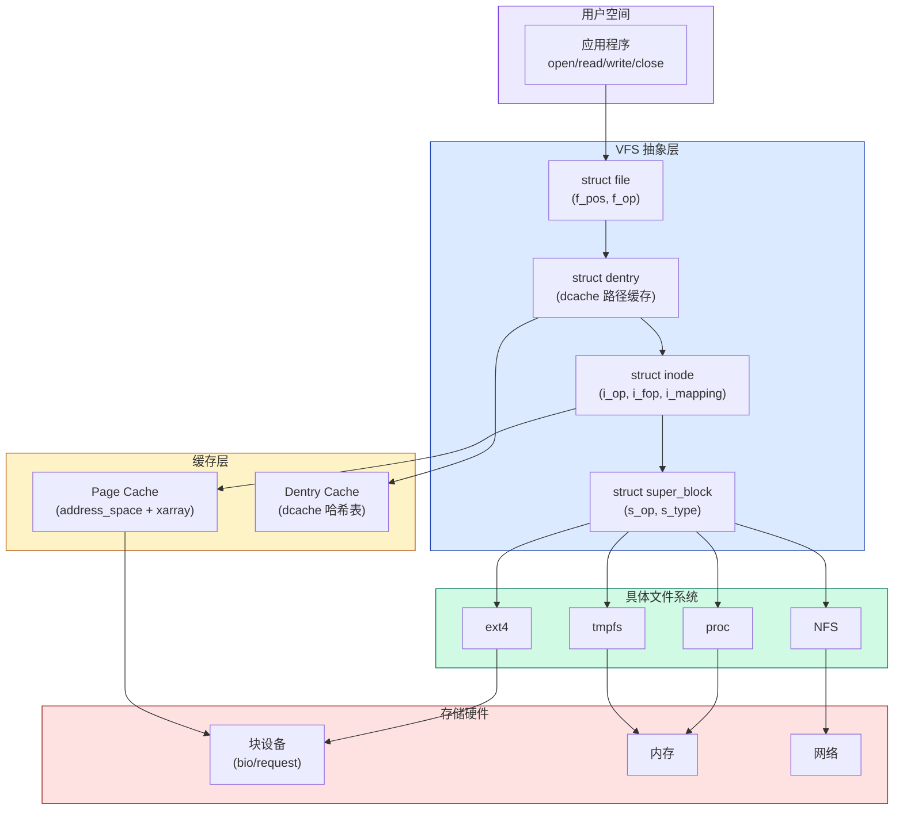

# 📖 《Linux内核深度解析》第6章 文件系统 — 读书笔记

> 📅 2026-07-31 | 🏷️ VFS / inode / dentry / super_block / page cache / ext4 / DAX | 📊 难度：中

---

## 🎯 一句话概括

本章围绕 "Linux 如何让几十种完全不同的文件系统（ext4/btrfs/NFS/proc/...）对用户程序呈现统一的 open/read/write/close 接口"展开，核心是 VFS（虚拟文件系统）这一抽象层的四大数据结构：super_block、inode、dentry、file。

---

## 📚 内容梳理

### 6.1 概述

#### 核心知识点

- **文件系统三层架构**：

```
用户空间:    open/read/write/close/mmap (POSIX 系统调用)
              │
内核空间:    ┌─── VFS (虚拟文件系统层) ───┐
              │ super_block / inode / dentry / file │
              └────────────┬────────────────────────┘
                           │
              ┌────────────┼───────────────────────────────┐
              │            │                               │
         磁盘文件系统   内存文件系统      网络文件系统
         ext4/xfs/btrfs  proc/sysfs/tmpfs    NFS/CIFS
              │            │                               │
硬件:     块设备层       内存                网络
         (bio/request)   (page cache)       (socket)
```

- 文件系统从不同角度的分类：
  - 用户空间接口：`/usr/bin/mount`、`open()`/`read()`/`write()`
  - 硬件交互：块设备（ext4）、字符设备、网络（NFS）
  - 内核空间：VFS 抽象层 + 各具体文件系统实现

### 6.2 虚拟文件系统的数据结构

#### 6.2.1 超级块 (super_block)

```c
// include/linux/fs.h
struct super_block {
    struct list_head    s_list;          // 全局超级块链表
    dev_t               s_dev;          // 设备号
    unsigned char       s_blocksize_bits; // 块大小的位数
    unsigned long       s_blocksize;     // 块大小 (字节)
    loff_t              s_maxbytes;      // 最大文件大小
    struct file_system_type *s_type;     // 文件系统类型
    const struct super_operations *s_op; // 超级块操作函数集
    unsigned long       s_flags;         // 挂载标志 (MS_RDONLY 等)
    unsigned long       s_magic;         // 魔数 (标识文件系统类型)
    struct dentry       *s_root;         // 根目录项
    // ...
};
```

- 每个已挂载的文件系统实例对应一个 super_block
- `s_op` 包含文件系统操作：`alloc_inode()`、`destroy_inode()`、`write_inode()`、`sync_fs()` 等
- 全局链表 `super_blocks` 串联所有超级块

#### 6.2.2 挂载描述符

- `struct mount`：描述一次挂载关系（挂载点 + 文件系统实例）
- 挂载树形成 mount namespace 的层次结构

#### 6.2.3 文件系统类型

```c
// include/linux/fs.h
struct file_system_type {
    const char          *name;        // "ext4", "proc", "tmpfs" 等
    int                 fs_flags;
    struct dentry *(*mount)(struct file_system_type *, int,
                    const char *, void *);  // 挂载方法
    void (*kill_sb)(struct super_block *);  // 卸载方法
    struct module       *owner;
    struct file_system_type *next;    // 全局文件系统类型链表
    struct hlist_head   fs_supers;    // 该类型所有超级块的链表
};
```

- `register_filesystem()` 注册文件系统类型
- `/proc/filesystems` 列出所有已注册的文件系统类型

#### 6.2.4 索引节点 (inode)

```c
// include/linux/fs.h
struct inode {
    umode_t             i_mode;        // 文件类型和权限 (rwxrwxrwx)
    unsigned short      i_opflags;
    kuid_t              i_uid;         // 所有者 UID
    kgid_t              i_gid;         // 所有者 GID
    unsigned int        i_flags;
    const struct inode_operations *i_op; // inode 操作函数集
    struct super_block  *i_sb;         // 所属超级块
    struct address_space *i_mapping;   // 页缓存 (page cache)
    unsigned long       i_ino;         // inode 编号
    union { ... };                     // 设备号等
    dev_t               i_rdev;        // 设备文件的设备号
    loff_t              i_size;        // 文件大小 (字节)
    struct timespec64   i_atime;       // 最后访问时间
    struct timespec64   i_mtime;       // 最后修改时间
    struct timespec64   i_ctime;       // 最后状态改变时间
    unsigned short      i_bytes;
    blkcnt_t            i_blocks;      // 占用的块数
    const struct file_operations *i_fop; // 文件操作函数集
    struct address_space i_data;       // 直属的 address_space
    struct list_head    i_devices;
    struct hlist_node   i_hash;        // inode 哈希表
    // ...
};
```

- 每个文件/目录/设备在内存中对应一个 inode
- `i_op`：inode 操作（create/mkdir/lookup/rename/unlink 等）
- `i_fop`：文件操作（open/read/write/mmap/ioctl 等）
- `i_mapping`：指向 page cache，管理文件内容在内存中的缓存

#### 6.2.5 目录项 (dentry)

```c
// include/linux/dcache.h
struct dentry {
    unsigned int        d_flags;
    struct dentry       *d_parent;     // 父目录
    struct qstr         d_name;        // 文件名 (快速字符串)
    struct inode        *d_inode;      // 关联的 inode
    const struct dentry_operations *d_op; // 目录项操作
    struct super_block  *d_sb;         // 所属超级块
    struct hlist_bl_node d_hash;       // 哈希表节点
    struct list_head    d_lru;         // LRU 链表 (回收用)
    struct list_head    d_child;       // 父目录的子目录链表
    struct list_head    d_subdirs;     // 子目录/文件链表
    // ...
};
```

- dentry 是路径名到 inode 的映射缓存（内存中的目录项缓存）
- dentry 和 inode 的关系：dentry.d_inode → inode（多个 dentry 可指向同一 inode = 硬链接）
- dentry 缓存（dcache）极大加速了路径名查找

#### 数据结构关系图

```
┌────────────────────────────────────────────────────────────────────┐
│                    VFS 四大数据结构关系                               │
│                                                                    │
│  struct file (进程打开的文件)                                       │
│  ┌─────────────────────────┐                                       │
│  │ f_path.dentry ─────────────► struct dentry (目录项缓存)          │
│  │ f_inode ───────────────────► struct inode (索引节点)             │
│  │ f_op → file_operations  │         │                            │
│  │ f_pos (文件偏移)         │         │ d_inode                    │
│  └─────────────────────────┘         ▼                            │
│                                 struct dentry                      │
│  task_struct                    ┌──────────────────┐               │
│  ┌──────────┐                  │ d_name (文件名)    │               │
│  │ *files ──────► files_struct │ d_parent (父目录)  │               │
│  └──────────┘   ┌──────────┐  │ d_inode → inode   │               │
│                 │ fd_array[]│  │ d_subdirs (子目录) │               │
│                 │ [0]→file  │  └──────────────────┘               │
│                 │ [1]→file  │         │                            │
│                 │ [2]→file  │         │ d_inode                    │
│                 └──────────┘         ▼                            │
│                                 struct inode                       │
│                                 ┌──────────────────┐               │
│                                 │ i_mode (权限)     │               │
│                                 │ i_size (大小)     │               │
│                                 │ i_sb → super_block│              │
│                                 │ i_mapping → page cache           │
│                                 │ i_op (inode操作)  │               │
│                                 │ i_fop (文件操作)  │               │
│                                 └────────┬─────────┘               │
│                                          │ i_sb                    │
│                                          ▼                         │
│                                 struct super_block                  │
│                                 ┌──────────────────┐               │
│                                 │ s_type (文件系统)  │               │
│                                 │ s_op (超级块操作)  │               │
│                                 │ s_root (根dentry) │               │
│                                 │ s_blocksize       │               │
│                                 └──────────────────┘               │
└────────────────────────────────────────────────────────────────────┘
```

#### 6.2.6 file 结构

```c
// include/linux/fs.h
struct file {
    struct path         f_path;        // {vfsmount, dentry}
    struct inode        *f_inode;      // 关联的 inode (快速访问)
    const struct file_operations *f_op; // 文件操作函数集
    atomic_long_t       f_count;       // 引用计数
    unsigned int        f_flags;       // 打开标志 (O_RDONLY 等)
    fmode_t             f_mode;        // 访问模式
    loff_t              f_pos;         // 当前读写位置
    struct address_space *f_mapping;   // page cache 映射
    // ...
};
```

- 每次 `open()` 创建一个 file 结构
- 进程的 `task_struct→files→fd_array[fd]` 指向 file
- fork 后父子进程共享 file（f_count++），因此共享文件偏移量

#### FAQ

**Q: inode 和 dentry 为什么要分开？**
inode 代表"文件本身"（内容、权限、大小），dentry 代表"文件在目录树中的位置"（名字、父子关系）。分开的原因：(1) 硬链接——多个 dentry 可以指向同一个 inode (2) dentry 是纯内存缓存，可以随时回收重建，inode 关联了磁盘上的实际数据。

**Q: 同一个文件被两个进程打开，哪些结构是共享的？**
每个进程有独立的 `struct file`（独立的 f_pos），但它们指向同一个 dentry 和 inode。如果是 fork 后继承的 fd，则连 file 都是共享的。

**Q: /proc 和 /sys 这种内存文件系统有磁盘上的 inode 吗？**
没有。它们的 inode 是在内存中动态创建的，不持久化到磁盘。super_block 也是内存中的。

---

### 6.3 注册文件系统类型

- `register_filesystem(&ext4_fs_type)` 将文件系统类型加入全局链表
- `get_fs_type("ext4")` 根据名字查找已注册的文件系统类型

### 6.4 挂载文件系统

#### 核心流程

```
mount -t ext4 /dev/sda1 /mnt
  │
  └─ sys_mount() → do_mount()
      │
      ├─ (1) 路径查找: path_lookup("/mnt") → 获取挂载点的 dentry
      │
      ├─ (2) 调用文件系统的 mount 方法:
      │   ext4_fs_type.mount() → ext4_mount()
      │     → mount_bdev() (块设备文件系统通用)
      │       → 打开块设备
      │       → 读取超级块 (从磁盘)
      │       → 填充 super_block 结构
      │       → 创建根 inode 和根 dentry
      │
      ├─ (3) 创建 struct mount 描述符
      │     关联 super_block + 挂载点 vfsmount
      │
      └─ (4) 将 mount 挂到挂载树上 (mount namespace)
           graft_tree() → 将新文件系统的根dentry "覆盖" 在挂载点上
```

### 6.5 打开文件

#### 核心流程

```
open("/home/user/file.txt", O_RDWR)
  │
  └─ sys_open() → do_sys_open() → do_filp_open()
      │
      ├─ (1) 路径名查找 (path_lookup / link_path_walk):
      │   从 "/" 的 dentry 开始
      │     → 在 dcache 中查找 "home" → 命中(dentry已缓存) → 获取 inode
      │     → 在 dcache 中查找 "user" → 命中 → 获取 inode
      │     → 在 dcache 中查找 "file.txt"
      │       → 命中: 直接得到 dentry + inode
      │       → 未命中: 调用 inode->i_op->lookup() → 从磁盘读取
      │                 创建新 dentry + inode → 加入 dcache
      │
      ├─ (2) 权限检查: inode_permission() 检查 i_mode vs 当前进程的 uid/gid
      │
      ├─ (3) 分配 struct file:
      │     get_empty_filp() → 分配并初始化
      │     file->f_inode = inode
      │     file->f_op = inode->i_fop (从 inode 继承文件操作)
      │     file->f_pos = 0
      │
      ├─ (4) 调用文件系统的 open 方法:
      │     file->f_op->open(inode, file)
      │
      └─ (5) 安装到进程的文件描述符表:
            fd_install(fd, file)
            → current->files->fd_array[fd] = file
            → 返回 fd 给用户态
```

#### FAQ

**Q: dentry cache (dcache) 的作用是什么？**
路径名查找是文件系统最频繁的操作。如果每次 open 都要从磁盘读目录项，性能会非常差。dcache 把最近使用过的 dentry 缓存在内存中，路径名查找时先查 dcache → 命中则 O(1) 获取 inode，不需要磁盘 I/O。

**Q: 路径名查找为什么要逐个组件遍历？**
因为每个目录组件可能是挂载点（需要跨越到另一个文件系统）、可能是符号链接（需要重定向）、可能需要权限检查。不能简单地拼接字符串查找。

### 6.6~6.8 读/写/创建/删除文件

- **读文件**：`sys_read()` → `vfs_read()` → `file->f_op->read_iter()` → 具体文件系统从 page cache 或磁盘读取
- **写文件**：`sys_write()` → `vfs_write()` → `file->f_op->write_iter()` → 写入 page cache → 脏页由 writeback 机制异步写回磁盘
- **创建文件**：`sys_open(O_CREAT)` → `do_last()` → `vfs_create()` → `dir->i_op->create()` → 在磁盘上分配 inode + 在目录中添加条目
- **删除文件**：`sys_unlink()` → `vfs_unlink()` → `dir->i_op->unlink()` → 减少 inode 的硬链接计数，计数为 0 且无进程打开时释放磁盘空间

### 6.9 设置文件权限

- `sys_chmod()` → `chmod_common()` → `notify_change()` → `inode->i_op->setattr()`
- 修改 inode 的 `i_mode` 字段并标记为脏

### 6.10 页缓存 (Page Cache)

#### 核心知识点

- **页缓存**：文件内容在内存中的缓存，以页 (4KB) 为单位
- `struct address_space` 管理一个文件/设备的所有缓存页

```c
// include/linux/fs.h
struct address_space {
    struct inode        *host;          // 关联的 inode
    struct xarray       i_pages;        // 页缓存的 Xarray (6.1用 xarray 替代 radix tree)
    atomic_t            i_mmap_writable; // 可写 mmap 的数量
    struct rb_root_cached i_mmap;       // 所有映射了此文件的 VMA (用于 RMAP)
    unsigned long       nrpages;        // 缓存的页数
    const struct address_space_operations *a_ops; // 操作函数集
    // ...
};
```

- **address_space_operations** 核心方法：
  - `readpage()` / `readahead()`：从磁盘读页到 page cache
  - `writepage()` / `writepages()`：将脏页写回磁盘
  - `write_begin()` / `write_end()`：写文件时的页准备和完成

- **[6.1 变化]**：页缓存从 `radix_tree` 迁移到 `xarray`（更好的 API 和并发性能）

- **读写流程与 page cache 的关系**：
  ```
  read():  fd → file → inode → address_space → xarray 查找页
           命中 → 直接拷贝到用户缓冲区
           未命中 → a_ops->readpage() 从磁盘读 → 加入 xarray → 拷贝

  write(): fd → file → inode → address_space
           a_ops->write_begin() → 准备页(可能从磁盘读)
           拷贝用户数据到页
           a_ops->write_end() → 标记页为脏
           后续由 writeback 机制异步写回磁盘
  ```

### 6.11~6.12 读写文件的技术原理

- **预读 (readahead)**：内核检测到顺序读模式时，提前读取后续的页到 page cache
- **写回 (writeback)**：脏页不立即写回磁盘，由内核线程 (flusher/writeback) 在以下时机写回：
  - 脏页超过 `dirty_background_ratio` (默认 10%) → 后台异步写
  - 脏页超过 `dirty_ratio` (默认 20%) → 阻塞写者强制同步写
  - 脏页存在时间超过 `dirty_expire_centisecs` (默认 30秒) → 过期写
  - 显式 `fsync()`/`sync()` 调用 → 同步写

### 6.13 文件回写

- `sys_fsync()` → `vfs_fsync()` → `file->f_op->fsync()` → 确保数据和元数据写到磁盘
- fdatasync：只同步数据，不同步元数据（更快）
- writeback 内核线程按超级块组织：每个块设备一个 `bdi_writeback`

### 6.14 DAX (Direct Access)

- DAX 用于**持久内存 (NVDIMM)** 设备，绕过 page cache 直接访问
- 文件内容直接映射到进程地址空间（不经过拷贝）→ 减少延迟
- 配置：`CONFIG_FS_DAX` + 挂载时 `-o dax`
- 适用于 ext4/xfs 等支持 DAX 的文件系统

### 6.15 常用的文件系统类型

| 类型 | 文件系统 | 特点 |
|---|---|---|
| 磁盘 | ext4 | Linux 默认，日志式，成熟稳定 |
| 磁盘 | xfs | 高性能大文件，元数据日志 |
| 磁盘 | btrfs | COW，快照，压缩，RAID |
| 内存 | tmpfs | 基于内存+swap，快 |
| 内存 | proc | 进程信息伪文件系统 |
| 内存 | sysfs | 设备模型导出 |
| 网络 | NFS | 网络文件共享 |
| 特殊 | devtmpfs | 设备节点 |
| 特殊 | cgroupfs | cgroup 控制接口 |

#### 重要结论

- VFS 是 Linux 文件系统的核心抽象——所有文件系统都实现 VFS 定义的操作接口
- page cache 是读写性能的关键——几乎所有文件 I/O 都经过 page cache
- dentry cache 是路径查找性能的关键——避免重复的磁盘目录读取

---

## 🧠 费曼解读

### 一、VFS 四层抽象 — 为什么内核要"多此一举"加一层？

**用大白话说：**
想象你有一个万能遥控器（VFS），可以控制任何品牌的电视（ext4/NFS/proc/...）。每个品牌的电视内部电路完全不同，但遥控器上的按钮是统一的：开机、换台、调音量。VFS 就是这个"万能遥控器"的规范——它定义了"按钮"（open/read/write），每个文件系统只需要实现这些按钮背后的"电路"。

没有 VFS 的世界：应用程序需要针对每种文件系统写不同的代码——"如果是 ext4 就调 ext4_read()，如果是 NFS 就调 nfs_read()"。有了 VFS：所有应用只调用 `read(fd, buf, size)`，内核根据 fd 关联的 inode 自动分发到对应文件系统。

**类比：**
USB 接口标准。U盘、鼠标、键盘、摄像头内部完全不同，但都用同样的 USB 插口。操作系统只需要一个 USB 驱动框架（= VFS），每种设备实现自己的驱动（= 具体文件系统）。

**为什么重要：**
在你的 Thor 平台上，`/proc/interrupts`、`/sys/fs/cgroup/`、`/dev/mem` 这些文件其实不在磁盘上——它们是 procfs/sysfs/devtmpfs 的虚拟文件。但你的应用程序用 `open()`+`read()` 就能访问它们，不需要知道底层是什么文件系统。这就是 VFS 的力量。

**关键细节：**
- VFS 的函数分发通过函数指针表实现：`inode->i_op->lookup()`、`file->f_op->read_iter()`
- 注册新文件系统只需要实现一组回调函数并调用 `register_filesystem()`
- 内核中有 60+ 种文件系统都通过这套框架统一管理

**理解自测：**
如果你要实现一个新的"虚拟文件系统"（如让 `/sys/kernel/debug/my_driver/status` 返回驱动状态），你需要实现 VFS 的哪些操作？至少需要哪些结构体和回调函数？

---

### 二、Page Cache — 为什么读文件不是每次都去磁盘？

**用大白话说：**
磁盘很慢（SSD ~100μs，HDD ~10ms），内存很快（~100ns）。如果每次 `read()` 都去磁盘读，系统会慢得不可用。所以内核在内存中开辟了一大片区域（page cache），把最近读过的文件内容缓存在这里。下次读同样的内容，直接从内存拿，快 1000 倍。

写文件也一样——不是直接写磁盘，而是先写到 page cache 中的页面（标记为"脏"），然后由后台线程择时写回磁盘。这就是为什么突然断电可能丢失最近几秒的写入数据。

**类比：**
图书馆的书桌（page cache）vs 书架（磁盘）。你从书架取了一本书放在书桌上看，看完不急着放回去。下次再要这本书，书桌上就有，不用再跑书架。书桌满了？把最久没看的书放回去（LRU 回收）。别人需要这本书？你书桌上的笔记（脏页）先得抄到书里（writeback）才能还。

**为什么重要：**
`free` 命令中的 `buff/cache` 就是 page cache 占用的内存。很多人看到"内存被用完了"就紧张，其实大部分是 page cache——它是可以随时回收的。理解 page cache 对 Thor 平台的内存管理调优很重要。

**关键细节：**
- page cache 的查找用 xarray（类似基数树），按 `(inode, page_offset)` 索引 → O(log n) 查找
- mmap 文件映射也走 page cache——用户态直接访问 page cache 中的页，避免 read/write 的内核-用户空间拷贝
- `echo 3 > /proc/sys/vm/drop_caches` 可以手动释放 page cache（调试用，生产环境不推荐）

**理解自测：**
如果两个进程同时 mmap 同一个文件，它们看到的物理页是同一个还是两个？修改是否互相可见？这和 MAP_SHARED vs MAP_PRIVATE 有什么关系？

---

### 三、路径名查找 — open("/home/user/file.txt") 背后发生了什么？

**用大白话说：**
打开文件时，内核需要沿着路径一级一级找下去：先找到根目录 "/" 的 inode → 在其中查找 "home" 目录 → 在 home 的 inode 中查找 "user" 目录 → 在 user 的 inode 中查找 "file.txt"。每一步都可能需要读磁盘（如果 dcache 未命中）。

为什么不能直接用文件名当 key 一步到位？因为路径中的每一级可能是：(1) 挂载点（需要跨越到另一个文件系统）(2) 符号链接（需要重定向到另一个路径）(3) 需要检查目录权限。

**类比：**
导航到"中国/浙江省/杭州市/西湖区/文三路100号"。你不能直接跳到"文三路100号"，必须逐级确认：先确认你在中国 → 浙江省的入口在哪 → 杭州市在浙江的哪里 → 西湖区在杭州哪里。因为每一级可能有"检查站"（权限）或"转乘点"（挂载点/符号链接）。

**关键细节：**
- dcache 让大部分路径查找不需要磁盘 I/O（热点路径全在内存中）
- `link_path_walk()` 是逐组件遍历的核心函数
- RCU 路径查找（rcu-walk）：无锁快速路径，大部分查找不需要持有任何锁

**理解自测：**
如果 /mnt 是一个 NFS 挂载点，访问 /mnt/data/file.txt 时，路径查找在 "mnt" 这一步会发生什么特殊处理？

---

## 🔗 知识图谱



---

## ❓ 启发性发问

### 理解层

1. 硬链接和符号链接在 VFS 数据结构层面有什么区别？哪个依赖 dentry，哪个依赖 inode？

2. 如果一个文件正在被进程打开（有 struct file 引用），此时另一个进程删除了这个文件（unlink），文件内容会立即从磁盘消失吗？为什么？

### 应用层

3. 在 Thor 平台上，你读 `/proc/interrupts` 获取中断信息。这个"文件"在磁盘上存在吗？它的 read 方法是谁实现的？每次读到的内容为什么不同？

4. 如果你要为 Thor 平台写一个驱动的 debugfs 接口（如导出中断延迟统计），你需要实现哪些 VFS 回调？

### 追问层

5. page cache 对 DAX (持久内存) 设备来说是多余的还是有用的？为什么 DAX 要绕过 page cache？

6. ext4 的日志 (journal) 机制和 page cache 的 writeback 机制是什么关系？日志保护的是什么，page cache 缓存的是什么？

### 关联层

7. 前面内存管理章节学到的 page 回收和 LRU 链表，和 page cache 有什么关系？page cache 中的文件页是放在 LRU 的哪条链表上？

8. cgroup v2 的 memory 控制器能限制 page cache 的使用吗？如果一个 cgroup 的 page cache 超限会发生什么？

---

## 💡 个人洞察

1. **VFS 是 Linux "一切皆文件" 哲学的技术实现**。设备是文件（/dev/）、进程信息是文件（/proc/）、内核参数是文件（/sys/）、网络套接字也可以是文件。这不仅是哲学，更是工程效率——所有工具（cat/grep/echo）都能操作任何"文件"。

2. **page cache 是 Linux 性能的"秘密武器"**。数据库系统经常选择 O_DIRECT 绕过 page cache 自己管理缓存（如 MySQL InnoDB buffer pool），因为它们比内核更了解自己的访问模式。但对于一般工作负载，page cache 的启发式预读和 LRU 回收已经足够好了。

3. **理解 VFS 对理解 /proc 和 /sys 很重要**。之前做 CPU 隔离时经常读写 `/sys/fs/cgroup/` 和 `/proc/irq/`，现在明白了这些不是"真正的文件"，而是内核通过 VFS 框架暴露出来的接口。每次 `cat /proc/interrupts` 实际上在调用 procfs 注册的 `.show()` 回调函数动态生成内容。
