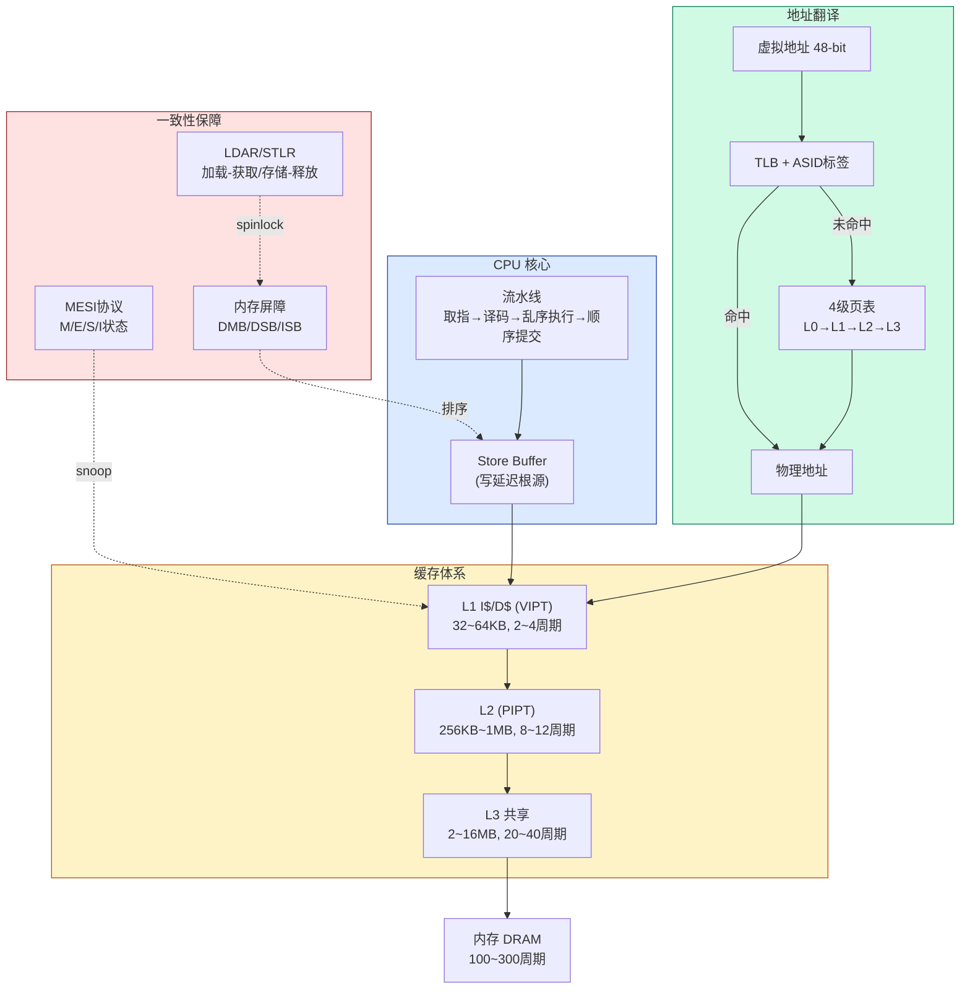

# 📖 《奔跑吧Linux内核》卷1 第1~2章 — 读书笔记

> 📅 2026-07-28 | 🏷️ ARM64 / 处理器架构 / 缓存 / 页表 / 内存屏障 / TLB | 📊 难度：中高

---

## 🎯 一句话概括

这两章回答了一个根本问题：**CPU 发出一个虚拟地址后，数据是怎样经过 TLB → 页表 → 缓存 → 内存这条链路找到的，以及多核场景下如何保证这条链路上的数据一致性**。

---

## 📚 内容梳理

### 第 1 章：处理器架构

#### 1.1 处理器基础（§1.1.1~§1.1.3）

**核心知识点：**

- **RISC vs CISC**：RISC（ARM）只保留常用简单指令，大部分一个周期完成；CISC（x86）指令集复杂，但现代 x86 内部会把 CISC 指令译码成类 RISC 的微操作（μops）再执行。两者在底层实现上已趋同。
- **大/小端字节序**：ARM 默认小端（低字节存低地址）。0x12345678 在小端内存中排列为 78 56 34 12。可以用 union 的 char 成员检测当前端序。
- **一条指令的完整生命周期**：取指 → 译码 → 分发 → 乱序执行 → 顺序提交。关键点是**乱序执行但顺序提交**——处理器会找出无数据依赖的指令并行执行，但最终结果按程序顺序提交到 LSQ（Load-Store Queue），对外保证正确性。

**重要结论：**
- 现代处理器的乱序执行对单核程序员透明（顺序提交保证了单核正确性），但在多核场景下会引发内存可见性问题 → 需要内存屏障。

#### 1.2 高速缓存体系（§1.1.4~§1.1.13）

**核心知识点：**

- **缓存层次**：L1（2~4 周期，32~64KB）→ L2（8~12 周期，256KB~1MB）→ L3（20~40 周期，2~16MB）→ 内存（100~300 周期）。每级容量增大约 4~16 倍，延迟也增大约 4~10 倍。
- **缓存行**：缓存和内存之间数据交换的最小单位，通常 64 字节。CPU 访问一个 int（4字节），实际会加载整条缓存行（64字节）到 L1。
- **地址编码**：虚拟地址被拆成 tag（标签）| index（索引）| offset（偏移）三段。offset 定位缓存行内的字节，index 定位哪一组，tag 验证是否命中。
- **映射方式**：直接映射（每个地址只能放在一个位置，容易颠簸）→ N 路组相联（每个地址可以放在 N 个位置之一，减少颠簸）。典型 ARM64：L1 4-way，32KB，缓存行 64B → 128 组 × 4 路。
- **PIPT / VIVT / VIPT**：
  - VIVT（虚拟索引+虚拟标签）：最快但有重名和同名问题，现代处理器基本不用
  - PIPT（物理索引+物理标签）：最准确但要等 TLB 翻译完才能查缓存，慢
  - VIPT（虚拟索引+物理标签）：折中方案，用虚拟地址低位做索引（和 TLB 并行），物理地址高位做标签验证。ARM64 在 4KB 页下 VIPT 无别名问题（索引位全在页内偏移范围内，虚拟=物理）
- **MESI 协议**：维护多核缓存一致性的硬件协议。四种状态：
  - M（Modified）：独占+已修改，与内存不一致
  - E（Exclusive）：独占+未修改，与内存一致
  - S（Shared）：多核共享，只读
  - I（Invalid）：无效
  - 关键转换：写操作前必须获得独占权 → 向其他核发 Invalidate → 其他核变 I → 本核变 M。ARM 部分处理器使用 MOESI 变种（增加 Owned 状态，允许脏数据直接共享而不必先写回内存）。
- **伪共享（False Sharing）**：两个无关变量在同一缓存行中，不同核各改各的变量也触发 MESI 失效 → 缓存行反复 bounce。解决：`__cacheline_aligned_in_smp` 让变量独占缓存行。书中详细用 MESI 状态转换追踪了 CPU0 改 x、CPU1 改 y 的 5 步过程。
- **缓存在内核中的应用**：slab 的 `SLAB_HWCACHE_ALIGN`；zone、irqaction 等结构体用 `____cacheline_aligned_in_smp`；worker_pool 的 nr_running 独占缓存行。

**重要结论：**
- ARM64 L1 D-cache 使用 VIPT，4KB 页下等效 PIPT，无别名问题
- 伪共享是 SMP 系统性能优化中容易被忽视的关键因素
- 内核中几乎所有高频访问的数据结构都做了缓存行对齐

#### 1.3 内存屏障（§1.1.4 + §1.4.9）

**核心知识点：**

- **乱序的两个来源**：(1) 编译器优化重排指令（用 `barrier()` 阻止）(2) CPU 乱序执行+Store Buffer 延迟写入（用硬件屏障指令阻止）
- **弱一致性内存模型**：ARM 采用弱一致性模型——程序员必须用内存屏障指令显式告诉 CPU 哪些操作有顺序要求。x86 是较强的 TSO（Total Store Order）模型，大部分场景不需要显式屏障。
- **三条屏障指令**：
  - DMB（Data Memory Barrier）：保证之前的内存访问指令在之后的之前完成，只影响内存指令
  - DSB（Data Synchronization Barrier）：比 DMB 更强，还等缓存维护/TLB 操作完成，之后的任何指令都要等
  - ISB（Instruction Synchronization Barrier）：刷流水线，重新取指。改了页表/系统寄存器后必须用
- **书中三个经典例子**：
  - 例 1-1：两核同时读写两个地址，无屏障时结果不确定（4 种可能）
  - 例 1-2（生产者-消费者）：Core A 写 Data 再写 Flag，Core B 轮询 Flag 再读 Data → 不加 DMB 则 B 可能先看到 Flag=1 但 Data 还是旧值
  - 例 1-3（设备寄存器）：写命令到外设后，必须用 DSB 确保写完成，再轮询状态

**与其他知识的关联：** 内核中 spinlock 的实现依赖 LDAR/STLR（加载-获取/存储-释放屏障原语），这是单方向的"半个 DMB"，比全 DMB 更高效。

#### 1.4 ARM64 架构与指令集（§1.2~§1.4）

**核心知识点：**

- **异常级别**：EL0（用户态）→ EL1（内核态）→ EL2（Hypervisor）→ EL3（安全监控）。高异常级别有更大权限。
- **关键寄存器**：
  - 通用：X0~X30（64-bit），W0~W30（低 32-bit）。X29=FP，X30=LR，XZR=零寄存器
  - 系统：SCTLR_EL1（系统控制，含 MMU 使能位 M）、TCR_EL1（翻译控制）、TTBR0/1_EL1（页表基地址）、MAIR_EL1（内存属性）、ESR_EL1（异常综合信息）、FAR_EL1（缺页地址）、SP_EL0（内核 current 指针）
- **独占内存访问指令**：LDXR/STXR（Load/Store Exclusive）用于实现原子操作。ARMv8.1 引入 LSE（Large System Extensions）提供 CAS/SWP/LDADD 等硬件原子指令，对 SMP 性能有显著提升。
- **异常处理**：硬件自动保存 PSTATE→SPSR_ELx、PC→ELR_ELx、根据异常类型跳转到异常向量表。向量表有 4 组（来自当前EL用SP_EL0 / 来自当前EL用SP_ELx / 来自低EL的AArch64 / 来自低EL的AArch32）× 4 种类型（同步/IRQ/FIQ/SError）= 16 个入口。

**重要结论：**
- LSE 原子指令是 ARM64 SMP 性能的关键特性，Linux 内核在编译时可选择是否使用（ALTERNATIVE 宏动态替换）
- 理解异常向量表的 4×4 布局是分析内核中断和缺页处理的前提

#### 1.5 大小核与 NUMA（§1.1.14~§1.1.17）

- **big.LITTLE / DynamIQ**：大核（高性能高功耗）+ 小核（低功耗低性能）异构架构。DynamIQ 允许同一 cluster 内混合大小核。
- **NUMA**：非统一内存访问，处理器访问本地内存快、远端内存慢。ARM 阵营的 ThunderX2、鲲鹏等服务器芯片支持 NUMA。大多数 ARM 嵌入式系统（包括 Thor）使用 UMA 架构。

---

### 第 2 章：ARM64 在 Linux 内核中的实现

#### 2.1 ARM64 内存管理（§2.1.1~§2.1.6）

**核心知识点：**

- **页表结构**：4KB 页 + 48-bit VA = 4 级页表（L0~L3），每级 512 项（9 bit 索引），每项 8 字节。TTBR0 存用户页表（VA 高位 = 0），TTBR1 存内核页表（VA 高位 = 1）。
- **页表项描述符**：
  - L0~L2 有三种类型：无效（bit[0]=0）、块描述符（映射大页，bit[1:0]=01）、表描述符（指向下一级页表，bit[1:0]=11）
  - L3 有两种：无效、页描述符（bit[1:0]=11，指向 4KB 物理页）
  - L1 块 = 1GB 大页，L2 块 = 2MB 大页
  - 关键属性位：AP[2:1]（权限）、AF（访问标志）、SH（共享属性）、AttrIndx（缓存策略索引 MAIR）、UXN/PXN（不可执行）、nG（非全局，使用 ASID）
- **内核内存分布**（48-bit VA，Linux 5.0）：

| 区域 | 虚拟地址范围 | 大小 |
|---|---|---|
| 用户空间 | 0x0000_0000_0000_0000 ~ 0x0000_FFFF_FFFF_FFFF | 256TB |
| 内核模块 | MODULES_VADDR ~ MODULES_END | 128MB |
| vmalloc（含内核映像） | VMALLOC_START ~ VMALLOC_END | ~129TB |
| 固定映射 (fixmap) | FIXADDR_START ~ FIXADDR_TOP | ~4MB |
| PCI I/O | PCI_IO_START ~ PCI_IO_END | 16MB |
| vmemmap | VMEMMAP_START ~ VMEMMAP_END | 2TB (max) |
| 线性映射 | PAGE_OFFSET ~ 高地址 | 128TB |

- **内核映像在 vmalloc 区域中**（5.0 起为了支持 KASLR，不再在线性映射区）
- **案例分析**：书中逐级推导了一个虚拟地址 0xFFFF 8000 1234 5678 的 L0→L1→L2→L3 翻译过程，含每一级的索引计算和物理基地址提取

**重要结论：**
- 块描述符（2MB/1GB 大页）跳过底层页表级，减少翻译开销和 TLB 压力
- 内核映像从 5.0 起放在 vmalloc 区域内（KASLR），和 4.x 不同
- `cat /sys/kernel/debug/kernel_page_tables` 可以 dump 内核页表

#### 2.2 高速缓存管理（§2.2）

- ARM64 的缓存维护指令按"一致性点"分级：
  - PoC (Point of Coherency)：所有 master（CPU、DMA、GPU）都能看到一致数据的点（通常是内存控制器）
  - PoU (Point of Unification)：指令缓存和数据缓存统一的点（用于自修改代码）
- 关键指令：DC CIVAC（清洁+失效到 PoC）、DC CVAC（清洁到 PoC）、IC IALLU（失效所有指令缓存）
- DMA 场景：设备不经过 CPU 缓存直接读写内存 → 必须手动 flush/invalidate 缓存保证一致性

#### 2.3 TLB 管理（§2.3）

**核心知识点：**

- **TLBI 指令**：ARMv8 提供 TLBI 指令族，操作符包括 VMALLE1IS（EL1 全 TLB）、VAE1IS（指定 VA）、ASIDE1IS（指定 ASID）等。后缀 IS 表示 Inner Shareable（广播到所有核）。
- **Linux 内核封装**：`flush_tlb_all()` 的实现为 dsb(ishst) → __tlbi(vmalle1is) → dsb(ish) → isb()，三步保证完整性。
- **ASID**：每个 TLB 条目带 ASID 标签标记所属进程，进程切换只需更换 TTBR 中的 ASID 而不刷 TLB。ASID 存在 TTBR1_EL1 高位（TCR_EL1.A1=1 时）。`ASID(mm) = mm->context.id & 0xffff`。
- **`__TLBI_VADDR` 宏**：将虚拟地址右移 12 位放入低 44 位，ASID 放入高 16 位，组成 TLBI 指令的参数 Xt。

#### 2.4 内存属性（§2.4）

- ARM64 两大类内存：Normal Memory（可缓存可推测）和 Device Memory（不可缓存不可推测）
- Device 内存 4 种属性：nGnRnE（最严格）、nGnRE、nGRE、GRE（最宽松）
- 通过 MAIR_EL1 寄存器配置 8 组属性，页表项的 AttrIndx[2:0] 索引之
- 共享属性分 3 级：Non-shareable、Inner Shareable（同 cluster 内的核）、Outer Shareable（跨 cluster/跨设备）

#### 2.5 内存屏障的完整体系（§2.5）

- **DMB/DSB/ISB 带参数**：SY（全系统）、ISH（内部共享域）、OSH（外部共享域）、NSH（不共享）；每个再分 LD（仅读）、ST（仅写）、无后缀（读写都管）
- **加载-获取 / 存储-释放屏障原语**：LDAR（Load-Acquire）和 STLR（Store-Release）是单方向的"半个 DMB"。它们组合构成临界区，是内核 spinlock 实现的基础。LDAR 之后的指令不能向前越过它；STLR 之前的指令不能向后越过它。
- **与 spinlock 的关系**：自旋锁的加锁用 LDAXR（Load-Acquire Exclusive），解锁用 STLR（Store-Release）→ 临界区内的内存操作被"框住"不会泄漏到锁外面

#### 2.6 启动汇编代码（§2.6）

**核心知识点：**

- **链接脚本 vmlinux.lds.S**：定义 .text/.init/.data/.bss 各段在内核虚拟地址空间中的排列。代码段起始 = KIMAGE_VADDR + TEXT_OFFSET = 0xFFFF000010080000（Linux 5.0）。
- **head.S 启动流程**：
  1. `_head` 入口 → 检查 CPU → 保存设备树地址
  2. `__primary_switch` → 创建恒等映射（identity mapping：VA=PA）+ 内核映像映射
  3. 写 TTBR0/TTBR1 → 设置 SCTLR_EL1.M=1 开启 MMU → ISB 刷流水线
  4. 跳转到内核虚拟地址中的 `start_kernel()` → 进入 C 代码世界
- **恒等映射的必要性**：开启 MMU 的瞬间，PC 指向的是物理地址。如果此时 MMU 开始翻译但没有 VA=PA 的映射，下一条指令就取不到 → 必须有恒等映射让这个过渡瞬间 PC 仍然有效
- **KASLR**：内核地址空间布局随机化。内核启动时随机选择一个偏移量加到 KIMAGE_VADDR 上 → 每次启动内核映射到不同虚拟地址 → 增加攻击难度

**与其他知识的关联：** memblock 引导内存分配器正是在这个阶段工作——页表已建立但 buddy 还没初始化时，用 memblock 管理物理内存分配。

---

## 🧠 费曼解读

### 一、高速缓存组相联 — 数据在缓存里怎么找到的？

**用大白话说：**
CPU 想读一个地址的数据，会先去缓存找。但缓存很小（32KB），内存很大（几 GB），不可能所有数据都在缓存里。所以需要一套"定位系统"来快速判断数据在不在缓存、在哪个位置。

把地址拆成三段：第一段（offset）定位缓存行内的第几个字节；第二段（index）定位在哪一组；第三段（tag）验证这组里的数据是不是你要的。

**类比：**
一个书柜有 128 排（组），每排放 4 本书（4 路）。你拿到一个书号 "2024-056-003"：
- "003" = 看书的第 3 页（offset，缓存行内偏移）
- "056" = 去第 56 排（index，定位到哪组）
- "2024" = 核对书的编号前缀是不是 2024（tag，验证命中）

如果第 56 排的 4 本书都不是 "2024" 开头的 → 未命中（miss），需要去仓库（内存）取，取回来替换掉一本旧书。

**为什么重要：**
理解索引和标签的拆分方式，是理解 VIPT 为什么无别名问题的前提。也是理解为什么伪共享会发生的基础——两个变量如果 index 相同，就在同一组（同一缓存行）。

**关键细节：**
以 ARM Cortex-A 典型 L1 D-cache 为例：32KB，4-way，64B 缓存行 → 每路 128 行 → 128 组 → index 需要 7 bit → [12:6]。offset 需要 6 bit → [5:0]。tag 是剩余高位。4KB 页内偏移也是 [11:0] → index 的 [12:6] 中只有 bit[12] 超出了页内偏移范围。如果改为 64KB 页或减小缓存路数，可以让所有 index 位都落在页内偏移中 → VIPT 完全等效 PIPT。

**理解自测：**
如果 L1 D-cache 变成 64KB 4-way（index 变成 8 bit [13:6]），4KB 页下 VIPT 还安全吗？为什么？

---

### 二、MESI 协议 — 多核缓存怎么不"打架"？

**用大白话说：**
每个 CPU 有自己的 L1 缓存（小仓库）。CPU0 改了某个变量 a=1，这个新值先存在 CPU0 的小仓库里，CPU1 的小仓库里还是旧值 a=0。如果 CPU1 直接用旧值，就出错了。

MESI 协议就是一套"广播通知"机制：你改了数据之前，先在总线上喊一嗓子"我要改这个数据了，你们谁有旧的就标记作废"。所有核收到通知后把自己缓存里这行数据标记为无效（I 状态），这样下次它们要用就必须重新来拿最新的。

**类比：**
图书馆的书被人借走后：
- **M 状态**：你借了书还在上面写了批注 → 你手上是唯一修改版，图书馆里的是旧版
- **E 状态**：只有你借了这本书，但你没写批注 → 你和图书馆里的一样
- **S 状态**：好几个人各复印了一份 → 大家都一样，但谁都不能改（改了别人不知道）
- **I 状态**：你的复印件被标记"已过期" → 下次用之前必须重新去图书馆拿最新版

**为什么重要：**
在 Thor 平台上做 CPU 隔离时，隔离的 CPU5 和其他核即使逻辑上不交互，只要它们的缓存行有交集（比如共享的 L3 缓存），MESI 协议仍然会产生跨核的 snoop 流量（总线窥探），间接影响延迟。这是 isolcpus 无法完全消除的硬件级干扰。

**关键细节：**
书中 §1.1.12 用 5 个步骤详细追踪了 CPU0 改 x、CPU1 改 y（在同一缓存行）时的状态转换：E→S→M→I→M→I→M，每一步都涉及总线事务和缓存行 flush。这 5 步就是伪共享的完整开销。

**理解自测：**
如果 CPU0 反复读（不写）一个变量，CPU1 反复写这个变量，MESI 状态会怎样变化？CPU0 的读操作性能会受影响吗？

---

### 三、内存屏障 — 写了的东西别人为什么看不到？

**用大白话说：**
现代 CPU 有一个"暂存区"叫 Store Buffer——CPU 写数据时先写到暂存区，等方便了再真正写到缓存/内存。这样写操作不用等，CPU 可以继续干别的。

问题来了：CPU0 写了 a=1 到暂存区，然后写了 flag=1 到暂存区。但 flag=1 可能比 a=1 更快从暂存区出去（因为 a 对应的缓存行正被别的核占着，要等 Invalidate ACK）。这时 CPU1 看到了 flag=1 去读 a，发现 a 还是旧值 0！

内存屏障就是一道"闸门"：DMB 说"闸门前的写必须全部从暂存区出去后，闸门后的写才能出去"。这样 CPU1 看到 flag=1 时，a=1 一定已经可见了。

**类比：**
快递站出货：你先寄了包裹 A，再寄了包裹 B。但 A 的目的地比较远需要转运，B 的目的地近可以直达。结果收件人先收到 B 后收到 A。如果 B 里写着"A 已经寄出了请查收"，收件人看到 B 就以为 A 到了，但其实没到。DMB 相当于告诉快递站："A 没送到之前，B 不许发出去"。

**为什么重要：**
内核中几乎所有并发原语（spinlock/mutex/RCU/percpu）都依赖内存屏障。ARM 是弱一致性内存模型（不像 x86 的 TSO 自动保证大部分顺序），在 ARM 上写无锁代码必须显式使用屏障。

**关键细节：**
DMB 只排序内存访问指令，不等它们完成；DSB 要等之前所有操作完成（包括缓存维护、TLB 操作）；ISB 刷掉流水线中已取的指令。内核改了页表后的标准序列是 `DSB ISH → TLBI → DSB ISH → ISB`。

带参数的精细控制：`dmb ishst` = 仅排序 Inner Shareable 域的 Store-Store 操作，比全 `dmb sy` 开销小很多。

**理解自测：**
Linux 内核的 `smp_wmb()` 在 ARM64 上展开为 `dmb ishst`。如果把它改成 `dmb sy`，程序还正确吗？性能会怎样？

---

### 四、页表翻译 — 虚拟地址怎么一步步变成物理地址？

**用大白话说：**
每个程序都以为自己独占内存（0x0~0xFFFF...），但物理内存是共享的。页表就是一本"地址翻译本"，把程序的虚拟地址翻译成真实的物理地址。

翻译本太大（256TB 地址空间 → 如果每 4KB 一条记录需要 5 亿条 → 几 GB），所以设计成多级目录：省→市→区→门牌。大部分省市区组合没有人住 → 对应的目录页不创建 → 省了大量内存。

**类比：**
全国快递地址翻译成仓库编号：
- 第 1 级（L0）：全国分 512 个省 → 用地址的 [47:39] 选省 → 省目录里写着"去第 X 页找市目录"
- 第 2 级（L1）：每省 512 个市 → 用 [38:30] 选市 → 市目录指向区目录
- 第 3 级（L2）：每市 512 个区 → 用 [29:21] 选区 → 区目录指向门牌目录
- 第 4 级（L3）：每区 512 个门牌 → 用 [20:12] 选门牌 → 找到物理仓库编号
- 最后 [11:0] 是仓库内的第几个货架（页内偏移）

**为什么重要：**
缺页异常、COW、mmap、swap 等机制都在操作页表。isolcpus 隔离的 CPU 切换进程时需要更换 TTBR0（用户页表基地址），页表翻译的效率直接影响切换延迟。

**关键细节：**
L1/L2 的页表项可以是"块描述符"而非"表描述符"——直接映射 1GB/2MB 大页，跳过后续页表级。这减少了翻译级数和 TLB 压力。内核线性映射区通常使用 2MB 块映射。

每个页表项中的 nG（non-Global）位决定是否关联 ASID：nG=1 的 TLB 条目是 per-进程的（用户页），nG=0 的是全局的（内核页，不受 ASID 切换影响）。

**理解自测：**
如果把内核的线性映射从 2MB 块映射改成 4KB 页映射，对系统性能有什么影响？影响的主要是什么？

---

### 五、ASID — 切换进程时怎么不清空 TLB？

**用大白话说：**
TLB 缓存了最近的地址翻译结果。切换进程后，同一个虚拟地址在不同进程中对应不同的物理页。如果不处理，新进程可能命中旧进程的 TLB 条目 → 访问到错误的物理页。

最简单的方法是切换时清空所有 TLB，但代价太大（之后大量 TLB miss）。ASID 方案是给每条 TLB 条目打上"属于进程 N"的标签 → 切换进程时只需更新 ASID 编号，不同进程的 TLB 条目共存互不干扰。

**类比：**
你手机上有微信、钉钉、电话三个通讯录。不打标签的话，切换 App 就要清空所有联系人缓存。打了标签后，切 App 时缓存里三个 App 的联系人都在，只是自动过滤显示当前 App 的。

**为什么重要：**
ASID 数量有限（8-bit 只有 256 个），用完后必须 rollover（递增版本号+延迟 TLB flush）。系统进程越多，rollover 越频繁。你的 Thor 平台如果同时运行大量容器，确认是 8-bit 还是 16-bit ASID 直接影响 TLB 效率。

**关键细节：**
书中说明了 ASID 存在 `mm->context.id` 低 16 位，`ASID(mm) = mm->context.id & 0xffff`。`__TLBI_VADDR()` 宏把 ASID 放到参数的 [63:48]，虚拟地址 [55:12] 放到 [43:0]，组成 TLBI 指令的完整参数。

KPTI（Meltdown 防护）场景下 ASID 奇偶分离，可用数量减半。

**理解自测：**
如果一个系统有 300 个进程频繁切换，8-bit ASID 会发生什么？对实时性有什么影响？

---

## 🔗 知识图谱

---

## ❓ 启发性发问

### 理解层

1. ARM64 VIPT 缓存在 4KB 页下无别名，但如果页大小是 64KB 呢？是更安全还是更不安全？为什么？

2. MESI 协议中 E→M 的转换是否需要总线事务（通知其他核）？和 S→M 的转换有什么不同？

### 应用层

3. 在 Thor 平台做 CPU 隔离时，你已经用了 isolcpus + cpuset。从本章学到的缓存知识出发，是否还需要关注 L3 缓存的隔离？如果需要，ARM 有什么硬件机制可以做到？

4. 你的 cyclictest 延迟测试中，如何区分一个毛刺是 TLB miss 造成的还是 L1 cache miss 造成的？需要用什么工具？

### 追问层

5. 书中说 ARM64 的内存屏障是"弱一致性模型"的产物，而 x86 是 TSO 模型。如果把 Linux 内核中所有的 `smp_mb()` 都去掉，在 x86 上运行和在 ARM64 上运行分别会怎样？

6. 恒等映射（identity mapping）在开启 MMU 后仍然存在吗？内核什么时候清理它？如果不清理会有什么问题？

### 关联层

7. 之前做的 nohz_full 实验中，"远程 tick"通过 IPI 干扰隔离 CPU。从 MESI 协议的角度，IPI 本身的处理过程会对 CPU5 的 L1 缓存造成什么影响？

8. 第 2 章介绍的 ASID rollover 机制和 percpu 变量有什么相似之处？它们各自是怎样避免跨核争用的？

---

## 📝 行动项

- [ ] 确认 Thor 平台的 CPU（Cortex-A 哪个型号）的 L1 缓存是 VIPT 还是 PIPT：`cat /sys/devices/system/cpu/cpu0/cache/index0/type`
- [ ] 确认 Thor 平台使用 8-bit 还是 16-bit ASID：检查 `ID_AA64MMFR0_EL1.ASIDBits`
- [ ] 用 `perf stat -C 5 -e cache-misses,cache-references,dTLB-load-misses` 测量隔离 CPU 的缓存和 TLB 命中率
- [ ] 对照书中 §1.1.11 的 MESI 状态转换图，手动走一遍 4 核竞争同一缓存行的完整状态变化
- [ ] 在 Thor 上用 `/sys/kernel/debug/kernel_page_tables` 查看内核页表实际映射，确认线性映射区是否使用 2MB 块映射
- [ ] 重读 §2.5.2 加载-获取/存储-释放屏障原语，结合 spinlock 源码理解 LDAR/STLR 如何框住临界区

---

## 💡 个人洞察

1. **缓存隔离是 CPU 隔离的"最后一公里"**。isolcpus 隔离了调度，managed_irq 隔离了中断，但只要隔离 CPU 和其他核共享 L3 缓存，MESI 的 snoop 流量仍然会造成干扰。ARM 的 MPAM（Memory Partitioning and Monitoring）和 Intel 的 CAT（Cache Allocation Technology）可以做 L3 缓存分区，这可能是 Thor 平台进一步降低延迟的方向。

2. **ARM 的弱内存模型是双刃剑**。弱模型让硬件有更多优化空间（高性能），但把正确性的负担交给了程序员/编译器。这也是为什么同样的无锁算法在 x86 上跑没问题，移植到 ARM 上可能就有 bug 的原因。在审查 ARM 平台的内核代码或驱动代码时，要特别注意内存屏障是否充分。

3. **恒等映射的设计非常精妙**。开启 MMU 是一个"在飞行中换引擎"的操作——前一条指令还在用物理地址，下一条就在用虚拟地址。恒等映射让这个过渡变成了"无感切换"。类似的设计思路在内核中还有很多，比如 trampoline 代码（CPU 热启动时的跳板）。
