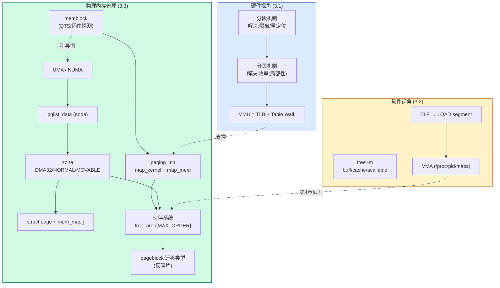

# 📖 《奔跑吧Linux内核》卷1 第3章 内存管理之预备知识 — 读书笔记

> 📅 2026-09-09 | 🏷️ 内存管理 / 分段分页 / UMA·NUMA / node·zone·page / memblock / 伙伴系统 | 📊 难度：中

---

## 🎯 一句话概括

本章回答一个承上启下的问题：**一块从 BootLoader 交给内核的裸物理内存(DDR),是怎样被内核用 node → zone → page 三级数据结构描述、经过页表线性映射、最后按 order 切块喂进伙伴系统,变成可以 `alloc_pages()` 的可用内存的**。它是第 4~6 章内存管理实战的地基。

---

## 📚 内容梳理

### 3.1 从硬件角度看内存管理——为什么需要分页

这一节讲的是"内存管理机制的进化史",核心是理解**分段和分页各自解决了什么、又遗留了什么**。

#### 核心知识点

- **远古时代:动态分区法**。没有虚拟内存,进程直接用物理地址。操作系统占最低一块,进程 A/B/C 依次往上排。进程换出换入后留下大小不一的空洞 → **内存碎片**。要消碎片就得整体搬移进程,极其耗时。
- **动态分区法的三大死穴**(这是理解虚拟内存价值的关键):
  1. **地址空间保护缺失**:所有进程都能访问全部物理内存,进程 A 一个野指针就能改坏进程 B。
  2. **内存使用效率低**:内存不足时只能把整个进程换出磁盘,数据搬运量巨大。
  3. **地址重定位问题**:进程每次换入的物理地址都不同,而代码里的跳转/取数地址是写死的 → 需要重定位。
- **分段机制**:给每个进程一个虚拟地址空间,虚拟地址经 CPU 映射到物理地址。
  - 解决了**保护问题**(不同进程映射到不同物理区,越界访问触发异常→缺页异常)和**重定位问题**(进程只认虚拟地址)。
  - 遗留问题:映射粒度仍是"整个进程/整个段",内存不足时还是要把整段换出 → 磁盘 IO 大;而且段大小不固定,产生**外部碎片**。
- **分页机制**:把映射粒度从"段"细化为**固定大小的页面(page,通常 4KB)**。
  - 常用页只留内存、冷页换出磁盘 → 利用**局部性原理**,只搬运真正需要的页,比分段高效得多。
  - 物理侧的页叫**物理页面 / 页帧(page frame)**,编号叫**页帧号(PFN)**;虚拟侧的页叫**虚拟页面**。
  - 大内存服务器(TB 级)用 4KB 页管理成本高(每个页帧要几十字节的描述结构)→ 现代 CPU 支持 2MB/1GB **大页**。
  - 完成翻译的硬件叫 **MMU**,ARM 的 MMU = **TLB + 页表遍历单元(Table Walk Unit)** 两部分。

#### 重要结论

- **分段解决"隔离",分页解决"效率"**。今天的 Linux 本质是"以分页为主",分段在 x86 上被弱化为平坦模型,ARM64 则根本没有分段。
- 虚拟内存的三大价值(保护、效率、重定位)是理解后续所有内存机制(缺页、COW、swap、mmap)的出发点。

#### FAQ

**Q: 分页机制里"页帧号 PFN"和"物理地址"什么关系?**
物理地址 = PFN × 页大小 + 页内偏移。4KB 页时 `PFN = 物理地址 >> 12`。内核里 `page` 结构、`pfn_to_page()`/`page_to_pfn()` 都围绕 PFN 展开。

**Q: 分段既然被淘汰,为什么 x86 还保留段寄存器?**
历史包袱 + 少量特殊用途(如 x86_64 用 FS/GS 做 per-CPU/TLS 基址)。主流映射靠分页,分段基址大多设为 0(平坦模型)。ARM64 干脆不做分段。

#### 与其他知识的关联

3.1.4 的"两级页表 + Bit[31:20]/Bit[19:12]/Bit[11:0]"描述的是 **ARM32** 的经典两级页表(一级 4096 项、二级 256 项)。这与第 2 章讲的 **ARM64 四级页表(L0~L3,每级 512 项)** 不是一回事——本章用 ARM32 举例是为了讲清"多级查表"的思想,读的时候要在脑子里换算到 ARM64。

---

### 3.2 从软件角度看内存管理——五个视角

这一节是"换五个身份看同一块内存",不涉及深原理,重点是建立**从用户命令到进程地址空间**的全景直觉。

#### 核心知识点

- **系统使用者视角(`free -m`)**:
  - `total/used/free`:总量/已用/未分配。
  - `buff/cache`:buffer 缓存块设备写出数据,cache 是**页面高速缓存**缓存打开的文件。
  - `available`:内存紧张时能回收的量。**关键纠错**:`available ≠ free + buff + cache`,因为共享内存段、tmpfs、ramfs 属于**不可回收**部分。正确公式是 `available = free + buff + cache − 不可回收部分`。
- **应用开发者视角(`malloc`/`mmap`)**:书里抛出三个"灵魂拷问"贯穿第 4 章——
  1. `malloc()` 返回的是**虚拟内存**,什么时候才分配物理内存?(答案:写的时候触发缺页才分配,即 lazy allocation)
  2. `malloc(100)` 内核实际给多大物理内存?(至少一个 4KB 物理页)
  3. `func1`(只 malloc)和 `func2`(malloc 后 memset)分配行为差异?(func1 只拿到虚拟地址,func2 因写入而真正触发缺页分配了物理页)
- **进程视角(ELF → VMA)**:这是本节最有料的部分。
  - **ELF 文件结构**:ELF Header(版本/机型/入口地址)→ 各段(代码段/数据段/BSS)→ 段头表 → 字符串表/符号表。
  - **段(section)vs 分段(segment)**:链接时把**权限相同**的 section 合并成 segment。`readelf -l` 看到的两个 **LOAD** 型 segment 就是加载时真正映射的:
    - LOAD1:`R E`(只读+可执行)= .init + 代码段 + .rodata
    - LOAD2:`RW`(可读+可写)= 数据段 + BSS
  - **`/proc/pid/maps`** 动态查看进程地址映射,每一行就是一个 **VMA**(`vm_area_struct`):代码段(r-xp)、数据段(rw-p)、堆([heap])、[vvar]、[vdso]、栈([stack])。
  - **实测细节**:程序 `malloc(100KB)`,`/proc/maps` 里 [heap] 却是 **140KB**——内核分配的堆比申请值稍大(glibc 预留)。
  - **`/proc/pid/smaps`** 给出更细的指标:`Rss`(实际占用物理内存)、`Pss`(按共享比例摊分)、`Private_Dirty`、`Swap` 等。堆的 `THPeligible: 1` 表示可用透明大页。
  - **VDSO**(Virtual Dynamic Shared Object):解决内核和 libc 之间版本问题的特殊映射,让部分系统调用(如 gettimeofday)不陷入内核。
- **内核视角(三层架构)**:内存管理分三层——
  - **用户空间层**:系统调用接口(brk/mmap/madvise),libc 封装成 malloc/mmap。
  - **内核空间层**:sys_brk/sys_mmap 等 → VMA 管理、缺页中断、匿名页面、页面高速缓存、页面回收、RMAP、slab 分配器、页表管理。
  - **硬件层**:MMU、TLB、高速缓存 + 板载 DDR/LPDDR。

#### 重要结论

- **VMA 是理解进程地址空间的核心抽象**。`/proc/pid/maps` 的每一行 = 一个 VMA,第 4.4 节会展开。
- **Rss ≠ 申请量**:代码段申请 444KB 但 Rss 只有 180KB,因为按需缺页,没访问的页不占物理内存。

#### FAQ

**Q: `free` 里的 buff/cache 算"已用"还是"空闲"?**
物理上被占用,但逻辑上"可回收",所以 `available` 会把大部分 cache 算作可用。这就是为什么 Linux "看起来内存总是快满了"——它主动拿空闲内存做缓存,需要时再还。

**Q: 为什么 malloc 小内存看不到新 VMA,大内存(如 100KB)能看到?**
glibc 小请求走 brk 在已有堆 VMA 里切,大请求(超过 `M_MMAP_THRESHOLD`,默认 128KB 附近)直接 mmap 新建匿名 VMA。100KB 落在堆里,所以看到的是 [heap] 变大而非新 VMA。

---

### 3.3 物理内存管理之预备知识

本章的技术核心。从"一段裸 DDR"到"伙伴系统可分配",分 7 步:架构(UMA/NUMA)→ 数据结构(node/zone/page)→ 内存大小探测(DTS/memblock)→ 物理内存映射(paging_init)→ zone 初始化 → 空间划分(PAGE_OFFSET)→ 物理内存注入伙伴系统。

#### 3.3.1 UMA 与 NUMA

- **UMA(统一内存访问)**:所有 CPU 通过同一条系统总线访问同一块 DDR,访问延迟一致。嵌入式、手机、桌面基本都是 UMA。图 3.6 的例子:4 个 CPU,CPU0/1 组成 Cluster0 共享 L2,CPU2/3 组成 Cluster1 共享 L2,四核共享 L3,统一访问 DDR。
- **NUMA(非统一内存访问)**:多个**内存节点**,每个节点绑定一组 CPU。CPU 访问**本地节点**快,访问**远端节点**要经 UPI(Ultra Path Interconnect)总线,慢很多。
- **延迟量化**(Intel Xeon 5500,表 3.1)——这张表值得记住,它是"缓存/内存层级代价"的实测锚点:

| 访问类型 | 延迟 |
|---|---|
| L1 命中 | ~4 周期 |
| L2 命中 | ~10 周期 |
| L3 命中(未共享) | ~40 周期 |
| L3 命中(与其他 CPU 共享该行) | ~65 周期 |
| L3 命中(被其他 CPU 改过) | ~75 周期 |
| 访问**远端** L3 | ~100~300 周期 |
| 本地 DDR | ~60ns |
| 远端节点 DDR | ~100ns |

**重要结论**:同样是 L3 命中,"被别的核改过"比"独占"慢近一倍(75 vs 40 周期)——这正是第 1 章 MESI 协议和伪共享的代价在延迟表上的体现。远端内存比本地慢约 40ns(60→100ns),这就是 NUMA 亲和性调优的意义。

#### 3.3.2 内存管理的核心数据结构:node → zone → page

这是全章的骨架。物理内存管理相关的数据结构层次:

```
pglist_data (内存节点/node)          ← 一个 NUMA 节点的所有资源
  ├── node_zones[]                   ← 该节点的若干 zone
  │     └── struct zone              ← 内存管理区(DMA/DMA32/NORMAL/...)
  │           ├── watermark[]        ← 三条水位线
  │           ├── free_area[MAX_ORDER] ← 伙伴系统空闲链表
  │           └── per_cpu_pageset    ← per-CPU 页面缓存(pcp)
  └── node_mem_map / 全局 mem_map[]  ← page 数组,与物理页一一对应
        └── struct page              ← 描述一个物理页帧(4KB)
```

- **`pglist_data`(内存节点)**:描述一个节点的全部内存资源。
  - **UMA**:只有一个节点,用全局变量 `contig_page_data` 描述。
  - **NUMA**:用指针数组 `node_data[]` 管理多个节点,初始化时枚举 ACPI 固件获得。
- **`zone`(内存管理区)**:把一个节点的物理内存按"用途/可寻址范围"再切分。为什么要有 zone?两个历史原因:
  1. **寻址位宽限制**:32 位处理器最多 4GB 物理内存,内核空间通常只有 1GB,无法把 4GB 全部线性映射 → 能线性映射的叫 `ZONE_NORMAL`,映射不了的叫 `ZONE_HIGHMEM`(高端内存)。
  2. **架构 DMA 限制**:x86 的 ISA 设备只能访问前 16MB → 有 `ZONE_DMA`。
  - 常见 zone 类型:`ZONE_DMA`(0~16MB,仅 x86,ARM 原书说没有)、`ZONE_DMA32`(最低 4GB,给 32 位 DMA 设备)、`ZONE_NORMAL`(线性映射)、`ZONE_HIGHMEM`(高端内存,64 位系统没有)。
- **`page`(物理页帧描述符)**:内核给**每个** 4KB 物理页都分配一个 `struct page`,用 `mem_map[]` 数组存放,和物理页**一一对应**。这是内存管理里数量最庞大的结构(1GB 内存 = 262144 个 page),所以 `struct page` 对大小极度敏感(第 5 章会讲它的 union 压缩技巧)。
- **`pte_t`(页表项)**:本质是 `u64`,但隐含 MMU 语义(第 2 章讲过的 AP/AF/SH/nG 等属性位)。

zone 结构体(原书基于 5.0):

```c
// include/linux/mmzone.h (Linux 5.0)
struct zone {
    unsigned long        watermark[NR_WMARK];   // MIN/LOW/HIGH 三条水位线
    long                 lowmem_reserve[MAX_NR_ZONES]; // 防止过度使用低端 zone
    struct pglist_data  *zone_pgdat;            // 指回所属节点
    struct per_cpu_pageset __percpu *pageset;   // per-CPU 页面缓存,减少锁争用
    unsigned long        zone_start_pfn;        // 起始页帧号
    unsigned long        managed_pages;         // 被伙伴系统管理的页数
    unsigned long        spanned_pages;         // 跨越的总页数(含空洞)
    unsigned long        present_pages;         // 实际存在的页数
    const char          *name;
    ZONE_PADDING(_pad1_)                        // 填充:让热点锁分居不同缓存行
    struct free_area     free_area[MAX_ORDER];  // ★伙伴系统核心
    unsigned long        flags;
    spinlock_t           lock;                  // 保护 zone 的自旋锁
    ZONE_PADDING(_pad3_)
    atomic_long_t        vm_stat[NR_VM_ZONE_STAT_ITEMS]; // zone 计数
} ____cacheline_internodealigned_in_smp;        // 整体缓存行对齐
```

- **`ZONE_PADDING` 的用意**(呼应第 1 章伪共享):`zone->lock` 和 `zone->lru_lock` 是两个竞争极其激烈的热点锁,早期(4.0)常需同时持有。用 padding 把它们塞进**不同缓存行**,避免一个锁的写让另一个锁所在缓存行失效。zone 数量少,不在乎浪费这点空间。
- **`spanned` vs `present` vs `managed`** 三个页数要分清:
  - `spanned_pages` = end_pfn − start_pfn(含中间的空洞)
  - `present_pages` = 实际存在的物理页(减掉空洞)
  - `managed_pages` = 交给伙伴系统管理的(减掉 memmap/reserved 等启动占用)
  - 关系:`spanned ≥ present ≥ managed`

**[6.1 变化]** 原书基于 5.0,以下几处在 6.1 已改变:
- `zone->lru_lock` 和 `zone->vm_stat`:5.0 已从 zone 移到 `pglist_data`;6.1 进一步把 lru_lock 下沉到 **`lruvec`**(per-memcg),字段是 `struct lruvec.lru_lock`。
- `zone->pageset`(`struct per_cpu_pageset`)在 5.14 改名为 **`zone->per_cpu_pageset`**(`struct per_cpu_pages`)。
- **ARM64 从 5.5 起也有了 `ZONE_DMA`**(默认覆盖前 1GB / 由固件描述的 32 位可寻址范围),原书"ARM 没有 ZONE_DMA"的说法在 6.1 **已过时**。6.1 的 arm64 会同时创建 `ZONE_DMA` 和 `ZONE_DMA32`。

#### 3.3.3 内存大小:DTS / memblock 探测

- 内核不自己探测内存条,而是由 **BootLoader/BIOS 把 DDR 大小传进来**。ARM64 有两种描述途径:**DTS(设备树)** 或 **BIOS(ACPI)**。
- **DTS**:2011 年起 ARM Linux 全面采用,从 PowerPC 的 FDT(扁平设备树)演化而来。内存节点长这样:
  ```
  memory@60000000 {
      device_type = "memory";
      reg = <0x60000000 0x40000000>;  // 起始地址 + 大小(1GB)
  };
  ```
- **QEMU Virt 开发板**(本书实验平台):内存布局写死在 QEMU 源码 `hw/arm/virt.c`,不用 DTS 文件。物理内存(RAM)起始地址固定 **0x4000 0000**,大小由命令行 `-m` 指定。低地址区排布着 flash/UART/RTC/GPIO/PCIE MMIO 等外设。
- **解析调用链**:
  ```
  start_kernel()
    → setup_arch()
      → setup_machine_fdt()
        → early_init_dt_scan_nodes()
          → early_init_dt_scan_memory()   ← 解析 "memory" 节点拿到 base/size
            → early_init_dt_add_memory_arch()
              → memblock_add()             ← 加入 memblock 子系统
  ```
- **memblock**:页表和伙伴系统就绪**之前**的引导期内存分配器,负责登记/分配这段"还没被正式管理"的物理内存。(呼应 ch1ch2 笔记的 memblock→buddy 交接)

**[6.1 变化]** `early_init_dt_scan_memory()` 在 6.1 已改为**无参数**签名 `int __init early_init_dt_scan_memory(void)`,内部自己遍历 memory 节点,不再由 `early_init_dt_scan_nodes` 传 node/uname/depth。

#### 3.3.4 物理内存映射:paging_init 的两次映射

内核用内存前要先建页表,入口是 `paging_init()`:

```c
// arch/arm64/mm/mmu.c
void __init paging_init(void)
{
    pgd_t *pgdp = pgd_set_fixmap(__pa_symbol(swapper_pg_dir));
    map_kernel(pgdp);   // ① 映射内核映像 → vmalloc 区域
    map_mem(pgdp);      // ② 线性映射全部物理内存 → 线性映射区
    ...
}
```

两次映射目标地址不同,这是 ARM64 内核地址空间的关键设计:

- **① `map_kernel()`**:把内核映像各段(代码段 `_text~_etext`、只读数据段、init 段、数据段 `_data~_end`)映射到 **vmalloc 区域**(0xFFFF 0000 1000 0000 ~ 0xFFFF 7DFF BFFF 0000)。这是 5.0 起为支持 **KASLR** 的做法(第 2 章讲过)。
- **② `map_mem()`**:把物理内存**线性映射**到线性映射区(0xFFFF 8000 0000 0000 ~ 0xFFFF FFFF FFFF FFFF,128TB)。它分**三段**映射:
  1. 第一段:0x4000 0000 ~ 0x4008 0000(内核映像之前的低地址)
  2. 第二段:内核映像结束 `_end` ~ 物理内存结束
  3. **第三段(单独拎出)**:内核映像开始 `_start` ~ 结束 `_end`
- **为什么第三段要单独映射?** 两个原因:
  1. 后续 `smp_cpus_done()→mark_linear_text_alias_ro()` 会把第三段设为**只读**,防止内核模块或 Hibernate 机制不小心改到内核代码(内核代码在这里有个线性映射的"别名"alias)。
  2. 第一、二段启用了**连续页表项属性(PTE_CONT)** 优化,把第三段拆出来避免 PTE_CONT 影响它的独立属性设置。

#### 3.3.5 zone 初始化

- QEMU 虚拟机只配了 `CONFIG_ZONE_DMA32`,没配 DMA/HIGHMEM/DEVICE,所以只有 **ZONE_DMA32 + ZONE_NORMAL**(加上永远存在的 ZONE_MOVABLE)。
- **ZONE_DMA32 大小**:定义在 `zone_sizes_init()`,上限 4GB,由 `max_zone_dma_phys()` 计算。
  ```c
  // arch/arm64/mm/init.c (Linux 5.0)
  static void __init zone_sizes_init(unsigned long min, unsigned long max)
  {
      unsigned long max_zone_pfns[MAX_NR_ZONES] = {0};
      if (IS_ENABLED(CONFIG_ZONE_DMA32))
          max_zone_pfns[ZONE_DMA32] = PFN_DOWN(max_zone_dma_phys());
      max_zone_pfns[ZONE_NORMAL] = max;
      free_area_init_nodes(max_zone_pfns);   // 用各 zone 的最大 pfn 初始化
  }
  ```
- **启动日志印证**(1GB 内存):
  ```
  Zone ranges:
    DMA32    [mem 0x40000000-0x7fffffff]   ← 1GB 全在 DMA32
    Normal   empty                          ← NORMAL 为空(内存<4GB)
  On node 0 totalpages: 262144              ← 262144 × 4KB = 1GB
    DMA32 zone: 4096 pages used for memmap   ← 4096 页给 mem_map 用
    DMA32 zone: 262144 pages, LIFO batch:63  ← pcp 每批 63 页
  ```
- **`mem_map` 开销**:262144 个页,每个配一个 `struct page`,`calc_memmap_size()` 算出需要 4096 个页(即 16MB)来存这些 page 结构。这就是"管理内存也要花内存"的成本。
- zone 核心初始化在 `free_area_init_core()`;pcp 那行日志出自 `zone_pcp_init()`。

**[6.1 变化]**:
- `free_area_init_nodes()` 在 5.8 改名为 **`free_area_init()`**;`zone_sizes_init()` 在 6.1 是**无参**版本,内部自己取 min/max pfn,且会填 `max_zone_pfns[ZONE_DMA]`。
- `memblock_virt_alloc_*` 系列在 6.1 已改名为 **`memblock_alloc_*`**。

#### 3.3.6 空间划分:PAGE_OFFSET 与线性映射地址转换

- 32 位:用户/内核按 3:1(或 2:2)划分 4GB。ARM64 的划分见第 2 章。
- **`PAGE_OFFSET`**:线性映射区的起始虚拟地址,由 VA_BITS 决定。VA_BITS=48 时 `PAGE_OFFSET = 0xFFFF 8000 0000 0000`。
  ```c
  #define PAGE_OFFSET (UL(0xffffffffffffffff) - (UL(1) << (VA_BITS - 1)) + 1)
  ```
- **线性映射的地址互转**(这是 `__pa()`/`__va()` 的底层):
  - `__phys_to_virt(x)`:物理→虚拟,`(x - PHYS_OFFSET) | PAGE_OFFSET`(QEMU 里 `PHYS_OFFSET = 0x4000 0000`)。
  - `__virt_to_phys`:虚拟→物理,要**先判断**这个虚拟地址是线性映射区还是 vmalloc 区(内核映像在 vmalloc 区,不能用同一公式):
    ```c
    #define __is_lm_address(addr)  (!!((addr) & BIT(VA_BITS - 1))) // bit47 判断
    #define __lm_to_phys(addr)     (((addr) & ~PAGE_OFFSET) + PHYS_OFFSET)  // 线性映射
    #define __kimg_to_phys(addr)   ((addr) - kimage_voffset)               // 内核映像
    #define __virt_to_phys_nodebug(x) \
        (__is_lm_address(__x) ? __lm_to_phys(__x) : __kimg_to_phys(__x))
    ```
- **关键点**:因为内核映像被 KASLR 挪到了 vmalloc 区,`__pa()` 必须分流处理——线性映射区减 PAGE_OFFSET 加 PHYS_OFFSET,内核映像区减 `kimage_voffset`。这是 5.0 之后地址转换比早期内核复杂的根源。

#### 3.3.7 物理内存初始化:如何把物理页注入伙伴系统

这是本章的"收尾大戏"——memblock 里登记的物理内存,怎么按 order 切块交给伙伴系统。

**伙伴系统基础**:
- 空闲内存按 **2^order 个连续页** 分组管理,`MAX_ORDER = 11`,即 order 0~10,共 11 条链表:1,2,4,...,1024 页。**order-10 = 1024 页 = 4MB** 是单个内存块的最大值。
- `zone->free_area[MAX_ORDER]`,每个 `free_area` 里又按迁移类型分成多条链表:
  ```c
  struct free_area {
      struct list_head  free_list[MIGRATE_TYPES]; // 按迁移类型分链
      unsigned long     nr_free;
  };
  ```
- **迁移类型(MIGRATE_TYPES)**——反碎片的核心机制,把页按"可移动性"分类,同类聚集:
  - 原书(5.0)列的枚举里有 `MIGRATE_RESERVE`,这其实是**更老内核**的残留写法。
  - 每个**页块(pageblock)** 有一个迁移类型,`pageblock_order = MAX_ORDER-1`(即 4MB / 1024 页),用 **4 bit** 存类型,存在 `zone->pageblock_flags` 指向的位图里,大小由 `usemap_size()` 计算。
  - `get/set_pageblock_migratetype()` 读写;底层是 `set_pfnblock_flags_mask()`。
- **初始化时全标为 MIGRATE_MOVABLE**:`memmap_init_zone()` 循环里对每个 pageblock 调 `set_pageblock_migratetype(page, MIGRATE_MOVABLE)`。所以 `/proc/pagetypeinfo` 里:
  - 大部分页在 **MIGRATE_MOVABLE** 链表;
  - 大部分页初始化时在 **order-10** 链表(内存刚启动,大块连续,还没被切碎)。

**注入过程(按 order 对齐切块)**:
```
start_kernel()
  → mm_init()
    → mem_init()
      → free_all_bootmem()  (memblock_free_all)
        → free_low_memory_core_early()
          → for_each_free_mem_range() 遍历每个空闲内存块 [start, end]
            → __free_pages_memory(start, end)
              → memblock_free_pages() → __free_pages()  ★伙伴系统核心
```

`__free_pages_memory()` 的切块算法是精髓:
```c
static void __init __free_pages_memory(unsigned long start, unsigned long end)
{
    while (start < end) {
        // order 取"start 的对齐能力"与 MAX_ORDER-1 的较小值
        int order = min(MAX_ORDER - 1UL, __ffs(start));
        // 若这个 order 的块超出了 end,就降 order
        while (start + (1UL << order) > end)
            order--;
        memblock_free_pages(pfn_to_page(start), start, order);
        start += (1UL << order);
    }
}
```
- `__ffs(start)` = start 二进制最低位 1 的位置 = start 的对齐能力。例:`start=0x63300` 以 0x100(256=2^8)对齐 → order=8,正好切出一个 256 页的块挂到 order-8 链表。
- **规律**:起点没对齐时 order 零碎(先切小块把地址"垫齐"),一旦 `start` 对齐到 0x400(1024=2^10),之后就一路 order-10 大块地挂进去。看日志 `[0x8800e, 0xaecea]`:
  ```
  start=0x8800e order=1  ← 起点只对齐到 2,先切 2 页
  start=0x88010 order=4
  start=0x88020 order=5
  ...逐步垫齐...
  start=0x88400 order=10 ← 对齐到 0x400 后,全是 order-10
  start=0x88800 order=10
  ...
  ```
- 这解释了为什么系统刚启动时 `/proc/buddyinfo` 里 order-10 的空闲块特别多。

**[6.1 变化]**:
- `free_all_bootmem()` 在新内核叫 `memblock_free_all()`;`__free_pages_boot_core` → `__free_pages_core`。
- **`migratetype` 枚举**在 6.1 已是:`MIGRATE_UNMOVABLE, MIGRATE_MOVABLE, MIGRATE_RECLAIMABLE, MIGRATE_PCPTYPES, MIGRATE_HIGHATOMIC, [MIGRATE_CMA], [MIGRATE_ISOLATE], MIGRATE_TYPES`。注意:MOVABLE 和 RECLAIMABLE 顺序与原书不同,`MIGRATE_RESERVE` 早已删除,新增了 `HIGHATOMIC`(高阶原子分配预留)、`CMA`、`ISOLATE`。
- MAX_ORDER 在 6.1 仍为 11(默认),但 6.4+ 起 MAX_ORDER 语义改为"最大 order 本身"(减 1),阅读更新内核代码时要注意。

---

## 🧠 费曼解读

### 一、node / zone / page 三级结构 — 内核到底怎么"记账"内存?

**用大白话说:**
内核要管几个 G 的物理内存,不可能眼里只有"一大坨字节"。它像仓库管理一样分三级记账:

- **node(节点)**:一栋仓库楼。UMA 系统只有一栋楼(`contig_page_data`);NUMA 系统有好几栋,每栋楼配几个搬运工(CPU),搬本楼的货快,去别的楼搬货慢。
- **zone(管理区)**:一栋楼里按"货物用途"分的库区。有的库区专门放"只能给老式设备用的货"(DMA),有的放普通货(NORMAL)。为什么要分?因为有些硬件设备(老 DMA)只够得着低地址的货架,你不能把它要的东西放到高层去。
- **page(页帧)**:货架上最小的格子,固定 4KB。每个格子都挂一张卡片(`struct page`)记录它的状态。

**类比:**
一个连锁仓储集团:
- node = 不同城市的仓库(北京仓、上海仓,跨城调货慢 = NUMA)
- zone = 每个仓库里的分区(冷藏区只能放特定货 = ZONE_DMA,普通区 = ZONE_NORMAL)
- page = 货架上的标准托盘(4KB),每个托盘一张登记卡(struct page)

**为什么重要:**
你在 Thor 平台做 CPU 隔离和实时调优,`/proc/zoneinfo`、`/proc/buddyinfo`、NUMA 亲和(`numactl`)全都建立在这三级结构上。理解了 node/zone/page,才看得懂"为什么隔离核跨 NUMA 访问内存会引入抖动"。

**关键细节:**
`struct page` 是数量最大的结构(1GB=26 万个),所以它拼命压缩(第 5 章的 union)。而 zone 数量极少(一个 node 就几个),所以它反而用 `ZONE_PADDING` **主动浪费空间**换取锁不伪共享——同一个内核里,两种结构对"空间 vs 性能"的取舍完全相反,这是很典型的工程判断。

**理解自测:**
一个 4GB 内存、单 NUMA 节点的 ARM64 系统,大概有几个 node、几个 zone、几个 struct page?

---

### 二、zone 的存在意义 — 为什么内存要"分区"而不是一锅端?

**用大白话说:**
你可能觉得内存就是一整块,随便分不就行了?但有两个硬约束逼着内核分区:

1. **有些设备"够不着"高地址**。老式 DMA 设备地址线只有 32 位甚至更少,它只能读写低 4GB(或低 16MB)的内存。如果内核把这些低地址内存随便分给了普通程序,等 DMA 设备要用时就没得分了 → 所以要专门圈一块 `ZONE_DMA32`/`ZONE_DMA` 留给它们。
2. **32 位内核"看不全"物理内存**。32 位内核空间只有 1GB,没法把 4GB 物理内存全部一一映射进来 → 能映射的叫 NORMAL,映射不了的叫 HIGHMEM(高端内存),用的时候临时映射。

**类比:**
停车场按车型分区:货车太高只能停一楼(DMA 设备只能用低地址),小轿车哪层都行(普通内存)。如果不分区,让小轿车先把一楼停满,货车来了就没地方停了。

**为什么重要:**
`free`、`/proc/meminfo` 里的分区统计,以及"明明还有内存却分配失败(某个 zone 耗尽)"这类诡异现象,根子都在 zone 划分。64 位系统没有 HIGHMEM 了,但 DMA/DMA32 依然影响低地址内存的可分配量。

**关键细节:**
64 位内核空间足够大,能线性映射全部物理内存 → **HIGHMEM 在 64 位系统被彻底取消**。但 DMA 约束是硬件决定的,和位宽无关,所以 DMA/DMA32 依然保留。**[6.1]** ARM64 从 5.5 起也引入了 ZONE_DMA(不再像原书说的"ARM 没有")。

**理解自测:**
一个 64 位系统内存只有 2GB(全在 4GB 以内),它会有 ZONE_NORMAL 吗?启动日志里 Normal 会不会是 empty?(提示:回看 3.3.5 的日志)

---

### 三、伙伴系统的 order 切块 — 为什么启动时全是 order-10?

**用大白话说:**
内核要把一大段连续物理页交给伙伴系统。伙伴系统只收"2 的整数次幂个页"的整齐块(1、2、4、...、1024 页)。问题是:一段内存的起始页号往往不是整齐的 2^n 对齐,怎么切?

诀窍:**看起点能被多大的 2 的幂整除,就先切多大的块**。比如起点是 0x8800e(二进制末尾是 ...1110),最低位的 1 在第 1 位 → 只能先切 2 页,把地址推到 0x88010;这时末尾 4 个 0,能切 16 页;...每切一次地址越来越"整齐",直到对齐到 1024 页边界,后面就能一路切最大的 order-10 大块。

**类比:**
铺地砖。房间左边墙不是整砖对齐的,你得先在墙角切几块小砖头把边垫齐,一旦垫到整砖网格线上,后面就能一路铺整砖(1m×1m 的大砖),又快又整齐。启动时内存大片连续没被用过,所以"整砖"(order-10 大块)特别多。

**为什么重要:**
这解释了两个现象:(1) 系统刚启动 `/proc/buddyinfo` 里 order-10 空闲块爆多;(2) 运行久了大块被切碎,高 order 块变少 → 高阶分配(如需要连续 4MB)失败 → 触发内存规整(compaction,第 5 章)。你做实时系统时,大页(hugepage)分配失败往往就是碎片化的结果。

**关键细节:**
`order = min(MAX_ORDER-1, __ffs(start))`——`__ffs()` 求最低位 1 的位置,正好等于地址的对齐能力。再用 `while (start + (1<<order) > end) order--` 防止最后一块超出边界。两个约束共同保证:块既不超范围,又尽量大。

**理解自测:**
起始页帧号 `start = 0x88200`,`__ffs(0x88200)` 是多少?会切出 order 几的块?(提示:0x88200 = ...1000 0010 0000 0000)

---

### 四、线性映射 vs vmalloc 映射 — 内核为什么用两套地址转换公式?

**用大白话说:**
内核空间的虚拟地址其实分成两个区:
- **线性映射区**:物理地址和虚拟地址是"固定差值"的关系,虚拟地址 = 物理地址 + 一个固定偏移。转换极快,一个加减法搞定。内核访问普通物理内存走这里。
- **vmalloc 区**:内核映像自己被 KASLR"随机搬家"到了这个区,它和物理地址不是固定偏移关系,得单独减一个 `kimage_voffset`。

所以 `__pa()`(虚拟转物理)必须先问一句:"你是线性映射区的地址,还是内核映像的地址?"再选对应公式。

**类比:**
两种寄快递填地址:
- 线性映射 = 标准小区,门牌号 = 楼号 + 固定基数,规律死板一算就出。
- vmalloc/内核映像 = 政府给某栋楼做了保密处理,随机分配了一个代号(KASLR),你得查专门的对照表(减 kimage_voffset)才知道真实位置。

**为什么重要:**
5.0 之前内核映像就在线性映射区,`__pa()` 一个公式走天下。5.0 引入 KASLR 后把内核映像挪进 vmalloc 区,转换才分了叉。看内核崩溃日志、做地址取证时,搞不清一个地址在哪个区,`__pa()` 算出来就是错的。

**关键细节:**
判断靠 `__is_lm_address(addr) = (addr & BIT(VA_BITS-1))`——即看虚拟地址的**第 47 位**(VA_BITS=48 时)。线性映射区这一位是 1,vmalloc 区是 0。这是个非常轻量的一位判断。

**理解自测:**
为什么内核映像要单独放 vmalloc 区、做 KASLR,而不是和普通线性映射一样固定偏移?(提示:安全)

---

### 五、pageblock 迁移类型 — 反碎片的"分区隔离"思想

**用大白话说:**
内存会碎片化:分了又放、放了又分,最后满地都是零散的小块,想找一整块连续的大内存却找不到。伙伴系统的应对是:**把页按"能不能被搬走"提前分类,同类聚在一起**。

- 可移动的(MOVABLE,如用户进程的匿名页):它们能被搬家,碎了也能通过"内存规整"重新拼整。
- 不可移动的(UNMOVABLE,如内核数据结构):它们钉死在原地,一旦插在中间就把连续区域劈成两半。

内核把"可移动"和"不可移动"的页分到不同的 **pageblock**(4MB 一块)里,不让它们混住。这样即使 MOVABLE 区碎了,也能整体规整成大块,而不会被 UNMOVABLE 的"钉子户"卡住。

**类比:**
小区停车:把"长期不挪的僵尸车"(UNMOVABLE)集中停到角落一个区,把"每天都开走的日常车"(MOVABLE)停另一个区。这样日常车区永远能腾出连续车位办活动;要是僵尸车和日常车混停,想腾一片连续场地就永远做不到。

**为什么重要:**
这是 Linux 抗碎片化的地基。启动时所有页块都是 MOVABLE(内存干净),运行中内核才逐步"偷"一些块转成 UNMOVABLE。高阶连续内存分配(大页、DMA 缓冲、`vmalloc` 之外的连续分配)能否成功,直接取决于 MOVABLE 块有没有被"钉子户"污染。

**关键细节:**
每个 pageblock 用 **4 bit** 记录迁移类型,存在 `zone->pageblock_flags` 位图里。`pageblock_order` 通常等于 `MAX_ORDER-1`(4MB)。**[6.1]** 迁移类型比原书多了 `MIGRATE_HIGHATOMIC`(给高阶原子分配预留,避免中断上下文里的高阶分配失败)、`MIGRATE_CMA`、`MIGRATE_ISOLATE`。

**理解自测:**
如果内核把一个 UNMOVABLE 的对象分配在了一个原本 MOVABLE 的 pageblock 中间,对后续的内存规整会造成什么后果?

---

## 🔗 知识图谱



---

## ❓ 启发性发问

### 理解层
1. `spanned_pages`、`present_pages`、`managed_pages` 三者的差值分别对应哪些"被吃掉"的内存?一台机器的 `managed_pages` 明显小于物理内存总量,少掉的去哪了?
2. 为什么伙伴系统选 order-10(4MB)作为单块上限,而不是更大?这和 pageblock_order 恰好相等是巧合吗?

### 应用层
3. 在你的 Thor 平台上,`cat /proc/buddyinfo` 和 `/proc/pagetypeinfo`——如果发现高 order 空闲块几乎为 0,说明系统处于什么状态?对实时任务申请连续大页会有什么影响?
4. 隔离核跑实时任务时,如果它分配的内存落在**远端 NUMA 节点**,cyclictest 的延迟会怎样变化?如何用 `numactl --membind` 或内核参数保证隔离核只用本地内存?

### 追问层
5. 启动日志说 "4096 pages used for memmap"——这 16MB 的 struct page 数组本身放在哪个 zone?它算 `managed_pages` 吗?如果内存很大(如 512GB),memmap 开销会大到什么程度?(引出 sparse memory model)
6. `__free_pages_memory()` 用 `__ffs(start)` 决定 order。如果物理内存的起始地址不是 4MB 对齐(比如从 0x40001000 开始),伙伴系统初始化会浪费效率吗?

### 关联层
7. 第 1~2 章讲的 KASLR 把内核映像放进 vmalloc 区,本章 3.3.6 的 `__virt_to_phys` 就必须分流处理。请把"KASLR → 内核映像在 vmalloc 区 → __pa() 分叉"这条因果链完整串起来。
8. 本章的 memblock→伙伴系统交接,和 ch1ch2 笔记里提到的"页表已建立但 buddy 未初始化时用 memblock 管理"是同一件事的两端。请描述从 `setup_arch()` 到 `mem_init()` 这段时间里,物理内存管理权是怎么从 memblock "移交"给伙伴系统的。

---

## 💡 个人洞察

1. **本章是"数据结构的地基课",真正的算法在第 4~6 章**。node/zone/page/free_area 这四个结构一旦烂熟于心,后面 `alloc_pages()` 快慢路径、水位线、回收、规整都只是在这套结构上跑算法。建议把 3.3.2 的那张三级结构图钉在脑子里。

2. **"管理内存也要花内存"是个反直觉但关键的成本**。1GB 内存要花 16MB(4096 页)存 struct page,占比 1.5%。内存越大,这个 memmap 开销越可观——这直接催生了 SPARSEMEM_VMEMMAP 等模型。做嵌入式/实时系统内存预算时,这部分不能忘。

3. **反碎片(迁移类型)本质是"空间换连续性"的隔离思想**,和第 1 章的缓存行对齐、ZONE_PADDING 是同一种工程哲学——用一点确定的浪费,换掉一个不确定的、代价高昂的坏情况(伪共享 / 碎片化 / 高阶分配失败)。内核里这种"预防性隔离"的设计反复出现。

4. **原书 5.0 与手上 6.1 源码的差异集中在两处**:(1) 数据字段位置迁移(lru_lock/vm_stat 从 zone → node → lruvec 一路下沉,反映"锁粒度细化"的长期趋势);(2) ARM64 补上了 ZONE_DMA。读旧书配新源码时,这种"字段搬家"最容易踩坑,查代码时务必以 6.1 为准。

---

## 📝 行动项

- [ ] 在 Thor 平台跑 `cat /proc/buddyinfo`,记录各 order 空闲块分布,判断碎片化程度
- [ ] `cat /proc/zoneinfo` 确认平台有哪些 zone(是否有 ZONE_DMA)、各 zone 的 managed/present/spanned
- [ ] `numactl --hardware` 确认 Thor 是 UMA 还是 NUMA;若 NUMA,测隔离核跨节点访存的延迟差异
- [ ] 读 6.1 的 `arch/arm64/mm/init.c:zone_sizes_init()` 和 `mm/mm_init.c`,对照笔记验证 5.0→6.1 的初始化流程变化
- [ ] 用 `cat /proc/pagetypeinfo` 观察 MIGRATE_UNMOVABLE 块随系统运行的增长,理解碎片化的动态过程

