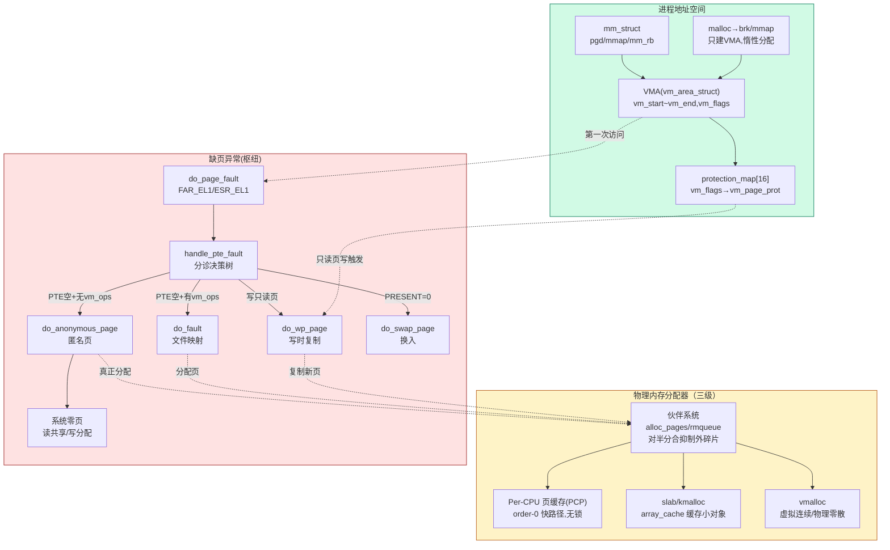

# 📖 《奔跑吧Linux内核》卷1 第4章 物理内存与虚拟内存 — 读书笔记

> 📅 2026-09-09 | 🏷️ 伙伴系统 / slab / vmalloc / 进程地址空间 / 缺页异常 / COW | 📊 难度：高（全书篇幅最大的一章）

---

## 🎯 一句话概括

这一章回答了内存管理最核心的一条主线：**物理页从哪里来（伙伴系统 → slab → vmalloc 三级分配器），虚拟地址空间怎么组织（mm_struct → VMA → 红黑树），以及虚拟地址第一次被访问时物理页怎样被"按需"补上（缺页异常的 5 种分支）**——malloc/mmap 只是"画饼"（建立 VMA），真正的物理页要等第一次访问触发缺页异常才分配。

---

## 📚 内容梳理

> 本章内容极多，按"三级分配器（4.1~4.3）→ 进程地址空间（4.4~4.6）→ 缺页异常（4.7）"三大板块组织。

### 板块一：物理内存分配器

#### 4.1 页面分配之快速路径（伙伴系统）

**分配接口的四层封装：**

```c
// include/linux/gfp.h  —— 都是对 alloc_pages() 的封装
alloc_pages(gfp, order)          // 分配 2^order 个页，返回 struct page*
__get_free_pages(gfp, order)     // 同上，但返回内核线性地址（不能用于 HIGHMEM）
alloc_page(gfp)                  // = alloc_pages(gfp, 0)，分配单页
get_zeroed_page(gfp)             // 分配单页并清零，返回线性地址
__free_pages(page, order)        // 释放
```

**GFP 分配掩码（gfp_mask）——最重要的入参：**

分配掩码分 3 类标志位：
- **区域修饰符（zone modifier）**：`__GFP_DMA` / `__GFP_DMA32` / `__GFP_HIGHMEM` / `__GFP_MOVABLE`，指定从哪个 zone 分配。
- **移动性和位置提示**：`__GFP_MOVABLE`（可迁移，用于反碎片）/ `__GFP_RECLAIMABLE`。
- **水位线和回收行为**：`__GFP_HIGH`（可用紧急保留内存）/ `__GFP_ATOMIC`（不能睡眠）/ `__GFP_DIRECT_RECLAIM`（允许直接回收）/ `__GFP_KSWAPD_RECLAIM`（可唤醒 kswapd）。

常用组合（书中重点）：

| 掩码 | 值 | 语义 | 能否睡眠 |
|---|---|---|---|
| `GFP_ATOMIC` | `__GFP_HIGH \| __GFP_ATOMIC \| __GFP_KSWAPD_RECLAIM` | 中断上下文/持锁时分配 | ❌ 不能睡眠 |
| `GFP_KERNEL` | `__GFP_RECLAIM \| __GFP_IO \| __GFP_FS`（0x6000C0） | 内核最常用 | ✅ 可睡眠 |
| `GFP_USER` | `GFP_KERNEL \| __GFP_HARDWALL` | 用户空间进程分配 | ✅ |
| `GFP_HIGHUSER_MOVABLE` | `GFP_USER \| __GFP_HIGHMEM \| __GFP_MOVABLE` | 用户匿名页/页缓存 | ✅ |

**核心调用链：**

```
alloc_pages(gfp, order)
  → __alloc_pages_nodemask()          ← 分配器心脏
    → prepare_alloc_context()         ← 填充 struct alloc_context
    → get_page_from_freelist()        ← 快速路径（fast path，本节重点）
    → __alloc_pages_slowpath()        ← 慢速路径（回收/规整/OOM，见第5章）
```

`struct alloc_context` 把一次分配的上下文打包传递：

```c
// mm/internal.h
struct alloc_context {
    struct zonelist *zonelist;   // 候选 zone 列表
    nodemask_t *nodemask;        // 允许的 NUMA 节点
    struct zoneref *preferred_zoneref; // 首选 zone
    int migratetype;             // 迁移类型（UNMOVABLE/MOVABLE/RECLAIMABLE）
    enum zone_type high_zoneidx; // 允许的最高 zone（由 gfp_zone() 从 gfp 算出）
    bool spread_dirty_pages;
};
```

**zonelist 与后备（fallback）机制：**
- `gfp_zone(gfp)` 把 GFP 掩码翻译成 `high_zoneidx`（能用的最高 zone）。
- 每个节点有两个 zonelist：`ZONELIST_FALLBACK`（允许跨节点后备）和 `ZONELIST_NOFALLBACK`（仅本节点）。
- 从 `high_zoneidx` 开始由高到低遍历 zone（HIGHMEM → NORMAL → DMA），高端内存优先用完，把低端内存留给真正需要的分配。

**水位线检查（快速路径的关键闸门）：**

```c
// zone_watermark_fast() → __zone_watermark_ok()
// 三条水位线，由 min_free_kbytes 计算
watermark[WMARK_MIN]   // 最低警戒线，低于此只有紧急分配能过
watermark[WMARK_LOW]   // 低于此唤醒 kswapd 异步回收
watermark[WMARK_HIGH]  // kswapd 回收到此为止
```

`__zone_watermark_ok()` 判断逻辑：`空闲页 - 申请页 - lowmem_reserve[] ≥ 对应水位` 且 该 order 的空闲链表非空。`lowmem_reserve[]` 是低 zone 为高 zone 请求预留的"保护额度"，防止高端请求耗尽低端稀缺内存。

**从空闲链表取页 —— rmqueue()：**

```
rmqueue()
  ├─ order==0 且非 CMA → rmqueue_pcplist()   ← 走 per-CPU 页缓存（PCP），快！
  └─ order>0           → __rmqueue_smallest() ← 直接从伙伴系统空闲链表取
                          └─ 找不到 → __rmqueue_fallback() ← 从其他迁移类型"偷"
```

**Per-CPU 页缓存（PCP）机制**——单页分配的加速层：

```c
// include/linux/mmzone.h
struct per_cpu_pages {
    int count;       // 当前缓存的页数
    int high;        // 高水位，超过则批量还给伙伴系统
    int batch;       // 每次批量搬移的页数
    struct list_head lists[MIGRATE_PCPTYPES]; // 按迁移类型分链表
};
```
单页分配/释放优先走本 CPU 的 PCP 链表，**完全避开 zone->lock 自旋锁**，这是 order-0 分配快的根本原因。PCP 为空时一次性从伙伴系统搬 `batch` 个页进来。

**伙伴系统的取页与切分 —— __rmqueue_smallest() + expand()：**
- 从请求的 order 开始向上找第一个非空链表。
- 若找到的块比请求大（如请求 order-2，只有 order-4 空闲），用 `expand()` 逐级对半切分，把切下来的"伙伴"挂回低阶链表。

**释放与合并 —— __free_one_page()：**

```
__free_pages()
  → free_the_page() → free_unref_page()（order-0 走 PCP）
                    → __free_pages_ok() → __free_one_page()（核心合并）
```

`__free_one_page()` 的伙伴合并算法：
```c
// __find_buddy_pfn: 用异或找伙伴的页帧号
buddy_pfn = page_pfn ^ (1 << order);
```
两个块能合并成 buddy 的条件（`page_is_buddy()` 三判断）：① 伙伴也是空闲的；② 伙伴的 order 相同；③ 伙伴和本块在同一个 zone。满足则合并成更高一阶的块，递归向上直到不能合并。这就是伙伴系统抑制外碎片的核心。

**check_new_pages()：** 分配出去前检查页面标志位是否"干净"（无残留的 mapcount、非法 flags 等），防止 bug 页被复用。

> **[6.1 变化]** Linux 5.0 引入的 `ZONE_BOOSTED_WATERMARK` / `watermark_boost_factor` 反碎片机制（commit 1c30844d，见脚注[1]），在发生外碎片事件时临时抬高水位、多回收一点内存以触发 kswapd 规整。6.1 中该机制仍在，且伙伴系统整体框架未变；主要差异是 folio 的引入尚未波及本节的 page 级接口。

#### 4.2 slab 分配器

**为什么需要 slab：** 伙伴系统的最小分配单位是一个页（4KB）。但内核里大量对象只有几十到几百字节（如 `task_struct`、`inode`、`dentry`）。用伙伴系统分配这些小对象会浪费严重（内碎片），且频繁的构造/析构开销大。slab 由 Sun/Solaris 的 Jeff Bonwick 首创，思路是：**向伙伴系统批发若干页，切成同样大小的对象缓存起来，同类对象反复复用**。

**核心数据结构 —— kmem_cache（slab 描述符）：**

```c
// include/linux/slab_def.h
struct kmem_cache {
    struct array_cache __percpu *cpu_cache; // ★ per-CPU 本地对象缓冲池（最快路径）
    unsigned int batchcount;   // 每次批量搬移的对象数
    unsigned int limit;        // 本地缓冲池上限
    unsigned int shared;       // 多 CPU 共享缓冲池开关
    unsigned int size;         // 对象大小（含对齐/red zone）
    unsigned int object_size;  // 对象原始大小
    unsigned int flags;        // SLAB_HWCACHE_ALIGN 等
    unsigned int num;          // 每个 slab 容纳多少对象
    unsigned int gfporder;     // 每个 slab 用 2^gfporder 个页
    unsigned int colour;       // 着色区数量
    unsigned int colour_off;   // 着色偏移（= L1 缓存行大小）
    const char *name;
    struct kmem_cache_node *node[MAX_NUMNODES]; // 每个 NUMA 节点的 slab 管理
};
```

**array_cache（本地对象缓冲池）**——slab 快路径的核心：

```c
// mm/slab.c
struct array_cache {
    unsigned int avail;    // 当前可用对象数
    unsigned int limit;
    unsigned int batchcount;
    unsigned int touched;  // 最近是否被访问（用于回收判断）
    void *entry[];         // 指向对象的指针数组（LIFO 栈，栈顶最热）
};
```
每个 CPU 一个 `array_cache`，分配时从 `entry[--avail]` 弹出（LIFO，保证拿到最近释放、缓存最热的对象），释放时压回栈顶。**这一步无需任何锁**——这是 slab 分配比 kmalloc-via-buddy 快的根本。

**三级 slab 链表 —— kmem_cache_node：**

```c
// mm/slab.h
struct kmem_cache_node {
    spinlock_t list_lock;
    struct list_head slabs_partial; // 部分空闲的 slab（优先从这里分配）
    struct list_head slabs_full;    // 全部占用的 slab
    struct list_head slabs_free;    // 全部空闲的 slab（内存紧张时可回收）
    unsigned long free_objects;
    unsigned int free_limit;
    struct array_cache *shared;     // 本节点内多 CPU 共享缓冲池
};
```

**接口：**
```c
kmem_cache_create(name, size, align, flags, ctor) // 创建一类专用缓存
kmem_cache_alloc(cachep, gfp)                      // 分配一个对象
kmem_cache_free(cachep, objp)                      // 释放
kmem_cache_destroy(cachep)                          // 销毁整个缓存
```

**slab 的三种布局：**
- **OBJFREELIST_SLAB**：freelist（空闲对象索引数组）直接放在 slab 内的对象区里复用，最省内存。
- **OFF_SLAB**：freelist 存在 slab 外部（另外用一个 kmalloc 缓存管理），用于对象很大的情况。
- **普通（管理数据在 slab 头部）**：freelist 紧跟在 slab 页起始处。

**着色（coloring）—— 缓解缓存行冲突：**
不同 slab 的第一个对象如果都从页首（同一 cache line 对齐位置）开始，会导致它们映射到同一组 L1 缓存组，产生冲突。着色让每个 slab 的对象区起始地址错开 `colour_off`（= L1 缓存行大小）的整数倍，把对象打散到不同缓存组，提高缓存利用率。

**对象数计算 —— calculate_slab_order() / cache_estimate()：** 权衡"每个 slab 用几个页"以让 (对象总大小 + 管理开销) 尽量填满页、内碎片最小。

**分配慢路径（本地缓冲池空了）：**

```
kmem_cache_alloc()
  → slab_alloc() → __do_cache_alloc() → ____cache_alloc()
      ├─ ac->avail>0 → 直接返回 ac->entry[--avail]   ← 快路径
      └─ ac->avail==0 → cache_alloc_refill()          ← 慢路径
          ├─ 从 shared 共享池搬对象
          ├─ 从 slabs_partial/slabs_free 取 slab 填充本地池
          └─ 都没有 → cache_grow_begin() → kmem_getpages() ← 向伙伴系统要新页
                       （新页设置 PG_slab 标志）
```

**释放 —— slab_get_obj() / slab_put_obj()：** 用 `page->active` 记录 slab 内已分配对象数；`page->freelist` 管理空闲对象索引。对象归还后若整个 slab 变空，挂到 `slabs_free`，供内存紧张时回收。

**kmalloc —— 建立在 slab 之上的通用分配器：**

```c
// kmalloc 根据大小选择预建的通用缓存 kmalloc-8/16/32/64/.../8192
kmalloc_index(size) // 返回大小对应的缓存下标（向上取到 2 的幂）
```
`kmalloc(30, GFP_KERNEL)` 会落到 `kmalloc-32` 缓存，浪费 2 字节。超过 `KMALLOC_MAX_CACHE_SIZE`（通常 8KB/一页）的请求直接走伙伴系统 `alloc_pages`。

> **[6.1 变化]** 书中讲的是 **SLAB** 分配器（`slab_def.h`）。现代内核（含 6.1）**默认使用 SLUB**（`slub.c` / `slab_def.h` → `slub_def.h`）。SLUB 去掉了 SLAB 的 `array_cache` 多级缓冲和着色，改用 per-CPU 的 `kmem_cache_cpu`（`freelist` + `page`）和更简单的 `page->freelist`，代码更精简、可扩展性更好。三者可选：SLAB（缓存友好但复杂）、SLUB（默认，可扩展）、SLOB（已在 6.2 移除，用于极小系统）。核心 API（`kmem_cache_create/alloc/free`、`kmalloc`）在两者间完全一致。

#### 4.3 vmalloc()

**核心特征：虚拟地址连续，物理地址不必连续。** 与 kmalloc（物理连续）互补。适合分配大块内存（如模块代码、大缓冲区），因为大块物理连续内存难找（外碎片），而 vmalloc 只要求虚拟连续——逐页从伙伴系统抓单页，再用页表拼成连续的虚拟区间。

**地址范围（ARM64，Linux 5.0）：**
```
VMALLOC_START = MODULES_END = 0xFFFF000010000000
VMALLOC_END   ~ 覆盖到 vmemmap 之前，约 129TB
```

**两个核心数据结构：**
```c
// include/linux/vmalloc.h
struct vm_struct {              // 描述一段 vmalloc 虚拟区间
    struct vm_struct *next;
    void *addr;                 // 虚拟起始地址
    unsigned long size;
    unsigned long flags;
    struct page **pages;        // ★ 指向逐页分配的 page 数组
    unsigned int nr_pages;      // 页数
    phys_addr_t phys_addr;
};

struct vmap_area {              // 挂在红黑树+链表上，管理虚拟地址空洞
    unsigned long va_start;
    unsigned long va_end;
    struct rb_node rb_node;     // 红黑树节点（按地址排序，快速找空洞）
    struct list_head list;
    struct vm_struct *vm;
};
```

**调用链：**
```
vmalloc(size)
  → __vmalloc_node_range(...)
    → __get_vm_area_node()
      → alloc_vmap_area()          ← 在 vmap_area 红黑树中找一块够大的虚拟地址空洞
    → __vmalloc_area_node()
      → 循环 alloc_page()          ← 逐页向伙伴系统要单个物理页（不要求连续）
      → map_vm_area() → vmap_page_range() ← 把这些散页在页表里映射成连续虚拟区间
```

**关键结论：**
- vmalloc 分配比 kmalloc **慢**：要逐页分配 + 逐页建页表映射，且访问时更容易 TLB miss（映射零散）。
- vmalloc 区有独立的页表映射，**不在线性映射区**，所以 `vmalloc` 得到的地址不能用 `virt_to_phys()` 简单转换，要用 `vmalloc_to_page()`。
- 只在"需要大块内存 + 不需要物理连续 + 不在乎速度"时用（如加载内核模块）。

> **[6.1 变化]** 6.1 的 vmalloc 引入了 per-CPU 的 `vmap_block` 和更复杂的 `vmap_area` 管理（`free_vmap_area_root`/`busy` 分离的红黑树），以及 `KASAN` vmalloc 影子内存支持；核心"找虚拟空洞→逐页映射"的思路不变。

---

### 板块二：进程地址空间

#### 4.4 mm_struct 与 VMA

**mm_struct —— 一个进程的整个地址空间的"总管"：**

```c
// include/linux/mm_types.h
struct mm_struct {
    struct vm_area_struct *mmap;      // ★ VMA 单向链表（按地址升序）
    struct rb_root mm_rb;             // ★ VMA 红黑树（按地址快速查找）
    unsigned long (*get_unmapped_area)(...); // 找空闲地址区间的回调
    unsigned long mmap_base;          // mmap 区起始地址
    pgd_t *pgd;                       // ★ 一级页表基址（写入 TTBR0）
    atomic_t mm_users;                // 使用该地址空间的线程数
    atomic_t mm_count;                // mm_struct 本身的引用计数
    struct rw_semaphore mmap_sem;     // ★ 保护 VMA 的读写信号量（6.1 更名 mmap_lock）
    struct list_head mmlist;
    unsigned long total_vm;           // 总映射页数
    unsigned long start_code, end_code;   // 代码段
    unsigned long start_data, end_data;   // 数据段
    unsigned long start_brk, brk;         // ★ 堆的起始与当前边界（malloc 操作它）
    unsigned long start_stack;            // 栈起始
    unsigned long arg_start, arg_end, env_start, env_end;
};
```
- `mm_users` vs `mm_count`：`mm_users` 是"多少个线程共享这个地址空间"（如多线程进程）；`mm_count` 是"这个 mm_struct 结构体本身被引用几次"（内核线程借用时 +1）。`mm_users` 归零时 `mm_count` 减 1，`mm_count` 归零才真正释放 mm_struct。**两级引用计数**避免内核线程临时借用地址空间时被误释放。

**VMA（vm_area_struct）—— 一段连续、属性相同的虚拟内存区间：**

```c
// include/linux/mm_types.h
struct vm_area_struct {
    unsigned long vm_start;        // 区间起始（含）
    unsigned long vm_end;          // 区间结束（不含）
    struct vm_area_struct *vm_next, *vm_prev; // 链表前后指针
    struct rb_node vm_rb;          // 红黑树节点
    struct mm_struct *vm_mm;       // 所属进程地址空间
    pgprot_t vm_page_prot;         // ★ 该区间页表项的硬件保护属性
    unsigned long vm_flags;        // ★ 区间标志位（VM_READ/WRITE/EXEC...）
    struct anon_vma *anon_vma;     // 匿名页反向映射
    const struct vm_operations_struct *vm_ops; // ★ 文件映射的操作方法集（含 fault 回调）
    unsigned long vm_pgoff;        // 文件映射的页偏移
    struct file *vm_file;          // 映射的文件（匿名映射为 NULL）
};
```

**VMA 标志位（vm_flags，部分）：**

| 标志 | 含义 |
|---|---|
| `VM_READ / VM_WRITE / VM_EXEC` | 可读/可写/可执行 |
| `VM_SHARED` | 共享映射（否则私有） |
| `VM_MAYREAD/MAYWRITE/MAYEXEC/MAYSHARE` | mprotect 后可变成对应权限 |
| `VM_GROWSDOWN` | 向低地址扩展（栈） |
| `VM_DONTEXPAND` | 不允许扩展 |
| `VM_PFNMAP` | 纯 PFN 映射（无 struct page） |
| `VM_IO` | 映射设备 I/O 空间 |

**vm_flags → vm_page_prot 的转换 —— protection_map[]：**

VMA 用软件标志 `vm_flags`，但页表项要硬件属性 `vm_page_prot`。转换靠一张预建的 16 元素查找表：

```c
// mm/mmap.c  vm_get_page_prot() 查表
// 索引 = (VM_SHARED<<3 | VM_EXEC<<2 | VM_WRITE<<1 | VM_READ)
pgprot_t protection_map[16] = {
    __P000, __P001, __P010, __P011,  // 私有映射（Private，写触发 COW）
    __P100, __P101, __P110, __P111,
    __S000, __S001, __S010, __S011,  // 共享映射（Shared）
    __S100, __S101, __S110, __S111,
};
// 例：__P011 = PAGE_READONLY（私有可读可写：初始只读，写时触发 COW）
//     __S011 = PAGE_SHARED（共享可读可写）
```
> ⚠️ 注意 `__P011`（私有+读+写）映射到 `PAGE_READONLY` 而非可写——因为私有可写页要先设成只读，等真正写时触发缺页异常做 COW/分配。这是 COW 和 fork 的硬件基础。

**查找 VMA —— find_vma()：**
```
find_vma(mm, addr)
  ├─ 先查 vmacache[VMACACHE_SIZE]（每线程 4 项 LRU 缓存）← 命中率很高，O(1)
  └─ 未命中 → 遍历 mm_rb 红黑树，O(log n) 找到第一个 vm_end > addr 的 VMA
```
`vmacache` 利用"程序访问有局部性"——同一 VMA 常被连续访问，缓存最近命中的几个 VMA。

**插入 VMA —— insert_vm_struct() → find_vma_links() + vma_link()：** 同时维护链表和红黑树两套结构（链表方便顺序遍历，红黑树方便按地址查找）。

**合并 VMA —— vma_merge()：** 新 VMA 若和相邻 VMA 属性兼容（相同 vm_flags、连续、同一文件同偏移），就合并成一个，减少 VMA 数量。三种情况：与前 VMA 合并、与后 VMA 合并、前后一起合并（吃掉中间）。

> **[6.1 变化]** ① `mmap_sem` 在 5.8 起更名为 `mmap_lock`，配套 `mmap_read_lock()/mmap_write_lock()` API。② `vmacache` 已在 6.1 被**移除**，改用 maple tree。③ **6.1 最大变化：VMA 的红黑树 `mm_rb` + 链表 `mmap` 被 maple tree（`mm->mm_mt`）完全取代**，`find_vma` 走 maple tree 遍历，`vm_next/vm_prev` 字段被删除。书中的红黑树内容在 6.1 已过时，但"按地址组织 VMA、快速查找"的目标一致。

#### 4.5 malloc()

**malloc 只是"用户态零售商"，真正向内核批发内存靠 brk / mmap：**
- 小于 `MMAP_THRESHOLD`（glibc 默认 128KB）→ 用 `brk()` 扩展堆。
- 大于阈值 → 直接 `mmap()` 匿名映射一块（释放时能立刻还给内核，避免堆碎片）。

**brk 系统调用的宏展开（ARM64）：**
```c
SYSCALL_DEFINE1(brk, unsigned long, brk) { ... }
// 展开为三层：
//   __arm64_sys_brk(regs)  ← 从 pt_regs 取参数的入口
//     → __se_sys_brk(...)   ← 符号扩展包装
//       → __do_sys_brk(...) ← 真正的实现体
```

**关键：brk 只调整 VMA 边界，不分配物理页。**
```
sys_brk(new_brk)
  → 若扩大：do_brk_flags()  ← 创建/扩展匿名 VMA，vm_flags = VM_DATA_DEFAULT_FLAGS
  → 若 VMA 需要立即填充物理页（VM_LOCKED 等）：__mm_populate()
```
`TASK_SIZE`（48 位 VA 时为 `0x1_0000_0000_0000` = 256TB）限制用户态地址上界，brk 不能越过它。

**预分配物理页 —— __mm_populate() → populate_vma_page_range() → get_user_pages()：**
一般情况下 malloc 后的页是"惰性"的（第一次访问才缺页分配）。但如果需要立即锁定物理页（如 `mlock`），走 `get_user_pages()` 主动触发缺页、把页"钉"在内存里。

**get_user_pages()（GUP）—— 把用户页"钉住"：**
```
get_user_pages()
  → __get_user_pages()
    → follow_page_mask() → follow_page_pte() ← 查页表，页已在则直接返回
      └─ 页不在 → faultin_page() → handle_mm_fault() ← 主动触发缺页分配
```
`FOLL_*` 标志控制行为：`FOLL_WRITE`（为写而 pin）、`FOLL_FORCE`（强制，Dirty COW 相关）、`FOLL_GET`（增加引用计数）等。GUP 常用于 DMA、O_DIRECT——设备要直接访问用户页，必须先保证物理页存在且不被换出。

**vm_normal_page() —— 区分"普通页"和"特殊页"：**
```c
// mm/memory.c  _vm_normal_page()
// PTE_SPECIAL（bit 56）标记的页没有 struct page（如 VM_PFNMAP 的设备内存、零页）
struct page *vm_normal_page(vma, addr, pte);
```
"普通页"有对应的 `struct page`，参与 LRU/RMAP/引用计数；"特殊页"（PTE_SPECIAL 置位）没有 struct page，不能被回收/迁移。COW 和页回收都要先用 `vm_normal_page()` 判断页的性质。

#### 4.6 mmap

**四种映射类型（私有/共享 × 匿名/文件）：**

| | 匿名映射（无文件） | 文件映射 |
|---|---|---|
| **私有（MAP_PRIVATE）** | malloc 大块内存、栈 | 加载可执行文件/动态库（写时 COW） |
| **共享（MAP_SHARED）** | 父子进程共享内存（IPC） | 多进程共享文件、mmap 写回文件 |

**常用 flags：** `MAP_ANONYMOUS`（匿名，无文件）、`MAP_PRIVATE`（私有，写触发 COW）、`MAP_SHARED`（共享，写回文件/其他进程可见）、`MAP_FIXED`（强制用指定地址，危险）、`MAP_POPULATE`（立即预分配物理页，不惰性）。

**prot 参数：** `PROT_READ/WRITE/EXEC/NONE`，最终转成 VMA 的 vm_flags 和页表 vm_page_prot。

**内核实现：** `mmap()` → `ksys_mmap_pgoff()` → `do_mmap()` → `mmap_region()`，核心是找一段空闲虚拟地址（`get_unmapped_area`）→ 建立 VMA → （可选）预填充物理页。**默认惰性**：mmap 返回时通常只建了 VMA，物理页等第一次访问才缺页补上。

**相关机制：**
- **readahead（预读）**：文件映射访问时，内核预读后续页到 page cache，减少缺页次数。默认预读窗口 128KB，可用 `blockdev --setra` 调整。
- **Dirty COW（CVE-2016-5195）**：竞态利用 `FOLL_FORCE` + 私有文件映射的 COW，写入本应只读的文件页。书中第 2 版已删除详细分析（见脚注[3]）。

> **[6.1 变化]** mmap/brk 的用户接口和 `do_mmap` 主流程在 6.1 基本不变；内部因 maple tree 改造，VMA 的插入/查找路径改走 `mas_*` 系列 API。get_user_pages 在 6.1 有 `FOLL_PIN` / `pin_user_pages()` 新语义（区分长期 pin 和临时 pin），解决了 DMA 与 COW 的一类竞态。

---

### 板块三：缺页异常处理（本章重点）

> 缺页异常是把前面所有机制串起来的"总枢纽"：malloc/mmap 画的饼（VMA）在这里被兑现成真实物理页。

#### 4.7.1 ARM64 底层处理流程

**从硬件异常到内核 C 函数的路径：**
```
CPU 访问未映射/无权限地址
  → 触发同步异常（synchronous exception）
  → 跳转异常向量表 vectors → el1_sync（内核态）/ el0_sync（用户态）
  → 根据 ESR_EL1.EC 判断异常类型
  → el1_da / el0_da（data abort，数据中止）
  → do_mem_abort()
  → 查异常处理表，数据中止 → do_page_fault()  ← 进入内存管理核心
```

**两个关键硬件寄存器：**
- `FAR_EL1`（Fault Address Register）：**出错的虚拟地址**——do_page_fault 就是要为它找/建映射。
- `ESR_EL1`（Exception Syndrome Register）：**异常综合信息**。
  - `EC`（bits[31:26]）：异常类别（区分指令中止/数据中止/来自 EL0 还是 EL1）。
  - `ISS`（bits[24:0]）：异常细节。
    - `DFSC`（Data Fault Status Code）：具体故障类型（翻译错误/访问权限错误/访问标志错误）。
    - `WnR`（bit[6]）：Write not Read——是写操作还是读操作导致的（决定后续走读缺页还是写缺页/COW）。

#### 4.7.2 do_page_fault()

**主干逻辑（分支很多，抓主线）：**
```c
// arch/arm64/mm/fault.c
static int do_page_fault(unsigned long addr, unsigned int esr, ...)
{
    // ① 若在原子上下文或缺页被禁（faulthandler_disabled）→ 不能处理，报错
    if (faulthandler_disabled() || !mm) goto no_context;

    // ② 用户态触发 → 设置 FAULT_FLAG_USER
    if (user_mode(regs)) flags |= FAULT_FLAG_USER;
    if (is_write_abort(esr)) flags |= FAULT_FLAG_WRITE; // 写缺页

    // ③ 拿 mmap_sem 读锁（内核态用 trylock 避免死锁）
retry:
    down_read(&mm->mmap_sem);

    // ④ find_vma() 找出错地址所在 VMA
    vma = find_vma(mm, addr);
    if (!vma) goto bad_area;               // 没有 VMA → 非法地址（可能 SIGSEGV）
    if (vma->vm_start <= addr) goto good_area;
    if (!(vma->vm_flags & VM_GROWSDOWN)) goto bad_area; // 不是栈 → 非法
    expand_stack(vma, addr);               // 是栈 → 自动扩展

good_area:
    // ⑤ 权限检查：写缺页但 VMA 不可写 → 非法
    // ⑥ 真正处理
    fault = handle_mm_fault(vma, addr, flags);
}
```

**vm_fault_t 返回码（位标志）：**

| 返回码 | 含义 |
|---|---|
| `VM_FAULT_OOM` | 内存不足 |
| `VM_FAULT_SIGBUS` | 总线错误（如映射越过文件末尾） |
| `VM_FAULT_SIGSEGV` | 段错误（非法地址） |
| `VM_FAULT_MAJOR` | 主缺页（需要磁盘 I/O，如换入/读文件） |
| `VM_FAULT_MINOR`（0） | 次缺页（无需 I/O，如匿名页/COW） |
| `VM_FAULT_RETRY` | 需要重试（释放锁后重来，避免长时间持锁） |
| `VM_FAULT_NOPAGE` | 已处理，无需返回新页 |

**FAULT_FLAG_* 输入标志：** `FAULT_FLAG_WRITE`（写）、`FAULT_FLAG_USER`（用户态）、`FAULT_FLAG_ALLOW_RETRY`（允许重试）、`FAULT_FLAG_RETRY_NOWAIT`（重试但不等待）等，用来告诉核心处理函数"这是什么样的缺页"。

#### 4.7.3 handle_mm_fault() → handle_pte_fault() 分发

**先逐级补齐页表，再按 PTE 状态分派处理函数：**
```
handle_mm_fault()
  → __handle_mm_fault()
    → pgd_offset / p4d_alloc / pud_alloc / pmd_alloc  ← 逐级创建缺失的页表
    → handle_pte_fault()                              ← 核心分发
```

**handle_pte_fault() 的分发决策树（全章最重要的一张表）：**

```
handle_pte_fault(vmf):
  if (PTE 为空 pte_none):
      if (VMA 无 vm_ops)  → do_anonymous_page()   # 匿名映射（malloc/匿名mmap）
      else                → do_fault()            # 文件映射
  else:  # PTE 不为空
      if (PTE 的 PRESENT 位没置位) → do_swap_page()  # 页被换出到 swap
      if (是 NUMA 页)              → do_numa_page()  # NUMA 页迁移
      if (写缺页 && PTE 只读)      → do_wp_page()    # 写时复制 COW
      else                         → 更新 PTE 访问位（pte_mkyoung + ptep_set_access_flags）
```

**五种缺页处理函数一览：**

| 函数 | 触发条件 | 场景 |
|---|---|---|
| `do_anonymous_page()` | PTE 空 + 无 vm_ops | malloc / 匿名 mmap |
| `do_fault()` | PTE 空 + 有 vm_ops | 文件映射（代码段/动态库/mmap 文件） |
| `do_swap_page()` | PTE 非空 + PRESENT=0 | 换入被换出的页 |
| `do_wp_page()` | 写缺页 + PTE 只读 | 写时复制（fork 后写共享页） |
| `do_numa_page()` | NUMA 平衡标记 | NUMA 页迁移 |

#### 4.7.4 匿名页面缺页 —— do_anonymous_page()

```
do_anonymous_page(vmf):
  ① pte_alloc()          ← 分配 PTE 页表（不用 pte_alloc_map，见 4.7.9）
  ② 若是读缺页 → 映射到系统零页（ZERO_PAGE），不分配真实物理页！
  ③ 若是写缺页 → alloc_zeroed_user_highpage_movable() 分配清零的物理页
  ④ mk_pte() 生成 PTE，page_add_new_anon_rmap() 加入反向映射
  ⑤ set_pte_at() 写入页表
```

#### 4.7.5 系统零页（zero page）—— 读优化的精妙设计

```c
// arch/arm64/mm/mmu.c  一块全局的、内容全 0 的物理页
unsigned long empty_zero_page[PAGE_SIZE / sizeof(unsigned long)];
#define ZERO_PAGE(vaddr) phys_to_page(__pa_symbol(empty_zero_page))
```

**malloc 后三种访问场景：**
1. **malloc 后只读**：缺页 → 映射到共享的系统零页（只读）。**所有进程的所有"读未写"匿名页共享这一个物理页**，极省内存。
2. **malloc 后先读再写**：先读时映射零页（只读）；后写时因零页只读触发**写缺页 → do_wp_page → 分配真实物理页**。
3. **malloc 后直接写**：`do_anonymous_page` 直接分配清零的真实物理页。

> 💡 这就是为什么 `malloc(1GB)` 瞬间返回、且 `top` 里 RSS 不涨——只建了 VMA，一个物理页都没分。只有真正写入的页才占物理内存。

#### 4.7.6 文件映射缺页 —— do_fault()

**根据读/写和共享/私有分三条路：**
```
do_fault(vmf):
  if (VMA 无 fault 回调) → 特殊处理（防 read-modify-write 竞态，见下）
  if (读缺页)                    → do_read_fault()
  if (写缺页 && !VM_SHARED)      → do_cow_fault()    # 私有文件映射写 = COW
  if (写缺页 && VM_SHARED)       → do_shared_fault() # 共享文件映射写 = 脏页回写
```

**① do_read_fault() —— 读文件映射：**
```
do_read_fault():
  → do_fault_around()   ← 预映射：以出错地址为中心，提前映射附近约 16 个页
                          （fault_around_bytes 默认 65536=16页）到已有 page cache
                          只建映射，不新建 page cache → 减少缺页次数
  → __do_fault()        ← 真正调用 vma->vm_ops->fault() 把文件内容读进 vmf->page
  → finish_fault() → alloc_set_pte() ← 为物理页和出错虚拟地址建 PTE
```
> **[死锁修复，Linux 5.0]** `__do_fault()` 中预先分配 PTE 所需物理页（`prealloc_pte`），**再**调用 `vm_ops->fault()`。因为 fault 回调里会给页加 `PG_locked` 锁，若此时再分配页表页可能与文件系统死锁。预分配打破了这个顺序依赖。

**② do_cow_fault() —— 私有文件映射的写时复制：**
```
do_cow_fault():
  → anon_vma_prepare()   ← 检查/初始化 RMAP
  → alloc_page_vma(GFP_HIGHUSER | __GFP_MOVABLE) ← 为 cow_page 分配新页
  → __do_fault()         ← 读文件内容到 vmf->page
  → 把 vmf->page 内容复制到 cow_page
  → finish_fault()       ← 用 cow_page 建 PTE，加入匿名页 RMAP
```
私有映射写文件 = 改动只属于本进程、不回写文件 → 复制一份变成匿名页。

**③ do_shared_fault() —— 共享文件映射的写：**
```
do_shared_fault():
  → __do_fault()         ← 读文件内容
  → 若定义了 page_mkwrite() → 通知文件系统"页将变可写"
  → finish_fault()       ← 用 vmf->page 建 PTE，加入文件页 RMAP
  → 设为脏页，balance_dirty_pages_ratelimited() 平衡回写
```
共享映射写 = 要回写到文件、其他进程可见 → 直接用 page cache 页并标脏。

#### 4.7.7 写时复制 —— do_wp_page()

**当写一个只读页时触发。核心：能复用就复用，不能复用才复制。**

```
do_wp_page(vmf):
  → vm_normal_page() 取出错页的 struct page
  ├─ 特殊映射页 + 可写共享 → wp_pfn_shared() → wp_page_reuse()
  ├─ 单身匿名页（mapcount==1，reuse_swap_page 判断）→ wp_page_reuse() # 直接复用，不复制！
  ├─ 可写共享普通页 → wp_page_shared() → wp_page_reuse()
  └─ 其他（非单身匿名页/只读文件页）→ wp_page_copy()  # 真正的写时复制
```

**表 4.18 写时复制处理归纳：**

| 页面分类 | 私有映射/只读共享 | 可写共享映射 |
|---|---|---|
| 特殊映射页 | `wp_page_copy()` 复制 | `wp_page_reuse()` 复用 |
| 单身匿名页 | `wp_page_reuse()` 复用 | 无 |
| 非单身匿名页 | `wp_page_copy()` 复制 | `wp_page_copy()` 复制 |
| KSM 页 | 复制（仅私有映射） | 无 |
| 文件映射页 | `wp_page_copy()` 复制 | `wp_page_reuse()` 复用 |

**wp_page_reuse() —— 复用（快）：** 不分配新页，只是给现有 PTE 加上可写属性：`pte_mkyoung`（设访问位）→ `pte_mkdirty`（设脏位）→ `maybe_mkwrite`（设 PTE_WRITE、清 PTE_RDONLY）→ `ptep_set_access_flags` 写回。

**wp_page_copy() —— 复制（慢）：**
```
wp_page_copy():
  ① 若旧页是零页 → alloc_zeroed_user_highpage_movable()；否则 alloc_page_vma() 并复制旧页内容
  ② __SetPageUptodate() 标记新页内容有效
  ③ pte_offset_map_lock() 重取 PTE 并检查是否被改过
  ④ 用 new_page 生成 PTE，设 PTE_DIRTY | PTE_WRITE
  ⑤ ptep_clear_flush_notify() 先清 PTE 再刷 TLB（★ 见 4.7.11）
  ⑥ page_add_new_anon_rmap() 新页加入 RMAP，加入 LRU
  ⑦ set_pte_at_notify() 写入硬件 PTE
  ⑧ page_remove_rmap(old_page) 减旧页 mapcount（★ 必须在切换 PTE 之后，见 4.7.10）
```

#### 专题：缺页异常中的三个经典竞态（4.7.8 / 4.7.10 / 4.7.11）

> 这三节是本章思维含量最高的部分，都是"多 CPU 同时操作同一 PTE/页"引发的竞态，理解它们能真正吃透内存屏障和 TLB 在内存管理中的作用。

**① ARM64 硬件 DBM 机制导致的竞态（4.7.8）**

- **硬件访问位管理**：`TCR_EL1.HA=1` 时，CPU 访问内存自动置 `PTE_AF`（无需软件缺页模拟）。
- **硬件脏位管理（DBM）**：`TCR_EL1.HD=1` 时，CPU 写只读页时自动清 `PTE_RDONLY`（硬件层完成"变可写"）。Linux 4.3 起支持。
- **竞态场景**：软件在更新 PTE 的同时，硬件也在异步地"读-修改-回写"PTE → 软件可能覆盖硬件刚设的脏位。
  - 进程 3 写页时，硬件自动把 `PTE_RDONLY` 清 0；
  - 进程 2 的 `ptep_set_access_flags()`（内核默认实现）不知情，仍把旧值（`PTE_RDONLY=1`）写回 → 脏状态丢失 → 硬件异常。
- **修复**：ARM64 版 `ptep_set_access_flags()`（`arch/arm64/mm/fault.c`）用 `cmpxchg_relaxed()` 原子操作更新 PTE，并对 `PTE_RDONLY` 位做异或反转处理，确保不覆盖硬件对该位的修改。

```c
// arch/arm64/mm/fault.c  关键片段
pteval = pte_val(pte);
do {
    old_pteval = pteval;
    pteval ^= PTE_RDONLY;          // 反转，避开硬件对 RDONLY 的异步修改
    pteval |= pte_val(entry);
    pteval ^= PTE_RDONLY;
    pteval = cmpxchg_relaxed(&pte_val(*ptep), old_pteval, pteval); // 原子 CAS
} while (pteval != old_pteval);
```

**② 写时复制的竞态（4.7.10）—— 为什么 mapcount 要"最后减"**

Linux 2.6.26 修复的经典 bug。父进程1、子进程2 对同一匿名页（mapcount=2）同时 COW，进程3 要读该页：
- **错误顺序（旧代码）**：进程2 先减旧页 mapcount（→1）→ 进程1 见 mapcount==1 以为是"单身页"，直接复用旧页并写入新数据 → 进程3 读到进程1 写的新数据 → 而进程2 最后才切 PTE 到新页，读到的是旧页原始数据 → **数据不一致**。
- **修复**：`wp_page_copy()` 中**先切 PTE 到新页，再减旧页 mapcount**（`page_remove_rmap` 放最后）。配合 `ptep_clear_flush` 的 TLB 刷新，保证"减小的 mapcount 可见前，没有进程能访问旧页"，旧页在 mapcount 可见前不会被复用。

**③ 切换 PTE 前为什么要先刷 TLB（4.7.11）—— SMC vs COW 竞态**

Linux 2.6.19 修复。主进程两个线程（线程1@CPU0 跑代码，线程2@CPU1），私有映射同一 Page0（PTE_RDONLY，可执行只读）：
- fork 后父子 PTE 都设为只读，mapcount=2。
- 线程2 写该地址（自修改代码 SMC）→ 写缺页 → mapcount=2 不能复用 → `wp_page_copy()`：建新页 Page1，复制内容，`set_pte()` 切到 Page1，写入新代码。
- **问题**：若切 PTE 时没刷 CPU0 的 TLB，线程1 的指令/数据 TLB 仍指向 Page0 → 线程1 继续从 Page0 取到**旧指令** → 执行错误。
- **修复**：切换 PTE 前先 `ptep_clear_flush_notify()`——**先清 PTE，再刷 TLB**，然后才 `set_pte_at()` 写新值。保证所有 CPU 都丢弃对旧页的 TLB 缓存后才用新页。

#### 4.7.9 pte_offset_map() 的安全使用

`pte_offset_map()` 安全运行需两个条件：① 持有读者类型 `mmap_sem`；② 保证 PMD 指向下一级页表（PT）而非巨页 PMD（段映射）。
- `handle_pte_fault()` 中调用是安全的：已持读锁 + 用 `pmd_devmap_trans_unstable()`（内部 `pmd_trans_huge()` 检查 `PMD_TABLE_BIT`）确认非巨页。
- `do_anonymous_page()` 中则改用 `pte_alloc()` 而非 `pte_alloc_map()`——因为 THP 的 khugepaged 线程可能在 `pte_alloc()` 之后把 PMD 变成巨页，此时 `pte_offset_map()` 不安全。

#### 4.7.12 缺页异常引发的死锁

Linux 5.0 开发期发现：系统内存短缺时，**缺页异常处理路径**与**内核回写线程（flush thread）**之间死锁。详见书中 6.3.1 节案例分析。

#### 4.7.13 小结：五种缺页处理函数的判断条件

| 函数 | 判断条件 | 应用场合 |
|---|---|---|
| `do_anonymous_page()` | PTE 空 + 无 vm_ops | malloc / 匿名 mmap |
| `do_fault()` | PTE 空 + 有 vm_ops | 文件映射（读→read_fault，私有写→cow_fault，共享写→shared_fault） |
| `do_swap_page()` | PTE 非空 + PRESENT=0 | 换入 swap 页 |
| `do_wp_page()` | PTE PRESENT=1 + 写错误 | fork 后写共享页（复用或复制） |

> **[6.1 变化]** 6.1 引入 **per-VMA lock**（`vma->vm_lock`）做缺页异常的乐观加速——先尝试只拿 VMA 级锁处理缺页，避免全局 `mmap_lock` 争用，失败才回退到持锁重试。ARM64 硬件 DBM 竞态修复、COW mapcount 顺序、TLB-before-PTE 这三条竞态处理逻辑在 6.1 中依然保留。THP 相关的 `do_huge_pmd_*` 分支在 6.1 更完善。

---

## 🧠 费曼解读

### 一、伙伴系统 —— 内存怎么"对半分、对半合"？

**用大白话说：**
物理内存被切成一个个 4KB 的页。但你有时要连续的一大块（8 个页、16 个页）。伙伴系统就是一套"对半分、对半合"的管理法：手里有一块 16 页的大内存，你要 4 页，它就把 16 切成 8+8，再把其中一个 8 切成 4+4，给你一个 4，剩下的 4、8 挂回"货架"备用。你还回来时，如果发现你那 4 页的"另一半兄弟"（伙伴）也是空闲的，就把两个 4 拼回一个 8，继续往上拼。

**类比：**
像超市卖鸡蛋——只有 1、2、4、8、16 装的盒子（2 的幂）。顾客要 4 个，货架上没有 4 装的，只有 8 装的 → 拆成两个 4 装，卖一盒、剩一盒上架。顾客退货时，如果隔壁那盒"同批次、相邻编号"的 4 装也在架上，就合并成 8 装重新上架。**"伙伴"必须是同样大小、地址相邻、同批次**——这正是 `page_is_buddy()` 的三个条件。

**为什么重要：**
这是整个物理内存分配的地基。slab、vmalloc、缺页异常最终都向伙伴系统要页。它对半分合的设计天然抑制外碎片——空闲块总能拼回大块。理解它才能看懂 `/proc/buddyinfo` 里每个 order 的空闲块数量，才能诊断"内存够但分不出连续大块"的碎片问题。

**关键细节：**
找伙伴用一行异或：`buddy_pfn = page_pfn ^ (1 << order)`。因为伙伴对的两个块，其页帧号只差第 order 位——异或那一位就得到另一半的地址。单页（order-0）分配走 per-CPU 页缓存（PCP），完全绕开 `zone->lock`，这是高频小分配快的秘诀。

**理解自测：**
页帧号 0b1100（order-1 块）的伙伴是谁？如果它俩合并成 order-2 块，这个 order-2 块的起始页帧号是多少？为什么 order-1 块的起始页帧号一定是偶数×2？

---

### 二、slab 分配器 —— 为什么不直接用伙伴系统？

**用大白话说：**
伙伴系统最小给你一整页（4KB）。但内核天天要分配几十字节的小对象（一个进程描述符、一个文件节点）。如果每个小对象都占一页，浪费到姥姥家了。slab 的办法是：向伙伴系统批发一版页，切成一格一格同样大小的"对象槽"，用完的对象不还给伙伴系统，而是留在 slab 里等下一次复用。

**类比：**
像鸡蛋托盘。你不会为了一个鸡蛋去仓库搬一整箱（伙伴系统的页），而是用一个 30 格的托盘（slab），一格放一个蛋（对象）。拿蛋、放蛋都在托盘上操作，飞快。托盘空了才还仓库，托盘满了再批发新托盘。而且每个 CPU 自己手边放一个小托盘（`array_cache`），拿蛋根本不用喊仓库管理员（不用加锁）。

**为什么重要：**
`kmalloc()` 就是建在 slab 上的。你在内核里写 `kmalloc(64, GFP_KERNEL)`，背后就是从 `kmalloc-64` 这个 slab 缓存拿一个 64 字节的对象槽。理解 slab 才能看懂 `/proc/slabinfo`、才能诊断 slab 泄漏（某类对象只分不还，slab 无限膨胀）。

**关键细节：**
per-CPU 的 `array_cache` 是个 LIFO 栈——总是弹出最近还回来的对象，因为它大概率还在 L1 缓存里（缓存热）。"着色"（coloring）让不同 slab 的对象起始地址错开缓存行大小的整数倍，避免它们都挤在同一组 L1 缓存组里打架。

**理解自测：**
`kmalloc(100, GFP_KERNEL)` 实际占用多少字节？浪费了多少？如果你的驱动频繁 `kmalloc(100)`，从缓存利用率角度，用 `kmem_cache_create` 建一个精确 100 字节的专用缓存有什么好处？

---

### 三、系统零页 —— malloc 1GB 为什么秒返回？

**用大白话说：**
你 `malloc(1GB)`，函数瞬间就返回了，`top` 里内存也没涨。内存真给你了吗？没有！内核只是在你的"地址空间地图"上画了个 1GB 的区域（VMA），一个真实物理页都没分。等你真正往某个地址写数据时，才触发缺页异常，临时给你补一个物理页。更妙的是：如果你只读不写，内核连补页都省了——直接把你指向一个**全世界共享的、内容全是 0 的页**（系统零页）。

**类比：**
像图书馆的"预约座位"。你在系统上预约了整排 100 个座位（VMA），但没人真占（没分物理页）。有人来看书（读），图书馆不给他搬新椅子，而是指着墙角那把"公用样板椅"让他看看就行（零页，只读共享）。只有当他要在椅子上刻字（写）时，图书馆才真给他搬一把专属椅子（分配真实物理页，触发写缺页 COW）。

**为什么重要：**
这是"惰性分配 / 按需调页（demand paging）"的精髓，也是 Linux 内存超额分配（overcommit）的基础。它解释了为什么 `VmSize`（地址空间大小）远大于 `VmRSS`（真实占用物理内存）。做延迟敏感系统时，第一次访问 malloc 的内存会有一次缺页延迟毛刺——这正是 `mlockall()` / `MAP_POPULATE` 要提前消除的。

**关键细节：**
零页 `empty_zero_page` 是一块全局静态清零内存，`ZERO_PAGE()` 宏取它的 page。三种场景：只读→映射零页；先读后写→读时零页、写时 do_wp_page 分配真页；直接写→do_anonymous_page 直接分配清零真页。

**理解自测：**
一个进程 `malloc(1GB)` 后只读了其中 4KB，此时它的 RSS 增加了多少？如果换成 `memset(p, 0, 1GB)`（全部写一遍），RSS 又增加多少？为什么两者差别巨大？

---

### 四、写时复制（COW）—— fork 为什么不复制整个内存？

**用大白话说：**
`fork()` 要复制父进程的整个地址空间给子进程。但如果真的一字节一字节复制几 GB 内存，太慢了，而且子进程往往马上 `exec` 换掉全部内容，复制纯属白费。COW 的办法是：**先不复制，父子共享同一批物理页，但都标记成"只读"**。谁想改哪一页，改的那一刻才触发缺页异常，内核这才把那一页复制一份给他改。没改的页永远共享。

**类比：**
像两个人共用一份 Google 文档的"只读副本"。一开始两人看到的是同一份（共享物理页，省内存）。A 要改第 3 页 → 系统悄悄给 A 单独复制第 3 页让他改（COW），B 还看原来的。第 1、2、4 页两人一直共用，从不复制。

**为什么重要：**
COW 是 `fork()` 高效的根本，也是缺页异常里最复杂的分支（`do_wp_page`）。它把"复制"的成本从 fork 时刻分摊到"真正写"的时刻，且只为写过的页付费。理解 COW 才能理解 `fork` 后父子进程内存计数、才能看懂前面三个竞态问题为什么都围绕它。

**关键细节：**
不是所有写只读页都要复制。"单身匿名页"（mapcount==1，只有一个进程映射）可以直接**复用**（`wp_page_reuse`），把 PTE 改成可写即可，不必复制。只有"非单身"（还有别的进程在共享）才真复制（`wp_page_copy`）。硬件基础是 `protection_map[]` 把私有可写页初始设成 `PAGE_READONLY`——先只读，写时才触发 COW。

**理解自测：**
父进程 malloc 一页并写入数据（mapcount=1），然后 fork 出子进程（mapcount=2）。此时父进程再写这一页，会复制吗？子进程随后 exit（mapcount 回到 1），父进程又写，会复制吗？

---

### 五、缺页异常的分发决策 —— 一次缺页怎么知道该干什么？

**用大白话说：**
CPU 访问一个地址失败了，内核收到"缺页异常"。但"缺页"有好多种原因：这地址根本没分过页？页被换到磁盘了？页是只读的但你要写？内核必须像急诊分诊台一样，快速判断"你是哪种病"，再送到对应科室（处理函数）。

**类比：**
像医院急诊分诊。病人（缺页）进来，护士（`handle_pte_fault`）先问几个问题：
- 你有没有病历（PTE 空不空）？没病历 → 看你有没有挂过某科室（有没有 vm_ops）→ 分到匿名科（`do_anonymous_page`）或文件科（`do_fault`）。
- 有病历但人不在（PRESENT=0）→ 病人被转院了（换出到 swap）→ 换入科（`do_swap_page`）。
- 有病历、人在，但你想做只读病历不允许的操作（写只读页）→ 复印科（`do_wp_page` 做 COW）。

**为什么重要：**
这张分诊表（`handle_pte_fault` 的分发逻辑）是整章的总纲。前面讲的伙伴系统、slab、零页、COW、文件映射，全都是这张表的某个分支的下游。看任何内存问题的调用栈，几乎都要经过这个分发点。

**关键细节：**
判断顺序是有讲究的：先判 `pte_none`（PTE 空 = 从没建过映射），再判 PRESENT 位（PTE 非空但页不在内存 = swap），最后判写权限（COW）。`WnR` 位（来自 ESR_EL1）告诉内核这是读还是写，直接决定走读缺页还是写缺页/COW。

**理解自测：**
一个 PTE"内容非空但 PRESENT=0"和"内容全空（pte_none）"，分别代表什么？为什么内核能靠这个区分"页被换出去了"和"这地址从没访问过"？

---

### 六、切换 PTE 前先刷 TLB —— 时序为什么不能反？

**用大白话说：**
COW 时内核要把页表项（PTE）从"指向旧页"改成"指向新页"。TLB 是这个映射的高速缓存。问题是：改 PTE 和刷 TLB 谁先谁后？如果先改 PTE 指向新页、还没来得及刷别的 CPU 的 TLB，那个 CPU 的 TLB 里还存着"旧映射"，它就会继续用旧页——拿到过时的数据/指令。正确做法是**先把 PTE 清空并刷掉所有 CPU 的 TLB，再写入新映射**，确保没人再抱着旧地图。

**类比：**
公司搬办公室。你不能"先在前台挂新地址的牌子、再去通知快递员"——因为在你通知到之前，可能已经有快递员按旧地址（TLB 缓存）把包裹送到空办公室了。正确顺序：先把旧地址作废并通知所有快递员（清 PTE + 刷 TLB），确认大家都知道旧地址失效了，再公布新地址（写新 PTE）。

**为什么重要：**
这是多核内存管理里"时序即正确性"的典型。它解释了 `ptep_clear_flush_notify()` 为什么叫"clear_flush"——先 clear（清 PTE）再 flush（刷 TLB），最后才 set 新值。在你的 Thor 多核平台上，任何涉及跨核共享页的页表修改都必须遵守这个时序，否则会出现难以复现的数据错乱。

**关键细节：**
这个 bug 的经典场景是"一个线程做自修改代码（SMC）、另一个线程做 COW"（Linux 2.6.19 修复）。TLB 分指令 TLB 和数据 TLB，自修改代码尤其敏感——线程1 的指令 TLB 若不刷，会继续执行旧页里的旧指令。ARM64 刷 TLB 要配合 DSB/ISB 屏障才能保证对所有核生效。

**理解自测：**
如果把 `ptep_clear_flush` 拆成"先 set 新 PTE，再刷 TLB"，在单核系统上会出问题吗？在多核系统上呢？为什么单核和多核的结论不同？

---

## 🔗 知识图谱



---

## ❓ 启发性发问

### 理解层

1. 伙伴系统用 `pfn ^ (1<<order)` 找伙伴。为什么一个 order-2 的块（4 页）的伙伴一定也是 order-2、且两者合并后的 order-3 块的起始页帧号一定是 8 的整数倍？如果强行合并两个不满足对齐的相邻块会怎样？

2. `do_anonymous_page` 里，读缺页映射到零页、写缺页分配真页。那么"先读后写"的页经历了几次缺页异常？分别是什么类型？为什么不能一次到位？

### 应用层

3. 在 Thor 平台跑 cyclictest 时偶发延迟毛刺。从本章知识出发：如果毛刺发生在测试程序刚启动、第一次访问大块 buffer 时，最可能是哪种缺页异常造成的？用什么手段（mlockall / MAP_POPULATE / prefault）能在测试前消除它？

4. 你的实时线程绑定在隔离 CPU5 上，但它 malloc 的内存第一次写入时触发 `do_anonymous_page` → 可能要向伙伴系统要页 → 可能抢 `zone->lock`。这条路径会不会引入跨核干扰？PCP 机制在这里起了什么保护作用？

### 追问层

5. 4.7.8 的 ARM64 DBM 竞态用 `cmpxchg_relaxed` 解决。为什么用 `relaxed`（不带内存屏障）版本就够了，而不需要完整的 `cmpxchg`？这和 PTE 修改本身的语义有什么关系？

6. 4.7.10 说 COW 时 mapcount 必须"最后减"，4.7.11 说 PTE 必须"先清后刷 TLB"。这两个时序约束能不能合并成一句更本质的原则？它们共同防范的是什么？

### 关联层

7. 第 1~2 章讲过 TLB/ASID 和内存屏障，本章 4.7.11 又用到"切 PTE 前刷 TLB"。把两章联系起来：ARM64 上一次完整的"修改 PTE 并让所有核可见"需要哪几条指令的组合（PTE 写入 + TLBI + DSB + ISB）？各自的作用是什么？

8. 第 3 章讲 zone/page 数据结构，本章讲伙伴系统从 zone 的 `free_area[]` 取页。结合起来：`/proc/buddyinfo` 每一列对应一个 order 的 `free_area[order].nr_free`。如果高 order 列全是 0、低 order 列很多，说明系统处于什么状态？对你申请连续大页（如 hugepage、大 DMA 缓冲）意味着什么？

---

## 📝 行动项

- [ ] 在 Thor 平台实时进程里加 `mlockall(MCL_CURRENT | MCL_FUTURE)`，用 `perf stat -e page-faults,minor-faults,major-faults` 对比加锁前后缺页次数，确认运行时缺页已归零
- [ ] cyclictest 加 `-m`（锁内存）和 `--mainaffinity` 参数，测量对最大延迟的改善幅度
- [ ] 用 `cat /proc/<pid>/smaps` 查看实时进程各 VMA 的 `Rss`/`Pss`/`Private_Dirty`，确认哪些区间已真正分配物理页、哪些还在惰性状态
- [ ] `cat /proc/buddyinfo` 观察各 zone 各 order 的空闲块分布，判断长时间运行后是否出现高 order 碎片（影响大 DMA 缓冲/hugepage 分配）
- [ ] `cat /proc/slabinfo | sort -k3 -n` 找出对象数最多的 slab 缓存，排查是否有 slab 泄漏
- [ ] 确认 Thor 平台内核用的是 SLUB 还是 SLAB：`cat /sys/kernel/slab/ 2>/dev/null && echo SLUB || echo SLAB`
- [ ] 确认 Thor CPU 是否支持硬件 DBM（`ID_AA64MMFR1_EL1.HAFDBS`），影响缺页异常中软件模拟访问位/脏位的开销
- [ ] 写一个 demo：malloc 1GB 后分别"只读一页"和"memset 全写"，用 `/proc/self/status` 的 VmRSS 验证费曼解读三的结论

---

## 💡 个人洞察

1. **"惰性 + 按需 + 共享"是 Linux 内存管理贯穿始终的三板斧。** malloc 只画 VMA（惰性），第一次访问才分页（按需），只读页共享零页、fork 页共享到写才复制（共享）。这三招把物理内存的实际占用压到了"真正用到"的最小值，代价是把成本分摊到运行时的缺页异常上——对吞吐是净赚，对**延迟敏感的实时任务却是隐患**（每次缺页都是一次不可预测的延迟）。这正是我在 Thor 平台做 CPU 隔离时必须用 `mlockall(MCL_CURRENT|MCL_FUTURE)` 把实时线程的内存全部预先钉住、消灭运行时缺页的根本原因。

2. **缺页异常是"内存管理的总线"。** 表面看它只是补个物理页，实则串起了伙伴系统、slab、RMAP、COW、swap、文件系统、TLB、内存屏障几乎所有子系统。任何一个内存相关的疑难 Oops，调用栈几乎都会经过 `handle_mm_fault`。把这张分诊表刻进脑子，读任何内存崩溃日志都有了坐标系。

3. **三个竞态问题（DBM/COW-mapcount/TLB-before-PTE）揭示了一个共性：在多核上，"软件以为自己独占的状态"随时可能被另一个核或硬件异步改写。** 解法要么用原子操作（cmpxchg），要么用严格的时序 + 屏障（先清后刷再写）。这和第 1~2 章的内存屏障、MESI 是同一套世界观在内存管理层的投影——**弱内存序模型下，正确性 = 原子性 + 时序 + 可见性**。ARM64 的弱序特性让这些竞态比 x86 更容易暴露，移植 x86 内核代码到 ARM 平台时要格外警惕这类"在 x86 上碰巧对"的时序假设。

---

## ✅ 质量自检

- [x] 覆盖 4.1~4.7 全部小节，按"三级分配器/地址空间/缺页异常"三大板块重组（非照搬原书顺序）
- [x] 关键数据结构给出源码级定义（per_cpu_pages/kmem_cache/array_cache/mm_struct/vm_area_struct/vm_struct）
- [x] 核心流程给出完整调用链（alloc_pages/slab_alloc/vmalloc/do_page_fault/handle_pte_fault/do_wp_page）
- [x] 缺页异常分诊决策树 + 五种处理函数对照表（本章核心）
- [x] 三个经典竞态单开专题深挖（DBM/COW-mapcount/TLB-before-PTE）
- [x] 6 个费曼解读，均配类比 + 理解自测
- [x] 全程标注 [6.1 变化]：SLUB 默认、maple tree 取代红黑树、mmap_lock 改名、per-VMA lock、pin_user_pages
- [x] 启发性发问 8 题分四层，行动项结合 Thor 平台 CPU 隔离/cyclictest 场景
