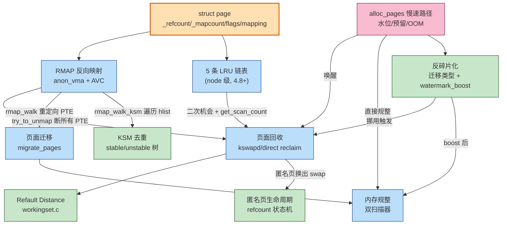

# 📖 《奔跑吧Linux内核》卷1 第5章 内存管理之高级主题 — 读书笔记

> 📅 2026-09-09 | 🏷️ Linux内核 / 内存管理 / 页面回收 / RMAP / KSM / 内存规整 / ARM64 | 📊 难度：高

---

## 🎯 一句话概括

本章围绕 `struct page` 这个"内存原子"展开,讲清了内核如何用 `_refcount`/`_mapcount`/`flags`/`mapping` 几个字段追踪每一个物理页面的一生,并在此基础上搭建起五大高级子系统:**RMAP 反向映射**(从物理页反查谁在用它)、**页面回收**(内存紧张时按 LRU + 二次机会算法淘汰页面)、**页面迁移与内存规整**(搬移页面消除外碎片)、**KSM**(合并内容相同的页面省内存),以及 **页面分配慢速路径 + 反碎片化优化**(内存告急时的层层自救)。一句话:**前四章讲"怎么把内存分出去",第五章讲"内存不够时怎么把它抢回来、挪整齐、省着用"。**

---

## 📚 内容梳理

> 说明:本节按"**数据结构基石 → 反向映射 → 回收 → 迁移/规整 → 去重 → 分配自救**"的逻辑主线重新组织,与原书 5.1~5.9 的编排顺序不完全一致,目的是把彼此依赖的机制串成一条链。所有关键结构均给出 Linux 5.0 源码级定义 + 文件路径,并对照 `linux-6.1.158` 标注 **[6.1 变化]**。

### 🧱 一、page 数据结构:内存世界的"原子"

物理内存被划分成一个个 4KB 页面,每个页面用一个 `struct page` 来描述。系统里有多少物理页面,就有多少个 `struct page`。因为数量极其庞大(几十 GB 内存 = 上千万个 page),所以这个结构对**大小极度敏感**,内核用了大量 `union`(共用体)来压缩它。

```c
// <include/linux/mm_types.h>  (Linux 5.0)
struct page {
    unsigned long flags;        // 页面状态标志 + 编码的 section/node/zone/last_cpupid
    union {                     // 第一组:5 个字长的联合体,不同用途复用
        struct {                // 页面在 LRU / 伙伴系统时
            struct list_head lru;      // 挂入 LRU 链表 或 伙伴系统空闲链表
            struct address_space *mapping; // 指向 file 的 address_space 或匿名 anon_vma
            pgoff_t index;             // 在映射中的偏移
            unsigned long private;     // 私有数据(如 buffer_head、swp_entry)
        };
        struct {                // 用于 slab/slub
            ...
            struct kmem_cache *slab_cache;
            void *freelist;
            ...
        };
        struct {                // 复合页 tail page / page table / ZONE_DEVICE
            ...
        };
    };
    union {                     // 第二组
        atomic_t _mapcount;     // 被多少个用户 PTE 映射(幸福指数)
        unsigned int page_type;
        ...
    };
    atomic_t _refcount;         // 引用计数(命根子)
    ...
};
```

**三个最核心的字段(全章反复出现):**

| 字段 | 别名理解 | 含义 | 关键 API |
|------|---------|------|---------|
| `_refcount` | 命根子 | 页面被内核**引用**的总次数,归 0 才能真正释放回伙伴系统 | `get_page()`/`put_page()`、`set_page_refcounted()`(置 1) |
| `_mapcount` | 幸福指数 | 被多少个**用户态 PTE** 映射,初值 `-1`(没人映射) | `page_mapcount()` = `_mapcount + 1` |
| `flags` | 身份证 | 低位存 PG_* 状态位,高位编码所属 section/node/zone/last_cpupid | `PageLocked()`/`SetPageActive()` 等 |
| `mapping` | 户口本 | 指向 anon_vma(匿名) 或 address_space(文件) | 低 2 位藏了类型标记 |

**`mapping` 低 2 位的位运算技巧**(全章高频):
```c
#define PAGE_MAPPING_ANON    0x1   // 匿名页面
#define PAGE_MAPPING_MOVABLE 0x2   // 非 LRU 可迁移页面
#define PAGE_MAPPING_KSM     (PAGE_MAPPING_ANON | PAGE_MAPPING_MOVABLE) // 两位都置 = KSM 页面
#define PAGE_MAPPING_FLAGS   (PAGE_MAPPING_ANON | PAGE_MAPPING_MOVABLE)
```
因为 `anon_vma`/`address_space` 指针必然按 4 字节以上对齐,低 2 位永远是 0,内核便"废物利用"这两位来标记页面类型——判断一个页面是不是 KSM 页面,只需 `(mapping & PAGE_MAPPING_FLAGS) == PAGE_MAPPING_KSM`。

**PG_locked 页锁**:通过 `lock_page()`/`trylock_page()` 获取,底层是 `test_and_set_bit_lock(PG_locked, ...)`。它是页面级别的互斥锁,回收、迁移、KSM 合并等操作都要先拿到页锁,防止并发改动同一个页面。

> **[6.1 变化] ⭐ folio 化(本章最重大的演进)**:6.1 内核引入了 `struct folio`(见 `include/linux/mm_types.h:281`)。folio 是"一定不是 tail page 的一组页面"的抽象,本质是把原来散落在 `struct page` 各 union 里、只对 head page 有效的字段(lru/mapping/index/_refcount 等)提取到一个类型安全的新结构里。大量 `mm/*.c` 的核心函数签名从 `struct page *` 改成了 `struct folio *`(例如 `shrink_page_list` → `shrink_folio_list`)。理解本章时可把 folio 近似看作"5.0 里 head page 那一套语义的显式封装",数据结构的本质关系没变。

---

### 🔄 二、RMAP 反向映射:从物理页反查"谁在用我"

**正向映射**是"虚拟地址 → 物理页面"(走页表);**反向映射(Reverse Mapping, RMAP)** 是反过来:"给定一个物理页面,找出所有映射了它的用户 PTE"。

**为什么需要它?** 页面回收要换出一个页面时,必须先把**所有**映射到它的 PTE 都断开(否则进程还在用就被换走会崩溃)。一个物理页面可能被父子进程共享(fork 后 COW),被谁映射着,只有 RMAP 知道。

**核心数据结构(匿名页面):**

```c
// <include/linux/rmap.h>
struct anon_vma {                 // AV:一族共享同一匿名内存的进程的"树根"
    struct anon_vma *root;        // 指向根 anon_vma
    struct rw_semaphore rwsem;
    atomic_t refcount;
    unsigned degree;              // 有多少个 anon_vma_chain 挂载 + 子 anon_vma 数
    struct anon_vma *parent;
    struct rb_root_cached rb_root;// 红黑树,索引所有关联的 VMA(通过 AVC)
};

struct anon_vma_chain {           // AVC:连接 VMA 和 anon_vma 的"桥"
    struct vm_area_struct *vma;
    struct anon_vma *anon_vma;
    struct list_head same_vma;    // 挂到 vma->anon_vma_chain 链表
    struct rb_node rb;            // 挂到 anon_vma->rb_root 红黑树
};
```

**三者关系(ASCII 图):**
```
   page->mapping ──► anon_vma (AV, 树根)
                        ▲  rb_root 红黑树
                        │
              ┌─────────┼─────────┐
             AVC       AVC       AVC          (每个 AVC 是一座桥)
              │         │         │
             VMA0      VMA1      VMA2         (父进程 + 各子进程的 VMA)
```
- `page->mapping` 指向 anon_vma;`page->index` 记录页面在 VMA 中的偏移。
- 由 page 找 anon_vma → 遍历 rb_root 上所有 AVC → 每个 AVC 指向一个 VMA → 用 `page->index` 算出该 VMA 中的虚拟地址 → 查到 PTE。这就是 `rmap_walk_anon()` 干的事。

**新旧模型演进(本章重点辨析):**
- **旧模型(2.6 早期)**:父子进程共享一个 anon_vma。问题——若父进程有 1000 个子进程,某个只属于父进程的页面,在遍历时要扫描 1000 个子进程的 VMA(明明它们没映射这个页),扫描效率灾难性下降。
- **新模型(2.6.34, Rik van Riel)**:每个进程(每次 fork)拥有**自己的 anon_vma**,通过 AVC 把子 anon_vma 链接到父 anon_vma 形成层级。这样一个页面到底被哪些 VMA 映射,精确记录在它自己所属 anon_vma 的红黑树里,遍历时不再扫描无关的 VMA。**AVC 的本质就是"多对多关系"的中间表**(一个 VMA 关联多个 anon_vma,一个 anon_vma 关联多个 VMA)。

`page_add_new_anon_rmap()` 是匿名页面首次建立映射的入口,关键动作:`atomic_set(&page->_mapcount, 0)`(第一次映射,幸福指数从 -1 变 0)。

---

### ♻️ 三、页面回收:内存告急时的"腾笼换鸟"

当空闲内存低于水位线,内核要回收一些页面。回收的对象分两类:**文件页**(有后备文件,脏页写回后即可丢弃)和**匿名页**(无后备文件,必须写到 swap 才能回收)。

#### 3.1 LRU 链表:谁最该被淘汰

内核为每个 **lruvec** 维护 5 条 LRU 链表:

```c
// <include/linux/mmzone.h>
enum lru_list {
    LRU_INACTIVE_ANON = LRU_BASE,      // 不活跃匿名页
    LRU_ACTIVE_ANON   = LRU_BASE + LRU_ACTIVE,   // 活跃匿名页
    LRU_INACTIVE_FILE = LRU_BASE + LRU_FILE,     // 不活跃文件页
    LRU_ACTIVE_FILE   = LRU_BASE + LRU_FILE + LRU_ACTIVE, // 活跃文件页
    LRU_UNEVICTABLE,                   // 不可回收(如 mlock 锁定的页)
    NR_LRU_LISTS
};
```

> **[6.1 变化] ⭐ MGLRU / 多代 LRU**:6.1 引入了可配置的 **Multi-Gen LRU**(`CONFIG_LRU_GEN`,见 `include/linux/mmzone.h:370` 的 `struct lru_gen_struct`)。它把传统的 active/inactive 两级替换成"多代"(generation)组织,用页表扫描 + 分代老化更精准地识别冷热页,回收决策更高效。传统 5 链表 LRU 仍然保留作为默认/回退。**对隔离核实时优化的意义**:MGLRU 改变了 kswapd 扫描页表的行为模式,可能影响回收路径引入的抖动特征,做延迟分析时要注意内核是否开启了 lru_gen。

**[6.1 变化]** 回收的核心函数已 folio 化并重命名:`shrink_page_list` → **`shrink_folio_list`**(`mm/vmscan.c:1640`);`shrink_active_list`/`shrink_inactive_list` 保留名字但操作对象变为 folio;早期的 `shrink_node_memcg` 早已演进为 **`shrink_lruvec`**。

**基于内存节点(node)还是内存管理区(zone)?** —— 关键历史转折:

> **[书中重点]** LRU 链表最早挂在 **zone** 上,**Linux 4.8**(Mel Gorman)起改为挂在 **node** 上。原因:zone 级 LRU 会导致高端 zone 的页面老化速率与低端 zone 不一致,回收决策失真。改为 node 级后,`lruvec` 挂在 `pglist_data`(node)下,回收以 node 为单位统筹。

#### 3.2 第二次机会法(Second Chance):PG_active + PG_referenced

内核不是简单的 LRU,而是**二次机会算法**——一个页面被访问不会立刻升为活跃,要"攒够两次"。三个标志位配合:

| 标志 | 类型 | 作用 |
|------|------|------|
| `PTE_AF`(ARM64 access flag) | 硬件位 | CPU 访问页面时硬件自动置位 |
| `PG_referenced` | 软件位 | "最近被访问过"的软件记录 |
| `PG_active` | 软件位 | 页面当前在 active 链表 |

**升级路径**:inactive 且未 referenced → 访问 → 置 referenced;再次访问 → 从 inactive 升到 active。**降级路径**:active 页在扫描时若未被再次访问 → 清 active、降到 inactive(先给一次 referenced 缓冲)。`mark_page_accessed()` 是这套状态机的核心入口。

#### 3.3 回收调用链(kswapd 路径)

```
kswapd()                                 // 每个 node 一个 kswapd 内核线程
  └─ balance_pgdat()                     // 把 node 的各 zone 拉回高水位之上
       └─ kswapd_shrink_node()
            └─ shrink_node()             // node 级回收主函数
                 └─ shrink_lruvec()      // 遍历该 lruvec 的各条 LRU
                      ├─ get_scan_count()          // 算每条链表扫多少页
                      ├─ shrink_active_list()      // active → inactive 降级
                      └─ shrink_inactive_list()    // 从 inactive 尾部取页
                           └─ shrink_page_list()   // [6.1] shrink_folio_list()
                                └─ try_to_unmap()  // 借 RMAP 断开所有 PTE
                                └─ pageout()       // 脏页写回
```

**扫描控制结构 `scan_control`** 与优先级:
```c
struct scan_control {
    unsigned long nr_to_reclaim;  // 目标回收页数
    int priority;                 // 扫描优先级,越小越激进
    ...
};
#define DEF_PRIORITY 12
// 每轮扫描页数 = LRU 总页数 >> priority。priority 从 12 递减到 0,
// 越扫不到目标就越激进(一次扫的比例翻倍),直到 priority=0 扫描全部。
```

`get_scan_count()` 决定"扫匿名页多还是文件页多",受 **swappiness** 影响:
- `swappiness` 默认 60,范围 0~200(旧内核 0~100)。值越大越倾向回收匿名页(多用 swap);为 0 时几乎不动匿名页(除非文件页已耗尽)。
- 还受 **inactive_ratio** 约束:活跃/不活跃链表的比例要维持在一个合理区间(大内存下 active:inactive 可达 3:1),防止工作集被过度回收。

<details>
<summary>🔬 <b>专题深挖:直接回收(direct reclaim)对隔离核实时性的杀伤</b></summary>

- **kswapd 回收**是**异步**的,由独立内核线程在后台做。但如果分配速度快过 kswapd,分配进程会陷入**直接回收(direct reclaim)**——**在分配的上下文里同步地扫 LRU、写回脏页、断 PTE**,这一过程可能持续数毫秒甚至更久。
- 对 **Thor 平台的隔离核** 而言:即便把 kswapd 用 cpuset 赶到 housekeeping 核,一旦隔离核上的实时线程自己触发了直接回收(比如分配了未锁定的内存),它就会**在自己的关键路径上**卡住去回收——这是 cyclictest 尾延迟毛刺的经典来源之一。
- **规避手段**:实时进程启动即 `mlockall(MCL_CURRENT|MCL_FUTURE)` 锁定全部内存,让其页面进入 `LRU_UNEVICTABLE`,从根上杜绝被回收/换出;并预留足够 housekeeping 内存让 kswapd 有余量,避免全局进入直接回收。
</details>

---

### 📏 四、Refault Distance:文件页回收的"后悔药"(专题深挖)

<details open>
<summary>🔬 <b>专题深挖:Refault Distance 算法(Linux 3.15, Johannes Weiner)</b></summary>

**要解决的痛点**:文件页回收有个两难。inactive_file 链表太短,刚回收的页面马上又被访问(**refault,再故障**),说明工作集被误伤;太长又浪费内存。传统 LRU 无法区分"这个页面是真的冷,还是只是因为 inactive 链表太短而被冤枉淘汰"。

**核心思想**:回收一个文件页时,不是彻底遗忘它,而是在原来页表项/页缓存槽位留下一个 **shadow(影子)条目**,记录它被淘汰那一刻的 **eviction 时间戳**(其实是一个单调递增的 `inactive_age` 计数)。当这个页面再次被访问、重新读回(refault)时:

```
refault_distance = 当前 inactive_age(refault 时刻) − shadow 里记录的 eviction 时刻
```

`refault_distance` 表示"它离开后,inactive 链表又流过了多少页面"。判断规则:
- 若 `refault_distance ≤ 活跃文件页数(active_file)` → 说明它其实还属于工作集,只是被过早淘汰 → **直接激活**放入 active 链表(补偿它)。
- 否则 → 它确实是冷页,放回 inactive 正常对待。

**源码位置**:`mm/workingset.c`,三个关键函数:
- `workingset_eviction()`:回收时打包 shadow(`pack_shadow()` 把 node/memcg/eviction 时间编码进一个指针大小的值)。
- `workingset_refault()`:refault 时解包(`unpack_shadow()`),算 distance,决定是否激活。
- `workingset_activation()`:页面被激活时推进 inactive_age。

**shadow 编码**:因为要塞进一个指针大小的槽位,`pack_shadow` 把 memcg id、node id、eviction 计数、workingset 标记按位打包,最低位置 1 以区别于正常 page 指针。

> **[6.1 变化]** MGLRU 开启时,eviction/refault 走的是另一套 `lru_gen_eviction()`/`lru_gen_refault()` 路径(`mm/workingset.c:220`),用"代"的编号代替 inactive_age。传统路径在未开 lru_gen 时仍然生效。

**类比**:图书馆把很久没人借的书下架进仓库,但在书架原位留一张卡片记着"下架时馆藏流水号是 5000"。若不久有人来找这本书(流水号才到 5100,距离仅 100 < 常借书总量),管理员意识到"下架错了,这是热门书",重新上架并放到显眼位置。
</details>

---

### 🌱 五、匿名页面的一生:_refcount/_mapcount 的状态机

把一个匿名页面的完整生命周期串起来,看两个计数如何联动(书中给出的经典状态转换):

| 阶段 | 触发 | `_refcount` | `_mapcount` | 关键标志 |
|------|------|:-----------:|:-----------:|---------|
| **① 产生** | 缺页中断分配新页 `alloc_pages` | 1 | -1 | — |
| **② 使用(建立映射)** | `page_add_new_anon_rmap` + 加入 LRU + swap cache | 1→3 | -1→0 | PG_swapbacked, PG_lru |
| **③ 换出(swap out)** | `add_to_swap` 加入交换缓存,`try_to_unmap` 断 PTE | 3→2 | 0→-1 | PG_locked, 写入交换分区 |
| **④ 换入(swap in)** | 缺页再访问,`do_swap_page` 从 swap 读回 | 重新建立 | -1→0 | — |
| **⑤ 销毁** | 进程退出 / 页面回收完成 | →0 | -1 | 归还伙伴系统 |

要点:**②中 `_refcount` 会短暂涨到 3**(页表映射 1 + LRU 隔离/操作 1 + swap cache 1 之类的临时引用),这正是 KSM"有趣的计算公式"要精确扣减各来源的原因(见第八节)。`_mapcount` 始终反映"有几个用户 PTE",换出后没人映射即回到 -1。

---

### 🚚 六、页面迁移:把页面"搬家"

**页面迁移(page migration)** 是把一个页面的内容原封不动搬到另一个物理页面,并把所有映射它的 PTE 重新指向新页。用途:内存规整、NUMA 页面平衡、内存热插拔、CMA。

**主流程调用链:**
```
migrate_pages(from_list, ...)            // 遍历待迁移页面链表
  └─ unmap_and_move()
       └─ __unmap_and_move()
            ├─ lock_page()               // 拿旧页页锁
            ├─ try_to_unmap()            // 借 RMAP 断开旧页所有 PTE,换成迁移页表项
            ├─ move_to_new_page()        // 内容 + 状态迁移到新页
            │    ├─ mapping->a_ops->migratepage()  // 有则用文件系统专用迁移
            │    └─ migrate_page() → copy_highpage()  // 通用:逐字节拷贝
            └─ remove_migration_pte()    // 把迁移页表项换成指向新页的正常 PTE
```

**两大类可迁移页面:**
1. **传统 LRU 页面**:匿名页、文件页,走上面标准流程。
2. **非 LRU 可迁移页面(non-LRU movable)**:如 zsmalloc、virtio-balloon 管理的页。它们不在 LRU 上,通过 `page->mapping` 低位打 `PAGE_MAPPING_MOVABLE`,并注册 `address_space_operations` 里的 `isolate_page`/`migratepage`/`putback_page` 回调。用 `PG_movable`/`PG_isolated` 标志协调隔离与迁移。

---

### 🧹 七、内存规整(compaction):消除外碎片

**外碎片化**:系统总空闲内存充足,但被零散占用,凑不出一块连续大页。内存规整用**双扫描器(two-scanner)** 算法把可迁移页面搬到一端,腾出连续空闲区。它以 **zone** 为单位工作。

**双扫描器思想(ASCII 图):**
```
zone 物理地址空间 ────────────────────────────────────────►
[已用][可迁移][空闲][已用][空闲][空闲] ...... [空闲][空闲]
  ▲ migrate scanner 从低地址向上          free scanner 从高地址向下 ▲
      (找"可迁移的已用页")                   (找"空闲页"作为搬迁目标)
                     两个扫描器相遇 → 本轮规整结束
```
migrate scanner 找到可迁移页面,free scanner 提供空闲落脚点,`migrate_pages()` 把前者搬到后者。低地址逐渐连成大片空闲。

**控制结构 `compact_control`(部分字段):**
```c
struct compact_control {
    struct list_head freepages;   // free scanner 收集的空闲页
    struct list_head migratepages;// migrate scanner 收集的待迁移页
    unsigned long free_pfn;       // free scanner 当前位置(从高往低)
    unsigned long migrate_pfn;    // migrate scanner 当前位置(从低往高)
    enum migrate_mode mode;       // 同步/异步模式
    int order;                    // 目标分配阶
    ...
};
```

**迁移模式 `migrate_mode`(决定能否阻塞,直接关系延迟):**

| 模式 | 是否可阻塞 | 使用场景 |
|------|-----------|---------|
| `MIGRATE_ASYNC` | 否,不等锁不等回写 | 直接规整第一轮,追求低延迟 |
| `MIGRATE_SYNC_LIGHT` | 部分,可等页锁不等回写 | 折中 |
| `MIGRATE_SYNC` | 是,可等锁等回写 | kcompactd / 强制规整,追求成功率 |
| `MIGRATE_SYNC_NO_COPY` | 是,但不做内容拷贝(硬件加速) | 特定驱动 |

**入口**:`compact_zone_order()` 初始化 `cc` → `compact_zone()` 主循环 → `isolate_migratepages()`/`isolate_migratepages_block()` 隔离可迁移页 → `migrate_pages()` 搬移。**直接规整(direct compaction)** 在分配慢速路径中被调用(见第九节)。规整以 `pageblock_order`(一个页块 = 分配器最大阶,通常 4MB)为粒度对齐。

<details>
<summary>🔬 <b>专题深挖:规整/迁移引发的延迟毛刺</b></summary>

对隔离核实时优化:同步规整(`MIGRATE_SYNC`)会等页锁、等脏页回写,持续时间不可控;更隐蔽的是 `try_to_unmap` 断 PTE 时要 **flush TLB**,在多核 ARM64 上通过 **IPI 广播** 通知其他 CPU——这会打断正在隔离核上跑的实时线程(TLB shootdown 中断)。KSM 那节量化过:单次 flush 约 10μs,遍历 1 万个 PTE 就是 100ms。**启示**:cyclictest 抓到的毛刺若与内存压力相关,要排查是否有规整/迁移触发的跨核 TLB IPI;`nohz_full` + `isolcpus` 挡不住 IPI,需要从源头(mlock、减少全局内存压力、关闭不必要的 KSM/NUMA balancing)入手。
</details>

---

### 🧬 八、KSM:合并内容相同的页面(专题深挖)

**KSM(Kernel SamePage Merging)** 最初为 KVM 设计:一台宿主机跑几十个相同的虚拟机,大量匿名页内容完全一样,合并成一个只读页可省下巨量内存。Linux 2.6.32 引入。

**使能方式**:进程调用 `madvise(addr, len, MADV_MERGEABLE)` 声明某段内存"可合并";`ksmd` 内核线程后台周期扫描这些内存,发现内容相同就合并。注意 `madvise` 要求 **addr 页对齐**——所以直接用 `malloc()` 的地址往往触发不了 KSM(malloc 不保证页对齐),这是常见"坑"。且只有**匿名页**会被扫描(`follow_page` + `PageAnon` 过滤)。

**sysfs 控制节点**(`/sys/kernel/mm/ksm/`):`run`(0 停/1 跑/2 停并拆分)、`pages_to_scan`、`sleep_millisecs`、`max_page_sharing`(默认 256)、`pages_shared`/`pages_sharing`(合并效果统计)。

#### 8.1 两棵红黑树:stable + unstable

```c
// <mm/ksm.c> (Linux 5.0 命名)
struct rmap_item {         // [6.1] 更名为 struct ksm_rmap_item
    struct rmap_item *rmap_list;  // 挂到 mm_slot.rmap_list
    struct anon_vma *anon_vma;    // 加入 stable 树后指向 VMA 的 anon_vma
    struct mm_struct *mm;
    unsigned long address;        // 跟踪的用户虚拟地址
    unsigned int oldchecksum;     // 上次的页面校验和
    union { struct rb_node node;          // 加入 unstable 树的节点
            struct { struct stable_node *head; struct hlist_node hlist; }; };
};
struct stable_node {       // [6.1] 更名为 struct ksm_stable_node
    struct rb_node node;          // 加入 stable 红黑树
    struct hlist_head hlist;      // 共享此 KSM 页的所有 rmap_item
    unsigned long kpfn;           // KSM 页帧号
    int rmap_hlist_len;           // hlist 成员数; = STABLE_NODE_CHAIN(-1024) 表示链式节点
    int nid;
};
```

- **unstable 红黑树**:存放"内容暂时没变、但还没找到相同伙伴"的候选页。因为内容可能随时被改,所以叫"不稳定"。用页面内容 `memcmp` 排序。为避免比较正在频繁改动的页,先用 **checksum** 过滤:只有本轮校验和与上轮相同(说明近期没改)的页面才放进 unstable 树。
- **stable 红黑树**:存放已合并的、被设为**只读**的 KSM 页面。稳定不变,故用它做二分查找。

**扫描一个候选页的决策流程**:
```
cmp_and_merge_page(page):
  1. 先查 stable 树 (stable_tree_search): 找到内容相同的 KSM 页 → 合并进去,完事
  2. 算 checksum,若与 oldchecksum 不同 → 更新 oldchecksum,return(近期在改,先不处理)
  3. 查 unstable 树 (unstable_tree_search_insert):
     - 找到内容相同的候选 → try_to_merge_two_pages 合并两页,建新 stable_node,加入 stable 树
     - 没找到 → 把本页 rmap_item 插入 unstable 树,等下一轮
```

#### 8.2 stable node 的链式改造(Linux 4.13, Andrea Arcangeli)

**痛点**:大服务器上几百万个相同页合并到**一个** stable_node。当迁移/规整要遍历它时,`rmap_walk_ksm` 要遍历几百万个 rmap_item,每断一个 PTE 都 flush TLB(约 10μs),累计数百毫秒,期间还占着页锁,足以让系统"宕机"级卡顿。

**解法**:限制每个 stable_node 最多合并 **256(`max_page_sharing`)** 个页。超过就把该 stable_node 升级成**链式结构**:
- **传统 stable_node(dup)**:实际持有 ≤256 个 rmap_item 的 hlist,兼容旧格式。
- **链式 stable_node(chain)**:`rmap_hlist_len == STABLE_NODE_CHAIN(-1024)`,自己**不存 rmap_item**,而是把多个 dup 节点串成 hlist;红黑树上的位置由 chain 占据(用 `rb_replace_node` 把原 dup 换成 chain,再把 dup 挂进 chain 的 hlist)。

于是 1000 个相同页会生成多个 KSM 页(每 256 个一组:page1、page257、page513...),遍历任一 KSM 页只需处理 ≤256 个 rmap_item,把最坏耗时压到毫秒级。

#### 8.3 write_protect_page 里"有趣的计算公式"

合并前要把候选页设为只读,前提是**确认没有其他内核路径正在操作它**。判断公式(第 1089 行附近):
```c
if (page_mapcount(page) + 1 + swapped != page_count(page))
    return err;   // 说明有额外引用(如 DIRECT_IO),放弃本次合并
```
拆解 `_refcount` 的来源并逐项抵消:
```
正常关系:  (page->_mapcount + 1) + PageSwapCache()  == page->_refcount
              └─ page_mapcount() ─┘   └ 在 swap cache 则 +1 ┘
本场景额外的 +1:scan_get_next_rmap_item() 里 follow_page() 拿页时给 _refcount 加了 1
所以:      page_mapcount(page) + 1 + swapped == page_count(page)  才是"干净"状态
```
若左右**不相等**,说明存在预期外的引用(典型是 `get_user_pages_fast()` 带来的 DIRECT_IO 读写),此刻改只读并合并会出错,必须放弃。这是全章 `_refcount`/`_mapcount` 精妙运用的巅峰例子。

#### 8.4 page->index 的取值

- **父子进程共享匿名页**:`page->index` = 虚拟地址在 VMA 中的偏移;fork 复制 VMA 和页表,父子的 index 一致,`rmap_walk_anon` 用 `page->index` + `vma_address()` 反算地址。
- **KSM 页(不相干进程共享)**:`page->index` = **第一次映射该页的 VMA 中的偏移**。因为各进程虚拟地址不同,`rmap_walk_ksm` 改用每个 `rmap_item->address` 直接取地址,而非依赖 `page->index`。

> **[6.1 变化]** KSM 结构体加了 `ksm_` 前缀(`ksm_rmap_item`/`ksm_stable_node`);`ksm_use_zero_pages`(把全零页合并到系统零页,`mm/ksm.c:275`)与 256 上限、STABLE_NODE_CHAIN 链式改造在 6.1 均已是正式特性;`break_cow` 等改用 `mmap_read_lock()`(即 5.0 里的 `mmap_sem` 已更名为 `mmap_lock`)。

---

### 🆘 九、页面分配慢速路径:内存告急时的层层自救

`alloc_pages()` 在空闲内存高于**低水位**时走**快速路径**(`get_page_from_freelist` 直接分配)。一旦低水位下分配失败,进入 **`__alloc_pages_slowpath()`**(`mm/page_alloc.c`),开始由轻到重的自救。

**自救阶梯(按尝试顺序):**
```
__alloc_pages_slowpath():
  1. gfp_to_alloc_flags(): 把水位判据从 ALLOC_WMARK_LOW 降到 ALLOC_WMARK_MIN(最低警戒水位)
  2. wake_all_kswapds(): 唤醒各 node 的 kswapd 异步回收
  3. 用 MIN 水位重试 get_page_from_freelist()
  4. 满足条件时先做异步直接规整 __alloc_pages_direct_compact()(COMPACT_PRIO_ASYNC)
  5. __gfp_pfmemalloc_flags(): 判断能否动用系统预留内存(见下表)
  6. __alloc_pages_direct_reclaim(): 直接页面回收(同步!在分配上下文里回收)
  7. __alloc_pages_direct_compact(): 直接内存规整
  8. should_reclaim_retry()/should_compact_retry(): 判断是否重试(no_progress_loops 上限
     MAX_RECLAIM_RETRIES=16;超限尝试 unreserve_highatomic_pageblock 挪 HIGHATOMIC 页块)
  9. check_retry_cpuset(): 换 cpuset 再试
 10. __alloc_pages_may_oom(): 启动 OOM Killer 杀进程腾内存,然后回到 retry
 11. nopage: __GFP_NOFAIL 则死磕(ALLOC_HARDER 再试),否则 warn_alloc() 报告失败返回 NULL
```

**水位三档**:高水位 `WMARK_HIGH` > 低水位 `WMARK_LOW` > 最低警戒水位 `WMARK_MIN`。MIN 以下是系统预留内存,普通请求禁用。

**分配优先级与可动用的预留内存比例(表 5.12,重点记忆):**

| 优先级 | 触发条件 | 可访问的预留内存 |
|--------|---------|-----------------|
| 正常 | `GFP_KERNEL`/`GFP_USER` | **0**(只能用到 MIN 水位) |
| 高(`ALLOC_HIGH`) | `__GFP_HIGH` | MIN 以下的 **1/2** |
| 艰难(`ALLOC_HARDER`) | `__GFP_ATOMIC` 或实时进程 | MIN 以下的 **5/8** |
| OOM 补偿(`ALLOC_OOM`) | 线程组有线程被 OOM 杀掉 | MIN 以下的 **3/4** |
| 紧急(`ALLOC_NO_WATERMARKS`) | `__GFP_MEMALLOC` 或进程 `PF_MEMALLOC` | **全部**(忽略水位) |

> 记忆线索:优先级越高、越"救命",能挖的预留内存越多——正常 0、高 1/2、艰难 5/8、OOM 3/4、紧急全给。`__GFP_ATOMIC` 不可睡眠(常在中断上下文),实时进程也享受 ALLOC_HARDER 待遇。

---

### 🧩 十、内存碎片化管理:迁移类型 + watermark_boost

#### 10.1 伙伴系统为何天然会碎片化

两块内存成为"伙伴"必须同时满足:**① 大小相同 ② 地址连续 ③ 从同一大块分裂而来**。因为第③条,若 P1 和 P2(分属不同父块 C0、C1)先合并,即使后来 P0、P3 都空闲,它们也没法与已合并块凑成大块——留下"空洞",这就是**外碎片化**。后果:总空闲充足却分不出连续大页。

更棘手的是:**内核自用页面不可迁移**(断映射后内核若继续访问就 oops,不像用户页断映射后触发缺页可安全重建)。一小块内核页夹在中间,就阻断了整块合并。

#### 10.2 反碎片法:按迁移类型分组(Linux 2.6.24)

以**页块(pageblock,约 4MB)** 为粒度,把页面按迁移属性归类,同一页块内页面迁移类型一致:
- **MIGRATE_UNMOVABLE**:不可迁移(内核自用、DMA 缓冲,`GFP_KERNEL`)。
- **MIGRATE_MOVABLE**:可迁移(用户 `malloc`/`mmap` 匿名页)。
- **MIGRATE_RECLAIMABLE**:不可移动但可回收(文件页缓存)。

`free_area` 因此按 `[order][migratetype]` 二维组织空闲链表。迁移类型正是为内存规整服务的——规整时把可迁移页搬走,凑出连续内核可用块。

#### 10.3 Linux 5.0 新增:watermark_boost 临时抬水位

**场景**:请求 order=4 的不可迁移内存,该类型无足够大空闲块。

- `__zone_watermark_ok()` 会检查:在 UNMOVABLE/MOVABLE/RECLAIMABLE 三类里,有任一 ≥order 的空闲块就算"能分配"。
- 分配器通过 `fallbacks[][]` 数组**挪用(steal)** 其他迁移类型的页块(如不可迁移优先向可回收、再向可迁移借),入口 `__rmqueue_fallback()` → `steal_suitable_fallback()`。挪用会打 `trace_mm_page_alloc_extfrag` 跟踪点——**它就是"外碎片化事件"的信号**。

**5.0 的优化**:挪用发生 = 碎片化苗头。为及早补救,`steal_suitable_fallback()` 调用 `boost_watermark()` **临时抬高 zone 水位**(`zone->watermark_boost`),并置 `ZONE_BOOSTED_WATERMARK`。回到 `rmqueue()` 时**提前唤醒 kswapd** 回收内存;kswapd 在 `balance_pgdat()` 达到平衡后**撤销 boost 水位**并唤醒 **kcompactd** 以 `pageblock_order` 为目标做规整。整套 = "发现挪用→抬水位→提前回收+规整→凑回连续大块→撤销 boost"。

---

## 🧠 费曼解读

### 概念 1:`_refcount` vs `_mapcount` —— 命根子 vs 幸福指数

- **大白话**:`_refcount` 是"这个页面此刻被内核里多少处'握着'",归 0 才敢把它还给伙伴系统;`_mapcount` 是"多少个用户进程的页表项正指着它"。
- **类比**:一本图书馆的书。`_mapcount` = 有多少读者在借阅证上登记了这本书(用户视角);`_refcount` = 加上管理员正在整理/装订/扫码的临时占用(全部占用)。哪怕没人借(mapcount=0),管理员还攥在手里(refcount>0)就不能销毁。
- **为什么重要**:这是理解回收、迁移、KSM 的地基。KSM 的"有趣公式"、匿名页生命周期的计数变化,全靠精确区分这两者。
- **关键细节**:`page_mapcount() = _mapcount + 1`(mapcount 初值 -1 表示无人映射);两者不是简单相等,差值恰好是内核临时引用(swap cache、follow_page、DIRECT_IO...),KSM 就是靠精确列举这些差值来判断页面是否"干净"。
- **理解自测**:一个匿名页只被一个进程映射、且在 swap cache 中,没有其他内核操作,它的 `_refcount` 和 `_mapcount` 各是多少?(答:`_mapcount`=0,`_refcount`=2 = 映射 1 + swap cache 1)

### 概念 2:RMAP 反向映射 —— 为什么需要"倒查"

- **大白话**:正常是"知道虚拟地址,查页表找到物理页";RMAP 是反过来"拿着物理页,找出所有指着它的虚拟地址"。
- **类比**:快递柜。正向 = 你有取件码(虚拟地址)去柜子(物理页)取件。反向 = 快递柜坏了要搬走,管理员必须通知**所有**存了件的人(所有映射的 PTE)来处理——RMAP 就是那份"存件人名单"。
- **为什么重要**:回收/迁移一个页面前,必须断开它的所有 PTE。没有 RMAP 就只能扫描全系统页表,慢到不可用。
- **关键细节**:新模型(2.6.34)每进程独立 anon_vma + AVC 桥接,解决了旧模型"1000 个子进程要扫 1000 遍"的可扩展性灾难。AVC 本质是"VMA 与 anon_vma 多对多关系"的中间表。
- **理解自测**:为什么不直接在 page 里存一个"用户列表",非要搞 anon_vma + AVC 两级?(答:一个页可能被海量 VMA 映射,内联列表会撑爆 page 结构;红黑树 + 层级共享才可扩展)

### 概念 3:第二次机会算法 —— LRU 的"缓刑"

- **大白话**:页面不是"最近没用就立刻淘汰",而是要"连续两次没被光顾"才降级,给一次改过自新的机会。
- **类比**:公司裁员先给"黄牌警告"(PG_referenced),再犯才真降级(移出 active);表现好(再次被访问)则撤销警告甚至升职(升到 active)。
- **为什么重要**:纯 LRU 会误伤"偶尔沉默但很重要"的页;二次机会用极小代价(几个标志位)大幅提升回收命中率。
- **关键细节**:ARM64 上 `PTE_AF` 是硬件位(CPU 访问自动置),`PG_active`/`PG_referenced` 是软件位;`mark_page_accessed()` 驱动整个状态机;Refault Distance 是它在"文件页误伤"维度的进一步补救。
- **理解自测**:swappiness=0 时,内存紧张会先回收匿名页还是文件页?(答:文件页;除非文件页耗尽才动匿名页)

### 概念 4:Refault Distance —— 回收的"后悔药"

- **大白话**:淘汰一个文件页时留个"影子小票"记下淘汰时刻;它很快又被要回来时,算算"离开期间队伍才走了多少人",太短就说明淘汰错了,补偿性地把它放进活跃队。
- **类比**:见第四节图书馆下架卡片的例子。
- **为什么重要**:它让内核能**自适应**调整活跃/不活跃链表的平衡点,避免抖动(thrashing)——刚回收就 refault 的恶性循环。
- **关键细节**:shadow 用 `pack_shadow` 编码进指针大小的槽位;`refault_distance ≤ active_file` 才激活。6.1 MGLRU 下走 `lru_gen_refault` 另一套。
- **理解自测**:refault_distance 很大(远超 active_file)说明什么?(答:这页确实是冷页,当初回收正确,不激活)

### 概念 5:KSM 的两棵树 —— 为什么要 stable + unstable

- **大白话**:已经合并、设成只读、内容铁定不变的页放"稳定树"(可靠地二分查找);内容可能还在变、暂未找到伙伴的候选放"不稳定树"。
- **类比**:相亲平台。稳定树 = 已领证的夫妻档案(不会变,可精确检索);不稳定树 = 还在观察期的候选人(可能随时变卦,先用"最近有没有改主意"的校验和筛一遍再登记)。
- **为什么重要**:内容可变的页面无法用作红黑树的稳定 key,直接比会出错;两棵树 + checksum 预筛既避开了哈希专利,又控制了 memcmp 的最坏开销。
- **关键细节**:unstable 树用 checksum 过滤"近期改动过"的页;256 上限 + 链式 stable_node(4.13)防止一个 KSM 页聚集过多 rmap_item 导致 TLB flush 风暴。
- **理解自测**:为什么合并前用 `trylock_page` 而非 `lock_page`?(答:拿不到锁就跳过先处理别的页,不值得为一个候选页阻塞等待)

### 概念 6:分配慢速路径 —— 内存告急的"救命阶梯"

- **大白话**:低水位分不出内存了,就一级级加码:先叫醒后台回收线程 → 降到最低水位再试 → 自己动手同步回收/规整 → 动用预留内存 → 实在不行杀进程(OOM)。
- **类比**:公司现金流告急。先催回款(kswapd)→ 动用周转金(MIN 水位)→ 老板亲自跑业务(直接回收/规整)→ 动应急储备金(预留内存,按优先级给不同比例)→ 最后裁员止血(OOM Killer)。
- **为什么重要**:决定了内存压力下系统是优雅降级还是雪崩;直接回收/规整会在**分配者自己的上下文**里同步执行,是延迟毛刺的重要来源。
- **关键细节**:预留内存按优先级分配比例(正常 0 / 高 1/2 / 艰难 5/8 / OOM 3/4 / 紧急全给);`no_progress_loops` 上限 16;`__GFP_NOFAIL` 会死磕不返回 NULL。
- **理解自测**:实时进程(RT)分配内存时享受什么额外待遇?(答:ALLOC_HARDER,可访问 MIN 以下 5/8 的预留内存)

### 概念 7:watermark_boost 反碎片 —— 提前拉响警报

- **大白话**:一旦发现要"挪用"别的迁移类型的页块(碎片化苗头),就临时把水位线抬高,骗系统"内存不够了",提前叫醒 kswapd 回收 + kcompactd 规整,把碎片整理掉。
- **类比**:小区停车位分了"业主区/访客区"。一旦访客车开始占业主车位(挪用),物业提前(而非等真满了)去清理僵尸车、规整车位,防止越来越乱。
- **为什么重要**:传统机制要等真到低水位才行动,carboost 让防碎片"治未病",显著改善大页分配成功率。
- **关键细节**:`boost_watermark()` 设 `zone->watermark_boost`,置 `ZONE_BOOSTED_WATERMARK`,`rmqueue` 出口提前 `wakeup_kswapd`;平衡后撤销并 `wakeup_kcompactd`。
- **理解自测**:boost 水位什么时候被撤销?(答:kswapd 的 `balance_pgdat` 达到平衡/完成一轮后,减去 boost 值并唤醒 kcompactd)

---

## 🔗 知识图谱



**读图**:橙色是数据结构基石 `struct page`;蓝色是核心机制(RMAP/LRU/回收/迁移/规整);绿色是精巧算法(Refault/KSM/生命周期/反碎片);粉色是分配入口。**RMAP 是枢纽**——回收、迁移、KSM 三大子系统都依赖它"倒查并操作 PTE"。分配慢速路径是总调度者,把回收和规整串起来自救。

---

## ❓ 启发性发问

**理解层**
1. `_refcount` 和 `_mapcount` 为什么不能合并成一个计数?它们各自归零的含义有何本质不同?
2. LRU 从 zone 级改为 node 级(4.8),到底解决了什么"老化速率不一致"的问题?

**应用层**
3. 在 Thor 隔离核上跑 cyclictest 时抓到偶发几百微秒的毛刺,如何用本章知识列出"内存管理"维度的嫌疑清单(直接回收 / 规整 / TLB IPI / KSM 遍历),并逐一验证或排除?
4. `mlockall` 之后页面进入 `LRU_UNEVICTABLE`,它还会不会被内存规整/迁移搬动?会不会因此仍引入 TLB IPI 打断实时核?(提示:mlock 防换出,但不必然防迁移)

**追问层**
5. KSM 的"有趣公式"里,如果去掉那个 `+1`(follow_page 的引用)会发生什么误判?为什么恰好是 +1 而不是 +2?
6. watermark_boost 提前唤醒 kswapd 做回收,这本身会不会在隔离核附近引入新的抖动?"治碎片"与"实时确定性"是否存在矛盾?

**关联层**
7. Refault Distance 的 shadow 机制,和 KSM 的 checksum 预筛、二次机会的 referenced 位,都是"用极小状态记住历史来改进决策"——能否抽象出内核里这类"轻量历史指纹"的通用设计模式?
8. 本章的 RMAP 与第 2~4 章的正向页表映射、COW、缺页处理如何闭环?(fork → COW → 页面回收换出 → 缺页换入,`page->index` 在其中如何一致地扮演角色?)

---

## 📝 行动项

- [ ] 在 Thor 平台用 `perf trace`/`ftrace` 抓 `mm_page_alloc_extfrag`、`mm_compaction_*`、`mm_vmscan_direct_reclaim_begin/end` 跟踪点,统计隔离核 workload 运行期间是否发生直接回收/规整,量化其耗时分布。
- [ ] 对实时进程加 `mlockall(MCL_CURRENT|MCL_FUTURE)`,用 `/proc/<pid>/smaps` 确认关键段进入 `Unevictable`/`Locked`,对比施加前后 cyclictest 的 `Max` 尾延迟。
- [ ] 检查内核是否开启 `CONFIG_LRU_GEN`(MGLRU)及 `/sys/kernel/mm/lru_gen/enabled`,评估其页表扫描行为对隔离核的额外中断/抖动影响,决定是否关闭。
- [ ] 评估并按需关闭 KSM(`/sys/kernel/mm/ksm/run`=0)与 NUMA balancing(`kernel.numa_balancing=0`),消除 KSM 遍历合并与自动 NUMA 迁移带来的跨核 TLB IPI。
- [ ] 监控 `/proc/buddyinfo` 与 `/proc/pagetypeinfo` 观察外碎片化程度;必要时用 `vm.watermark_boost_factor`/`vm.min_free_kbytes` 调参,或用 `echo 1 > /proc/sys/vm/compact_memory` 在低峰期主动规整,避免运行期触发同步规整。
- [ ] 把 kswapd/kcompactd 通过 cpuset 约束到 housekeeping 核,验证 `isolcpus` 是否已把这些内核线程排除出隔离核。

---

## 💡 个人洞察

1. **RMAP 是内存管理的"隐形枢纽"**。表面上本章讲了五个独立子系统,但回收、迁移、KSM 全都卡在同一个动作上:"拿着物理页,断/改它所有的 PTE"。理解了 RMAP,后面全部豁然开朗;它也解释了为什么这些机制的延迟成本本质相同——都要 `rmap_walk` + `flush TLB`。对做实时优化的人,这意味着**优化方向可以统一**:凡是减少页面被跨进程共享映射、减少全局内存压力的手段,同时利好回收/迁移/KSM 三条路径。

2. **内核到处在用"轻量历史指纹"换决策质量**。二次机会的 referenced 位、Refault 的 shadow 时间戳、KSM 的 checksum,都是"花一两个 bit/一个 word 记住过去,避免昂贵的重新判断"。这是资源受限系统的通用智慧:**不追求完美信息,而是用最小状态逼近最优决策**。这个思路完全可以迁移到我自己写的调度/缓存逻辑里。

3. **"治碎片/省内存"与"实时确定性"存在结构性张力**。watermark_boost、KSM、规整、MGLRU 页表扫描,都是为了**吞吐/密度**主动做后台工作,而后台工作 = 不确定的中断与 TLB IPI = 实时的敌人。做隔离核优化的核心心法不是"调优这些机制",而是**从隔离核上彻底摘除它们**(mlock 断回收、关 KSM/NUMA balancing、把内核线程赶到 housekeeping 核),让隔离核活在一个"内存永远够、永不被打扰"的理想世界里。

---

## ✅ 质量自检

- [x] 完整读完 `/tmp/ch5.txt`(约 6250 行,分块读至末尾脚注 6249 行)
- [x] 覆盖全部 5.1~5.9 内容:page 结构、RMAP、页面回收、Refault、匿名页生命周期、页面迁移、内存规整、KSM、分配慢速路径、内存碎片化管理
- [x] 内容按逻辑主线重组(基石→反向映射→回收→迁移/规整→去重→分配自救),而非照抄目录
- [x] 关键数据结构给出源码级定义 + 文件路径 + 字段注释(page/anon_vma/AVC/lru_list/scan_control/rmap_item/stable_node/compact_control)
- [x] 核心流程配完整调用链(回收链、迁移链、KSM 决策流、慢速路径阶梯)
- [x] 复杂关系配 ASCII 图(RMAP 三级、双扫描器)+ Mermaid 知识图谱
- [x] 设 4 处专题深挖(直接回收对隔离核、Refault Distance、迁移/规整延迟、KSM)
- [x] 费曼解读 7 个核心/难点概念,每个含大白话/类比/为什么重要/关键细节/理解自测
- [x] 对照 `linux-6.1.158` 实际 grep 验证并标注 **6.1 变化**（folio、MGLRU、shrink_folio_list、mmap_lock、ksm_ 前缀）
- [x] 保留重要数值(swappiness 60、DEF_PRIORITY 12、max_page_sharing 256、STABLE_NODE_CHAIN -1024、MAX_RECLAIM_RETRIES 16、预留内存 1/2·5/8·3/4 比例、pageblock 4MB)
- [x] 启发性发问分理解/应用/追问/关联四层
- [x] 行动项、个人洞察均与 Thor 平台(ARM64 隔离核实时优化、cyclictest、mlockall)结合

---
