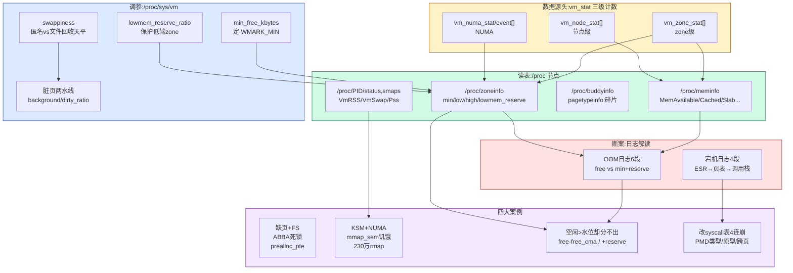

# 📖 《奔跑吧Linux内核》卷1 第6章 内存管理之实战案例 — 读书笔记

> 📅 2026-09-09 | 🏷️ meminfo / vm_stat / 调优参数 / OOM日志 / 宕机分析 / 缺页死锁 / KSM+NUMA | 📊 难度：中

---

## 🎯 一句话概括

这一章从"实战运维"的视角回看前几章的内存管理机制：**先教你怎么"读表"——通过 `/proc/meminfo`、`/proc/zoneinfo`、`/proc/buddyinfo`、`/proc/PID/status`、`vm_stat` 计数值把系统内存状态看穿；再教你怎么"调参"——`min_free_kbytes`/`lowmem_reserve`/`swappiness`/脏页回写六参数如何影响回收与分配时机；最后用四个真实宕机案例（缺页-文件系统 ABBA 死锁、KSM+NUMA 锁饥饿、"空闲内存够却分不出页"、动态改系统调用表 4 连崩）教你怎么"读日志、断根因"**。核心方法论：所有内存指标背后都有一个 `vm_stat` 计数项，所有"分不出内存"背后都有一条水位 + `lowmem_reserve` 的判断式，所有宕机日志背后都有一条 ESR→页表→调用栈的解读链。

---

## 📚 内容梳理

> 本章偏实战，按"6.1 读表（日志与调试信息）→ 6.2 调参（调优参数）→ 6.3 断案（实战案例）"三大板块组织，尽量整理成可直接查阅的表格与命令。

### 板块一：内存管理日志与调试信息（6.1）

#### 6.1.1 三个全局 vm_stat 计数值

内核用三组全局原子数组统计各类页面，是所有 `/proc` 内存节点的数据源头：

| 全局计数值 | 定义位置 | 统计范围 | 最大项 |
|---|---|---|---|
| `vm_zone_stat[]` | mm/vmstat.c | 内存管理区（zone）级 | `NR_VM_ZONE_STAT_ITEMS` |
| `vm_numa_stat[]` | mm/vmstat.c | NUMA 相关（命中/未命中/本地/远端） | `NR_VM_NUMA_STAT_ITEMS` |
| `vm_node_stat[]` | mm/vmstat.c | 内存节点（pglist_data）级 | `NR_VM_NODE_STAT_ITEMS` |

同时 `struct zone` 里有 `vm_stat[NR_VM_ZONE_STAT_ITEMS]`、`pglist_data` 里有 `vm_stat[NR_VM_NODE_STAT_ITEMS]`——**局部计数 + 全局计数两级**，局部改动最终汇总到全局。

**zone 级常见统计项（vm_zone_stat）：**

| 统计项 | 含义 |
|---|---|
| `NR_FREE_PAGES` | 空闲页面数量 |
| `NR_ZONE_INACTIVE_ANON / ACTIVE_ANON` | 不活跃/活跃匿名页面 |
| `NR_ZONE_INACTIVE_FILE / ACTIVE_FILE` | 不活跃/活跃文件映射页面 |
| `NR_ZONE_UNEVICTABLE` | 不可回收页面 |
| `NR_ZONE_WRITE_PENDING` | 脏页 + 正在回写 + 不稳定页面 |
| `NR_MLOCK` | 被 mlock() 锁住的页面 |
| `NR_PAGETABLE` | 用于页表的页面 |
| `NR_KERNEL_STACK_KB` | 内核栈占用（KB） |
| `NR_BOUNCE` | 跳跃页面（bounce，低端 DMA 中转缓冲） |
| `NR_ZSPAGES` | zsmalloc 机制页面 |
| `NR_FREE_CMA_PAGES` | CMA 中空闲页面 |

**NUMA 级统计项（vm_numa_stat）：** `NUMA_HIT`（在预设节点分配成功）、`NUMA_MISS`（预设节点分配失败）、`NUMA_FOREIGN`、`NUMA_INTERLEAVE_HIT`、`NUMA_LOCAL`（本地节点分配）、`NUMA_OTHER`（本地节点以外分配）。

**接口函数：** `zone_page_state_add()` / `node_page_state_add()`（增加计数并汇总到全局）、`global_zone_page_state()` / `global_node_page_state()`（读全局计数）、`inc/dec_zone_page_state()`（±1）。

> **[6.1 变化]** ① 独立的 `vm_numa_stat[]` 在 5.14 被重构：NUMA 计数改用**每 CPU 事件计数** `vm_numa_event[]`，最大项由 `NR_VM_NUMA_STAT_ITEMS` 改名为 **`NR_VM_NUMA_EVENT_ITEMS`**，`zone` 内也是 `vm_numa_event[]`。书中的 `NUMA_HIT/MISS/...` 语义仍在，只是归类和读取路径变了。② slab 计数项在 6.1 改成"按字节"版本 **`NR_SLAB_RECLAIMABLE_B` / `NR_SLAB_UNRECLAIMABLE_B`**（末尾 `_B` 表示 byte），读取用 `global_node_page_state_pages()`。

#### 6.1.2 /proc/meminfo 字段详解

查看系统内存最权威的节点，实现在 `fs/proc/meminfo.c` 的 `meminfo_proc_show()`：

| 字段 | 含义 / 计算 |
|---|---|
| `MemTotal` | 可用物理内存总量，读全局 `_totalram_pages`。**不等于**虚拟机分配值（内核静态代码/预留段不计入，见下） |
| `MemFree` | 空闲物理内存，读 `vm_zone_stat[NR_FREE_PAGES]` |
| `MemAvailable` | 真正"可用"内存，`si_mem_available()` 计算 ≈ MemFree + 可回收 pagecache + 可回收 slab − 各 zone 最低水位保留 |
| `Buffers` | 块设备层缓存，`nr_blockdev_pages()` |
| `Cached` | 页面高速缓存 = `NR_FILE_PAGES − swap_cache − Buffers` |
| `SwapCached` | 曾换出又换回、内容仍在交换缓存中的匿名页 |
| `Active / Inactive` | 活跃/不活跃（匿名 + 文件）LRU 页面之和 |
| `Active(anon)/Inactive(anon)` | 活跃/不活跃匿名 LRU 页面 |
| `Active(file)/Inactive(file)` | 活跃/不活跃文件映射 LRU 页面 |
| `Unevictable / Mlocked` | 不可回收页面 / mlock 锁住页面（`NR_MLOCK`） |
| `SwapTotal / SwapFree` | 交换分区总量 / 空闲量 |
| `Dirty / Writeback` | 脏页（`NR_FILE_DIRTY`）/ 正在回写（`NR_WRITEBACK`） |
| `AnonPages` | 有 RMAP 的匿名页（`NR_ANON_MAPPED`），注意不含部分 shmem/tmpfs |
| `Mapped` | 映射到用户空间的文件缓存页（`NR_FILE_MAPPED`） |
| `Shmem` | tmpfs/shmem/devtmpfs 页面（`NR_SHMEM`） |
| `KReclaimable` | 内核可回收内存 = 可回收 slab + `NR_KERNEL_MISC_RECLAIMABLE` |
| `Slab` | 全部 slab = SReclaimable + SUnreclaim |
| `SReclaimable / SUnreclaim` | 可回收 / 不可回收 slab 页面 |
| `KernelStack` | 全部进程内核栈总大小（`NR_KERNEL_STACK_KB`） |
| `PageTables` | 页表占用页面（`NR_PAGETABLE`） |
| `NFS_Unstable` | NFS 已发送未落盘页面（原 `NR_UNSTABLE_NFS`） |
| `WritebackTmp` | 回写临时缓存（`NR_WRITEBACK_TEMP`） |
| `VmallocTotal / VmallocUsed` | vmalloc 区总大小 / 已用 |
| `Percpu` | per-cpu 机制页面（`pcpu_nr_pages()`） |
| `AnonHugePages / ShmemHugePages / ShmemPmdMapped` | 透明巨页相关统计 |
| `CmaTotal / CmaFree` | CMA 机制总量 / 空闲 |
| `HugePages_Total/Free / Hugepagesize / Hugetlb` | 普通巨页（预分配）数量/空闲/单页大小/总大小 |

**命令示例：**
```bash
cat /proc/meminfo                          # 全量
grep -E 'MemTotal|MemFree|MemAvailable|Cached|Slab' /proc/meminfo
awk '/MemAvailable/{print $2/1024 " MB"}' /proc/meminfo
```

> **[6.1 变化]** 6.1 的 meminfo 相比 5.0 **新增多个字段**：`SecPageTables`（KVM 二级页表，`NR_SECONDARY_PAGETABLE`）、`Zswap/Zswapped`（压缩交换缓存，需 `CONFIG_ZSWAP`）、`ShadowCallStack`（`CONFIG_SHADOW_CALL_STACK`）、`FileHugePages/FilePmdMapped`（文件透明巨页）、`CommitLimit/Committed_AS`。**变化最大的是 `NFS_Unstable`：`NR_UNSTABLE_NFS` 计数项已在 5.9 删除，6.1 中该行被硬编码为 `0`**（NFS 改由通用回写机制处理）。

#### meminfo 六个"不相等"疑问（面试高频）

| 疑问 | 根因 |
|---|---|
| **MemTotal ≠ 虚拟机分配的内存** | 内核静态代码/数据、init 段、crashkernel、CMA 等在启动阶段被 `reserved`，不计入 MemTotal。例：分配 1GB → MemTotal 999784KB，差值 ≈ reserved − 释放的 init 段。启动日志 `Memory: 929640K/1048576K available (... 53400K reserved ...)` 可佐证 |
| **MemFree 不该当"可用内存"用** | 系统会拿空闲内存当文件缓存加速 I/O。应看 `MemAvailable`——它把可回收的 pagecache、可回收 slab 都算进"可用"，只是不含 swap |
| **为何区分 SReclaimable / SUnreclaim** | 建 slab 描述符时若设 `SLAB_RECLAIM_ACCOUNT`，分配页面带 `__GFP_RECLAIMABLE`（迁移类型 `MIGRATE_RECLAIMABLE`），全空的 slab 可被 `cache_reap()` 回收。分类的意义在于 `si_mem_available()` 计算 MemAvailable 时把可回收 slab 计入可用 |
| **Active(anon)+Inactive(anon) ≠ AnonPages** | AnonPages 只统计有 RMAP 的匿名页（`NR_ANON_MAPPED`）；而 shmem/tmpfs 页设了 `PG_SwapBacked`，被挂到**匿名 LRU 链表**（计入 anon LRU）却**不计入 AnonPages**（它计入 Shmem/`NR_FILE_MAPPED`）。shmem 是"两栖"页面 |
| **Active(file)+Inactive(file) ≠ Mapped** | 文件 LRU 之和是 LRU 里全部文件页；Mapped 只是其中"映射到用户空间"的那部分（`NR_FILE_MAPPED`）。且 shmem 被计入 Mapped 却挂在匿名 LRU |
| **Active(file)+Inactive(file) ≠ Cached** | Cached = `NR_FILE_PAGES − swap_cache − Buffers`；shmem 计入 `NR_FILE_PAGES`（进 Cached）却挂在匿名 LRU（不进 file LRU），故两者不等 |

> 记忆钥匙：**这些"不相等"几乎全是 shmem 惹的祸**——它既是文件（有 inode、page cache）又能被换出（有匿名属性），于是被同时记进"文件计数"和"匿名 LRU"两套账。

#### 6.1.3 伙伴系统信息：/proc/buddyinfo 与 /proc/pagetypeinfo

- `/proc/buddyinfo`：每个 zone 从 order-0 到 order-10（MAX_ORDER-1）的**空闲块数量**，即 `zone->free_area[order].nr_free`。高 order 列若全 0、低 order 列很多 → 外碎片严重，分不出连续大块。
- `/proc/pagetypeinfo`：更详细，按**迁移类型**（Unmovable/Movable/Reclaimable/HighAtomic/CMA/Isolate）× 每个 order 分别列出成员数。
- **页块（pageblock）**：反碎片的最小迁移单位。配 `CONFIG_HUGETLB_PAGE` 时 `pageblock_order = HUGETLB_PAGE_ORDER`（通常 9，即 2MB=512 页）；否则 `= MAX_ORDER-1`（10）。

```bash
cat /proc/buddyinfo       # 快速看碎片
cat /proc/pagetypeinfo    # 看各迁移类型的碎片分布
```

#### 6.1.4 内存管理区信息：/proc/zoneinfo

四部分：① 内存节点总体统计（`nr_inactive_anon` 等，来自 pglist_data）；② zone 总信息（下表）；③ zone 详细页面计数（来自 zone->vm_stat）；④ 每 CPU 分配器（PCP）信息。

| 字段 | 含义 |
|---|---|
| `pages free` | zone 空闲页面数 |
| `min / low / high` | 最低警戒水位 / 低水位 / 高水位（页数） |
| `spanned` | zone 跨越的总页数 |
| `present` | zone 实际管理的页数 |
| `managed` | 被伙伴系统管理的页数（`present − 内核预留`，通常 present > managed） |
| `protection: (a,b,c,...)` | 即 `lowmem_reserve[]` 数组，为高端 zone 请求预留的低端保护额度 |
| PCP 段 `count/high/batch` | 每 CPU 缓存页数 / 高水位 / 批量搬移数 |

#### 6.1.5 与进程相关的内存信息：/proc/PID/status

进程 `mm_struct` 里有 `rss_stat`，统计 4 类页面：`MM_FILEPAGES`（文件映射）、`MM_ANONPAGES`（匿名）、`MM_SWAPENTS`（换出的匿名）、`MM_SHMEMPAGES`（共享内存）。`/proc/PID/status` 关键内存字段：

| 字段 | 含义 |
|---|---|
| `VmPeak` | 历史峰值虚拟内存（≈ mm->total_vm 峰值） |
| `VmSize` | 当前虚拟内存 = mm->total_vm |
| `VmLck` | mlock 锁住的内存 = mm->locked_vm |
| `VmPin` | get_user_pages 固定的内存 = mm->pinned_vm |
| `VmHWM` | 历史峰值物理内存（High Water Mark） |
| `VmRSS` | 当前物理内存 = **RssAnon + RssFile + RssShmem** |
| `RssAnon / RssFile / RssShmem` | 匿名 / 文件映射 / 共享内存 各自的 RSS |
| `VmData / VmStk / VmExe / VmLib` | 私有数据段 / 用户栈 / 代码段 / 共享库 大小 |
| `VmPTE` | 页表占用（mm->pgtables_bytes） |
| `VmSwap` | 换出到交换分区的大小（`MM_SWAPENTS`，**不含 shmem**） |
| `HugetlbPages` | 使用的普通巨页大小 |

```bash
grep -E 'VmPeak|VmSize|VmRSS|RssAnon|VmSwap' /proc/<pid>/status
cat /proc/<pid>/smaps          # 逐 VMA 的 Rss/Pss/Private_Dirty/Swap
```

#### 6.1.6 为什么 S_swap ≠ P_swap

- **S_swap** = `SwapTotal − SwapFree`（系统级，由 `si_swapinfo()` 从 `nr_swap_pages` 统计）。
- **P_swap** = 遍历所有进程，累加各 `/proc/PID/status` 的 `VmSwap`。
- **不相等根因**：匿名页换出时 `try_to_unmap_one()` 会 `MM_ANONPAGES−−`、`MM_SWAPENTS++`（计入进程 VmSwap）；但 **shmem 页换出时不计入任何进程的 `MM_SWAPENTS`**（shmem 的 `page->mapping` 指向 inode->i_mapping，`PageAnon()` 判否，不进 VmSwap）。因此系统已用 swap 里含 shmem 部分，而进程 VmSwap 之和不含 → S_swap > P_swap。

#### 6.1.7 解读 OOM Killer 日志（6 段结构）

| 段 | 内容 | 关键点 |
|---|---|---|
| 1 触发信息 | `xxx invoked oom-killer: gfp_mask=..., order=0, oom_score_adj=0` + 调用栈 | 从 gfp_mask 判断分配优先级；order=0 即单页；调用栈定位触发路径（如缺页 → filemap_fault → alloc_pages → out_of_memory） |
| 2 系统总体 | `Mem-Info:` active_anon/inactive_anon/slab_*/free 等 | `show_free_areas()` 读 `vm_node_stat[]` |
| 3 节点信息 | `Node 0 active_anon:...KB` | 遍历 pgdat，`node_page_state()` |
| 4 zone 信息 | `Node 0 DMA32 free:.. min:.. low:.. high:..` + `lowmem_reserve[]` + 各 order 空闲块 `1322*4KB (UME)` | **诊断核心**：比 free 与 min，(U/M/E/C/H/I) 表示迁移类型 |
| 5 总体内存 | pagecache / swap cache / RAM / reserved / hwpoisoned 页数 | 判断有无 swap、预留多少 |
| 6 可选进程 | `dump_tasks()` 列 pid/rss/oom_score_adj，选分数最高者终止 | `rss` 单位是**页**不是 KB |

#### 6.1.8 解读缺页异常宕机日志（4 段结构，以"改系统调用表"为例）

| 段 | 内容 | 关键解读 |
|---|---|---|
| 1 错误类型 | `Unable to handle kernel write to read-only memory at virtual address 0xffff...` | `__do_kernel_fault()` 输出。`is_el1_permission_fault()` + `ESR.WnR` 判断：写只读→"write to read-only memory"；读不可读→"read from unreadable memory"；addr<PAGE_SIZE→"NULL pointer dereference"；否则"paging request" |
| 2 ESR 信息 | `Mem abort info: ESR=0x9600004f, Exception class=DABT(current EL)` + Data abort info(WnR/ISS) | `mem_abort_decode()`。EC 域 bit[31:26] 判异常类别（DABT/IABT，来自 EL0/EL1），FSC 域判故障类型（翻译/权限/访问标志） |
| 3 页表遍历 | `swapper pgtable: 4k pages, 48-bit VAs` + `[addr] pgd=.. pud=.. pmd=.. pte=..` | `show_pte()`。逐级打印**页表项内容**（非指针）。"swapper"=内核地址；"user pgtable"=用户地址 |
| 4 寄存器+调用栈 | `Internal error: Oops: <ESR> [#1] SMP` + Modules + CPU/PID/Comm + pstate/pc/lr/sp/x0~x29 + Call trace + Code | `__die()/__show_regs()/dump_backtrace()`。pc/lr 带符号定位崩溃函数；Call trace 还原路径；Code 打印 PC 附近指令 |

---

### 板块二：内存管理调优参数（6.2）

所有参数在 `/proc/sys/vm/` 下（40 余个），定义在 `kernel/sysctl.c` 的 `vm_table[]`，每项含 procname/data(全局变量)/maxlen/mode/proc_handler/extra1(最小值)/extra2(最大值)。

#### 6.2.1 min_free_kbytes —— 影响水位

- **作用**：设定每个 zone 预留的最低警戒水位 `watermark[WMARK_MIN]`。普通优先级分配**不能**动用预留内存；只有 `__GFP_HIGH`/`__GFP_ATOMIC`/`__GFP_MEMALLOC` 等高优先级可以。
- **计算**：`init_per_zone_wmark_min()` 依据 `lowmem_kbytes`（所有 zone 的 `managed − high` 之和）算出，**范围 128KB ~ 64MB**。三条水位在 `__setup_per_zone_wmarks()` 设置：
  - `WMARK_MIN` = min_free_kbytes 按 zone managed 页数比例分摊
  - `WMARK_LOW` = MIN + max(MIN/4, managed × watermark_scale_factor / 10000)
  - `WMARK_HIGH` = MIN + 上述增量 × 2

| 调整 | 影响 |
|---|---|
| **调大** | 相当于抬高低水位 → kswapd 提前被唤醒回收；留给普通请求的内存变少 → **可能提前触发 OOM**。但外碎片时临时抬水位反而能缓解碎片（Linux 5.0 新特性 watermark_boost） |
| **调小** | 预留太少 → 高优先级/紧急路径（如带 `PF_MEMALLOC` 的 kswapd）可能分配失败 → **可能死锁**。< 1024KB 有风险 |

> 默认值：`cat /proc/sys/vm/min_free_kbytes`（随内存大小变化）。

#### 6.2.2 lowmem_reserve_ratio —— 保护低端 zone

- **作用**：设置每个 zone 的 `lowmem_reserve[MAX_NR_ZONES]` 数组（单位：页），防止高端 zone 的请求把低端稀缺内存（如 ZONE_DMA 给 ISA 设备用）耗光，也防止低端 zone 过早 OOM 而高端还大把空闲。
- **判据**（`__zone_watermark_ok()`）：
  ```c
  if (free_pages <= min + z->lowmem_reserve[classzone_idx])
      return false;   // 该 zone 不满足本次分配
  ```
  `classzone_idx` = 分配掩码首选 zone。例：order=2、GFP_KERNEL（首选 NORMAL），判断 ZONE_DMA 时读 `lowmem_reserve[NORMAL]`（如 7610 页）→ 空闲需 > `min + 7610×4KB` 才能分。
- `/proc/zoneinfo` 里 `protection:` 就是该数组；越低端的 zone 保护值越大，ZONE_NORMAL 全 0（无需保护）。修改经 `setup_per_zone_lowmem_reserve()`。

#### 6.2.3 影响页面回收的参数

| 参数 | 默认 | 语义 | 调大 / 调小 |
|---|---|---|---|
| `swappiness` | 60 | kswapd 把匿名页写入 swap 的积极程度（0~100） | **调大**→更多匿名页换出、腾内存但增 I/O；**调小**→少换出、护 I/O 性能；**0**→仅当"空闲+文件页 < 高水位"才回收匿名页 |
| `zone_reclaim_mode` | 0 | 本 zone 分配失败时的策略（仅 NUMA） | **0**→直接换下一个 zone/节点；**非 0** 按位：bit0 开启本 zone 回收、bit1 只回写脏文件页、bit2 只回收匿名页。延迟敏感的本地内存优先场景开启，文件服务器场景关闭 |
| `watermark_boost_factor` | 15000 | 外碎片时临时抬高 `zone->watermark_boost`（提高 WMARK_HIGH 到 150%），让 kswapd 多回收、kcompactd 易合并大块 | **0**→关闭临时抬水位机制（Linux 5.0 引入，`boost_watermark()`） |
| `watermark_scale_factor` | 10 | 分母 10000 → 相邻水位间距 = 总内存的 0.1% | 最大 1000（间距 10%）。低水位影响 kswapd 唤醒时机，高水位影响其睡眠时机 |

#### 6.2.4 影响脏页回写的参数（两组水线）

回写机制有**两条水线**：软水线（background，后台异步回写）和硬水线（限制，阻塞写进程）。

| 参数 | 默认 | 语义 |
|---|---|---|
| `dirty_background_ratio` | 10 | 脏页占（空闲+可回收）比例达此值 → **内核回写线程开始后台回写**（不阻塞应用） |
| `dirty_background_bytes` | 0 | 同上，但用绝对字节。与 ratio 二选一，设一个另一个自动归 0 |
| `dirty_ratio` | 20 | 脏页比例达此值 → **write() 系统调用被阻塞**并强制回写，直到低于此值（I/O 延迟主因，但防脏页过量） |
| `dirty_bytes` | 0 | 同上绝对字节版；不能小于 2 页 |
| `dirty_expire_centisecs` | 3000 | 脏数据过期时间，单位 10ms（默认 30s）。回写线程唤醒后优先回写超期脏数据 |
| `dirty_writeback_centisecs` | 500 | 回写线程周期性唤醒间隔（默认 5s） |
| `drop_caches` | — | 手动回收：1=页缓存；2=可回收 slab（inode/dentry）；3=两者 |

> 关键区分：`background_ratio` 是"该开始后台回写了"的**软提醒**（不卡应用），`dirty_ratio` 是"脏页不许再多了"的**硬上限**（卡 write）。两者不冲突，一软一硬。

> **[6.1 变化]** 6.1 中 sysctl 表迁到各子系统（`mm/` 下用 `register_sysctl_init`），但上述 vm 参数名、默认值、语义与 5.0 完全一致。`swappiness` 上限在更晚的内核（6.4+）才提升到 200，6.1 仍是 100。

---

### 板块三：实战案例分析（6.3）

#### 案例一：缺页异常 + 文件系统引发的 ABBA 死锁

- **现象**：两个线程死锁。task1 在缺页路径 `do_fault → alloc_set_pte → __pte_alloc → alloc_pages`，因触及 memcg 上限进入直接回收 `do_try_to_free_pages → shrink_page_list → wait_on_page_writeback`，卡在等某页回写完成。task2 是回写内核线程 `wb_workfn → ext4_writepages → mpage_prepare_extent_to_map → __lock_page`，卡在申请页锁。
- **分析（经典 ABBA）**：
  - CPU0 缺页访问文件后半段 → `__do_fault` 里 `lock_page(Page_B)`（持有 Page_B 锁）→ 发现 PT 为空，`pte_alloc_one` 分配 Page_C 作页表 → 加入 memcg 超限 → 直接回收，`shrink_page_list` 里**等 Page_A 回写完成**（Page_A 是该文件前半段脏页，已被回写线程设 `PG_Writeback`）。
  - CPU1 回写线程正扫描到 Page_B，`lock_page(Page_B)` **等 Page_B 锁**——而 Page_B 锁被 CPU0 持有。
  - A 等 B、B 等 A → 死锁。
- **根因**：缺页处理里"先持页锁 → 再分配页表页 → 页表页分配又触发回收 → 回收又等另一页锁"形成环。
- **修复**（Michal Hocko，并入 Linux 5.0）：缺页路径**提前预分配页表页**——`vm_fault` 增加 `prealloc_pte` 成员，在为 Page_B 加锁**之前**若发现 PT 为空就先分配好页表页，打破"持锁中再分配→再回收→再等锁"的依赖环。社区否决了只改 ext4 的方案（xfs 等同样有此问题），从缺页侧统一修复。

#### 案例二：KSM 和 NUMA 引发虚拟机宕机（锁饥饿）

- **现象**：至强 NUMA 服务器，开了 KSM + numad，多台 KVM 虚拟机无响应。虚拟机内核 softlockup 显示 vCPU 卡在 `flush_tlb_page → smp_call_function_many`（发 IPI 后等其他 vCPU 回应）。
- **分析**：主机 vmcore 显示 ksmd（读锁）、khugepaged（写锁）、qemu-system（读锁）都在等同一把 `mm->mmap_sem`。持有者是 **numad**——它调 `migrate_pages` 迁移某进程 A 内存，`do_migrate_pages` 先持 A 的读锁，迁移中遇到一个 KSM 页，`rmap_walk_ksm` 遍历 `stable_node->hlist` 逐个解除用户 PTE 映射，每解一个都要 `flush_tlb_page` 发 IPI 刷 TLB。
- **根因**：该 KSM 页的 `stable_node` 挂了**约 230 万个 rmap_item**（约 9GB 内存合并成了一个 KSM 页）。每次 TLB 刷新 IPI 约 10~100μs，230 万次 → 持续 **23~230 秒**。整个过程在持 `mm->mmap_sem` 临界区内，导致 khugepaged 写锁申请插队 → ksmd 读锁被写者阻塞 → qemu 缺页要读锁全被饿死 → 虚拟机无响应。读写信号量"写者优先"语义加剧了饥饿。
- **修复**：Linux 4.13（Andrea Arcangeli）已修复（限制单个 stable_node 的合并规模 / 分批），Ubuntu 16.04 的 4.4.0-96.119 亦已回合。升级内核即可。

#### 案例三：为什么无法分配一个页面（空闲 > 水位却分不出）

- **现象**：OOM 日志显示 `free:86048KB`，`min:22528KB`、`low:28160KB`，空闲远大于水位，却分不出一个页、触发 OOM。分配掩码 `GFP_KERNEL`、order=0。
- **分析**：关键在 `zone_watermark_fast()`：
  ```c
  if (!(alloc_flags & ALLOC_CMA))
      cma_pages = zone_page_state(z, NR_FREE_CMA_PAGES);
  if (!order && (free_pages - cma_pages) > mark + z->lowmem_reserve[classzone_idx])
      return true;
  ```
  `GFP_KERNEL` 分配的是**不可迁移**（MIGRATE_UNMOVABLE）内存，`gfp_to_alloc_flags()` 只有 `MIGRATE_MOVABLE` 才会设 `ALLOC_CMA`。因此本次不带 `ALLOC_CMA`，必须从空闲里**扣掉 CMA 预留**：日志里 `free_cma:64280KB`，真正可用 = `86048 − 64280 = 21768KB` < min(22528KB) → 分配失败。
- **根因**：CMA 预留区只能装可迁移页，不可迁移的 GFP_KERNEL 请求用不了它；"看起来空闲很多"其实大部分是 CMA。
- **进阶（x86_64 三 zone 场景）**：即使某 zone 空闲 > min，也可能因 `lowmem_reserve[classzone_idx]` 保护而被拒。日志 `lowmem_reserve[]: 0 3174 7610 7610 7610`，首选 NORMAL：
  - ZONE_DMA：需 `140 + 7610×4 = 30580KB`，空闲 15884KB → 拒
  - ZONE_DMA32：需 `26400 + 4435×4 = 44140KB`，空闲 44104KB → 差一点，拒
  - ZONE_NORMAL：空闲 41024KB < min 41036KB → 拒 → 触发 OOM
- **启示**：诊断"分不出页"，不能只看 free vs min，要算 **free − free_cma vs min + lowmem_reserve[首选zone]**。

#### 案例四：动态修改系统调用表引发的 4 次宕机

内核模块用 `kallsyms_lookup_name` 找到 `sys_call_table`，`walk_pagetable` 手动遍历页表拿 PTE，`pte_mkwrite` 去掉只读位，再改表项指向自定义函数。四连崩：

| 次 | 现象 | 根因 | 修复 |
|---|---|---|---|
| 1 | `write to read-only memory`，写 PTE 却仍报只读 | `walk_pagetable` 里 `if (pmd_val(*pmd) & PMD_TYPE_SECT)` 判断错——`PMD_TYPE_SECT` 值是 `1<<0`，`PMD_TYPE_TABLE` 是 `3<<0`，直接按位与判不出段/表，把 pmd 内容当 pte 返回了 | 改成 `(pmd_val(*pmd) & PMD_TYPE_MASK) == PMD_TYPE_SECT` |
| 2 | 改 ioctl 后调用即崩，`__arm64_sys_ioctl` 访问非法地址 | 搞错系统调用回调**函数原型**。ARM64 下 `SYSCALL_DEFINEx` 展开后进 `sys_call_table[]` 的是 `__arm64_sys_xxx(const struct pt_regs *regs)`，参数是 `pt_regs*` 而非展开参数 | 自定义函数原型改为 `long my_new_ioctl(const struct pt_regs *reg)` |
| 3 | 改成 clone(220) 后 `write to read-only memory`，异常地址 0x...2050 与表基址 0x...1970 不在同一页 | `sys_call_table` 是普通全局数组，未按页对齐，**横跨两个页面**。每项 8 字节，clone(220) 落在 Page1、ioctl(29) 落在 Page0，只改了 Page0 的 PTE | `walk_pagetable(syscall_table + 8*syscall_nr)` 传目标表项地址；完整方案应改两个页的 PTE |
| 4 | 压测（循环加载/卸载）改 read(63) 后崩，`IABT`（取指异常）pc 指向已卸载模块地址 | 卸载恢复表项时的时序/一致性问题（留给读者）——本质是模块卸载后 `sys_call_table` 仍可能指向已释放的模块代码，取指落到无效页（pte=0） | 需保证恢复原表项 + TLB/指令缓存一致后再卸载 |

> 核心教训：① ARM64 PTE 有效位(bit0)+类型位(bit1) 区分表/段映射，判类型要用 MASK 精确比对；② 系统调用回调统一原型是 `syscall_fn_t = long(*)(struct pt_regs*)`；③ 全局数组不保证页对齐，跨页要当心；④ 动态改内核代码/数据是极其危险的越界写，缺页宕机日志的 ESR(DABT/IABT) + WnR + 页表项内容是断案的关键证据。

---

## 🧠 费曼解读

### 一、Buffers vs Cached —— 都是缓存，差在缓存"什么"

**大白话：** `Buffers` 和 `Cached` 都是内核拿空闲内存做的磁盘缓存，但角度不同。Cached 是**文件内容**的缓存（你读一个文件，内容留在内存里，下次不用再读盘）；Buffers 是**块设备（裸盘）**层面的缓存（文件系统元数据、直接对 `/dev/sda` 的读写等偏"块"的东西）。

**类比：** 图书馆里，Cached 是"把整本书的内容复印一份放在阅览区"（按书/文件组织），Buffers 是"把书架编号、借还记录这些管理数据记在小本子上"（按物理位置/块组织）。你要看书内容找 Cached，要查书在哪个架子找 Buffers。

**为什么重要：** 运维看 `free -m` 时，Buffers+Cached 加起来常占大头，很多人误以为"内存快满了"。其实这部分是**可回收的**（`MemAvailable` 已把它算进可用）。真正该看的是 MemAvailable，而不是 MemFree。

**关键细节：** `Cached = NR_FILE_PAGES − swap_cache − Buffers`，是从文件页总数里扣掉交换缓存和块缓存算出来的。shmem 也计入 NR_FILE_PAGES，所以 Cached 里其实混了一点 shmem。

**理解自测：** 你 `dd if=bigfile of=/dev/null` 读一个大文件后，free 里涨的是 Buffers 还是 Cached？如果 `dd if=/dev/sda of=/dev/null` 直接读裸盘呢？

---

### 二、RSS vs PSS vs USS —— "我到底占了多少内存"

**大白话：** 一个进程"占多少物理内存"有好几种算法。**RSS**（Resident Set Size）= 我映射的所有物理页，但**共享库被重复计算**——10 个进程都链了 libc，每个进程的 RSS 都把整个 libc 算进去。**PSS**（Proportional）= 共享页按"分摊"算，libc 被 10 个进程共享就每人算 1/10。**USS**（Unique）= 只算我独占的页（Private），最能代表"杀掉这个进程能省多少内存"。

**类比：** 合租房算电费。RSS = 每个人都按"整个客厅的灯"全额算（重复）；PSS = 客厅灯费按人头平摊；USS = 只算自己卧室的电费（独占）。想知道"某人搬走能省多少"，看 USS（他卧室的电 + 分摊的公共部分）。

**为什么重要：** 统计系统真实内存占用时，把所有进程的 RSS 加起来会**远超物理内存总量**（共享页被重复计数）。PSS 之和才接近真实。`/proc/PID/smaps` 里每个 VMA 都有 `Rss/Pss/Private_Clean/Private_Dirty`(≈USS)。

**关键细节：** `/proc/PID/status` 的 `VmRSS = RssAnon + RssFile + RssShmem`。匿名页(RssAnon)基本是私有的；文件/共享页可能被多进程共享。要精确算内存归属，smaps 的 Pss 是金标准。

**理解自测：** 100 个进程各链 20MB 的共享库、各有 5MB 私有数据。用 RSS 累加算出的总内存是多少？实际物理占用大约多少？该用哪个指标做容量规划？

---

### 三、min_free_kbytes 与三条水位 —— 回收的"油表刻度"

**大白话：** 内存像油箱，内核在油箱上刻了三条线：**high（高水位）**、**low（低水位）**、**min（最低警戒）**。油量掉到 low 线 → 唤醒 kswapd 后台开始"回收"（抽点旧内存出来）；kswapd 一直回收到 high 线才停、去睡觉；掉到 min 线以下 → 只有"救护车"（高优先级 GFP_ATOMIC 等）才能动用这点保命油，普通车加不到油就得抛锚（分配失败甚至 OOM）。`min_free_kbytes` 就是设定 min 这条线的高度，另两条线在它之上按比例算出。

**类比：** 汽车油表。low 是黄灯亮"该找加油站了"（叫醒 kswapd），high 是"加满了"（kswapd 睡觉），min 是红线"仅够开到最近加油站的保命油"，只留给紧急情况。

**为什么重要：** 调 `min_free_kbytes` 直接影响 kswapd **何时开始回收**。调大 → 回收提前、系统更"宽裕"但浪费内存也更早 OOM；调小 → 内存用满才回收、紧急路径易失败。对延迟敏感系统，回收本身会带来抖动，需要权衡。

**关键细节：** min 不是固定值，是按各 zone 的 managed 页数**比例分摊**的；low/high 还受 `watermark_scale_factor` 影响（默认间距 = 总内存 0.1%）。范围硬限 128KB~64MB。

**理解自测：** 把 min_free_kbytes 从 64MB 调到 256MB，kswapd 唤醒会更早还是更晚？在内存 4GB 的机器上，普通进程可用内存大约减少多少？为什么调太大反而更易 OOM？

---

### 四、swappiness 的真实含义 —— "换匿名页" vs "扔文件页"的天平

**大白话：** 内存紧张要回收时，内核有两类页可回收：**文件页**（回收=扔掉缓存，脏的先写回文件，代价小，随时能从磁盘重读）和**匿名页**（malloc 出来的堆/栈，没有对应文件，要回收只能**写到 swap**）。swappiness 就是这架天平的偏向：值越大越倾向动匿名页（多用 swap），值越小越倾向先扔文件缓存、少动 swap。它**不是**"用不用 swap 的开关"，而是"多积极用 swap"的旋钮。

**类比：** 房间要腾地方。文件页像"从图书馆借的书"（还回去即可，需要再借），匿名页像"自己写的手稿"（要收进仓库=swap 才能腾走，取回也慢）。swappiness 高 = 优先把手稿往仓库塞；低 = 优先先还借来的书，尽量不动手稿。

**为什么重要：** 数据库/延迟敏感服务通常把 swappiness 调低（如 1~10），避免关键进程的匿名页被换出、访问时产生磁盘 I/O 毛刺。但调 0 也不是完全禁 swap——0 表示"直到 空闲+文件页 < 高水位 才回收匿名页"，极端紧张时仍会换。

**关键细节：** swappiness=60 是默认；范围 0~100（6.1）。它影响 kswapd 扫描匿名 LRU vs 文件 LRU 的比重。没有 swap 分区时，调它基本无意义（匿名页无处可换，只能 OOM）。

**理解自测：** 一台数据库机 swappiness=60，偶发查询延迟毛刺，`vmstat` 看到 si/so 有值。调 swappiness=1 能解决吗？如果根本没配 swap 分区，调它有用吗？

---

### 五、脏页回写的两条水线 —— "该洗碗了"与"水槽满了不许再放"

**大白话：** 你写文件，数据先进内存变成"脏页"，稍后才刷到磁盘。内核怕脏页堆太多（一旦断电全丢、且刷盘时会 I/O 风暴），设了两条线。**dirty_background_ratio(10%)** 是"软线"：脏页超 10% → 内核回写线程**后台**开始刷盘，你的程序**照常写不受影响**。**dirty_ratio(20%)** 是"硬线"：脏页超 20% → 你的 `write()` **被卡住**，逼你等刷盘降下去才能继续。

**类比：** 洗碗池。background 线像"池里碗到一半，室友开始默默洗"（你还能继续放碗）；dirty 线像"池子快满了，规定谁再想放碗必须先洗几个"（放碗动作被阻塞）。一个是后台提醒，一个是强制刹车。

**为什么重要：** dirty_ratio 触发时 write 被阻塞，是很多"偶发 I/O 延迟尖刺"的元凶。对写密集/延迟敏感场景，常把两条线都调低（让后台更早、更平缓地刷，避免攒到硬线一次性爆发），或用 `dirty_bytes` 精确控制。

**关键细节：** 比例分母是"空闲 + 可回收内存"，不是总内存。还有时间维度：`dirty_expire_centisecs`(30s) 定义脏页多久算"过期该优先刷"，`dirty_writeback_centisecs`(5s) 定义回写线程多久醒一次。

**理解自测：** 一个日志服务每秒写大量数据，偶尔卡顿几百毫秒。是撞上了 background 线还是 dirty 线？把 dirty_background_ratio 从 10 调到 5、dirty_ratio 从 20 调到 10，预期能改善吗，代价是什么？

---

## 🔗 知识图谱



---

## ❓ 启发性发问

### 理解层

1. `MemFree` 很小但 `MemAvailable` 很大，说明系统处于什么状态？为什么应用程序判断"内存够不够"应该看 MemAvailable 而不是 MemFree？哪些页被算进了"可用"却不在"空闲"里？

2. 为什么 shmem 页面会同时导致 meminfo 里"anon 三项对不上、file 两项对不上、Cached 对不上"？请用"shmem 既是文件又能换出"这一双重身份，串起 `PG_SwapBacked`、匿名 LRU、`NR_FILE_MAPPED`、`NR_SHMEM` 之间的关系。

### 应用层

3. 在 Thor 平台，你的隔离进程 `/proc/PID/status` 显示 `VmRSS` 稳定但 `VmSwap` 缓慢增长。结合 swappiness 与匿名页回收机制，这说明什么？要让隔离进程"零 swap"，除了 mlockall 还能调哪个 vm 参数？

4. 一台 ARM64 板子 `cat /proc/buddyinfo` 发现 order≥4 的列长期为 0,order 0~2 很多。此时申请一块 2MB 连续 DMA 缓冲（order-9)会怎样？`watermark_boost_factor` 和 `kcompactd` 在这里能帮上什么忙?

### 追问层

5. 案例三里"空闲 86MB 却分不出一页",根因是 `free − free_cma < min`。为什么 GFP_KERNEL(不可迁移)不能用 CMA 预留内存,而 GFP_HIGHUSER_MOVABLE 可以?这背后是迁移类型的什么约束?如果强行让不可迁移页占用 CMA 区会破坏什么?

6. 案例一的 ABBA 死锁,最终修复是"缺页时提前预分配页表页"。为什么不能反过来"回写时先提交 I/O 再抢页锁"(社区否决的方案)?从"哪一侧是通用机制、哪一侧是文件系统特定实现"的角度,说明修复应该放在哪一层。

### 关联层

7. 本章 6.1.8 的宕机日志用 ESR 的 EC/WnR/FSC 定位错误类型,第 4 章 4.7 讲过 `do_page_fault` 用同样的 ESR 分派。把两章连起来:一次"写只读内核内存"从硬件 data abort 到打印 "write to read-only memory",经过了 `do_mem_abort → do_page_fault →(内核态且权限错)→ __do_kernel_fault → die_kernel_fault` 哪几个判断点?每个点读的是 ESR 的哪个域?

8. 案例二的 KSM+NUMA 死锁,核心是 `mmap_sem` 读写信号量的"写者优先"导致读者饥饿。第 4 章提到 6.1 用 **per-VMA lock** 优化缺页。假设该服务器跑 6.1 内核,per-VMA lock 能否缓解本案例的虚拟机缺页饥饿?numad 的 `migrate_pages` 持全局 `mmap_lock` 写锁这一环还在吗?

---

## 📝 行动项(结合 Thor 平台 CPU 隔离 + 实时性优化)

- [ ] 用 `grep -E 'MemAvailable|Cached|Slab|Committed_AS' /proc/meminfo` 建立隔离节点内存基线,重点盯 MemAvailable 而非 MemFree
- [ ] 对隔离 CPU 上的实时进程 `cat /proc/<pid>/smaps`,统计各 VMA 的 `Pss`/`Private_Dirty`/`Swap`,确认哪些区间已被 mlock 钉住、哪些还有 swap 风险(VmSwap 应为 0)
- [ ] 把隔离场景的 `vm.swappiness` 调低(如 1~10),配合 mlockall,消除实时线程匿名页被换出导致的访问毛刺;若无 swap 分区则确认这一点已天然满足
- [ ] 适度调整 `vm.min_free_kbytes`:太小则紧急分配失败风险高,太大则 kswapd 提前在隔离核外的 CPU 上回收——权衡"减少回收抖动"与"预留够用",并观察 kswapd 是否被绑定/隔离
- [ ] 写密集路径调低 `dirty_background_ratio`/`dirty_ratio`(或用 `dirty_bytes`),让脏页平缓后台回写,避免撞 dirty_ratio 硬线时 write 阻塞造成隔离进程延迟尖刺
- [ ] `cat /proc/buddyinfo` + `/proc/pagetypeinfo` 定期采样,监控长跑后是否出现高 order 外碎片(影响大 DMA 缓冲/hugepage);必要时启用 `watermark_boost_factor`
- [ ] 建立"宕机日志解读 SOP":实时任务崩溃时,按 4 段法先读 ESR(EC 判 DABT/IABT、WnR 判读写)→ 页表项内容 → Call trace 定位,区分"访问只读/空指针/取指错"
- [ ] 若用了 KVM 虚拟化或 KSM/numad,核对内核版本是否 ≥ 已修复案例二的版本(4.13+/6.1),避免 `mmap_lock` 长临界区导致 vCPU 卡死
- [ ] 用 `/proc/zoneinfo` 记录各 zone 的 `min/low/high` 与 `protection[]`,配合 OOM 日志的"free − free_cma vs min + lowmem_reserve[首选zone]"公式,能在故障时快速判定"为何分不出页"

---

## 💡 个人洞察

1. **本章是前几章的"仪表盘与故障灯"。** 第 3~5 章讲清了 zone/伙伴系统/slab/回收的机制,本章告诉你这些机制在运行时**长什么样、怎么读、怎么调、坏了怎么查**。最大的收获是打通了"机制 ↔ 计数 ↔ /proc 字段 ↔ 调优参数"这条链:每个 meminfo 字段背后都是一个 `vm_stat` 项,每个"分不出内存"背后都是 `__zone_watermark_ok` 那一行 `free_pages <= min + lowmem_reserve[]`。掌握这条链,运维时就从"猜"变成"算"。

2. **诊断"内存不足"的黄金公式不是 free vs total,而是 `(free − free_cma) vs (min + lowmem_reserve[首选zone])`。** 案例三反复证明:空闲内存看起来充裕,却因为 CMA 预留(不可迁移请求用不了)+ 低端 zone 保护而分不出页。这是最反直觉、也最容易在真实生产踩的坑。对 Thor 这种可能配了大块 CMA/预留的嵌入式 ARM64 平台尤其要警惕——"内存够"和"能分出这种类型的内存"是两回事。

3. **四个案例共享一个母题:内存管理的正确性高度依赖"临界区里别做重活/别形成环"。** 案例一是持页锁时又触发回收等另一页锁(环),案例二是持 mmap_sem 时刷 230 万次 TLB(重活),两者都是"锁临界区内做了不该做的长耗时/依赖操作"。这与第 4 章三个缺页竞态是同一世界观在"锁与时序"层面的延续:**多核下,持锁时间和加锁顺序就是正确性和实时性本身**。对我做 CPU 隔离/实时优化的启示是——实时路径要极力避免落入这类全局锁(mmap_lock)的长临界区,per-VMA lock、mlock 预取、绑定 kswapd/kcompactd 出隔离核,本质都是在"缩短或避开"这些临界区对实时任务的干扰。

---

## ✅ 质量自检

- [x] 覆盖 6.1(日志调试信息)/6.2(调优参数)/6.3(四大案例)全部小节,按"读表→调参→断案"重组
- [x] `/proc` 接口全部整理成可查表:meminfo 字段表、meminfo 六个"不相等"疑问表、zoneinfo 字段表、PID/status 字段表、OOM 日志 6 段表、宕机日志 4 段表
- [x] 每个调优参数给出作用/默认值/调大调小影响(min_free_kbytes/lowmem_reserve/swappiness/zone_reclaim_mode/watermark_boost/scale_factor/脏页六参数)
- [x] 四个案例均按"现象→分析→根因→修复"结构,含关键调用栈与判据公式;案例四用 4 次宕机对照表
- [x] 5 个费曼解读(Buffers vs Cached、RSS/PSS/USS、min_free_kbytes 三水位、swappiness 真实含义、脏页两水线),均含大白话+类比+为什么重要+关键细节+理解自测
- [x] 给出实际命令示例(meminfo/smaps/buddyinfo/zoneinfo/status)
- [x] 知识图谱(Mermaid)串联数据源→读表→调参→断案→案例
- [x] 启发性发问 8 题分四层,行动项 9 条挂钩 Thor 平台 CPU 隔离/实时性场景
- [x] 全程实测标注 [6.1 变化]:vm_numa_stat→vm_numa_event(NR_VM_NUMA_EVENT_ITEMS)、slab 计数改 _B 字节版、NFS_Unstable 硬编码为 0(NR_UNSTABLE_NFS 已删)、meminfo 新增 SecPageTables/Zswap/ShadowCallStack/File(Huge)Pages 等、swappiness 上限 6.1 仍为 100
