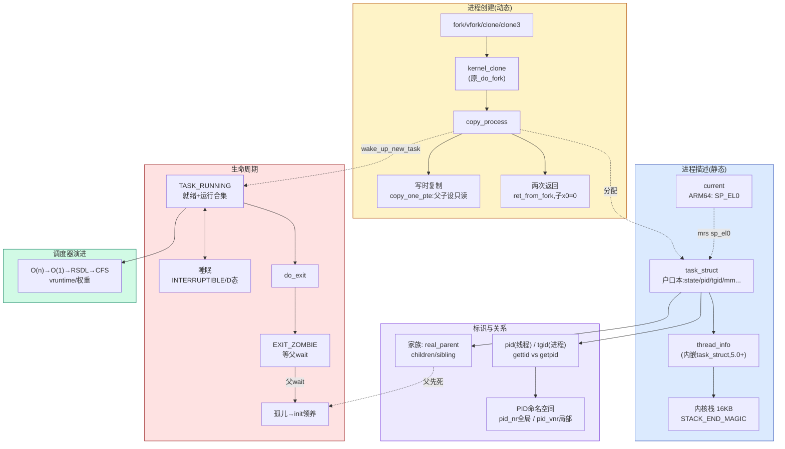

# 📖 《奔跑吧Linux内核》卷1 第7章 进程管理之基本概念 — 读书笔记

> 📅 2026-09-09 | 🏷️ 进程/线程 / task_struct / 进程状态 / fork·vfork·clone / 写时复制 / PID命名空间 / 内核线程 / 调度器演进 | 📊 难度：中

---

## 🎯 一句话概括

这一章回答进程管理最根基的一条主线：**Linux 用同一个 `task_struct` 描述"进程"和"线程"（二者本质相同，只是资源共享程度不同），fork/vfork/clone 三兄弟都汇聚到同一个内核函数（原 `_do_fork`，6.1 已更名 `kernel_clone`）→ `copy_process` 里靠写时复制（只复制页表、不复制内存）廉价地"生"出子进程；进程终止后先变僵尸（保留 task_struct 让父进程收尸），父进程 wait 后才彻底消亡，父进程若先死则孩子被 init 领养**——一句话：`task_struct` 是进程的"户口本"，fork 是"低成本克隆"，僵尸态是"等待销户的过渡态"。

---

## 📚 内容梳理

> 本章按"静态特性（7.1 进程是什么）→ 动态诞生（7.2/7.3 创建）→ 消亡（7.3 终止）→ 调度器历史（7.4）"组织。核心专题深挖"进程创建"。

### 板块一：进程的基本概念（7.1）

#### 进程 vs 程序 vs 线程

| 概念 | 定义 | 有无"生命力" |
|---|---|---|
| **程序** | 完成特定任务的有序指令集合 / 可执行文件（代码 + 数据） | ❌ 静态、无生命 |
| **进程** | 一段执行中的程序，是有"生命力"的实体，含代码段 + 用户栈 + 内核栈 + 数据段 + 堆 + 活动状态 | ✅ 动态 |
| **线程** | 轻量级进程，操作系统调度的最小单元；共享所属进程的资源空间 | ✅ 动态 |

一句公式：**进程 = 程序 + 执行**。进程抽象的目的是提高 CPU 利用率（多道并发），让每个进程都"以为自己独占 CPU"，其核心技术是**上下文切换 + 进程调度**。

> 💡 **Linux 的关键设计：内核不为线程设计任何特殊的数据结构或调度算法。** 线程和进程都用同一个 `task_struct` 描述、都作为调度实体参与调度。区别只在于 `clone()` 时"选择共享哪些资源"——线程 = 与父进程共享地址空间（`CLONE_VM`）等资源的进程。所以在 Linux 里，"进程"对应一个 `task_struct`（单线程）或一组 `task_struct`（多线程进程的每个线程各一个）。

#### task_struct 关键字段（源码级）

```c
// include/linux/sched.h  （只列关键字段并注释含义）
struct task_struct {
#ifdef CONFIG_THREAD_INFO_IN_TASK
    struct thread_info    thread_info;   // ★ 5.0起 thread_info 搬进 task_struct（ARM64默认开）
#endif
    unsigned int          __state;       // ★[6.1变化] 进程状态；5.0是 volatile long state
    void                 *stack;         // 指向内核栈
    refcount_t            usage;         // 引用计数
    unsigned int          flags;         // 进程标志位 PF_*（PF_EXITING/PF_KTHREAD/PF_WQ_WORKER...）

    int                   prio;          // 动态优先级（调度类实际使用）
    int                   static_prio;   // 静态优先级（由 nice 换算，NICE_TO_PRIO）
    int                   normal_prio;   // 由 static_prio + 调度策略算出
    unsigned int          rt_priority;   // 实时进程优先级
    const struct sched_class *sched_class;// 调度类
    struct sched_entity   se;            // CFS 普通进程调度实体
    struct sched_rt_entity rt;           // 实时进程调度实体
    struct sched_dl_entity dl;           // deadline 调度实体
    unsigned int          policy;        // 调度策略 SCHED_NORMAL/FIFO/RR/...
    cpumask_t             cpus_mask;     // ★[6.1变化] 允许运行的CPU；5.0叫 cpus_allowed

    struct mm_struct     *mm;            // ★ 进程地址空间；内核线程为 NULL
    struct mm_struct     *active_mm;     // 内核线程"借用"的地址空间

    int                   exit_state;    // 退出状态 EXIT_ZOMBIE / EXIT_DEAD
    int                   exit_code;     // 退出值
    int                   exit_signal;   // 终止时给父进程发的信号（fork 用 SIGCHLD）
    pid_t                 pid;           // ★ 进程标识符（其实是"线程ID"）
    pid_t                 tgid;          // ★ 线程组ID（getpid() 返回它）

    struct task_struct __rcu *real_parent; // 亲生父进程
    struct task_struct __rcu *parent;      // 当前父进程（通常==real_parent）
    struct list_head      children;        // 子进程链表头
    struct list_head      sibling;         // 兄弟进程链表节点
    struct task_struct   *group_leader;    // 线程组组长

    struct list_head      tasks;           // ★ 串起系统所有进程的全局双向链表
    struct fs_struct     *fs;              // 文件系统信息（cwd/root）
    struct files_struct  *files;           // 打开的文件描述符表
    struct nsproxy       *nsproxy;         // 命名空间代理（pid/mnt/net/... ns）
    char                  comm[TASK_COMM_LEN]; // 可执行程序名（ps 里看到的名字）
};
```

> **[6.1 变化]** ① `state`（`volatile long`）→ **`__state`（`unsigned int`）**，且 `PREEMPT_RT` 下新增 `saved_state`；读状态应用 `READ_ONCE(p->__state)` 或 `task_is_running()` 等辅助宏，不再直接读 `p->state`。② `cpus_allowed` → **`cpus_mask`**（配套 `cpus_ptr` 指针）。③ `thread_info` 内嵌 `task_struct`（`CONFIG_THREAD_INFO_IN_TASK`，ARM64 默认开）这一点 5.0 已如此，6.1 保持。

#### 进程状态（Linux 的 5 种核心状态）

```c
// include/linux/sched.h  （6.1.158 实际值，位标志设计）
#define TASK_RUNNING           0x00000000  // 可运行态（正在跑 或 就绪等待跑）
#define TASK_INTERRUPTIBLE     0x00000001  // 可中断睡眠（浅睡眠，可被信号唤醒）
#define TASK_UNINTERRUPTIBLE   0x00000002  // 不可中断睡眠（深睡眠，ps 里的 D 状态）
#define __TASK_STOPPED         0x00000004  // 停止态（收到 SIGSTOP / 被 ptrace）
#define __TASK_TRACED          0x00000008  // 被跟踪态
#define EXIT_DEAD              0x00000010  // 正在被彻底删除（exit_state）
#define EXIT_ZOMBIE            0x00000020  // 僵尸态（exit_state，等父进程 wait）
#define TASK_DEAD              0x00000080  // 进程已死
#define TASK_WAKING            0x00000200  // 正在被唤醒（迁移中的过渡态）
#define TASK_NEW               0x00000800  // [4.8起] 新建态：保证还未跑、信号唤不醒、不入队
```

⚠️ 关键辨析：
- **`TASK_RUNNING` 是"运行态 + 就绪态"的合集**，Linux 不像教科书那样区分"就绪"和"运行"。一个 `TASK_RUNNING` 的进程可能正在某 CPU 上跑，也可能在就绪队列里排队。
- **僵尸态放在 `exit_state`（不是 `__state`）**：`EXIT_ZOMBIE` / `EXIT_DEAD` 表示进程已消亡但描述符还在的两个阶段。

**进程状态转换 ASCII 图：**

```
                    fork/clone
                        │
                        ▼
                   ┌─────────┐  wake_up_new_task  ┌──────────────────────┐
                   │ TASK_NEW│───────────────────▶│    TASK_RUNNING       │
                   └─────────┘                    │  ┌────────┐┌────────┐ │
                                                   │  │就绪(rq)│⇄│运行(CPU)│ │
                                                   │  └────────┘└────────┘ │
                                                   └──────────────────────┘
                            调度器选中 ▲  │ 时间片耗尽/被抢占 │ 等待资源
                             (schedule)│  │(仍 RUNNING)      │ (schedule_timeout)
                          资源就绪/被唤醒│  │                  ▼
              ┌────────────────────────┴──┐          ┌───────────────────────┐
              │  wake_up() 把它挪回就绪队列 │◀─────────│  睡眠态                │
              └───────────────────────────┘  信号或   │ ┌───────────────────┐ │
                                              资源到达  │ │TASK_INTERRUPTIBLE │ │ ← 可被信号打断
                收到 SIGSTOP │  ▲ SIGCONT              │ │(浅睡, 等 IO/事件) │ │
                            ▼  │                       │ ├───────────────────┤ │
                    ┌──────────────┐                   │ │TASK_UNINTERRUPTIBLE│ │← 不理信号(D态)
                    │__TASK_STOPPED│                   │ │(深睡, 等关键 IO)  │ │
                    └──────────────┘                   │ └───────────────────┘ │
                                                        └───────────────────────┘
       do_exit()  │
                  ▼
         ┌──────────────────┐  父进程 wait()/waitpid()  ┌───────────┐
         │ EXIT_ZOMBIE 僵尸 │─────────────────────────▶│ EXIT_DEAD │──▶ 释放 task_struct
         │ (task_struct 还在)│    回收退出码后           │ (release) │    (彻底消失)
         └──────────────────┘                          └───────────┘
```

> 设置状态别用裸赋值 `p->state = ...`。推荐 `set_current_state(state)`（内含 `smp_store_mb`，处理 SMP 高速缓存一致性/内存屏障）。

#### 进程标识：PID / TGID / 命名空间

创建进程时分配唯一号码 PID，内核用 bitmap 管理已分配/空闲 PID（`/proc/sys/kernel/pid_max` 是上限）。关键要拧清 **PID 与 TGID 的错位**：

| 概念 | 存放字段 | 内核视角 | 用户 API |
|---|---|---|---|
| 线程 ID | `task->pid` | 每个线程唯一 | `gettid()` 返回它 |
| 线程组 ID | `task->tgid` | 一个进程内所有线程相同（= 主线程的 pid） | `getpid()` 返回它 |

> POSIX 要求"一个多线程程序里所有线程共享同一个 PID"，但 Linux 内核偏偏给每个线程独立分配 `pid`。为弥合矛盾引入**线程组 TGID**：主线程 `pid == tgid`；后续线程有自己的 `pid`，但 `tgid` 继承主线程。所以用户空间 `getpid()` 拿到的是 TGID（"进程号"），`gettid()` 才是内核真正的 `pid`（"线程号"）。

**PID 命名空间（namespace）**：容器隔离的基石。引入 ns 后，"标识一个进程"需要 `(pid_namespace, pid)` 二元组。同一个 `task_struct` 在不同层级命名空间里看到不同的 PID：
- `pid_nr()` / 全局 PID：从**根（init）命名空间**看到的 PID。
- `pid_vnr()` / 虚拟 PID：从**当前命名空间内部**看到的 PID（容器里的进程看到的 "PID 1"）。

`copy_process` 里 `CLONE_NEWPID` 会为子进程建新的 PID 命名空间；其余 `CLONE_NEW*`（NEWNS/NEWUSER/NEWUTS/NEWIPC/NEWNET/NEWCGROUP）对应挂载/用户/主机名/IPC/网络/cgroup 隔离。

#### 进程家族关系

内核维护完整的进程家谱，`task_struct` 用 4 个成员描述亲缘：

| 成员 | 含义 |
|---|---|
| `real_parent` | 亲生父进程；若亲父已亡，指向 init(进程1) |
| `parent` | 当前父进程（被 ptrace 时可 ≠ real_parent，通常一致） |
| `children` | 子进程链表头 |
| `sibling` | 兄弟进程链表节点（挂在父进程的 children 上） |

**进程家族关系 ASCII 图：**

```
   init_task (进程0 / idle / swapper)   ← init/init_task.c 静态初始化，所有进程祖先
        │ kernel_thread(kernel_init)
        ▼
     进程1 (init / systemd)             ← 用户空间所有进程的祖先；孤儿进程的收养者
        │ fork
   ┌────┴──────┬───────────┐
   ▼           ▼           ▼
 进程A ──────▶进程B       进程X          real_parent
   │ children  ▲ sibling                （A 是 B、X... 的父; B/X 互为兄弟）
   │  链表      │
   ▼           │
 进程C         │  next_task() 沿 tasks 全局链表遍历
(A、C 祖孙关系) │  for_each_process(p) 从 init_task 扫到 init_task

全局链表: init_task.tasks ⇄ 进程A.tasks ⇄ 进程B.tasks ⇄ ... (list_head 双向链表)
线程组:   PID==TGID 时, 组内线程挂到 group_leader 的 thread_group 链表
```

- `for_each_process(p)`：从 `init_task` 出发遍历所有进程（沿 `tasks` 链表）。
- `next_thread(p)`：沿 `thread_group` 遍历线程组内的下一个线程。

#### thread_info 与内核栈

- **内核栈大小**：ARM64 为 **16KB**（4 个页），ARM32 为 8KB。若配 `CONFIG_VMAP_STACK` 用 `vmalloc` 分配（可加保护页防溢出），否则 `alloc_pages`。
- **`set_task_stack_end_magic()`** 在栈最高地址写幻数 `STACK_END_MAGIC`，用于栈溢出检测。
- **5.0 起的重大变化（`CONFIG_THREAD_INFO_IN_TASK`）**：把 `thread_info` 从内核栈底搬进 `task_struct`。好处：① 栈溢出时不会踩坏 thread_info；② 栈地址泄漏也不易借此攻击。ARM64 默认开启。搬走后 `thread_info` 精简，去掉了指向 `task_struct` 的 `task` 指针。

```c
// arch/arm64/include/asm/thread_info.h
struct thread_info {
    unsigned long        flags;         // TIF_* 标志（TIF_NEED_RESCHED/TIF_SIGPENDING...）
    ...                                 // preempt_count 抢占计数等
};
```

#### 获取当前进程 current（ARM64）

内核态 ARM64 运行在 EL1，`SP_EL0` 寄存器在 EL1 下闲置 → 内核借它存放**当前进程 `task_struct` 的地址**：

```c
// arch/arm64/include/asm/current.h  （6.1.158 与 5.0 完全一致）
static __always_inline struct task_struct *get_current(void)
{
    unsigned long sp_el0;
    asm ("mrs %0, sp_el0" : "=r" (sp_el0));   // 从 SP_EL0 读出 task_struct 指针
    return (struct task_struct *)sp_el0;
}
#define current get_current()
```

对比 ARM32/4.0 时代：先用 SP 算出内核栈基址 → 取栈底 `thread_info` → `thread_info->task`。5.0+ 直接一条 `mrs` 读寄存器，更快更简洁。

#### 进程0 与 进程1

| | 进程0（idle/swapper） | 进程1（init/systemd） |
|---|---|---|
| 诞生 | `start_kernel` 中静态创建（`init_task`，`init/init_task.c`） | `rest_init` 里 `kernel_thread(kernel_init, ...)` 动态创建 |
| 身份 | 所有进程祖先；`mm=NULL` 是内核线程 | 内核线程 → `execve` 载入 `/sbin/init` 变普通进程 |
| 作用 | 就绪队列空时被调度，让 CPU 进入低功耗 idle；SMP 下每 CPU 一个 | 用户空间所有进程的祖先；孤儿进程的收养者 |
| PID | 0 | 1 |

---

### 板块二：进程的创建（7.2 / 7.3）—— 专题深挖

#### 写时复制（COW）—— fork 高效的根本

传统 UNIX 的 fork 全盘复制父进程地址空间，极慢且常被随后的 `execve` 白白丢弃。COW 的思路：**fork 时不复制内存，只复制父进程的页表，并把父子双方对应页表项都设为只读、共享同一批物理页**。当任一方要写某页时触发写保护缺页异常，此刻才复制那一页，各自拥有副本。于是 fork 开销从"复制几 GB 内存"降到"复制一份页表"。

#### fork / vfork / clone / 内核线程 —— 都汇聚到一个函数

用户接口 → 系统调用 → 统一入口（原 `_do_fork`，**[6.1] 更名 `kernel_clone`**）→ `copy_process`。区别只在传入的 `CLONE_*` 标志：

```
fork()   →  SYSCALL_DEFINE0(fork)   →  kernel_clone(&args{ .exit_signal=SIGCHLD })
vfork()  →  SYSCALL_DEFINE0(vfork)  →  kernel_clone(&args{ CLONE_VFORK|CLONE_VM, SIGCHLD })
clone()  →  SYSCALL_DEFINE5(clone)  →  kernel_clone(&args{ clone_flags, newsp, tls,... })
clone3() →  SYSCALL_DEFINE2(clone3) →  copy_clone_args_from_user → kernel_clone   [6.1新增]
kthread  →  kernel_thread(fn,arg,flags) → kernel_clone(&args{ CLONE_VM|CLONE_UNTRACED, .kthread=1 })
                                          │
                                          ▼
                                    copy_process()   ← 真正干活：造 task_struct + 继承资源 + 分配PID
                                          │
                                          ├─ dup_task_struct()     分配 task_struct + 内核栈
                                          ├─ copy_creds()          复制认证信息
                                          ├─ sched_fork()          调度相关初始化, state=TASK_NEW
                                          ├─ copy_files/fs/sighand/signal()  按标志共享或复制
                                          ├─ copy_mm()             ★ 复制/共享地址空间(COW核心)
                                          ├─ copy_namespaces()     复制命名空间
                                          ├─ copy_io()             复制 IO 上下文
                                          ├─ copy_thread()         ★ 复制内核栈框 pt_regs, 设 x0=0/pc
                                          └─ alloc_pid() + 挂链表   分配 PID, 加入进程管理
                                          │
                                          ▼
                                    wake_up_new_task()  唤醒新进程入就绪队列, 接受调度
                                          │
                             (若 CLONE_VFORK) wait_for_vfork_done()  父进程睡到子进程 exec/exit
```

**fork / vfork / clone 对比表：**

| 维度 | `fork()` | `vfork()` | `clone()` |
|---|---|---|---|
| 关键标志 | 仅 `SIGCHLD` | `CLONE_VFORK\|CLONE_VM\|SIGCHLD` | 调用者自由指定 `clone_flags` |
| 地址空间 | COW 复制页表（写时才分家） | **父子共享同一地址空间**（不复制页表） | 由 `CLONE_VM` 决定：共享=线程 / 不共享=进程 |
| 父进程行为 | fork 后父子并发 | **父进程阻塞**，直到子进程 `exec`/`exit` 释放内存 | 不阻塞（除非带 CLONE_VFORK） |
| 典型用途 | 创建子进程 | fork 后立即 exec 的优化（避免复制页表） | 创建线程 / 灵活的进程/线程/命名空间 |
| 返回值 | 父返回子 PID，子返回 0，失败 -1 | 同 fork | 同 fork |
| 开销 | 复制页表（中） | 最小（连页表都不复制） | 取决于共享程度 |

> 为什么 vfork 要阻塞父进程？因为父子**共用同一地址空间**，若父进程继续跑并改栈/堆，会破坏子进程的运行环境。所以必须扣住父进程，等子进程 `exec`（换掉地址空间）或 `exit`（放弃地址空间）后才放行——靠 `vfork_done` 完成量（completion）实现。

#### copy_process 关键子步骤（源码级）

```c
// kernel/fork.c  copy_process 精简
p = dup_task_struct(current, node);   // 1. 分配 task_struct + 内核栈, 内容先整体复制父进程
copy_creds(p, clone_flags);           // 2. 复制/新建认证信息
// 检查 RLIMIT_NPROC(每用户进程数上限) 和 max_threads(系统进程总数上限)
// 清 PF_SUPERPRIV/PF_WQ_WORKER, 设 PF_FORKNOEXEC(还没 exec, 暂不能执行)
sched_fork(clone_flags, p);           // 3. 调度初始化: p->__state=TASK_NEW; 继承 normal_prio; 选 sched_class; 设 CPU
copy_files/copy_fs/copy_sighand/copy_signal(clone_flags, p); // 4. 按 CLONE_* 共享或复制
copy_mm(clone_flags, p);              // 5. ★ 地址空间: 见下
copy_namespaces/copy_io(clone_flags, p);
copy_thread(clone_flags, sp, arg, p, tls); // 6. ★ 内核栈框: 子进程 x0=0, pc=ret_from_fork
pid = alloc_pid(p->nsproxy->pid_ns_for_children); // 7. 分配 pid 结构
// 8. 设 group_leader/tgid: CLONE_THREAD 置位→归入父线程组; 清零→自己当组长
// 9. list_add_tail_rcu 挂入 init_task.tasks 全局链表; attach_pid 挂各类哈希表; nr_threads++
```

**`dup_task_struct()`**：`alloc_task_struct_node` 分配描述符 → `alloc_thread_stack_node` 分配内核栈（ARM64 16KB）→ `arch_dup_task_struct` 把父进程描述符整体 memcpy → `tsk->stack` 指向新栈 → 写 `STACK_END_MAGIC` 幻数防溢出。

**`copy_mm()` → `dup_mm()` → `dup_mmap()`（COW 的落地）**：
1. 内核线程 `mm==NULL` → 直接返回（无地址空间可复制）。
2. `CLONE_VM` 置位（vfork/线程）→ 子进程 `mm` 直接指向父进程 `mm`（一个指针操作，最省）。
3. 否则 `dup_mm`：`allocate_mm` 分新描述符 → memcpy 父 mm 内容 → `mm_init`（含 `mm_alloc_pgd` 为子进程分配**一级页表 PGD**，ARM64 见 `arch/arm64/mm/pgd.c`）→ `dup_mmap` 遍历父进程所有 VMA，逐个复制页表项。

**`copy_one_pte()`（写时复制的精华，`mm/memory.c`）**：
```c
if (!pte_present(pte)) { ... goto out_set_pte; }          // 交换项/迁移项: 原样搬到子进程
if (is_cow_mapping(vm_flags) && pte_write(pte)) {          // 私有可写映射:
    ptep_set_wrprotect(src_mm, addr, src_pte);             //   父进程 PTE 设只读
    pte = pte_wrprotect(pte);                              //   子进程 PTE 也设只读  ← COW 关键
}
if (vm_flags & VM_SHARED) pte = pte_mkclean(pte);          // 共享映射: 清 DIRTY
pte = pte_mkold(pte);                                      // 清访问位 AF
page = vm_normal_page(vma, addr, pte);
if (page) { get_page(page); rss[...]++ ; page_dup_rmap(); }// 增 _refcount 和 _mapcount
out_set_pte: set_pte_at(dst_mm, addr, dst_pte, pte);       // 写入子进程 PTE (只复制映射,不复制页内容)
```
父子都把可写页 PTE 设只读，物理页共享；谁先写谁触发缺页 → `do_wp_page` 分配新页（详见第4章 COW 分支）。

#### 进程创建后的"两次返回"

fork 为何**返回两次**？因为 `kernel_clone` 造好子进程后，子进程也被 `wake_up_new_task` 加进调度器，稍后被调度执行——于是"父进程从 fork 返回一次""子进程被调度后从 fork 返回一次"。

**子进程为何返回 0？** `copy_thread()`（`arch/arm64/kernel/process.c`）复制父进程的 `pt_regs` 栈框（X0~X30、SP、PC、PSTATE 全套），然后**把子进程栈框里的 `X0` 改成 0**。ARM64 用 X0 传返回值 → 子进程回到用户空间时返回值就是 0；父进程的 X0 是子进程 PID。

**子进程第一次从哪开始跑？** `copy_thread` 把子进程硬件上下文 `cpu_context.pc` 设为汇编函数 **`ret_from_fork`**（`arch/arm64/kernel/entry.S`）：
```asm
ENTRY(ret_from_fork)
    cbz  x19, 1f        // x19==0 ? 用户进程 : 内核线程
    mov  x0, x20        //   内核线程: x20=arg
    blr  x19            //   跳内核线程回调函数 fn
1:  b    ret_to_user    // 用户进程: 返回用户空间(pt_regs->pc 记录了返回地址)
```
用户进程子进程走 `ret_to_user` 返回；内核线程子进程 `x19` 存回调函数入口，直接 `blr x19` 执行。

#### 内核线程（kthread）

内核线程 = 运行在内核地址空间的进程，**`mm==NULL`（没有独立用户地址空间）**，所有内核线程共享内核地址空间，同样参与调度。常见的有 `kswapd`（页回收）、`migration/N`（迁移）、`kworker`（工作队列）等。

```c
kthread_create(threadfn, data, namefmt, ...)  // 创建但处于不可运行态, 需 wake_up_process() 唤醒
kthread_run(threadfn, data, namefmt, ...)     // 创建并立即唤醒运行
kernel_thread(fn, arg, flags)                 // 底层: kernel_clone(CLONE_VM|CLONE_UNTRACED, .kthread=1)
```

> **[6.1 变化]** `kernel_thread()` 现走 `kernel_clone_args{ .kthread = 1 }`；6.1 还新增了 **`user_mode_thread()`**（供 `kernel_init` 等"内核起、随后进用户态"的场景），把过去 `kernel_thread` 的双重语义拆开。

---

### 板块三：进程的终止（7.3）

#### 终止的两种方式

- **自愿**：`main()` 返回（链接器自动补 `exit()`）或主动调 `exit()` 系统调用。
- **被动**：收到不能处理的信号；内核态执行时产生异常；收到 `SIGKILL` 等终止信号。

```c
// exit 系统调用把退出码转成内核格式, 交给 do_exit()
SYSCALL_DEFINE1(exit, int, error_code) { do_exit((error_code & 0xff) << 8); }
```

`do_exit()` 释放进程占用的绝大部分资源（内存、文件、信号处理等），但**保留 `task_struct`**，并把消息通知父进程。

#### 僵尸进程：为什么必须存在

进程 `exit` 后进入**僵尸态（`EXIT_ZOMBIE`）**：其它资源都还给内核了，唯独 `task_struct` 保留。为什么留着？——**为了让父进程能拿到子进程的退出码 / 终止原因等信息**。所以"清理进程资源"和"释放进程描述符"被故意分成两步：

```
子进程 do_exit() ──▶ EXIT_ZOMBIE (task_struct 尚在, 记录 exit_code)
                        │
      父进程 wait4()/waitid()/waitpid() ──▶ 读走退出信息 ──▶ release_task() ──▶ EXIT_DEAD ──▶ 释放 task_struct
```

相关系统调用：`sys_wait4` / `sys_waitid` / `sys_waitpid`——功能是①获取终止原因等信息；②销毁 `task_struct` 等最后资源。

> 若父进程一直不 wait，子进程就长期滞留僵尸态，白占 PID 和描述符——这就是"僵尸进程泄漏"。注意：僵尸进程杀不掉（它已经死了），只能让父进程去 wait 或让父进程退出（转由 init 收尸）。

#### 孤儿进程与 init 领养（进程托孤）

若**父进程先于子进程死**，子进程就成"孤儿"。内核把孤儿**托孤给 init（进程1）**：init 成为它的新父进程。init 会周期性 `wait` 回收所有领养来的僵尸子进程，防止僵尸泄漏。这正是 `real_parent` 在亲父消失后指向 init 的原因。

---

### 板块四：进程调度器的历史演进（7.4 概览）

本章末尾梳理了调度器的历史脉络（详细算法在后续章节）：

```
MLFQ 多级反馈队列(1962, Corbato)   ← 思想源头: 按优先级分队列 + "反馈"动态调整优先级
        │  (启发)
        ▼
O(n) 调度器 (Linux 2.4-)     : 全局就绪队列, 选下一个进程要遍历整个链表, 进程多则慢
        ▼
O(1) 调度器 (Linux 2.6, Ingo Molnar) : 每 CPU 一个 rq(减少锁争用); active/expired 两个优先级数组,
                                        140 个优先级队列 + 位图, 选进程 O(1); 用完互换两数组
        ▼
RSDL / SD (楼梯调度, 未合入主线)  : 公平调度的探索
        ▼
CFS 完全公平调度 (Linux 2.6.23-) : 抛弃固定时间片, 用"权重占比"公平分 CPU 时间;
                                    引入 vruntime(虚拟运行时间), 总是选 vruntime 最小的进程
```

关键概念补充：
- **优先级**：内核用 0~139，越小越高。0~99 给实时进程，100~139 给普通进程；deadline 进程为 -1。`task_struct` 四个优先级字段：`prio`(动态)/`static_prio`(静态,由 nice 换算)/`normal_prio`/`rt_priority`。
- **nice 值**：-20~+19，默认 0，越大越"谦让"（优先级越低）。
- **权重**：nice 0 对应权重 1024，查表 `sched_prio_to_weight[40]`。CFS 用权重占比算 vruntime。
- **调度类**（优先级从高到低串联）：`stop` → `deadline` → `realtime`(SCHED_FIFO/RR) → `CFS`(SCHED_NORMAL/BATCH/IDLE) → `idle`。

---

### ❓ 本章 FAQ（结合面试题）

**Q1：为什么说 Linux 里"进程和线程本质相同"？**
因为内核只有 `task_struct` 一种描述符、只有一套调度算法。线程就是"用 `clone(CLONE_VM|CLONE_FILES|CLONE_SIGHAND|CLONE_THREAD...)` 创建、与父进程共享地址空间等资源的 task"。所谓"进程"不过是"不共享地址空间的 task"。区别只是 `clone` 标志位选择共享哪些资源。

**Q2：`getpid()` 和 `gettid()` 返回的一样吗？**
单线程时一样。多线程时：`getpid()` 返回 TGID（整个进程共享），`gettid()` 返回该线程自己的 `pid`（内核视角的唯一 ID）。

**Q3：D 状态（TASK_UNINTERRUPTIBLE）的进程为什么 `kill -9` 都杀不掉？**
因为它在深睡眠里"对信号不做任何反应"——连 SIGKILL 都不响应。它在等一个不可打断的关键资源（通常是同步块 IO / 某些锁）。只能等它等的资源就位、被内核主动唤醒。长期 D 状态往往意味着 IO 卡死或驱动 bug。

**Q4：本章面试题 11——`for(i=0;i<2;i++) fork();` 输出几个 `_`？**
6 个。第一次 fork 后 2 个进程各打印 1 个（i=0），第二次 fork 时这 2 个各再 fork 出 1 个共 4 个进程，i=1 时 4 个各打印 1 个——但因为 `printf` 带 `\n` 是行缓冲、且父子在循环内，实际按进程数累加：进程数 1→2→4，打印发生在每轮循环末尾，2(第一轮2个)+4(第二轮4个)=6 个 `_`。

**Q5：用户进程页表何时分配？一级、二级页表分别何时建？**
一级页表 PGD 在 fork 的 `copy_mm → dup_mm → mm_init → mm_alloc_pgd` 时分配（每个进程创建即有）。低级页表（PMD/PTE 等）大多是**惰性**的：`dup_mmap` 复制父进程已有页表项；对新映射区，则等第一次访问触发缺页异常时在 `handle_mm_fault` 里 `pXd_alloc` 逐级补建（见第4章）。

---

## 🧠 费曼解读

### 一、进程 vs 线程在 Linux 中本质相同 —— 一张户口本管到底

**用大白话说：** 别的教科书把"进程"和"线程"讲成两种东西，各有各的数据结构。但 Linux 偷懒（其实是高明）：它只造了一种"户口本"（`task_struct`），进程用它、线程也用它。所谓创建线程，不过是创建一个新 task 时说一句"这个新 task 跟我共用地址空间、共用打开的文件、算在同一个线程组里"。共享得多就叫"线程"，各过各的就叫"进程"。

**类比：** 像合租 vs 独居。都是"住户"（task），登记用同一种户口本。你和室友共用客厅、厨房、水电（共享地址空间、文件表）——这叫"线程"（一个 house 里的多个室友=一个进程里的多个线程）。你自己单独租一套、什么都不共享——这叫"进程"。房管所（内核）根本不区分"室友"和"租户"，都按"住户"管理和排班（调度）。

**为什么重要：** 理解这点，你就明白为什么 Linux 的 `ps -eLf`、`top -H` 能把线程当"轻量进程"列出来，为什么 `pthread_create` 底层是 `clone`，为什么线程也有自己的内核栈和 `pid`。它也解释了 NPTL 线程模型：1 个用户线程 = 1 个内核 task = 1:1 映射。

**关键细节：** 线程组用 `tgid` 粘合：组内所有 task 的 `tgid` 相同（= 主线程 `pid`），`group_leader` 指向主线程。信号可以发给整个线程组（`kill`）或单个线程（`tgkill`）。`CLONE_THREAD` 是"归入同一线程组"的开关。

**理解自测：** 一个 4 线程的进程，在内核里有几个 `task_struct`？`ps aux`（不带线程展开）会显示几行？它们的 `tgid` 相同吗？`pid` 相同吗？

---

### 二、写时复制 —— fork 一个 4GB 进程为什么很快

**用大白话说：** `fork()` 名义上要把父进程整个内存复制给子进程。要是真复制 4GB，慢死，而且子进程往往马上 `exec` 换掉一切，白复制。COW 的办法：先不复制内存，只复制那张"内存地图"（页表），并把父子双方地图上所有页都标成"只读、共享同一批真实物理页"。谁想改哪一页，改的那一刻才触发缺页、单独复制那一页。

**类比：** 像复印一本书。你不预先把整本书印一遍给同事（复制内存），而是给他一份目录（页表），指向同一本原书（共享物理页），并约定"只准看不准写"。同事真要在第 50 页做批注时，才把第 50 页单独复印一张给他改（COW 分页复制）。没批注的页永远共用原书。

**为什么重要：** 这是 fork 高效的根本，也把"复制成本"从 fork 时刻分摊到"真正写"的时刻，且只为写过的页付费。对你的 Thor 实时平台意义重大：**fork 本身不慢，但 fork 后第一次写共享页会触发缺页 + 分配 + 复制**——这是实时任务里一次不可预测的延迟毛刺来源。

**关键细节：** 落地在 `copy_one_pte()`：`ptep_set_wrprotect` 把父子 PTE 都设只读；`get_page`/`page_dup_rmap` 增加物理页的引用计数和映射计数。写触发的缺页由 `do_wp_page` 处理（单身页复用、非单身页复制，详见第4章）。

**理解自测：** 父进程 malloc 并写满 100MB，然后 fork。此刻子进程的 RSS 增加了多少？物理内存实际多用了多少？如果子进程立刻 `execve`，之前"共享的 100MB"发生了什么？

---

### 三、task_struct 与内核栈 / thread_info 的关系 —— 三块拼图怎么拼

**用大白话说：** 每个进程在内核里有三样东西：一张"户口本"（`task_struct`，记录一切属性）、一块"内核态草稿纸"（内核栈，进内核干活时用）、一小片"当前状态标签"（`thread_info`，存 CPU 相关的标志/抢占计数）。老版本把标签贴在草稿纸的最底下；新版本（5.0+）把标签直接夹进户口本里，更安全。

**类比：** 像员工档案。`task_struct` 是人事部的完整档案袋；内核栈是他工位上的一叠草稿纸（处理内核事务时演算用）；`thread_info` 是别在档案袋上的一张"当前工牌"（记录他现在能不能被打断=抢占计数）。以前工牌别在草稿纸背面（栈底），草稿纸写爆了（栈溢出）就会糊掉工牌信息；现在工牌夹进档案袋，栈爆了也不伤工牌，档案袋地址还不容易被人从草稿纸泄漏出去。

**为什么重要：** 这决定了 `current` 怎么找。ARM64 用 `SP_EL0` 直接存 `task_struct` 地址，一条 `mrs` 指令拿到 `current`，再 `current->stack` 找到内核栈——比老 ARM32"从 SP 推算栈底再取 thread_info->task"快得多。理解这套关系才能看懂内核栈溢出、`STACK_END_MAGIC` 检测、以及为什么 ARM64 内核栈是 16KB。

**关键细节：** `CONFIG_THREAD_INFO_IN_TASK`（ARM64 默认开）把 `thread_info` 挪进 `task_struct` 首字段。内核栈可选 `CONFIG_VMAP_STACK`（vmalloc 分配，带 guard page）。栈顶写 `STACK_END_MAGIC` 幻数，一旦被覆盖即报栈溢出。

**理解自测：** 为什么 `thread_info` 必须是 `task_struct` 的第一个成员（提示：`task_thread_info` 宏）？内核栈溢出时，把 `thread_info` 放进 `task_struct` 相比放栈底安全在哪？

---

### 四、僵尸进程为什么必须存在 —— 死了还不能马上销户

**用大白话说：** 进程死的时候，内核不是"啪"一下全清干净，而是先把大部分家产（内存、文件）交还，只留一张"死亡证明 + 户口本"（`task_struct` + 退出码），等它爹（父进程）来"认领遗体、看死因"（`wait`）。认领完了才彻底销户。这个"人死了但户口本还没销"的过渡状态，就是僵尸态。

**类比：** 像医院的太平间。病人去世后，遗体不会立刻火化——要先停在太平间（僵尸态），保留身份信息和死亡原因，等家属（父进程）来确认、签字（`wait`）。家属签完字，才真正火化销户（`release_task` → 释放 `task_struct`）。如果家属一直不来（父进程不 wait），遗体就一直占着太平间的床位（占着 PID 和描述符）——这就是僵尸泄漏。

**为什么重要：** 这解释了两个常见运维现象：① `ps` 里看到一堆 `<defunct>`/Z 状态进程，是父进程没好好 wait，得查父进程 bug（不是内核问题）；② 僵尸进程 `kill -9` 杀不掉，因为它已经死了，你只能去弄它父进程（让父进程 wait，或杀父进程让 init 收尸）。

**关键细节：** 僵尸态放在 `exit_state`（`EXIT_ZOMBIE`），不在 `__state`。父进程 `wait4/waitid` 读走退出信息后 `release_task` 把它推进 `EXIT_DEAD` 并释放描述符。孤儿进程（父先死）被 init（进程1）领养，init 会定期 wait 收尸。

**理解自测：** 一个进程 fork 出子进程后既不 wait 也不退出，子进程立刻 exit。此时 `ps` 里子进程是什么状态？谁该为这个僵尸负责？如果此时把父进程杀掉，僵尸会怎样？

---

### 五、TASK_UNINTERRUPTIBLE 为什么不可中断 —— 深睡眠里连闹钟都不理

**用大白话说：** 睡眠有两种深浅。浅睡（`TASK_INTERRUPTIBLE`）像打盹，有人喊你（发信号）就醒。深睡（`TASK_UNINTERRUPTIBLE`，就是 ps 里的 D 状态）像被全麻做手术，任何呼喊、闹钟（信号，包括 SIGKILL）都叫不醒你，必须等手术做完（等的那个关键资源到位）内核才唤醒你。

**类比：** 浅睡眠 = 你在沙发上打盹，快递打电话（信号）你就接（被唤醒去处理）。深睡眠 = 你正躺在手术台上做关键操作（比如内核正在帮你把数据从磁盘搬到内存，且这个操作被打断会导致数据损坏），此时绝不能被任何人叫醒——就算总经理（SIGKILL）来了也得等手术结束。

**为什么重要：** 为什么内核要设计这么"顽固"的状态？因为有些操作**中途被打断会导致数据结构损坏或硬件状态不一致**（典型：正在进行的同步块 IO、正在操作某些硬件寄存器）。为保证一致性，宁可让它短暂不可打断。但副作用是：如果它等的资源永远不来（IO 卡死、NFS 服务器挂了、驱动 bug），进程就永久卡在 D 状态，`kill -9` 无效，甚至拖垮系统负载（D 状态计入 load average）。

**关键细节：** 排查 D 状态进程：`cat /proc/<pid>/stack` 看它卡在哪个内核函数、`cat /proc/<pid>/wchan` 看等待点。高 load 但 CPU 空闲，常是大量 D 状态进程在等 IO。6.1 还有 `TASK_KILLABLE`（= UNINTERRUPTIBLE 但可被致命信号唤醒）作为折中，用于可安全打断的等待。

**理解自测：** 为什么 load average 很高但 `top` 显示 CPU 几乎空闲？这和 D 状态进程有什么关系（提示：Linux 的 load 计入 R + D 状态）？在你的实时平台上，一个实时线程若陷入 D 状态会有什么后果？

---

### 六、PID 命名空间 —— 容器里的"1 号进程"骗局

**用大白话说：** 同一个进程，在系统全局看是 PID 5000，但在容器内部看却是 PID 1。这不是 bug，是 PID 命名空间在"造假"——每个命名空间是一套独立的 PID 编号体系，一个进程可以同时拥有多个"身份证号"（在每层命名空间里各一个）。容器里的进程只看得见自己命名空间的号，看不见外面。

**类比：** 像跨国公司的工号。你在总部的全局工号是 88888（全局 PID），但你被派到中国分公司，分公司给你重新编号"001 号员工"（命名空间内的 PID）。分公司的人只知道你是"001"，看不到你的全局工号；而总部两个号都认得。容器就是这个"分公司"——它的第一个进程在内部是"001"（PID 1，扮演 init），在总部却是某个大号。

**为什么重要：** 这是容器（Docker/K8s）隔离的地基之一。它解释了为什么 `docker exec` 进容器 `ps` 看到的 PID 从 1 开始、且看不到宿主机进程。也解释了内核里两套取 PID 的函数：`pid_nr`（全局）vs `pid_vnr`（当前命名空间）。容器的"PID 1"还继承了 init 的职责——给容器内孤儿进程收尸。

**关键细节：** `CLONE_NEWPID` 在 `copy_process → copy_namespaces` 时为子进程建新 PID 命名空间。命名空间可嵌套（分公司下还有子部门），外层能看见内层的进程（有对应 PID），内层看不见外层。`getpid()` 返回的是**当前命名空间**看到的 PID。

**理解自测：** 宿主机上 `ps` 看到某进程 PID 是 3000，它是某容器的"init"。在容器内 `getpid()` 返回多少？为什么容器里杀 PID 1 会导致整个容器退出？

---

## 🔗 知识图谱



---

## ❓ 启发性发问

### 理解层

1. `TASK_RUNNING` 为什么把"就绪"和"运行"合成一个状态？如果内核想知道"这个可运行进程此刻是否真的占着某 CPU"，它该看哪个字段而不是 `__state`（提示：`on_cpu` / `task_on_rq`）？

2. `copy_one_pte` 里对私有可写页做了 `ptep_set_wrprotect(父) + pte_wrprotect(子)`。为什么**父进程的 PTE 也要设只读**，只设子进程的不行吗？（提示：父进程之后写这页会发生什么？）

### 应用层

3. 在 Thor 平台，你把实时线程绑在隔离的 CPU5 上。它启动后第一次 `fork` 一个辅助进程，这次 fork 会不会在 CPU5 上引入延迟？延迟来自 fork 本身（复制页表）还是来自随后的写时复制缺页？你会怎么用 `perf stat -e minor-faults,major-faults` 区分？

4. 你用 `ps -eLf | awk '$? ~ /D/'` 发现某个内核线程长期处于 D 状态。结合本章：D 状态意味着它在等什么？你会用 `/proc/<pid>/stack` 和 `/proc/<pid>/wchan` 怎样定位它卡在哪个内核函数？它会不会把系统 load average 抬高、干扰你对隔离 CPU 空闲度的判断？

### 追问层

5. vfork 靠"阻塞父进程 + 共享地址空间"避免复制页表。既然现在 fork 有了 COW（也很便宜），vfork 是不是就多余了？在什么极端场景下 vfork 仍比 COW-fork 更省（提示：MMU-less 系统、超大页表、fork 后立即 exec）？

6. `kernel_clone`（原 `_do_fork`）用同一个函数 + 不同 `CLONE_*` 标志实现了进程、线程、内核线程、命名空间隔离。这种"一个机制、参数化差异"的设计哲学，和第4章"缺页异常一个入口分派多种处理"、以及调度器"一套 task 管进程和线程"是否是同一种思想？它的代价是什么？

### 关联层

7. 本章 `copy_mm` 复制页表、设 PTE 只读；第4章 `do_wp_page` 在写只读页时复制。把两章串起来：从 `fork` 到"子进程第一次写某页"到"各自独立"，完整经历了哪些函数？物理页的 `_mapcount` 在这条链上怎么变化？

8. 本章讲 `current` 靠 ARM64 的 `SP_EL0`;第1~2章讲上下文切换要保存/恢复寄存器。进程切换时，内核必须更新 `SP_EL0` 让 `current` 指向新进程——这个更新发生在 `__switch_to` 的哪一步?如果漏了会怎样?

---

## 📝 行动项（结合 Thor 平台 ARM64 多核 CPU 隔离/实时性优化）

- [ ] 用 `ps -eLo pid,tid,psr,stat,comm | awk '$3==5'` 查看绑定在隔离 CPU5 上的进程/线程及其状态（R/S/D），确认隔离核上确实只跑目标实时线程、无杂散内核线程
- [ ] 对实时任务做 fork 开销评估：`perf stat -e minor-faults,major-faults,task-clock ./rt_fork_test`，量化 fork 后写时复制缺页对单次 fork 延迟的贡献；实时热路径上尽量避免 fork，改用预创建的线程池
- [ ] 内核线程绑核：用 `taskset -pc <cpumask> <kthread_pid>` 或内核 `kthread_bind()`，把 `kworker`/`ksoftirqd` 等从隔离 CPU 上迁走；结合 `nohz_full` + `isolcpus` 减少隔离核上的内核线程唤醒
- [ ] D 状态排查脚本：`for p in $(ps -eo pid,stat | awk '$2 ~ /D/ {print $1}'); do echo "== $p =="; cat /proc/$p/stack; cat /proc/$p/wchan; echo; done`，定位是否有 IO 阻塞进程干扰实时性/抬高 load
- [ ] 用 `cat /proc/<rt_pid>/status` 观察实时线程的 `State`、`Threads`、`VmRSS`、`voluntary_ctxt_switches`/`nonvoluntary_ctxt_switches`，确认它没有被非自愿抢占（隔离生效的标志）
- [ ] cyclictest 前用 `mlockall(MCL_CURRENT|MCL_FUTURE)` 锁内存 + 预触发（prefault）栈和堆，消除运行时缺页；对照本章 COW/缺页知识理解为何这能压平延迟尾部
- [ ] 验证 fork 的两次返回与绑核继承：写 demo `fork` 后在子进程 `sched_getaffinity` 检查是否继承父进程的 CPU 亲和性（隔离场景下子进程可能意外落到隔离核上）
- [ ] 若用容器承载实时负载，确认容器 PID 命名空间内的"init"（PID 1）能正确回收僵尸子进程（用 `--init` 或 tini），避免僵尸累积占用隔离环境资源
- [ ] 确认 Thor 内核版本相对 5.0 的差异点：`grep -r "__state\|kernel_clone" /proc/version` 无意义，改为核对内核头/源码确认已是 `__state`/`kernel_clone`/`clone3` 语义，避免照搬旧文档

---

## 💡 个人洞察

1. **Linux 进程管理的核心美学是"用一种抽象统一多种概念"。** 一个 `task_struct` 同时是进程、线程、内核线程；一个 `kernel_clone` 同时实现 fork/vfork/clone/kthread；一套调度器管所有 task。差异全靠"参数化"（`CLONE_*` 标志、`mm` 是否为 NULL、调度类）表达。这种设计让内核代码量骤减、可维护性大增，代价是初学者容易被"进程和线程到底啥区别"绕晕——因为在内核眼里它们真没本质区别。理解这一点，很多"进程/线程/容器"的问题就化约成同一个问题：这个 task 共享了什么、隔离了什么。

2. **"惰性 + 分摊"的哲学从内存管理贯穿到进程管理。** 第4章的 malloc 惰性分配、按需缺页，和本章 fork 的写时复制（只复制页表、写时才复制页）、僵尸态（先还资源、后销描述符），是同一种思路：**把昂贵操作推迟到真正必要的时刻，且只为实际用到的部分付费。** 对吞吐是净赚。但对我做的实时系统，这套"分摊"恰恰是延迟毛刺的根源——fork 后第一次写、malloc 后第一次访问，都会在运行时冒出一次不可预测的缺页。所以实时优化的本质常常是"用 `mlockall`/预触发/线程池把这些被分摊的成本提前一次性付掉"，把不确定性从热路径挪走。

3. **僵尸态和孤儿领养揭示了内核"责任链"设计的严谨。** 进程死亡不是原子的销毁，而是"释放资源"与"通知父进程/回收描述符"的解耦——保证了父进程总能拿到子进程死因。而 init 的"兜底领养"确保了即使父进程失职，系统也不会泄漏僵尸。这种"总有一个最终责任人"的设计，和容器里 PID 1 必须承担 init 职责一脉相承——它提醒我在容器化实时负载时，绝不能让业务进程当裸 PID 1，否则孤儿/僵尸无人回收，长期运行必埋隐患。

---

## ✅ 质量自检

- [x] 覆盖 7.1~7.4 全部小节，按"静态描述/创建/终止/调度演进"四大板块重组
- [x] `task_struct` 给出源码级关键字段定义（含 `include/linux/sched.h` 路径与逐字段注释）
- [x] 进程状态含实际位值 + ASCII 状态转换图；进程家族关系 ASCII 图
- [x] fork→kernel_clone→copy_process 完整调用链 + copy_process 子步骤源码级拆解（含 copy_one_pte COW 精华）
- [x] fork/vfork/clone 六维对比表；PID/TGID/命名空间辨析表
- [x] "进程创建"专题深挖（COW、两次返回、ret_from_fork、内核线程）
- [x] FAQ 5 题（结合本章面试题，含 fork 输出 6 个下划线解析）
- [x] 6 个费曼解读（进程vs线程本质相同 / COW / task_struct-内核栈-thread_info / 僵尸进程 / D态不可中断 / PID命名空间），均含大白话+类比+为什么重要+关键细节+理解自测
- [x] Mermaid 知识图谱；启发性发问 8 题分四层；行动项挂钩 Thor 平台（ps/top 观察状态、fork 开销、kthread 绑核、D 状态排查）
- [x] 全程标注 [6.1 变化]：`state`→`__state`(+saved_state)、`cpus_allowed`→`cpus_mask`、`_do_fork`→`kernel_clone`(+`kernel_clone_args`)、新增 `CLONE_PIDFD`/`clone3`、`kernel_thread` 重构 + 新增 `user_mode_thread`

