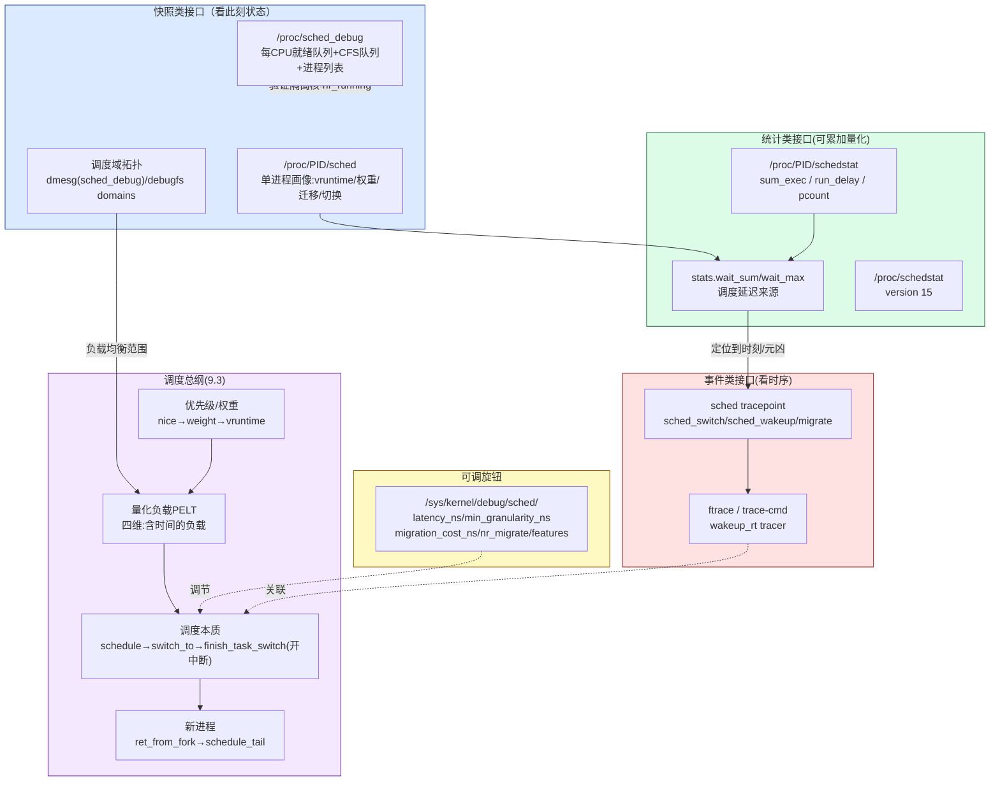

# 📖 《奔跑吧Linux内核》卷1 第9章 进程管理之调试与实战 — 读书笔记

> 📅 2026-09-09 | 🏷️ sched_debug / schedstat / /proc/PID/sched / ftrace / tracepoint / run_delay / 调度延迟 / 负载均衡 | 📊 难度：中

---

## 🎯 一句话概括

这一章把前八章的调度**理论**落到**可观测、可调试的实操**上：内核通过三组接口把调度器的"内心活动"暴露出来——**`/proc/PID/sched`**（单个进程的调度画像）、**`/proc/sched_debug`**（整个系统各就绪队列/调度域的实时快照）、**`schedstat`（`/proc/PID/schedstat` + `run_delay`）**（可累加的调度统计），再配合 **ftrace 的 `sched_switch`/`sched_wakeup` tracepoint** 抓每一次切换/唤醒的精确时刻；掌握这套工具，就能把"某进程 CPU 异常""调度延迟毛刺""隔离核上混进了别的任务"这类问题从玄学变成可量化定位的工程问题。

---

## 📚 内容梳理

> 本章偏调试实战，按"**调试接口(9.1)→ 综合案例(9.2)→ 进程管理总纲(9.3)**"三块组织，重点做成可查表 + 可直接敲的命令。所有调试接口都依赖内核配置 `CONFIG_SCHED_DEBUG=y`；统计信息还需要 `CONFIG_SCHEDSTATS=y`。

### 板块一：调度调试接口（9.1）

#### 前置开关

```bash
# 1) 编译期必须打开（否则 /proc/sched_debug、/proc/PID/sched 不存在）
CONFIG_SCHED_DEBUG=y
CONFIG_SCHEDSTATS=y          # schedstat 统计
CONFIG_SCHED_INFO=y          # run_delay 等 sched_info（SCHEDSTATS 会自动选上）

# 2) 运行期打开统计采集（默认关，开销考虑）
echo 1 > /proc/sys/kernel/sched_schedstats
cat /proc/sys/kernel/sched_schedstats   # 确认为 1
```

#### 9.1.1 单进程调度画像 —— `/proc/<PID>/sched`

由 `proc_sched_show_task()` 输出（`kernel/sched/debug.c`）。`cat /proc/560/sched` 关键字段：

| 字段 | 含义 | 排障用途 |
|---|---|---|
| `se.exec_start` | 本进程上次被调度运行的时刻 | 判断"缓存热度"（配合 migration_cost） |
| `se.vruntime` | 虚拟运行时间（ms） | CFS 红黑树键值，越小越"欠 CPU"、越优先被选 |
| `se.sum_exec_runtime` | 累计真实运行时间 | 进程到底吃了多少 CPU |
| `se.nr_migrations` | 被迁移到其他 CPU 的次数 | **隔离核验证**：绑核后该值应停止增长 |
| `nr_switches` | 上下文切换总次数（= `nvcsw + nivcsw`） | 切换是否过于频繁 |
| `nr_voluntary_switches` | 主动切换（等 I/O、锁、睡眠）次数 | 主动多 = I/O 型 |
| `nr_involuntary_switches` | 被抢占切换次数 | 被抢占多 = 竞争激烈/优先级低 |
| `se.load.weight` | 权重（= nice→weight，再 ×1024） | nice=0 → 1024×1024=1048576 |
| `se.avg.load_avg` | 量化负载（PELT），上限≈权重 | 100% 占 CPU 时逼近 1024 |
| `se.avg.util_avg` | 量化算力（利用率） | 用于 EAS/调频/负载均衡 |
| `prio` | 内核优先级（nice=0 → 120） | 100~139 为普通进程 |
| `policy` | 调度策略（0=NORMAL, 1=FIFO, 2=RR, ...） | 确认实时线程策略是否生效 |

打开 `sched_schedstats` 后，`/proc/PID/sched` 还会多出一批统计（`stats.*`）：`wait_sum`（在就绪队列排队等待的总时间）、`wait_max`、`sum_sleep_runtime`、`nr_wakeups`、`nr_wakeups_migrate`、`nr_wakeups_local/remote/affine` 等。**其中 `wait_sum`/`wait_max` 就是"调度延迟"的直接来源**。

> **[6.1 变化]** ① 原书 5.0 里这些统计藏在 `se.statistics.*`（`sched_entity` 内），6.1 已把 `struct sched_statistics` 从 `sched_entity` 挪到了 **`task_struct.stats`**（commit ceeadb83aea2，v5.15），字段前缀由 `se.statistics.` 变为 `stats.`。② 原书的 `se.runnable_weight`、`se.avg.runnable_load_avg` 两个字段在 6.1 已**改名/移除**：PELT 重构（commit 9f68395333ad，v5.7）后普通任务不再有 per-task `runnable_weight`，`runnable_load_avg` 统一改叫 **`runnable_avg`**。所以 6.1 的 `/proc/PID/sched` 里看到的是 `se.avg.runnable_avg`，没有 `runnable_load_avg`。

#### 补充接口：`/proc/<PID>/schedstat` —— run_delay 的正主

一行三个数字（源自 `task_struct.sched_info`）：

```bash
cat /proc/560/schedstat
#   ①            ②           ③
# sum_exec    run_delay    pcount
# 该任务在CPU上   ★在就绪队列里    被调度上CPU
# 运行的总ns    等待运行的总ns   的总次数
```

- **`run_delay`（第 2 列）= 该任务"想跑但没跑上"的累计等待时间（ns）**，是量化调度延迟最直接、最可累加的指标。
- 平均单次调度延迟 ≈ `run_delay / pcount`。
- 全系统聚合版在 `/proc/schedstat`（每 CPU 一行 + 每 domain 一行），版本号 `version 15`。

> **[6.1 变化]** `/proc/schedstat` 的 `SCHEDSTAT_VERSION` 在 6.1 仍为 **15**（自 2008 年起未变），字段布局兼容,原书结论有效。

#### 9.1.2 系统级快照 —— `/proc/sched_debug`

`cat /proc/sched_debug`，`sched_debug_header()` + 每 CPU 的 `print_cpu()`/`print_cfs_rq()` 输出。分三段读：

**① 头部（全局参数）**
```
Sched Debug Version: v0.11, 6.1.xxx        ← 版本号仍为 v0.11
ktime / sched_clock / cpu_clk / jiffies    ← 各种时钟采样值
sysctl_sched_latency          : 6.000000   ← 调度周期（ms）
  .sysctl_sched_min_granularity: 0.750000  ← 最小调度粒度
  .sysctl_sched_wakeup_granularity: 1.0     ← 唤醒抢占粒度
```

**② 每个 CPU 的就绪队列（`cpu#N`）**

| 字段 | 含义 |
|---|---|
| `nr_running` | 该 CPU 就绪队列中可运行进程数 |
| `load` | 就绪队列总权重（值为原权重×1024） |
| `nr_switches` | 该队列发生进程切换的次数 |
| `nr_load_updates` | 负载更新次数 |
| `next_balance` | 下一次触发负载均衡的时刻 |
| `curr->pid` | 当前正在运行进程的 PID |
| `clock / clock_task` | 队列时钟采样值 |

**③ 每个 CFS 就绪队列（`cfs_rq[N]`）**

| 字段 | 含义 |
|---|---|
| `exec_clock` | CFS 队列累计运行时间 |
| `MIN_vruntime` | 红黑树最左节点 vruntime（下一个要跑的） |
| `min_vruntime` | 队列基准 vruntime |
| `max_vruntime` | 红黑树最右节点 vruntime |
| `spread` | max−MIN，队列内 vruntime 跨度 |
| `nr_running` / `h_nr_running` | 本层 / 层级（含 cgroup 子组）可运行数 |
| `load` | CFS 队列总权重 |
| `load_avg` | 队列量化负载（所有进程之和） |
| `runnable_avg` | 可运行状态总量化负载 |
| `util_avg` | 队列当前量化算力 |

**④ 尾部：所有进程列表（`runnable tasks`）**
第 1 列进程状态（`R`=就绪、`S`=睡眠），后续列：进程名、PID、红黑树键值(`tree-key`)、切换次数、优先级、`wait`（等待时间）、`sum-exec`（总运行）、`sum-sleep`（总休眠）。

> **[6.1 变化]** ① `cfs_rq` 段落里 `runnable_load_avg` 已改名 **`runnable_avg`**，并新增 `h_nr_running`、`idle_nr_running`、`idle_h_nr_running`、`util_est_enqueued`、`removed.*` 等字段。② 头部三个可调参数（latency/min_granularity/wakeup_granularity）只是"显示"，真正的可写节点位置在 6.1 变了（见 9.1.4）。③ 版本号 `v0.11` 未变。

#### 9.1.3 调度域拓扑 —— 需要启动参数 `sched_debug`

CPU 拓扑（调度域 domain / 调度组 group）是理解 SMP 负载均衡的难点。要打印它，除了 `CONFIG_SCHED_DEBUG=y`，还要在**内核启动命令行**里加 `sched_debug`（`early_param("sched_debug", ...)` 只置 `sched_debug_verbose`）：

```bash
# grub / cmdline 加参数后重启，再看 dmesg
dmesg | grep -i "sched.*domain\|CPU.*domain\|span"
```

- 典型 ARM64 多核只有一层 **MC**（Multi-Core，共享 LLC）层级：CPU0 的 `domain-0` 管辖 `CPU[0-3]`。
- Intel 超线程机器会多一层 **SMT**：CPU0 的 `domain-0`(SMT) 管 CPU0+CPU4（同物理核两超线程），其父域 `domain-1`(MC) 管 CPU0~CPU7。
- 层级从低到高：`SMT → MC → DIE/NUMA`。负载均衡从最低层开始、逐层向上找不均衡的调度组再迁移。

> **[6.1 变化]** 6.1 除 dmesg 外，还能直接在 debugfs 里读结构化的调度域信息：`/sys/kernel/debug/sched/domains/cpuN/domainM/{name,flags,...}`（由 `update_sched_domain_debugfs()` 生成），比翻 dmesg 更方便。启动参数从 `sched_debug` 演进为 `sched_verbose`（`sched_debug` 仍兼容）。

#### 9.1.4 调度相关可调节点

原书列在 `/proc/sys/kernel/` 下的一批 CFS 调优旋钮：

| 节点 | 默认 | 含义 |
|---|---|---|
| `sched_latency_ns` | 6ms | CFS 一轮调度周期（进程 ≤ `sched_nr_latency`(8) 时用它） |
| `sched_min_granularity_ns` | 0.75ms | 单进程最短运行时间，防频繁切换（进程数 >8 时周期=它×进程数） |
| `sched_wakeup_granularity_ns` | 1ms | 被唤醒进程睡得太短就不抢占当前进程；调大→抢占概率↓ |
| `sched_migration_cost_ns` | 0.5ms | 运行时间 < 它则认为"缓存还热"，负载均衡不迁移它 |
| `sched_nr_migrate` | 32 | 一次负载均衡最多迁移几个进程（迁移时关中断，调大→中断/实时延迟↑） |
| `sched_cfs_bandwidth_slice_us` | 5ms | CFS 带宽限流的时间片 |
| `sched_child_runs_first` | 0 | fork 后是否让子进程先跑（1=先跑） |
| `sched_schedstats` | 0 | 统计信息开关 |

`/sys/kernel/debug/` 下：`sched_features`（`START_DEBIT`/`WAKEUP_PREEMPT` 等特性开关，定义在 `kernel/sched/features.h`）、`sched_debug`（仅控制 `sched_debug_enabled`，**不**控制 `/proc/sched_debug` 节点本身）。

> **[6.1 变化 ★重要]** 这是本章对实操影响最大的差异：**CFS 调优旋钮从 `/proc/sys/kernel/` 整体搬进了 debugfs `/sys/kernel/debug/sched/`**（commit 8a99b6833c88，v5.13），且**去掉了 `sched_` 前缀**：
> ```
> 5.0：/proc/sys/kernel/sched_latency_ns
> 6.1：/sys/kernel/debug/sched/latency_ns
> 5.0：/proc/sys/kernel/sched_min_granularity_ns   → 6.1：.../sched/min_granularity_ns
> 5.0：/proc/sys/kernel/sched_wakeup_granularity_ns → 6.1：.../sched/wakeup_granularity_ns
> 5.0：/proc/sys/kernel/sched_migration_cost_ns     → 6.1：.../sched/migration_cost_ns
> 5.0：/proc/sys/kernel/sched_nr_migrate            → 6.1：.../sched/nr_migrate
> 5.0：/sys/kernel/debug/sched_features             → 6.1：/sys/kernel/debug/sched/features
> ```
> 6.1 还新增 `idle_min_granularity_ns`、`latency_warn_ms`（长延迟告警阈值）等。**仍留在 `/proc/sys/kernel/` 的**只剩 `sched_schedstats`、`sched_child_runs_first`、`sched_cfs_bandwidth_slice_us`、`sched_rt_period_us`、`sched_rt_runtime_us`、`sched_rr_timeslice_ms`、`sched_util_clamp_*` 等。写脚本时务必先探测路径。

#### 9.1.5 用 ftrace / trace-cmd 追踪调度事件（原书未展开，实战补充）

`/proc/sched_debug` 是**快照**（只看某一瞬间），要抓"**事件序列**"（谁在什么时刻被唤醒、被谁抢占、切给了谁）必须用 tracepoint。核心是 `sched` 这一组静态探针：

| tracepoint | 触发时机 | 关键字段 |
|---|---|---|
| `sched:sched_switch` | 每次上下文切换 | `prev_comm/prev_pid/prev_prio/prev_state` → `next_comm/next_pid/next_prio` |
| `sched:sched_wakeup` | 进程被唤醒并入队 | `comm/pid/prio/target_cpu` |
| `sched:sched_wakeup_new` | 新 fork 进程首次唤醒 | 同上 |
| `sched:sched_migrate_task` | 任务迁移到别的 CPU | `pid/orig_cpu/dest_cpu` |
| `sched:sched_stat_runtime` | 一段运行时间结算 | `pid/runtime/vruntime` |
| `sched:sched_waking` | 唤醒动作发起（早于 wakeup） | `comm/pid/target_cpu` |

**方式 A：原生 ftrace（无依赖，嵌入式友好）**
```bash
cd /sys/kernel/debug/tracing
echo 1 > events/sched/sched_switch/enable
echo 1 > events/sched/sched_wakeup/enable
# 只看 CPU5（隔离核）：
echo 5 > /sys/kernel/debug/tracing/tracing_cpumask   # 或用 per-CPU 目录
echo 1 > tracing_on ;  sleep 1 ;  echo 0 > tracing_on
cat trace | grep -E "sched_switch|sched_wakeup"
```

**方式 B：trace-cmd（推荐，能算延迟）**
```bash
# 抓 3 秒调度事件，只跟踪 CPU5
trace-cmd record -e sched:sched_switch -e sched:sched_wakeup -M 20 -o sched.dat sleep 3
trace-cmd report sched.dat | less        # 文本查看
# wakeup→switch 的时间差 = 唤醒延迟；两次 switch 之间 = 运行时长
```

**方式 C：内置延迟 tracer（直接测最坏调度延迟）**
```bash
echo wakeup_rt > /sys/kernel/debug/tracing/current_tracer   # 专测实时任务唤醒延迟
# 或 wakeup（普通）；跑一会
cat /sys/kernel/debug/tracing/tracing_max_latency   # 记录到的最大唤醒延迟(us)
cat /sys/kernel/debug/tracing/trace                 # 对应那次的完整调用轨迹
```

**读一条 sched_switch 的方法**：`prev_state` 若是 `R`（0/TASK_RUNNING）说明 prev 是被**抢占**下台（还想跑）；若是 `S/D` 说明是**主动**让出（睡眠/等 I/O）。把 `sched_wakeup(pid=X)` 的时间戳减去随后 `sched_switch(next=X)` 的时间戳，就是进程 X 这一次的**调度延迟**——和 `run_delay` 的增量应对得上。

---

### 板块二：综合案例分析（9.2）

**题目**：双核系统，Shell 里运行死循环 `test`（`while(1) i++;`），CPU0 就绪队列已有 4 个进程、CPU1 有 1 个，全部 nice=0。问 test 的内核运行流程 + 一段时间后两队列如何变化。

**运行 test 的完整内核流程**（用户态只看到"程序跑起来了"，内核里发生了这些）：

```
1) Shell 调用 fork() → _do_fork()
   ① 建新进程 task_struct  ② 复制父进程 task_struct
   ③ 复制相关页表项        ④ 设置新进程内核栈
2) 父进程 wake_up_new_task() 尝试唤醒新进程
   ① select_task_rq()：为新进程挑"最闲"的 CPU → 选中 CPU1
   ② enqueue_task()：把新进程挂到 CPU1 就绪队列
3) CPU1 重新选择进程运行
   ① scheduler_tick() → task_tick() → check_preempt_tick() 置 TIF_NEED_RESCHED
   ② 中断返回前检查需要调度 → preempt_schedule_irq()
   ③ schedule() → pick_next_task() 选中新进程
   ④ switch_mm() 切页表 → ⑤ switch_to() 切到新进程
4) 新进程首次运行走 ret_from_fork() → 返回用户态 → exec() 装载 test
5) 负载均衡（关键：test 一直占 CPU，会打破均衡）
   ① scheduler_tick() → trigger_load_balance()（时间点存 rq->next_balance）
   ② 触发 SCHED_SOFTIRQ 软中断
   ③ run_rebalance_domains()：从当前 CPU 沿调度域低→高遍历，找最忙调度组
   ④ 双核只有一层 MC 域：domain_mc_0 管 {group_mc_0, group_mc_1}
   ⑤ 若在 CPU1 上跑均衡，发现 CPU0 的 group_mc_0 最忙，算出要迁多少负载
   ⑥ 从 CPU0 迁部分进程到 CPU1，直到两组权重平衡
```

**结论**：初始 CPU0=4、CPU1=1(test)，负载不均（权重差 3 个进程）；SMP 负载均衡触发后会从 CPU0 迁进程到 CPU1，最终两个就绪队列趋于均衡（各约 2~3 个），test 也可能在均衡中被迁走。**这就是"绑核前，任何进程都可能被负载均衡搬到任意 CPU"的机制来源**——也正是隔离核 `isolcpus`/`nohz_full` 要禁掉负载均衡的原因。

---

### 板块三：进程管理总纲（9.3）—— 全书调度部分收尾

**9.3.1 进程的本质**：进程（线程）是**分配 CPU 时间（CPU 资源）的基本单位**。一个 CPU 服务成千上万进程，如何公平分配是调度的核心命题。架构从单核→SMP→HMP(大小核)→NUMA，SMP 负载均衡追求高吞吐，大小核上的 EAS(绿色节能调度)追求低功耗。

**9.3.2 逃不掉的优先级**：优先级是贯穿进程生命周期的纽带。三代调度器（O(n) → O(1) → CFS）算法在变，但"优先级"从未被抛弃。UNIX 用 nice(−20~19)，Linux 内部转成**权重(weight)**（优先级越高权重越大）。CFS 中：① 分到的时间片 ∝ 本进程权重/队列总权重；② vruntime 走速 ∝ 1/权重（优先级越高 vruntime 越慢、越占 CPU）；③ SMP 负载均衡也基于权重（早期直接用权重和，PELT 后用考虑历史的量化负载）。

**9.3.3 调度器的选择**：需求(n 个进程) > 供应(CPU 数)才需要调度。历史算法有 FIFO、最短任务优先、最短完成时间、轮转、优先级、多级反馈队列、彩票。Linux 三代：O(n) 是最简单优先级调度，O(1) 是多级反馈队列的延伸，**CFS 更像彩票算法的延伸（吸收优先级 + 比例份额两种思想）**。没有万能调度器——服务器要吞吐、PC 要交互低延迟、移动端要低功耗、工业要实时；DPDK 甚至直接"抛弃调度器"，用独占 CPU 轮询收包。**调度是一门取舍与折中的艺术**。

**9.3.4 用四维空间理解负载**：权重是静态的（零维的点），量化负载(PELT，Linux 3.8+)引入时间轴（四维中变化的物体）。PELT 核心思想：负载应考虑**历史使用情况**——一个进程一直占 CPU，其量化负载无限逼近它的权重；还考虑"可运行状态时间占比"（类似 CPU 使用率）。缺点：靠过去推测当下，"像看后视镜推测前方路况"，某些场景不准。

**9.3.5 案例：为何不能调度（内核抢占的意义）**——本节含金量最高，串起中断/抢占/新进程调度/进程切换：

场景：内核只有线程0（先跑，创建了线程1、2 后进 while 死循环）。时钟中断到来会检查是否需要调度。

- **不支持内核抢占的内核**：即使线程0 的 `need_resched` 置位，**内核态中断返回时不检查**，只有用户态中断返回/系统调用返回用户空间时才检查 → 线程0 是内核线程，中断只走 `el1_irq`，直接恢复现场继续跑线程0，**线程1/2 永远得不到调度**。
- **支持内核抢占的内核**（图9.17）：`el1_irq` 返回前检查 `TIF_NEED_RESCHED`，置位则 `preempt_schedule_irq()` 切到线程1/2。

**新建线程首次如何运行？**（关键疑问：新线程栈是空的，怎么恢复中断现场？）
- `copy_thread()`（`arch/arm64/kernel/process.c`）在创建时设好硬件上下文 `cpu_context`：`pc = ret_from_fork`、`sp = childregs`(指向 pt_regs 栈框)。
- `switch_to()` 把 next 的 `cpu_context` 恢复到寄存器 → 处理器从 **`ret_from_fork`** 开始执行新线程（不是从中断现场恢复！）。
- `ret_from_fork`（`entry.S`）第一件事 `bl schedule_tail` → `finish_task_switch()` → `finish_lock_switch()` → `raw_spin_unlock_irq()` **打开本地中断**。所以**新线程运行在开中断环境**，不会卡在关中断态。
- 判断 `x19`：非 0 → 内核线程，跳回调函数；为 0 → 用户进程，`ret_to_user` 返回用户空间。
- 新线程此时**不从中断现场返回**（它还没触发过任何中断）；线程0 的中断现场保存在**线程0 自己的栈**里，等调度器下次再选中线程0 时才恢复。

**9.3.6 调度的本质**——经典思考题：
```c
raw_local_irq_disable();   // 关本地中断
schedule();                // 切到进程B
raw_local_irq_enable();
```
误解："A 关中断下切到 B，B 也在关中断下跑，若 B 死循环则系统永远收不到时钟中断而瘫痪。"
**错**：进程 B 被切上来后，会在 `finish_task_switch()` → `raw_spin_unlock_irq()` 里**打开本地中断**，所以 B 运行在开中断环境，时钟中断照常到来，系统不会瘫痪。

理解调度的四个关键点：**① 什么时候触发调度？② 如何高效选下一个？③ 如何切过去？④ 下一个进程如何回到上次暂停处？**

**用户进程 A → 内核线程 B 的完整切换栈帧变化（图9.19/9.20）**：
```
T0 前：用户进程 A 在用户态跑
T0：时钟中断 → CPU 跳 el0_irq → 把中断现场存进 A 的 pt_regs 栈框
处理中断 → scheduler_tick() 检查需要调度 → 置 TIF_NEED_RESCHED
中断返回前 ret_to_user 检查需要调度 → schedule()
压栈：el0_irq→ret_to_user→__schedule→context_switch→switch_to（SP 指向 switch_to 栈帧）
switch_to() 返回时（T1）：SP 已指向内核线程 B 的 switch_to 栈帧 → CPU 开始跑 B
出栈：B 沿栈帧回溯 finish_task_switch→el1_preempt→el1_irq
     → 在 el1_irq 里恢复 B 上次保存的 pt_regs 中断现场 → 回到 B 上次被中断处继续跑
```
两种上下文各归其位：**中断上下文存进程栈的 pt_regs 栈框；进程上下文存 task_struct（cpu_context）**。核心洞察：**任何进程（用户/内核）都必须在 `switch_to()` 里切换；用户进程必须先靠中断或系统调用陷入内核，才有机会在 `switch_to()` 把自己换下台，且会在栈里留下"踪迹"，重新被调度时靠栈帧回溯返回用户态。**

---

## 🧠 费曼解读

### 一、`/proc/sched_debug` 怎么读 —— 就绪队列的"体检报告"

**用大白话说：**
`/proc/sched_debug` 就是把每个 CPU 的就绪队列拉出来拍一张"当前照片"。你最该盯三个数：`nr_running`（这个 CPU 上现在有几个进程排队想跑）、`load`/`load_avg`（这个队列有多重）、`curr->pid`（此刻谁在跑）。最下面还列出每个进程的 `vruntime` 键值——CFS 就是永远挑 `vruntime` 最小的那个跑。

**类比：**
像看一个收银台的实时监控。`nr_running` = 这个收银台前排了几个人；`load` = 这些人购物车总量（有人买一件、有人买一车，权重不同）；`vruntime` = 每个人"已被服务的加权时长"，谁被服务得最少（vruntime 最小）就轮到谁——这就是 CFS 的"绝对公平"。红黑树最左边(`MIN_vruntime`)那个就是下一个被叫号的人。

**为什么重要：**
做 CPU 隔离时，这是**验证隔离是否生效的第一现场**。你把实时任务绑到 CPU5、又用 `isolcpus` 把 CPU5 隔离，那么 `cpu#5` 的就绪队列理应只有你的任务（`nr_running=1`），`load` 就是它一个的权重。如果发现 `nr_running` 莫名 >1、或冒出内核线程，说明隔离没干净，得查 cpuset/中断亲和性。

**关键细节：**
所有 `load`/权重值都是"原始权重 ×1024"（内核为了定点小数计算把权重放大 1024 倍），nice=0 的进程原始权重 1024，显示成 1048576，除以 1024 才是 2048…别被大数字吓到。`spread = max−MIN_vruntime` 反映队列内部公平性偏差，太大说明有进程长期饿着。

**理解自测：**
`cpu#5` 显示 `nr_running: 1`、`load: 1048576`、某进程 `vruntime` 一直在涨而 `MIN_vruntime` 等于它——说明这个 CPU 上是什么状态？（提示：只有一个进程独占）

---

### 二、`run_delay` 是什么 —— 调度延迟的"码表"

**用大白话说：**
`run_delay`（在 `/proc/PID/schedstat` 第 2 列）记录一个进程"**准备好了、想上 CPU，但被迫在就绪队列里干等**"的累计纳秒数。它不是进程睡觉的时间（那是自愿的），而是"我明明能跑，却没轮到我"的时间——这正是**调度延迟**的精确定义。

**类比：**
你到了餐厅、菜也点好了（进程 TASK_RUNNING、在就绪队列里），就等上菜（上 CPU）。`run_delay` = 你干坐着等上菜的总时间。`sum_exec`（第 1 列）= 你真正在吃的时间。`pcount`（第 3 列）= 上了几道菜（被调度上 CPU 几次）。平均每道菜等多久 = `run_delay / pcount` = 平均单次调度延迟。

**为什么重要：**
对实时/低延迟系统，`run_delay` 是**可累加、可采样、开销极低**的黄金指标——比 ftrace 轻，适合长期监控。cyclictest 报的 max latency 如果异常，第一件事就是采样目标线程的 `run_delay` 增量：如果 `run_delay` 在暴涨，说明是"排队等 CPU"造成的延迟（该查抢占/负载均衡/别的任务混进来了）；如果 `run_delay` 平稳但延迟仍大，那延迟来自别处（中断、缺页、时钟精度）。

**关键细节：**
必须先 `echo 1 > /proc/sys/kernel/sched_schedstats` 才有数据。采样法：`t0=读run_delay; sleep 1; t1=读run_delay; 增量=t1-t0`。把这个增量除以同期 `pcount` 增量，就是这一秒内的平均调度延迟。它对应 `/proc/sched_debug` 进程列表里的 `wait` 列和 `stats.wait_sum`。

**理解自测：**
一个绑在隔离核、且是该核唯一任务的实时线程，它的 `run_delay` 增量应该接近多少？如果它突然开始增长，最可能是什么侵入了这个核？

---

### 三、用 tracepoint 抓一次上下文切换 —— 给调度器装"行车记录仪"

**用大白话说：**
`sched_debug` 是快照（只有"此刻"），但延迟毛刺是**事件**（"就在那 50 微秒里发生了什么")。tracepoint 就是内核在调度器关键函数里预埋的"打点相机"，每次唤醒(`sched_wakeup`)、每次切换(`sched_switch`)都咔嚓一张带纳秒时间戳的照片。把这些照片按时间排好，一次抢占的全过程就还原出来了。

**类比：**
行车记录仪。平时不看，出了事故(毛刺)才调出那一秒的录像逐帧回放：几点几分几秒，B 车（高优先级任务）出现在路口（`sched_wakeup`），几微秒后 A 车（你的实时线程）被迫让道（`sched_switch`，prev=你 next=B，prev_state=R 表示你是被抢的、还想跑）。

**为什么重要：**
这是把"cyclictest 报了个 80us 毛刺"翻译成"**在时刻 T，中断线程 irq/58 被唤醒并抢占了我的实时线程 42us**"的唯一手段。快照类工具（sched_debug/schedstat）告诉你"有延迟、有多少"，tracepoint 告诉你"**是谁、在哪一刻、抢了多久**"——根因定位靠它。

**关键细节：**
读 `sched_switch` 看 `prev_state`：`R`(=0) 表示 prev 是被**抢占**（还想跑却被踢下台，这才是延迟元凶）；`S/D` 表示 prev 主动睡了。抓毛刺要关联三条线：`sched_wakeup(抢占者)` 时间戳 → `sched_switch(next=抢占者)` 时间戳 → 下一个 `sched_switch(next=我的线程)` 时间戳。第一段差=唤醒到抢占的延迟，最后一段差=我被压制的总时长。用 `wakeup_rt` tracer 可以让内核自动帮你抓最坏那次。

**理解自测：**
一条 `sched_switch: prev_comm=rt_thread prev_state=R ==> next_comm=irq/70`，说明发生了什么？如果 `prev_state=S`，结论又不同在哪？

---

### 四、调度延迟到底从哪来 —— 拆解毛刺的四个源头

**用大白话说：**
"实时线程该在 t 时刻跑，实际 t+Δ 才跑上"，这个 Δ（延迟）不是单一原因，而是好几段叠加：① 中断/关中断把 CPU 占着不放；② 别的更高优先级任务在跑、或负载均衡在搬东西；③ 内核不可抢占的临界区（持锁、软中断）；④ 唤醒到真正切换之间的固有开销（选核、切页表、刷 TLB）。

**类比：**
你叫的救护车（实时线程）迟到了 Δ 分钟。可能是：① 路口红灯太长（关中断/中断风暴）；② 前面有辆车占道没让（更高优先级任务/负载均衡迁移）；③ 车正在维修不能立刻发车（内核临界区不可抢占）；④ 司机接到电话到发动引擎的固有耗时（切换开销）。要缩短 Δ，得分别对症。

**为什么重要：**
不同源头对应完全不同的优化手段，用错工具白费力：`run_delay` 涨→源头②(排队)→隔离核/绑核/关负载均衡；`run_delay` 不涨但延迟大→源头①③④→查中断亲和性(`/proc/irq/*/smp_affinity`)、`nohz_full` 去时钟中断、`PREEMPT_RT` 抢占内核、mlockall 消缺页。

**关键细节：**
四个源头分别对应可观测指标——① 看 `/proc/interrupts` 该核中断数 + ftrace `irq` 事件；② 看 `run_delay`/`sched_switch(prev_state=R)`；③ 看 `preempt` tracer / `PREEMPT_RT` 配置；④ 看 `sched_wakeup→sched_switch` 时间差。cyclictest 的 `-h`(直方图) + ftrace 联动能定位到具体是哪一段。

**理解自测：**
你在隔离核上 cyclictest 偶发 50us 毛刺，`run_delay` 增量却几乎为 0。据本节，该往哪三个方向查？为什么不该再去调 `isolcpus`？

---

### 五、为什么"关中断后 schedule 切到死循环进程"系统不会瘫痪

**用大白话说：**
很多人第一反应：A 在关中断状态下切到 B，那 B 不也在关中断下跑吗？B 要是死循环，时钟中断进不来，系统不就卡死了？答案是不会——因为**进程切换的收尾工作 `finish_task_switch()` 会主动把中断打开**。B 一旦被切上来，中断就已经开了，时钟照常滴答。

**类比：**
接力赛交接棒。A 选手（关着中断）把棒递给 B，但**交接的裁判(`finish_task_switch`)在 B 接棒的瞬间就吹哨恢复了全场信号(开中断)**。所以 B 跑起来时赛场是正常的，裁判(时钟中断)能随时叫停 B。关中断只是保护"交接棒那一瞬间"不被打断，交接完就恢复。

**为什么重要：**
这是理解"中断与调度关系"的试金石。它揭示了一个反直觉但关键的事实：**`schedule()` 里关中断保护的是切换过程的原子性，而不是切换后的运行**；开中断的责任交给了被切上来的那个进程的收尾代码。这也解释了新 fork 进程为何走 `ret_from_fork`→`schedule_tail` 也要开中断——同一套机制。

**关键细节：**
开中断发生在 `finish_task_switch()` → `finish_lock_switch()` → `raw_spin_unlock_irq(&rq->lock)`。每个被调度上台的进程（无论老进程从 `switch_to` 返回，还是新进程从 `ret_from_fork` 进入）都会经过这个收尾点。因此"关中断下 schedule"是安全惯用法，内核里到处都是。

**理解自测：**
如果内核有 bug，`finish_task_switch()` 没能开中断，后果是什么？新 fork 的内核线程和被切回的老进程，各自靠哪段代码开中断？

---

## 🔗 知识图谱



**排障动线**：快照(sched_debug 看哪个核不对) → 统计(schedstat/run_delay 量化延迟有多大、是不是排队) → 事件(tracepoint 抓是谁在哪一刻抢的) → 旋钮/隔离(对症调优)。

---

## ❓ 启发性发问

### 理解层

1. `/proc/PID/sched` 里 `nr_voluntary_switches` 远大于 `nr_involuntary_switches`，和反过来，各说明进程是什么类型（I/O 型 vs CPU 型）？为什么被抢占多往往意味着"竞争激烈或优先级偏低"？

2. `run_delay`（想跑没跑上）和 `sum_sleep_runtime`（睡眠时间）本质区别是什么？为什么只有 `run_delay` 才算"调度延迟"，睡眠时间不算？一个 `sleep(1)` 的进程，这一秒计入哪个？

### 应用层

3. 在 Thor 平台把实时线程绑到隔离核 CPU5，你怎么用 `/proc/sched_debug` **一条命令**验证 CPU5 上确实没有其他任务在排队？看哪个字段、期望值是多少？如果发现有个 `kworker` 混进来，下一步查什么？

4. cyclictest 报了一次 90us 毛刺。给出一套"快照→统计→事件"三步定位法：分别用哪个接口、看哪个指标、如何把毛刺时刻和某个 `sched_switch` 事件对上？

### 追问层

5. 6.1 把 `sched_migration_cost_ns`、`sched_nr_migrate` 从 `/proc/sys/kernel/` 挪进了 debugfs。对做实时性优化的人，调**大** `migration_cost_ns` 或调**小** `nr_migrate` 各自如何影响"实时任务被负载均衡打扰"的概率？代价是什么？

6. `run_delay` 采样开销极低但只有"总量"，ftrace tracepoint 信息全但有开销、且高频事件可能丢帧。在长期生产监控 vs 现场抓一次毛刺两个场景下，你分别选哪个、为什么？能否设计一个"平时 run_delay 采样、超阈值自动触发 ftrace 快照"的组合方案？

### 关联层

7. 结合第9.3.5/9.3.6 节：为什么隔离核要用 `nohz_full`（去掉周期时钟中断）？时钟中断除了计时，还承担了 `scheduler_tick()`→检查抢占→负载均衡触发的职责——去掉它，对"该核上唯一的实时任务"有什么好处？又会失去什么（如 vruntime 更新、RCU 静默期上报）？

8. 把本章的 `switch_to`/`finish_task_switch` 开中断机制，和第4章缺页异常的"运行时不可预测延迟"联系起来：一个绑在隔离核、已 `mlockall` 的实时线程，它的调度延迟还可能来自哪几处（提示：TLB、IPI、其他核发来的 reschedule 中断）？为什么单靠 CPU 隔离不足以消灭所有毛刺？

---

## 📝 行动项（结合 Thor 平台 CPU 隔离 / cyclictest）

- [ ] **验证隔离核干净**：`cat /proc/sched_debug | grep -A20 "cpu#5"`，确认实时任务运行时 `cpu#5` 的 `nr_running` 稳定为 1、`load` 等于该任务权重；若 >1 用 `grep -B2 -A2 "cpu#5" -i` 揪出混进来的内核线程/kworker
- [ ] **量化调度延迟**：写个采样脚本，`echo 1 > /proc/sys/kernel/sched_schedstats` 后周期读实时线程 `/proc/<pid>/schedstat` 第 2 列(`run_delay`)与第 3 列(`pcount`)，算增量比值得平均单次调度延迟；隔离核上该增量应≈0，若增长立即告警
- [ ] **抓抢占瞬间**：`trace-cmd record -e sched:sched_switch -e sched:sched_wakeup -M <CPU5掩码> sleep 5`，`trace-cmd report | grep -E "prev_comm=<rt线程>|next_comm=<rt线程>"` 找 `prev_state=R` 的记录，确认是谁在抢；重点看是否有 irq 线程/迁移线程
- [ ] **cyclictest 毛刺关联**：`cyclictest -m -a5 -p99 -i200 -h400 -D60` 跑出直方图，同时 `echo wakeup_rt > current_tracer`，事后 `cat tracing_max_latency` + `cat trace` 看最坏那次唤醒延迟的完整调用轨迹，把毛刺 us 值和 trace 里的抢占/中断事件对齐
- [ ] **确认 6.1 debugfs 路径**：在 Thor 上先 `ls /sys/kernel/debug/sched/`，用 `latency_ns`/`min_granularity_ns`/`migration_cost_ns`/`nr_migrate` 而非老的 `/proc/sys/kernel/sched_*`；写脚本时两条路径都探测以兼容不同内核版本
- [ ] **削弱负载均衡打扰**：实验性调整 `/sys/kernel/debug/sched/nr_migrate`（调小）和 `migration_cost_ns`（调大），配合 `isolcpus`+`nohz_full`+cpuset，用上面的 `nr_migrations`(在 `/proc/pid/sched`) 是否停止增长来验证隔离核不再参与迁移
- [ ] **确认内核抢占模型**：`grep PREEMPT /boot/config-$(uname -r)` 或 `cat /sys/kernel/debug/sched/preempt`（6.1 dynamic preempt），确认是否 `PREEMPT_RT`/`PREEMPT`；非抢占内核下内核态延迟会显著偏大
- [ ] **中断亲和性核对**：`for i in /proc/irq/*/smp_affinity_list; do echo "$i: $(cat $i)"; done | grep 5`，确保没有中断被路由到隔离核 CPU5（这是 `run_delay` 为 0 但仍有毛刺时的头号嫌疑）

---

## 💡 个人洞察

1. **调度调试的三类接口对应"三种时间视角"，缺一不可**：`sched_debug` 是**现在时**（此刻快照），`schedstat`/`run_delay` 是**完成时**（累计发生了多少），tracepoint 是**进行时的回放**（每个事件的精确时刻）。排障的功力就在于按这个顺序收敛：先用快照找到"哪个 CPU/进程不对劲"，再用统计量化"问题有多严重、是不是排队造成的"，最后用事件流锁定"是谁在哪一纳秒干的"。只会 `top` 的人卡在第一步，能打通三层才能给毛刺定根因。

2. **`run_delay` 是被低估的实时性金指标**。它比 ftrace 轻得多（无逐事件开销）、可长期采样、语义精确（"想跑没跑上"正是调度延迟的定义），非常适合作为隔离核的健康探针——隔离核上唯一实时任务的 `run_delay` 增量就该恒等于 0，一旦它开始爬升，几乎必然是"有东西侵入了这个核"（中断被误路由、kworker 没排干净、负载均衡把任务迁进来了）。把它做成告警比事后翻 trace 高效得多。

3. **6.1 把调度旋钮搬进 debugfs，本质是"内核开发者对这些接口稳定性的降级承诺"**——从 `/proc/sys`（sysctl，相对稳定、面向管理员）挪到 `/sys/kernel/debug`（调试接口，随时可变、面向开发者），传递的信号是"这些是 CFS 内部实现细节，别当稳定 API 依赖"。对我们做实时优化的人，教训是：**任何调优脚本都要先探测路径、且不能假设参数名跨版本不变**；更该优先用 `isolcpus`/`nohz_full`/cpuset/`SCHED_FIFO` 这类稳定机制,而不是去拧 `latency_ns` 这种随时会挪窝的旋钮。

4. **9.3.6"关中断下 schedule 不会瘫痪"这个思考题，是整个调度部分的思想收口**：它逼你想明白"关中断保护的是切换动作的原子性，开中断的责任转移给了下一个进程的收尾代码"。这个"责任转移"模式在内核里反复出现（新进程走 `ret_from_fork`、老进程走 `switch_to` 返回，殊途同归到 `finish_task_switch` 开锁开中断）。理解它，才能真正读懂"为什么一个 CPU 能在开关中断的夹缝里安全地服务成千上万个进程"。

---

## ✅ 质量自检

- [x] 覆盖 9.1（调试接口）、9.2（综合案例）、9.3（进程管理总纲）全部小节，按"快照/统计/事件"三类接口重组（非照搬原书顺序）
- [x] 三大接口均做成可查字段表：`/proc/PID/sched`、`/proc/PID/schedstat`、`/proc/sched_debug` 逐字段释义
- [x] 补充原书未展开的 ftrace/trace-cmd 实操（三种方式 + tracepoint 表 + wakeup_rt tracer），命令可直接敲
- [x] 综合案例给出"fork→唤醒→选核→切换→负载均衡"完整内核流程，并归纳到隔离核动机
- [x] 5 个费曼解读（sched_debug 怎么读 / run_delay 含义 / tracepoint 抓上下文切换 / 调度延迟四源头 / 关中断 schedule 不瘫痪），均配类比 + 理解自测
- [x] 全程实测标注 [6.1 变化]：**调优旋钮迁入 debugfs `/sys/kernel/debug/sched/`（去 sched_ 前缀，v5.13）**、`sched_features` 移入 `sched/` 子目录、`runnable_load_avg`→`runnable_avg`（PELT 重构 v5.7）、`sched_statistics` 由 `sched_entity` 迁入 `task_struct.stats`（v5.15）、新增 `h_nr_running`/`idle_min_granularity_ns`/`latency_warn_ms`、`SCHEDSTAT_VERSION` 仍为 15、`/proc/sched_debug` 版本仍 v0.11、调度域可从 debugfs `domains/` 读
- [x] 知识图谱 Mermaid 呈现"快照→统计→事件→旋钮"排障动线
- [x] 启发性发问 8 题分四层；行动项 8 条全部挂钩 Thor 平台 isolcpus/cpuset/nohz_full/cyclictest/run_delay/ftrace 实操
- [x] 中文全角标点；命令与字段名用代码块保持可复制
