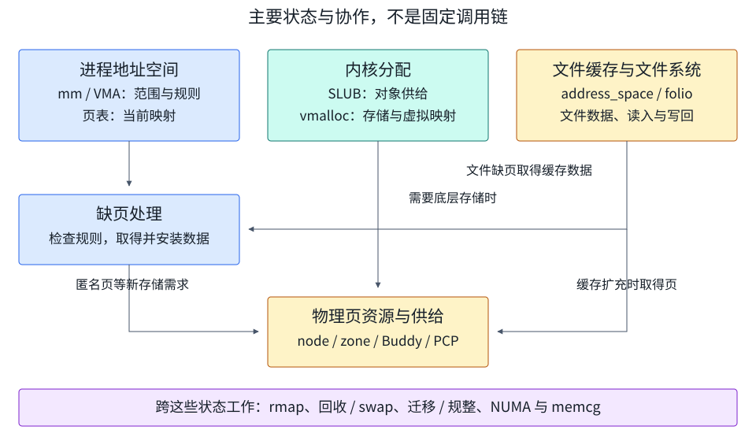
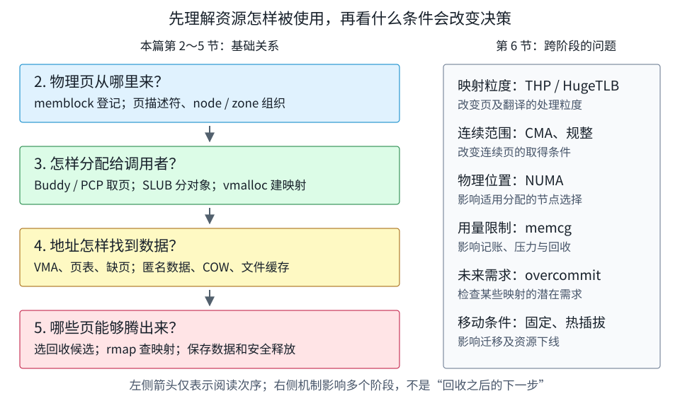
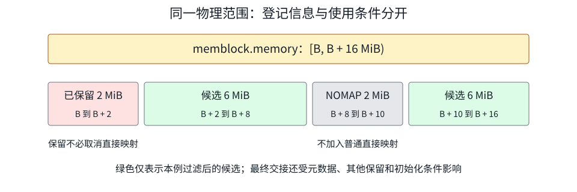
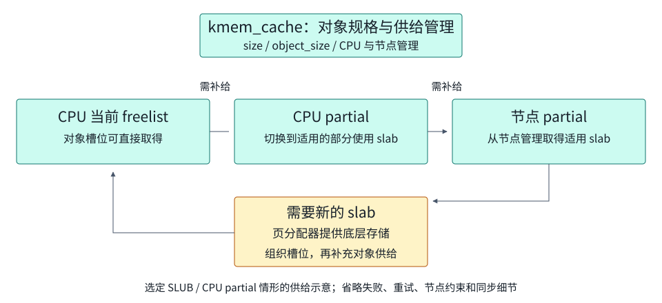
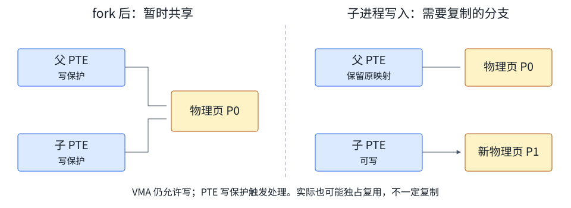

# 内存管理总览：从物理页到分配、映射与回收

Linux 的内存管理子系统通常简称 **mm**。它管理物理页，向内核组件提供对象和缓冲区，为进程建立地址空间，并把文件数据缓存在内存中。内存紧张时，它还要决定哪些数据值得保留、哪些页可以腾出来继续使用。

理解 mm 的难点在于：**分配一页、把它映射给进程、保存其中的数据、最后释放它，往往由不同部分负责。** 总览要讲清这些部分怎样连接，而不只是分别介绍几个分配器。

本文以本地 **Linux 6.1.158、arm64（AArch64）** 为依据，面向已有一定内核知识、希望系统理解 mm 的工程师。具体芯片和内核配置未指定；图中的页大小会单独注明，大页、交换、内存控制等功能的启用情况按实际配置判断。

## 阅读入口

| 你现在想做什么 | 从哪里进入 |
| --- | --- |
| 先理解 mm 的整体结构和各部分联系 | 本篇：[全局结构与章节路线](#map) |
| 把某一部分的原理理解得更完整 | 下表中的 `01`～`05` 机制分篇 |
| 追踪算法、关键字段、并发和失败分支 | **[深入专题首页：sub/](sub/index.md)** |
| 选择接口，或查询参数、用法和释放方式 | [API 选型指南](api.md) · [API 详细参考](api-reference.md) |
| 查不熟悉的缩略词和专有名词 | [缩略词与术语速查](#glossary) |

**机制分篇、`sub/` 专题和 API 文档是不同用途的入口，不要求全部按顺序读完。** 例如：想理解对象分配，先读本篇第 3 节，再看分配机制篇；想追踪 SLUB 的空闲对象链表和并发交接，则直接进入 [SLUB 专题](sub/object-allocation/01-slub.md)。

## 1. 先看全局，再确定阅读顺序

### 1.1 mm 的主要部分怎样协作？

先按使用者分出三条路径：

- **内核组件**需要对象或缓冲区。对象分配器和虚拟内存分配器负责满足不同需求，必要时向页分配器申请底层物理页。
- **用户进程**需要可访问的地址范围。地址空间管理记录范围及权限；缺页处理在需要时准备数据，页表把虚拟地址连接到物理页。
- **文件读写与文件映射**需要文件内容。页缓存保存文件数据，文件系统负责相应的读入与写回。

看图时先抓住共同点：三条路径最终都使用物理页。再看交叉点：文件缺页可以使用已有页缓存，对象分配也可以直接使用缓存中的空闲对象。因此，图中的箭头表示依赖或数据取得关系，**不是每次请求都从上到下执行的调用链**。

图中 `mm / VMA` 指进程地址空间及其虚拟内存区间；`folio` 是页缓存等路径使用的页面管理单位；Buddy、PCP 和 SLUB 是分配相关机制。下面会在各自出现的地方解释它们。

回收、反向映射和资源限制会跨越这些路径：回收一页时，要知道它保存什么数据、还有谁在访问；限制一个资源组的用量时，要对相关分配记账，而不是另建一个与系统隔离的物理内存池。

源码也沿这些边界分布。多数通用机制在 `mm/`；arm64 的缺页入口在 `arch/arm64/mm/fault.c`；fork 的地址空间复制涉及 `kernel/fork.c`；文件数据读写还依赖具体文件系统。

### 1.2 为什么按下面的顺序讲？

本篇按“**有什么物理页 → 怎样分配 → 怎样访问其中的数据 → 怎样腾出页**”展开。最后再讨论会影响多个阶段的大页、节点选择和资源限制。

左侧是理解概念的顺序，不是 mm 的执行顺序。右侧的问题贯穿多个阶段，所以放在基础关系讲清后集中解释。

| 本篇章节 | 本节回答的问题 | 为什么接在前一节之后？ | 对应机制分篇 |
| --- | --- | --- | --- |
| [第 2 节：物理页](#physical) | 内核知道哪些 RAM 可用？怎样找到一页的管理信息？ | 先认识所有分配器共同使用的资源 | [物理内存如何被描述与组织](01-mechanisms.md) |
| [第 3 节：分配](#allocation) | 怎样把空闲页变成页块、对象或连续虚拟缓冲区？ | 知道页在哪里之后，才能理解怎样取出和归还 | [从页块到对象与虚拟工作区](02-allocation.md) |
| [第 4 节：地址与数据](#address-space) | 进程的虚拟地址怎样找到数据？文件缓存在哪里接入？ | 分配提供物理存储，映射才建立进程的访问方式 | [地址空间、页表与按需提供数据](03-address-space.md) |
| [第 5 节：回收](#reclaim) | 哪些页可以腾出来？怎样处理已有映射和需要保存的数据？ | 理解页的使用方式之后，才能判断怎样安全回收 | [回收、反向映射与资源压力](04-reclaim-rmap.md) |
| [第 6 节：特殊需求与限制](#constraints) | 大页、连续内存、节点和资源组怎样改变前面的决策？ | 这些机制修改分配、映射或回收条件，不构成另一条独立流水线 | [页粒度、位置与资源约束](05-placement-and-limits.md) |

第 7 节用两个完整操作检查这些联系；第 8 节供查术语；第 9 节供查 API。**每个机制章节末尾都有直接进入 `sub/` 的链接**，不必读到文末再找专题。

## 2. 物理页：内核怎样认识和组织 RAM？

这一节先不讨论某次 `kmalloc`。先回答页分配器开始工作之前的问题：机器有哪些 RAM，哪些已经被占用，一页的管理信息放在哪里？

### 2.1 启动时先登记物理区间，再交给运行期分配器

内核刚启动时，Buddy 页分配器还没有准备好，但初始化页表、页描述符等结构已经需要内存。早期分配器 **memblock** 因而先按物理地址区间记录 RAM 和保留区域，并为初始化工作分配内存。

图里的三个标记分别回答不同问题：

- `memory`：哪些区间属于登记的物理内存。
- `reserved`：哪些区间已经保留，暂不能作为普通空闲页交出去；它可以与 `memory` 重叠。
- `NOMAP`：哪些区间不能加入内核的普通直接映射。

随后，arm64 的初始化路径建立页描述符、节点和 zone 等管理结构，通过 `mem_init`、`memblock_free_all` 等交接步骤，将可以释放的页交给运行期分配器。普通分配从此主要是在已有管理结构中改变页的状态，而不是重新发现 RAM。

### 2.2 同一页要区分“位置、管理信息、内容地址”

**PFN（Page Frame Number，页帧编号）**按基本页大小对物理地址编号。`struct page` 保存对应页的管理信息；CPU 访问页内的数据则需要有效的虚拟地址。

例如在基本页为 4 KiB 的配置下，对一个 RAM 地址右移 12 位可得到 PFN。根据 PFN 可以找到页描述符，但描述符本身不包含那 4 KiB 数据。

这个区分在读源码时很重要：`struct page *` 通常用来检查状态、维护引用或建立映射；数据指针才用于读写内容。把 PFN 转成描述符，不代表已经分配了这一页，也不能据此随意释放它。

本地 arm64 源码采用稀疏内存模型 **SPARSEMEM**，以 **VMEMMAP** 组织页描述符的虚拟地址。普通 RAM 的直接映射则提供另一类地址，用来访问页内容。前者解决“管理信息在哪里”，后者解决“怎样读写 RAM”。

页缓存和回收路径还经常使用 **folio**：把一个或多个连续基本页作为一个整体管理。它是管理单位，不表示另一个地址空间，也不自动表示已经使用了大页映射。

### 2.3 Node、zone、section 分别负责什么？

| 名称 | 管理重点 | 阅读时怎样理解 |
| --- | --- | --- |
| node，内存节点 | 按内存拓扑组织资源 | 一组内存位于哪个节点；单节点系统也有节点管理 |
| zone，内存区域 | 按分配条件组织一个节点中的页 | 一次请求可以使用哪些区域；各 zone 分别维护空闲块和水位 |
| section，稀疏内存管理单元 | 按物理地址范围组织页描述信息 | 对应范围是否有内存、描述信息是否建立 |

它们不能简单理解成“node 包含 zone、zone 再包含 section”这样一条统一的分配层级。Node 和 zone 主要参与分配范围管理，section 主要参与物理地址和描述符组织。

物理页也不是预先按进程永久切好的。一页可以先存放内核对象，释放后成为文件缓存；也可以同时被多个进程映射。页描述符中的部分字段会随用途改变，释放时要遵守它当前所属机制的规则。

**本节到下一节的连接：**我们已经有了可管理的物理页和对应描述符。接下来要解释，分配器怎样从这些页中挑出合适的块，再提供给不同使用者。

机制分篇：[物理内存如何被描述与组织](01-mechanisms.md)，其中 [启动分配与交接](01-mechanisms.md#bootmem) 进一步解释初始化。继续追踪运行期空闲块，可进入 [Buddy 专题](sub/page-allocation/01-buddy.md)。

## 3. 分配：怎样把页变成调用者需要的内存？

分配器面对的不只是字节数。调用者可能需要物理连续的页块、频繁复用的小对象，或者只要求 CPU 能连续访问的大缓冲区。这三个需求对应不同的工作。

### 3.1 Buddy 管空闲页块，PCP 减少频繁访问公共链表

**Buddy（伙伴系统）**将空闲页组织成按阶分组的块。阶数 `order` 对应 `2^order` 个基本页；找到的块过大时可以拆分，释放时则检查同阶伙伴能否合并。

例如在基本页为 4 KiB 的配置下，`order = 2` 请求四个连续基本页，共 16 KiB。若只有一个合适的八页块，Buddy 可以将其拆为两个四页块，交出其中一个。

这解释了“空闲页很多，分配仍可能失败”的一种情况：总量足够，但空闲页分散，没有满足阶数及对齐要求的块。

**PCP（Per-CPU Pages，每 CPU 页缓存）**在每个 CPU 附近缓存适用的空闲页块。常见分配可以从本地列表取出，缺少时再批量向 Buddy 补充；释放也可以先回到 PCP，之后再批量归还 Buddy。

PCP 减少公共管理结构上的竞争，但不增加物理内存。页留在 PCP 时，也还没有参加 Buddy 空闲块的合并。

源码定位：`mm/page_alloc.c`。Buddy 的拆分与合并可看 `expand`、`__free_one_page`；PCP 的批量交接可看 `rmqueue_bulk`、`free_pcppages_bulk`。

### 3.2 SLUB 在页块上管理对象

如果每次创建一个几十字节的结构体都单独分配整页，会浪费空间，也难以高效复用。**SLUB**在底层页块中划分对象槽位，用空闲对象链表管理分配和归还。

这里区分两个名称：

- **SLUB**是本文分析的对象分配器实现，主要源码在 `mm/slub.c`。
- 小写 **slab**是它管理的一组对象的底层存储，不表示本文改用另一套 `CONFIG_SLAB` 分配器。

`kmem_cache` 描述一类对象的大小等信息。一块 slab 中有多个对象，分配一个对象通常只需取出一个空闲槽位；没有合适的空闲对象时，才需要取得更多底层页。

图中的 `freelist` 是空闲对象链表，`partial` 表示部分对象已用、仍有空闲对象的 slab。图选取启用 CPU partial 的一种补充路径，省略了失败、重试和同步细节。

释放对象后，槽位可以再次使用。底层页是否归还页分配器，还要看 slab 中是否仍有对象在用以及缓存保留策略。因此，`kfree` 并不意味着对应底层页立即回到 Buddy。

### 3.3 Vmalloc 用映射把分散页连接为连续虚拟缓冲区

有些缓冲区只需要 CPU 用连续地址访问，并不要求其物理页整体连续。`vmalloc` 可以先保留连续的内核虚拟地址区间，再分配底层页并建立页表映射。

这降低了对大块物理连续内存的依赖，代价是管理虚拟区间、页表和翻译缓存；常规调用需要可睡眠上下文。相关接口中：

- `vmalloc` 分配底层页并建立虚拟映射。
- `vmap` 把调用者提供的已有页映射到连续虚拟区间。
- `kvmalloc` 先尝试 `kmalloc`，失败后在适用条件下回退到 `vmalloc`；使用者不能假定返回区域物理连续。

这些接口的页所有权和清理方式不同，具体用法见 [连续虚拟工作区](api.md#workspace) 与 [已有页映射](api.md#existing-pages)。实现位于 `mm/vmalloc.c`。

### 3.4 GFP、水位与慢路径决定能尝试到什么程度

**GFP（Get Free Pages）标志**描述分配条件，包括可使用的内存区域、能否直接回收、能否发起某些 I/O 等。最常见的 `GFP_KERNEL` 允许直接回收，因此调用上下文必须允许睡眠。

页分配器还用**水位**保护各 zone 的空闲余量。即使找到空闲块，也需要判断这次分配是否满足相应水位和保留条件。

第一次尝试不成功时，慢路径可能重新检查允许范围、执行回收、尝试规整或重试。**规整（compaction）**通过迁移可移动页，把零散空闲空间集中起来，主要解决连续性问题；回收主要解决哪些已用页能重新分配的问题。

慢路径按请求条件选择操作，高阶分配可能先尝试规整，并非所有失败都固定经过“回收 → 规整 → OOM”。**OOM（Out Of Memory，内存不足）处理**只在特定路径和条件下考虑，不能用来解释每一次返回 `NULL`。

源码定位：`mm/page_alloc.c` 的 `get_page_from_freelist`、`__alloc_pages_slowpath`。水位与允许操作的关系见 [分配条件与慢路径](02-allocation.md#slowpath)。

**本节到下一节的连接：**分配器已经能提供物理存储，但这还没有回答进程怎样使用某个虚拟地址。下一节看地址空间、页表和缺页处理怎样连接到这些页。

机制分篇：[从页块到对象与虚拟工作区](02-allocation.md)。实现专题可按问题选择：[Buddy](sub/page-allocation/01-buddy.md) · [PCP](sub/page-allocation/02-pcp.md) · [分配慢路径](sub/page-allocation/03-slowpath.md) · [SLUB](sub/object-allocation/01-slub.md) · [Vmalloc](sub/virtual-allocation/01-vmalloc.md)。

## 4. 地址与数据：进程怎样访问物理页？

这一节沿虚拟地址向下看：地址允许访问吗？页表现在指向哪里？如果还没有数据，应该新分配、读文件，还是恢复交换数据？

### 4.1 地址范围、页表和数据页由不同对象管理

| 对象 | 主要记录什么 | 例子 |
| --- | --- | --- |
| `mm_struct` | 一个进程地址空间的管理信息 | 页表根、虚拟区间的组织等 |
| **VMA（Virtual Memory Area，虚拟内存区间）**，对应 `vm_area_struct` | 一个区间的权限、映射类型及关联对象 | 某段可写的私有匿名映射，或某个文件的映射 |
| 页表 | 当前地址翻译及访问属性 | 某虚拟页现在映射到哪个物理页 |
| 数据页或 folio | 实际内容及其管理状态 | 匿名数据、文件缓存数据 |

普通 `mmap` 可以先建立 VMA，而不立即为整个区间准备数据页。**驻留**在本文中指数据当前实际在 RAM 中；虚拟范围的大小不等于驻留数据的大小。

图使用四个 4 KiB 页的私有匿名区间。VMA 覆盖整个范围，但只有两页已有数据映射。其余位置没有当前数据映射，不表示地址非法；访问它们时可以进入缺页处理。

`mprotect` 改变范围的权限，`munmap` 撤销相应范围的映射。撤销一方映射后，若其他进程或内核组件仍持有数据页，该页还不能释放。

### 4.2 MMU 负责正常翻译，缺页处理补齐访问条件

arm64 的 **MMU（Memory Management Unit，内存管理单元）**根据页表及翻译配置转换地址；**TLB（Translation Lookaside Buffer，地址翻译缓存）**缓存相应翻译，减少反复查页表的成本。硬件不会在每次访问时查 Linux 的 VMA。

当翻译或访问条件不满足、触发相关异常时，内核才进入软件缺页路径。它先检查地址和权限，再根据映射类型处理：

| 情形 | 数据通常从哪里来？ |
| --- | --- |
| 普通私有匿名映射的首次写入 | 新分配并清零的匿名页 |
| 普通文件映射缺页 | 已有页缓存，或通过文件系统读入的文件数据 |
| 访问已交换出去的匿名内容 | 交换缓存或交换后端 |
| 私有映射对共享页写入 | 满足条件时复用原页，否则复制后建立独立映射 |

所以“缺页”既不等于地址错误，也不等于每次都重新分配一个页。

页表里的 **PTE（Page Table Entry，页表项）**在基本页路径中保存当前映射。在为缺页准备数据时，线程可能等待，其他线程也可能修改同一地址的映射。安装结果前必须重新检查原条目，避免覆盖已经改变的状态。

源码入口：`arch/arm64/mm/fault.c` 的 `do_page_fault` 进入通用 `mm/memory.c` 的 `handle_mm_fault`；匿名分配和写保护处理分别可沿 `do_anonymous_page`、`do_wp_page` 阅读。

### 4.3 COW 让私有映射先共享，再按需分离

**COW（Copy-On-Write，写时复制）**用于推迟私有数据的复制。Fork 后，适用的匿名数据页可以暂时由父子进程共享；VMA 仍允许写，但相关 PTE 被写保护，使写入进入缺页处理。

图展示需要复制的分支：子进程得到副本并修改自己的映射，父进程仍使用原页。如果原页已经符合独占复用条件，则可以恢复可写，而不必再复制。

这里要抓住权限的两层含义：VMA 说“这个区间允许写”，PTE 的写保护说“这次写入要先经过内核处理”。引用计数、用户映射数量和独占状态用于不同判断，不能只看一个计数就决定是否复制或释放。

### 4.4 文件缓存把文件内容接入同一套映射和回收机制

普通 buffered read/write，也就是经页缓存的文件读写，和普通文件 `mmap` 可以使用同一份缓存内容。文件的 **`address_space`** 按文件偏移索引 folio，相关索引保存在 `i_pages` 中。

这里的 `address_space` 是文件缓存管理对象，不是进程的 `mm_struct`。前者回答“某文件偏移的数据在哪”，后者回答“某进程有哪些虚拟区间”。

缓存被修改后标为**脏（dirty）**，表示内容还需要按文件系统规则保存；**写回（writeback）**负责把修改提交给相应文件系统和后端。写回完成的干净数据可以继续留在缓存中，供下一次读取使用。

写回过程中，应用可能再次修改数据，因此“一次写回结束”不一定表示该页没有新的脏数据。持续写入过快时，内核还可能让写入任务等待，控制脏数据增长。应用若要求持久化，需要使用相应同步接口并处理错误，不能只凭普通写入返回判断已经落盘。

源码定位：`mm/filemap.c` 的 `filemap_fault` 连接文件缺页与页缓存；`mm/page-writeback.c`、`fs/fs-writeback.c` 及具体文件系统协作处理写回。

### 4.5 改页表之后，还要处理旧翻译和内存属性

假设一段地址从旧页改为新页。即使内存中的 PTE 已更新，其他 CPU 的 TLB 仍可能保存旧翻译。相应更新路径必须完成必要的翻译失效和同步，才能安全释放或重新使用旧页。

数据 Cache 缓存内容，TLB 缓存地址翻译，两者承担不同工作。arm64 的 Normal/Device、缓存性、共享性及执行属性也影响访问方式，不只涉及地址和读写权限。

对于内核，直接映射、内核映像和 `vmalloc` 区域也不是同一类地址关系，不能把某个转换 helper 用于所有内核地址。详见 [arm64 映射类别](03-address-space.md#kernel-mappings) 与 [TLB 和 Cache](03-address-space.md#tlb-cache)。

设备使用还要区分：

- **DMA（Direct Memory Access，直接内存访问）**：设备访问 RAM，需要按 DMA API 管理设备地址、访问时机和同步。
- **MMIO（Memory-Mapped I/O，内存映射 I/O）**：CPU 通过映射访问设备寄存器等资源，需要设备内存属性和 I/O 访问函数。

DMA 的一致性映射仍有顺序要求；流式映射需要遵守 CPU 与设备的使用权交接。普通内存分配或 CPU 虚拟映射，不能代替这些要求。用法入口见 [设备内存接口](api.md#device-memory)。

**本节到下一节的连接：**现在知道了一页可能被哪些进程映射、保存哪类数据。内存不足时，就可以反过来问：这页能不能腾出，怎样处理仍在使用它的映射和内容？

机制分篇：[地址空间、页表与按需提供数据](03-address-space.md)。实现专题：[arm64 缺页与 COW](sub/address-space/01-fault-cow.md) · [页缓存与写回](sub/page-cache/01-cache-writeback.md)。

## 5. 回收：哪些已用页可以腾出来？

应用主动释放是一种归还方式；**回收（reclaim）**则是在压力下，由内核寻找可以腾出的已用页。它既要尽量避免影响正在使用的数据，又要保证数据和访问关系得到正确处理。

### 5.1 先判断数据能否丢弃，或是否需要保存

| 页中保存的内容 | 回收时主要考虑什么？ |
| --- | --- |
| 普通干净文件缓存 | 数据通常可以从文件重新读取；满足引用、映射等条件后，可以丢弃缓存 |
| 脏文件缓存 | 修改还未保存，需要按文件系统的写回规则处理 |
| 普通匿名数据 | 没有原始文件可重新读取，通常需要可用的 swap 保存内容 |
| 仍在使用的内核对象、固定页等 | 不能像普通文件缓存一样直接丢弃，需要使用者释放或满足专门条件 |

部分内核缓存还可以通过 **shrinker（缓存回收接口）**释放不用的缓存对象。回收因此不只是处理进程数据页，但也不能随意释放任意内核对象。

### 5.2 LRU 选择候选，不直接证明页已经能释放

**LRU（Least Recently Used，最近最少使用）**相关机制利用访问证据判断哪些页近期较少使用。传统实现把相关页组织到 active/inactive 等列表，再决定扫描和处理哪些候选；这些名字不等于“仍有人使用/已经无人使用”。

**MGLRU（Multi-Gen LRU，多代 LRU）**按 generation，也就是访问新近程度的“代”，组织候选并调整回收选择。传统 LRU 与 MGLRU 是不同策略，要按配置及运行开关判断使用哪一种。

二者选出的“冷页”都还需要后续检查。最近没有访问的一页，可能仍被映射、被引用，或者有尚未保存的数据；这些情况决定它现在能否释放。

### 5.3 Rmap 从数据页找到可能映射它的地址

页表擅长从“进程虚拟地址”找到物理页。回收和迁移却往往先拿到物理页，需要知道哪些进程地址还在映射它。

**Rmap（reverse mapping，反向映射）**为这个方向的查找提供索引。它通过文件缓存或匿名映射相关对象，找到可能包含该页的 VMA，再检查真实页表项，确认当前映射。

图表达的是反向查找关系，不是每页保存一份完整的进程地址列表。找到候选 VMA 后仍要验证页表，因为候选区间中的对应地址可能尚未映射，或已经发生 COW。

需要撤销映射时，还要处理页表、相关计数及 TLB 同步。用户映射撤销后，缓存引用、设备固定等其他持有关系可能仍在；只有满足最终释放条件，底层页才能重新分配。

源码定位：`mm/rmap.c` 的 `rmap_walk`、`try_to_unmap`；回收候选的处理主要在 `mm/vmscan.c` 的 `shrink_folio_list` 等路径中。

### 5.4 Swap 保存匿名数据，refault 帮助判断回收代价

**Swap（交换）**为适用的匿名数据提供保存位置。交换条目记录后备位置，但 RAM 中还可能有 **swap cache（交换缓存）**，所以再次缺页时可能命中缓存，也可能需要从后端读入。

没有可用 swap、交换空间不足或受到资源组限制时，一些匿名页就无法按普通交换路径回收。另一方面，允许交换冷匿名页，也可能帮助保留更频繁访问的文件缓存；不能单用“发生交换”判断策略好坏。

真正关心的是工作集能否留在内存中。**工作集**是当前一段时间内实际需要访问的数据；它不等于所有驻留页。数据刚被回收又很快需要重新载入，这种 **refault（回收后的重访）**可以帮助内核判断是否回收了本来应当保留的数据。

图以同一文件偏移的数据为例。回收后留下的 `shadow entry` 只保存有关回收历史，不保存文件内容；重新读入时得到的 folio 也不必使用原来的物理页。有适用历史时，内核才能据此评价这次重访。

若反复回收和恢复工作集，系统可能忙于搬运数据，任务却很少推进。**PSI（Pressure Stall Information，资源压力停顿信息）**从任务因资源压力而停顿的时间来观察影响，而不是仅报告内存占用。

进一步解释见 [swap](04-reclaim-rmap.md#swap)、[工作集与 refault](04-reclaim-rmap.md#working-set)、[PSI](04-reclaim-rmap.md#psi)。本文描述机制，不假定目标机已经启用 swap 或某种交换后端。

**本节到下一节的连接：**分配、映射和回收的基本关系已经建立。接下来，大页会改变处理粒度，连续内存需求会改变布局要求，节点与资源组则会限制从哪里分配、哪些用量可以增长。

机制分篇：[回收、反向映射与资源压力](04-reclaim-rmap.md)。实现专题：[回收执行](sub/reclaim/01-reclaim.md) · [Rmap](sub/reclaim/02-rmap.md) · [传统 LRU](sub/reclaim/03-lru.md) · [MGLRU](sub/reclaim/04-mglru.md)。

## 6. 特殊需求与限制：哪些条件会改变上述决策？

本节不是在回收之后再增加几个执行步骤，而是把贯穿前面章节的条件放到一起。每项都要对应一个具体问题。

### 6.1 THP 与 HugeTLB：能否用更大的映射粒度？

**THP（Transparent Huge Pages，透明大页）**让内核在适用映射中自动尝试较大的页面和映射粒度。使用大页可以让一个翻译条目覆盖更多地址，减轻 TLB 压力，但也带来连续性、对齐和更大分配粒度的要求。

例如在 arm64 基本页为 4 KiB 的配置下，一个适用的 2 MiB PMD 块映射可以覆盖 512 个基本页。**PMD（Page Middle Directory，页中间目录）**是 Linux 的页表层级名称之一，在这个例子中用于较大粒度的映射。这不是所有 arm64 配置通用的大小。

THP 可以在缺页时尝试，也可以通过后台路径把适用的基本页合并；不能满足条件时，相应路径可能回退到基本页。已有大页还可能因后续操作拆分。

**HugeTLB**则使用专门的大页资源池和预留规则，常通过 `hugetlbfs` 等入口显式使用。它和 THP 都涉及大页，但资源管理、使用方式及失败处理不同。

进一步读 [大页机制](05-placement-and-limits.md#hugepages)；实现分别进入 [THP](sub/page-size/02-thp.md) 与 [HugeTLB](sub/page-size/03-hugetlb.md)。

### 6.2 CMA 与规整：能否取得指定连续物理范围？

前面已经看到规整通过迁移改善空闲布局。**CMA（Contiguous Memory Allocator，连续内存分配器）**进一步准备特定物理区域，平时允许适用的可移动页使用，连续分配需要时再迁走这些页，尝试取得目标范围。

这个设计避免把连续区域始终闲置，但依赖其中的占用可以迁移。若存在无法迁走的页，请求仍可能失败。

CMA 解决连续物理内存准备和取得问题；设备是否能访问，以及怎样交接和同步，仍由 DMA API 管理。机制见 [CMA](05-placement-and-limits.md#cma)，实现见 [CMA 专题](sub/page-size/04-cma.md)。

### 6.3 NUMA：页应该从哪个内存节点分配？

**NUMA（Non-Uniform Memory Access，非一致内存访问）**指 CPU 访问不同内存节点的代价可能不同。NUMA 内存策略可以选择优先节点、允许节点或跨节点交错等分配方式；cpuset 等规则还会限制实际允许范围。

它影响前面的页分配及部分缺页路径，而不是创建新的对象分配器。策略改变通常影响后续分配；已有页的位置是否改变，还要看有没有执行迁移以及是否满足迁移条件。

如果目标芯片和系统只有一个内存节点，多节点策略的作用就有限，不必把多节点当作所有 arm64 机器的默认状态。机制见 [NUMA](05-placement-and-limits.md#numa)，实现见 [NUMA 专题](sub/resource-control/02-numa.md)。

### 6.4 Memcg：这次分配应计入谁的用量，是否超限？

**Memcg（memory cgroup，内存控制组）**对相关内存用量记账并施加保护和限制。**Charge**在这里指把一笔使用量计入对应资源组及相关层级，不是再分配一份物理页。

例如，系统有可用物理页，但某个资源组已达到限制，属于该组的请求仍可能受到回收、等待或失败的影响。反过来，多个进程可以映射同一文件缓存页，实际记账也不是每个映射都各算一份完整物理页。

以 cgroup v2 的常见接口区分：

- `memory.min`、`memory.low`提供有效范围内的回收保护，实际保护还受层级和用量影响。
- `memory.high`用于施加超量压力，`memory.max`用于限制用量；交换另有相关限制。

保护并不预先为组分配 RAM。物理分配、用户映射和资源组记账是相关但独立的状态。机制见 [memcg](05-placement-and-limits.md#memcg) 与 [保护层级](05-placement-and-limits.md#memory-protection)，实现见 [Memcg 专题](sub/resource-control/03-memcg.md)。

### 6.5 Overcommit：建立映射时怎样看待未来的内存需求？

**Overcommit（内存过量承诺）**相关策略处理的是：现在建立的某些可写映射，将来全部写入或发生 COW 时，可能还需要多少内存？

例如，一个普通、未预填充的匿名映射已经建立，但只写了其中一小部分。虚拟范围很大，当前驻留量可以很小，未来写入却可能需要更多物理页。**RSS（Resident Set Size，驻留集大小）**描述进程相关的当前驻留量，不能代替这种未来需求的记账。

`Committed_AS`、`CommitLimit`分别反映相关承诺量和限制。它们用于承诺检查，不表示有同样多的物理页已经分配，也不能替代 memcg 的用量限制。

因此，“范围已经建立”“实际访问时能分配页”“资源组允许新增用量”是不同关口。机制见 [overcommit](05-placement-and-limits.md#overcommit)，实现见 [Overcommit 专题](sub/resource-control/04-overcommit.md)。

### 6.6 固定与热插拔：哪些页不能随意移动？

**Pinning（页面固定）**用于某些需要持续持有页面的场景，例如设备访问用户页。CPU 的页表可以在迁移时修改，但设备或其他持有者可能仍依赖原物理位置；相应固定状态会限制迁移等操作。

普通引用和 DMA pin 的语义不同，必须使用匹配的取得与释放接口。进程 `munmap` 只结束相应用户映射，不自动结束其他组件对页的固定。

**内存热插拔**则改变可管理的物理资源范围。下线内存要处理隔离、迁移及无法迁走的占用，不是把一个更大的区间交给普通 `free`。

这两项会影响回收、规整及 CMA 等路径。机制见 [页面固定](05-placement-and-limits.md#pinning) 与 [热插拔](05-placement-and-limits.md#hotplug)；固定的调用方式见 [API 指南](api.md#pinning)。目前 `sub/` 中尚无独立的固定和热插拔实现专题。

**本节小结：**大页改变映射与处理粒度，CMA 改变连续区域的准备方式，NUMA 选择物理位置，memcg 限制记账用量，overcommit 检查未来需求，固定状态限制页的移动。它们作用在前面介绍的分配、映射和回收之上。

全部实现专题集中在 **[sub/ 首页](sub/index.md)**；本节不另复制一套完整目录。

## 7. 用两个操作检查全局联系

下面不是全 mm 的固定流程，而是两个选定场景。读每一步时，注意负责处理的部分发生了什么变化。

### 7.1 内核组件反复创建和销毁同一类对象

1. **对象层：**组件通过合适的 `kmem_cache` 申请对象；SLUB 有空闲槽位时，直接取出供组件使用。
2. **页层：**缓存需要新的 slab 时，再向底层页分配器申请页块。此时才可能涉及页分配水位、回收或其他慢路径。
3. **使用者：**组件结束对象使用，先确保线程、回调等不再访问，再归还对象。
4. **对象层与页层：**对象槽位先成为可复用状态；slab 是否释放底层页，还要判断其中的其他对象和保留策略。

这条路径说明，**对象的使用结束与底层页的归还不是同一时刻**。想深入可接着读 [SLUB 专题](sub/object-allocation/01-slub.md)；实际调用查 [对象缓存 API](api.md#object-cache)。

### 7.2 进程建立私有匿名映射，写入后再 fork

限定为普通基本页、没有主动预填充和特殊用户缺页处理的场景：

| 操作 | 主要发生的变化 | 联系本篇哪部分 |
| --- | --- | --- |
| `mmap` 建立范围 | 建立 VMA 等信息；不要求整个范围立刻有数据页，相关承诺检查按映射类型和策略执行 | 第 4 节的地址空间，第 6 节的 overcommit |
| 首次写入尚未映射的地址 | 缺页处理取得并清零数据页，完成相关记账和反向关系，检查并安装 PTE | 第 3 节的分配，第 4 节的缺页，第 6 节的 memcg |
| `fork` | 复制相关地址空间信息；适用的匿名页暂时共享，相关 PTE 写保护 | 第 4 节的 COW |
| 一方再次写入 | 根据共享和独占条件复制或复用，更新映射并执行必要同步 | 第 4 节的 COW 和 TLB |
| 某页进入回收候选 | 检查访问、映射、内容和引用状态；有适用 swap 时可能保存匿名数据 | 第 5 节的回收与 rmap |
| 一方 `munmap` | 撤销该方映射；另一方或其他持有者仍可能保留页 | 第 4、5 节的映射与释放关系 |

回收是可能插入的压力处理，不是每次 fork 或解除映射都必经的步骤。文件映射、大页和设备映射要按各自规则进一步分析。

读完总览，应该能解释：一次缺页为什么可能调用页分配器，一次页分配为什么可能触发回收，回收为什么又需要反向检查进程页表。它们是相互协作的机制，不是几个孤立的功能清单。

## 8. 缩略词与术语速查

这里说明术语在本系列中的具体含义。知道英文全称后，更重要的是知道它参与哪个问题；正文中的首次出现也给了简要解释。

### 8.1 物理页与分配

| 名称 | 全称或名称说明 | 本文中的含义 |
| --- | --- | --- |
| mm | memory management | Linux 内存管理子系统 |
| PFN | Page Frame Number | 按基本页大小划分物理地址得到的页帧编号 |
| PCP | Per-CPU Pages | 每 CPU 缓存的适用空闲页块，减少频繁访问 Buddy 公共结构 |
| GFP | Get Free Pages | 分配条件标志；控制允许区域、回收等行为 |
| Buddy | 伙伴系统，算法名 | 按阶组织空闲块，通过拆分和伙伴合并满足页分配 |
| SLUB | 对象分配器实现名 | 本文采用的实现，源码主要在 `mm/slub.c` |
| slab | 对象分配中的存储单元 | 用于存放同类对象的一组底层页；不是在此改用 `CONFIG_SLAB` |
| memblock | 早期内存管理器名 | 按区间登记 RAM、保留范围并提供启动期分配 |
| SPARSEMEM | sparse memory，稀疏内存模型 | 组织可能不连续的物理内存及其描述信息 |
| VMEMMAP | 页描述符虚拟映射的名称 | 为页描述符提供规则的虚拟地址组织 |
| folio | 页面管理类型名，不是缩略词 | 把一个或多个连续基本页作为整体管理，常见于缓存和回收 |

### 8.2 地址、映射与设备

| 名称 | 全称或名称说明 | 本文中的含义 |
| --- | --- | --- |
| VMA | Virtual Memory Area | 一个虚拟区间及其权限、映射类型和对象信息 |
| MMU | Memory Management Unit | 执行地址翻译和相关访问检查的硬件单元 |
| TLB | Translation Lookaside Buffer | 缓存地址翻译及相关属性，不是缓存页内数据 |
| PTE | Page Table Entry | 页表项；本文基本页路径中指末级条目 |
| PMD | Page Middle Directory | Linux 页表层级名；适用配置下可用于大粒度块映射 |
| COW | Copy-On-Write | 私有数据先共享，写入时按条件复制或复用 |
| RSS | Resident Set Size | 进程相关的驻留集大小，不等于全部虚拟范围或未来需求 |
| PSS | Proportional Set Size | 将共享驻留页按映射关系分摊后的统计量，不表示访问热度 |
| VA / PA | Virtual Address / Physical Address | CPU 虚拟地址 / 物理地址；不能直接等同于设备 DMA 地址 |
| ASID | Address Space Identifier | 地址空间标识，参与区分不同翻译上下文的缓存结果 |
| GUP | Get User Pages | 用户页取得接口族的惯用简称；GET 与 PIN 模型、不同入口的锁条件要分别核对 |
| DMA | Direct Memory Access | 设备直接访问内存，需遵守 DMA 地址及同步规则 |
| MMIO | Memory-Mapped I/O | CPU 通过设备资源映射访问寄存器等，需使用相应 I/O 接口 |
| page cache | 页缓存 | 按文件偏移组织的缓存数据，可用于普通文件读写和文件映射 |
| dirty / writeback | 脏状态 / 写回 | 内容有待保存的修改 / 正在按相应协议提交修改 |

### 8.3 回收、特殊需求与限制

| 名称 | 全称或名称说明 | 本文中的含义 |
| --- | --- | --- |
| rmap | reverse mapping | 从数据页查找可能映射它的 VMA，再验证真实页表 |
| LRU | Least Recently Used | 利用访问新近程度组织和选择回收候选的相关机制 |
| MGLRU | Multi-Gen LRU | 用多个访问“代”组织候选的 LRU 实现 |
| swap | 交换机制名 | 为适用匿名数据提供保存与恢复路径；交换缓存仍可在 RAM 中 |
| refault | 回收后重访 | 数据回收后又被访问，相关统计帮助判断回收是否伤及工作集 |
| PSI | Pressure Stall Information | 观察任务因资源压力而停顿的时间信息 |
| OOM | Out Of Memory | 内存不足；特定失败条件下进入相应 OOM 处理 |
| THP | Transparent Huge Pages | 透明大页，内核在适用映射中自动尝试较大粒度 |
| HugeTLB | 专门的大页机制名 | 使用专门资源池和预留模型，与 THP 区分 |
| CMA | Contiguous Memory Allocator | 在准备的物理区域内，通过隔离、迁移等尝试取得连续页 |
| NUMA | Non-Uniform Memory Access | 不同节点的内存访问代价可能不同，策略参与选择页的位置 |
| memcg | memory cgroup | 对相关内存用量记账、提供保护并施加限制的资源组机制 |
| charge | 记账操作名 | 把一笔内存用量计入资源组及相关层级 |
| overcommit | 内存过量承诺，策略名 | 对某些映射的潜在未来内存需求记账和检查 |
| compaction | 内存规整 | 迁移可移动页以改善空闲布局，不增加 RAM 容量 |
| pinning | 页面固定 | 按相应接口持续持有页，可能限制迁移等操作 |

## 9. 使用时直接查询 API

选择接口时用 [API 指南](api.md)；已知道函数名，需要查参数、返回值、所有权和失败清理时，用 [API 详细参考](api-reference.md)。实现专题解释内部怎样工作，不代替接口的调用规则。

| 需求 | 查询入口 |
| --- | --- |
| 小对象、数组与清零 | [kmalloc / kzalloc / kcalloc](api.md#bytes) |
| 专用对象缓存 | [kmem_cache 接口族](api.md#object-cache) |
| 按阶申请物理页块 | [alloc_pages / __free_pages](api.md#pages) |
| 连续虚拟缓冲区 | [kvmalloc / kvzalloc / vmalloc](api.md#workspace) |
| 将已有页组成虚拟映射 | [vmap / vunmap](api.md#existing-pages) |
| 用户态范围与权限 | [mmap / munmap / mprotect / madvise](api.md#userspace) |
| DMA 与 MMIO | [设备内存与资源映射](api.md#device-memory) |
| 固定用户页及解除固定 | [pin_user_pages 与 unpin](api.md#pinning) |
| 大页、节点策略和资源组 | [扩展需求查询](api.md#policy-queries) |
| 用量、重访、保护和任务停顿 | [资源压力查询](api.md#pressure-observation) |
| 按参数和失败路径查具体用法 | [API 详细参考](api-reference.md) |

想继续读实现，可随时回到 **[深入专题首页：sub/](sub/index.md)**，选择本篇对应的问题。参考资料、版本校正和核对范围见 [源码与参考依据](99-evidence.md)。
