# Linux 内存管理总览

Linux 内存管理（MM）不只是给调用者分配和释放内存。它同时维护几种不同的关系：物理内存有哪些、虚拟地址允许怎样访问、数据目前存放在哪里、谁还在使用这些数据，以及资源不足时应当怎样调整。

理解 MM，首先要把这些关系分开，再看它们怎样连接。本篇围绕各部分的主要功能及其协作展开：既解释内核分配对象的路径，也解释进程访问和文件数据的路径，最后连接回收、迁移及资源控制。

## 阅读基线

- 面向能够阅读 C 源码、理解进程、虚拟内存、系统调用和基本同步概念的工程师。
- 实现基线为本地 Linux **6.1.158** 源码，体系结构为 **arm64 / AArch64**。仓库按已打 RT 补丁处理；本系列调度分析采用 `PREEMPT_RT=y`，但不能据此认定 MM 的所有路径都可睡眠，或把所有锁归为同一类型。
- 芯片型号、基本页大小、虚拟地址（VA）位宽及具体功能启用情况未在本文固定。图中的页编号和地址位置是关系示意，不是目标机器的布局。
- 本篇讨论具有内存管理单元（MMU）的常规系统；设备内存等特殊路径在末尾定位，不套用普通 RAM 的所有规则。
- 本篇提供总览及源码阅读入口。[专题索引](index.md)列出核心机制及相关接口；完整 API 参考和可选扩展的深入实现尚未全部覆盖，可另查[旧版 API 参考](old/api-reference.md)。

读完应能解释三件事：不同分配和访问需求分别由谁处理；物理页、地址映射与数据来源怎样关联；共享、内存压力和资源限制怎样影响这些过程。

## 缩略词表

| 缩略词 | 英文全称 | 中文含义与本文用途 |
| --- | --- | --- |
| MM | Memory Management | 内存管理 |
| RAM | Random Access Memory | 随机访问存储器；本文主要指普通系统内存 |
| VA | Virtual Address | 虚拟地址 |
| PFN | Page Frame Number | 页帧号，标识物理地址空间中的基本页帧 |
| VMA | Virtual Memory Area | 虚拟内存区域，描述一段地址的范围、权限和映射语义 |
| MMU | Memory Management Unit | 内存管理单元，执行地址转换与访问检查 |
| TLB | Translation Lookaside Buffer | 地址转换缓存 |
| PTE | Page Table Entry | 页表项；本文具体讨论末级页表项时使用此简称 |
| GFP | Get Free Pages | 页分配标志名称的来源；表达分配位置和行为约束 |
| PCP | Per-CPU Pages | 每 CPU 页缓存，降低符合条件的页分配和释放开销 |
| COW | Copy-on-Write | 写时复制，用于在共享数据与写入隔离之间切换 |
| DMA | Direct Memory Access | 直接内存访问，涉及设备寻址与内存使用约束 |
| I/O | Input/Output | 输入输出；本文主要指文件与存储数据传输 |
| VFS | Virtual File System | 虚拟文件系统，提供统一文件访问接口及对象模型 |
| BSS | Block Started by Symbol | 零初始化静态存储数据对应的区域；不保证独立对应一个 VMA |
| DAX | Direct Access | 直接访问，相关文件数据路径不沿用普通页缓存方式 |
| LRU | Least Recently Used | 最近最少使用；用于理解访问冷热与回收组织，不代表精确全局排序 |
| MGLRU | Multi-Generation LRU | 多代 LRU，是本版本可选的回收组织实现 |
| NUMA | Non-Uniform Memory Access | 非一致内存访问，不同 CPU 与内存节点之间的访问代价不同 |
| OOM | Out Of Memory | 内存耗尽；本文区分全局与内存控制组的处理 |
| RT | Real-Time | 实时；本文涉及仓库的实时抢占补丁基线 |
| THP | Transparent Huge Pages | 透明大页 |
| CMA | Contiguous Memory Allocator | 连续内存分配器 |
| KSM | Kernel Samepage Merging | 内核同页合并 |
| HMM | Heterogeneous Memory Management | 异构内存管理 |
| GUP | Get User Pages | 获取用户页相关接口族；引用获取与 pin 必须进一步区分 |
| DAMON | Data Access MONitor | 数据访问监测机制 |

`memcg` 是 memory cgroup 的常用简称，表示内存控制组；`rmap` 表示 reverse mapping，即反向映射。folio、slab、SLUB、swap、memblock 和 SPARSEMEM 是术语或实现名称，不在表中强行按首字母展开；SLUB 是非队列式 slab 分配器实现，SPARSEMEM 是稀疏物理内存模型。

## 1. MM 管什么，与谁协作

MM 面对两类直接需求。内核代码需要页、对象或可访问的虚拟空间；用户进程需要一个可保护、可共享并支持按需驻留的地址空间。文件访问、设备使用和资源控制又给这些需求附加了数据来源、寻址范围及资源归属等条件。

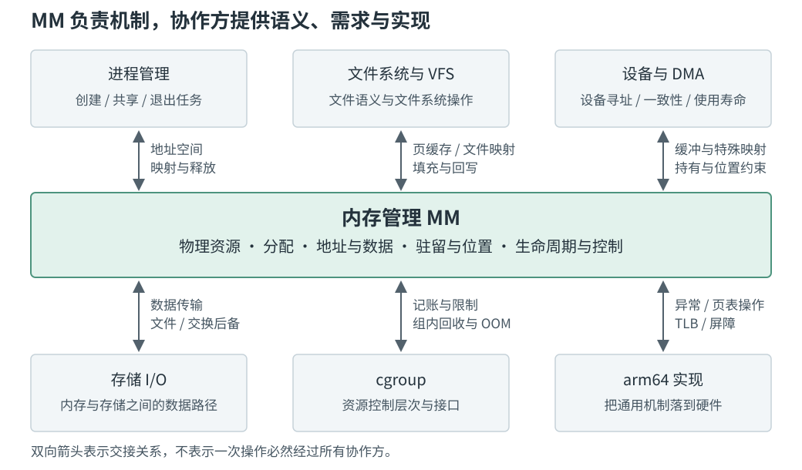

图 1：箭头标明交接内容。MM 提供内存机制，但并不独自决定进程生命周期、文件语义、设备协议或资源控制策略。

| 协作方 | 对方负责什么 | MM 的交接点 |
| --- | --- | --- |
| 进程管理 | 创建、执行、退出任务及建立任务关系 | 创建、复制、共享或销毁地址空间；释放相应映射与引用 |
| 文件系统与虚拟文件系统 | 文件命名、访问语义及文件系统操作 | 建立文件映射、维护页缓存；通过文件系统操作填充和回写数据 |
| 存储 I/O | 将数据在内存与存储介质之间传输 | 为文件缓存、交换和回写提供数据传输路径 |
| 设备与 DMA | 设备访问协议、DMA 地址和一致性要求 | 分配或持有内存、建立特殊映射；约束页的位置、寿命及可迁移性 |
| cgroup | 资源控制层次和控制接口 | 内存记账、保护、限制、组内回收和 OOM |
| arm64 实现 | 异常入口、翻译机制、屏障与体系结构操作 | 将通用地址空间与页表管理落到具体硬件行为 |

这些交接解释了为什么 MM 不能只看成 `mm/` 目录里的代码。例如，文件回写需要文件系统参与，缺页从 arm64 异常处理进入，而 DMA 分配也不能仅凭某个 GFP 标志完成所有设备适配。

## 2. 整体组成与协作地图

可以从四个方向观察 MM：**资源供给**组织并分配物理内存；**地址与数据访问**把虚拟地址连接到数据；**驻留与位置调整**处理压力和碎片；**生命周期与资源控制**约束前面所有过程。

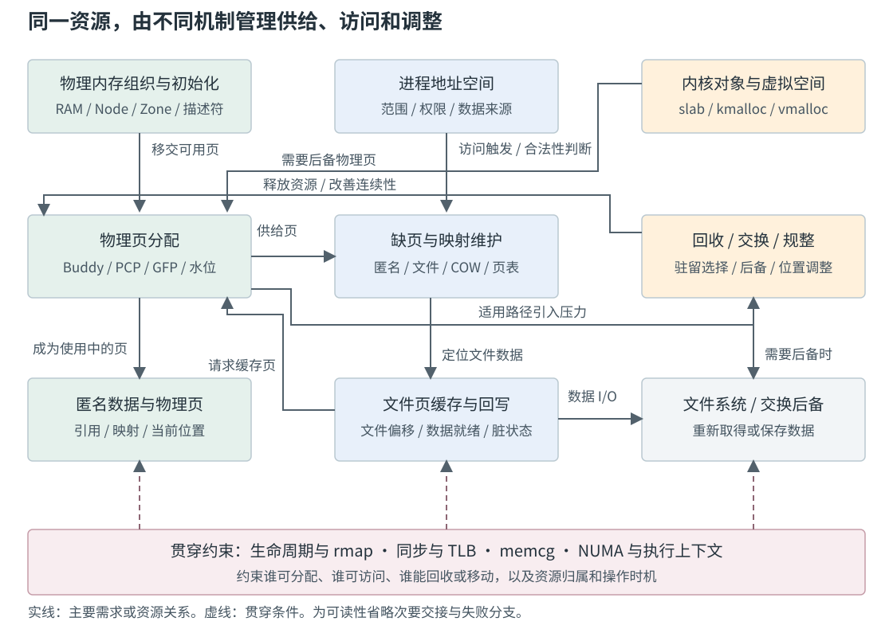

图 2：实线表示主要需求或资源关系，虚线表示条件约束。图是协作地图，不是严格分层的调用链；启动、后台工作及错误处理不会都经过同一入口。

物理页分配器为内核对象、用户数据、页表及页缓存提供页，但并不决定它们的全部使用规则。地址空间管理决定某个地址允许怎样使用，页表体现当前转换，而缺页处理在两者与数据来源之间协调。回收需要理解数据能否重新获得，也需要生命周期机制协助解除映射。

### 子模块入口总表

表中的划分是学习与查阅边界，不要求一个功能部分对应一个文件。总览入口指向本文的对应章节，已有独立专题的条目附上专题链接。

| 功能部分 | 主要职责 | 总览入口 | 独立专题 |
| --- | --- | --- | --- |
| 物理内存组织 | 描述页帧、节点、区域及元数据 | [3.1 物理资源](#physical-resources) | [组织与初始化](02-physical-memory.md) |
| 启动内存管理 | 发现、保留、早期分配并移交可用内存 | [3.2 启动交接](#boot-handoff) | [组织与初始化](02-physical-memory.md) |
| 物理页分配 | 根据约束提供和接收物理页块 | [4.1 页分配](#page-allocation) | [物理页分配（草稿）](01-page-allocation.md) |
| 内核对象分配 | 复用物理页，为小对象提供缓存与分配 | [4.2 对象分配](#object-allocation) | [对象分配](03-kernel-objects.md) |
| 内核虚拟空间与映射 | 提供虚拟连续空间及不同类型的内核映射 | [4.3 虚拟连续分配](#kernel-virtual-allocation)、[5.4 arm64 虚拟地址全景](#kernel-mappings) | [内核虚拟空间](04-kernel-virtual.md) |
| 进程地址空间 | 管理 VMA、范围、权限与映射语义 | [5.1 地址空间](#process-address-space) | [地址空间](05-process-address.md) |
| 页表与 TLB | 实现和维护实际地址转换 | [5.2 地址转换](#translation) | [arm64页表](06-arm64-page-tables.md) |
| 缺页与 COW | 按访问需求建立或改变映射 | [5.3 缺页与共享](#faults-and-cow) | [缺页与COW](07-page-faults.md) |
| 文件页缓存与预读 | 按文件偏移缓存数据，服务读取和映射 | [6.1 缓存与访问](#page-cache) | [缓存与回写](08-page-cache-writeback.md) |
| 脏页与回写 | 将修改过的缓存数据协调写回存储 | [6.2 回写](#writeback) | [缓存与回写](08-page-cache-writeback.md) |
| 回收与交换 | 选择驻留数据，释放可重新使用的资源 | [7.1 回收](#reclaim)、[7.2 交换](#swap) | [回收与交换](09-reclaim-swap.md) |
| 迁移与规整 | 改变物理位置，改善局部性和连续空闲空间 | [7.3 迁移与规整](#migration-compaction) | [迁移与规整](10-migration-compaction.md) |
| 引用、映射与 pin | 管理使用关系及释放、移动条件 | [8.1 生命周期](#lifetime) | [生命周期与rmap](11-page-lifetime-rmap.md) |
| 反向映射与同步 | 定位并安全修改相关映射与对象 | [8.2 反向映射](#reverse-mapping)、[8.3 同步](#synchronization) | [生命周期与rmap](11-page-lifetime-rmap.md)、[页表](06-arm64-page-tables.md) |
| 记账、限制与 OOM | 管理资源归属、压力范围与耗尽处理 | [8.4 资源控制](#resource-control)、[7.4 失败边界](#failure) | [memcg/OOM](12-memcg-oom.md) |
| NUMA 策略与位置调整 | 协调分配位置、允许节点与访问局部性 | [8.5 NUMA](#numa) | [NUMA](13-numa-policy.md) |
| 扩展能力与观测 | 大页、连续内存、特殊介质及诊断能力 | [9.2 扩展定位](#extensions) | [观测与扩展入口](14-observability-extensions.md)，非全部扩展深挖 |

## 3. 物理内存怎样成为可管理的资源

### 3.1 页、节点与区域分别解决什么问题

**物理页帧**是按基本页大小划分的物理地址单位，页帧号（PFN）由物理地址和页大小确定。它不意味着每个 PFN 都对应可用 RAM：地址空间可能有空洞、设备区域或保留区域。

对纳入普通页管理的内存，`struct page` 保存对应页的状态和使用信息。它是描述符，不是数据本身。**folio** 将一页或一组具有共同管理语义的连续页作为单位处理；它不替代所有 `struct page` 接口，也不意味着每个 folio 都是一份文件缓存。

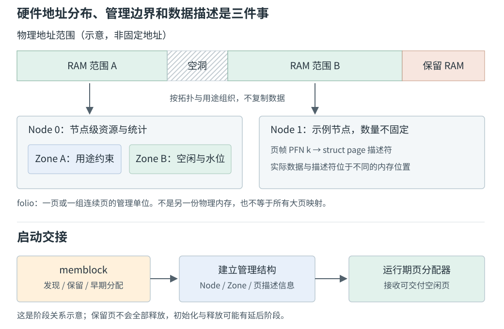

图 3：上半部分区分实际 RAM 范围与管理结构，下半部分给出从早期管理到运行期分配的交接。Node 和 Zone 不是物理地址空间中的额外数据副本。

**Node** 是节点级内存管理单位，尤其用于表达非一致内存访问（NUMA）的拓扑与位置关系。一个节点下的 **Zone** 按用途及约束组织页，维护空闲页、统计与水位。节点不等于“一个 CPU 的私人内存”，同一节点可以由多个 CPU 访问和使用。

这套组织同时回答两个问题：内存在哪里，以及本次需求允许使用其中哪些部分。具体 Zone 组成和 DMA 可访问范围依赖平台与配置，不能把其他体系结构的固定边界套到 arm64。

物理内存模型又解决另一层问题：如何为可能稀疏、不连续的物理地址范围组织 `struct page` 描述信息。例如，SPARSEMEM 及其相关实现支持稀疏内存组织；`vmemmap` 则是页描述符的虚拟映射区域，不能误认为用户数据所在的内存池。

### 3.2 从 memblock 到运行期页分配器

在完整页管理结构尚未建立时，内核已经需要内存来放置早期页表和管理数据。**memblock** 用范围信息记录已发现的内存与保留区域，承担早期分配，并避免覆盖内核镜像等已有占用。

随后建立节点、区域及页描述信息，把可以交付的空闲页加入运行期页分配器。arm64 的 `mem_init()` 调用 `memblock_free_all()`，是这项交接的重要源码入口。保留区域不会因此全部变成可用页，某些初始化与释放还存在后续阶段。

因此，memblock 与 Buddy 不是两个长期并列、任意可互换的通用分配接口。前者解决系统尚未准备好时的资源管理，后者承担运行期页供给。[来源 S1、S2](#s1)

## 4. 分配体系怎样满足不同需求

内核调用者的需求并不相同：有的需要若干物理连续页，有的需要一个小对象，有的只要求 CPU 可通过连续虚拟地址访问一块较大空间。这些需求决定应该进入哪类分配体系。

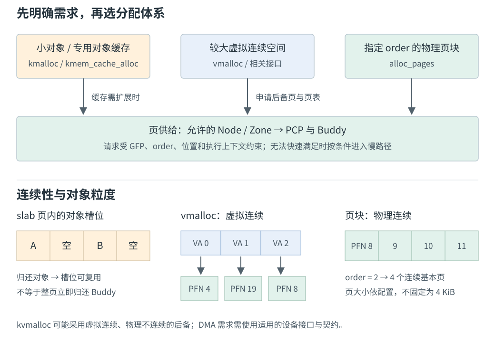

图 4：上半部分展示接口依赖，下半部分展示连续性。对象缓存有可用对象时，不必每次向页分配器要新页；`vmalloc` 则需要管理虚拟范围和对应页表。

### 4.1 页分配：满足带约束的物理页需求

**Buddy** 按不同 order 管理空闲物理页块。一个 order 为 `n` 的块包含 `2^n` 个基本页帧，并满足相应的物理连续性与对齐要求。没有合适的小块时可拆分大块；释放时在条件允许的情况下与伙伴合并。伙伴关系不等于任意相邻块。

**每 CPU 页缓存（PCP）** 为符合条件的分配和释放提供局部缓存，减少频繁访问区域级管理结构的开销。PCP 和 Buddy 是同一页供给体系中的协作部分，而不是两个彼此独立的资源池。

调用者除了数量，还通过 GFP 标志、允许节点等条件表达需求。GFP（Get Free Pages）标志影响可选区域、是否允许直接回收、I/O 与重试行为。`GFP_KERNEL` 可能导致睡眠；不能在不允许睡眠的上下文中仅因“这是普通内核分配”就使用它。

选定允许使用的 Zone 后，还要判断取页是否会使空闲资源低到难以维持后续供给。**区域水位**是分配与后台回收共同使用的判断尺度：`min` 参与较低空闲量下的分配保护，`low` 与后台回收的启动判断相关，`high` 通常作为后台恢复空闲资源的目标尺度。它们属于 Zone，而不是整机只有一组的“剩余内存阈值”；具体检查还结合 order、保留资源、分配标志和水位提升等条件。

这样，页分配器既检查“有没有符合条件的页块”，也检查“当前请求是否适合继续取页”。可以直接满足时就取页；无法快速满足时，只有在请求及上下文允许的条件下才进入相应慢路径，连接后台回收、直接回收或规整。可用内存统计充足，也不保证某个高 order、指定节点或受限区域的请求一定成功。[来源 S3](#s3)

### 4.2 对象分配：把页转化为可复用的小对象

如果每个小对象都单独占用一整页，空间利用与分配开销都会变差。slab 分配体系从页分配器获得页，再把它们组织成对象槽位，并维护空闲与已使用对象。

`kmem_cache_alloc()` 适合从专门的对象缓存分配；`kmalloc()` 为按大小分配的常见需求提供接口。在本版本中，SLUB 是可选的 slab 实现之一；具体构建选择须核对配置，不能因为源码含 `mm/slub.c` 就认定运行时必然使用 SLUB。

归还一个对象，通常先让槽位重新可用，不等于立即把对应整页交还 Buddy。只有页中的使用关系和分配器策略允许时，才可能释放底层页。这也解释了“对象已释放”和“系统空闲页立即增加”为何不是同一件事。

部分内核缓存可通过 **shrinker** 在压力下释放可再生的数据，但不能把任意活跃内核对象当成匿名页进行交换。

### 4.3 虚拟连续分配与专用接口

`vmalloc()` 为调用者提供虚拟连续空间，其底层物理页不要求整体连续。它需要取得后备页、保留内核虚拟范围并建立映射；释放时也要处理页表与地址转换缓存，因此不只是“放宽连续性的 `kmalloc`”。

`kmalloc()` 返回的对象具有物理连续性；较大请求可能绕过小对象缓存直接使用页分配。`kvmalloc()` 在接口约束允许时结合两类策略，调用者必须接受其物理不连续的可能性，并使用配套释放方式。

| 典型需求 | 主要入口 | 总览层面必须知道的边界 |
| --- | --- | --- |
| 获得指定 order 的物理页块 | `alloc_pages()` | 返回页描述符；需要正确释放页及处理分配失败 |
| 按字节数分配内核对象 | `kmalloc()`、`kzalloc()` | 有大小与上下文约束；`kzalloc()` 额外清零 |
| 复用某类对象 | `kmem_cache_alloc()` | 对象来自指定缓存，释放时应归还该缓存 |
| 较大虚拟连续空间 | `vmalloc()`、`vzalloc()` | 不保证整体物理连续，不直接当作普通 DMA 缓冲使用 |
| 接受两种后备策略 | `kvmalloc()` | 可能使用 vmalloc 后备，应使用 `kvfree()` 等配套接口 |
| 降低特定关键路径的分配失败风险 | mempool | 通过预先准备的资源提供保证，仍受使用契约约束 |
| 分配 per-CPU 数据 | `alloc_percpu()` 等 | 管理各 CPU 的数据实例，并非一般共享对象分配 |
| 设备 DMA 缓冲 | DMA API | 处理设备地址、一致性与平台约束；不能只看 CPU 虚拟地址 |

总览到这里应能判断分配类型，尚不足以替代详细接口契约。[来源 S4、S5](#s4)

## 5. 地址空间怎样连接到实际内存

想先定位用户区和内核各映射区在整张地址地图上的位置，可直接看 [5.4 arm64 虚拟地址全景](#kernel-mappings)。

### 5.1 `mm_struct` 和 VMA 描述地址的使用规则

`mm_struct` 表示一个用户地址空间，包括页表根、VMA 索引及相关统计和同步状态。共享地址空间的线程可以使用同一个 `mm_struct`；不能把它理解为每个 `task_struct` 必然独占一份的对象。

先把任务对象、地址空间对象和进程看到的地址区域对应起来：

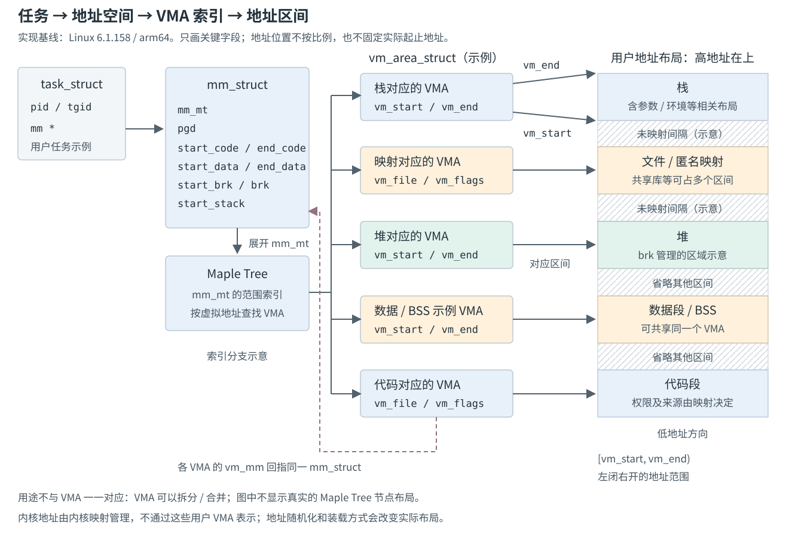

图 5a：借鉴[《深入理解 Linux 虚拟内存管理》](https://www.cnblogs.com/binlovetech/p/16824522.html)中“任务对象、地址空间、VMA 与地址区域并列对应”的表达方式，按本地 6.1.158 定义重新绘制。图中的布局是示意，不使用参考资料里的其他架构地址常量或旧版 VMA 链表字段。

从左向右读图：任务的 `mm` 指向地址空间；`mm_struct.mm_mt` 按地址范围索引 VMA；每个 VMA 用 `vm_start`、`vm_end` 描述左闭右开的区间，用 `vm_flags` 等表达权限与语义，并通过 `vm_mm` 回指所属地址空间。图中的 Maple Tree 方框是内嵌字段 `mm_mt` 的展开视图，不表示 `mm_struct` 另有一个指向它的指针。本地源码使用 **Maple Tree**，不是参考图中的 `mm->mmap` 加 `vm_next` / `vm_prev` 链表。

从右侧布局看，同一地址空间包含代码、数据、BSS、堆、文件或匿名映射、栈及未映射间隔。**这些用途名称不与 VMA 一一对应**：同一用途可以由多个 VMA 承接，数据与 BSS 也可能共享同一个 VMA；权限、映射来源或局部操作发生变化时，VMA 可以拆分或合并。

`mm_struct` 中的 `start_code` / `end_code`、`start_data` / `end_data`、`start_brk` / `brk`、`start_stack` 记录程序布局的部分边界或起始位置，并不替代 VMA 索引。文件与匿名映射可以分布在多个区间；地址随机化、装载方式和运行时分配会改变具体布局。库函数 `malloc()` 还会管理已有空间，不应将每次小对象申请都解释成一次 `brk()` 系统调用。

虚拟内存区域（VMA）因而不是“代码段对象”或“堆对象”，而是一段具备特定范围、权限、共享或私有语义、文件来源及相关操作的地址描述。其功能是让内核能够按地址判断使用规则。[来源 S6](#s6)

`mmap()`、`brk()`、`munmap()`、`mprotect()` 等改变的是地址空间的不同方面：建立范围、调整范围、删除范围或修改权限。它们不都是“立即取得并填满物理页”的操作；特殊映射及预填充选项又可能改变普通按需路径。

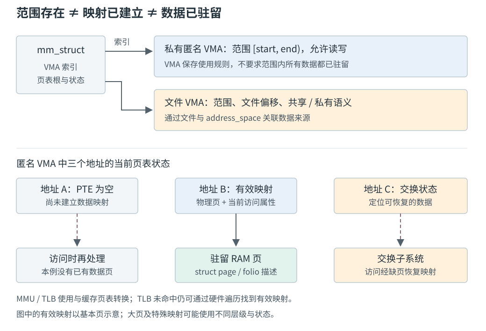

图 5b：图 5a 说明地址区域怎样被组织，图 5b 进一步区分同一范围里的当前状态：可以同时存在尚未建立映射、已经驻留和已换出的部分。VMA 是范围与语义描述，不是当前驻留页清单。

### 5.2 页表描述转换，MMU/TLB 执行和缓存转换

页表表达虚拟地址与物理页及访问属性之间的关系。末级页表项（PTE）既可能是有效映射，也可能为空，或在适用路径中编码交换等软件状态。大页路径还可能在较高层级建立映射，不能把所有地址都画成同一种末级 PTE 结构。

MMU 根据当前翻译配置和页表执行地址转换与权限检查；TLB 缓存转换结果。**TLB 未命中不等于缺页**：硬件页表遍历如果找到有效且权限合适的映射，访问可以继续，不需要内核分配新页。

修改页表也不等于其他 CPU 已立即停止使用旧转换。撤销、改权限或改变物理位置时，需要按照体系结构与并发协议完成页表更新、必要的 TLB 失效和相关同步。

arm64 的翻译层数、各层覆盖范围及地址布局受页大小和 VA 位宽影响。本篇不固定某组位域或大页字节数；具体深入时应联合核对配置、`arch/arm64/` 页表定义及当前布局。[来源 S6、S7](#s6)

### 5.3 缺页把访问需求与数据来源连接起来

缺页并不都表示程序错误。它可能表示合法范围中的数据尚未建立映射、需要从文件或交换后备取得数据，或写入需要改变共享关系。非法地址或不允许的访问则不能简单靠“分配一页”修复。

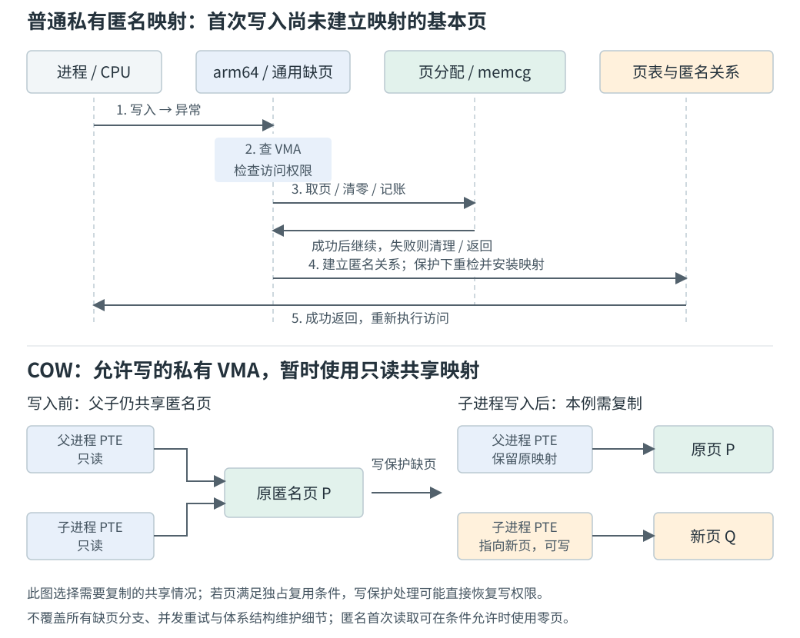

图 6：上半部分选择普通私有匿名映射、基本页、尚无后备页的首次写入路径；下半部分选择两者仍共享匿名页时的 COW。这里只展示相关路径，不覆盖大页、用户态缺页处理等全部分支。

对于图中的首次写入：

1. 进程建立可写的私有匿名范围，普通按需路径此时主要建立 VMA。
2. CPU 写入尚无有效映射的地址，经 arm64 异常入口进入缺页处理。
3. 内核查找 VMA，检查访问是否合法，再选择对应缺页机制。
4. 匿名缺页取得并清零新页，处理资源记账，建立匿名页关系；页表所需页也可能需要分配。
5. 在必要的保护下重新检查并安装映射，更新相关状态；成功返回后重新执行访问。

“重新检查”是必要的：另一个线程可能在当前线程等待分配或处理缺页期间已经完成映射。分配成功不等于可以不检查就覆盖现有页表项。分配或记账失败也不能留下半安装的有效映射。

如果是尚未写入的匿名首次读取，适用条件下可以映射共享零页，不必给每个读取者立即准备专有数据页。这是选择“首次写入”作为上图路径的原因。

**写时复制（COW）** 则利用“VMA 允许写、当前共享页映射暂时禁止写”的差异。普通 `fork()` 后，部分私有匿名页可以由父子地址空间共享；写入触发写保护缺页，当页仍不能独占使用时，为写入者复制数据并改变它的映射。若匿名页已满足独占复用条件，也可能只恢复写权限，而不总是复制。

文件 `MAP_PRIVATE` 的写入也需要隔离：修改可以落到新的匿名页，而不是作为共享写入直接改变文件页缓存。这是地址空间语义影响数据去向的例子。[来源 S8](#s8)

### 5.4 arm64 虚拟地址空间全景

§5.1 展开的是**单个进程的用户地址范围**。下图把这部分放回 arm64 的整体布局：低地址范围通常由 `TTBR0_EL1` 对应的用户页表描述，高地址范围通常由 `TTBR1_EL1` 对应的内核页表描述。中间空洞不属于这两段可翻译的地址范围；内核高地址也不是进程可以访问的额外用户空间。

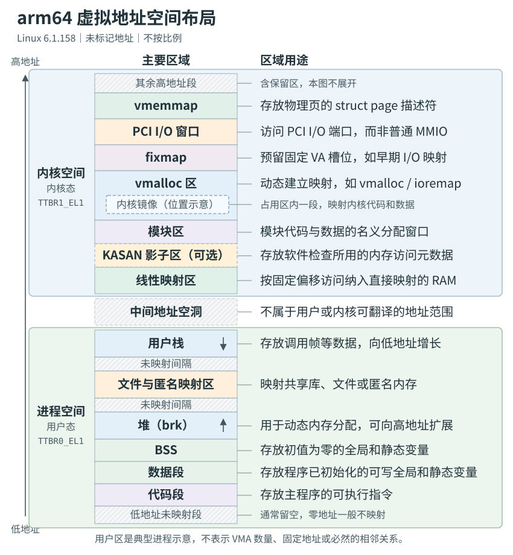

图 5c：沿用[参考图](https://img2022.cnblogs.com/blog/2907560/202210/2907560-20221025125918837-1995458208.png)的版式，按本地 Linux 6.1.158 arm64 源码重新绘制。**从下往上地址递增**，区块高度不代表容量；用户区的各段是典型布局，不是固定边界。以**配置和实际使用均为 48 位 VA、地址不带标签**为例，用户范围为 `0x0000_0000_0000_0000` 至 `0x0000_ffff_ffff_ffff`，内核范围从 `0xffff_0000_0000_0000` 起。具体边界取决于 VA 位宽、页大小、内核配置和启动状态，不是目标机器的实测布局。[来源 S7](#s7)

图中省略了部分内核子区之间的间隔。内核镜像占用 vmalloc 地址范围中的一部分，位置可受 KASLR 影响；模块区画的是名义窗口，实际分配也可能受随机化和回退路径影响。进程空间里的灰色间隔只是该示意进程的未映射范围，与中间不可翻译的地址空洞不同。

实用的区分是：**读写 RAM 内容**通常走线性映射，**查询物理页的管理信息**走 `struct page`，**访问设备寄存器**通常要按设备属性建立 `ioremap()` 映射。不能把这些虚拟地址都交给同一种物理地址转换宏。映射与接口选择见[内核虚拟空间专题](04-kernel-virtual.md)及来源 S7、S9。

## 6. 文件数据怎样进入并使用内存

### 6.1 缓冲文件访问和文件映射在页缓存处汇合

**文件页缓存**按文件数据的位置组织驻留内存。普通文件缓存通常通过 inode 对应的 `address_space` 管理，其中 `i_pages` 的 XArray 索引缓存内容。这里的 `address_space` 是文件缓存管理对象，不等于进程的 `mm_struct`。

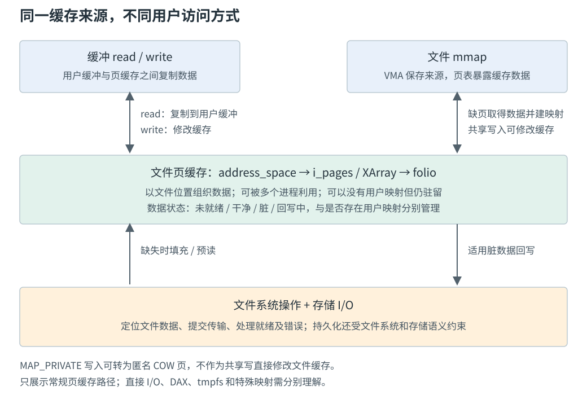

图 7：缓冲 `read()` 把缓存数据复制到用户缓冲；文件 `mmap` 则通过缺页等机制使用户地址映射到相应缓存页。两种方式共享缓存来源，但用户侧访问方式不同。

缓冲读取首先利用已有缓存，缺失数据时通过文件系统与 I/O 填充。**预读**根据访问情况提前准备可能即将需要的数据，减少后续等待；它仍消耗内存，并不是独立于页缓存的另一份文件内容。

普通文件映射把 VMA 中的文件与偏移信息连接到页缓存。读取已经驻留且状态合适的页，可能只需建立进程映射；缓存缺失或数据未就绪时，则可能涉及 I/O 和等待。因此，“缺页”不意味着每次都要读存储，也不意味着每次都必须分配新的数据页。

上图只代表常规页缓存路径。直接 I/O、DAX 和某些特殊文件映射不能照搬它。`tmpfs`/共享内存也有缓存式组织，但没有普通磁盘文件那样可重新读取的文件后备，回收时需要另外理解交换和其生命周期。

### 6.2 修改缓存与数据持久化是两个阶段

缓冲写入以及适用的共享可写文件映射可以修改页缓存，并使相应数据进入脏状态。**回写**由 MM 与文件系统配合，将修改送往后备存储；脏数据的积累也会影响写入节流和内存回收。

页缓存的数据状态与用户映射关系是两条不同轴线：一页可以被多个进程映射，也可以没有用户映射而仍留在缓存中；一页可以干净、脏或正在回写。删除某个进程映射不会自动删除文件缓存。

普通 `write()` 完成或共享映射中的写入发生，不等于数据已经耐久地写到介质。`fsync()` 等涉及文件系统和存储保证，不能把“清除了某个脏标志”直接等同于所有持久化语义已满足。[来源 S10](#s10)

## 7. 内存压力下怎样维持供给

分配失败之前，应先问清楚缺的是什么：是可重新使用的内存，还是满足连续性、节点和区域条件的内存？资源控制造成的压力，又可能只作用于某个组，而不是整个机器。

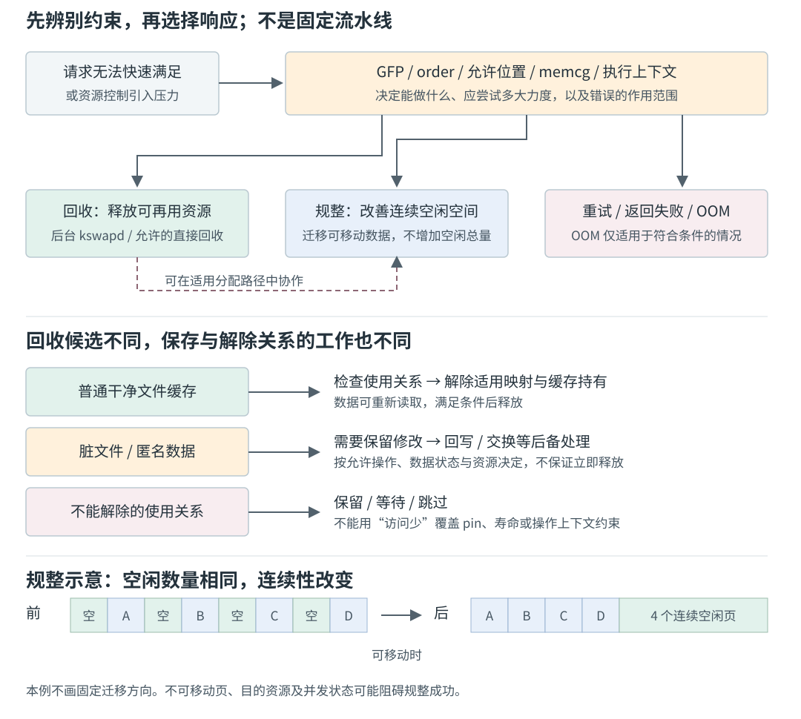

图 8：回收增加可重新使用的资源，规整调整其空间分布。它们可在适用的分配路径中协作，但不是每次都按固定顺序执行；OOM 也不是每次分配失败的必经步骤。

### 7.1 回收：选择哪些数据可以暂时不驻留

回收不是仅凭“某页使用得少”就把它释放。它同时判断数据是否需要保存、能否再次取得、是否仍有不可解除的使用关系，以及当前路径是否允许必要操作。

**kswapd** 是节点级后台回收工作线程，通过相关压力条件维持空闲资源。**直接回收**则由允许该行为的请求路径执行，可能直接增加调用者等待时间。两者共同使用回收机制，但背景与延迟影响不同。

LRU（最近最少使用）帮助组织访问冷热和候选页。传统路径区分活跃/非活跃及匿名/文件等类别；本源码还包含多代 LRU（MGLRU），实际使用哪条路径取决于配置和运行设置。总览只要求理解“尽量保留更有价值的驻留数据”，不将实现描述成精确的全局访问排序。

| 候选资源 | 为什么可能回收 | 阻碍或额外工作 |
| --- | --- | --- |
| 普通干净文件缓存 | 文件数据可从后备重新取得 | 仍需检查使用关系、解除必要映射并安全移除缓存 |
| 普通脏文件缓存 | 成功保存修改后可能释放 | 回写与等待受上下文和文件系统条件限制，不保证扫描时立即写回释放 |
| 匿名内存 | 可在适用条件下转移到交换后备 | 需要可用后备，且不能违反 mlock、pin 等约束 |
| 可再生内核缓存 | 可由所属子系统释放并按需重建 | 通过 shrinker 等协议，不是任意 slab 对象都可回收 |
| 活跃、锁定或被持有的内存 | 不一定具备回收条件 | 需保留、等待或跳过；不能破坏现有使用者 |

扫描到“可以考虑回收”的页，还要由反向映射、页锁和引用等机制完成状态检查与交接。这些机制在第 8 节连接起来。[来源 S11](#s11)

### 7.2 交换：保留数据，而不是简单丢弃

匿名数据通常没有可重新读取的普通文件副本。若要释放其驻留 RAM，就必须在适用路径中通过 **swap** 保存数据，并留下能够再次定位数据的状态。进程以后访问相应地址时，经交换缺页将数据重新带回，建立有效映射。

swap 因而是驻留管理与缺页之间的桥梁，不只是“内存不足时才使用的某块磁盘”。交换后备、交换缓存与具体读写路径各有职责；压缩交换实现也可能改变后备形态。没有可用交换后备时，不能假定匿名数据都能像干净文件缓存一样丢弃。

已经具有合适交换副本的页也不必每次回收都重新写入，具体需要检查当前数据状态。[来源 S12](#s12)

### 7.3 迁移与规整：位置变化不等于数据被回收

**页迁移**把数据从原物理位置搬到新位置，并协调缓存索引、用户映射和相关状态。用户虚拟地址可以保持不变。迁移是基本能力，可以服务 NUMA 局部性、规整和内存下线等不同目标。

**内存规整**则使用迁移等机制把可移动页重新安排，使空闲空间更集中，以改善物理连续页分配。它不凭空增加空闲页总量，也不能保证克服不可移动页造成的碎片。图 8 的示例展示相同空闲数量、不同连续性的区别。

两者的关键协作是：找到可移动数据、获得目的页、阻止访问看到不一致的搬移过程，并把相关映射更新到新位置。迁移失败可能来自引用、pin、回写或目的资源等条件，不只来自“没有空闲内存”。[来源 S13](#s13)

### 7.4 OOM 与失败边界

OOM（内存耗尽）处理在适用范围内判断严重资源不足并采取措施，OOM killer 可以通过选择受害任务促使资源释放。它不是一种正常的页分配器，也不保证解除某个高 order 或指定位置的困难。

分配请求的 GFP 标志、order 和调用范围决定重试与 OOM 资格；某些请求会直接失败或采取其他后备，而不会触发 OOM killer。内存控制组的耗尽处理又可能限定在组内，即使机器还有其他可用内存。

因此，“请求失败”到“杀死某个进程”之间有条件判断，不能画成无条件箭头。调用者仍必须按接口契约处理错误和已有资源的清理。[来源 S3、S14](#s14)

## 8. 共享资源怎样保持正确并受到控制

### 8.1 引用、映射和 pin 是不同的使用关系

一个物理页可以同时关联进程页表、页缓存和临时内核使用者。理解释放时，不能只看最后一个用户地址是否被 `munmap()`。

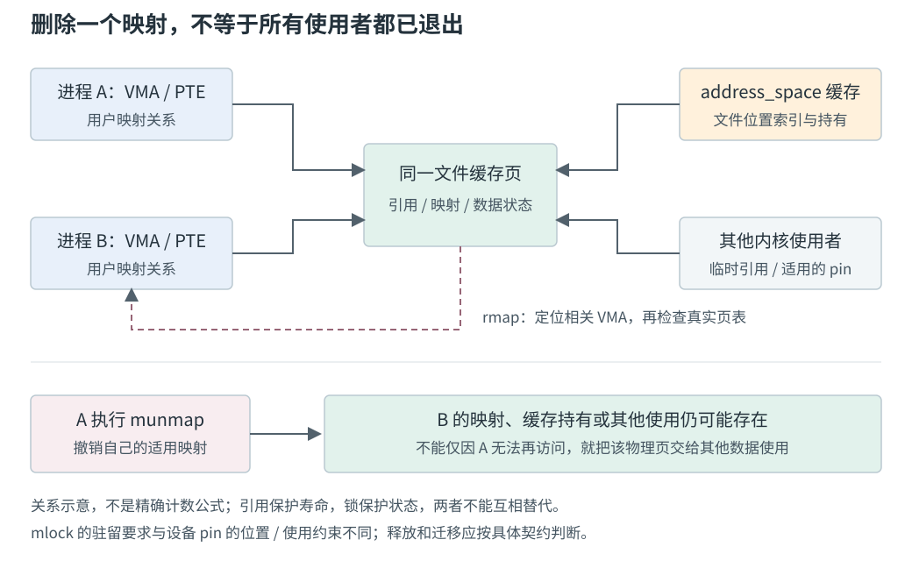

图 9：以普通文件缓存页为例，进程 A 解除映射后，进程 B、缓存和其他使用者仍可能需要它。箭头表示关系，不表示可以把它们简单相加得到所有实现中的精确计数。

**引用计数**用于维护对象寿命；**映射计数**反映相应用户映射关系；通过 GUP 相关接口取得的普通引用与通过 `pin_user_pages*()` 建立的 pin，又需要区分。尤其是某些长期设备使用要求物理位置保持稳定，会影响迁移与回收。

`mlock()` 主要表达相关用户内存不应被正常换出的驻留要求，不等于所有形式的设备 pin，也不应直接解释为“物理地址永远不会改变”。映射、引用和驻留要求共同决定操作条件。

释放内存的根本问题是：还有哪些使用者，以及它们是否已经按协议退出；并不是“进程不再能访问它”这一条判断。

### 8.2 反向映射帮助从物理页找到相关地址

正常访问从地址空间和虚拟地址出发，经页表找到物理页。回收或迁移面对的起点往往相反：已经选中了一个物理页，需要找出哪些用户映射涉及它。

**rmap** 利用匿名页的 `anon_vma` 关系，或文件的 `address_space` 和映射索引等结构，定位可能相关的 VMA，再检查真实页表。它不是一个与页表完全对称、直接列出所有虚拟地址的“倒置页表”。

定位之后，回收可以尝试解除适用映射；迁移则需要协调临时迁移状态与最终映射。访问可能在此期间遇到等待或重试，这正是缺页、生命周期和后台内存管理相互连接的地方。[来源 S15](#s15)

### 8.3 不同保护机制对应不同状态

| 需要保持一致的状态 | 代表性保护机制 | 与其他机制的协作 |
| --- | --- | --- |
| VMA 范围与地址空间布局 | `mmap_lock` 及相关地址空间协议 | 缺页查找不能与范围销毁或变化失去协调 |
| 页表项及其相关状态 | 页表锁、更新协议和 TLB 维护 | 防止并发安装、解除或修改留下不一致转换 |
| 数据页正在填充、回写或迁移 | page/folio 锁及相应状态协议 | 访问不能把尚未就绪的数据当作可用内容 |
| 缓存索引与回收队列 | XArray、LRU 等各自的保护机制 | 缓存归属及回收资格必须协调变化 |
| 对象是否仍然存活 | 引用及所有权协议 | 防止保护其他状态前对象已经被释放 |

没有一把“MM 总锁”覆盖全部过程。锁保护状态，引用保护寿命，两者互不替代；拿到了页引用，也不等于可以任意修改页表或缓存关系。具体锁顺序、是否允许等待及 RT 下的语义，需要在相应专题按实际类型和调用路径核对。[来源 S6、S15](#s15)

### 8.4 资源归属与限制形成另一条控制线

**memcg（内存控制组）** 将有关内存消耗记账到控制组层次，并把限制和保护作用于分配、回收等过程。物理页在哪个 Node/Zone，与消耗记在哪个 memcg，是两个不同维度；cgroup 不是事先切出来的一块专有物理地址范围。

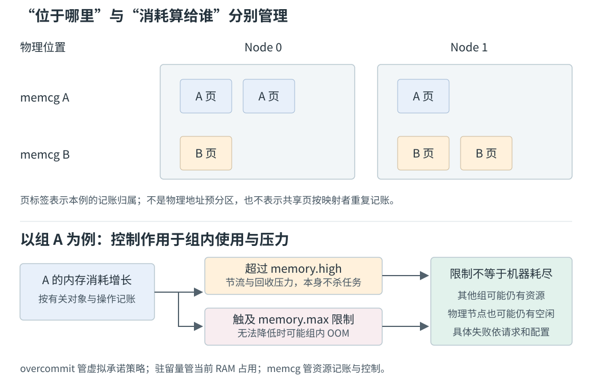

图 10：不同组的页可以分布在同一物理节点；一个组的页也可以分布在不同节点。共享数据的记账有专门规则，不按“映射者人数”简单均分或逐份重复收费。

以 cgroup v2 为例，`memory.high` 主要引入节流和回收压力，超过它本身不触发 OOM killer；`memory.max` 则是更强的限制，无法降低使用时可能进入组内 OOM 处理。保护与限制共同影响候选资源和压力范围，不能把它们画成新的页分配器。

**overcommit** 关注虚拟内存承诺及允许的申请策略，**驻留内存**反映数据当前占用的 RAM，**memcg** 则提供资源记账与控制。三者不能混为同一个“已分配内存”数字。地址申请成功也不保证以后所有写入都一定获得物理页。[来源 S16、S17](#s16)

### 8.5 NUMA 把位置选择连接到执行和资源约束

在 NUMA 系统中，同一数据放在哪个节点会影响访问代价。分配位置由内存策略、允许节点及可用资源等共同影响，不等于每次都只向当前 CPU 最近的节点请求。

迁移可以改变已有数据的位置；自动 NUMA 平衡在启用且适用时，还涉及访问观察和任务/内存位置调整。调度改变任务执行位置，并不意味着其所有内存立即同步搬走。memcg 又可能在节点仍有空闲资源时限制该组的增长。

因此，“离谁近”“允许用哪里”和“允许消耗多少”应分别理解，再看它们如何共同作用于请求。[来源 S18](#s18)

## 9. 把各部分重新连接起来

### 9.1 三条路径检验整体理解

**内核对象路径。** 调用者根据对象与上下文选择接口；缓存已有空闲槽位时可复用；缓存需要扩展时向页分配体系获取页。压力下可能涉及回收，但不得违反调用约束。对象归还后，槽位、底层页与调用者寿命分别完成相应交接。

**文件映射路径。** VMA 保存范围、权限与文件来源；访问缺少映射时，经缺页定位缓存数据；必要时通过文件系统与 I/O 填充；页表将数据暴露给进程。共享写入、私有 COW、解除映射及回写各自改变不同关系，而不是一个统一的“写入并释放”动作。

**压力下重新供给路径。** 分配或资源控制引入压力；回收按数据价值、后备和使用条件选取候选；rmap、同步和生命周期机制帮助移除适用映射与持有关系；可释放资源回到分配体系。若缺的是连续空间，则还需适用的规整；无法满足时按请求与范围处理失败。

这三条路径的共同点是：**资源供给负责取得页，地址机制负责暴露数据，驻留管理负责调整保留内容，生命周期与控制机制负责保证调整合法。** 回看图 2，应能说明每条箭头为何存在，而不只是记住方框名称。

### 9.2 扩展能力挂接在哪里

| 能力 | 挂接位置与主要问题 | 总览边界 |
| --- | --- | --- |
| THP / hugetlb | 大页分配、映射、缺页和生命周期 | 两种管理方式不同；不能把所有 folio 等同于大页映射 |
| CMA | 指定连续内存需求、迁移与区域管理 | 需结合保留/初始化及设备需求；不是所有 DMA 的唯一供给方式 |
| KSM | 在适用匿名内存上合并相同内容，连接 COW | 共享关系增加了写入隔离与生命周期约束 |
| zswap / zram | 压缩交换缓存或压缩 RAM 块设备 | 与 swap 的连接方式不同，压缩仍消耗资源 |
| 内存热插拔 | 物理资源上线/下线、隔离与迁移 | 下线受可移动性和使用关系影响 |
| HMM / 设备内存 | CPU 与设备地址空间、特殊页与迁移 | 不套用普通文件缓存或普通 RAM 的全部规则 |
| 硬件内存错误处理 | 故障页隔离、映射和进程错误处理 | 不等于普通分配失败或回收 |
| DAMON、页归属与内存安全检测 | 访问观测、分配追踪、越界与寿命诊断 | 是观测/检测能力，不是普通供给路径中的必经模块 |

这些能力是否启用及其细节需要另行确认。总览只定位它们怎样接入整体，不把首次阅读变成全部配置和实现的展开。

### 9.3 源码与官方文档入口

下面的链接指向当前本地源码树，便于审阅时核对；迁入正式站点时需要改为适合发布的源码链接。这些入口不是“已经逐行验证所有分支”的声明。

| 标记 | 入口 | 本篇对应问题 |
| --- | --- | --- |
| S1 | [物理内存模型](../../../../linux-6.1.158/Documentation/mm/memory-model.rst)、[mm_types.h](../../../../linux-6.1.158/include/linux/mm_types.h)、[mmzone.h](../../../../linux-6.1.158/include/linux/mmzone.h) | PFN、页描述符、folio、Node 与 Zone |
| S2 | [memblock.c](../../../../linux-6.1.158/mm/memblock.c)、[arm64 init.c](../../../../linux-6.1.158/arch/arm64/mm/init.c) | 早期资源管理与 `memblock_free_all()` 交接 |
| S3 | [page_alloc.c](../../../../linux-6.1.158/mm/page_alloc.c) | Buddy、PCP、水位、`__alloc_pages_slowpath()` 及 OOM 资格 |
| S4 | [分配指南](../../../../linux-6.1.158/Documentation/core-api/memory-allocation.rst)、[slab_common.c](../../../../linux-6.1.158/mm/slab_common.c)、[slub.c](../../../../linux-6.1.158/mm/slub.c) | 接口选择、GFP、对象缓存和构建实现 |
| S5 | [vmalloc.c](../../../../linux-6.1.158/mm/vmalloc.c)、[util.c](../../../../linux-6.1.158/mm/util.c)、[mempool.c](../../../../linux-6.1.158/mm/mempool.c)、[percpu.c](../../../../linux-6.1.158/mm/percpu.c) | 虚拟连续、`kvmalloc()` 和专用分配 |
| S6 | [sched.h](../../../../linux-6.1.158/include/linux/sched.h)、[mm_types.h](../../../../linux-6.1.158/include/linux/mm_types.h)、[mmap.c](../../../../linux-6.1.158/mm/mmap.c)、[页表锁说明](../../../../linux-6.1.158/Documentation/mm/split_page_table_lock.rst) | 任务与地址空间、VMA、Maple Tree、页表与同步边界 |
| S7 | [arm64 内存布局](../../../../linux-6.1.158/Documentation/arm64/memory.rst)、[memory.h](../../../../linux-6.1.158/arch/arm64/include/asm/memory.h)、[pgtable.h](../../../../linux-6.1.158/arch/arm64/include/asm/pgtable.h)、[ptdump.c](../../../../linux-6.1.158/arch/arm64/mm/ptdump.c)、[fixmap.h](../../../../linux-6.1.158/arch/arm64/include/asm/fixmap.h)、[mmu.c](../../../../linux-6.1.158/arch/arm64/mm/mmu.c)、[module.c](../../../../linux-6.1.158/arch/arm64/kernel/module.c)、[tlbflush.h](../../../../linux-6.1.158/arch/arm64/include/asm/tlbflush.h) | 地址转换、区域边界与顺序、镜像和模块映射、TLB 维护 |
| S8 | [arm64 fault.c](../../../../linux-6.1.158/arch/arm64/mm/fault.c)、[memory.c](../../../../linux-6.1.158/mm/memory.c) | `handle_mm_fault()`、匿名缺页、`do_wp_page()` 和文件 COW |
| S9 | [ioremap.c](../../../../linux-6.1.158/mm/ioremap.c)、[arm64 ioremap.c](../../../../linux-6.1.158/arch/arm64/mm/ioremap.c) | I/O 映射与普通 RAM 分配的区别 |
| S10 | [filemap.c](../../../../linux-6.1.158/mm/filemap.c)、[readahead.c](../../../../linux-6.1.158/mm/readahead.c)、[page-writeback.c](../../../../linux-6.1.158/mm/page-writeback.c)、[fs.h](../../../../linux-6.1.158/include/linux/fs.h) | `filemap_fault()`、缓存索引、预读与脏页回写 |
| S11 | [vmscan.c](../../../../linux-6.1.158/mm/vmscan.c)、[MGLRU 说明](../../../../linux-6.1.158/Documentation/mm/multigen_lru.rst) | 后台/直接回收与候选组织 |
| S12 | [swap_state.c](../../../../linux-6.1.158/mm/swap_state.c)、[swapfile.c](../../../../linux-6.1.158/mm/swapfile.c)、[memory.c](../../../../linux-6.1.158/mm/memory.c) | 交换缓存、后备与交换缺页 |
| S13 | [compaction.c](../../../../linux-6.1.158/mm/compaction.c)、[migrate.c](../../../../linux-6.1.158/mm/migrate.c)、[迁移说明](../../../../linux-6.1.158/Documentation/mm/page_migration.rst) | 位置调整、映射迁移与连续空闲空间 |
| S14 | [oom_kill.c](../../../../linux-6.1.158/mm/oom_kill.c)、[page_alloc.c](../../../../linux-6.1.158/mm/page_alloc.c) | OOM 的适用条件与失败处理 |
| S15 | [rmap.c](../../../../linux-6.1.158/mm/rmap.c)、[gup.c](../../../../linux-6.1.158/mm/gup.c)、[pin_user_pages 说明](../../../../linux-6.1.158/Documentation/core-api/pin_user_pages.rst)、[mlock.c](../../../../linux-6.1.158/mm/mlock.c) | 反向映射、引用、pin 和驻留限制 |
| S16 | [cgroup v2 文档](../../../../linux-6.1.158/Documentation/admin-guide/cgroup-v2.rst)、[memcontrol.c](../../../../linux-6.1.158/mm/memcontrol.c) | 记账、`memory.high`、`memory.max` 和组内压力 |
| S17 | [overcommit 说明](../../../../linux-6.1.158/Documentation/mm/overcommit-accounting.rst) | 承诺与实际驻留的区别 |
| S18 | [mempolicy.c](../../../../linux-6.1.158/mm/mempolicy.c)、[NUMA 策略说明](../../../../linux-6.1.158/Documentation/admin-guide/mm/numa_memory_policy.rst) | 节点选择与位置策略 |

原稿资料阅读以本地随附官方文档为主；本轮修订另行阅读了用户指定文章的地址布局与管理部分，并查看其结构图，只借鉴图示组织方式，实现字段与关系仍回到本地源码核对。未执行内核构建、目标机实验或运行配置验证；SLUB、MGLRU、大页及其他可选能力均未作为已启用事实。
