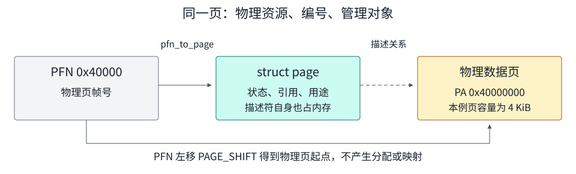
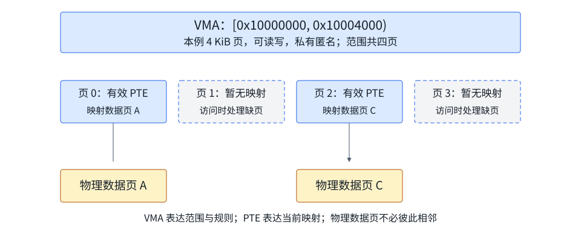

# 内存管理总览：资源、地址空间与数据生命周期

Linux 的 mm 不只负责“申请和释放内存”。它把有限的物理页，组织成内核对象、进程地址空间和文件缓存可以共同使用的资源；同时维持隔离、共享、按需提供数据以及压力下的再利用。

对已有内核基础的工程师，进入 mm 最重要的是建立三组联系：

- **资源与使用者**：一页属于哪个管理范围，现在被谁使用，什么时候能重新分配？
- **地址与数据**：一个虚拟区间允许做什么，当前实际映射了什么，缺失的数据由谁提供？
- **使用与再利用**：共享、引用、脏状态及设备固定怎样影响解除映射、回收和迁移？

这几组联系贯穿页分配、SLUB、页表、缺页、页缓存和回收。下面先建立全局，再沿各篇深入。

本文及配套文章以本地 **Linux 6.1.158、arm64 / AArch64** 为依据。默认读者知道进程、虚拟内存、系统调用和基本同步，不重讲入门概念。示例中的页大小、地址及启用条件会单独说明。

## 1. mm 提供哪些能力？

### 1.1 向内核组件提供不同粒度的存储

内核组件既可能需要小控制对象，也可能需要一组页或连续 CPU 工作区。mm 提供页分配、对象缓存和动态虚拟区域等不同形式的供给。

它们不能简单按“内存大不大”排列。对象缓存解决小粒度复用；按阶页分配满足指定物理块形态；虚拟区域组合访问区间、底层页和映射。供给状态、调用上下文和生命周期都参与选择。

### 1.2 管理进程地址空间，落实访问规则

mm 为进程维护地址范围、权限和映射对象，并通过页表落实当前访问关系。一个范围可以已存在，却尚未为全部地址准备数据页；同一物理页也可以被多个合法映射共享。

地址空间管理与物理分配不是同一个操作。`mmap` 建立映射规则，缺页处理根据规则补充数据；`mprotect` 改变许可，`munmap` 结束一段映射。

### 1.3 将文件数据与内存访问连接起来

文件数据可以驻留于页缓存，既服务普通文件读写，也服务文件映射。文件系统决定数据怎样读入和写回；mm 管理缓存对象、映射与资源压力。

这避免把“文件缓存”“某进程的文件映射”“一次读操作的缓冲”都理解成互不关联的数据副本。

### 1.4 在有限资源下维持运行

mm 回收可再取得的数据，为适用匿名页使用 swap，并通过迁移与规整改善物理布局。NUMA 策略与 memcg 又约束资源来自哪里、记到哪个资源组。

它不能保证所有分配永远成功。容量、连续性、范围、记账和允许的补救工作不同，可能分别造成等待、回退或失败。

## 2. 先看实际组成及协作

箭头表示主要的数据取得或资源依赖，不是固定调用链。对象缓存命中不需要走到页分配；文件缺页命中已有缓存也不需要重新读入存储设备。

| 组成 | 主要维护什么 | 与谁协作 |
| --- | --- | --- |
| memblock 与初始化 | 早期 RAM、保留区间和资源交接 | arm64 启动、页描述符与 zone 初始化 |
| 页分配器，Buddy / PCP | 适用范围内的空闲物理页块 | 内核分配、用户页、缓存、回收与规整 |
| slab 类分配器，SLUB 示例 | 对象规格、可用对象和 slab 供给 | 底层页分配、对象使用者 |
| vmalloc / vmap | 动态内核虚拟区间与映射 | 底层页、已有页面和页表管理 |
| mm / VMA / 页表 | 地址空间、区间规则和当前映射 | 缺页、文件映射、fork、解除映射 |
| 页缓存 | 文件与偏移对应的驻留数据 | 文件系统、读写、文件缺页与写回 |
| rmap | 从数据页查找可能使用它的用户映射 | 回收、迁移、访问状态检查 |
| 回收 / swap / 迁移 / 规整 | 数据保留条件、可复用资源及布局 | 页分配、rmap、文件系统与记账 |
| THP / HugeTLB / CMA | 较大映射粒度或连续资源需求 | 页供给、预留、拆分与迁移 |
| NUMA / memcg / overcommit | 位置策略、资源组限制及有关承诺 | 范围建立、实际分配、记账与回收 |
| 用户页固定 / 热插拔 | 外部持有约束或可管理资源变化 | 引用、迁移、上线与下线 |

源码主要集中于 `mm/`，但模块边界不等于目录边界。arm64 异常入口位于 `arch/arm64/`，fork 的资源复制位于 `kernel/fork.c`，文件数据取得依赖具体文件系统回调。

## 3. 资源、管理对象和访问地址怎样联系？

### 3.1 同一页有不同的表示

**物理页**是资源，**PFN**是物理位置的页粒度编号，**`struct page`**是管理对象。描述符不存放整页内容，也不等于内容指针。

arm64 的 SPARSEMEM / VMEMMAP 提供描述符组织；普通 RAM 的直接映射提供内容访问。取得描述符与取得分配权限不同，计算地址与建立有效映射也不同。

进一步讲解见 [物理内存如何被描述与组织](01-mechanisms.md)，包括地址空洞、node / zone / section、管理量和空闲量。

### 3.2 页不是永久按进程划分的

页分配器按 node 和 zone 管理供给，不为每个进程切出永久物理区域。一页可以先成为内核对象的底层存储，归还后用于文件缓存；也可以在合法条件下被多个进程映射。

改变用途时，描述符中的角色相关状态随之变化。释放必须遵守当前使用模型，不能看见 `struct page *` 就随意增加引用或归还。

页缓存与回收中还使用 `folio`，以一个或多个连续基本页为整体管理。Folio 不是另一种地址空间，也不必然等同于 THP。

### 3.3 不同分配器改变的资源形态不同

在理解物理供给后，再看三个需求：

| 需求 | 主要机制 | 关键判断 |
| --- | --- | --- |
| 频繁创建的小对象 | SLUB / 通用 kmalloc 缓存 | 有无可用对象，是否需要新 slab |
| 明确要求按阶物理块 | Buddy / PCP 页供给 | 范围、阶数、布局及水位 |
| CPU 连续访问的可变工作区 | vmalloc，或接受回退的 kvmalloc | 分散底层页、映射成本和睡眠 |

它们共同依赖页资源，却不在每次请求中承担同样的工作。详见 [从页块到对象与虚拟工作区](02-allocation.md)；具体接口和清理见 [主要 API](api.md)。

### 3.4 启动资源怎样成为运行期供给？

运行期分配器自己需要描述符、页表和管理结构，不能用尚未建立的 Buddy 完成所有初始化。Memblock 先用物理区间记录 RAM、早期占用与属性，并为这些管理对象提供早期存储。

`memory` 与 `reserved` 可以重叠：前者记录资源，后者表达已保留范围。NOMAP 又约束是否加入普通直接映射，不是把两组容量简单相减就能决定每个地址是否可用。

arm64 在适用启动阶段建立节点、描述信息与 zone，再通过 `mem_init` / `memblock_free_all` 将候选页交给运行期管理。部分启动占用后来能按专门协议释放，不意味着普通组件可以任意取消保留。

此后，普通分配在已有资源管理上改变使用状态；不是每次重新发现 RAM 或建立描述符。完整讲解见 [启动分配与交接](01-mechanisms.md#bootmem)。

### 3.5 为什么第一次供给失败后仍可能成功？

页分配先在允许范围内检查水位、块形态和空闲供给。失败可能意味着当前尝试未满足，而不是系统再也没有资源。

慢路径重新计算策略和范围，在允许时回收、规整或重试。高阶请求可能先规整，不能画成所有请求固定执行“回收 → 规整 → OOM”。

水位和保留保护供给余量，GFP 决定可做的工作；它们不提供额外 RAM。若请求不能等待，或限制来自固定页、域和记账，换一种策略也未必能成功。见 [水位与慢路径](02-allocation.md#slowpath)。

## 4. 地址空间怎样连接到实际数据？

### 4.1 规则、当前映射、后备数据分开管理

`mm_struct` 组织地址空间，VMA 描述连续区间的权限、映射类型和对象，页表记录当前硬件可用的映射。文件映射还关联文件与偏移。

对象之间没有一一对应关系。一个 VMA 可以包含很多页，有些尚未驻留；同一文件缓存页又可能被多个 VMA 映射。

图取 4 KiB 页、四页私有匿名范围。VMA 已存在，当前只有两页安装数据映射。空白位置仍可能合法，只是在访问时需要缺页处理。

### 4.2 正常访问由硬件完成，异常才进入缺页路径

arm64 MMU 根据翻译配置和页表解析地址，TLB 缓存翻译结果。VMA 不直接参与每次硬件访问。

异常时，arm64 缺页处理根据地址和类型找到区间、检查许可，再交给通用 mm。数据可能来自新匿名页、已有文件缓存、文件读入或 swap；并非每次缺页都申请全新普通页。

取得数据可能等待，期间页表或映射状态可能改变。实现必须在安装时重新检查，不能拿最初看到的空 PTE 无条件覆盖后来出现的映射。

详见 [地址空间、页表与按需提供数据](03-address-space.md)。源码入口为 `arch/arm64/mm/fault.c` 的 `do_page_fault` 与 `mm/memory.c` 的 `handle_mm_fault`。

### 4.3 私有映射可以先共享，再处理独立写入

fork 后，适用私有匿名数据页可以被父子进程暂时共享。VMA 仍允许写，相关 PTE 却可能写保护，使首次写入进入 COW。

图只演示需要复制的分支。若当前页符合独占复用条件，处理写保护也可能只是恢复可写状态，而非再次复制。

权限要分层理解：VMA 表达是否允许访问，PTE 表达当前如何实施它。页引用、映射数量和独占状态又各有语义，不能用一个数字替代所有判断。

### 4.4 页表变化还需要翻译和内容同步

页表在内存中保存分层条目，硬件结合相应配置解释后形成翻译；TLB 可以缓存适用结果，不是逐项复制软件页表。改动内存条目不保证所有 CPU 同时停止使用旧翻译，实际更新需要相应范围失效、屏障及通知。

内核映像、直接映射和动态区域采用不同地址关系，转换 helper 也不建立映射。页表的条目指针、条目值、编码地址和属性必须分别理解。

数据 Cache 与 TLB 又是不同对象。Normal / Device、缓存性、共享性与执行属性决定访问行为，不能仅检查地址和读写权限。

设备 DMA 访问 RAM 与 CPU 访问 MMIO 也不同：前者使用设备 DMA 地址和使用权/同步契约，后者使用设备资源映射和 I/O accessor。Coherent 不代替发布顺序，Streaming 不允许在设备仍使用时任意读写或释放。

见 [arm64 映射类别](03-address-space.md#kernel-mappings)、[TLB 与 Cache](03-address-space.md#tlb-cache) 和 [设备接口](api.md#device-memory)。

### 4.5 文件缓存怎样从使用进入写回？

普通文件页缓存用 `address_space.i_pages` 按文件索引组织 folio，连接 buffered read、buffered write 与文件 mmap。解除一个映射不自动销毁该数据缓存。

修改数据使其进入待保存状态。写回将修改交给相应文件系统和后备存储；期间还能重新变脏，完成后可能仍有待写修改。干净数据通常继续留在缓存中复用，不是写回后立即释放。

脏化速度高于保存速度时，后台写回与脏页平衡会对产生修改的任务施加压力。应用的持久化需求还须使用相应同步接口并处理错误；写入返回不等于完整持久化保证。

见 [页缓存生命周期与写回](03-address-space.md#page-cache)。

## 5. 回收为什么需要理解使用者？

资源紧张时，内核面对的不是一批可以任意丢弃的字节：

- 干净文件缓存可能有可重新读入的后备数据。
- 脏文件数据需要按文件系统协议保留或写回。
- 普通匿名内容不能简单丢弃，适用时需要 swap 等保存方式。
- 被使用、固定或不可移动的页，还限制回收与迁移。

假设选中一页作为候选，仅从 PFN 不知道有哪些进程还映射它。Rmap 连接数据页与有关 VMA，再检查真实页表项，让解除映射不必依赖全机地址空间扫描。

解除用户映射也不等于所有引用消失。回收还检查内容状态和其他持有者；迁移要处理映射、复制、同步及固定条件。

**回收改善可复用资源，规整改善物理布局，资源组限制约束用量范围。** 它们相关，但不互相替代。

详见 [回收、反向映射与资源压力](04-reclaim-rmap.md)。主要入口为 `mm/vmscan.c`、`mm/rmap.c`、`mm/compaction.c` 与 `mm/memcontrol.c`。

### 5.1 候选排序与安全释放是两道判断

传统 LRU 组织 active / inactive 等集合，用访问状态帮助选择候选；MGLRU 用 generation 等表达类似的新近程度。它们都不把“冷”直接等同于“可释放”。

候选之后还要检查脏状态、后备位置、映射、引用和固定条件。Rmap 查找使用关系，写回或 swap 保存必要内容，翻译同步避免旧访问落到重新使用的资源。

驻留量也不等于工作集。若刚被回收的内容马上再次需要，refault 会暴露这类周转；回收很忙却不代表有效工作增加。需要将访问模式、数据恢复成本与停顿一起判断，见 [工作集与 refault](04-reclaim-rmap.md#working-set)。

### 5.2 Swap 记录后备位置，不表示数据必已离开 RAM

普通交换条目联系后备槽位，swap cache 中仍可能保存 RAM 数据。再次访问可以命中这份缓存，也可能需要读入；不能把所有非 present 条目都当作交换页。

回收 RAM 必须等待必要数据和关系处理完成。未启用 swap、后备耗尽或资源组限制，都会影响匿名候选的可回收性。见 [交换条目与恢复](04-reclaim-rmap.md#swap)。

当冷匿名数据与热文件缓存竞争时，有无适用交换供给可以改变回收选择；关闭 swap 不必然减少总体 I/O，允许 swap 也不保证没有延迟。回收篇用同一容量模型比较两种选择，并以 PSI 区分占用与时间影响，见 [资源停顿观察](04-reclaim-rmap.md#psi)。

## 6. 页粒度、位置、承诺和固定怎样影响上述机制？

### 6.1 大页与 CMA 服务不同的形态需求

大页可能用更少条目覆盖相同虚拟范围，但增加连续性、对齐、分配和处理粒度要求。THP 在适用映射中透明尝试和回退，HugeTLB 使用专门资源与预留模型，不能混成同一种机制。

CMA 准备适用连续物理区域，在运行期允许特定可移动需求使用，再于连续请求时尝试取得目标范围。它改善资源准备，不保证任何固定或不可移动占用都能消除，也不代替 DMA 契约。

详见 [大页](05-placement-and-limits.md#hugepages) 与 [CMA](05-placement-and-limits.md#cma)。

### 6.2 物理位置、映射者和记账者分别管理

NUMA 策略决定适用分配从哪些节点开始，cpuset 和 zone 还限制允许范围。改变策略不自动将所有已有页迁到目标节点。

Memcg 则限制适用用量与压力域，不为每个进程建立独占物理池。同一文件页可以被多个进程映射，同时按实际规则记到某个资源组。物理分配成功也不保证 charge 成功。

`memory.min/low` 表达有效范围内的回收保护，`memory.high/max` 与交换限制表达压力或用量边界。保护不预分配 RAM，实际有效量还受祖先和用量限制。详见 [NUMA](05-placement-and-limits.md#numa)、[memcg](05-placement-and-limits.md#memcg) 与 [保护层级](05-placement-and-limits.md#memory-protection)。

### 6.3 地址范围承诺与当前驻留不同

适用可写范围可能在未来触碰或 COW 时需要更多数据页。Overcommit accounting 按类型跟踪有关承诺，不把当前 RSS 当作全部未来需求。

范围建立时的承诺检查与实际提供数据时的物理供给、memcg charge 是不同关口。`CommitLimit / Committed_AS` 不能直接替代空闲量或进程驻留量。详见 [overcommit](05-placement-and-limits.md#overcommit)。

### 6.4 外部持有可能限制页面移动

CPU 映射可以随迁移更新，但设备或其他持有者可能仍依赖固定页。普通引用、DMA pin、长期固定和设备映射各有协议；解除用户映射不自动结束它们。

热插拔也要建立或撤销可管理资源，处理迁移、隔离和占用条件，不是普通 free 的扩大版本。详见 [固定](05-placement-and-limits.md#pinning) 与 [热插拔](05-placement-and-limits.md#hotplug)。

## 7. 用两个操作串起全局

### 7.1 内核组件创建一批对象

组件确定对象布局及生命周期，再从通用或专用缓存取得对象。供给命中时只改变对象层状态；需要新 slab 时才进入底层页取得。

使用结束先保证线程、回调等不再访问对象。归还后槽位可复用；底层 slab 页是否立即释放，取决于其他对象和缓存政策。

这条路径连接了**对象生命周期、缓存供给与页资源生命周期**三层管理。

### 7.2 进程建立私有匿名范围，再访问和 fork

选择没有主动预填充、没有特殊用户缺页处理的普通基本页情形：

1. 映射建立时先形成范围及规则，不要求全部数据页驻留。
2. 首次写入未驻留地址，缺页取得并清零数据页，处理记账、rmap，再安装映射。
3. fork 复制相应地址空间信息，适用数据页先共享，写保护参与 COW。
4. 一方写入，按共享与独占条件决定复制或复用，维护映射和翻译同步。
5. 解除一方映射时结束该方的关系；另一方或其他持有者仍可能保留数据页。

这是选定情形的生命周期，不是整个 mm 的固定顺序。文件映射、共享匿名、大页和设备映射应按各自对象契约理解。

## 8. 怎样逐步深入？

| 顺序 | 要建立的认识 | 当前文章 |
| --- | --- | --- |
| 1 | 页资源、描述符、访问地址和归属 | [物理内存如何被描述与组织](01-mechanisms.md) |
| 2 | 页块、对象槽位与连续虚拟工作区的供给 | [从页块到对象与虚拟工作区](02-allocation.md) |
| 3 | VMA、页表、文件数据与缺页的连接 | [地址空间、页表与按需提供数据](03-address-space.md) |
| 4 | 使用者、内容状态与压力对再利用的约束 | [回收、反向映射与资源压力](04-reclaim-rmap.md) |
| 5 | 大页、连续区域、节点、用量承诺与固定约束 | [页粒度、位置与资源约束](05-placement-and-limits.md) |
| 查询 | 主要接口选择、签名、约束和清理 | [主要 API 与使用方式](api.md) |

每篇给定向源码入口。深入时选一个具体状态变化，例如 Buddy 拆分、SLUB 补给、COW 重查或 rmap 确认映射，而不是从目录第一个文件开始通读。

当前第一篇深入专题为 [Buddy：空闲页块的组织、分配与合并](sub/page-allocation/01-buddy.md)，从真实空闲块表示出发，推演分配、释放及不能合并的情形。配套 [页分配 API 样章](api-reference.md#pages) 负责调用契约与使用示例；两者均待内容 review。

本批继续补入 PCP、分配慢路径、SLUB、vmalloc、arm64 缺页与 COW、页缓存与写回、回收、rmap、大页与 CMA、NUMA 与 memcg 等深入草稿，统一从 [深入专题导读](sub/index.md) 进入。机制文章与 API 查询各自维护，不把新增专题当作所有实现分支已覆盖。

总览主文覆盖整体职责、基本机制及联系，可以先独立阅读；分篇承接更细解释、图解与源码入口，API 单独支持查询。大页并发、SLUB 同步、具体 swap 后端和完整回收算法等仍可继续下钻，不把基本机制介绍包装成全部实现审计。

## 9. 使用时从哪里进入？

具体开发需求可直接查 [API 指南](api.md)：

按函数名查询参数、返回值、所有权和失败清理，使用 [内核内存 API 详细参考](api-reference.md)。其中包括扩容、用户复制、mmap 后备对象存活、固定和池资源等使用骨架。

| 需求 | 查询入口 |
| --- | --- |
| 小对象、数组与清零 | [kmalloc / kzalloc / kcalloc](api.md#bytes) |
| 专用对象缓存 | [kmem_cache 接口族](api.md#object-cache) |
| 明确按阶物理块 | [alloc_pages / __free_pages](api.md#pages) |
| 可变 CPU 工作区 | [kvmalloc / kvzalloc / vmalloc](api.md#workspace) |
| 已有页组成虚拟映射 | [vmap / vunmap](api.md#existing-pages) |
| 用户态范围与权限 | [mmap / munmap / mprotect / madvise](api.md#userspace) |
| DMA 与 MMIO | [设备内存与资源映射](api.md#device-memory) |
| 固定适用用户页 | [pin_user_pages 与 unpin](api.md#pinning) |
| 大页、节点策略和资源组入口 | [扩展需求查询](api.md#policy-queries) |
| 用量、重访、保护和任务停顿 | [PSI 与资源压力查询](api.md#pressure-observation) |
| 直接按参数和失败路径查用法 | [API 详细参考](api-reference.md) |

设备、文件系统和资源控制的完整工作流仍有各自契约，不能从普通 CPU 工作区示例推导。API 指南提供主要入口与正确使用边界，不冒充所有设备的完整驱动模板。

参考、版本校正及核对范围集中放在 [源码与参考依据](99-evidence.md)，不打断正文主线。
