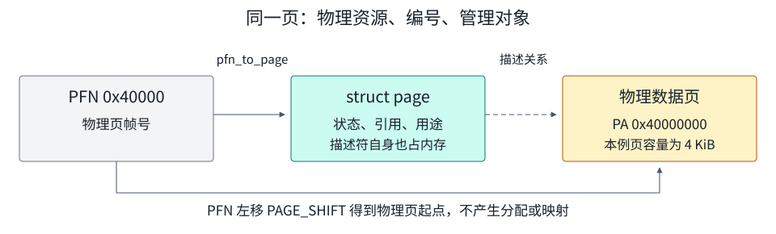
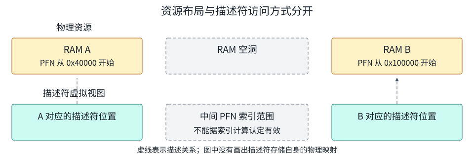
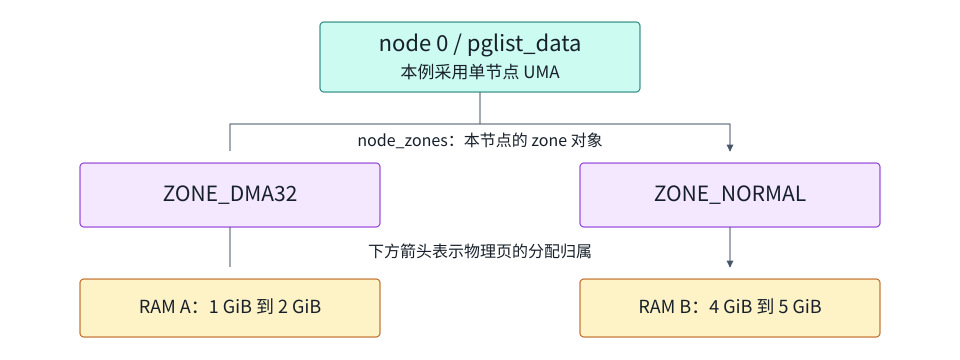
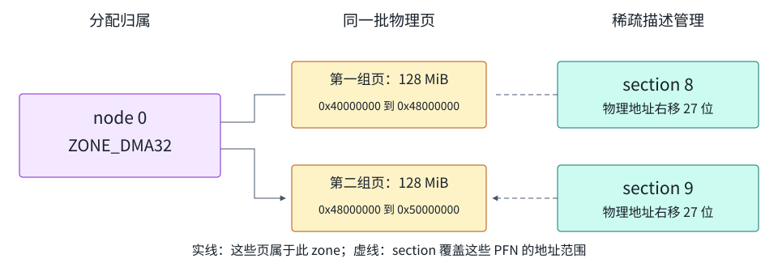
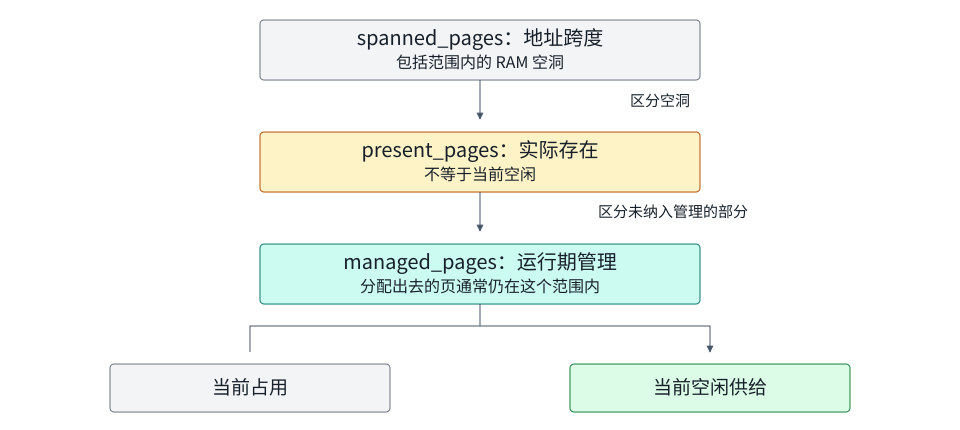
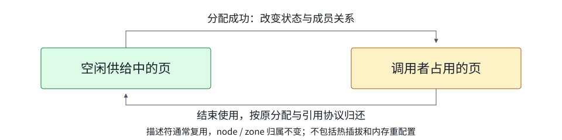

# 物理内存如何被描述与组织

理解页分配之前，先要回答：**内核面对的物理内存，究竟是一批怎样的资源？**

不能只把它看成“若干 GiB 的容量”。同样大小的两页，可能属于不同节点，处在不同分配范围，也可能一页已交给调用者，另一页仍在空闲供给中。内核必须同时知道这些信息，才能决定请求从哪里取得页。

本节沿同一批页看物理布局、描述符组织和分配归属。承接 [总览](00-overview.md)，暂不展开 Buddy 算法，先建立 [页块与对象分配](02-allocation.md) 所需模型。

基线为 Linux 6.1.158、arm64。地址布局是教学例子，基本页取 4 KiB，不代表目标芯片配置。

## 1. 物理地址范围，不等于一整块 RAM

假设一台系统有两段普通 RAM：

| 区间，左闭右开 | 含义 | 大小 |
| --- | --- | --- |
| `[0x40000000, 0x80000000)` | RAM A | 1 GiB |
| `[0x80000000, 0x100000000)` | RAM 空洞 | 2 GiB |
| `[0x100000000, 0x140000000)` | RAM B | 1 GiB |


图只画局部范围。空洞表示本例没有普通 RAM，不意味着真实平台里这些地址一定没有其他资源。

RAM 总共 2 GiB，首段起点到末段终点却跨越 4 GiB。若只记起点和长度，就无法区分 RAM 与空洞。

RAM A 内还可能有内核映像、页表和启动保留区。**地址存在、RAM 存在、纳入分配管理、当前空闲，是四件不同的事。** 先区分存在与可用，描述符和统计量才不容易混淆。

## 2. 同一页，区分资源、编号和描述符

### 2.1 PFN 不是从第一段 RAM 开始数的下标

PFN（Page Frame Number）表示物理页帧号，由物理地址计算：

```text
PFN        = 物理地址 >> PAGE_SHIFT
页内偏移   = 物理地址 & (PAGE_SIZE - 1)
物理页起点 = PFN << PAGE_SHIFT
```

本例 `PAGE_SHIFT = 12`：

```text
RAM A 第一页：物理起点 0x40000000，PFN 为 0x40000
RAM B 第一页：物理起点 0x100000000，PFN 为 0x100000
```

PFN 不会因中间没有 RAM 而压缩成连续编号。其间隔首先反映物理地址的间隔。

### 2.2 描述符保存管理信息，不是页内容

页的用途、状态、引用及与管理结构的联系保存在 `struct page`，而非把整页数据塞进结构体。



虚线表示描述关系，不表示描述符中有直接指向数据的指针。

- 读写 `page->flags`，是在访问管理状态。
- 通过有效映射读写内容，是在访问那页 RAM。
- `alloc_pages` 返回描述符指针，被分配的资源仍是物理页。

描述符也是存放在内存中的对象，管理信息同样消耗 RAM，其存储与被描述的数据页却不是同一概念。

定义在 `include/linux/mm_types.h`。其中有用途相关联合体：空闲页可使用 `buddy_list` / `pcp_list` 的位置，文件页和匿名页有相应语义。**字段不是每页同时有效的属性清单；读字段前先判断角色。**

### 2.3 转换不取得使用权

```text
已有有效 PFN → pfn_to_page → 对应描述符
已有描述符   → page_to_pfn → 对应 PFN
```

`pfn_to_page` 不会把页从空闲供给中取走。算出描述符不表示可以开始写该页。

能计算 PFN 也不说明存在普通 RAM。空洞、未上线内存或特殊页类型需要核对接口的有效性与使用条件；转换不是资源检查。

## 3. arm64 怎样组织页描述符？

### 3.1 稀疏的是资源，不必是描述符访问方式

若用物理连续大数组覆盖整个跨度，空洞也会影响管理信息开销。SPARSEMEM 按物理地址固定粒度划分 section，组织描述信息及有关存在状态。

本树 arm64 的 `ARCH_SPARSEMEM_ENABLE` 选择 `SPARSEMEM_VMEMMAP`，这里沿此实现，不展开其他模型历史。

VMEMMAP 提供按 PFN 索引的虚拟视图，资源可以分散，描述符定位仍是简单指针运算：

```c
/* include/asm-generic/memory_model.h：
 * 仅摘录 CONFIG_SPARSEMEM_VMEMMAP 分支。
 */
#define __pfn_to_page(pfn)  (vmemmap + (pfn))
#define __page_to_pfn(page) (unsigned long)((page) - vmemmap)
```

加一个 PFN，前进的是 PFN 个 `struct page` 的大小，不是数据页大小。arm64 的基址包含 `memstart_addr` 偏置，见 `arch/arm64/include/asm/pgtable.h`；不能视为从物理地址零开始填满的实际数组。



索引范围不保证都有有效映射，图也没有画描述符存储自身的物理映射。

VMEMMAP 保留按 PFN 定位的简单形式，不要求描述符存储物理连续。Section 负责稀疏组织，VMEMMAP 提供访问视图，不是互相替代的分配器。

### 3.2 Section 不是分配规格

取 4 KiB 页时，本树 arm64 的 `SECTION_SIZE_BITS = 27`，一 section 覆盖 128 MiB 地址范围，即 32768 个基本页的位置。

不代表每次分配 128 MiB，也不代表范围全部存在 RAM 或页全部空闲。

Buddy 的 order 回答空闲块包含多少基本页。**描述管理粒度与分配块大小是不同层面。**

源码：`Documentation/mm/memory-model.rst`、`arch/arm64/include/asm/sparsemem.h`。更换页配置须重新核对粒度。

## 4. 找到描述符后，怎样访问内容？

普通、具有直接映射的 arm64 RAM 页可通过 `page_address(page)` 取得内容地址：


两个指针都是内核可访问的地址，却指向不同对象。联系到同一页，不意味着相等。

这里不新建页表，也不再次分配存储，取得的是已有直接映射中的地址。普通页分配通常改变资源归属，不为每次请求重新建直接映射。

通用页访问代码还常用 `kmap_local_page` / `kunmap_local` 表达局部临时访问。本树普通 arm64 页所用的相应非 HIGHMEM 实现返回 `page_address`，不为这次调用另外寻找映射槽。接口的局部使用和配对约束仍须遵守，不能因为当前结果来自直接映射就随意改变调用者生命周期。

源码：`include/linux/mm.h` 的 `page_address`、`lowmem_page_address`，`arch/arm64/include/asm/memory.h` 的 `page_to_virt`。

本节不固定虚拟起点。转换涉及 `PAGE_OFFSET`、`PHYS_OFFSET` 和实际配置，不是任意地址减常数的算法，也不用于 DMA 地址转换。

| 视图 | 定位什么 | 用途 |
| --- | --- | --- |
| PFN | 物理页位置 | 联系物理地址与描述符 |
| VMEMMAP | 描述符 | 访问管理信息 |
| 直接映射 | 普通 RAM 页内容 | CPU 读写数据 |

## 5. Node 与 zone 为什么存在？

### 5.1 Node 回答资源位于哪里

NUMA 中，CPU 访问不同节点可能有不同成本，策略也可能限定节点。内核用 `pglist_data`，简称 pgdat，保存节点管理信息。

Node 不等于内存条或连续地址。本例采用单节点 UMA（Uniform Memory Access，一致内存访问）模型，A 和 B 都属于 node 0，空洞不要求产生新 node。

### 5.2 Zone 区分节点中的分配条件

同一节点还可能因可寻址范围等条件分别管理页。普通请求可用的页，不一定符合受限地址请求。

本例明确教学条件：启用 `CONFIG_ZONE_DMA32`，关闭 `CONFIG_ZONE_DMA`，不划出 `ZONE_MOVABLE`，两段 RAM 都纳入此节点。按本树 arm64 的边界计算：

- A 在 4 GiB 以下，属于 node 0 的 `ZONE_DMA32`。
- B 在 4 GiB 及以上，属于 node 0 的 `ZONE_NORMAL`。



这是本例，不是 arm64 固定布局，zone 跨度也可包含空洞。

Zone 是相应分配条件的物理页管理范围，不是虚拟映射区，维护空闲供给、水位等状态。不能只看全机总量忽略范围。

`ZONE_DMA32` 不专属于某设备，也不代替 DMA 分配、映射和同步契约。

### 5.3 结构体中先抓关系字段

以下为 `include/linux/mmzone.h` 删节字段，非完整结构体，原字段也不一定相邻：

```c
typedef struct pglist_data {
    struct zone node_zones[MAX_NR_ZONES];
    struct zonelist node_zonelists[MAX_ZONELISTS];
    unsigned long node_start_pfn;
    unsigned long node_present_pages;
    unsigned long node_spanned_pages;
    int node_id;
    /* ... */
} pg_data_t;

struct zone {
    struct pglist_data *zone_pgdat;
    unsigned long zone_start_pfn;
    atomic_long_t managed_pages;
    unsigned long spanned_pages;
    unsigned long present_pages;
    /* ... */
};
```

`node_zones` 是本节点对象数组，`zone_pgdat` 联系回节点。同种 zone 在不同节点有各自对象和状态。

`node_zonelists` 保存候选 zone 引用，可引用其他节点，不复制内存。实际哪些可用仍取决于请求。

由页定位 zone，可看 `include/linux/mm.h`：

```c
static inline struct zone *page_zone(const struct page *page)
{
    return &NODE_DATA(page_to_nid(page))->node_zones[page_zonenum(page)];
}
```

先找 node，再取对应 zone，不能据此推断描述符直接存有 `zone *`。

## 6. Node、zone、section 是同一层级链吗？

Node / zone 是分配归属，section 是描述管理粒度。不能简单画成 node 包含 zone、zone 包含 section、section 包含 page。

A 起始 256 MiB 同属一个 node 和 zone，同时覆盖两个 128 MiB section：



实线表示归属，虚线表示覆盖 PFN 范围，没有 zone 到 section 的包含指针。

编号由物理地址右移 27 位得到 8 和 9，不因 A 是首段而从零编号。

| 问题 | 管理概念 |
| --- | --- |
| 页位于哪个资源节点？ | Node |
| 页属于哪类分配范围？ | Zone |
| 物理范围的描述信息怎样组织？ | Section |
| PFN 怎样定位管理对象？ | VMEMMAP 与 `struct page` |

增加同节点一段 RAM 会扩展资源和描述管理，不一定增加 node；有描述符也不意味着空闲。

## 7. 纳入管理，不等于当前可分配



`spanned_pages` 包含空洞，`present_pages` 排除空洞，`managed_pages` 表示运行期页分配管理范围，都不是当前空闲页数。

整体看本例 node，跨度 4 GiB，RAM 2 GiB；拆到 zone 后各自统计，不能把节点数量当成某一 zone 的数量。

管理范围还结合保留与初始化。这里保留包括启动占用等不能直接交出的部分，不与水位、`lowmem_reserve` 或紧急供给混为一谈。

arm64 `mem_init` 调用 `memblock_free_all` 将适用页交给分配器。Managed 范围的页分配出去后通常仍属这个范围，只是不再空闲。



普通 `alloc_pages` / `__free_pages` 通常复用同一描述符，node / zone 不变，不包括热插拔或重配置。

“由页分配器管理”是范围，“当前空闲”是状态，“满足请求”还需条件。

<a id="bootmem"></a>

## 8. 这些管理结构尚未建立时，怎样分配？

### 8.1 启动分配不能依赖尚未就绪的 Buddy

页描述符、页表、节点和 zone 自身需要存储。如果它们的建立全依赖运行期分配器，初始化就形成循环依赖。

Memblock 在此时使用较简单的物理区间集合：记录哪些 RAM 已登记、哪些范围已占用，以及本次早期分配允许在哪个范围寻找。它不需要先将所有 RAM 组织成运行期空闲页块。

`memblock_region` 记录 `base / size / flags`，适用配置下还记录节点；`memblock_type` 管理一组区间。最重要的两个集合是：

```text
memblock.memory    已登记内存的区间与属性
memblock.reserved  已保留、不能重复作为早期空闲资源的区间
```

保留一个已登记范围，不等于从 memory 删除它。计算可用部分需要同时看两组集合、NOMAP 等属性和当前允许边界，不能把两组总容量相加。

### 8.2 保留与不映射约束不同


图采用独立的 16 MiB 对齐范围，以 B 为起点：

- 前 2 MiB 已保留，可以仍有适用直接映射，但不能再次提供为普通空闲存储。
- 中间 2 MiB 标记 NOMAP，不加入普通直接映射，并按相应规则排除普通供给。
- 其余 12 MiB 只是这个模型下的候选，仍需考虑管理元数据、其他保留和交接条件。

因此，“内核有地址能访问它”与“分配器能再次把它交出去”不同。也不能认为 reserved 总大小自动包含所有 NOMAP 信息；后者是区间属性，须读实际过滤路径。

### 8.3 arm64 从平台信息到运行期管理

RAM 和保留信息可以来自设备树、EFI 等平台启动信息，不固定假设所有芯片使用同一入口。登记后，`arm64_memblock_init` 进一步处理物理范围、内核映像、initrd 和适用保留。

接着看两个关键阶段：

| 阶段 | 已能处理的事情 |
| --- | --- |
| `bootmem_init` 中的 `sparse_init`、`zone_sizes_init` | 使用早期存储建立页描述信息与运行期管理范围 |
| `mem_init` 中的 `memblock_free_all` | 将适用未占用页交给运行期页分配体系 |

这是依赖关系的定位，不是完整启动调用图。早期页表、线性映射、NUMA 和条件保留也参与启动，应沿 `arch/arm64/` 的真实调用者继续追踪。

交接后，普通组件通过页或对象分配接口取得存储，不把 memblock 当作旁路物理内存分配器。某些启动占用如 init 段可能在完成使命后按专门协议释放，但不能由普通调用者随意取消保留。

### 8.4 早期 API 与运行期 API 分开理解

| 接口族 | 主要作用 |
| --- | --- |
| `memblock_add` / `memblock_reserve` | 登记 RAM 或保留范围 |
| `memblock_phys_alloc*` | 适用早期分配，返回物理地址 |
| `memblock_alloc*` | 返回适用的 CPU 地址 |
| `memblock_phys_free` / `memblock_free` | 参数地址类型与用法不同，不能混用 |
| `memblock_free_all` | 向运行期页供给交接 |

源码：`include/linux/memblock.h`、`mm/memblock.c`、`arch/arm64/mm/init.c`。先跟随区间登记、过滤和交接，深入时再进入对应启动路径；不以函数名的排列代替执行顺序。

## 9. 带着模型进入页分配

一次请求先考虑：

1. **范围**：允许从哪些 node / zone 取得？
2. **供给**：范围内有无符合条件的空闲块？
3. **使用**：怎样管理生命周期，以什么映射访问内容？

下一篇 [从页块到对象与虚拟工作区](02-allocation.md) 从供给开始讲 Buddy、PCP、SLUB 和动态区域。查询见 [API](api.md)，依据见 [核对附录](99-evidence.md#resources)。

读完应能解释：空洞不要求新节点，描述符定位不取得使用权，描述符指针不等于内容地址，归还不等于减少 managed 范围。
