# 物理页分配：从请求约束到页块供给

物理页分配器负责把可用物理内存交给调用者，并在使用者归还后重新组织资源。它交付的不是任意大小的字节对象，也不负责为某个用户地址建立映射；它解决的是：**在允许的位置，以允许的代价，取得满足数量、连续性和使用约束的物理页。**

理解时需要区分三件事：空闲页存在，符合请求的页块存在，以及当前请求被允许取得该页块。Buddy、每 CPU 页缓存、区域水位和慢路径分别参与其中不同的判断。

## 阅读说明

- 前置阅读：[内存管理总览](00-overview.md)，尤其是[物理资源组织](00-overview.md#physical-resources)与[分配体系](00-overview.md#allocation)。
- 实现基线：本地 Linux **6.1.158**、arm64 / AArch64；源码按已打 RT 补丁处理。基本页大小、最大阶覆盖、NUMA、CMA、大页及其他配置不在本文固定。
- RT 相关实现按 `CONFIG_PREEMPT_RT` 条件区分。系列调度基线不等于页分配的任何上下文都自动合法；本篇专门说明 PCP 和接口的上下文限制。
- 本文聚焦普通运行期页分配。启动管理只说明交接，回收和规整只解释分配器如何调用与判断结果，不展开它们的内部算法。
- 图中的页号、列表和水位数值用于推演，不来自目标机器观测。代码示例是独占页块的调用骨架，未编译内核或执行模块实验。

### 缩略词与术语

| 名称 | 全称或含义 | 本篇用途 |
| --- | --- | --- |
| PFN | Page Frame Number，页帧号 | 物理页位置、对齐与伙伴关系 |
| GFP | Get Free Pages | 分配位置、回收、重试及附加动作标志 |
| PCP | Per-CPU Pages | 每 CPU 页缓存；本版本支持部分低阶页块 |
| NUMA | Non-Uniform Memory Access | 节点位置、访问代价与允许范围 |
| CMA | Contiguous Memory Allocator | 受专门规则管理的连续内存区域 |
| DMA | Direct Memory Access | 设备寻址、一致性和使用要求 |
| I/O | Input/Output | 允许的数据传输与压力处理行为 |
| OOM | Out Of Memory | 适用请求和范围中的耗尽处理 |
| RT | Real-Time | 实时抢占分支及其锁语义 |
| NMI | Non-Maskable Interrupt | 不可屏蔽中断，涉及严格上下文边界 |
| THP | Transparent Huge Pages | 透明大页，影响某些 PCP 和分配路径 |
| `order` | 页块阶数 | 一个块有 `2^order` 个基本页 |
| `migratetype` | 流动性 / 迁移类型 | 区分可移动、不可移动、可回收及特殊类别 |
| `pageblock` | 页块级分类单位 | 保存区域流动性标记，不等同于每次请求的 order |
| `zonelist` | 候选 Zone 列表 | 位置搜索与允许的回退 |
| `memcg` | memory cgroup，内存控制组 | 在适用分配上记账并施加限制 |

<a id="position"></a>
## 1. 定位、职责与问题

### 1.1 交付物是物理页块

`alloc_pages(gfp, order)` 成功时返回页块首个基本页的 `struct page *`。块中包含 `2^order` 个连续物理页，首地址按块大小自然对齐。返回值是描述符，不是可直接进行字节读写的 CPU 地址。

这些页可以成为内核对象缓存的后备、用户匿名数据、页缓存或页表。它们后续的引用、映射、数据状态和资源归属由相应使用者继续管理。

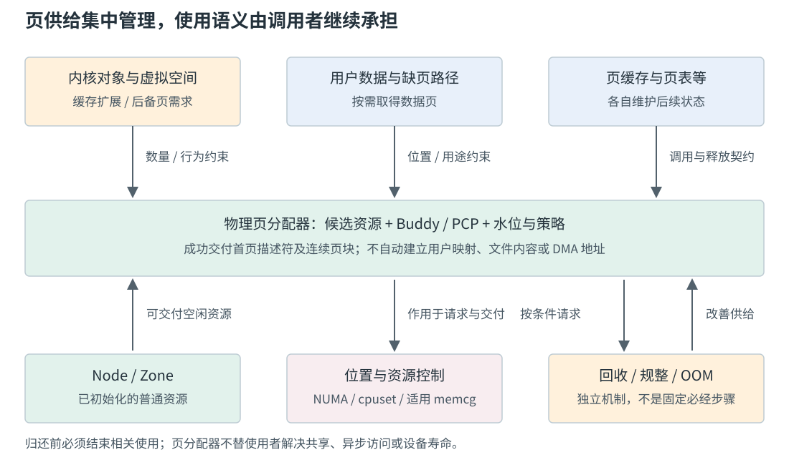

图 1：各使用者在需要时提出页请求；分配器从管理好的资源取得页。回收、规整提供压力处理能力，但不替代分配器的最终检查。

### 1.2 为什么集中提供页供给

不同使用者都需要页，但不应各自追踪全部空闲内存和实现位置选择。分配器集中组织资源，使用者表达需求，并承担成功后的管理责任。

这条边界也解释了接口选择：小对象优先考虑 slab 类接口；仅要求较大虚拟连续范围的需求可能使用 `vmalloc()`；DMA 需求还必须遵循设备接口。物理连续不会自动带来用户映射、文件内容或设备 DMA 地址。

### 1.3 本篇的边界

本文覆盖普通页块分配与归还、Buddy/PCP、位置和水位判断、快慢路径及主要接口。CMA 专用分配、迁移实现、页缓存回收、大页管理和设备映射由各自专题承接。

运行期页分配器从启动管理接收可交付空闲页，不会把全部保留区都自动当作普通资源；这里不重新展开 memblock 初始化。

<a id="organization"></a>
## 2. 整体组成与关键对象

### 2.1 请求包含五个维度

| 维度 | 代表性输入 | 影响的决策 |
| --- | --- | --- |
| 数量与连续性 | `order` | 块大小、PCP 资格、重试成本 |
| 位置 | 首选节点、nodemask、cpuset、内存策略 | 搜索起点、允许节点和回退范围 |
| 用途与流动性 | GFP 区域标志、`__GFP_MOVABLE` 等 | 最高可用 Zone、优先分类和特殊区域资格 |
| 允许的操作 | 直接回收、I/O、文件系统等 GFP 标志 | 能否等待、回收或进行适用规整 |
| 失败与附加动作 | 重试、清零、复合页、记账 | 尝试力度、交付前准备与清理 |

GFP 不是“优先级数字”。某些位选择资源，某些位描述行为，另一些影响交付状态；任务作用域、系统阶段和构建配置也会改变实际行为。

### 2.2 Node、Zone、Buddy 与 PCP

Node 描述节点级位置与资源，Zone 按用途和约束组织页。一个 Zone 内，Buddy 按 order 与迁移类型管理空闲块，PCP 则维护各 CPU 的局部缓存。

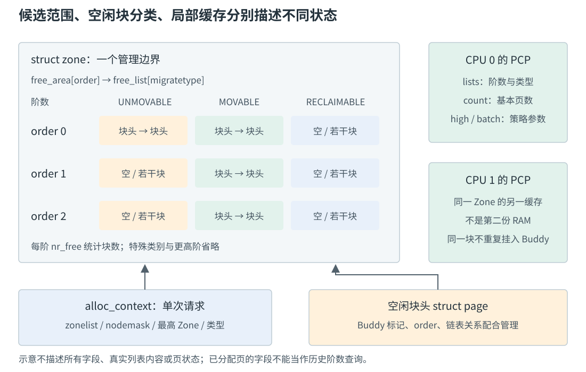

图 2：资源范围、列表分类和局部缓存是不同层次。`alloc_context` 是单次分配工作状态，不是永久保存资源的分配器对象。

| 对象 / 字段 | 作用 | 容易混淆的地方 |
| --- | --- | --- |
| `struct zone` | 空闲资源、PCP、锁、水位、保留量和统计的边界 | 不是 RAM 的额外副本 |
| `zone->free_area[order]` | 对应阶数的 Buddy 空闲块组织 | 不同时登记一个大块的全部子块 |
| `free_list[migratetype]` | 对应分类的空闲块链表 | 不是已使用页的完整归属表 |
| `free_area.nr_free` | 该阶的空闲块数量 | 单位是块，不是基本页 |
| `struct page` 的空闲块头状态 | `PageBuddy`、链表关系和记录的 order | 不能对任意已分配页当作历史 order 查询 |
| `struct per_cpu_pages` | 局部列表、`count`、`high`、`batch` | 不意味着无锁或 CPU 永久独占资源 |
| `struct alloc_context` | 候选列表、掩码、最高 Zone、迁移类型等 | 不由普通调用者自行构造 |

`PageBuddy` 标记 Buddy 空闲块的头页，大块内部各页不都作为独立节点重复登记。页进入 PCP 后，也不同时作为同一块挂在 Buddy 里；只看 `free_area` 不能覆盖局部缓存资源。[依据 A1、A2](#source-objects)

### 2.3 位置选择：先有搜索顺序，再筛选合法候选

“最高允许 Zone”是**区域索引上界**，不是唯一目标 Zone。候选由三层规则共同决定：

1. `zonelist` 给出搜索顺序，首选节点影响起点；允许跨节点回退的列表可以包含其他节点。
2. `highest_zoneidx` 排除索引高于上界的区域，较低索引区域仍可能成为候选，但有相应保留保护。
3. nodemask 与适用 cpuset 等限制进一步筛选节点，随后还要经过水位、类型和真正取页等判断。

以假设存在的两个节点为例，列表依次包含每个节点的 MOVABLE、NORMAL、DMA32 区域。普通请求无特殊保留覆盖，首选节点为 N0，若上界是 NORMAL，MOVABLE 会被跳过，并不是跳过后就不能尝试其他区域。

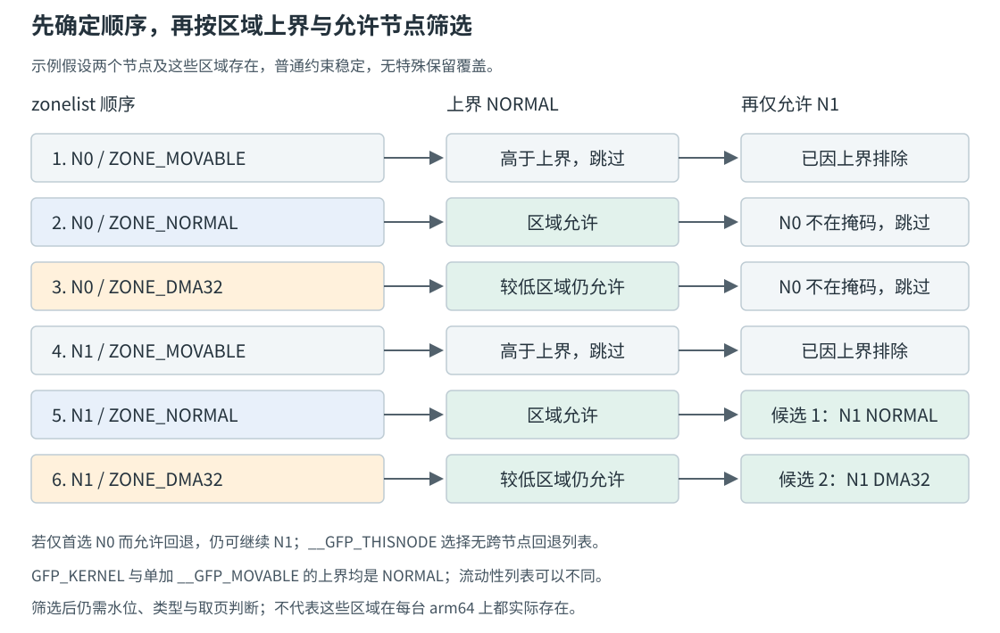

图 2a：这里假设示意区域确实存在，列表和限制稳定；不代表每台 arm64 都有这些区域或采用完全相同布局。

| 示例条件 | 筛选后的顺序 | 解释 |
| --- | --- | --- |
| 上界 NORMAL，允许 N0/N1 | N0 NORMAL → N0 DMA32 → N1 NORMAL → N1 DMA32 | 上界不是只准使用 NORMAL |
| 上界 NORMAL，nodemask 只允许 N1 | N1 NORMAL → N1 DMA32 | 首选 N0 不代表一定从 N0 取得页 |
| 上界 NORMAL，普通节点限制的交集为空 | 无可用候选 | 别处空闲资源不自动满足当前请求 |
| 首选 N0 并使用 `__GFP_THISNODE` | 仅在 N0 列表中按上界继续筛选 | 禁止跨节点回退，不等于取消区域筛选 |

GFP 的“流动性”和“区域选择”又需分开。本地按流动性分组启用的普通条件下：

| 标志组合 | `gfp_zone()` 得到的上界 | 普通迁移类型 |
| --- | --- | --- |
| `GFP_KERNEL` | `ZONE_NORMAL` | `MIGRATE_UNMOVABLE` |
| `GFP_KERNEL | __GFP_MOVABLE` | 仍为 `ZONE_NORMAL` | `MIGRATE_MOVABLE` |
| `GFP_HIGHUSER_MOVABLE` | `ZONE_MOVABLE` | `MIGRATE_MOVABLE` |

最后一项包含 `__GFP_HIGHMEM` 与 `__GFP_MOVABLE` 的组合，因此改变区域表结果；它不意味着 arm64 具有 `ZONE_HIGHMEM`。单加 `__GFP_MOVABLE` 不会自动把 Zone 上界改为 MOVABLE。

`__GFP_THISNODE` 在 NUMA 构建下选择无跨节点回退的 zonelist。普通任务策略、cpuset 和特殊保留有各自适用条件，不能把上述示例当作所有高优先级请求都严格执行同一交集的承诺；本例不展开那些覆盖规则。[依据 A2、A7](#source-fast)

<a id="principles"></a>
## 3. 核心原理与决策规则

<a id="buddy"></a>
### 3.1 order 与伙伴：确定的组织换来确定的定位

一个首 PFN 为 `p`、order 为 `o` 的块覆盖 `[p, p + 2^o)`，首 PFN 满足块大小对齐，低 `o` 位为零。同阶伙伴是同一更大块的另一半：

```text
buddy_pfn = p ^ (1UL << o)
```

为什么只翻转这一位？低 `o` 位确定块内偏移，第 `o` 位区分一个 order-`o+1` 父块的左右两半。翻转它即可定位另一半，不需要搜索全部空闲块。

例如，order-1 的 `[8, 10)` 与 `[10, 12)` 是伙伴；`[12, 14)` 的伙伴则是 `[14, 16)`。`[10, 12)` 与 `[12, 14)` 虽然相邻，却分属两个父块，不能按伙伴直接合并。

这种组织便于按阶查找和验证，但也限定了块大小和对齐：不能将任意相邻区间直接合成任意长度。不同寿命和流动性的使用混放，还会留下高阶请求难以利用的碎片。

### 3.2 拆分：沿用 PFN 8–15 推演

下面只考察一个 Zone、一个普通迁移类型下的 Buddy，暂不引入 PCP、水位、特殊边界和并发；不表示仅有八页的真实 Zone 一定允许分配。

初始只有 order-3 空闲块 `[8, 16)`，现在请求 order-1：

1. 本阶无块，向更高阶寻找，找到 order-3。
2. 删除原块，拆为两个 order-2 块。
3. 保留低地址半块继续拆，把 `[12, 16)` 放回 order-2。
4. 把 `[8, 12)` 再拆一层，将 `[10, 12)` 放回 order-1。
5. 将 `[8, 10)` 交付调用者。

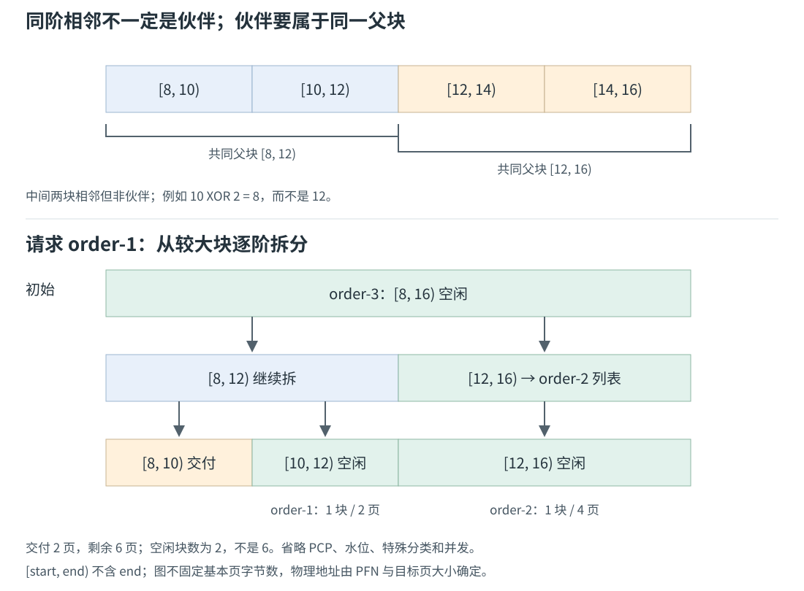

图 3：相同范围在不同阶段按不同阶组织。一块空闲内存只以当前块头和阶数挂入对应列表。

| 分配后的列表 | 块 | `nr_free` | 基本页数 |
| --- | --- | --- | --- |
| order-1 | `[10, 12)` | 1 | 2 |
| order-2 | `[12, 16)` | 1 | 4 |
| order-3 | 空 | 0 | 0 |

调用者得到 2 页，Buddy 剩余 6 页，但空闲块数为 2。`__rmqueue_smallest()` 从请求阶向上寻找当前类型的块，删除后调用 `expand()` 处理余块；它不是扫描全部地址求全局最佳匹配，外层还可能处理类型回退。[依据 A3](#source-buddy)

### 3.3 合并：候选位置不等于可合并状态

再把 `[10, 12)` 分配给第二个调用者。此时两个 order-1 块都在使用，只有 `[12, 16)` 空闲。

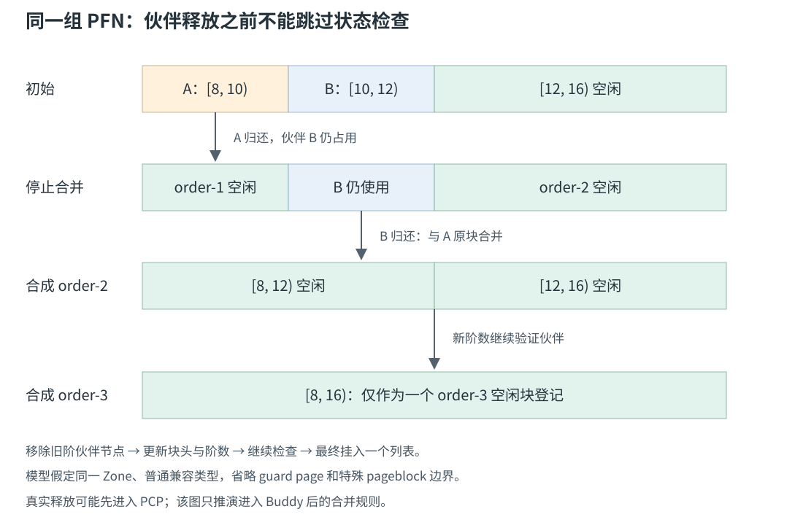

图 4：第一次归还时伙伴在使用；第二次归还后，伙伴关系连续成立，才能恢复大块。

- 先归还 `[8, 10)`：伙伴尚未空闲，停止合并，登记 order-1。
- 再归还 `[10, 12)`：移除空闲伙伴 `[8, 10)`，合为 `[8, 12)`。
- 新块变成 order-2，再与 `[12, 16)` 合为 order-3。

异或只给候选位置。实现还检查地址/描述信息合法、Buddy 空闲状态、相同 order、同一 Zone，以及跨 pageblock 时的分类边界。调试 guard page 又有专门处理，不能把简化模型当作全部分支。

合并必须先移除旧列表节点，再更新块头和阶数，最后只登记新块，否则会重复分配同一内存。`find_buddy_page_pfn()` / `page_is_buddy()` 定位和验证伙伴，`__free_one_page()` 逐阶合并。读取这些状态需要保护，无锁观察 `PageBuddy` 不等于拿到使用许可。[依据 A3](#source-buddy)

<a id="mobility"></a>
### 3.4 迁移类型：减少混放，不承诺绝对可移动

少量不可移动对象散落在较大范围中，就可能阻止其他空闲页形成大块。迁移类型尽量集中相近流动性的分配，减少这种混放。

普通类型包括不可移动、可移动和可回收；CMA、隔离、高优先级原子分配保留等类型另有规则。pageblock 保存区域级分类，空闲列表保存对应块；它与单次请求 order 是不同维度。

首选普通类型不足时可以按规则回退，并可能调整区域分类。这增加了供给机会，也带来混放代价，不是所有类别都永不借用的硬分区。`__GFP_MOVABLE` 也不会凭空建立迁移协议，实际使用者、映射和 pin 仍影响移动条件。

**`MIGRATE_MOVABLE` 不等于 `ZONE_MOVABLE`**：前者是流动性分类，可在普通 Zone 中出现；后者是 Zone 类型，由第 2.3 节的区域选择规则决定是否使用。

普通类型在同一候选阶数上的回退顺序为：

| 请求类型 | 第一回退类型 | 第二回退类型 |
| --- | --- | --- |
| UNMOVABLE | RECLAIMABLE | MOVABLE |
| MOVABLE | RECLAIMABLE | UNMOVABLE |
| RECLAIMABLE | UNMOVABLE | MOVABLE |

这不等于“先在全部阶数找第一类型，再找第二类型”。`__rmqueue_smallest()` 的本类型查找从请求阶向上；`__rmqueue_fallback()` 通常**先从大阶向下**，在当前阶按表查回退类型。源码用大块近似寻找空闲资源较集中的 pageblock，尽量减少跨多个区域混放。

下面重置初始状态，仍用 `[8, 16)` 推演。这次只观察 Buddy 回退阶段，排除 PCP、水位、CMA、HIGHATOMIC、隔离、`ALLOC_NOFRAGMENT` 和并发。为缩小图示，假设 `pageblock_order = 3`，且支持更高阶；这不是目标 arm64 的默认参数。

- 请求 UNMOVABLE 的 order-1 块，本类型所有适用列表为空。
- RECLAIMABLE 只有小块 `[24, 26)`；MOVABLE 有一个 order-3 块 `[8, 16)`；更大候选为空。
- 从大阶向下到 order-3，该阶 RECLAIMABLE 空，MOVABLE 非空，选 `[8, 16)`。虽然另有较小 RECLAIMABLE 块，也不会先跳到低阶使用它。
- 候选阶数覆盖整个 pageblock，`steal_suitable_fallback()` 把对应 pageblock 标记改成 UNMOVABLE，并把该空闲块移入本类型列表。
- 返回本类型查找，再把 `[8, 16)` 拆成所需 order-1：交付 `[8, 10)`，余下 `[10, 12)`、`[12, 16)` 登记为 UNMOVABLE。原 RECLAIMABLE 小块不变。

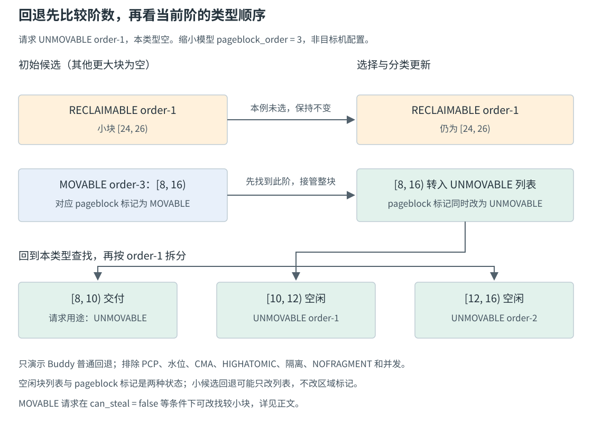

图 4a：示例同时改变了两种分类状态：当前空闲块所在列表，以及 pageblock 标记。不是把所有原已使用页直接改造成可移动或不可移动数据。

候选小于 pageblock 时，两种状态不总一起改变：

| 情况 | 空闲列表变化 | pageblock 标记 |
| --- | --- | --- |
| 不尝试接管整个区域或只能处理单块 | 把选中空闲块移到目标类型 | 可以保持原类型 |
| 允许尝试区域内更多空闲页 | `move_freepages_block()` 转移适用空闲块 | 普通启用分组条件下，相关空闲页与兼容页之和达到半个 pageblock 时才改；区域边界等还可阻止处理 |
| 候选覆盖完整 pageblock 或多个 pageblock | 转移选中块，后续按本类型拆分 | 修改相应覆盖范围的标记 |

`can_steal` 表示允许的尝试，不证明区域内所有已使用数据都能迁移。还有 MOVABLE 例外：在选择候选时若 `can_steal = false`，请求类型为 MOVABLE，且候选阶数大于请求阶数，会转去从小阶向上寻找回退块；不是先接管失败，再执行这个分支。特殊类别、兼容页计数和启发式完整细节不在这里穷举。[依据 A3、A4](#source-mobility)

<a id="pcp"></a>
### 3.5 PCP：以批量交接减少共享操作

每次小分配和归还都改 Buddy，会使各 CPU 频繁竞争区域锁。PCP 让符合条件的块暂存在当前 CPU：从局部列表取块，缺少时从 Buddy 批量补充，归还达到策略条件时批量回流。

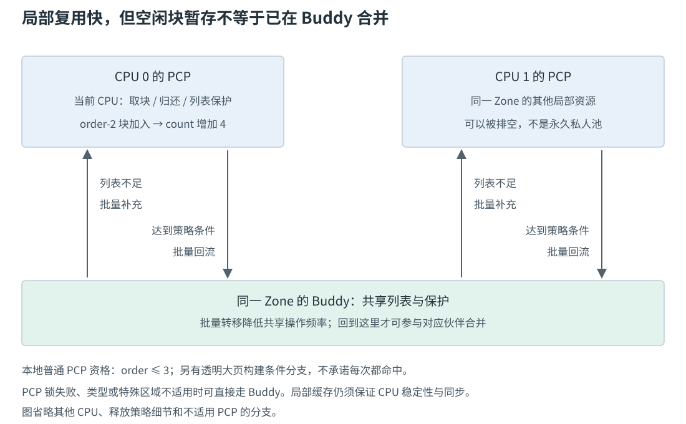

图 5：局部缓存不扩大允许 Zone，也不保证完全无锁。它改善共享操作频率，但暂存资源不立即参与 Buddy 合并。

本地 `pcp_allowed_order()` 允许 order 不大于 `PAGE_ALLOC_COSTLY_ORDER` 的块使用 PCP，该常量为 3；启用透明大页相关构建时还有特定 order 分支。所以不能写成“PCP 永远只缓存 order-0”。

`count` 按基本页计数，一个 order-2 块增加 4 而不是 1；补充时 `batch` 结合 order 换算，也不能对所有阶都解释为同样块数。

还要分清**PCP 的 `count` 与水位使用的 `NR_FREE_PAGES`**。本地普通区域路径中，后者是 Buddy 一侧的空闲页统计，不包含 PCP 暂存页；“这页无人使用”不意味着它已经计入这个水位口径。

以一个合法 order-2 块在两侧移动为例，省略损坏页检查失败、特殊分类和统计延迟：

| 转移 | Buddy 侧 `NR_FREE_PAGES` | 当前 PCP `count` |
| --- | --- | --- |
| Buddy → PCP 补充一个块 | 减少 4 | 增加 4 |
| PCP → 调用者 | 不因这次局部取用再减少 | 减少 4 |
| 调用者 → PCP 归还 | 不因局部暂存就增加 | 增加 4 |
| PCP → Buddy 回流 | 增加 4 | 减少 4 |

因此局部缓存中存在可取块，不保证分配已经能通过上游 Zone 检查。第 3.6 节进一步演示这个衔接。实际 vmstat 有局部累计和刷新，不能把表格理解为任意 `/proc` 采样都立即精确同步。

缓存暂存还会影响连续性：刚归还 PCP 的块未必立即在 Buddy 中合并。适用路径排空缓存或控制保留量，高阶归还有减轻碎片的策略；PCP 锁获取失败和特殊区域资格又可能使请求转向 Buddy，而非立刻判定整机耗尽。[依据 A5](#source-pcp)

<a id="watermarks"></a>
### 3.6 水位与保留：有资源，也要维持后续供给

若普通请求耗尽全部资源，负责回收和 I/O 的路径反而可能失去继续前进所需内存。水位与保留用于限制当前取页力度，并协调补充资源。

普通首次尝试使用较保守的 `low` 尺度，慢路径重新计算标志，通常转向 `min` 及适用保留资格；后台回收一般围绕恢复更充足空闲量展开。本地还有 `WMARK_PROMO`、水位提升等条件，三个常见名称不是全部模式的固定流程。

`lowmem_reserve[highest_zoneidx]` 保护更受约束区域，避免能使用较高区域的需求过度消耗它。它不是另一个地址池，也不是 PCP 的 `high` 参数。

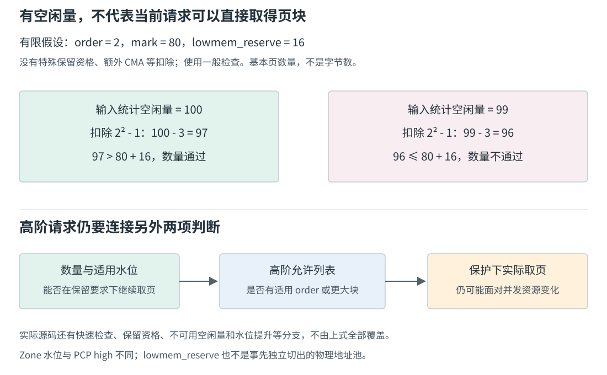

图 6：先推演一个有限假设下的数量判断，再连接块和竞争条件，不把算式当成全部水位分支的统一公式。

没有特殊保留资格、没有额外 CMA 等扣除，采用一般检查时：

```text
order = 2，mark = 80，lowmem_reserve = 16
order 相关扣除 = 2^2 - 1 = 3

输入空闲量 100：100 - 3 = 97；97 > 80 + 16，数量检查通过
输入空闲量  99： 99 - 3 = 96；96 <= 80 + 16，数量检查不通过
```

数量通过不证明 order-2 块存在。这里的一般高阶检查扫描 **Buddy 的 `free_area[order…]`，不是 PCP 列表**；`get_page_from_freelist()` 先作这项检查，之后才进入 `rmqueue()` 及其 PCP 尝试。真正取页又在保护下执行，资源可能在两次检查间被其他 CPU 取走。

沿用上面 mark/reserve 的数值，再设置一个统计稳定、无特殊保留覆盖、无节点回收和并发变化的场景：

- Buddy 侧统计为 100 页，但允许类别的空闲块都只有 order-0/1，没有 order-2 及更大块。
- 当前 CPU 的 PCP 恰有一个与请求迁移类型兼容的 order-2 块，`count = 4`。
- 数量判断仍通过，但 Buddy 高阶列表检查失败；首次候选路径跳过此 Zone，**不会因为 PCP 有块就绕过上游检查**。
- 若后续适用路径把这个 PCP 块排回 Buddy，统计可变为 104 页，且出现 order-2 块。在其他条件不变时，两项检查才都可通过。

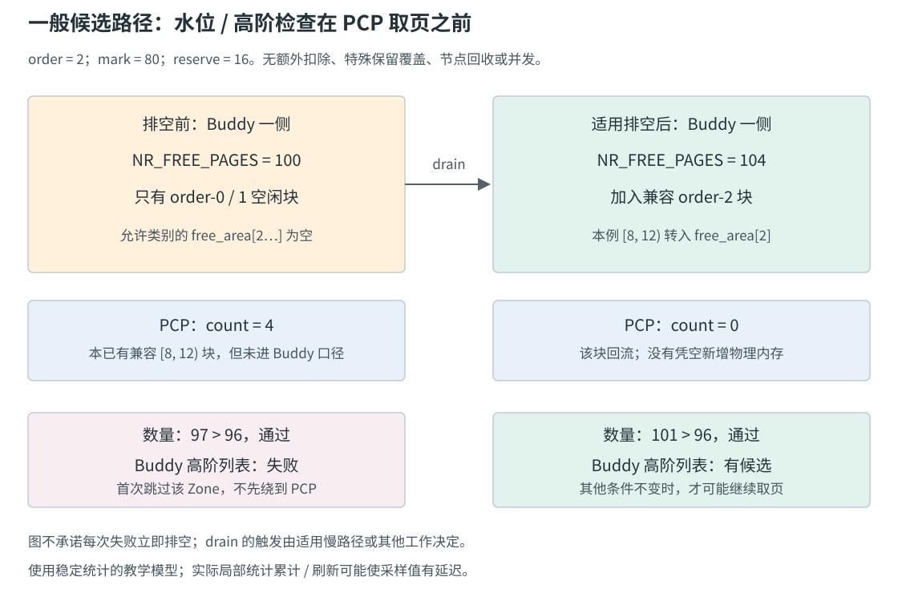

图 6a：排空把资源重新暴露给 Buddy 统计与列表。图不表示每次失败都立即执行 drain；真正是否排空仍由相应慢路径和其他工作决定。

这也解释了为什么不能把 PCP 简化成“任何时候都先取局部块，再检查整个 Zone”。某些允许忽略常规水位的特殊路径又有不同资格，不能从本例反推绝对规则。

不允许使用的 CMA 页、高优先级保留和其他授权会改变扣除或力度。**水位、连续性、位置资格和并发取页需要配合，不能互相替代。**[依据 A6](#source-watermarks)

<a id="processes"></a>
## 4. 主要工作过程与协作

<a id="fast-path"></a>
### 4.1 从公开接口到首次尝试

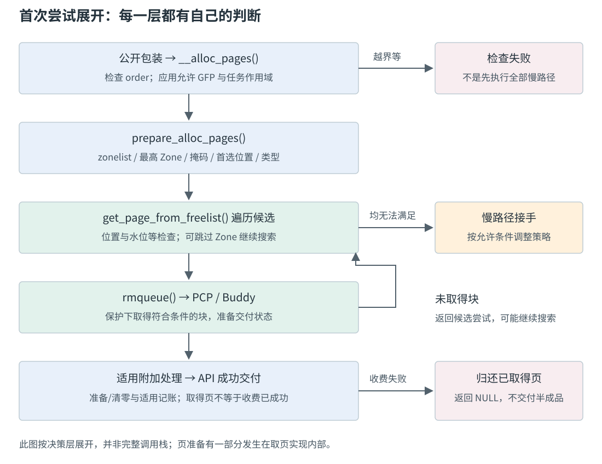

图 7：取得页后仍有状态准备和适用记账；记账失败可能归还页，因此底层取页与 API 成功有区别。

`alloc_pages()` 在 NUMA 构建下根据适用任务策略等确定起始位置和掩码；非 NUMA 构建走头文件包装，最终核心入口为 `__alloc_pages()`。

1. 检查 order 小于 `MAX_ORDER`，应用系统允许标志与任务作用域限制。
2. `prepare_alloc_pages()` 建立最高 Zone、zonelist、nodemask、首选位置和迁移类型。
3. `get_page_from_freelist()` 遍历候选，检查位置、水位等条件。失败可先跳过该 Zone，不一定立即直接回收。
4. `rmqueue()` 在资格和状态允许时使用 PCP，否则尝试 Buddy。
5. 对取得页执行准备与附加动作，再完成适用记账和最终返回。

本地 `__alloc_pages()` 对适用 `__GFP_ACCOUNT` 内核页还可进行 memcg 收费，失败会归还页并返回 `NULL`。用户匿名页等还有所属路径的记账机制，不能统统归到这里。

“fast path”不代表常数时间、无锁或不会失败：它可遍历候选，PCP 补充也可进入共享 Buddy。[依据 A7](#source-fast)

<a id="slow-path"></a>
### 4.2 慢路径按条件增加尝试力度

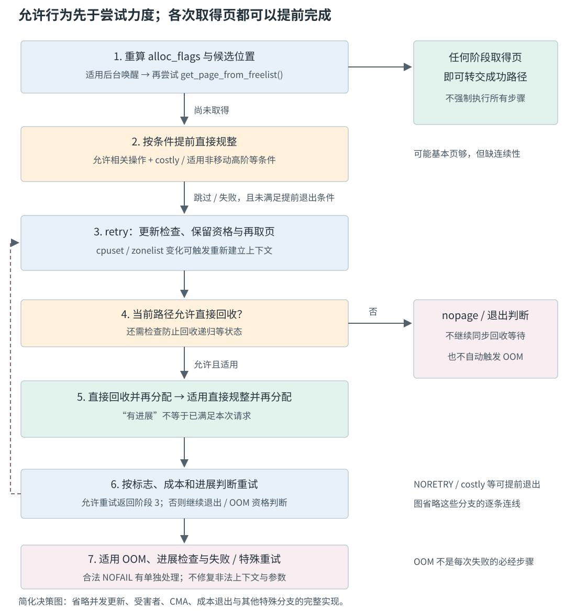

图 8：保留主要顺序与条件，不逐项复制全部 `goto`。每次取页成功都可提前完成，位置配置变化也可使上下文重新建立。

首先重新计算标志和候选，按资格唤醒后台工作，再取一次页。适用水位更宽或资源状态变化时，可能直接成功，无需回收。

允许直接回收且允许规整，并满足 costly 或适用非移动高阶等条件时，可能**提前规整**。这种请求可能基本页已足够，难点在连续性，先回收更多页未必最有帮助。

重试阶段处理位置更新、适用保留和再次取页。调用者不允许直接回收时，不能继续下面的同步压力工作；`PF_MEMALLOC` 等也有防止递归的条件。

允许继续时，可直接回收并再分配，再尝试适用直接规整。回收“有进展”不保证当前 order 满足，规整也不能跳过最终取页。

之后按标志与进展判断是否重试，符合条件才进入可能的 OOM 处理，并重新检查位置变化、受害任务等状态。它不是“回收 → 规整 → 杀进程”的无条件流水线。[依据 A8](#source-slow)

### 4.3 同样失败，后续行为可以不同

| 请求示例 | 首次失败后的主要边界 | 原因 |
| --- | --- | --- |
| `alloc_pages(GFP_NOWAIT, 0)` | 可有适用后台唤醒、重算和再取页，但不直接回收等待 | 允许行为限制后续操作 |
| `alloc_pages(GFP_KERNEL, 0)` | 允许直接回收，通常积极维持供给；适用时可 OOM，仍需检查失败 | 低阶默认策略不是绝对成功契约 |
| `alloc_pages(GFP_KERNEL | __GFP_NORETRY, 4)` | 属 costly，可先适用规整；满足退出条件时较早失败，不直接触发 OOM killer | 避免为高成本需求无限扰动系统 |

这只是决策边界，不承诺目标机进入同一分支。可选功能、任务状态、保留资格和并发变化都影响结果。

<a id="allocation-to-compound"></a>
**成功后，页块还要按用途初始化。** order 2 表示四个连续基本页，不表示后三页天然是 compound tail。本树普通 `__alloc_pages()` 路径经 `prep_new_page()`，在 `order > 0` 且带 `__GFP_COMP` 时才调用 `prep_compound_page()` 建立 head/tail 关系。两次请求可以拿到等大的连续块，但描述符协议不同。伙伴拆分负责**取得物理块**，`prep_new_page()` 负责**交付前的状态转换**。外部全链路和 Buddy 分步图见[资料对照表](reference-reading.md#physical)。

<a id="release"></a>
### 4.4 归还先结束使用，再回到资源组织

独占普通页块的调用者保存首 `struct page *` 与原 order，结束使用后调用 `__free_pages()`；不能拿任意附近地址或猜测阶数释放。

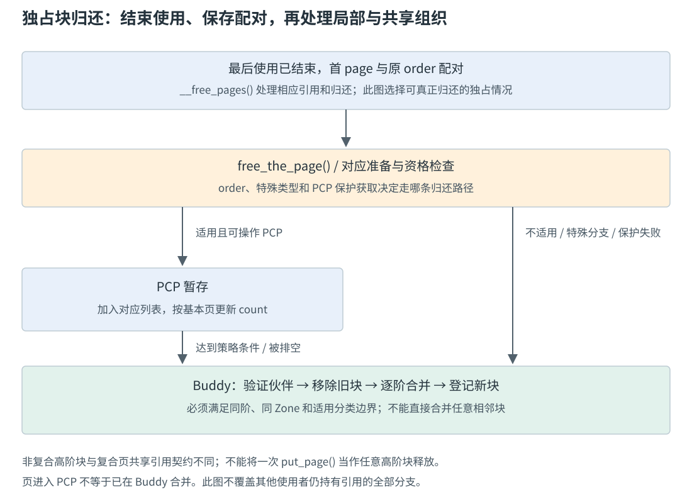

图 9：选择最后使用者归还独占块的路径。一般共享引用、复合页和其他使用者尚未退出时，不能仅按此简化图处理。

适用 order 优先尝试 PCP，达到条件后批量归还 Buddy；不适用、隔离等特殊情况或保护获取失败时走对应直接归还路径。进入 Buddy 才执行伙伴合并，所以刚归还并不保证高阶统计立即增加。

**高阶连续块不自动等于复合页（compound page）。** 独占非复合块保存 order 配对归还；若依赖头页引用维持整块共享寿命，需要合适复合页/folio 契约，不能把一次 `put_page()` 当作任意高阶块的释放替代品。[依据 A9](#source-free)

<a id="implementation"></a>
## 5. 源码实现与关键约束

### 5.1 函数对应不同决策层

| 层次 | 主要入口 | 阅读时追问 |
| --- | --- | --- |
| 公开接口与位置策略 | `alloc_pages()`、`alloc_pages_node()` | 首选与强制位置如何区分 |
| 主入口与请求准备 | `__alloc_pages()`、`prepare_alloc_pages()` | 输入与作用域如何形成工作上下文 |
| 候选选择 | `get_page_from_freelist()` | 为何跳过 Zone，何时允许取页 |
| 局部与共享切换 | `rmqueue()`、`rmqueue_pcplist()`、`rmqueue_buddy()` | PCP 资格和失败后备 |
| 列表与拆分 | `__rmqueue()`、`__rmqueue_smallest()`、`expand()` | 阶数、类型与余块处理 |
| 压力协调 | `__alloc_pages_slowpath()` | 哪些动作禁止，何时重试或退出 |
| 归还合并 | `__free_pages()`、`free_unref_page()`、`__free_one_page()` | 引用、缓存与伙伴怎样交接 |

节选 `__rmqueue_smallest()` 核心逻辑，省略跟踪语句；结合图 3，不重复整套推演：

```c
for (current_order = order; current_order < MAX_ORDER; ++current_order) {
    area = &zone->free_area[current_order];
    page = get_page_from_free_area(area, migratetype);
    if (!page)
        continue;
    del_page_from_free_list(page, zone, current_order);
    expand(zone, page, order, current_order, migratetype);
    set_pcppage_migratetype(page, migratetype);
    return page;
}
```

这段只解释查找方向和余块处理，不表示锁可省略，也不覆盖类型回退、Zone 筛选或记账。

### 5.2 列表、阶数与统计同步变化

同一块不能处于两个可分配列表，记录阶数不能与块范围不符。取块、拆分和合并在区域保护下协调链表、块头状态及统计；调用者不应自行修改这些内部字段。

水位检查没有对候选作长期预约，保护下取页仍可发现资源变化。观察到空闲不等于已经拥有它。

### 5.3 PCP 的位置稳定性与 RT

取得当前 CPU 的 PCP 指针后，需要避免迁移导致错误使用，并保护并发列表修改。本地 `pcpu_task_pin()` 非 RT 使用 `preempt_disable()`，RT 使用 `migrate_disable()`，再配合 PCP 的 `spinlock_t`。

位置稳定与锁互不替代：`migrate_disable()` 不阻止其他访问修改列表，PCP 还面对 trylock、远程排空和重入条件。每 CPU 数据不等于无需同步的数据。

实时抢占构建与任务的实时调度策略也不是同一条件。本地 `gfp_to_alloc_flags()` 对适用任务上下文中的 `rt_task(current)` 另有保留资格处理，不能推导为“启用 RT 后所有分配都可使用保留”或“所有路径都不能睡眠”。

### 5.4 上下文与回收递归

直接回收可进入其他子系统并等待，调用者若持有其所需资源可能形成递归依赖。除显式 GFP 外，`memalloc_nofs_save()` / `restore()` 与 no-I/O 作用域等限制可以覆盖后续嵌套分配。

本版本 `gfp_types.h` 特别提醒：`GFP_ATOMIC` / `GFP_NOWAIT` 当前实现不支持 NMI 和某些严格非抢占上下文，例如持有 raw spinlock；`__free_pages()` 注释也排除 NMI 和 raw spinlock 上下文。不能靠一句“原子上下文用 GFP_ATOMIC”推断 RT 下任何调用都合法。

先核对上下文、锁与实际路径，再选 GFP；不支持调用的关键路径可能需要此前准备资源，而不是增强标志。[依据 A5、A9、A10](#source-context)

<a id="api"></a>
## 6. 接口与使用

### 6.1 主要接口及配对

| 接口 | 成功 / 失败 | 关键契约 | 释放 |
| --- | --- | --- | --- |
| `alloc_pages(gfp_t gfp, unsigned int order)` | 首 `struct page *` / `NULL` | 二次幂数量连续页，保存 order | `__free_pages(page, order)` |
| `alloc_page(gfp)` | `struct page *` / `NULL` | order-0 包装 | `__free_page(page)` |
| `alloc_pages_node(int nid, gfp_t gfp, unsigned int order)` | 首页 / `NULL` | 合法在线首选节点；`NUMA_NO_NODE` 有默认处理，不单凭名字禁止回退 | `__free_pages(page, order)` |
| `__get_free_pages(gfp_t gfp, unsigned int order)` | `unsigned long` 内核地址 / `0` | 可直接访问连续页，不是用户或 DMA 地址 | `free_pages(addr, order)` |
| `get_zeroed_page(gfp_t gfp)` | 内核地址 / `0` | 一个清零基本页 | `free_page(addr)` |
| `alloc_pages_exact(size_t size, gfp_t gfp)` | `void *` / `NULL` | 最少整页，仍需取得足够连续块；不使用 `__GFP_COMP` 等不适用标志 | `free_pages_exact(addr, size)` |

“exact”不是字节级物理分配。申请 3 页仍可先取得 4 页块再归还多余页，失败难度不直接等同于三个独立 order-0。释放传原 size，不能改用 order 接口猜测。

固定节点还需理解 `__GFP_THISNODE` 等契约，其他节点有资源时也可失败。设备需求使用 DMA API，不将 CPU 地址直接当作设备地址。[依据 A11](#source-api)

### 6.2 GFP 选择与职责

| 组合 / 标志 | 主要含义 | 易误解之处 |
| --- | --- | --- |
| `GFP_KERNEL` | 常见内核分配，可直接回收 | 可睡眠，不是只取“内核专用池” |
| `GFP_KERNEL_ACCOUNT` | 适用内核分配附加记账 | 不是全部用户页记账入口 |
| `GFP_NOWAIT` | 不直接回收等待，可有后台唤醒 | 不保证成功，不跳过上下文检查 |
| `GFP_ATOMIC` | 适用上下文中无直接回收，具有部分保留资格 | 不是成功保证或 NMI/raw spinlock 许可 |
| `GFP_NOFS` / `GFP_NOIO` | 限制文件系统递归或 I/O | 不禁止全部睡眠，考虑作用域接口 |
| `__GFP_ZERO` | 交付前清零 | 有成本，默认内容不能替代初始化契约 |
| `__GFP_COMP` | 建立适用复合页信息 | 多页连续不自动是复合页 |
| `__GFP_MOVABLE` | 流动性提示，参与位置/类型规则 | 不自动使长期 pin 数据可迁移 |

通用接口中的 `__GFP_HIGHMEM` 名称不证明 arm64 具有高端内存 Zone。标志定义与目标架构布局需区分。

### 6.3 独占页块调用骨架

下面不是完整可加载模块。假设允许睡眠、分配普通 arm64 RAM，buffer 初始化为空并由单一使用者独占，不建立用户映射、设备使用或额外引用。

```c
#include <linux/errno.h>
#include <linux/gfp.h>
#include <linux/mm.h>
#include <linux/string.h>

struct page_buffer {
    struct page *head;
    void *addr;
    unsigned int order;
    size_t capacity;
};

static int page_buffer_alloc(struct page_buffer *buf, unsigned int order)
{
    struct page *page;

    if (!buf || order >= MAX_ORDER)
        return -EINVAL;
    if (buf->head)
        return -EBUSY;

    page = alloc_pages(GFP_KERNEL | __GFP_ZERO, order);
    if (!page)
        return -ENOMEM;

    buf->head = page;
    buf->addr = page_address(page);
    buf->order = order;
    buf->capacity = (size_t)PAGE_SIZE << order;
    return 0;
}

static void page_buffer_release(struct page_buffer *buf)
{
    if (!buf || !buf->head)
        return;

    __free_pages(buf->head, buf->order);
    buf->head = NULL;
    buf->addr = NULL;
    buf->order = 0;
    buf->capacity = 0;
}

static int page_buffer_pair_example(void)
{
    struct page_buffer first = { 0 };
    struct page_buffer second = { 0 };
    int ret;

    ret = page_buffer_alloc(&first, 1);
    if (ret)
        return ret;

    ret = page_buffer_alloc(&second, 0);
    if (ret)
        goto out_first;

    memset(first.addr, 0x5a, first.capacity);
    memset(second.addr, 0xa5, second.capacity);

    page_buffer_release(&second);
out_first:
    page_buffer_release(&first);
    return ret;
}
```

例子展示首指针与 order 配对，以及第二次失败时清理第一次成功资源。`page_address()` 依赖这里的普通 arm64 RAM 与 GFP 条件，不是全部特殊页的万能转换。

若增加共享、异步使用、DMA、用户映射或页引用，必须增加相应寿命协议。两个辅助函数不会自动提供线程安全，别人仍访问时也不能 release。

<a id="boundaries"></a>
## 7. 边界、变体与常见误解

### 7.1 成本、上界与重试策略

本地 `PAGE_ALLOC_COSTLY_ORDER` 为 3，order 大于它为 costly；合法阶数则小于 `MAX_ORDER`，默认上界可受架构构建覆盖。“costly”“最大阶”和“PCP 资格”不是同一概念。

| 策略 | 适用情况下行为 | 责任 |
| --- | --- | --- |
| 默认 | 普通低阶积极供给，高成本更避免扰动 | 仍按契约检查失败 |
| `__GFP_NORETRY` | 有限较轻尝试，可睡眠，不直接触发 OOM killer | 接受较早失败与后备 |
| `__GFP_RETRY_MAYFAIL` | 根据进展增加尝试，仍可失败，不直接触发 OOM killer | 不当作无限等待 |
| `__GFP_NOFAIL` | 合法受支持使用维持重试，可长期阻塞 | 不修复错误参数或上下文；高阶、新用途特别审查 |

标志不是越多越强。禁止直接回收不能靠重试修饰获得合法等待；本地 NOFAIL 分支对无直接回收能力及高阶使用还有告警与限制。

### 7.2 三类回退与保留资格

位置回退改候选 Zone/节点，类型回退改允许类别，压力与重试改善供给并再次取页；不是统一的“再从备用池取一次”。

`__GFP_MEMALLOC` 等保留资格通常保障能帮助释放资源的系统路径，不应为了普通成功率随意增强。可以提前准备资源时，不首先依靠消耗全部保留。

### 7.3 从现象返回具体条件

| 现象 | 先核对 |
| --- | --- |
| 空闲较多却高阶失败 | 对齐连续块、不可移动碎片、允许类型和区域 |
| 其他节点空闲却失败 | 首选/强制位置、掩码、cpuset 与策略 |
| 有块却不能交付 | 水位、保留、并发取走、准备及记账 |
| 归还后高阶数未增长 | PCP 暂存、伙伴是否空闲、特殊边界 |
| 无 OOM 日志却失败 | 直接回收/OOM 资格、costly、NORETRY 等 |

需要观测时，`/proc/buddyinfo` 提供按阶 Buddy 块，`/proc/pagetypeinfo` 补充类型/pageblock，`/proc/zoneinfo` 提供水位等状态，跟踪点连接请求与路径。口径不同，不能用单个总量证明“必应成功”。

本文未执行这些观测、修改水位或注入失败；更完整排障与实验按对应任务展开。[依据 A10、A12](#source-context)

<a id="summary"></a>
## 8. 总结与深入入口

核心模型是：**请求限定资源与代价，Zone 内 Buddy/PCP 供给，水位与保留保护后续工作，慢路径按条件修复，交付后的寿命由使用者承担。**

据此应能推导：

- order-0 改为 order-4，会同时改变数量、连续性难度、PCP 资格与重试成本判断。
- 允许直接回收不强制执行回收，标志重算后再取页也可能直接成功。
- 归还 PCP 不等于已在 Buddy 合并，相邻块不等于伙伴。
- 取页成功不等于记账成功，也不等于用户或设备已可访问。

继续从[总览入口总表](00-overview.md#module-index)或[专题草稿索引](index.md)找到已经写出的对象分配、回收、规整、NUMA、memcg和生命周期等专题；设备及其他可选扩展的全量深挖不视为已经完成。

### 源码与资料入口

下表链接指向本地源码树，记录核对入口，不表示全部配置、锁路径和运行行为已经实验验证。

| 标记 | 主要入口 | 对应内容 |
| --- | --- | --- |
| <a id="source-objects"></a>A1 | [mmzone.h](../../../../linux-6.1.158/include/linux/mmzone.h)、[mm_types.h](../../../../linux-6.1.158/include/linux/mm_types.h) | free_area、PCP、Zone、page、类型与常量 |
| A2 | [gfp.h](../../../../linux-6.1.158/include/linux/gfp.h)、[mmzone.c](../../../../linux-6.1.158/mm/mmzone.c)、[internal.h](../../../../linux-6.1.158/mm/internal.h) | 接口、区域/节点包装、候选筛选与 alloc_context |
| <a id="source-buddy"></a>A3 | [page_alloc.c](../../../../linux-6.1.158/mm/page_alloc.c)、[internal.h](../../../../linux-6.1.158/mm/internal.h) | 拆分、伙伴验证、合并 |
| <a id="source-mobility"></a>A4 | [gfp_types.h](../../../../linux-6.1.158/include/linux/gfp_types.h)、[page_alloc.c](../../../../linux-6.1.158/mm/page_alloc.c) | 流动性、分类回退、边界 |
| <a id="source-pcp"></a>A5 | [page_alloc.c](../../../../linux-6.1.158/mm/page_alloc.c)、[mmzone.h](../../../../linux-6.1.158/include/linux/mmzone.h) | PCP 资格、批量交接、CPU 稳定性 |
| <a id="source-watermarks"></a>A6 | [page_alloc.c](../../../../linux-6.1.158/mm/page_alloc.c)、[mmzone.h](../../../../linux-6.1.158/include/linux/mmzone.h) | 水位检查、扣除与 lowmem_reserve |
| <a id="source-fast"></a>A7 | [mempolicy.c](../../../../linux-6.1.158/mm/mempolicy.c)、[gfp.h](../../../../linux-6.1.158/include/linux/gfp.h)、[page_alloc.c](../../../../linux-6.1.158/mm/page_alloc.c) | 策略、请求准备、首次取页及记账 |
| <a id="source-slow"></a>A8 | [page_alloc.c](../../../../linux-6.1.158/mm/page_alloc.c)、[vmscan.c](../../../../linux-6.1.158/mm/vmscan.c)、[compaction.c](../../../../linux-6.1.158/mm/compaction.c) | 慢路径、压力交接和失败 |
| <a id="source-free"></a>A9 | [page_alloc.c](../../../../linux-6.1.158/mm/page_alloc.c) | 释放契约、PCP/Buddy 归还、exact |
| <a id="source-context"></a>A10 | [gfp_types.h](../../../../linux-6.1.158/include/linux/gfp_types.h)、[分配指南](../../../../linux-6.1.158/Documentation/core-api/memory-allocation.rst)、[no-FS/no-I/O 作用域](../../../../linux-6.1.158/Documentation/core-api/gfp_mask-from-fs-io.rst) | GFP 策略、严格上下文和作用域 |
| <a id="source-api"></a>A11 | [gfp.h](../../../../linux-6.1.158/include/linux/gfp.h)、[page_alloc.c](../../../../linux-6.1.158/mm/page_alloc.c) | 签名、返回类型及配对 |
| A12 | [vmstat.c](../../../../linux-6.1.158/mm/vmstat.c)、[kmem 跟踪点](../../../../linux-6.1.158/include/trace/events/kmem.h) | 观测入口与分配跟踪 |

本次以随附官方文档、头文件与关键实现为主；在线官方入口未返回可用内容。未构建内核、加载模块、运行目标机观测、修改配置或进行压力实验。示例按接口和清理路径核对，实际组件中的运行条件仍需确认。

<a id="challenge-result"></a>
## 独立挑战审阅结果

以下是外部图解增补前的审阅记录；增补范围见[本轮对照](reference-reading.md#physical)。

本篇学习正文由独立挑战 agent **Pauli** 按通用专题大纲审查，作者逐项回应并修订。第 1 轮提出的三项解释缺口——位置筛选、迁移类型回退、PCP 与水位口径——均经 Pauli 复核关闭，未出现新增实质挑战，因此在第 1 轮结束，没有待用户裁决项。

完整问题、双方观点、源码依据、修订位置和版本见[独立挑战审阅记录](review/review-page-allocation.md)。双方一致只表示此次范围内的问题已关闭，不替代用户阅读验收或目标机验证。
