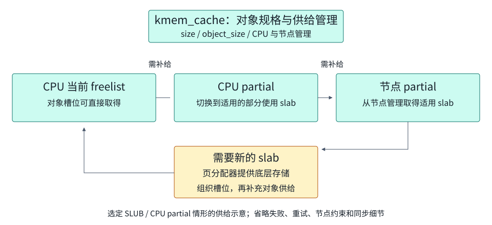

# 从页块到对象与虚拟工作区

[上一节](01-mechanisms.md) 解释了物理页怎样被描述与组织。本节进一步问：**空闲资源怎样变成调用者实际需要的存储？**

按阶页块、小对象、连续 CPU 工作区是三种不同需求。理解它们的供给方式，比先按字节阈值记一张函数表更有用。

本文基于 arm64 Linux 6.1.158。先采用普通可睡眠任务上下文、CPU 使用、调用者独立持有资源；需要设备使用、额外引用或严格上下文时，再重新判断契约。

## 1. Buddy 管理的不是任意长度空闲区间

### 1.1 为什么采用按阶块？

若每次都维护任意长度空闲区间，取得、拆分和合并时必须处理很多不同形状。Buddy 将规格限制为 `2^order` 个基本页，按阶组织空闲块，并利用确定的伙伴关系重新组合。

取 4 KiB 基本页作为算例：

| Order | 基本页数 | 容量 |
| --- | --- | --- |
| 0 | 1 | 4 KiB |
| 1 | 2 | 8 KiB |
| 2 | 4 | 16 KiB |
| 3 | 8 | 32 KiB |

`alloc_pages(..., 2)` 要求符合条件的四页物理连续块，不是任意四页。六页容量若通过一次按阶接口取得，通常要选择 order 3，得到八页。

这是该接口的规格代价，不是说所有物理分配 API 都只能按同一种方式取得容量。本树另有 exact 等接口，但它们也不能消除取得连续资源的困难。

### 1.2 推演一次拆分

下面单独选一个便于计算的局部 PFN 算例，不把页号 64 当作上一节 RAM A 的真实起点。假设同一 zone 内有适用、对齐的 order-3 空闲块 `[64,72)`。排除 PCP、其他块和迁移类型回退，范围与水位检查已通过。请求 order 1：


拆分后：

- `[64,66)` 交给调用者。
- `[66,68)` 作为 order-1 空闲块重新组织。
- `[68,72)` 作为 order-2 空闲块重新组织。

剩余总量为六页，最大空闲块却只有四页。原八页块已从管理中取出，不能同时还作为一个 order-3 空闲块存在。

`zone.free_area[order]` 保存该阶管理信息，其空闲链表还按 migratetype 分组。源码 `__rmqueue_smallest` 从请求阶向更大阶寻找适用块，取出后 `expand` 拆分余下部分。

看这些入链、出链操作时，要追踪“当前块的规格变成什么”，而不是只记链表函数名称。

### 1.3 合并为什么不是找任意相邻空闲块？

释放 `[64,66)` 时，同阶候选伙伴为 `[66,68)`。在本例中若它仍空闲且满足条件，合成 `[64,68)`；再与 `[68,72)` 合并恢复八页。

```text
buddy_pfn = pfn XOR (1 << order)
64 XOR 2 = 66
64 XOR 4 = 68
```

计算只确定候选位置。还要检查同阶、空闲状态、zone 边界及有关条件。相邻并不等于伙伴，跨越占用页也不能简单合并。

阅读起点：`mm/page_alloc.c` 的 `__rmqueue_smallest`、`expand`、`__free_one_page`，以及 `mm/internal.h` 的伙伴定位 helper。

进一步对应实际结构、链表计数、逐步状态和并发协议，阅读 [Buddy：空闲页块的组织、分配与合并](sub/page-allocation/01-buddy.md)。接口使用另查 [页分配 API 样章](api-reference.md#pages)，不将内部函数当作驱动调用入口。

## 2. 总量、布局和供给位置影响不同

### 2.1 空闲四页为什么仍拿不到四页块？


甲的前四页能构成适用块；乙的四页被占用页隔开。即使总量相同，当前局部供给也不能满足相同的 order-2 请求。

回收可能释放部分占用，规整可能迁移可移动页，其他允许 zone 也可能提供块。但每种补救都需要条件，不能从“全机还有空闲页”直接推出本次成功。

### 2.2 PCP 为什么放在 Buddy 旁边？

频繁小规格分配若每次都访问共享 zone 管理，会增加同步与共享状态操作。PCP 将部分适用规格的空闲页缓存到 CPU 局部，补充和排空时与 Buddy 批量交接。

PCP 里的页仍是空闲供给，不是永久分配给该 CPU 的私有 RAM。它主要改变供给组织和交接成本，不改变页的基本资源语义。

本树适用阶由 `pcp_allowed_order` 等分支决定，不沿用“PCP 只有 order 0”的旧版概括。局部供给也有同步、CPU 状态和批量交接条件，不能把 per-CPU 等同于调用者无需同步。

阅读起点：`mm/page_alloc.c` 的 `rmqueue`、`rmqueue_pcplist`、`pcp_allowed_order`。

## 3. 对象缓存在页资源上增加一层管理

### 3.1 分配单位与底层存储单位分开

需要约 256 字节的控制对象时，不希望每对象独占一页。Slab 类分配器取得底层页，再组织可复用的对象槽位。

只做容量推演：若一页 4 KiB 全用于 256 字节槽位，可放 16 个。真实 SLUB 还受对齐、元数据、调试配置和 slab 阶数影响，不能把 16 当作目标机固定对象数。

先区分三个层面：

| 对象 | 表达什么 |
| --- | --- |
| `kmem_cache` | 一类对象的规格及供给管理 |
| slab | 承载该类对象的一块底层存储 |
| object | 本次交给调用者的具体槽位 |

创建 cache 不等于已经为未来所有对象取得数据页；释放一个 object 也不等于其 slab 立刻释放。

### 3.2 看供给关系，再看字段

以本树 SLUB 和启用 CPU partial 的情形作示意：



当前 freelist 有适用对象时，可以按实际同步协议取得槽位。需要补给时，可以从适用 partial slab 取得供给；仍不足才需要准备新 slab。

这不是所有配置都执行的无条件调用链，节点策略、调试 hook、记账和失败重试也会影响路径。

关键对象可以这样对应：

- `kmem_cache.size` 是包含布局影响的槽位大小，`object_size` 表达对象大小。
- `kmem_cache_cpu.freelist` 保存当前可用对象入口，`slab` 表示当前 slab。
- `tid` 与同步协议一起帮助验证 CPU 局部状态，不能把它理解为普通对象计数。
- 节点管理记录 partial slab，并维护其集合与数量。

空闲对象位置可以用于存储 freelist 联系。具体指针编码和布局受配置影响，调用者不能读取或修改这些内部联系。

本树已使用 `struct slab`，定义在 `mm/slab.h`；不能把旧文章里 `struct page` 的 slab 字段原样搬来。SLUB 的 CPU 字段见 `include/linux/slub_def.h`。

### 3.3 同一块 slab，分配和释放时什么改变？

先想象已有四个对象槽位，A、B 在用，C、D 空闲：

```text
分配 C 前：A 在用 | B 在用 | C 空闲 | D 空闲
分配 C 后：A 在用 | B 在用 | C 在用 | D 空闲
归还 B 后：A 在用 | B 空闲 | C 在用 | D 空闲
```

这些变化首先发生在对象层。即使 B 归还，A 和 C 仍使用该 slab，底层页不能整体归还。全部对象空闲后，缓存也可能按政策保留资源供复用。

真实释放还区分当前 CPU 持有的 slab 与其他 slab、局部与远程交接、full / partial / empty 等状态。因此不画“任何对象释放都直接回当前 freelist”的固定箭头。

`kfree` 或 `kmem_cache_free` 不能替调用者结束异步访问。取消回调、停止发布、满足引用或 RCU 协议后，才能归还对象；缓存自身的同步不解决对象使用者的并发。

阅读起点：`mm/slub.c` 的 `slab_alloc_node`、`___slab_alloc` 和释放路径；先追踪对象供给，再深入状态验证和锁协议。

## 4. 连续工作区可以改变哪项约束？

### 4.1 CPU 连续访问，不一定需要整体物理连续

若六页工作区只供 CPU 连续访问，通过一次按阶物理分配可能需要八页块；动态虚拟区域可以由分散底层页支持六页容量。

它放宽整体物理连续要求，但需要虚拟区间、页数组及页表管理。真实实现可能使用不同页块或映射粒度，不必严格逐个 order-0 页处理。

这种改变能缓解一类布局问题，却不能消除容量不足、记账限制或映射元数据失败。

### 4.2 三个接口组合的工作不同

| 接口 | 存储与映射职责 |
| --- | --- |
| `vmalloc` | 取得新底层存储，管理虚拟区间并建立映射 |
| `vmap` | 将调用者已有页组合成虚拟映射 |
| `kvmalloc` | 先尝试 kmalloc，在适用条件下接受 vmalloc 回退 |

已有页时，问题已经变成“建立访问映射”，而不是再申请一份相同数据。`vmap` 默认模式保留调用者的页所有权；特殊所有权转移标志另有契约。

选择 `kvmalloc` 就要接受两类结果，不能在测试碰巧取得物理连续结果后，长期依赖连续性或改用只适合一种结果的清理。

本树 `kvmalloc_node` 不支持将 `GFP_ATOMIC` / `GFP_NOWAIT` 当作通用非阻塞方式。失败也不意味着一定能够回退并成功。

阅读起点：`mm/util.c` 的 `kvmalloc_node`、`kvfree`，`mm/vmalloc.c` 的 `__vmalloc_area_node`、`vmap`、`vunmap`。

## 5. 分配上下文决定允许做多少工作

### 5.1 GFP 同时影响范围与补救

有适用对象、PCP 页或 Buddy 块时，可直接完成相关状态转移。供给不足时，允许的回收、规整、等待和重试决定请求能走多远。

| 常用组合 | 理解重点 |
| --- | --- |
| `GFP_KERNEL` | 允许睡眠与直接回收，调用路径必须允许 |
| `GFP_NOWAIT` | 不进入当前线程的直接回收，需处理供给不足 |
| `GFP_ATOMIC` | 适用的非睡眠策略，可使用部分紧急供给，仍可能失败 |
| `GFP_KERNEL_ACCOUNT` | 在适用需求下加入内核资源组记账 |

不能只因某次命中对象缓存就认为 `GFP_KERNEL` 在不可睡眠路径安全，也不能将所有请求改成 `GFP_ATOMIC` 来获得固定时延或成功保证。

NMI、raw spinlock 等严格情境需核对具体接口与目标版本。处于文件系统或 I/O 路径时，还需防止回收递归依赖；NOFS / NOIO 作用域是表达这类约束的工具，不是随意组合标志的补丁。

### 5.2 水位保护的是供给余量，不是额外 RAM {#slowpath}

Zone 的 `WMARK_MIN / LOW / HIGH` 是页数量意义上的参考水位，结合 `watermark_boost`、order、分配策略和有关保留检查。它们不是所有芯片固定比例的三个容量池。

可以先从角色理解：LOW 与后台回收的启动判断有关，HIGH 参与回收满足程度的判断，MIN 参与更紧张供给下的检查。真实检查还要扣除本次不可用供给，并区分请求是否有权限使用部分保留资源。

不要直接套用“LOW 以下必异步、MIN 以下必同步”的固定流程。请求的 order、允许工作、范围和当前执行路径一起决定行为。

这里还需分清三种保留：

- memblock 阶段保留或启动占用：决定哪些页尚未纳入普通管理。
- `lowmem_reserve`：在分配检查中保护低位 zone，避免其他常规需求耗尽其供给。
- 高优先级或 highatomic 有关规则：影响特定请求能使用哪些空闲余量。

后两者不是从 RAM 中永久删掉一块的同一种操作，也不能直接拿来重算 `managed_pages`。

### 5.3 慢路径根据问题选择补救，不是固定流水线

`__alloc_pages_slowpath` 会重新计算适用策略及范围，可能唤醒后台回收、再次尝试现有供给，再根据条件做直接回收、规整、重试或失败处理。

本树对某些高阶或非 movable 请求，会先尝试适用的直接规整，因为可能已经有足够基本页，只是布局不合适。这正说明不能把所有慢路径都画成“回收 → 规整 → OOM”的固定顺序。

| 观察到的限制 | 补救主要改变什么 | 仍需满足什么 |
| --- | --- | --- |
| 适用空闲总量不足 | 回收更多可复用页 | 数据保留、引用与允许工作 |
| 总量有余，但没有目标块 | 规整改善布局 | 目标存储、可迁移性和连续范围 |
| 当前范围供给不足 | 在规则允许时尝试其他范围 | 节点、zone、cpuset 等约束 |
| 允许重试，但尚未取得进展 | 等待或再次检查 | GFP 的重试与失败政策 |

`__GFP_NORETRY`、`__GFP_RETRY_MAYFAIL` 和 `__GFP_NOFAIL` 表达不同策略，不能通过不断加标志来同时获得低时延、低压力和永不失败。通常优先给调用者定义合理失败路径；特殊 nofail 需求须按目标接口限制审查。

回收可能进入文件系统、写回或 I/O；调用者若持有这些路径需要的资源，可能形成递归等待。NOFS / NOIO 作用域应跟随实际依赖设置，而不是为了“快一点”随意禁止补救。

源码：`get_page_from_freelist`、`__zone_watermark_ok`、`__alloc_pages_slowpath`。阅读时记录当前范围、order、`alloc_flags` 和允许工作，跟随实际分支。

### 5.4 将分配移到热路径后，重新设计失败处理

对象原先在初始化时准备，后来改为在不能睡眠的路径临时创建，改变的不只是一个参数。应重新判断：

1. 能否提前准备资源？
2. 耗尽时能否丢弃、降级或延后工作？
3. 若确需非阻塞分配，失败与清理路径是什么？

预分配改变工作发生时间，但仍需容量及耗尽政策；延后到工作线程改变上下文，但仍需对象存活保证。

## 6. 从认识落实到接口

进一步进入实现，可读 [PCP](sub/page-allocation/02-pcp.md)、[分配慢路径](sub/page-allocation/03-slowpath.md)、[SLUB](sub/object-allocation/01-slub.md) 与 [vmalloc](sub/virtual-allocation/01-vmalloc.md)。这些草稿分别追踪批量交接、补救决策、对象供给和映射生命周期。

至此可解释：小对象不必每次申请新页；连续物理块不等于任意页集合；虚拟连续只放宽相应形态约束；GFP 不消除资源需求。

实际调用见 [API 指南](api.md)：[字节与数组](api.md#bytes)、[专用缓存](api.md#object-cache)、[按阶页块](api.md#pages)、[工作区](api.md#workspace)、[已有页映射](api.md#existing-pages)。

下一篇 [地址空间、页表与按需提供数据](03-address-space.md) 将这些页资源连接到进程映射。回收怎样补充供给，见 [资源压力](04-reclaim-rmap.md)。
