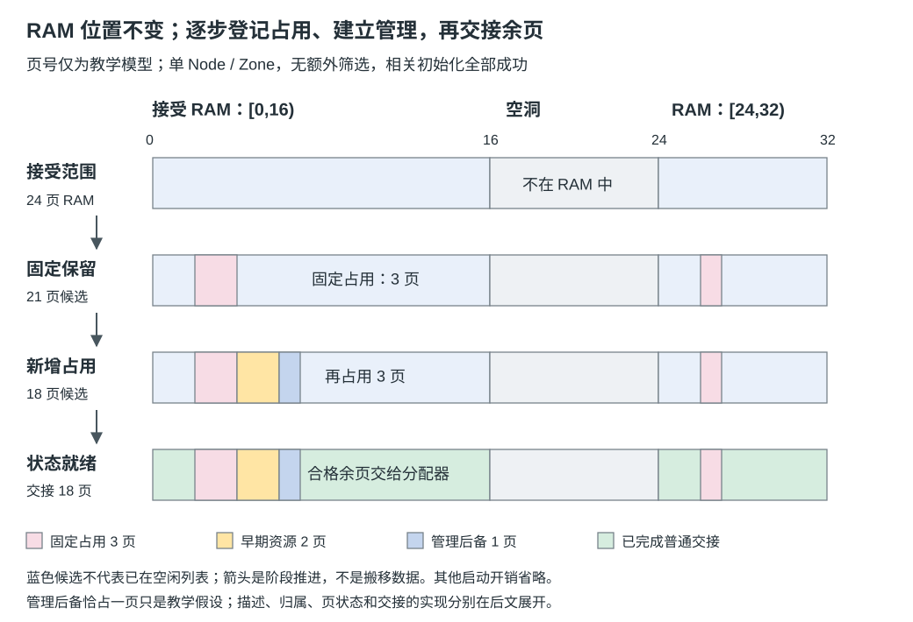
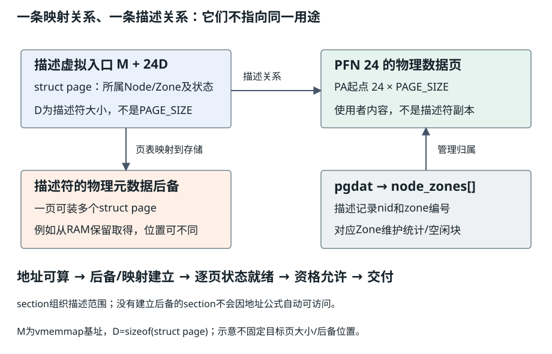
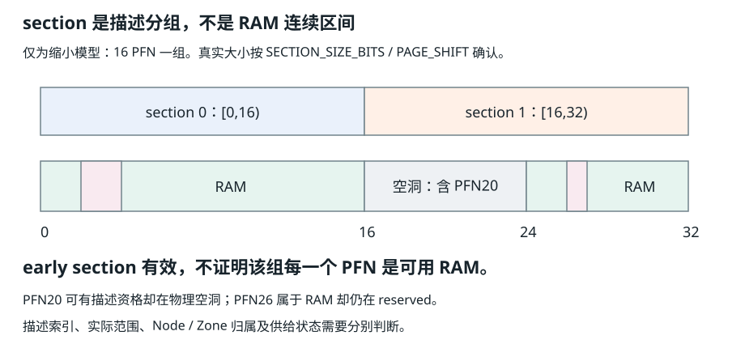
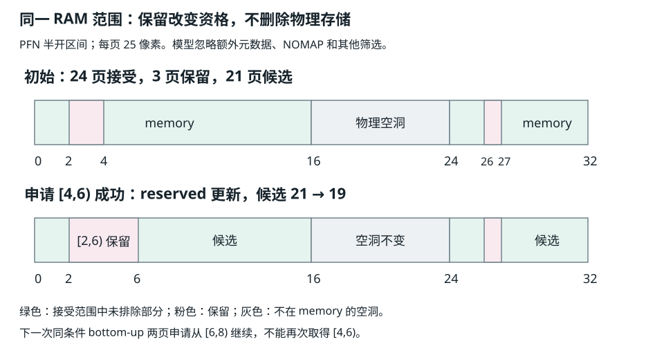
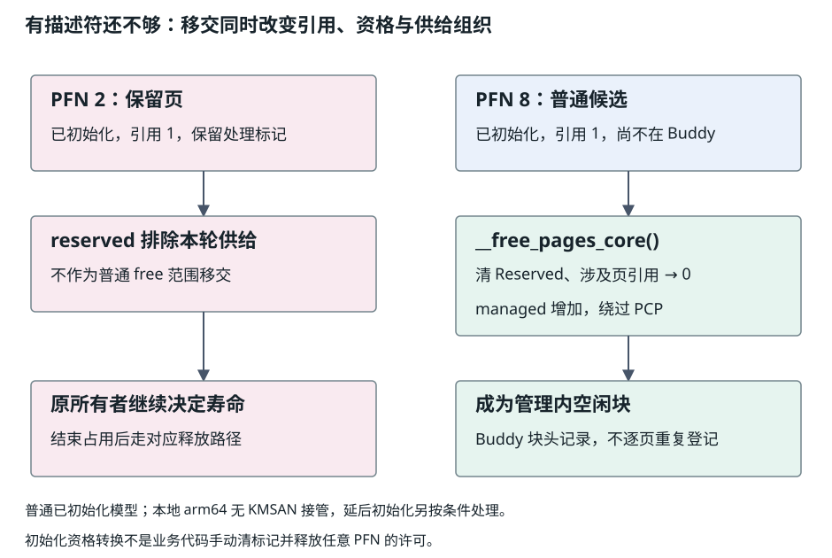
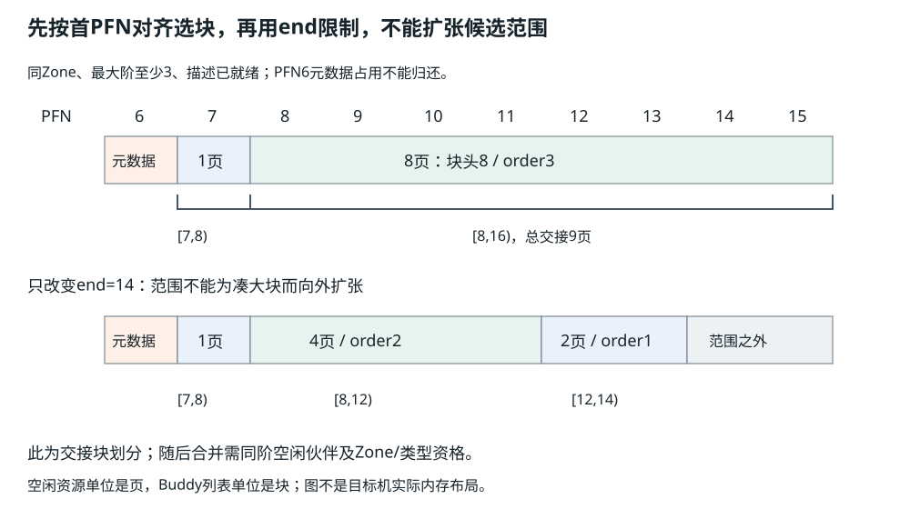

# 物理内存组织与初始化：从地址范围到可分配资源

开机时，内核获得的是“哪些物理地址属于 RAM”的范围信息，而不是一套已经能分配页的资源。RAM 中还有内核镜像、启动数据和管理信息的占用；内核必须把这些范围组织起来、保护已有内容，再建立逐页管理能力，最后让普通页分配器接收适用空闲页。

这就是本篇的**物理内存组织与初始化**：把启动时接受的 RAM 范围转换为运行期可管理的页资源。先走通这个转换，再区分范围、描述、管理资格和空闲状态，才能解释为什么安装的 RAM、内核管理的页和当前空闲页不是同一个数量。

## 阅读说明

- 承接[总览](00-overview.md#physical)，后接[物理页分配](01-page-allocation.md)。默认理解基本页和虚拟内存，不默认已掌握 memblock 或 vmemmap。
- 本地 Linux **6.1.158**、arm64 / AArch64，源码按已打 RT 补丁处理；页大小、节点数、VA 位宽、CMA 和延后初始化等按实际条件。
- 本文覆盖普通 RAM 的范围发现、保留、描述建立、管理层次和首次移交。热插拔、设备内存只讲边界与入口。
- 例子中的 PFN 数字是缩小模型；省略的元数据占用会明确指出，不把示意 managed 数量当作目标机统计。
- 内核源码只读，未启动、编译或运行内核，也不使用 memblock 改动目标机布局。

### 缩略词与入口

| 名称 | 含义 | 本篇用途 |
| --- | --- | --- |
| RAM | Random Access Memory | 普通系统内存，不等于全部可分配资源 |
| PFN | Page Frame Number | 基本物理页的位置编号 |
| PA / VA | Physical / Virtual Address | 数据位置与内核访问地址 |
| NUMA | Non-Uniform Memory Access | 节点位置、拓扑与管理 |
| memblock | 启动期范围管理器 | 记录接受范围与保留，不是运行期 Buddy |
| SPARSEMEM | 稀疏内存描述模型 | 按 section 组织 PFN 描述 |
| vmemmap | 页描述符的虚拟布局区域 | 存 `struct page`，不存被描述页的数据副本 |
| DMA | Direct Memory Access | 影响适用 Zone 边界的设备访问约束 |
| CMA | Contiguous Memory Allocator | 特定保留、后续供给路径 |
| NOMAP | 不加入普通直接映射的范围属性 | 不等于不存在 RAM |
| KMSAN | Kernel Memory Sanitizer | 公共交接钩子的来源，本地 arm64 不具备启用条件 |

| 当前问题 | 入口 |
| --- | --- |
| 物理内存组织与初始化是什么，为什么开机需要它 | [基本场景与模型](#basic-model) |
| RAM 范围怎样变成运行期可分配页 | [最小初始化过程](#basic-cycle) |
| 页数据、PFN 和描述符是什么关系 | [基本对象](#page-model) |
| memory 与 reserved 为什么重叠 | [两套范围](#ranges) |
| 早期申请如何防止重复交付 | [连续分配推演](#early-allocation) |
| 有描述符为何仍不可分配 | [描述与资格](#descriptors) |
| spanned/present/managed/free 怎样区分 | [统计层次](#accounting) |
| arm64 启动阶段如何接到 Buddy | [初始化与移交](#handoff) |
| memblock 接口是否能在模块中使用 | [接口边界](#apis) |

<a id="basic-model"></a>
## 1. 从开机建立物理资源模型

### 1.1 它出现在哪里：内核开始管理机器的 RAM

设一块 arm64 平台把内核镜像和启动所需信息放进 RAM，随后进入内核。内核从适用的固件或设备树路径获得内存范围，并按架构能力和启动条件确认自己能接受哪些部分。此时它面临的不是“为某个进程找四页”，而是更早的问题：

- 哪些地址是已接受的普通 RAM，哪些间隔根本不是这份 RAM 资源？
- 哪些 RAM 已被镜像、启动数据等使用，不能再次分配？
- 建立页表和内存管理信息时，需要的内存从哪里取得？
- 什么时候剩余页才具备逐页管理状态，能够交给普通页分配器？

这是本机制最直接的场景：**在普通运行期分配之前，先建立分配器能够依赖的资源与管理信息。** 工程师移植启动代码、核对内存布局，或分析“安装容量与内核报告容量为什么不同”时，也需要沿这条过程定位差异。热添加 RAM 有相关目标，但采用另一套运行期协议，本文不把它当作普通启动过程。

### 1.2 “组织”和“初始化”分别做什么

**物理内存组织，是记录并划分资源范围、属性、占用和管理归属。** 最初按地址区间记录“内核接受了什么、哪些部分不能再交付”；随后建立按节点和区域组织的运行期管理层次，让每页有明确的接收者。它改变的是管理表达，不是把所有 RAM 搬到一个连续位置。

**物理内存初始化，是把这些管理信息和逐页状态实际建立起来，并按资格完成资源交接。** 它既要为管理信息取得存储，也要准备页的描述、归属和初始状态；最后才把满足条件的空闲页交给运行期分配器。

这里的初始化不是硬件 DRAM 控制器的训练，也不是“把全部 RAM 清零”。本篇默认平台已提供可供内核使用的 RAM；讨论的是内核怎样建立软件管理。数据页需要何种初始化，由具体建立和使用路径决定，不能据本篇标题推导每页内容都是零。

先区分三个层次，后面才不会把数量和资格混在一起：

| 层次 | 保存或描述什么 | 本阶段解决的问题 |
| --- | --- | --- |
| 实际 RAM | 物理存储，其中有启动占用和未占用部分 | 字节真实存放在哪里 |
| 启动范围记录 | 接受范围、保留范围及属性 | 在逐页分配器就绪前避免重复使用占用 |
| 运行期页管理 | 页描述、管理归属、状态与空闲组织 | 按请求条件分配、归还和管理页 |

范围记录和页描述本身也需要存储。它们不是额外出现的一份物理资源，而是使用一部分 RAM 管理其余 RAM。

### 1.3 为什么先用范围管理，再建立逐页分配

普通页分配依赖管理对象、页描述符和空闲列表；启动代码还在建立这些信息时，不能反过来假定它们已经完整可用。但页表和管理对象又需要内存，这就形成了启动依赖。

**memblock 是内核在早期使用的地址范围管理器。** 它先记录已接受 RAM 与保留占用，从适用空闲区间选出早期存储，并在成功保留后交付。初始账本采用静态结构和数组，后续允许扩容时再为新的存储登记占用，避免要求普通页分配器先替自己完成全部准备。

随着页描述和管理层次逐步建立，剩余页才能转换为运行期资源。首次移交后，普通请求使用页分配、对象分配或虚拟分配接口，而不是继续用早期范围账本追踪每个使用者。

因此 memblock 不是“启动时的 Buddy 名称”：前者主要处理区间和早期占用，后者按页块组织运行期空闲供给。两者之间有一次受初始化资格控制的交接。

<a id="basic-cycle"></a>
### 1.4 沿同一组页走完最小初始化过程

下面先只看资源位置、占用和交接。用 PFN（基本物理页的位置编号）表示区间，`[a,b)` 包含 a 到 b-1 的页；这不是目标机器的地址或容量。

假设内核已接受 `[0,16)` 与 `[24,32)` 两段 RAM，共 24 页；中间 `[16,24)` 是空洞。固定占用为 `[2,4)` 和 `[26,27)`，共 3 页。再假设启动代码需要两页存储，之后为一份长期使用的管理信息取得一页。其余实际启动开销省略，单节点、单普通区域，无额外属性筛选，全部所涉描述和页状态成功就绪。



| 阶段 | 资源与管理变化 | 本模型的结果 |
| --- | --- | --- |
| 接受 RAM 范围 | 记录两段 RAM；空洞不是可用 RAM | 接受 24 页，尚不能仅凭范围就逐页分配 |
| 保护固定占用 | 将已有占用登记为保留，不删除其 RAM 身份 | 除去 3 页，剩余 21 页候选 |
| 取得早期资源 | 选 `[4,6)`，成功保留后交付给启动使用者 | 候选变为 19 页，不会再次交付同一范围 |
| 准备管理信息 | 另以 PFN6 为一页管理后备，登记保留；建立相关描述和归属 | 候选变为 18 页；RAM 位置没变，管理能力在建立 |
| 完成普通首次移交 | 对余页准备好的状态进行交接，加入运行期空闲组织 | 本模型有 18 页被运行期分配器接收，保留页仍属原所有者 |

这里的一页管理后备只是明确计算管理成本的教学假设，不代表真实页描述恰好只占一页或必须来自 PFN6。图中的箭头表示阶段推进，不表示物理数据被搬移。第 3 节展开区间搜索与账本，第 4 节展开实际初始化和交接。

最关键的变化发生在最后一步：前面的“候选 18 页”只是范围与属性允许考虑它们；描述、状态及交接都完成后，才能说这些页由运行期分配器管理。以后其中四页被分配出去，管理数量不会少四页，当前空闲数量才会变化。

### 1.5 从基本过程到实现分工

| 基本问题 | 实现分工 | 本文深入入口 |
| --- | --- | --- |
| 接受什么、谁已经占用 | 架构启动路径与 memblock 范围记录 | 两套范围、arm64 范围裁剪 |
| 内核如何记住每页的状态 | 页描述符及其实际存储 | PFN、`struct page` 与 vmemmap |
| 页归哪个管理范围 | Node/Zone 的建立及描述符归属 | 管理层次与统计 |
| 怎样组织稀疏的描述范围 | section 等元数据组织 | 描述建立、有效性和失败 |
| 何时成为空闲供给 | 初始化核心把合格页交给 Buddy | 首次移交、引用与块划分 |

这些职责相互依赖，但不是五份可以相加的 RAM。下面先解释数据页和描述信息的区别，再把已经建立的基本过程对应到真实对象。

## 2. 整体组成与关键对象

<a id="page-model"></a>
### 2.1 数据页、描述符和 PFN 先分开

一个基本物理页是一段实际存储空间；PFN 是它的位置编号，`struct page` 则是内核记录其状态的管理对象。它们不是同一份内容：

```text
物理地址 = PFN * PAGE_SIZE + 页内偏移
PFN      = 物理地址 >> PAGE_SHIFT
```

描述符可以记录所属 Node/Zone、引用、映射或分配器状态；它不需要有 `PAGE_SIZE` 字节大小，也不是把整个数据页复制进结构体。访问描述符与访问该页数据是两种操作。

**vmemmap 是在 SPARSEMEM_VMEMMAP 配置下组织页描述符的内核虚拟地址区域。** 可以按 PFN 索引描述符，但该虚拟区域也必须有实际存储与映射，并不是把被描述的全部 RAM 再复制进去。

把索引落到地址上：令 P 为基本页字节数，D 为 `sizeof(struct page)`，M 为 vmemmap 的虚拟基址。PFN24 的描述入口是 `M + 24D`，数据页起点是 `24P` 这个物理位置；两者的步长、地址空间和内容都不同。增加一个 PFN，描述入口增加的是 D，而不是 P。

一张物理页可以装多个描述符，负责记录其他数据页；这张管理后备可能来自不同的物理位置。`M+24D` 通过内核页表映射到**保存描述符的后备**，其中的管理状态再描述 **PFN24 的数据页**。读取前者是在看管理信息，访问后者才是在使用页内数据。

因此按 PFN 连续索引既不要求 RAM bank 连续，也不表示每个数据页内藏着自己的完整描述符。即使公式能算出入口，相关页表与后备没有建立时也不能解引用；第 3.4 节再解释这一描述资格。

使用 SPARSEMEM_VMEMMAP 时，`pfn_to_page(pfn)` 的基本布局表达是 `vmemmap + pfn`，逆转换按描述符数组位置得到 PFN。这里加的是 `struct page` 元素，不是数据页字节偏移。[依据 P1](#source-model)



图1区分三种箭头：虚拟描述入口到元数据后备的映射、描述符到数据页的描述、Node/Zone到数据页的管理归属。三个终点/用途不同，不能把一次地址运算当作全部关系都已建立。

<a id="ranges"></a>
### 2.2 memory 和 reserved 不是两份物理内存

第 1 节的接受范围与保留占用，在 memblock 中由两套区间集合表达；早期分配先用它们定位可考虑的空闲区间。

`memblock.memory` 记录内核已接受的范围及属性，`memblock.reserved` 记录需要排除普通早期供给的占用。保留内核镜像不是从机器中删除 RAM，而是在已有范围内登记“这段不能再次交付”。

一个 `memblock_region` 用 base、size、flags 和适用节点表示一个连续区间。两套集合可能重叠：页描述符和内核镜像所占内存既属于 RAM，也处于 reserved。不能把两者大小相加当作总 RAM。

实际`memblock_type`保存region数组、有效条目数cnt、数组容量max和总范围字节数total_size。例如两个bank通常对应memory数组的两个区间条目，而不是24个逐页对象；reserved另记占用区间。cnt数条目，total_size数字节，后面的present/managed数字页，不能混用单位。

从memory减reserved可按两个有序区间集合的边界推进：走到占用起点，先输出前面的空闲段；跳过占用，再从其终点继续。占用跨越bank空洞时，只排除它与已接受memory的交集，不会把空洞“填成保留RAM”。拆分/合并改变的是管理数组中的区间表达，不搬移对应物理数据。

粗略候选为 `memory - reserved`，之后还要根据节点、NOMAP、driver-managed、映射能力、对齐和初始化阶段筛选。它不是逐页状态表，也不记录运行期某个进程持有多少页。

### 2.3 Node、Zone、section 各回答不同问题

第 1 节的“建立逐页管理”包含资源归属和元数据组织。Node/Zone 组织运行期资源，section 组织稀疏描述范围；它们不是同一种切分。

| 层次 | 主要问题 | 不等于什么 |
| --- | --- | --- |
| Node / `pglist_data` | 资源的位置、节点级管理和拓扑 | 不是必定有本地 RAM 的 CPU 组 |
| Zone | 分配用途、允许范围及管理边界 | 不是每一种对象的独立内存池 |
| section / `mem_section` | 稀疏描述模型怎样组织 PFN 元数据 | 不是 Zone、Buddy order 或热插拔唯一操作单位 |
| pageblock | 页分配器的区域分类粒度 | 不固定等于一个 section 或单次请求大小 |
| `struct page` | 一个基本页的实际管理状态 | 不能仅凭地址推断使用资格 |

一个 Node 可以有多个 Zone；section 是元数据索引层次，两者不能互相替代。不同边界的页归还不能任意按伙伴合并。arm64 的 DMA/正常 Zone 边界由配置、设备/平台地址条件和已接受范围决定，不套用其他架构固定地址。

管理对象的组织是`NODE_DATA(nid)`取得pgdat，pgdat内的`node_zones[]`取得各Zone；描述符经初始化记录nid与zone编号，`page_zone()`等据该关联定位实际接收者。节点编号先由适用固件/设备树NUMA信息登记到memblock范围，arm64的通用arch_numa实现通过`numa_add_memblk`调用`memblock_set_node`；适用单节点回退则把接受RAM登记给节点0，不从“当前CPU编号”推导任意页归属。

用独立边界模型说明归属：仍由单N0管理原两bank，假设低Zone的全局范围为`[0,8)`，NORMAL为`[8,32)`，不引入MOVABLE调整。N0的两个Zone分别与节点范围相交，并扣去各自范围内的空洞计算存在页；PFN6归N0低Zone，PFN8和26归N0 NORMAL。PFN6保留也有归属，但不交空闲供给。

只把低Zone上界改到12，PFN8改归低Zone，PFN26仍NORMAL；它们的section编号和RAM位置不因此变化。这是初始化前选择两种边界的对照，不是运行期改Zone的接口。若范围被登记给另一个Node，接收者改为该Node内的Zone对象，也不能只改section号来完成。

section 按对齐的固定 PFN 跨度分组，实际每组页数为 `1 << (SECTION_SIZE_BITS - PAGE_SHIFT)`。为了沿用本篇数字，**只在图示模型中假设一 section 有 16 个 PFN**，对应 `[0,16)`、`[16,32)`；这不是 arm64 的真实 section 参数。



图 2：第二个 section 覆盖 `[16,32)`，其中 `[16,24)` 是空洞，`[24,32)` 才在 memory 中；PFN 26 还处于 reserved。描述模型的分组与 RAM bank、保留范围、Node/Zone 划分不同。

若第二组的 early section 描述已建立且有效，本地 `pfn_valid(20)` 可以在 early-section 分支成立，但 PFN 20 仍不属于 RAM；PFN 26 有 RAM 和描述，却仍被保留。`mem_section` 记录该组描述组织，vmemmap 按 PFN 定位逐页描述，Node/Zone 是描述符中关联的管理归属，不把这三者画成同一个块。

这只解释 early 判定为何不能提供 RAM/供给资格，不许可在任意阶段访问空洞描述字段。真实 arm64 `SECTION_SIZE_BITS` 随基本页配置取不同分支，见 `arch/arm64/include/asm/sparsemem.h`；其他阶段的 subsection 判定也不能被 early 模型替代。

folio 是后续按单页或连续复合单元操作的抽象，不是额外的一份物理资源；其引用、映射和类型将在[页寿命专题](11-page-lifetime-rmap.md)展开。[依据 P1、P4](#source-model)

<a id="pfn-to-allocator"></a>
**在图 2 上追问 PFN 26 的去向。** 在 `SPARSEMEM_VMEMMAP` 模型下按 PFN 找到 `struct page`，而不是先沿节点列表扫描所有页；再查描述符的 Node / Zone，知道该由谁接收。最后回到 memblock，确认 PFN 26 仍被保留，所以这一次不交给该 Zone 的空闲供给。相邻页可以与它同属一个 section 和 Zone，却因未被保留而具有不同的移交资格。源码可对照 `include/asm-generic/memory_model.h` 的 `__pfn_to_page()`、`include/linux/mm.h` 的 `page_zone()`、`mm/page_alloc.c` 的 `memmap_init_range()` 和 `mm/memblock.c` 的 `memblock_free_all()`。[原文分层图](reference-reading.md#physical)

## 3. 核心原理与决策规则

### 3.1 同一组 PFN：空洞和保留的区别

回到第 1.4 节的固定占用阶段，尚未进行两页申请及一页管理申请。接受的 memory 为 `[0,16)` 和 `[24,32)`，中间 `[16,24)` 是空洞；reserved 为 `[2,4)` 与 `[26,27)`。全部按基本页对齐，无 NOMAP 或其他筛选：

| 接受范围 | 排除保留后的候选 |
| --- | --- |
| `[0,16)` | `[0,2)`、`[4,16)` |
| `[24,32)` | `[24,26)`、`[27,32)` |

接受范围共 24 页，保留 3 页，候选 21 页。空洞的八页不在 memory 中，不因为执行“减去 reserved”而变成可以回收的资源。

这是候选数量，不是运行期空闲页数。内核还会为页表、描述符和其他启动资源增加保留，部分候选也可能尚未初始化。

<a id="early-allocation"></a>
### 3.2 早期申请：先选址，成功保留后才交付

令 P 为基本页大小，保持上述初始范围。假设按 bottom-up 搜索，所需搜索起点不高于 `4P`，无额外属性/节点过滤，调用：

```c
phys = memblock_phys_alloc_range(2 * P, 2 * P, 4 * P, 16 * P);
```

这只是明确参数的物理接口推演，P/phys 在这里是模型量，不是可加载模块代码。

1. 请求两页，按两页大小对齐，在 `[4P,16P)` 搜索。
2. 最低适用候选是 `[4,6)`，地址 `4P`。
3. `memblock_alloc_range_nid()` 找到地址后执行 `memblock_reserve()`；成功才返回，不是先交付后登记占用。
4. memory 不删除该 RAM；reserved 新增 `[4,6)`，可与相邻兼容范围 `[2,4)` 合为 `[2,6)`。
5. 候选由 21 页减为 19 页；下一次同条件申请可选择 `[6,8)`，不能再次给出 `[4,6)`。



图 3：颜色变化表示保留状态，不表示数据移到另一个物理位置。早期申请同时消耗未来可交付资源；元数据申请也要走这种占用管理。

本物理接口失败返回 0，不是可访问的虚拟指针。本地搜索避免分配第一基本页，也会解释特殊 end 标志为 `current_limit`；不能把示例中的搜索窗口推广成所有包装都无条件使用同一边界。

改变搜索方向可能选高地址块；改变节点条件会筛选范围。允许节点回退的接口可以首选不足后尝试其他节点，内部 exact_nid 则限制这种回退。这里不强行在两页示例中穷举全部镜像、节点和包装重试。[依据 P2](#source-memblock)

把方向变化写成可复用规则。对一个与搜索窗口相交后的空闲段`[s,e)`，请求size字节、align对齐：

```text
bottom-up候选 = round_up(s, align)
                 候选 < e 且 e - 候选 >= size 才可用
top-down候选  = round_down(e - size, align)
                 先确认 e >= size，再要求候选 >= s
```

方向还决定空闲段遍历次序。重置到未做两页申请的`[4P,16P)`空闲窗口：size=2P、align=2P，向上选4P，向下选14P；只改align=4P，向上仍4P，向下改选12P。两者都先找到候选再成功reserve，不以向下搜索允许块越过下界。

接口包装可以改变**搜索之前或失败重试时的约束**：上述物理range入口的普通数值窗口是本次搜索边界；虚拟internal包装先限制max_addr不超过current_limit，失败且min_addr非零时可去掉下界重试。节点回退则独立由exact_nid控制。不能把“放弃最低地址偏好”和“换Node”当同一操作。

### 3.3 字节范围要按整页资格交接

memblock 保存字节范围，页分配器接收完整基本页。免费范围交接用 `PFN_UP(start)` 与 `PFN_DOWN(end)`，排除两端不完整页；保留处理则需要保护任何与占用相交的页。

单独的边缘例子：接受范围为 `[P/2, 3P+P/2)`，其中可完整覆盖的页只有 PFN 1、2，不能把 PFN 0 或 3 的局部字节当作完整供给。若再保留 `[P+8,P+16)`，虽然只有八字节，PFN 1 也不能整页释放，剩下 PFN 2 才是该缩小模型候选。

因此“保留了多少字节”与“减少了多少个完整可交付页”不一定能简单相除。数值换算还必须核对半开区间和上/下取整方向。

<a id="descriptors"></a>
### 3.4 稀疏描述有效，不等于普通页可供给

SPARSEMEM 按 section 建立 PFN 描述组织，SPARSEMEM_VMEMMAP 为这些描述符准备虚拟布局和物理后备。后备页里存的是管理结构；被描述的 RAM 数据仍在原来的物理页。

把第 2.1 节的描述入口对应到建立过程：`__populate_section_memmap` 确定相关描述区范围，arm64 的 `vmemmap_populate` 取得或连接相应后备，再由 sparse 代码记录 section 描述组织成立；随后逐页初始化才写入 Node/Zone、引用及初始状态。地址布局、存储可访问和页状态就绪是不同步骤，不存在的 section 不会因同一地址公式自动具备它们。

本地 `pfn_valid()` 主要检查是否存在适用内存映射描述。早期 section 的判定可覆盖整个 section 跨度，因此有描述记录也可能对应空洞或不适用页。不能对任意 PFN 先算 `pfn_to_page()`，再把得到的地址当作普通 RAM 的证明。

要按当前用途分别问：

- 该 PFN 是否有合法描述入口？
- 是否属于接受的普通 RAM，具有适用映射和在线资格？
- 是否还被 reserved、NOMAP 或其他所有者占用？
- 逐页状态是否初始化，是否已移交相应管理器？
- 若已交付运行期管理，当前是空闲还是被使用？

这些检查不是让业务代码自行清 PageReserved 并加到 Buddy 的许可；资格转换必须经过对应初始化或上线协议。

NOMAP 位于 memory 属性中，普通可释放范围迭代会跳过它，但用于存在页计算的 PFN 范围迭代不按同样方式跳过。若把主模型 `[12,16)` 标为 NOMAP，memory 仍记录这些 RAM；第 3.5 节把这一条件接回具体统计，不能将其等同于物理空洞。[依据 P1、P2](#source-model)

<a id="accounting"></a>
### 3.5 spanned、present、managed、free 四种数量

| 数量 | 回答的问题 | 不代表什么 |
| --- | --- | --- |
| spanned | 管理范围从起点到终点覆盖多大跨度 | 跨度内无空洞 |
| present | 按对应初始化统计口径存在多少页 | 全部已可分配 |
| managed | 运行期分配器实际管理多少页 | 当前全部空闲 |
| free | 某统计口径下当前有多少空闲资源 | 每种请求都能取得，或立刻在 Buddy 合并 |

本节单独比较统计口径，省略第 1.4 节的一页管理后备成本，不是完整主例的最终统计。设单 Node、单普通 Zone 的示意范围为 `[0,32)`，接受范围仍为 `[0,16)` 和 `[24,32)`，无 NOMAP。只计一笔两页早期申请，共五页保留；其他启动占用省略，余页均已成功初始化并移交：

```text
spanned = 32
present = 24
managed = 19
```

这不是把多个 Node 的跨度任意相加得到单一跨度。若改为两个 Node、各自管理 `[0,16)` 与 `[24,32)`，每节点分别有自己的范围和统计，应重新按边界计算。

运行期再分配四页，managed 仍为 19，不因为这些页被使用就降成 15；空闲数量才随对应口径变化。PCP、Buddy 和 vmstat 的具体空闲口径见[页分配专题](01-page-allocation.md#pcp)。不能拿本节的简化数量承诺任意 `/proc` 采样完全一致。

保持单 Node、单 Zone、相同五页保留和省略占用的前提，做**交接前条件改变的对照**：仅将 `[12,16)` 标为 NOMAP，其他都不变。

| 交接前条件 | spanned | present | 普通最终 managed | 依据 |
| --- | --- | --- | --- | --- |
| 未加 NOMAP | 32 | 24 | 19 | 八页空洞、五页保留 |
| `[12,16)` 为 NOMAP | 32 | 24 | 15 | 存在页迭代仍记录 RAM，普通移交再排除四页 |

`__absent_pages_in_range()` 用 `for_each_mem_pfn_range()` 计算存在量，该迭代仍包含 NOMAP RAM；`for_each_free_mem_range(..., MEMBLOCK_NONE, ...)` 的普通释放筛选则排除 NOMAP。因此 present 不降，实际交付的 managed 降低。

这里不是说运行期随意加 NOMAP 就自动把 managed 从 19 改成 15。首次移交先重置 managed，再按真正交付页数增加；表格是两种启动条件下最终结果的比较，不是无锁修改运行期管理状态的方法。

### 3.6 把描述后备加入同一份资源账本

现在回到第 1.4 节完整主例的**首次移交之前**，不是在第 3.5 节已经交付 19 页后继续做早期申请。启动分配器为一份长期使用的描述管理后备取得 PFN6，登记 `[6,7)` 为 reserved；其他元数据占用仍省略。这是“管理后备也消耗一页”的教学假设，不声称真实 `sparse_init` 恰好一次分配一页或必选 PFN6。

| 时点 | 接受RAM | reserved完整页 | 尚可普通交接 | managed |
| --- | --- | --- | --- | --- |
| 固定占用登记后 | 24 | 3 | 21 | 尚未据本表交付 |
| 两页早期资源`[4,6)`成功 | 24 | 5 | 19 | 尚未据本表交付 |
| 新管理后备`[6,7)`成功 | 24 | 6 | 18 | 尚未据本表交付 |
| 余页描述/归属就绪并完成普通移交 | 24 | 6 | 已交付18 | 18 |

memory仍是两个原bank，reserved中相邻兼容的`[2,4)`、`[4,6)`、`[6,7)`可以表示为`[2,7)`。最后普通候选为`[0,2)`、`[7,16)`、`[24,26)`、`[27,32)`。PFN6的物理存储留给管理信息，PFN8等的描述存在并不要求它们自己也被reserved。

这解开启动的循环依赖：先用范围管理取得元数据后备，逐步建立描述与页分配器，再交接剩余页；不是要求Buddy先替自己分配所有管理信息。描述后备不足时，失败发生在管理能力建立阶段，不能把仍在memory中的未就绪范围直接交出去。

## 4. 主要工作过程与协作

<a id="handoff"></a>
### 4.1 arm64 接受范围，还要保证能管理和访问

前面的最小过程从“已经接受两段 RAM”开始，本节回到它之前的架构步骤：平台提供的范围还要满足内核自身的寻址和映射条件，才成为后续账本输入。

固件/设备树等提供候选物理范围，架构按可支持地址和启动条件接受。`arm64_memblock_init()` 处理物理地址能力、线性映射覆盖、内存限制、镜像及 initrd 的必要保留，不能简单取“机器安装的全部 RAM”。

物理地址能力和线性映射能力是两个约束：一个 PA 在物理寻址范围内，不保证当前 VA 布局能覆盖它。相关代码可能裁剪范围并调整基址；实际大小取决于配置及运行时能力，不在本篇固定某个 VA 位宽或线性映射容量。

线性窗口要覆盖的是地址跨度，不是各 RAM bank 容量之和。单独做一个简化模型：对齐单位为 U，窗口容量为 `16U`，低 bank `[0,4U)`、高 bank `[24U,28U)`。总 RAM 为 `8U`，但跨度为 `28U`，一个 `16U` 窗口不能同时覆盖两端。

假设两 bank 都满足物理能力，省略 KVM、随机化和内存限制分支，初始对齐基址为 0；内核镜像在 `[25U,27U)`，`_end` 的物理位置为 `27U`：

| 步骤 | 窗口与范围变化 | 原因 |
| --- | --- | --- |
| 初始窗口 | `[0,16U)`，不能覆盖高 bank 内的镜像 | 总容量小也不能消除中间空洞跨度 |
| 限制高端 | 从 `max(16U,27U)=27U` 起删除；高 bank 留 `[24U,27U)` | 保护镜像直到 `_end`，不在 `16U` 处截掉它 |
| 检查剩余高端 | 最后接受地址仍达 `27U`，超出初始窗口 | 保留镜像后仍需调整 |
| 上移基址 | `round_up(27U-16U,U)=11U`，窗口成 `[11U,27U)` | 窗口对齐后覆盖剩余高端 |
| 删除低端 | 删 `[0,11U)` 内已接受 RAM，低 bank 被舍弃 | 不能同时保住远隔的低 bank |


图 4：U、窗口和镜像位置都为教学参数，不是某台 arm64 的布局。若镜像位于低 bank，首次高端裁剪可能直接舍弃高 bank，后续调整条件又不同。

这不是为某个启动参数提供调优建议，而是把 `arm64_memblock_init()` 的高端保护与必要低端删除接到可推演模型；真正目标布局仍从实际符号、能力和配置确认。

内核和初始页表本身已占内存。相关平台 reserved-memory、initrd、crashkernel 等条件又增加不同保留，具体时点不必相同。内核必须先保护固定占用，才能让后续元数据分配不覆盖它们。

### 4.2 从范围到描述，再到 Zone

本地 `bootmem_init()` 先从接受范围取得 PFN 边界，进行 NUMA 组织及适用固定保留，再 `sparse_init()`、`zone_sizes_init()`。

- sparse 建立 section 与页描述后备，并记录哪些描述组织成立。
- Zone 初始化计算管理边界和存在页数量，建立运行期管理对象。
- 逐页初始化设置所属 Node/Zone、引用和相应初始状态；这不等于立即把每页挂到空闲列表。

元数据后备也来自 memblock，故 `sparse_init()` 放在相关固定保留之后。并非所有保留都必须提前到同一位置：本地 CMA 的一部分保留要等 DMA 边界确定，crashkernel 也有适用延后条件。

`zone_sizes_init()` 给 `free_area_init()` 提供区域上界；DMA、DMA32 与 NORMAL 的启用和边界取实际配置与平台。它不是直接把一个 section 改名为 Zone，也不代表所有 accepted 页均为 ordinary managed。

### 4.3 首次移交：引用、统计和 Buddy 状态一同转换

`mem_init()` 中的 `memblock_free_all()` 在适用空闲范围上实施交接。它先处理未使用描述存储、managed 统计的初始化及保留/NOMAP 页状态，再迭代普通可释放范围，按整页边界交付。

对主模型中的 PFN 2（保留）和 PFN 8（候选），假设二者有描述，已完成常规初始化且没有延后初始化：

| 阶段 | PFN2：保留页 | PFN8：普通候选 |
| --- | --- | --- |
| 常规页初始化后 | 引用初值为 1，保留处理设置 PageReserved | 引用初值也为 1，尚未加入 Buddy |
| 保留资格处理 | reserved 排除其本轮供给 | 处于适用 free 范围 |
| `__free_pages_core()` | 不把它作为本轮普通候选调用 | 清 Reserved、涉及页引用置 0、增加 managed，绕过 PCP 交给 Buddy |
| 移交完成 | 原所有者继续决定寿命 | 成为管理内的空闲页；块头记录 Buddy 状态 |



图 5：清理 Reserved/引用与加入管理器是受资格控制的初始化交接，不是业务代码可以随意组合的“释放任意 PFN”流程。

为何先有引用 1，再置 0？刚初始化的描述状态表示尚未空闲，不能让未交接页提前被重复使用；真正释放核心按块中涉及页处理计数，再更新 managed 和空闲组织。一个 order-o 交接增加 `2^o` 页 managed，不是一个块算一页。

`memblock_free_pages()` 对尚未完成延后初始化的页会跳过。以后再初始化/交付这些页，不代表它们在首次调用瞬间已全部 ready。

### 4.4 一段可交接范围怎样进入不同order列表

以新账本中的`[7,16)`为例，假设在同一普通Zone，逐页描述就绪，最大允许阶至少为3，且没有延后初始化。它有9页，却不能登记成一个“order约为3”的9页块：Buddy块必须同时满足二次幂大小、首PFN对齐和不越过范围终点。

本地`__free_pages_memory(start,end)`先用start的低位对齐能力限制order（非零start的尾随零位数），再用MAX_ORDER上界限制；若块终点越过end，就逐阶缩小。调用交接助手后，start推进实际块大小，再处理下一块：

| start / end | 由对齐允许的阶 | 终点检查 | 本次交接 | 下一start |
| --- | --- | --- | --- | --- |
| 7 / 16 | 7为奇数，只能order0 | `[7,8)`不越界 | 1页，块头7 | 8 |
| 8 / 16 | 8的低3位为0，可order3 | `[8,16)`恰覆盖余段 | 8页，块头8 | 16，结束 |

再只把end改成14：第一个单页不变；start8的order3会越界，降为order2交`[8,12)`；start12对齐允许order2，但`[12,16)`仍越界，再降为order1交`[12,14)`。七页变成1+4+2，而不是强行把range扩大到16。



这里选的是本次交接块，不等于最终列表永远保留同样形状：交接时可与同Zone中已空闲、同阶且合格的伙伴继续合并；范围外的PFN6仍为管理后备，就不能与PFN7合并。managed按实际交付的页数增加，空闲列表按块头/order组织，这两种数量在此分别为9页与两个初始交接块。

模型对应三层实现：普通free-range迭代产生字节差集；`__free_memory_core`做PFN_UP/PFN_DOWN及max_low_pfn裁剪；`__free_pages_memory`划块，再经`memblock_free_pages`和`__free_pages_core`交给Buddy。每层有明确交付物，不能把它们合并成一次“清Reserved”操作。

公共源码还有 `kmsan_memblock_free_pages()` 接管钩子，但**本地 arm64 不选择 HAVE_ARCH_KMSAN，KMSAN 的本地条件也排除 PREEMPT_RT**；其未启用桩函数返回 true，不在本文目标路径中接管页。不能把公共钩子存在误写成该 arm64 上一个未知可选配置；它与延后 struct page 初始化不是同一机制。

`totalram_pages` 的更新、Zone managed 和实际 Buddy 列表是不同层的统计/组织，特殊后续路径也要配合更新。本文只推演普通首次移交，不把函数末尾的一个总数当作每种配置全部页状态的快照。[依据 P3、P4](#source-handoff)

## 5. 源码实现与关键约束

### 5.1 重叠、分割和合并维护的是范围状态

加入范围不意味着简单把每次请求附在数组末尾。`memblock_add_range()` 处理已有覆盖与新覆盖，`memblock_isolate_range()` 在修改子区间属性或移除范围前切分边界，兼容相邻区间再合并。

主模型 reserved 从 `[2,4)` 加入 `[4,6)` 后成为 `[2,6)`，靠的是兼容范围合并；若只给其中一部分不同属性或节点条件，需先拆开，不应将新属性扩散到整个原范围。

范围数组也会增长。扩容自身需要后备和保留，初始化阶段必须协调可用 allocator 与占用；不能在尚未保护的范围上覆盖启动对象。启动范围 API 的修改顺序和 `__init` 生命周期不能机械推广成运行期可并发调用的通用 allocator。

### 5.2 描述初始化失败不一定是统一事务

本地`sparse_init_nid`有两种可区分的局部失败：节点usage存储申请失败，清本次节点所涉后续section记录；某section的描述后备申请失败，则已成功的前面section保留，从失败section开始清`section_mem_map`。这是描述资格处理，不是memblock范围回滚。

独立假设两个已登记的section S0/S1，S0已成功建立，S1的`__populate_section_memmap`失败：

| 这一失败出口的状态 | S0 | S1 |
| --- | --- | --- |
| memblock记录的RAM范围 | 不由此分支删除 | 不由此分支删除 |
| section描述记录 | 前面成功结果保留 | `section_mem_map=0`，相应描述有效性不成立 |
| 可否仅凭PFN算式解引用/交付 | 仍需页状态及所有权资格 | 不能当描述已就绪的普通页 |
| Zone的present_pages | 此出口不负责同步改该计数 | 不能从清section标记推导其自动减少 |

“section present”是稀疏元数据标志；Zone存在页数量由另一路memblock PFN迭代计算，二者不是同一变量。若RAM范围未删，存在量计算仍可看到原bank，而S1描述资格已失败。这是解释两层记录不一致的失败快照，不是已经安全启动后的统计。

实际调用链在sparse_init后还要进行Zone和逐页准备，普通memmap/free-range路径不提供一条统一的“描述失败就自动把bank从memblock剔除”事务。因此本文只确定这一局部出口，**不承诺该失败条件下目标系统一定可安全继续启动、仅少几页内存**；部分后备可能已经建立，后续访问也可能无法完成。没有执行失败注入，不能从日志中的“Some memory will not be available”代替最终启动结果验证。

正常交付模型以全部所涉描述/页状态就绪为前提；本失败例不能继续套用前面的managed=18。这比只说“不是统一事务”更具体：保留下来的是接受范围与前面成功描述，失去的是失败段描述资格，并没有取得该段可释放许可。

## 6. 接口与使用

<a id="apis"></a>
### 6.1 按生命周期与返回类型选择

| 需求 | 代表入口 | 必须确认 |
| --- | --- | --- |
| 启动接受物理范围 | `memblock_add()` / `memblock_add_node()` | PA、字节长度、节点与属性 |
| 排除启动占用 | `memblock_reserve()` | 半开范围、重叠、失败与后续所有者 |
| 取得物理位置 | `memblock_phys_alloc_range()` | 字节数、对齐、搜索窗口；本例失败 0 |
| 取得可访问早期存储 | `memblock_alloc*()` 的具体包装 | 返回 VA、映射前提、清零/失败策略与阶段 |
| 修改属性/节点 | 对应 isolate/set/clear 入口 | 原范围切分及新属性仅作用于目标子区间 |
| 运行期页/对象存储 | alloc_pages / kmalloc / vmalloc 等 | 已就绪 allocator 的各自契约 |

物理接口返回 PA，不能直接当作 C 指针。虚拟包装则要满足所用映射条件，不把不同返回类型或失败策略混为一类；名字都含 memblock 不能说明是否 panic、清零或允许节点回退，应查所选具体包装。

本文实际涉及的少量入口可直接作如下选型，均限定启动期且排除意外的slab-ready兼容回退：

| 入口 | 成功/失败 | 清零 | 窗口与节点 |
| --- | --- | --- | --- |
| memblock_phys_alloc_range | PA / 0 | 不替调用者初始化数据 | 普通数值range边界；ANYWHERE/ACCESSIBLE标志另解码 |
| memblock_alloc_try_nid_raw | VA / NULL | 否 | max受current_limit限制；min可放弃重试；首选nid失败可换节点 |
| memblock_alloc_exact_nid_raw | VA / NULL | 否 | 同样有min重试，但exact限制节点回退 |
| memblock_alloc_try_nid | VA / NULL | 成功后清size字节 | 与try_nid_raw同类窗口/回退策略 |
| memblock_alloc | VA / NULL | 是 | inline使用低限0、ACCESSIBLE和任意Node |

raw不清零，不表示“无保留登记”；exact不换节点，不表示最低地址永不放宽。这些入口本身的失败返回与调用者把关键失败升级为panic是两层责任，不能把某启动调用者检查NULL后panic写成所有memblock申请都panic。

本系列不提供运行期模块调用这些初始化入口“登记随意 RAM”的示例。新增运行期内存需要热插拔/设备类型等协议，不是先 memblock_add 再手动清标记。

### 6.2 reserve、解除保留和真正归还页

reserve 是范围占用登记，不是自动建立新映射。解除 memblock 范围保留也不等于任意阶段都已完成页描述初始化、managed 更新和 Buddy 归还。

释放初始化占用必须由原所有者确认不再使用，并在对应阶段走实际释放路径。仍用于内核镜像、页表或描述符的后备不能因为“管理信息也占内存”就随意回收。保留状态也不一定永久：initrd 或初始化代码等在适用时点可以结束寿命。

本节只采用第 3.2 节的两页申请模型，未加入 PFN6 管理占用，以免将不同账本的数字混用。沿 `[4,6)` 的这笔申请，区分两个互斥生命周期：

| 结束占用的时点 | 可定位的入口与本模型结果 |
| --- | --- |
| 首次移交前，memblock 范围管理仍有效 | `memblock_phys_free(4P,2P)` 删除 reserved 中该子区间，候选19→21；此操作本身不加 Buddy、不增加 managed |
| memblock allocator 主体已结束，但系统仍在初始化；这两页仍保留且未交付 | `memblock_free_late(4P,2P)` 按完整页调用 `memblock_free_pages()`，普通已初始化前提下交给 Buddy并配合 totalram更新，managed额外增加2 |

`memblock_free(ptr,size)` 是虚拟地址包装，转换后调用物理范围解除保留；`memblock_phys_free()` 和 `memblock_free_late()` 接收 PA，不能把物理数值当作前者的指针。

late 不靠重新遍历 reserved 完成供给，而是直接对其获准释放的完整页调用交接流程，所以调用者必须确认普通页描述已初始化、原占用已结束、这些页尚未交付。它是 `__init` 阶段接口，不是运行期任意页的通用 free。

若先在移交前解除保留，让首次 free_all 已把页交出去，就不能再执行 late 重复交付。部分字节范围的 late 只覆盖完整页；也不能把它用于仍承担描述符或镜像后备的页。

因此一次范围操作成功只证明它完成了所定义的范围修改，不证明运行期页供给已经同步完成。[依据 P2、P3](#source-memblock)

## 7. 边界、变体与常见误解

### 7.1 一个判断不能代替全部资格

| 观察 | 仍不能推出 |
| --- | --- |
| memory 中有该地址 | 已有页描述、普通映射、managed 或空闲 |
| `pfn_valid()` 成立 | 是当前在线普通 RAM、可供页分配器使用 |
| 有 Node/Zone 归属 | 页已交付空闲列表 |
| 页在 managed 范围 | 当前无引用或处于 Buddy |
| reserved 已解除 | 所有后续初始化/统计已完成 |
| vmemmap 地址连续 | 被描述物理数据页连续或无空洞 |

具体用途还要区分 ZONE_DEVICE、driver-managed、NOMAP、硬件错误隔离等，不以“能找到描述符”给所有类型统一释放方法。

### 7.2 热插拔和设备页是另一条资格转换

热添加需要建立相应描述和管理组织，上线才按允许的 Zone/类型增加资源；下线还需隔离分配与处理使用中的页。不能把启动期差集公式当作下线算法：运行期页面可能有映射、pin、业务引用或不可移动对象。

设备内存可能有 `struct page`，但其存储访问、迁移和释放协议不一定是普通 RAM；Node 的内存资源也不必与 CPU 拓扑一一对应。这里给出边界，不声称本篇覆盖全部热插拔或设备内存实现。

## 8. 总结与源码入口

同一 PFN 的理解顺序是：地址范围被接受，描述信息准备，属性和所有者允许，逐页初始化完成，运行期管理器接收；之后页分配器才判断当前请求能否取得它。

本篇讨论的初始化不是清零全部 RAM，而是建立范围账本、逐页管理信息和首次资源交接。memblock 先解决尚无完整页分配器时的存储需求，管理后备也要计入占用；剩余合格页随后才由 Buddy 接收。

沿完整主例，接受 24 页、固定保留 3 页，候选为 21；早期再占两页后为 19；继续计入一页管理后备后为 18。只有明确省略其他占用并完成所有普通交接，才可把 18 作为完整主例的 managed。第 3.5 节尚未加入管理后备的对照模型保留 19，不是两个互相矛盾的目标机统计。

### 源码依据

<a id="source-model"></a>
**P1 / P4：描述与管理**

- [内存模型文档](../../../../linux-6.1.158/Documentation/mm/memory-model.rst)、[memory_model.h](../../../../linux-6.1.158/include/asm-generic/memory_model.h)：SPARSEMEM_VMEMMAP 的描述索引。
- [mmzone.h](../../../../linux-6.1.158/include/linux/mmzone.h)：Node/Zone、mem_section、pfn_valid 的含义与条件。
- [arm64 sparsemem.h](../../../../linux-6.1.158/arch/arm64/include/asm/sparsemem.h)：实际 section 位数随基本页配置的分支。
- [sparse-vmemmap.c](../../../../linux-6.1.158/mm/sparse-vmemmap.c)、[arm64 mmu.c](../../../../linux-6.1.158/arch/arm64/mm/mmu.c)：描述虚拟入口的物理后备映射。
- [arch_numa.c](../../../../linux-6.1.158/drivers/base/arch_numa.c)、[of_numa.c](../../../../linux-6.1.158/drivers/of/of_numa.c)：适用节点来源登记与单节点回退。
- [sparse.c](../../../../linux-6.1.158/mm/sparse.c)：`sparse_init()`、`sparse_init_nid()`、描述后备与失败。
- [page_alloc.c](../../../../linux-6.1.158/mm/page_alloc.c)：`free_area_init()`、Zone present/spanned 初始化。

<a id="source-memblock"></a>
**P2：范围与接口**

- [memblock.c](../../../../linux-6.1.158/mm/memblock.c)：`memblock_add_range()`、`memblock_isolate_range()`、`should_skip_region()`、`memblock_find_in_range_node()`、`memblock_alloc_range_nid()`。
- 同文件的 `__next_mem_pfn_range()`、`memblock_phys_free()`、`memblock_free()`、`memblock_free_late()`：统计迭代与不同阶段释放。
- [memblock.h](../../../../linux-6.1.158/include/linux/memblock.h)：具体物理/虚拟包装、flags、返回与生命周期。

<a id="source-handoff"></a>
**P3：arm64 初始化与移交**

- [arm64 init.c](../../../../linux-6.1.158/arch/arm64/mm/init.c)：`arm64_memblock_init()`、`bootmem_init()`、`zone_sizes_init()`、`mem_init()`。
- [memblock.c](../../../../linux-6.1.158/mm/memblock.c)：`memmap_init_reserved_pages()`、`__free_memory_core()`、`memblock_free_all()`。
- [page_alloc.c](../../../../linux-6.1.158/mm/page_alloc.c)：`__init_single_page()`、`reserve_bootmem_region()`、`memblock_free_pages()`、`__free_pages_core()`。
- [KMSAN Kconfig](../../../../linux-6.1.158/lib/Kconfig.kmsan)与[未启用钩子](../../../../linux-6.1.158/include/linux/kmsan.h)：公共接管钩子不代表本地 arm64 可达配置。

正文事实以本地源码为准，没有编译或运行初始化例子。

<a id="review-result"></a>
## 独立挑战审阅

以下是外部图解增补前的审阅记录；增补范围见[本轮对照](reference-reading.md#physical)。

本次按更新后的方法重写基础概念、启动场景和最小过程，并重排对象与描述建立细节。新只读挑战者 Dirac 完成第 1 轮全文与七图审阅，技术静态审阅和教学解释审阅分别通过，无实质挑战。用户随后反馈“还可以，继续”，认可本次试读并授权更新 05；机制正文和图不因此再改动，该反馈不替代逐项技术或目标机验收。依据与验证边界见[本次记录](review/review-entry-02.md)。

此前 [Kierkegaard 记录](review/review-pedagogy-02.md)与 [Gibbs 记录](review/review-physical-memory.md)保留为历史，不自动套用其通过结论。未编译或运行内核，也未执行初始化或失败注入实验。
