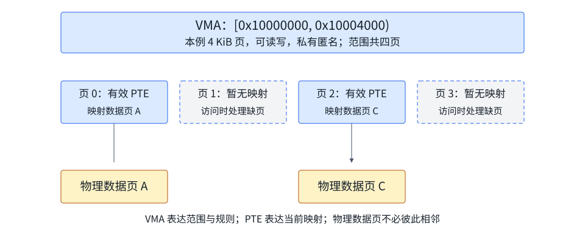
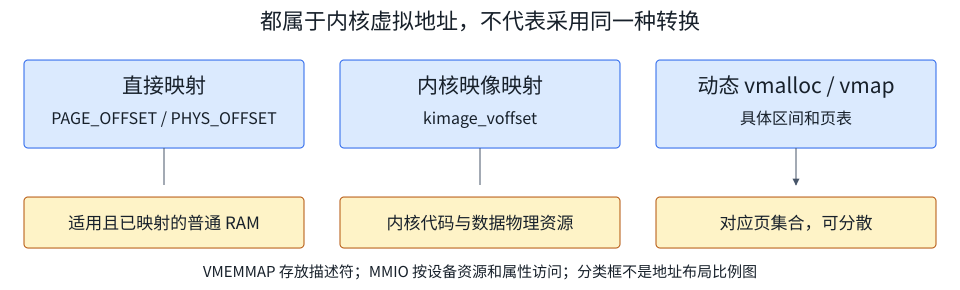
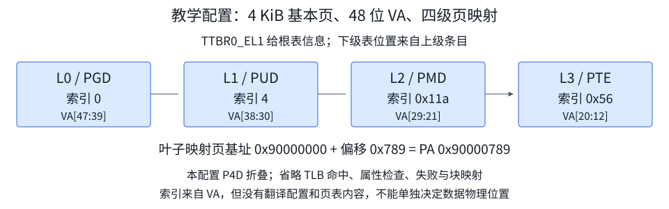
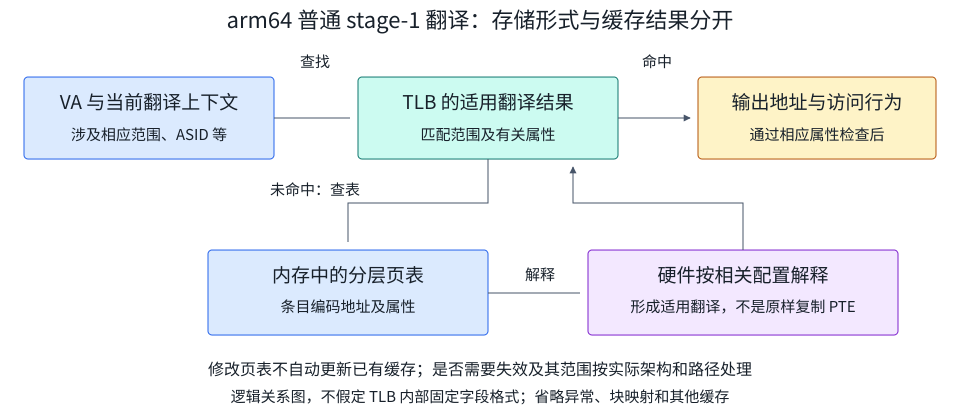
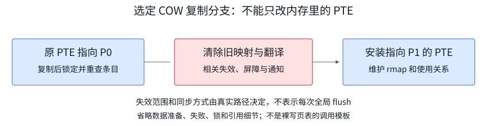
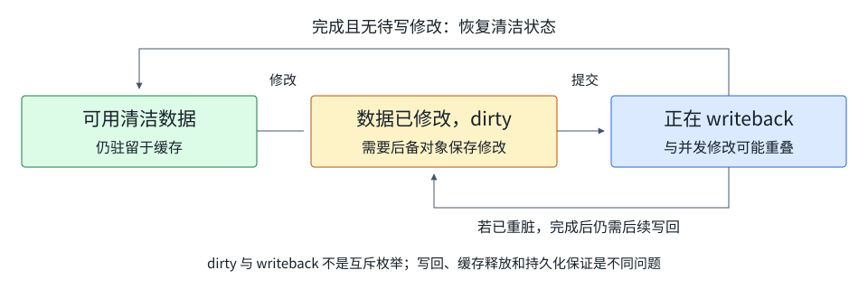
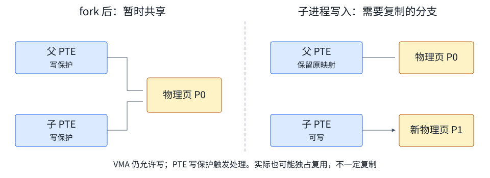

# 地址空间、页表与按需提供数据

页资源和内核分配已经有了位置，接下来问：**进程看到的地址范围，怎样与这些资源连接？**

本篇不从虚拟内存的意义重新讲起，而是区分 Linux 中的地址规则、当前映射和数据来源，再通过首次访问、文件缺页与 COW 推演它们的变化。

基线为 arm64 Linux 6.1.158。主例取普通基本页，不预填充、不使用 userfaultfd；大页和特殊映射在相应位置指出边界。

## 1. 地址空间不是单独一张页表

### 1.1 三类状态承担不同职责

| 对象 | 管理问题 | 核心联系 |
| --- | --- | --- |
| `mm_struct` | 整个用户地址空间怎样组织 | `mm_mt` 索引 VMA，`pgd` 联系页表根 |
| `vm_area_struct` | 某个连续区间允许什么、映射什么对象 | 起止地址、权限、文件与偏移、回调 |
| 页表 | 当前虚拟页实际指向哪里、如何访问 | 数据页、权限、访问与特殊状态 |

本树 VMA 由 `mm_struct.mm_mt` 的 Maple Tree 组织，不能沿用旧版双向链表加 `mm_rb` 的字段图。线程共享用户 mm 时，共享的是这套地址空间，不是每线程必有独立 mm。

内核线程通常没有自己的用户 mm，也不意味着没有可用内核映射。

### 1.2 用四页范围看规则与事实



图中 VMA 已覆盖四页，可读写、私有匿名；页 0、2 已驻留，页 1、3 尚未映射数据。

查到 VMA 说明地址属于一段规则，不能推出 PTE 已 present。反过来，仅看一个页表项也不能替代地址空间的整体权限和对象约束。

这些区分使按需分配成立：先建立可用范围，实际访问时再按规则提供数据。

源码阅读：`include/linux/mm_types.h`，`mm/mmap.c` 的 `do_mmap`、`mmap_region`。先追踪区间、标志和文件回调，再看页表。

## 2. arm64 中规则如何变成硬件访问？

### 2.1 用户与内核采用不同翻译范围

普通 EL1 管理的 stage-1 翻译中，`TTBR0_EL1` 与 `TTBR1_EL1` 提供相应页表根信息，`TCR_EL1` 配置地址范围、页粒度及有关参数。用户和内核使用低、高地址范围，不能把 64 位指针等同于实现了完整 64 位 VA。

切换还涉及 ASID、安全特性与实际协议，因此这些寄存器不是任何时刻都不变的裸指针。本篇只解释机制位置，不展开虚拟化 stage-2。

内核地址也有不同用途：

| 区域 | 访问或管理对象 |
| --- | --- |
| 直接映射 | 适用普通 RAM 页内容 |
| 动态 vmalloc / vmap 区域 | 按需建立的内核访问映射 |
| VMEMMAP | 页描述符 |
| 内核映像、模块、fixmap | 对应装载或特殊映射用途 |

它们不能随意互换，也不是一张自由可分配区域表。具体边界用本树符号和配置核对，见 `Documentation/arm64/memory.rst`、`arch/arm64/include/asm/memory.h`。

### 2.2 内核地址为什么不能统一用一个公式？ {#kernel-mappings}



直接映射针对适用 RAM，虚拟区间边界本身不保证每个位置有合法映射。对已映射的相应地址，忽略指针标记，可用关系理解：

```text
PA = VA - PAGE_OFFSET + PHYS_OFFSET
```

`PHYS_OFFSET` 联系启动确定的 `memstart_addr`，不硬编码为零或最小 RAM 起点。内核映像还使用 `kimage_voffset` 等关系；动态 vmalloc 地址则需根据实际映射定位对应页，不能套用上面的直接映射公式。

`phys_to_virt` 计算结果不建立页表；`pfn_to_page` 定位描述符不分配页。对于空洞、NOMAP 或特殊资源，“能够算出地址”与“允许访问”仍有区别。

VMEMMAP、模块区域和 fixmap 也有专门用途。Fixmap 固定的是位置或用途，不意味着映射对象永远不变。内核映像、直接映射和动态区域之间可能存在适用别名，访问与更新必须遵循各自规则。

### 2.3 用明确配置推演页表查找

取 **4 KiB 页、48 位 VA、四级普通页映射**：每级 512 个 8 字节条目，每级索引 9 位，页内偏移 12 位。

```text
VA[47:39]  VA[38:30]  VA[29:21]  VA[20:12]  VA[11:0]
 L0 索引    L1 索引    L2 索引    L3 索引    页内偏移
```



对于 `VA = 0x0000000123456789`，索引为 `0、4、0x11a、0x56`，偏移 `0x789`。最终映射页基址若为 `0x90000000`，数据 PA 为 `0x90000789`。

每级条目地址由“本级表位置 + 索引 × 8”得到，下级表位置来自上级条目。**VA 只提供索引，没有实际表内容无法决定最终数据位置。**

页表本身也占内存。多级组织可以只为使用的范围建立必要下级表；适用块映射则能提前结束查找，但增加对齐、连续性和更新粒度要求。

Linux 统一接口为 `PGD → P4D → PUD → PMD → PTE`。本例 P4D 折叠，实际对应四级；调用 helper 次数不等于硬件表数量。

源码阅读：`arch/arm64/include/asm/pgtable-types.h`、`pgtable.h` 和 `arch/arm64/Kconfig`。

### 2.4 页表 helper 操作的是位置还是条目值？

进入源码时需要区分条目指针、条目值和条目中编码的地址与属性：

| 操作 | 代表性 helper | 不自动完成什么 |
| --- | --- | --- |
| 定位条目 | `pgd_offset`、`pud_offset`、`pmd_offset` 及适用 PTE 接口 | 不自动为所有层级分配存储 |
| 读取或包装值 | `pte_val`、`__pte` | 不改变真实页表 |
| 构造条目值 | `mk_pte`、`pfn_pte` | 不自动安装、增加全部引用或建 rmap |
| 判断或修改属性 | `pte_present`、`pte_write`、`pte_wrprotect` | 不替代完整保护更新协议 |
| 安装或撤销 | `set_pte_at` 与适用清理接口 | 不免除锁、存活及翻译同步要求 |

这些是 mm 实现阅读点，不是普通驱动手动拼装映射的建议。尤其要区分 non-present 与全零：交换、迁移等状态也可以编码在非 present 条目中。

### 2.5 TLB、页表与数据 Cache 不做同一件事 {#tlb-cache}

TLB 缓存翻译结果，数据 Cache 缓存内容。普通 TLB miss 可以由硬件查表解决，不必产生缺页；访问许可或翻译不满足时才可能进入异常处理。

这里的“翻译结果”不等于把一个软件 PTE 原样复制进缓存。页表按层级保存地址与属性编码，硬件结合相关配置解释这些信息，形成适用范围的输出地址及访问属性；TLB 可以缓存相应结果。



普通用户地址还要结合当前翻译上下文理解。两个进程可以有相同 VA，却使用不同页表到达不同数据，ASID 等信息参与适用缓存的匹配和管理。

图画的是逻辑关系，不规定所有处理器的 TLB 内部字段格式。命中也不表示任何读写都允许：当前访问仍须满足有关属性；没有缓存结果时，才需取得和解释相应表信息。

部分访问属性与上级条目、相关控制配置共同有关，不能仅凭某个叶子整数独立推导所有行为。改变映射或有关解释条件时，是否需要失效、同步及其范围要遵循实际架构和内核协议，不能随意写寄存器代替它。

修改页表后必须维护相应翻译同步，不能因为“内存里的 PTE 已改”就认为各 CPU 都不再使用旧翻译。需要什么范围的失效和等待，由实际更新路径处理，不应套用每次全局刷新。

本树 arm64 TLB helper 把页表写入完成、TLBI 和相应完成屏障联系起来，使用用户地址空间 ASID 或内核范围等信息控制失效。它不是只执行一条“清缓存”的指令。



图对应 `wp_page_copy` 的成功替换分支：重查当前条目，清理旧映射与翻译，再维护新页关系并安装条目；省略其他分支和完整锁协议。不能将它扩展成所有 PTE 更新都必须执行同一组裸指令。

### 2.6 Cache、内存属性与设备使用

Normal / Device 属性与普通“是否可读写”是不同维度。arm64 页表的 AttrIndx 联系 MAIR 中的内存类型，其他条目属性还表达共享性和执行限制。选择错误属性，可能导致不符合设备协议的访问行为，即使地址数值和权限看起来正确。

普通 RAM 可以通过缓存加速访问；MMIO 读取和写入可能有设备副作用，应使用资源映射及相应 I/O accessor，不能当作普通字节数组任意访问。

DMA 又是设备访问 RAM，不等于 CPU 访问 MMIO：

- Coherent DMA 内存使 CPU 与设备按其一致性契约观察数据，但不代替描述符发布顺序和内存屏障。
- Streaming DMA 表达映射方向与使用权交接，重复使用时需在适当边界执行 `dma_sync_*`，完成后撤销映射。
- CPU 虚拟地址、CPU 物理地址和 DMA 地址分别服务不同使用者，不能直接互换。

不能通过手工刷 Cache、硬编码物理地址或替换 GFP 来代替 DMA API。实际维护可能由平台或 API 实现处理，驱动仍需遵守使用、同步和完成协议。

源码：`arch/arm64/include/asm/pgtable.h`、`pgtable-prot.h`、`tlbflush.h`，以及同树 `Documentation/core-api/dma-api-howto.rst`。接口入口见 [DMA 与 MMIO](api.md#device-memory)。

## 3. 首次写入未驻留页，谁做哪些工作？

### 3.1 异常先检查规则，不先分配页

从图中的页 1 发起写访问。arm64 缺页路径根据地址与异常类型，找到 VMA、检查是否允许这类访问，再进入 `handle_mm_fault`。

没有适用区间，或区间不允许写，不应通过“补一页”绕过保护。用户态通常得到相应信号；具体故障类型与处理仍取决于路径。

`arch/arm64/mm/fault.c` 的 `__do_page_fault` 在交给通用处理前检查 VMA 许可，体现的正是这条边界。

### 3.2 私有匿名写缺页的主干

选定普通 PTE 原先为空的私有匿名情形，`do_anonymous_page` 的工作可概括为：

1. 准备适用页表层级，并检查状态。
2. 准备匿名关系，取得清零数据页。
3. 处理 memcg 等适用记账与数据状态。
4. 锁定并重新检查目标 PTE。
5. 建立 rmap、统计与回收管理联系，安装映射。
6. 退出相应锁和访问协议；失败时归还已取得资源。

首次读取可能使用共享零页，而不马上取得私有数据页。不能把“第一次访问”一概写成新分配。

这个过程连接地址规则与页供给，但不等于只有一次 `alloc_pages`。页表、数据初始化、记账和使用关系都需要成立。

### 3.3 为什么已经取得数据，还要重查 PTE？

取得页或文件数据时可能等待；另一个线程可能已经完成同一地址的缺页，或有关状态已经变化。

本树 `do_anonymous_page` 在 PTE 锁下重新检查 `pte_none`。如果后来已经出现映射，本次准备的页不能无条件覆盖，应按路径清理或重新处理。

因此，锁不是仅用于“把指针写进去”；它也确定当前事实是否仍支持之前的决策。COW 中同样存在这一问题。

## 4. 文件缺页把地址连接到缓存对象

### 4.1 文件偏移是第二条索引

文件 VMA 包含 `vm_file` 和 `vm_pgoff`。按普通基本页理解：

```text
文件页索引 = vm_pgoff + ((fault_address - vm_start) >> PAGE_SHIFT)
```

`vm_pgoff` 的单位是基本页，不是字节。由文件与偏移定位页缓存数据，才能知道访问对应哪部分文件。

假设 VMA 从文件页索引 2 开始，访问区间内第 2 页，则对应文件页索引 4；虚拟地址相同，不代表不同文件映射会取得相同数据。

### 4.2 缓存命中与读入是两种状态

普通文件映射通过 VMA fault 回调取得数据，常见文件页路径进入 `filemap_fault`。已有、状态合适的缓存 folio 可供使用；缺失或未就绪的数据需要等待或发起文件读入。

文件读取之后仍需重验范围、对象和页状态。文件截断或并发变化不能仅凭最初的索引忽略。最终将数据安装到进程映射，也涉及相应引用与页表同步。

页缓存可以同时服务多个进程映射与普通文件 I/O，不应把每个 VMA 都画成私有文件数据副本。

`MAP_PRIVATE` 的文件映射写入通常建立私有匿名副本，不通过这种写入直接修改后备文件。共享写映射则有不同脏状态和写回契约。

共享匿名映射也不能直接套用前面的私有匿名缺页例子。本树 `mmap_region` 为相应共享匿名范围调用 `shmem_zero_setup`，用 shmem 对象承接；用户接口里的 `MAP_ANONYMOUS` 不等于内核数据页必走 `anon_vma` 路径。

源码阅读：`mm/memory.c` 的 `do_fault` 及相应分支、`mm/filemap.c` 的 `filemap_fault`，再追踪具体文件系统回调。

### 4.3 页缓存不仅服务缺页，也有自己的生命周期 {#page-cache}

普通文件页缓存由 `address_space` 联系文件数据，`i_pages` 使用 XArray 按文件页索引组织缓存 folio。一个 folio 可以覆盖一个或多个基本页索引；它的存储与某一个进程的映射生命周期不绑定。

普通 buffered read 从缓存取得数据，缺失时读入；buffered write 修改缓存并记录脏状态；文件 mmap 则让用户映射使用相应数据。这些入口共享缓存对象，不是三套独立缓存。

Direct I/O、DAX 等有各自访问路径，不能把下面的普通页缓存过程推广到所有文件 I/O。



修改后必须跟踪未保存内容。写回通过文件系统对应操作提交数据；正在 writeback 的 folio 又可能被并发修改，因此 dirty 与 writeback 不是互斥枚举。当前写回完成，不一定意味着所有后续修改已保存。

写回完成后，清洁缓存通常仍可复用，并非立刻释放到 Buddy。反过来，进程解除文件映射也不自动丢弃缓存。资源回收需要同时看内容状态、映射和引用。

### 4.4 为什么写入进程也可能被节流？

若修改数据的速度长期高于后备存储处理速度，脏页会持续占用 RAM。后台写回负责推进保存，脏化进程还可能在 `balance_dirty_pages` 等路径等待或受到节流，使产生脏页与写回能力取得平衡。

这与“分配时直接回收”相关，却不是同一条触发路径。一次文件写入停顿，可能来自脏页平衡、I/O、锁或资源组限制，不能仅归因于 Buddy 没有页。

系统有全局和有关写回域的参数与状态，不给所有设备推荐同一阈值。本节解释工作关系，不执行参数调整。

写回与应用要求的持久化保证也要区分。`write` 返回或解除映射不自动提供完整持久化语义；应用应使用文件系统支持的 `fsync` / `fdatasync` 或适用映射同步接口处理需求与错误。

源码：`include/linux/fs.h` 的 `address_space`，`mm/filemap.c`、`mm/page-writeback.c`，具体文件系统的脏化和写回实现。

## 5. COW：许可与当前实施状态不同

### 5.1 fork 后为什么可写 VMA 对应写保护 PTE？

若适用私有页在 fork 后暂时共享，两方直接写同一数据会破坏私有语义。内核先保留共享页，写保护让首次写入进入处理。



图选择子进程需要复制：准备新页 P1，复制 P0 内容，将子映射转向 P1，父映射保留 P0。

VMA 允许写解释“为什么这不是非法访问”；PTE 写保护解释“为什么当前需要内核介入”。

### 5.2 写保护不一定导致复制

本树 `do_wp_page` 区分匿名、共享等情况。适用匿名页若已符合独占复用条件，可以恢复可写映射；需要复制才进入 `wp_page_copy`。

所以不能把映射数、引用数或一次测试中的结果，当作所有 COW 的判定公式。KSM、swapcache、固定引用等因素还会影响处理。

### 5.3 COW 也要保护决策与安装之间的间隔

`wp_page_copy` 取得新数据后重新锁定 PTE，并用 `pte_same` 检查是否仍对应原条目。当前事实变化时，旧决策不能直接应用。

成功切换还维护翻译、rmap 和旧页使用关系的顺序。只复制数据、直接改一个 PTE，不是完整 COW。

阅读这一段时，可以用三个条件检查主干是否仍成立：

1. 决策前提：地址规则允许访问，锁定后当前 PTE 仍符合先前判断。
2. 发布条件：新数据已准备好，相应引用、记账和映射关系按该路径维护。
3. 结束条件：旧翻译与旧使用关系按协议处理，资源不会因过早复用被旧访问者误用。

这些是检查点，不是新定义的一条固定调用链。PTE 重查失败时，本次准备的副本不能强行发布；图示的正常分支也不能代表所有共享、独占和错误分支。

源码阅读：`kernel/fork.c`、`mm/memory.c` 的 `copy_page_range`、`do_wp_page`、`wp_page_copy`。

## 6. 解除映射后，数据页是否已经自由？

`munmap` 结束一段用户映射，可能导致 VMA 拆分、移除和页表清理。相应 TLB 协议确保旧翻译不能在资源复用后继续访问。

但另一进程、页缓存或其他引用仍可能持有数据。**解除这一映射，是结束一个使用关系，不是保证整页立即回到 Buddy。**

文件缓存页可能在进程解除映射后继续留在缓存；父子共享页也可能继续被另一方使用。用户映射清理不能任意套用独立页块的 `__free_pages` 示例。

源码阅读：`mm/mmap.c` 的解除映射与 `exit_mmap`，`mm/memory.c` 的清理路径，`mm/mmu_gather.c` 与 arm64 TLB helper。

## 7. 从地址方向转向资源方向

继续看具体安装、竞争与回滚，读 [arm64 缺页与 COW](sub/address-space/01-fault-cow.md)；缓存对象、文件截断重查和脏化写回，读 [页缓存与写回](sub/page-cache/01-cache-writeback.md)。

本篇一直从“已知地址，找到或提供数据”出发。下一篇 [回收、反向映射与资源压力](04-reclaim-rmap.md) 反过来问：已知一页数据，怎样找到使用者并判断能否再利用？

用户态接口见 [API 指南](api.md#userspace)。内部页表 helper 和缺页函数是实现阅读点，不是任意模块手动拼装映射的模板。
