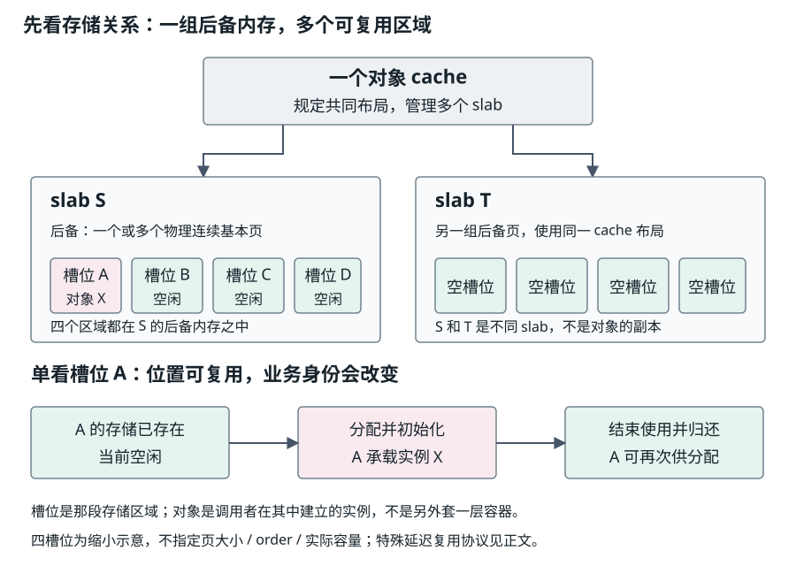
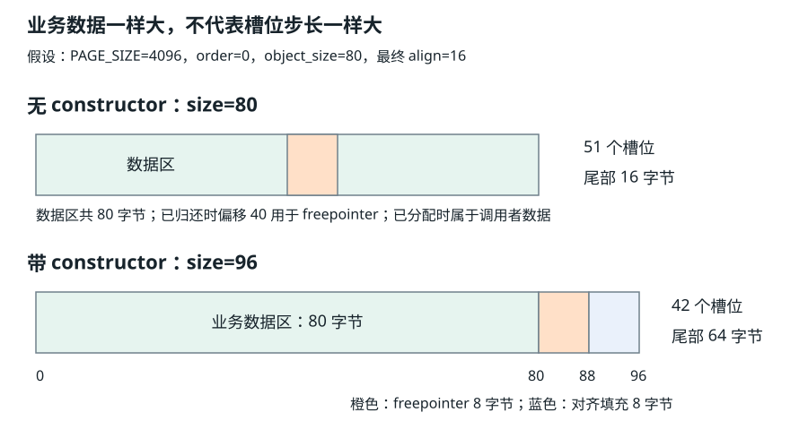
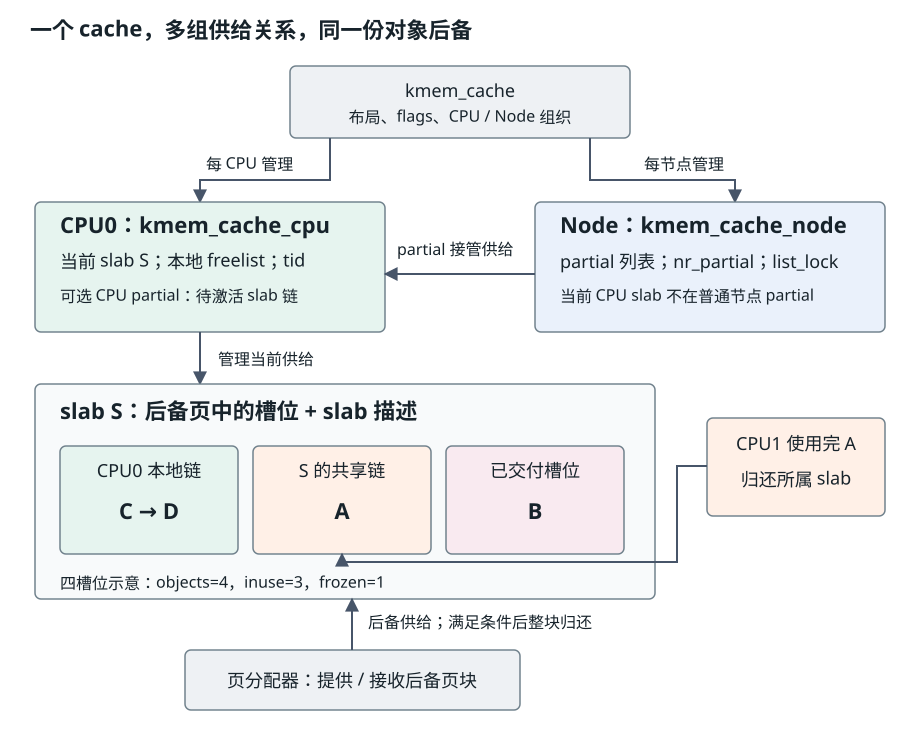
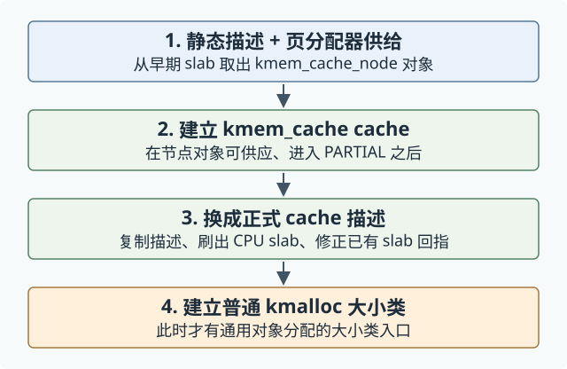
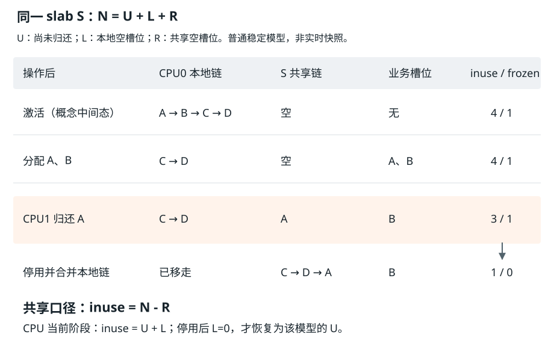
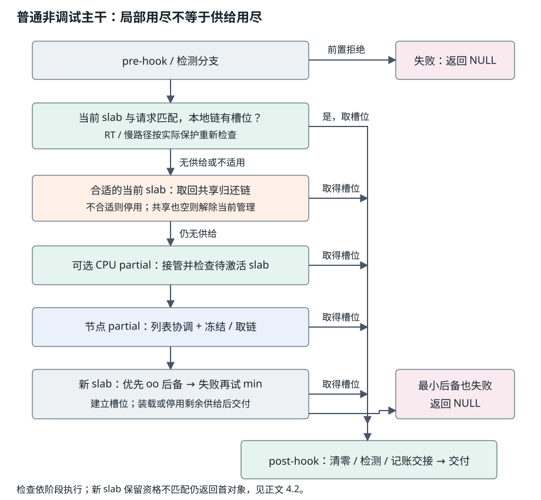
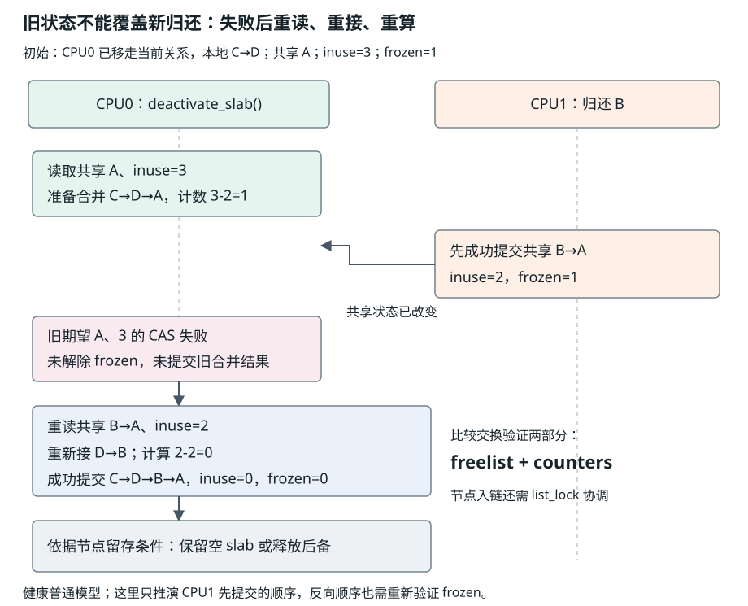

# 内核对象分配：slab、SLUB 与对象寿命

页分配器交付页块，内核中的很多需求却是几十或几百字节的结构体。对象分配器在两者之间建立一层：取得页块，把其中的存储空间划成可容纳单个对象的区域，再协调分配和归还。本文把这样的区域称为**槽位**，把一组后备页及其对象分配管理单元称为 **slab**。

这层机制最容易混淆的是三种状态：**业务对象已经结束使用、槽位已经可以复用、整个 slab 已经可以归还后备页**。它们不是同一事件。理解 SLUB，需要把这三种状态与 cache、两条 freelist、CPU 管理归属和节点列表联系起来。

## 阅读说明

- 前置：[内存管理总览](00-overview.md)与[物理页分配](01-page-allocation.md)。默认能够阅读 C，了解引用、锁和内核执行上下文。
- 基线：本地 Linux **6.1.158**、arm64 / AArch64，源码按已打 RT 补丁处理。选用 SLUB 分析实现，**不声称目标机配置已选中 SLUB**。
- `CONFIG_PREEMPT_RT`、CPU partial、NUMA、调试及检测功能按源码条件讲解。调度专题的指定 RT 前提，不自动补全本篇未知配置。
- 本文覆盖普通对象布局、局部与共享供给、分配释放协议、主要 API 和寿命边界。不展开全部调试算法、memcg 内部或完整 RCU 发布协议。
- 四槽位例子是缩小模型；布局计算中的页大小和对齐另行假设，不是目标机观测。图中 freelist 顺序用于推演，不承诺真实地址顺序。
- 文中代码为调用骨架，未编译或运行；没有加载模块、调参或压力实验。

### 缩略词与术语

| 名称 | 含义 | 本篇用途 |
| --- | --- | --- |
| slab | 一组后备页及其中的对象槽位 | 资源管理单位，不是单个业务对象 |
| 槽位 | slab 中为一次对象分配预留的一段存储空间 | 本文的布局用语，不是另一个内核结构体；分配前后都存在 |
| 业务对象 | 调用者在取得的存储中建立、使用的结构体实例 | 与槽位位置及 slab 的寿命不同 |
| SLAB / SLUB | 本版本的两种 slab 分配器实现名称 | 本文只展开 SLUB；不将两者内部结构混用 |
| cache | `struct kmem_cache` 所描述的对象缓存 | 规定对象布局、属性和供给组织，不是硬件 cache |
| freelist | 可分配槽位的链 | 区分 CPU 本地链与 slab 共享链 |
| partial | 仍有空闲槽位的 slab 管理状态 | 节点 partial 可包含完全空闲而被保留的 slab |
| GFP | Get Free Pages | 分配允许的动作及约束 |
| CAS | Compare-And-Swap，比较交换 | 条件提交组合状态；失败后重读 |
| tid | transaction ID，事务标识 | 验证 CPU 局部供给操作，不是进程或线程 ID |
| NUMA | Non-Uniform Memory Access | 节点选择与供给位置 |
| RT | Real-Time | 实时抢占分支与本地锁语义 |
| RCU | Read-Copy-Update | 延后后备回收及读取寿命边界 |
| KASAN | Kernel Address Sanitizer | 地址检测，可改变槽位复用过程 |
| KFENCE | Kernel Electric-Fence | 抽样检测，可能旁路普通 slab 供给 |

### 子机制入口

| 当前问题 | 入口 |
| --- | --- |
| slab、槽位和业务对象分别是什么 | [先建立基本模型](#basic-model) |
| 字节请求怎样变成槽位和后备页 | [布局与容量](#layout) |
| cache、slab、CPU、节点怎样协作 | [对象与归属](#objects) |
| 两条 freelist 和 `inuse` 怎样解释 | [四槽位推演](#two-freelists) |
| 局部供给用完之后怎样继续分配 | [分配与补充](#allocation) |
| 释放对象何时可能归还整个 slab | [释放与停用](#release) |
| 竞争时哪些状态必须一起改变 | [同步协议](#concurrency) |
| 应该选哪个 API，怎样完成清理 | [接口与使用](#apis) |
| 怎样区分留存、碎片与未结束使用 | [观测与边界](#boundaries) |

## 1. 定位、职责与问题

### 1.1 为什么在页之上增加对象层

若每个小结构体都独占一个基本页，会留下大量不能交给其他对象使用的空间；若每个子系统自行切页，又要重复实现空槽位组织、并发分配和页回收。对象层集中承担这些工作，让调用者按字节或对象类型提出需求。

下面先把“页块如何提供对象存储”讲清楚，再进入 cache 和 CPU 的供给组织。

<a id="basic-model"></a>
### 1.2 slab、槽位和业务对象：先区分三层

**slab 是对象分配器管理的一组后备内存。** 在本文普通 SLUB 路径中，它以一个或多个物理连续的基本页为后备，把其中的空间按同一 cache 的布局划成若干区域，供对象分配。分配器还保存其所属 cache、对象容量和空闲状态等管理信息。因此 slab 不等于“一个小结构体”，也不固定等于“一个基本页”。这里讨论的是 slab 这个资源单位；`struct slab` 是记录它的管理状态的源码描述符，不是其全部存储内容。

**槽位是 slab 中能够容纳一个对象的一段存储空间。** 它是本文对内存布局的称呼，不对应另一个叫“槽位”的内核结构体。槽位在分配前就已经存在，可以空闲、被占用、再变回空闲；包含的空间除对象数据外，还可能有对齐填充或分配器元数据。

**业务对象是调用者使用这段存储建立的一个实例。** 例如 `struct sample_object` 的实例。普通 `kmem_cache_alloc()` 返回供调用者使用的对象数据地址，不返回整个 slab，也不自动为实例建立全部业务状态。



图 1：这里只把每个 slab 画成四槽位 A/B/C/D，展示包含关系，不指定真实页大小、order 或容量。cache 是规定布局并管理多个 slab 的对象缓存，不是额外的一份业务数据，也不是硬件 cache。

沿 slab S 的槽位 A 看一次使用：

| 阶段 | 槽位 A | 业务对象 |
| --- | --- | --- |
| slab 建好、尚未交付 A | 空间已存在，是空闲槽位 | 尚未交付给本次调用者，不能当成本次可使用实例 |
| 分配并初始化 | A 被占用，调用者取得其中数据地址 | 调用者建立实例 X 并使用 |
| X 的所有使用结束后归还 | A 可以按分配器规则重新成为可分配空间 | 普通调用者不再有使用 X 的权利 |
| A 再次分配并初始化 | 同一位置重新被占用 | 新实例 Y 可以占用相同地址，不能因地址相同就认为仍是 X |

本表是普通无延迟复用条件下的模型；检测和 RCU 等特殊协议在后文区分。**槽位不是放在对象外面的另一个容器对象，而是承载对象的那段内存；释放对象也不等于把这段空间从 slab 中删除。**

如果 S 的槽位 B 仍被另一个对象占用，归还 A 只能释放 A 的使用权，不能归还包含 B 的整组后备页。即使 A/B/C/D 都空闲，是否立即释放 S 还取决于分配器留存和后备回收规则。这样就能区分开篇的三种事件：结束业务使用、允许复用某槽位、释放整个 slab。

后文讨论 freelist，是在说明“怎样找到这些空闲槽位”；讨论 frozen、CPU 和节点，是在说明“谁管理这些槽位的供给”；讨论 `inuse`，是分配器如何记录状态。它们都建立在上述存储模型之上。[证据 S2、S3](#source-layout)

### 1.3 `kmalloc` 与专用 cache 的分工

`kmalloc(n, flags)` 表达“需要 n 字节”，在适用范围选择能够容纳请求的大小类 cache；分配标志还可影响 cache 类别。超过 `KMALLOC_MAX_CACHE_SIZE` 的适用请求转向页分配路径，而不是从一个无限大的对象 cache 取槽位。阈值依目标配置，不在本文固定。

`kmem_cache_create()` 表达“这一类对象具有确定大小、对齐和属性”。后续通过该 cache 分配、归还对象。它适合反复使用的固定类型，但**创建一个专用名称不保证获得物理隔离的独立缓存**，允许合并时兼容请求可能复用已有 cache。

两者都不替使用者管理业务引用、发布顺序或锁。对象分配成功只代表存储已取得，尚不代表结构体已经具备合法业务状态。实现入口见[证据 S1](#source-api)。

<a id="kmalloc-routing"></a>
**把大小选择与槽位分配分开看。** 例如 SLUB 下普通动态大小请求 `kmalloc(n, GFP_KERNEL)`，`n = 80` 时，`kmalloc_slab()` 用 `(80 - 1) / 8 = 9` 查 `size_index`。静态表的第 9 项是 96 字节类，但本树 arm64 的 `ARCH_DMA_MINALIGN` 为 128，`include/linux/slab.h` 据此导出 `KMALLOC_MIN_SIZE`。初始化的 `setup_kmalloc_cache_index_table()` 把这项改指索引 7，即 128 字节类。因此应读**初始化后的表**，不能直接从通用静态表断言实际落在 96 字节类。

`kmalloc_type(flags)` 决定 cache 类别；类别与大小类合起来才选中 cache，之后按第 4 节从 CPU 本地链、可用 partial 或新 slab 取得槽位。编译期常量的适用内联路径可直接算索引，不改变这两层分工。大小类也不替代调用者请求的 80 字节边界。

## 2. 整体组成与关键对象

<a id="layout"></a>
### 2.1 四种“大小”不能混算

| 数量 | 表达什么 | 决定什么 |
| --- | --- | --- |
| 请求大小 | 本次 `kmalloc` 的字节数 | 选择能容纳请求的 cache |
| `s->object_size` | cache 对象的数据尺寸 | 本 cache 的数据区域；可能大于某次字节请求 |
| `s->size` | 相邻槽位之间的步长 | 对齐、元数据计入后的每槽位占用 |
| `PAGE_SIZE << order` | 一个 slab 的后备页块大小 | 可组织多少槽位以及尾部余量 |

在普通布局中，容量模型是：

```text
slab_bytes = PAGE_SIZE << order
objects    = floor(slab_bytes / s->size)
tail_bytes = slab_bytes - objects * s->size
```

这是容量计算，不是“业务对象总大小”。调试、KASAN 等会影响实际 `s->size`；相应额外区域不能算成调用者可任意写入的空间。[证据 S2](#source-layout)

### 2.2 对齐和 freepointer 怎样改变布局

用一个单独的布局例子：假设 arm64 基本页为 4096 字节，分析 order-0 后备，专用 cache 的 `object_size=80`、最终 `align=16`。忽略调试、KASAN、随机顺序和其他附加布局；这不保证真实配置会选 order-0。

普通无 constructor 的布局可以把空闲链指针存放在对象数据区内。目标源码选取的偏移为 `ALIGN_DOWN(object_size / 2, sizeof(void *))`，这里是 40。对象被交付时该区域归调用者；对象已归还时，SLUB 可将它用于链接空槽位，不同时承担两种用途。

- 无 constructor：步长为 80，容量 `4096 / 80 = 51` 个，尾部 16 字节。
- 增加 constructor、仍保持上述其余假设：freepointer 移到对象数据之外的偏移 80，占 8 字节，再按 16 对齐，步长为 96；容量 42 个，尾部 64 字节。



图 2：两种布局的业务数据都为 80 字节；第二种每槽位却占 96 字节。图只表示上述条件，不是所有带 constructor 的 cache 都固定增加 16 字节。槽位承载对象数据，但两者占用不一定相等，这正是第 1.2 节区分两者的原因。

为什么 constructor 影响 freepointer 位置？这类对象可能需要保存构造好的状态，不能把相同数据位置随意改成空闲链指针。`SLAB_TYPESAFE_BY_RCU`、poison 等也有对应的布局分支。普通无 constructor 对象则不能依赖释放后的数据仍保持原样。

要特别区分：**`s->inuse` 是布局中的元数据边界偏移，`slab->inuse` 是下面讨论的对象管理计数**。它们同名但单位和意义不同。

### 2.3 slab order 是容量与取得成本的取舍

每 slab 多放一些对象，可以减少局部供给耗尽后向共享组织和页分配器请求的次数；但更高 order 要求更大连续页块，压力或碎片下更难取得。小 order 则可能更频繁补充，并留下不同的尾部余量。

`calculate_order()` 结合对象步长、最少对象目标、允许余量与 order 条件逐步放宽搜索，而不是永远选择“能放一个对象的最小 order”。cache 保存：

- `s->oo`：优先布局的 order 和对象数。
- `s->min`：能容纳槽位的最小布局，供后备分配失败时再尝试。

同一 cache 的实际 slab 因此可能具有不同容量。后续必须读该 slab 的 `objects` 和实际后备阶数，不能把 `s->oo` 当成每个已存在 slab 的永久事实。[证据 S2](#source-layout)

<a id="objects"></a>
### 2.4 管理关系与对象归属

在“cache 管理 slab，slab 提供槽位”的模型上，CPU 和节点结构进一步组织供给：



图 3：业务对象位于 slab 的槽位中；CPU 和节点结构保存管理关系，不各自复制一份对象内存。CPU0 当前 slab 的共享链，也可以接收 CPU1 对该 slab 中对象的归还。两条链的详细协议在第 3 节展开。

| 对象 / 字段 | 持有什么 | 不代表什么 |
| --- | --- | --- |
| `struct kmem_cache` | 布局、flags、CPU 与节点组织 | 不是单个 slab，也不是业务对象引用计数器 |
| `struct slab` | 后备描述、`slab_cache`、共享链和 counters | 不是另外申请的一份对象数据 |
| `kmem_cache_cpu` | 当前 `slab`、本地 `freelist`、`tid`、可选 CPU partial | 当前 slab 的对象不一定只被这个 CPU 使用 |
| `kmem_cache_node` | 本节点 partial 列表、`nr_partial`、`list_lock` | partial 不覆盖所有 slab |
| 业务对象 | 调用者自己的锁、引用和内容 | 分配器不自动知道业务结束条件 |

本版本 `struct slab` 复用 `struct page` 的对应描述空间；对象内存仍在其后备页中。内部 `virt_to_slab()` 可由适用对象地址找到对应 slab，再由 `slab_cache` 找到 cache。它是解释实现归属的入口，不是业务代码对任意地址探测来源的通用许可。

节点 partial 表示共享可取的 slab。当前 CPU slab 不在普通节点 partial 上；启用且适用的 CPU partial 则保存一串待激活 slab，不是一条对象 freelist。普通满 slab 可以不挂在节点 full 列表上，调试条件才有额外跟踪。因此，“节点 partial 列表为空”不等于“该 cache 没有 slab”。[证据 S3](#source-objects)

这里的归属有两个层次：后备物理页始终来自对应 slab；谁管理供给会在 CPU 当前、CPU partial 和节点 partial 之间变化。把对象交给另一个 CPU 使用，不会把它搬进另一个 slab。

<a id="slub-bootstrap"></a>
### 2.5 放大初始化：管理对象从哪里来

运行时创建 cache 要准备 `kmem_cache` 描述及适用的每节点管理对象；这两类管理对象后来也是 slab 分配出来的。开机时通用 `kmalloc` cache 尚未就绪，不能用它来解释第一批管理对象从哪来。



`mm/slub.c` 的 `kmem_cache_init()` 先用静态描述建立 `kmem_cache_node` cache。在这个初始化阶段，`early_kmem_cache_node_alloc()` 直接开出早期 slab，从其中取一槽存放节点管理对象，并把剩余槽位所在的 slab 接回节点组织。节点对象能正常供应后，状态进到 `PARTIAL`，再建立用于分配 `struct kmem_cache` 的 cache。

随后 `bootstrap()` 分配正式 cache 描述、复制静态描述、刷出启动 CPU 的当前 slab，并把节点列表中的既有 slab 的 `slab_cache` 引用改向正式描述。**变化的是管理对象及其引用，不是把已有 slab 的业务内容搬到另一批物理页。** 两类描述自举完成，才初始化大小类索引和普通 `kmalloc` caches。具体入口见 `mm/slub.c` 的 `early_kmem_cache_node_alloc()`、`bootstrap()`，以及 `mm/slab_common.c` 的 `setup_kmalloc_cache_index_table()`。原文的创建、分配和释放图可按[资料对照表](reference-reading.md#slub)对照阅读。

## 3. 核心原理与决策规则

<a id="two-freelists"></a>
### 3.1 两条 freelist 解决的是共享更新频率

如果每次分配和释放都修改一个共享空闲链，多 CPU 会频繁争用同一组状态。SLUB 将当前 slab 的一部分空闲槽位交给 CPU 局部管理：

- `c->freelist`：当前 CPU 从当前 slab 取对象的局部链。
- `slab->freelist`：该 slab 的共享归还链，可以接收不适合进入上述局部链的释放。

局部分配和适用本地释放只改 CPU 供给状态；共享释放改 slab 的链与 counters。局部链耗尽后再批量取回共享链。这样，远程释放不需要直接改 CPU0 的本地链，CPU0 也不必为每次取槽位改共享计数。

“远程”实际依据是：**对象所属 slab 是否等于释放 CPU 当前的 `c->slab`**，不是对象最初在哪个 CPU 分配。即使在原分配 CPU 释放，只要它已切换当前 slab，也走共享释放。

### 3.2 frozen 与计数口径

`frozen=1` 表示 slab 暂由一个局部管理者负责，不参与普通节点列表管理。其他 CPU 可以向它的共享链归还对象，但不因这次释放擅自把它加到节点 partial，或从共享链取走它的供给。这里的“冻结”不是停止对象分配、释放或业务访问。

对下面普通、健康、稳定的双链模型，定义：

```text
N = slab->objects       总槽位数
L = CPU 本地链中的槽位数
R = slab 共享链中的槽位数
U = 已交付、尚未归还的槽位数

N = U + L + R
slab->inuse = N - R = U + L    （CPU 当前 slab 的阶段）
```

这解释了看似奇怪的计数：本地空槽位没有反映在共享链上，因此仍计入 `slab->inuse`。**不可以在任意 frozen 时刻把 `inuse` 直接解释成业务活跃数。** 在解除局部管理并合并本地链后，`L=0`，稳定普通模型才得到 `inuse=U`。

这些是用于推演的稳定状态关系，不是无锁读取多字段就能得到一致快照的承诺；调试、隔离损坏对象或检测延迟复用不在该模型中。[证据 S3、S4](#source-state)

### 3.3 四槽位主线：从建立到远程归还

假设 slab S 有 A/B/C/D 四个槽位，普通非调试路径，无额外检测延迟、节点或保留资格不匹配；暂不引入 CPU partial。除明确写出的交接外，没有并发变化。

1. 建立 S：槽位初始化并串成共享链，`objects=4, inuse=0, frozen=0`。这时尚未公开为 CPU 当前供给。
2. 激活到 CPU0：共享链被取走，S 进入局部管理；设置 `inuse=4, frozen=1`。
3. CPU0 分配 A，再分配 B：本地链变为 C→D，共享链仍空，`inuse` 仍为 4。
4. 将 A 交给 CPU1；CPU1 完成使用后归还：A 进入 **S 的共享链**，`inuse` 从 4 减为 3。CPU0 本地 C→D 不变。



图 4：两条链管理的是同一 slab 的不同空槽位集合。图中 `inuse=3` 的阶段只有 B 被交付，另有 C、D 在 CPU 本地链中。

| 阶段 | CPU0 本地链 | S 共享链 | U / L / R | inuse / frozen |
| --- | --- | --- | --- | --- |
| S 刚建立 | 无 | A→B→C→D | 0 / 0 / 4 | 0 / 0 |
| 激活后的概念状态 | A→B→C→D | 空 | 0 / 4 / 0 | 4 / 1 |
| 分配 A、B | C→D | 空 | 2 / 2 / 0 | 4 / 1 |
| CPU1 归还 A | C→D | A | 1 / 2 / 1 | 3 / 1 |

源码在激活并交付首对象的过程里会继续摘取首槽位，表中“激活后”是拆开解释的概念中间状态，不是每个 API 返回时都能观察到的独立阶段。

### 3.4 延续主线：本地链空了，S 却还有供给

CPU0 继续分配 C、D，本地链变空；B/C/D 已交付，A 在共享链，`U=3, L=0, R=1, inuse=3`。下一次请求不能直接认定 S 用完：

1. `get_freelist()` 读取共享链 A 和 counters。
2. 以组合状态更新把共享链清空，并重置 `inuse=objects=4`；有共享供给，保持 `frozen=1`。
3. 返回的 A 成为局部可用链；再摘取 A 交付本次请求。

第 2 步不是“突然多使用了一个对象”，而是 A 从共享空闲口径转回局部管理口径。交付 A 后四槽位都在使用。若又有请求而且两条链都为空，`get_freelist()` 在成功更新时解除冻结；分配路径清除 CPU 当前关系，再找其他供给。

因此三个命题不同：`c->freelist==NULL`、当前 slab 没有空槽位、整个 cache 没有可用供给。实现不能用第一个替代后两个。

### 3.5 本地归还为何不立即减少 inuse

重置到“CPU1 归还 A”之后的状态。如果 CPU0 不继续分配 C/D，而是归还 B，且 S 仍是其当前 slab，B 加到 CPU 本地链头：

```text
本地：B -> C -> D    共享：A
U=0, L=3, R=1       inuse=3, frozen=1
```

业务上没有未归还槽位，S 却仍处在 CPU 管理中，且共享计数不是零。这没有矛盾：局部释放避免了共享 counters 更新，计数要在补充或停用交接时协调。接下来第 5 节说明如何把这些局部空槽位合并并判断后备是否释放。

## 4. 主要工作过程与协作

<a id="allocation"></a>
### 4.1 供给顺序不是对每次请求的无条件承诺

普通分配的主干是局部可用槽位、当前 slab 共享归还、可选 CPU partial、节点 partial，最后建立新 slab。位置、保留资格、配置与并发检查分布在不同阶段，不能把主干读成每个槽位都先经过同一个统一门禁。



图 5：表示普通路径的决策，不表示每次请求都必须走完，也不把检测旁路和所有 NUMA 策略画进主干。

`slab_alloc_node()` 在取槽位之前运行 pre-hook；适用故障注入或 memcg 记账准备失败可以直接返回 NULL，哪怕已有空槽位。KFENCE 等检测路径也可能提供不同来源的对象。取得普通槽位后，post-hook 继续处理清零、检测和适用记账。**槽位供给不是整个 API 成败判断的唯一组成部分。** [证据 S4](#source-state)

### 4.2 从局部供给到共享 partial

局部取对象要确认当前 slab 存在、链非空且位置适用。慢路径再检查节点匹配和 `pfmemalloc` 保留资格；不适用的当前 slab 可能仍有空槽位，但应停用并寻找其他供给。

`pfmemalloc` 是后备页使用了相应保留资格的标记：页分配准备在使用 `ALLOC_NO_WATERMARKS` 的路径设置它，SLUB 建 slab 时继承，用来避免随意把这类供给用于普通目的。它不等于“凡 GFP_ATOMIC 分配都具有这个标记”。

对带标记 slab，`pfmemalloc_match()` 调用 `gfp_pfmemalloc_allowed()` 判断当前请求资格。后者同时看标志、任务与执行状态：`__GFP_NOMEMALLOC` 先排除，`__GFP_MEMALLOC`、适用 `PF_MEMALLOC` 或 OOM 保留资格按实际条件允许。不能仅据 `GFP_KERNEL` / `GFP_ATOMIC` 名称决定结果。

检查的位置还有一个本版本必须保留的区别：

| 阶段 | 本地源码行为 |
| --- | --- |
| 非 RT 适用局部快路径 | 检查链、当前 slab 和节点，没有在该分支逐次执行 `pfmemalloc_match()` |
| 当前 slab 慢路径 / CPU partial 激活后的检查 | 不匹配时停用，另找供给 |
| 节点 partial 查找 | 跳过不满足 `pfmemalloc_match()` 的候选 |
| 新 slab 已建立后的不匹配分支 | 停用其余槽位、不装载为局部供给，**仍返回本次首对象** |

最后一行是 `___slab_alloc()` 中明确的分支，不是推荐调用者取得保留资格的捷径。它解释了为什么不能把“不匹配”概括成所有来源都在交付前拒绝。本文讲清该交接，不穷举页分配器全部保留策略。[证据 S4](#source-state)

对上一节的四槽位模型，节点和资格始终匹配，因此本地空链首先尝试 S 的共享链，而不会先去申请新页。

两条链都没有供给时，若有适用 CPU partial，就摘一个待激活 slab 作当前 slab，再按当前请求检查和取得其共享链。CPU partial 的 `frozen` 不等于它已经有一条 CPU 本地对象链：待激活时空槽位通常仍在该 slab 的共享链中。

从节点 partial 取得 slab 时，`get_partial_node()` 用节点 `list_lock` 协调列表；`acquire_slab()` 用 slab 组合更新取走共享链并冻结，然后从节点列表删除。这两类保护各管一部分：列表锁防止另一个分配者同时接管相同列表节点，slab 组合更新则验证并发归还没有使读取的状态过期。

显式节点请求与未指定节点的搜索不完全相同，`get_partial()` 对未指定节点才继续相应远节点 partial 搜索。新后备的页级回退仍按 GFP 和页分配规则处理；`kmem_cache_alloc_node()` 的节点参数不应被理解成所有路径无条件的严格物理位置保证。[证据 S4](#source-state)

### 4.3 新 slab：高阶失败不一定是请求失败

没有适用旧供给时，`new_slab()` / `allocate_slab()` 取得后备页，设置所属 cache、对象数量和链，逐槽位执行适用初始化，再激活供给。

优先后备使用 `s->oo`。目标源码给这次尝试加入较克制的失败行为；当优先阶高于最小阶且允许直接回收时，还会避免为优先高阶布局执行那次回收。失败后用 `s->min` 和相应原始有效标志再尝试。不是所有新 slab 一律只做两次完全相同的页请求。

例如另一个明确假设的 cache，`oo.order=2`、`min.order=0`，步长为 128、基本页为 4096：

| 后备选择 | 页数 | 槽位容量 | 结果含义 |
| --- | --- | --- | --- |
| 优先 order-2 | 4 | 128 | 较多局部供给，要求更大连续页块 |
| 失败后 order-0 | 1 | 32 | 容量较小，但仍能交付完整对象 |
| 最小后备也失败 | 无 | 无 | 普通新 slab 路径不能交付对象 |

第一步失败不是“少交付半个对象”；第二步成功改变的是这个 slab 的容量。即使该 cache 别处有空槽位，位置或资格不适用也可能走到后备失败。[证据 S2](#source-layout)

### 4.4 可睡眠阶段前后为什么重读 CPU 状态

创建后备可能睡眠，不能把 CPU 局部锁一直持有到页分配结束。`___slab_alloc()` 在调用 `new_slab()` 前释放相应 CPU 稳定保护，回来后重新取得 CPU 指针；重新装载供给时还要确认当前状态。

在这段时间，任务可能迁移，原 CPU 也可能处理其他分配，当前 slab 已经变化。代码在 `retry_load_slab` 处处理这类变化，不能拿睡眠前的 `c` 和“当时没有 slab”直接当作返回后的事实。

这也说明，“每 CPU 缓存”不意味着一次完整分配函数一直不可抢占，或者一直操作同一 CPU。保护只覆盖具体阶段，边界之间需要重新验证。

## 5. 源码实现与关键约束

<a id="release"></a>
### 5.1 释放首先归还槽位，不能跳过业务寿命

调用者在最后一次使用结束后，通过来源匹配的接口归还对象。普通 SLUB 释放判断对象所属 slab 是否为本 CPU 当前 slab：相同时优先局部链；不相同时进入 `__slab_free()`，更新所属 slab 的共享链。

在 frozen slab 的共享归还中，释放方把对象接到共享链头，减少 `inuse`，组合提交后不做普通节点列表移动。若 slab 已解除冻结，释放可能让原满 slab 变为 partial，或让已有 partial 变空，此时还需要列表或 CPU partial 管理。

调试 cache、KASAN 隔离等可能改变普通归还路径或推迟槽位复用。分配器不会等待业务工作队列、定时器或引用者自动退出；提前释放即使成功挂回链，也仍是业务 use-after-free。[证据 S5](#source-release)

### 5.2 延续四槽位：停用如何恢复共享口径

回到“CPU1 已归还 A，CPU0 本地 C→D，B 尚未归还”的状态。假设一次位置不匹配或显式内部 flush 导致 CPU0 停用 S：

1. 在局部保护下移走当前关系，保存 S 和 C→D，清空 `c->slab/c->freelist` 并推进 tid。新局部操作不能继续从 S 取对象。
2. `deactivate_slab()` 统计本地空槽位，得到 `free_delta=2`，记住链尾 D。
3. 读取 S 的共享链 A 和 `inuse=3, frozen=1`。
4. 把 D 的 next 接到 A，准备共享链 C→D→A；计算 `new.inuse=3-2=1`，解除 frozen。
5. 根据新状态选择管理位置，成功提交后进入节点 partial。B 仍在使用，后备不能释放。

合并前后空槽位总数都为 3，没有凭空新增内存。改变的是管理位置与计数口径。

### 5.3 同样全空，为什么有时保留、有时归还

如果在上述停用前 CPU0 也已本地归还 B，则本地 B→C→D，共享 A，`inuse=3`。合并扣除本地三槽位后得到 `inuse=0`。

普通 `deactivate_slab()` 的主要选择为：

| 停用后的条件 | 去向 | 为什么 |
| --- | --- | --- |
| `inuse=0` 且节点 `nr_partial >= min_partial` | 丢弃 slab，进入后备释放 | 节点已有相应留存供给 |
| 共享链非空，但未进入上述释放条件 | 节点 partial，可包含空 slab | 保留供给，降低后续重新建 slab 成本 |
| 共享链为空，slab 满 | 普通条件不挂 full 列表；特定调试条件跟踪 | 暂无共享可供分配的槽位 |

这里 `min_partial` 与 `nr_partial` 的单位是 **slab 数**，不是槽位数；partial 列表还可能包含未全空的 slab，因此也不是“至少保留这么多个空 slab”的精确承诺。

另一种顺序是 S 先以 `inuse=1` 进入节点 partial，再归还 B。普通共享释放把它降为零，结合当前节点留存数量判断是否移除并释放。

CPU partial 还会增加一段留存。下面换到 S 已满、已解除当前 CPU 管理的分支：四个槽位都已交付，`inuse=4, frozen=0`，普通条件下不在 full 列表。假设 CPU partial 已启用、cache 非调试，释放 CPU 的当前 slab 与 S/T 均不同；将其 `cpu_partial_slabs` 阈值简化为 1，初始 partial 链为空，没有其他并发。数值仅为演示。

| 操作后 | S 的共享链 / inuse / frozen | 释放 CPU 的 partial | 交接 |
| --- | --- | --- | --- |
| 首次归还 S 中 A | A / 3 / 1 | S | 原满 slab 首次获得空槽位，冻结后放入 CPU partial |
| 再归还 B/C/D | D→C→B→A / 0 / 1 | 仍为 S | frozen 共享释放结束，不因全空自动排空 |
| 另一个原满 slab T 首次归还对象 | S 尚未解除冻结 | 旧链 S 被摘下，新链装入 T | `put_cpu_partial(..., drain=1)` 发现旧链 slab 数达到阈值 |
| 释放局部锁后处理旧链 S | 共享链不变 / 0 / 0 | T | 解除旧链冻结，按节点留存条件入 partial 或丢弃 |

阈值计量是 **slab 数量**，不是业务对象数，也不是“这次释放到全空”事件。`put_cpu_partial()` 先在局部保护下摘掉待排空旧链并装入新 slab，之后才在局部锁外调用旧链的解除冻结过程；新 slab T 不因触发旧链排空就一起被丢弃。

分配也可能从 CPU partial 接管 S；cache flush 则是另一种回流入口。`flush_cpu_slab()` 分别处理当前 slab 和 `unfreeze_partials()`，shrink/关闭 cache 会使用相应 flush 流程。不能把“没有下一次普通释放”理解成 CPU partial 永远无法退出。

所以“最后一个业务对象归还”与“后备页归还”之间可能隔着局部停用、留存策略、CPU partial 排空或 RCU 延后；不能据一次 `kmem_cache_free()` 承诺立即增加 Buddy 空闲页。

### 5.4 后备归还与 shrink 的边界

`discard_slab()` 接到真正后备释放。普通 `__free_slab()` 清理 slab 状态、撤销相关记账，再把实际 order 的页块归还页分配器。页分配器仍可能先放入 PCP，不能把“离开 SLUB”写成“立即已在 Buddy 合并”。带 `SLAB_TYPESAFE_BY_RCU` 时，`free_slab()` 通过 RCU 回调延后实际后备释放。

`kmem_cache_shrink()` 在本地实现中先 flush 局部供给，再扫描节点 partial，释放空 slab，并将适用的较满 slab 放到更靠前的位置。它**不会把所有活跃对象搬到一起**，也不能直接释放仍有活跃槽位的 slab。

把较满 slab 优先用于新分配，有助于避免继续填充最稀疏的 slab；稀疏 slab 若剩余对象之后归还，才更有机会整块释放。返回 0 表示此次检查认为所有 slab 已释放，非零表示仍有 slab；不是返回“释放了多少页”，并发分配也不由它禁止。[证据 S5](#source-release)

<a id="concurrency"></a>
### 5.5 两组组合状态，不是一把锁管全部

| 保护对象 | 需要协调的状态 | 适用机制 |
| --- | --- | --- |
| 当前 CPU 供给 | `c->freelist`、`c->tid`，以及切换当前 slab | 非 RT 适用局部 CAS；慢路径与 RT 使用 local lock |
| slab 共享状态 | `slab->freelist` 与 `counters` 中的 inuse/objects/frozen | slab 双字比较交换，条件不适用时由 slab lock 完成等价检查更新 |
| 节点组织 | partial/full 链及 `nr_partial` | 节点 `list_lock` |
| 全局 cache 元数据 | cache 列表、创建销毁等 | `slab_mutex` 及相应热插拔保护 |
| 业务对象 | 内容、身份、引用、发布 | 调用者自己的协议 |

CPU local lock 不阻止另一个 CPU 向 S 的共享链归还；节点列表锁也不是每次共享释放都必须取得。否则两条链降低共享争用的意义就不存在了。

### 5.6 tid 验证什么，arm64 实际又做了什么

非 RT 的适用局部快路径读取 tid，再读取链头和当前 slab，提交 `(freelist, tid)` 的条件更新。例如只用于表示事件的 `T`：

```text
读取：        (A, T)
中间局部操作：(B, next_tid(T))
旧请求提交：  期望 (A, T) -> 不匹配，重新读取
```

若中间分配和归还使链头又回到 A，tid 已推进，旧请求仍不能仅因地址相同就成功。启用抢占的构建中 `TID_STEP` 按 CPU 数量取相应步长，初值含 CPU 编号；实际不是每次都简单 `+1`。

这个协议用于验证局部事件与 CPU 匹配，不是跨 CPU 保护业务对象的引用协议，也不是无限位宽的永久唯一身份编号。

还必须追踪 arm64 具体实现：本地 `this_cpu_cmpxchg_double_8()` 在一次双字操作周围调用 `preempt_disable_notrace()` / `preempt_enable_notrace()`，内部使用 `cmpxchg_double_local()`。因此 SLUB 通用代码“没有显式围住整个快路径禁抢占”，**不能推导成 arm64 实际操作从不禁抢占**。共享 slab 更新使用的是另一组带相应内存语义的比较交换，不把 local 变体当成跨 CPU 锁。[证据 S6](#source-concurrency)

### 5.7 停用遇到远程归还：为什么必须重算

重置到第 5.2 节开始的状态：本地 C→D，共享 A，`inuse=3, frozen=1`，只有 B 未归还。CPU0 已摘掉当前关系、准备停用，CPU1 正要归还 B。



| 顺序 | CPU0 停用 | CPU1 归还 | S 的已提交共享状态 |
| --- | --- | --- | --- |
| 1 | 读到共享 A、inuse=3，准备扣除本地 2 个 | 尚未提交 | A；3；frozen=1 |
| 2 | 旧预期尚未提交 | 提交 B→A，inuse=2 | B→A；2；frozen=1 |
| 3 | 期望仍是 A、3，比较交换失败 | 已完成 | B→A；2；frozen=1 |
| 4 | 重读 B→A、2，重接 D→B，计算 `2-2=0` | 不再变化 | 成功后 C→D→B→A；0；frozen=0 |

若 CPU0 只更新 freelist 而不验证 counters，可能丢失 B 的归还或保留错误计数；若只更新计数，链也可能与之不一致。组合提交既验证旧状态，也一次提交新链与新 frozen/count。

`deactivate_slab()` 对需要节点列表管理的模式先取得 `list_lock`，组合更新成功后才入链；失败则释放相应锁，回到 redo 重读和重选去向。第 4 步已经全空，最终保留还是释放仍依第 5.3 节条件，不由“CAS 成功”本身决定。

若停用先成功，CPU1 的旧 frozen 预期也必须失败并重试，随后按已解除冻结的状态处理。不能把远程方一次读取到的 frozen 当成整个释放期间固定事实。

### 5.8 RT 改的是局部同步方式，不是供给模型

本地 `CONFIG_PREEMPT_RT` 分支令 `USE_LOCKLESS_FAST_PATH()` 为 false。普通分配转入使用 local lock 的路径，普通本地释放也在 local lock 下更新链并重新验证当前 slab。仍然使用本地 freelist、共享归还和 partial，不是每次直接请求 Buddy。

RT 的 local lock 不等于普通 irqsave 区域无条件禁抢占或硬中断。分阶段 CPU 稳定保护使用迁移禁止，具体可睡眠与锁顺序依实际路径判断。RT 关闭 CPU 局部无锁快路径，**不意味着 arm64 的 slab 共享双字比较交换必然被关闭**；后者另有体系结构能力和 cache flags 条件。

本地 SLUB 对 RT 的策略不允许 hardirq 中分配/释放，也不能把线程化 IRQ 与真正 hardirq 混同。**持有 `raw_spinlock_t` 等严格不可抢占保护时，即使有本地空槽位，也不能据 `GFP_ATOMIC` 推导分配安全；RT 的普通本地释放同样不能放在那里。**

原因不仅是会不会直接回收：RT 的 local lock 映射为每 CPU `spinlock_t`，保持可抢占并具有可能阻塞的锁语义；普通局部取槽位或归还会经过它，命中 freelist 不能跳过这种同步限制。应在进入严格保护区前准备存储，或设计明确受支持的预分配协议，而不是换一个 GFP 掩码。

本地 GFP 文档也明确不支持 NMI 和包括 raw spinlock 在内的部分严格不可抢占上下文，`GFP_NOWAIT` 同样不豁免。本文不把 NMI 中的这些分配接口当作合法路径。即使局部路径很短，后备申请、重试和检测也使单次分配延迟不构成固定上界。[证据 S6](#source-concurrency)

## 6. 接口与使用

<a id="apis"></a>
### 6.1 先按需求选择，再确定上下文

| 需求 | 主要接口 | 成功结果与清理 |
| --- | --- | --- |
| 单块字节存储 | `kmalloc(size, gfp)` / `kzalloc(size, gfp)` | 对应存储；`kfree()` |
| 数组，避免乘法溢出 | `kmalloc_array(n, size, gfp)` / `kcalloc(n, size, gfp)` | 检查乘法，后者清零；`kfree()` |
| 固定类型 cache | `kmem_cache_create(name, size, align, flags, ctor)` | cache 指针；停止使用并排空后 `kmem_cache_destroy()` |
| 从 cache 取对象 | `kmem_cache_alloc(s, gfp)` / `kmem_cache_zalloc(s, gfp)` | 槽位；`kmem_cache_free(s, obj)` |
| 指定首选节点 | `kmem_cache_alloc_node(s, gfp, node)` | 结合实际位置规则；仍归还来源 cache |
| 批量 cache 对象 | `kmem_cache_alloc_bulk(s, gfp, n, p)` | 本地 SLUB 正请求成功返回 n；失败返回 0并清理此前取得的部分 |
| 批量归还 | `kmem_cache_free_bulk(s, n, p)` | 归还给相应 cache，满足批量上下文要求 |
| 尽量释放空 slab | `kmem_cache_shrink(s)` | 保留 cache；返回值不是释放数量 |

成功分配的普通非零大小请求交付可用存储，失败检查 NULL。零大小 `kmalloc` 可返回 `ZERO_SIZE_PTR`，它不是可以解引用的业务对象；不要用零大小请求来简化正常对象判断。

GFP 决定允许的行为，不是给某个调用地点发放“安全证书”。`GFP_KERNEL` 的路径可以睡眠；不能因为近期总命中 freelist，就把同一代码放进不可睡眠区域。`GFP_NOWAIT` / `GFP_ATOMIC` 不能保证成功，也不豁免上一节的 NMI、严格不可抢占及 RT hardirq 边界。RT 下释放没有 GFP 参数，但仍需满足实际锁与上下文契约。

cache 创建和销毁涉及可睡眠元数据管理，应放在合适的初始化/退出阶段。批量分配和归还接口另要求中断使能；不能将单对象经验直接搬到 bulk。

cache 对象应通过取得它的 cache 归还。本文不依赖某些实现可识别来源的特殊行为放宽 API 配对；来自 `vmalloc`、页分配或其他分配器的地址更不能任意交给 `kfree`。[证据 S1](#source-api)

### 6.2 constructor、清零与逐次初始化

constructor 在新 slab 的槽位建立时运行，不保证每次复用都重新执行。它也不替调用者释放业务资源。本地 `new_slab()` 对 constructor 与 `__GFP_ZERO` 的组合有告警，因此不能在已有 ctor cache 上随意改用 zalloc，假定“重建构造状态”。

普通 `kmem_cache_zalloc()` 适合无 constructor 的清零需求，但零字节不等于合法的锁、链表头、引用和业务状态。这些仍需对应初始化。专用 cache 的名称是显示标识，也不代替业务类型检查。

允许合并时，多个创建请求可引用兼容的同一 cache，内部 `refcount` 管理这些创建引用，而不是对象使用引用。每次成功创建取得的引用应按 API 配对销毁，不能对同一取得的 cache 引用反复 destroy，试图“直到没有对象”为止。

### 6.3 两次分配，第二次失败也要完整清理

以下示例仅适用于可睡眠上下文、无 constructor、未发布给其他使用者的独占对象。包含声明和全部清理，不是完整可加载模块：

```c
#include <linux/errno.h>
#include <linux/slab.h>

struct sample_object {
    unsigned long value;
};

static int cache_example(void)
{
    struct kmem_cache *cache;
    struct sample_object *a, *b;
    int ret = -ENOMEM;

    cache = kmem_cache_create("mm_example", sizeof(*a), 0, 0, NULL);
    if (!cache)
        return ret;
    a = kmem_cache_zalloc(cache, GFP_KERNEL);
    if (!a)
        goto out_cache;

    b = kmem_cache_zalloc(cache, GFP_KERNEL);
    if (!b)
        goto out_a;

    a->value = 1;
    b->value = 2;
    kmem_cache_free(cache, b);
    ret = 0;
out_a:
    kmem_cache_free(cache, a);
out_cache:
    kmem_cache_destroy(cache);
    return ret;
}
```

| 失败点 | 已取得资源 | 清理 |
| --- | --- | --- |
| cache 创建 | 无 | 返回 |
| 第一次对象分配 | cache | destroy cache |
| 第二次对象分配 | cache、a | free a，再 destroy |
| 正常完成 | cache、a、b | free b、free a，再 destroy |

这是两次独立调用，第一次成功不会因第二次失败自动撤销。反之，本地 SLUB 的 `kmem_cache_alloc_bulk()` 正数量请求失败时主动清理前面已取得的对象，并返回 0；输出数组可能保留已失效指针值，不能再次把它们当成取得的资源释放。成功才按返回的完整数量使用和归还。

### 6.4 真正组件退出时，先停业务再停 cache

真实子系统常在初始化时创建 cache，长时间分配对象，在退出时销毁。应先停止新入口，再按本子系统协议排空已发布对象、引用者、工作和延迟回调，最后销毁 cache。没有通用的“一次 synchronize 就完成所有退出”的顺序。

`kmem_cache_destroy()` 会 flush 分配器局部状态并尝试关闭 cache，但不替业务层等待引用归零。尚有对象时本地关闭可失败并告警；该 API 返回 void，不是可以反复重试的 `-EBUSY` 接口。

名称与回调代码的寿命也要分开：本地创建用 `kstrdup_const()` 保存普通名称或安全复用相应内核常量，释放 cache 时清理保存名称，不要求普通临时名称缓冲普遍存活到销毁。constructor 回调代码及依赖必须在仍可能构建槽位时有效；业务延迟回调的代码寿命又由业务退出协议保证。[证据 S7](#source-lifetime)

## 7. 边界、变体与常见误解

<a id="boundaries"></a>
### 7.1 RCU 类型安全不保留旧业务身份

`SLAB_TYPESAFE_BY_RCU` 延后的是 slab 后备页的回收，不延后每个对象槽位的归还和复用。例如读取者在 RCU 区域内取得地址 A：

1. 原对象 X 结束使用，调用者归还 A。
2. 同一个 cache 将 A 分配给新对象 Y。
3. 原读取者仍持有地址 A；后备未离开相应类型存储，并不说明它仍是 X。

因此读取者必须有对象获取引用、身份验证和重试协议。目标 `slab.h` 的说明展示先尝试取得引用、再验证 key 的思路；具体内存顺序、引用重新初始化和发布仍依子系统协议，不能复制一个伪代码就声称所有无锁查找安全。

如果业务需要“X 结束后，宽限期内不复用这个槽位”，应由业务自己的延迟释放协议保证，而不是只给 cache 加这个 flag。读者也不能对未受相应协议保护的任意旧指针套用类型安全结论。[证据 S7](#source-lifetime)

### 7.2 占用大不一定泄漏，空槽位多也不一定可回收

以普通稳定模型区分三个数量：

```text
业务请求的数据总量
已取得槽位的总步长
所有仍由 SLUB 持有的后备页字节数
```

它们可以依次增大：请求与大小类有差距，槽位含对齐或元数据，slab 又有空槽位与尾部余量。只有业务对象没有按预期结束寿命，才是其中一种可能的泄漏原因，不能把全部差值都称为泄漏。

若四个 slab 各有四槽位、每个只剩一个长期使用对象，虽然总空槽位有 12 个，也不能仅凭数量释放任意一个 slab。SLUB 不会自动移动这些活跃对象去拼成一个满 slab；物理页规整也不会自动获得搬移任意内核对象、修正其所有指针的许可。

| 现象 | 先区分的原因 | 深入入口 |
| --- | --- | --- |
| 归还后后备占用没有立即下降 | CPU 局部留存、空 slab 保留、CPU partial、检测或 RCU 延后 | 两条链、停用及后备释放 |
| 存在空槽位但分配仍失败 | pre-hook 拒绝、位置或保留资格不匹配、可用供给不在当前范围 | 分配资格和失败点 |
| cache slab 长期增长 | 正常业务增长、未退出引用、重复申请、元数据变化 | 业务寿命与布局，再看分配来源 |
| 仍有很多稀疏 slab | 少量活跃对象分散，无法整块释放 | shrink 的边界 |

`/proc/slabinfo`、适用 sysfs 和 SLUB 统计提供不同组织视角。以本地启用相应 SLUB 统计支持、cache 仍使用普通路径且采样稳定的 `get_slabinfo()` 为例：

```text
num_objs    = 各节点记录的总槽位数
nr_free     = 节点 partial 列表中统计到的空槽位数
active_objs = num_objs - nr_free
```

它没有在这里遍历所有 CPU 的两条链扣除局部空槽位。沿四槽位 S 的例子，假设该 cache 只有 S：

| 稳定阶段 | 真正尚未归还的槽位 | slab->inuse | active_objs / num_objs | 原因 |
| --- | --- | --- | --- | --- |
| CPU0 本地 C/D，共享 A，只有 B 未归还 | 1 | 3 | 4 / 4 | S 不在节点 partial，节点空闲统计不扣除这三槽位 |
| 停用后共享 C/D/A，S 在节点 partial | 1 | 1 | 1 / 4 | 节点 partial 能统计三个空槽位 |
| B 也归还，S 全空但按留存条件保留 | 0 | 0 | 0 / 4 | 槽位全空，后备仍由 cache 持有 |

第一行的 `active_objs=4`、`slab->inuse=3`、业务未归还数 1 可以同时成立，不能据此认定“统计损坏”或“业务泄漏了四个对象”。同一接口中的 `objects_per_slab/cache_order` 取优先 `s->oo`，不意味着每个 slab 都未发生低阶后备回退。

其他 sysfs 属性要继续核对其 flags 与生成函数，采样也不保证得到无并发的一致全局快照。对象来源追踪取决于检测选项是否已启用。本文只说明诊断方向，不更改配置或执行 shrink。相关观测方法见[观测专题初稿](14-observability-extensions.md)。[证据 S8](#source-observe)

### 7.3 可回收属性不是“任意对象可以被丢弃”

`SLAB_RECLAIM_ACCOUNT` 影响后备分配分类和相应统计，但没有提供业务对象回收函数，也不让活跃内核对象进入普通 swap。实际对象是否可以释放，取决于使用者自己的缓存和 shrinker 协议。memcg 对适用对象记账也不改变该对象的清理责任；内部收费见[memcg 专题初稿](12-memcg-oom.md)。

本篇普通模型之外，调试 cache 会改变分配串行化和列表跟踪，KASAN 可延迟复用，KFENCE 可旁路普通供给。首先确认条件，再使用相应源码分支，不把这些例外写成每次分配都执行的固定步骤。

## 8. 总结与源码入口

可以用四个判断连接本篇主干：

1. 请求如何选择布局？先区分字节需求、槽位步长和后备 order。
2. 空槽位在哪？区分 CPU 本地链、slab 共享链和待接管 slab。
3. 谁负责交接？frozen 控制管理归属，组合更新和列表锁协调状态与位置。
4. 能否释放后备？先满足业务寿命，再解除局部管理、判断全空及留存/延后条件。

沿四槽位主线，`inuse` 从 4 变 3，不必意味着业务只用了 3 个；停用把本地空槽位并回共享链，才恢复相应共享计数。一次局部空链、一次对象归还和一次后备回收，分别是不同层的事件。

### 目标源码证据

以下入口针对本地源码，不把外部最新实现当成本版本事实。源码文件为主要链接，函数名用于搜索；站点预览不一定提供 C 文件行号跳转。

<a id="source-api"></a>
**S1：需求选择与 API**

- [include/linux/slab.h](../../../../linux-6.1.158/include/linux/slab.h)：`kmalloc()`、`kmalloc_array()`、`kcalloc()`、cache 与 bulk 声明及上下文说明。
- [mm/slab_common.c](../../../../linux-6.1.158/mm/slab_common.c)：`__do_kmalloc_node()`、`__kmalloc_large_node()`、`kfree()`、`find_mergeable()`。
- [mm/slub.c](../../../../linux-6.1.158/mm/slub.c)：`kmem_cache_alloc_bulk()` 的成功数量与 error 清理。

<a id="source-layout"></a>
**S2：布局与后备**

- [mm/slub.c](../../../../linux-6.1.158/mm/slub.c)：`calculate_sizes()`（4190 起）、`calculate_order()`、`setup_object()`、`allocate_slab()`（1923 起）、`new_slab()`。
- [include/linux/slub_def.h](../../../../linux-6.1.158/include/linux/slub_def.h)：`object_size`、`size`、`offset`、`inuse`、`oo` 与 `min`。

<a id="source-objects"></a>
**S3：对象组织**

- [mm/slab.h](../../../../linux-6.1.158/mm/slab.h)：`struct slab`、`virt_to_slab()`、`struct kmem_cache_node`。
- [include/linux/slub_def.h](../../../../linux-6.1.158/include/linux/slub_def.h)：`struct kmem_cache_cpu`、`struct kmem_cache`。
- [mm/slub.c](../../../../linux-6.1.158/mm/slub.c)：开头 frozen、列表和锁说明，普通与调试列表行为。

<a id="source-state"></a>
**S4：激活与补充**

- [mm/slub.c](../../../../linux-6.1.158/mm/slub.c)：`slab_alloc_node()`（3269 起）、`___slab_alloc()`（3008 起）、`get_freelist()`（2963 起）、`acquire_slab()`、`get_partial_node()`、`get_partial()`。
- [mm/slab.h](../../../../linux-6.1.158/mm/slab.h)：`slab_pre_alloc_hook()`、`slab_post_alloc_hook()` 与清零/记账交接。
- [mm/page_alloc.c](../../../../linux-6.1.158/mm/page_alloc.c)：页分配准备中的 pfmemalloc 标记、`__gfp_pfmemalloc_flags()`、`gfp_pfmemalloc_allowed()`；与 SLUB 分阶段资格检查对应。

<a id="source-release"></a>
**S5：释放与后备交接**

- [mm/slub.c](../../../../linux-6.1.158/mm/slub.c)：`do_slab_free()`、`__slab_free()`（3485 起）、`deactivate_slab()`（2416 起）、`put_cpu_partial()`、`__unfreeze_partials()`、`discard_slab()`、`free_slab()`、`__free_slab()`、`__kmem_cache_do_shrink()`。
- [mm/slab_common.c](../../../../linux-6.1.158/mm/slab_common.c)：`kmem_cache_shrink()` 的返回契约。

<a id="source-concurrency"></a>
**S6：同步与 arm64**

- [mm/slub.c](../../../../linux-6.1.158/mm/slub.c)：`USE_LOCKLESS_FAST_PATH`、`__cmpxchg_double_slab()`、`cmpxchg_double_slab()`、`next_tid()`；RT hardirq 策略说明在 499 起的注释。
- [arch/arm64/include/asm/percpu.h](../../../../linux-6.1.158/arch/arm64/include/asm/percpu.h)：`this_cpu_cmpxchg_double_8()`。
- [arch/arm64/include/asm/cmpxchg.h](../../../../linux-6.1.158/arch/arm64/include/asm/cmpxchg.h)：`arch_cmpxchg_double()` 与 local 变体。
- [include/linux/local_lock_internal.h](../../../../linux-6.1.158/include/linux/local_lock_internal.h)：RT 的 per-CPU spinlock 映射与迁移保护。
- [include/linux/gfp_types.h](../../../../linux-6.1.158/include/linux/gfp_types.h)：GFP_ATOMIC / GFP_NOWAIT 的 NMI、raw spinlock 等上下文边界。

<a id="source-lifetime"></a>
**S7：创建、销毁与寿命**

- [mm/slab_common.c](../../../../linux-6.1.158/mm/slab_common.c)：`kmem_cache_create_usercopy()`、`find_mergeable()`、`shutdown_cache()`、`kmem_cache_destroy()`、RCU cache 关闭工作。
- [mm/slub.c](../../../../linux-6.1.158/mm/slub.c)：`setup_object()`、`new_slab()` 的 ctor/zero 告警、`__kmem_cache_shutdown()`。
- [include/linux/slab.h](../../../../linux-6.1.158/include/linux/slab.h)：`SLAB_TYPESAFE_BY_RCU` 的寿命与身份验证说明。

<a id="source-observe"></a>
**S8：观测与属性**

- [mm/slub.c](../../../../linux-6.1.158/mm/slub.c)：`get_slabinfo()`、`show_slab_objects()` 与对应 sysfs 属性生成函数。
- [Documentation/mm/slub.rst](../../../../linux-6.1.158/Documentation/mm/slub.rst)：调试、cache 合并与观测条件。其历史例子不作为本文 arm64 地址或配置依据。
- [mm/slub.c](../../../../linux-6.1.158/mm/slub.c)：`calculate_sizes()` 中 `SLAB_RECLAIM_ACCOUNT` 的后备标志设置；回收内部见[回收专题初稿](09-reclaim-swap.md)。

<a id="review-result"></a>
## 独立挑战审阅

以下是外部图解增补前的审阅记录；增补范围见[本轮对照](reference-reading.md#slub)。

第 1 轮曾通过，但用户随后反馈 slab / 槽位的概念仍不清楚，说明首次引入的解释不足。本次补充第 1.2 节及基本关系图，并把复杂供给图后移。同一审阅者 James 重读最新整篇及六图，确认文本补足该模型缺口，分别给出本轮技术与教学审阅通过结论。累计使用 2 轮，无待裁决项，上限仍为 3 轮。

用户随后确认概念目前清晰并允许继续下一专题，已记录在本次审阅记录中。该反馈确认本次概念澄清，不代表逐项技术验收或目标机运行验证；本篇机制正文不因此再改动。

[写前约定](review/contract-kernel-objects.md)与[本次审阅记录](review/review-kernel-objects.md)保存关键问题、回应、版本和验证范围。作者完成本地 SVG/链接及桌面、窄屏临时渲染检查；没有编译示例或验证目标机运行。审阅通过不替代用户确认或真实学习效果验证。旧版 Boole 结论保留在[历史记录](review/review-mm-series.md#p03)，不作为本次重写稿依据。
