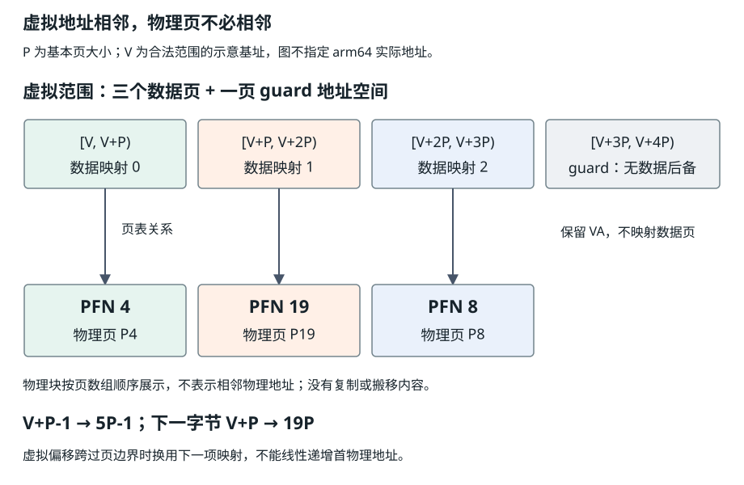
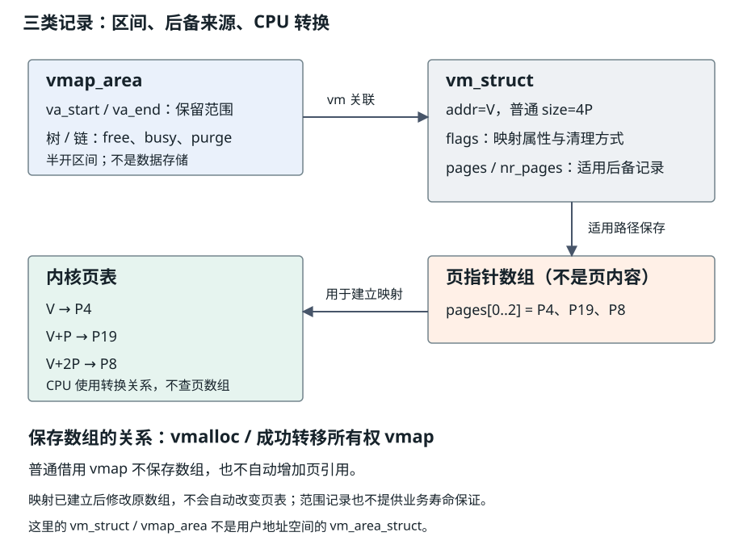
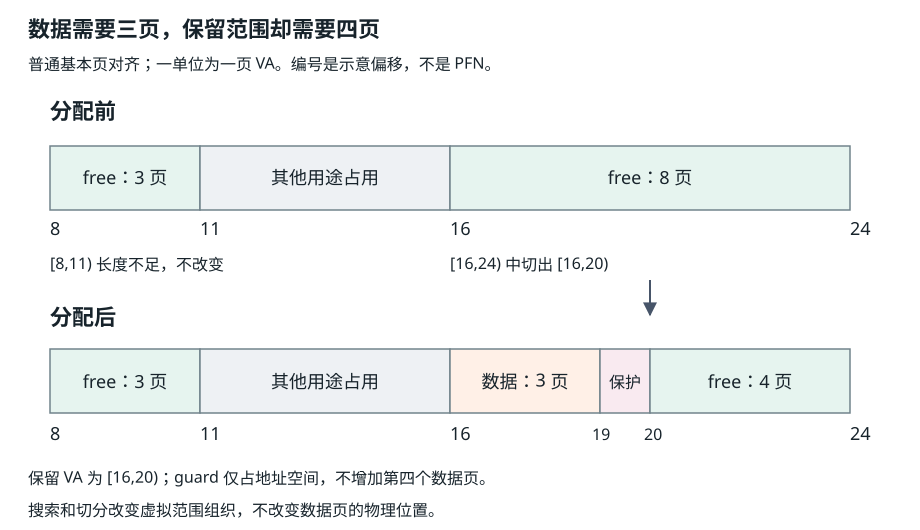
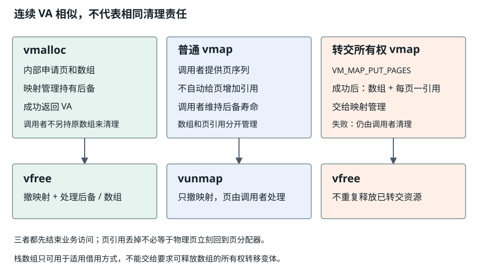
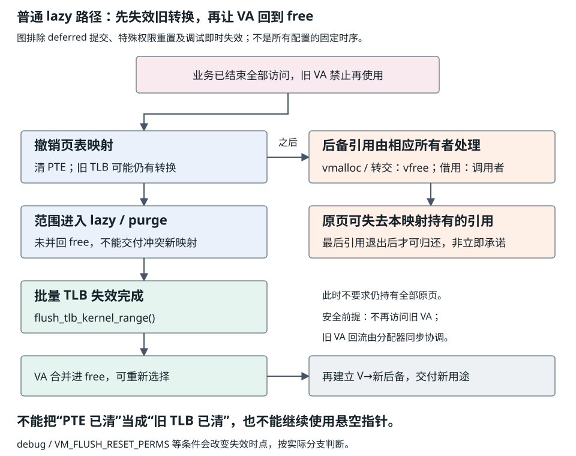

# 内核虚拟空间与分配：vmalloc、vmap 与映射归还

内核需要一段能用指针连续访问的存储，不代表它必须取得一整块连续物理内存。`vmalloc()` 取得后备页并建立连续虚拟映射；`vmap()` 则为调用者提供的页序列建立映射。**映射把地址联系起来，不把分散的页搬到一起。**

本篇沿三页实例区分四件事：保留虚拟范围、持有物理后备、建立页表映射、允许访问。释放也按这四层分析：停止业务访问、撤销映射、处理页引用、让虚拟范围重新可用，未必发生在同一时间。

## 阅读说明

- 前置：[内存管理总览](00-overview.md)、[物理页分配](01-page-allocation.md)。小对象选型参见[内核对象分配](03-kernel-objects.md)。
- 基线：本地 Linux **6.1.158**、arm64 / AArch64，源码按已打 RT 补丁处理。不固定真实页大小、VA 位宽、芯片或 vmalloc 起止地址。
- 主模型为普通 RAM、基本页映射、可睡眠任务、无检测延迟和特殊权限重置。大映射、RT、检测等按条件说明，不默认全部启用。
- 本文讲 vmalloc/vmap 的范围、后备、映射、失败清理与归还。设备 DMA、I/O 映射、用户 VMA 只讲边界，不把它们当作同一组 API。
- 例子中的虚拟页号表示示意窗口内的偏移，不是实际 arm64 地址；PFN 4/19/8 和内存内容也不是目标机观测。
- 代码是独占资源的使用骨架，未编译或运行；没有执行映射实验、调参、压力测试或内核配置修改。

### 缩略词与术语

| 名称 | 含义 | 本篇用途 |
| --- | --- | --- |
| VA / KVA | Virtual Address / Kernel Virtual Address | CPU 使用的虚拟地址 |
| PA | Physical Address | 映射指向的物理地址 |
| PFN | Page Frame Number | 基本物理页的位置编号 |
| PTE | Page Table Entry | 本模型中记录一个基本页映射的页表项 |
| TLB | Translation Lookaside Buffer | CPU 缓存的地址转换，不等于页表 |
| MMU | Memory Management Unit | 按页表及转换缓存完成 CPU 地址转换 |
| GFP | Get Free Pages | 页分配的行为与限制，虚拟分配并非支持全部标志 |
| NUMA | Non-Uniform Memory Access | 后备页和管理元数据的节点条件 |
| DMA | Direct Memory Access | 设备访问契约，不等于 CPU 的 VA→PA 转换 |
| I/O | Input/Output | 设备存储和映射属性的边界 |
| RT | Real-Time | 实时抢占分支与上下文约束 |
| guard | 未映射保护间隔 | 普通分配的尾部保护地址空间，不是额外数据页 |
| alias | 地址别名 | 不同虚拟地址指向同一物理页 |
| lazy / purge | 延迟处理 / 批量清理 | 暂存已撤销范围，完成失效后回流 |

### 子机制入口

| 当前问题 | 入口 |
| --- | --- |
| 虚拟范围、后备和映射分别是什么 | [基本模型](#basic-model) |
| 为什么连续虚拟地址可以对应分散页 | [三页推演](#mapping-example) |
| 数据、guard 和管理内存如何占用资源 | [区间与对象](#organization) |
| 范围怎么选择和切分 | [空闲区间决策](#range-selection) |
| vmalloc 在哪里失败，怎样清理 | [建立过程](#allocation) |
| vmap 成功后谁拥有页和数组 | [所有权](#ownership) |
| 清 PTE 后为什么还要处理旧 TLB | [归还与复用](#release) |
| 如何选 API 和处理上下文 | [接口与示例](#apis) |
| kvmalloc 何时转入 vmalloc | [策略组合](#kvmalloc) |
| DMA、I/O、用户映射与大映射有什么边界 | [边界与定位](#boundaries) |

## 1. 定位、职责与问题

<a id="basic-model"></a>
### 1.1 地址范围不是一块已经存在的数据

**虚拟范围**是 CPU 地址空间中的一段编号，例如 `[V, V+3P)`，其中 P 为基本页大小。保留它的含义是：虚拟区间分配器暂不把同一范围分给冲突的另一用途。只保留编号，不能读写数据。

**物理后备**是实际保存内容的页。它需要由相应持有者取得并维持有效。三个页可以位于不同物理位置，不必因虚拟访问连续而相邻。

**映射**是“某段 VA 指向哪个页、允许怎样访问”的关系。基本页模型用内核页表记录这个关系，MMU 在 CPU 访问时使用它。页表及必要管理记录也占用真实内存，不是额外的一份数据内容。

**TLB**缓存已使用的转换。清除了页表项，不代表每个 CPU 已缓存的旧转换同时消失；后文的 lazy 回流正是在协调这个区别。

这四者的关系是：**有范围、有后备、建立合法映射，并完成必要维护，才交付可访问指针。** 一个指针值本身不能证明当前仍有映射，也不能证明其后备寿命有效。

### 1.2 为什么为内核增加一组虚拟分配接口

页分配器擅长交付指定阶数的物理连续页块，但更大的连续页块受到碎片、位置和分配行为限制。若用途只是 CPU 顺序读写较大缓冲区，可以用多个页建立连续 VA，减少对大物理连续块的依赖。

这不是无成本的替代：仍要找到足够大的虚拟范围、取得数据页、管理记录和页表，并维护映射。它也不保证比 kmalloc 更快，或在任何失败情形都能补救。

两条主要接口的责任不同：

- `vmalloc(size)`：调用者没有后备页，接口为其取得页并建立映射。
- `vmap(pages, count, flags, prot)`：调用者已经有页，接口按数组顺序建立连续 VA；通常不负责新数据页分配。

<a id="mapping-example"></a>
### 1.3 同一三页模型：虚拟相邻不代表物理相邻

假设三个有效、由持有者管理的普通页，页序列为 `[P4, P19, P8]`，数字为 PFN。为其建立三个基本页映射：

```text
[V,      V+P)  -> PFN 4
[V+P,   V+2P)  -> PFN 19
[V+2P,  V+3P)  -> PFN 8
```



图 1：箭头表示映射，不表示复制数据。物理页不被排序或搬移；若它们原来有适用直接映射地址，新 VA 可以只是同一页的另一种访问地址，即别名。

取虚拟偏移 d，满足 `0 <= d < 3P`，计算：

```text
i      = floor(d / P)
offset = d % P
PA     = PFN[i] * P + offset
```

例如 `V+P-1` 指向 `4P+P-1`；接下来的虚拟字节 `V+P` 指向 `19P`，不是 `5P`。CPU 正常跨页访问会按每个页的映射转换；这是逻辑地址连续，而非后备物理块连续。

反过来，将 pages 数组换成 `[P8, P4, P19]` 就改变虚拟顺序，不需要搬移这三个页的内容。只有在明确停止旧映射使用并安全建立新映射后，才能使用新的顺序，不能运行中直接改数组就假定页表随之改变。[证据 V1、V3](#source-mapping)

## 2. 整体组成与关键对象

<a id="organization"></a>
### 2.1 请求长度、映射长度、保留长度和管理内存

仍用基本页大小 P。假设 `vmalloc()` 请求 `2P+17` 字节，P 大于 17，采用普通基本页映射且保留尾部 guard：

| 数量 | 本例 | 含义 |
| --- | --- | --- |
| 调用者请求长度 | `2P+17` | API 交付给调用者使用的需求边界 |
| 数据映射长度 | `3P` | 向基本页边界取整，需三个后备页 |
| 保留 VA 长度 | `4P` | 数据映射加一页 guard 地址空间 |
| 页指针数组 | 三个 `struct page *` 项 | 另占管理内存，不是数据副本 |
| 其他元数据与页表 | 随实际映射和共享结构而定 | 不包含在上述三页数据容量中 |

最后一页剩下的 `P-17` 字节是取整余量；guard 则是另一个没有数据映射的地址间隔。两者不是同一种“空闲”：前者位于数据映射内，后者不提供数据后备。不能因为映射覆盖整页，就把请求长度之外的部分当作额外 API 保证。

`vm_struct.size` 普通情况下包含 guard，`get_vm_area_size()` 返回去掉 guard 的映射长度。因此显示范围大小与数据页字节数可能不同，不等于凭空多占了一页物理数据。

普通 `vmap(count=3)` 请求的是三个完整页的映射，同样保留尾部 guard，但数据需求来自页数而不是 `2P+17` 的字节参数。它不会为 guard 再申请第四个数据页。本地 vmap 还会拒绝按 `VM_NO_GUARD` 去掉保护，并清掉该标志继续正常处理。[证据 V2](#source-range)

### 2.2 记录管理信息，不复制后备内容



图 2：`vmap_area` 记录范围，`vm_struct` 保存适用映射属性，pages 是页指针序列，页表才是 CPU 转换依据。普通借用 vmap 不把调用者页数组保存在 `vm_struct.pages`；图中的保存关系针对 vmalloc 或成功转移所有权的变体。

| 对象 / 字段 | 持有什么 | 不代表什么 |
| --- | --- | --- |
| `vmap_area.va_start/va_end` | 半开 VA 区间 | 不是物理地址或可访问内容 |
| `vmap_area` 的树/链关系 | 按地址管理 free、busy 或待 purge 范围 | busy 不等于所有映射已经交付完成 |
| `vmap_area.vm` | 适用 busy 区间的映射记录 | 不是页数组，也不提供业务引用 |
| `vm_struct.addr/size/flags` | 地址、保留长度与映射属性 | 不是进程的 `vm_area_struct` |
| `vm_struct.pages/nr_pages` | vmalloc 或特定所有权变体的后备记录 | 普通 vmap 不自动持有此数组 |
| 页数组 `pages[i]` | 映射第 i 个基本页的来源 | 更新数组不自动修改既有 PTE |
| 内核页表 | VA→页和权限关系 | 与 CPU TLB 是不同状态 |

普通映射函数通过 `init_mm` 和内核页表入口建立关系，不在当前进程的用户 VMA 中凭空增加一段区域。即使调用者是某个用户任务的系统调用执行路径，vmalloc 返回的仍是内核地址。

需要源码记录的原因也在这里：释放时先查到管理范围和属性，再判断后备处理；不能只拿一个地址做一次物理转换就完成所有清理。[证据 V1、V3](#source-mapping)

<a id="range-selection"></a>
### 2.3 空闲区间：三个数据页要找四页地址空间

虚拟区间管理器没有 Buddy 的固定阶伙伴约束，可以切分连续空闲 VA 区间。但仍必须在允许的窗口内、满足长度及对齐，不能将两个不相邻区间拼成一个连续返回指针。

用示意虚拟页号表示窗口内的位置，普通对齐为一基本页。初始 free 包含 `[8,11)` 和 `[16,24)`，中间 `[11,16)` 被其他用途占用。本次需要三个数据页加一 guard，共四页 VA：

1. `[8,11)` 只有三页地址长度，不够，尽管数据只需要三页。
2. `[16,24)` 有八页地址长度，选其低地址端。
3. 保留 `[16,20)`；数据映射 `[16,19)`，guard `[19,20)`。
4. 剩余 `[20,24)` 继续作为 free 范围。原 `[8,11)` 不变。



图 3：编号是虚拟页偏移，不是 PFN。free 变化管理的是 VA，不会因为切成两段就拆分物理页。

本地用 free 红黑树和有序链管理区间，`subtree_max_size` 记录子树中最大空闲区间大小，让搜索跳过明显不可能容纳请求的子树。它不是子树所有空闲长度之和：两个各两页的洞合计四页，仍不能容纳一个四页连续范围。

普通搜索沿地址顺序寻找适用匹配，再用 `adjust_va_to_fit_type()` 删除完全匹配区间、缩短边缘或切出左右余区间，更新增强信息。忙碌记录随后进入 busy 树，防止并发请求重新取得同一范围。

对于更大的对齐，候选还要取 `ALIGN(max(free_start, vstart), align)`，检查大小、溢出和窗口上界。本地在适用大对齐搜索中会为最坏对齐余量扩大搜索长度，精确短窗口等情况另有处理；不能把这一条数学能放下的判断当作所有配置下搜索一定选中的充分条件。

没有找到范围时，`alloc_vmap_area()` 可先 purge 已释放但未回流的区间，再重试；还有适用通知机制。物理页足够、虚拟洞总量足够，都不证明本次连续范围一定存在。本文只推演普通对齐主路径，不穷举大对齐搜索优化。[证据 V2](#source-range)

### 2.4 区间管理状态与业务状态分开

free 是可供区间分配器取得的范围；busy 是已被保留、不能冲突使用的范围；lazy/purge 是已撤映射但等待相应失效回流的范围。一个正在初始化、尚未交付的 vmalloc 区间也可以已经是 busy。

这与“业务缓冲区有没有用户”不同：缓冲区的使用者退出由调用者负责，分配器记录不会替业务层等待定时器、工作或其他 CPU 的访问结束。后文中可以早于 VA 回流处理后备引用，也不能因此继续访问旧指针。

## 3. 核心原理与决策规则

<a id="allocation"></a>
### 3.1 vmalloc 建立的是一组资源，不只是一次页申请

延续三页实例，`vmalloc(2P+17)` 的普通建立过程是：

| 阶段 | 新取得或更新的资源 | 此时能否作为成功结果使用 |
| --- | --- | --- |
| 大小/条件检查 | 决定长度、范围与基本映射粒度 | 不能 |
| 保留 VA | `vm_struct`、busy `vmap_area`，总范围四页 | 不能，只有地址范围 |
| 准备页数组 | 三个页指针的管理存储 | 不能，尚不保证页已取得 |
| 取得数据页 | 假设获得 P4、P19、P8，记录真实数量 | 不能，尚未完成映射 |
| 建立内核映射 | 相应页表和 PTE，连接 V 的三页 | 仍需完成对应维护与交付准备 |
| 完成准备 | 检测、初始化和 `VM_UNINITIALIZED` 等状态处理 | 返回后按 API 使用 |

关键入口是 `__vmalloc_node_range()`，它组织区间和映射粒度；`__vmalloc_area_node()` 准备页数组、取得后备并调用映射过程。页数组较大时本地可递归使用 vmalloc 来取得管理内存，较小时用 kmalloc；这是有界的元数据分配，不是把每个数据页再递归复制一次。

主模型逐基本页追踪，但后备获取并不固定是一个三次调用的循环：本地在适用条件下尝试批量页分配，批量不足可继续单次页路径。页分配还受 GFP、节点策略、压力和信号等条件影响。图中的 P4/19/8 只是成功来源的假设。

vmalloc 一般在返回成功前取得数据后备并建立映射，不像用户匿名映射那样默认等调用者第一次读写时再按需取得这些数据页。合法地址出现缺页也不能据此当作 vmalloc 的正常延迟供给策略。[证据 V4](#source-allocation)

### 3.2 页数组怎样变成 CPU 可使用的关系

基本页映射通过 `vmap_pages_range()` 进入下层，按 VA 和 pages 数组同步推进。PTE 层用 `pages[nr]` 生成映射，并在成功设置当前项后推进数组位置与 VA：

```text
nr=0，addr=V       ：PTE 记录 pages[0]=P4
nr=1，addr=V+P     ：PTE 记录 pages[1]=P19
nr=2，addr=V+2P    ：PTE 记录 pages[2]=P8
addr=V+3P         ：停止数据映射，不为 guard 设置数据 PTE
```

下层可能需要分配此前不存在的页表。它还检查已有 PTE 不被无意覆盖、页指针及对应来源合法等条件；这不是让业务代码用任意地址覆盖已使用的内核页表的 API。

普通 vmap 对权限执行 `pgprot_nx()`，不把调用者传入的 prot 当作取得可执行内存的通用许可。普通数据用途用 `PAGE_KERNEL`；修改代码权限等特殊用途遵循对应接口与协议。

映射函数还有 cache 维护和适用架构同步钩子。**cache 内容维护与 TLB 转换失效不同**：一个名字带 flush 的 cache 钩子不保证旧地址转换已经失效。本地 arm64 继承的普通 `flush_cache_vmap/vunmap` 钩子为空实现，不能把公共调用点写成每次 arm64 映射都执行一次具体 D-cache 全量刷新。PTE 写入和 TLB 协作另依实际架构实现。[证据 V3、V6](#source-mapping)

### 3.3 部分失败，内部状态可能已有变化

普通返回约定是完整成功的指针或 NULL，不交付“只有前两页能用”的部分成功指针。但内部并不是一次全有或全无的物理操作。

| 失败阶段 | 已有资源 | 本地代表性清理 |
| --- | --- | --- |
| 元数据或区间保留 | 可能只有部分管理对象 | 释放未交付记录，不创建数据对象 |
| 页数组分配 | 已有保留范围 | `free_vm_area()` 撤销该区间关联，后续按范围回流处理 |
| 三页只取得两页 | 已有范围、数组、真实页数为二 | `__vfree()` 清理记录的页并处理数组和范围 |
| 页表映射中途失败 | 数据页齐全，部分 PTE 已建立 | 撤销该范围已建立映射，释放本次后备与数组，不交付 |

`area->nr_pages` 保存实际取得数量，所以失败清理不把未取得的第三页当作有效页释放。部分 PTE 失败后，不能只释放元数据而留下仍可指向已归还页的映射；清除映射与 lazy 范围协议继续配合。

不要把“失败已经清理”理解为所有底层页表页都立刻归还，或 VA 马上重新进入 free；共享的页表结构及范围回流有自己的管理边界。清理后业务没有取得可用结果，与系统每层资源即时回到原状态不是一回事。

本地还通过 NOFS/NOIO 作用域约束适用的页表分配过程，不是假定每一层都无条件使用外层 GFP 的全部位。大映射失败、`__GFP_NOFAIL` 等有另外的重试条件，本篇不以普通失败表概括全部特殊请求。[证据 V4、V5](#source-allocation)

## 4. 主要工作过程与协作

<a id="ownership"></a>
### 4.1 普通 vmap：映射已有页，不替调用者管理引用

假设 P4/P19/P8 已由调用者各持有一个有效引用。`vmap(pages, 3, 0, PAGE_KERNEL)` 保留范围并装入映射，**普通路径不因设置三项 PTE 再自动给三个页各增加一次引用**。

因此映射存在期间，调用者必须用自己的持有协议保证后备不能消失。把页交给另一个用途或丢掉最后一个引用，不能靠“页表里还指向它”保持资源有效。

普通页数组只用来建立映射，vmap 不把它保存到 `vm_struct.pages`。调用者保留数组所有权；若已用其他可靠记录安排页清理，构建后可以结束原数组存储的寿命。反之，若数组是唯一记住后备页的地方，就必须留到不再需要它为止。**数组寿命与页引用寿命不是同一契约。**

更新这个数组也不自动重映射：页表已经记录了当时的页序列，后续维护要经过相应映射接口，而不是改三项指针。

### 4.2 VM_MAP_PUT_PAGES：成功点才转移所有权

本版本提供显式变体 `vmap(pages, count, VM_MAP_PUT_PAGES, prot)`。成功后将页数组和其中每页的一个引用交给映射管理，在 `vm_struct` 中保存，再用 **vfree** 完成后备处理：

- 数组必须来自可用 kmalloc/vmalloc 存储，不能是栈数组或静态数组。
- 页引用必须确实是调用者可转交的有效引用；代码示例限定独占 order-0 普通页，不把任意高阶复合页头当作独立小页引用。
- 成功后调用者不能再次自行释放已转交的数组或这组引用。
- 失败返回 NULL 时，源码尚未执行保存数组与页数的转移步骤；调用者继续承担原资源清理。

这不是 vmap 替调用者 get_page：转移的是已有引用，而不是凭空增加一组引用。其他持有者若仍有合法引用，vfree 丢掉这一组引用也不证明这些物理页立即回到页分配器。



图 4：连续 VA 相似，后备责任不同。普通 vmap 用 vunmap；显式转移变体用 vfree。不能把宏名字中的“PUT”理解为失败时也自动清掉原数组。

### 4.3 同样的三页，归还契约不同

| 路径 | 数据页从哪里来 | 成功后数组 / 引用 | 正常配对 |
| --- | --- | --- | --- |
| vmalloc | 内部页供给 | 映射管理持有并清理 | vfree |
| 普通 vmap，flags=0 | 调用者提供 | 数组仍由调用者管理；页寿命由调用者保证 | vunmap，之后按持有协议处理页 |
| 成功 VM_MAP_PUT_PAGES vmap | 调用者提供 | 数组及每页一引用转交 | vfree，不自行重复处理转交资源 |

误配 `vunmap()` 到转移变体，会只撤映射而不完成转交后备和数组的清理；误配 `vfree()` 到没有后备记录的普通借用映射，也不能据其“释放内存”的名字获得正确契约。释放接口不是按“这个地址看起来位于 vmalloc 区域”随意选择的。[证据 V5](#source-ownership)

## 5. 源码实现与关键约束

<a id="release"></a>
### 5.1 首先结束访问，不是让分配器等待业务退出

归还前必须停止新访问，排空按本子系统协议仍可能使用缓冲区的工作、引用与异步路径。移除某个指针变量不一定意味着其他 CPU 已退出；vfree/vunmap 也不会替业务代码修复悬空引用。

普通 `vunmap()` 与 vfree 的实际回收进入 `__vunmap(addr, deallocate_pages)`，先找到映射记录，随后撤销映射；参数决定是否继续处理后备页和数组。必须提供原始基址，不能传一个中间页或字节偏移，或对相同取得的资源重复归还。

`remove_vm_area()` 断开范围与映射记录并进入撤映射流程，不是业务上暂时“摘掉记录但仍能读写旧地址”的操作。内部返回的描述信息也有并发限制，不面向业务自行组合完整释放。

### 5.2 清页表、释放后备、地址回流不是同一事件

代表性 lazy 路径如下，先假设任务上下文已结束全部访问、没有特殊权限重置或调试立即失效：



图 5：两条资源寿命不要求同步。调用者在“结束使用”之后不能再访问旧 VA，即使某 CPU 的 TLB 恰好仍保留旧转换。

| 阶段 | 页表与 VA 状态 | 后备状态 |
| --- | --- | --- |
| 使用中 | VA 被保留，数据映射有效 | 相应所有者持有页 |
| 停止访问并撤映射 | 数据 PTE 清除，范围进入 lazy/purge 组织 | 还需按所有权处理 |
| 相应后备清理 | VA 尚可能未进入 free，旧 TLB 别名可尚未全部失效 | vfree 丢掉所持引用；普通 vmap 由调用者处理 |
| 完成批量失效 | 清除对应旧转换，再把区间合并进 free | 原页不必仍归本映射持有 |
| 后续重用该 VA | 建立新的页表关系，再交付新访问 | 可指向另一组后备 |

`free_unmap_vmap_area()` 清相应页表映射，再将区间交给 `free_vmap_area_noflush()`：从 busy 组织移出，加入等待 purge 的范围。`__purge_vmap_area_lazy()` 收集一批待处理范围，调用 `flush_tlb_kernel_range()`，**在失效之后**才并回 free 区间管理。

因此普通 vunmap 返回不普遍证明所有 CPU 的旧转换已经清完；它也不要求原物理页一直留到全部 VA 回流。前提是业务不再访问旧 VA，分配器则不在缺少相应失效时把该 VA 交付为冲突的新映射。

这解释了第 6 节示例为何可以先 vunmap，再归还普通借用页。但绝不能反过来据此声称“既然页还能重新分配，旧 VA 也可以继续使用”。旧访问属于错误，可能触及别人后来取得的数据。

### 5.3 旧 VA 重用竞争：不能只看到 free 就换后备

仍用旧映射 `V→P4`。若新用途准备在同一 V 映射 Q：

1. 清除旧页表项。
2. 若未失效就让 V 回到可分配范围，另一个 CPU 可能取得它并建立 `V→Q`。
3. 其他 CPU 的旧 TLB 仍可能使同一个 V 命中 P4，导致 CPU 观察到不同物理落点。

本地 lazy 协议用“先暂存范围，再完成转换失效，最后回流”隔开这次竞争。它不是保证软件继续使用旧指针时一定马上缺页，而是保证合法的新映射不被相应旧转换混淆。

各同步对象也有分工：

| 保护 | 协调内容 | 不能替代什么 |
| --- | --- | --- |
| `free_vmap_area_lock` | free 区间搜索、切分、合并和增强信息 | 业务访问停止与 TLB 失效 |
| `vmap_area_lock` | busy 范围树/链及记录关联 | 所有者的页引用 |
| `purge_vmap_area_lock` | 待 purge 范围组织 | CPU 转换缓存失效 |
| `vmap_purge_lock` | 串行化适用批量 purge | 调用者生命周期 |
| 页表/架构映射协议 | 实际页表变化及必要可见性 | 任意对象发布和设备访问协议 |

purge 先在短锁下摘取待处理集合，完成范围 TLB 失效后再处理 free 组织。不能把全局区间锁拿到手就当作所有 CPU 已看见新页表，或让业务在这些内部锁下访问已归还缓冲区。

lazy 不是永远不回收：待处理量超过策略阈值会安排工作，区间分配失败可 purge 后重试；特定调试或权限重置条件还会要求不同失效时点。具体数量不是本篇固定的机器常数。[证据 V6](#source-release)

### 5.4 arm64 失效与 vm_unmap_aliases

本地 arm64 `flush_tlb_kernel_range()` 在适用范围路径中先执行 `dsb(ishst)`，逐项 TLBI，再 `dsb(ish)`、`isb()`；范围较大时转向更广的失效函数。它是共享虚拟映射与实际 CPU 转换的交接，不是仅修改某个 C 链表。

不要把 TLBI 的编码单位写成目标基本页始终为 4 KiB：实现按 `PAGE_SHIFT` 推进，页大小由配置决定。完整页表层级及指令语义由[arm64 页表专题初稿](06-arm64-page-tables.md)承接，本文只说明为何回流要依赖这个完成点。

`vm_unmap_aliases()` 是 vmap 层的别名维护入口：手中页可能过去被这层映射过，某些 CPU 仍有其旧 VA 别名转换；该函数处理相应 lazy 映射和块状态，让适用旧别名消失。

普通调用者不需在每次 vfree/vunmap 后机械追加它。若用途涉及修改后备页属性、特殊 direct-map 权限等，应按对应高层协议判断；不能只因数据仍能通过直接映射访问，就忽略别名属性约束。`VM_FLUSH_RESET_PERMS` 分支有额外 direct-map/TLB 处理，不在普通三页模型中。

### 5.5 中断延后回收与 lazy TLB 延后是两种延后

普通 vmalloc/vmap 建立需要可睡眠任务上下文；vunmap 明确不能在中断中调用。普通 vfree 在任务上下文可能睡眠，非 NMI 中断路径则把地址排入 deferred 链，由工作执行实际回收。

`vfree_atomic()` 源码入口允许非 NMI 原子上下文的适用延后提交，但它不表示 vmap/vmalloc 也因此能在相同上下文建立映射。其 deferred 链使用待释放地址处的存储记录链节点，提交后业务更不能继续读写该缓冲区。特殊权限重置范围不应据此假定可在原子上下文回收。

这两种延后分别是：

- deferred vfree：实际撤映射和后备处理尚待工作执行。
- lazy purge：对应撤映射已经进行，范围等待转换失效和地址回流。

延后提交返回时不能把它解释成数据页已归还、旧 TLB 已全部失效或者虚拟范围已经 free。本地 `vfree_atomic` 没有模块导出，声明存在不等于普通可加载模块能直接链接调用；代码示例使用已导出的正常接口。

RT 也不会让普通 vmalloc/vmap 变成硬中断分配器。严格不可抢占区域、raw spinlock、NMI 等不能通过换一个 GFP 标志豁免建映射或来源释放契约。前篇 SLUB 的上下文条件也不能被 kvfree 的通用名字绕过。[证据 V5、V6](#source-release)

## 6. 接口与使用

<a id="apis"></a>
### 6.1 选型依据不是“名字中都有 map”

| 需求 | 取得 | 归还 | 主要限制 |
| --- | --- | --- | --- |
| 小块普通对象/字节 | kmalloc / kzalloc | kfree | 按其 GFP、来源与上下文契约 |
| 较大 CPU 连续缓冲区，可接受非连续后备 | vmalloc / vzalloc | vfree | 任务上下文；数据后备及管理资源仍可能不足 |
| 优先 kmalloc，可接受 vmalloc 后备 | kvmalloc / kvzalloc | kvfree | 从需求开始就不依赖物理连续 |
| 已有页按指定顺序访问 | 普通 vmap | vunmap | 不自动保住页引用，不释放借用后备 |
| 显式转交页数组和引用 | VM_MAP_PUT_PAGES vmap | vfree | 数组可释放、引用可转交、失败仍归调用者 |
| 设备物理/I/O 区域 | ioremap 类 | iounmap | `__iomem`、属性和设备接口，不是普通 RAM 分配 |

普通 vmalloc/vmap 失败返回 NULL；请求 0 不能当作正常可访问分配。vunmap/vfree 接收原基址，不是 vmap 的 pages 数组、某个 `struct page *` 或任意中间字节指针。

`vmalloc()` 默认使用相应普通 GFP，`vzalloc()` 增加清零需求；清零不替代锁、链表或对象业务初始化。低层 vmalloc 与 kvmalloc 的参数支持范围不能互相替换，下面按本版本函数契约区分：

| 参数或修饰 | `__vmalloc_node_range()` 等低层 vmalloc 契约 | `kvmalloc_node()` 参数契约 |
| --- | --- | --- |
| 普通可回收基线 | 支持 GFP_KERNEL | 要求兼容、包含 GFP_KERNEL 的组合 |
| 显式 GFP_NOFS / GFP_NOIO | 本地函数注释明确支持，并有适用页表作用域处理 | 不据“允许阻塞”就推广为受支持参数；遵循其 GFP_KERNEL 兼容要求 |
| `__GFP_RETRY_MAYFAIL` | 不支持的重试修饰 | 支持，可表达更愿意尝试 kmalloc |
| 调用者传 `__GFP_NORETRY` | 不支持 | 普通参数契约不支持；内部为首次尝试添加它是另一件事 |
| `__GFP_NOFAIL` | 支持的重试修饰，需满足其余前提 | 较大请求清除首次 kmalloc 的该位，将相应语义交给后备 |
| 不允许直接回收，如 GFP_NOWAIT | 不支持，要求 `__GFP_DIRECT_RECLAIM` | GFP_NOWAIT / GFP_ATOMIC 不属于支持用法 |
| Zone 修饰 | 不作为支持的公共保证 | 不能据此取得 vmalloc 后备或设备地址保证 |

例如较大请求使用 `kvmalloc(size, GFP_KERNEL | __GFP_RETRY_MAYFAIL)`，可按其契约让首次 kmalloc 更愿意尝试；把完全相同的组合搬到 `__vmalloc()`，就不再属于本地低层 vmalloc 声明支持的重试用法。反过来，源码内部给第一次 kmalloc 加 NORETRY，不等于调用者可以为整个 kvmalloc 请求添加 NORETRY。

这些是**接口支持范围**，不是声称入口统一检查并拒绝每个非法组合。某次未受支持的组合走通一个实现分支，不证明其全部路径有相同保证。特别是“允许阻塞”只是 kvmalloc 后备的一项运行判断，不替代其参数契约。

不要因为某次改成 `__GFP_DMA` 看起来取得了低地址，就将该指针当成设备 DMA 地址或把实现接受某些位写成公共保证。驱动应使用设备 DMA 接口，NOFS/NOIO 需求也须遵循对应作用域与高层调用契约。[证据 V4、V7](#source-api)

### 6.2 普通借用 vmap：成功失败都由调用者清理页

以下仅演示可睡眠任务中的两个独占 order-0 RAM 页。使用栈页数组是合法的普通借用方式，但不可以只替换 flags 就改成所有权转移：

```c
#include <linux/errno.h>
#include <linux/gfp.h>
#include <linux/mm.h>
#include <linux/string.h>
#include <linux/vmalloc.h>

static int map_example(void)
{
    struct page *pages[2];
    void *addr;
    int ret = -ENOMEM;

    pages[0] = alloc_page(GFP_KERNEL);
    if (!pages[0])
        return ret;
    pages[1] = alloc_page(GFP_KERNEL);
    if (!pages[1])
        goto out_first;

    addr = vmap(pages, 2, 0, PAGE_KERNEL);
    if (!addr)
        goto out_second;

    memset(addr, 0, 2 * PAGE_SIZE);
    vunmap(addr);
    ret = 0;
out_second:
    __free_page(pages[1]);
out_first:
    __free_page(pages[0]);
    return ret;
}
```

| 分支 | 清理 |
| --- | --- |
| 第一个页失败 | 返回，没有已取得页 |
| 第二个页失败 | 释放第一个页 |
| vmap 失败 | vmap 撤销本次未完成映射；调用者释放两个页 |
| 成功使用结束 | 先 vunmap，再释放两个持有页 |

示例没有发布地址，也没有其他引用者，所以函数结束前可以直接清理。真实组件若把地址交给其他 CPU、工作队列或用户映射，必须先排空实际使用者；不能把这个短函数的顺序当作通用退出同步方案。

### 6.3 显式转移：成功后只交付映射指针

下面只创建和转交三个独占 order-0 页，返回成功地址由调用者在合适上下文 **vfree**。失败内部清理原资源：

```c
#include <linux/gfp.h>
#include <linux/mm.h>
#include <linux/slab.h>
#include <linux/vmalloc.h>

static void *map_owned_pages(void)
{
    struct page **pages;
    void *addr;
    unsigned int i = 0;

    pages = kcalloc(3, sizeof(*pages), GFP_KERNEL);
    if (!pages)
        return NULL;

    for (i = 0; i < 3; i++) {
        pages[i] = alloc_page(GFP_KERNEL);
        if (!pages[i])
            goto fail;
    }

    addr = vmap(pages, 3, VM_MAP_PUT_PAGES, PAGE_KERNEL);
    if (!addr)
        goto fail;

    return addr;

fail:
    while (i)
        __free_page(pages[--i]);
    kfree(pages);
    return NULL;
}
```

第三个页失败时 i=2，释放此前两页；vmap 失败时 i=3，释放三页和数组。vmap 成功后不能再执行这段清理，否则与之后 vfree 的后备处理重复。成功返回的页内容未在本示例中清零或初始化，调用者仍需按数据用途处理。

如果原页还被其他持有者合法使用，这个例子的“独占”前提不成立；应明确各自引用和访问协议，不能直接替换成任意页指针数组。

<a id="kvmalloc"></a>
### 6.4 kvmalloc 是有条件的策略组合

本地 `kvmalloc_node()` 先做 kmalloc 尝试。较大请求调低首次尝试的破坏性：适用时加 NOWARN/NORETRY，保留 RETRY_MAYFAIL 的选择，并将 NOFAIL 语义交给后备处理。不是每次先耗尽所有物理连续分配机会才转 vmalloc。

| 条件 | 后续行为 |
| --- | --- |
| kmalloc 成功 | 直接返回，不再建 vmalloc 映射 |
| kmalloc 失败，`size <= PAGE_SIZE` | 返回该失败，不进行同样的 vmalloc 后备 |
| 较大请求失败，不允许阻塞 | 不进入 vmalloc 后备；这不让不支持的 GFP 成为受支持 API 用法 |
| 较大请求失败，允许阻塞且满足大小等条件 | 进入 `__vmalloc_node_range()` 后备 |
| 后备失败 | 返回 NULL，不交付半段存储 |

本地文档不支持 GFP_NOWAIT/GFP_ATOMIC 及 `__GFP_NORETRY` 的普通 kvmalloc 用法；实现中某种不支持组合偶然在首次 kmalloc 成功，也不构成未来持续成功的契约。超过 `INT_MAX` 的后备还被拒绝，而这个判断发生在首次 kmalloc 失败之后，不是所有调用都在入口统一拒绝。

调用者应从开始就接受物理不连续的可能性，统一 `kvfree()`，不靠猜结果来源选择错误释放方式。例如：

```c
#include <linux/errno.h>
#include <linux/slab.h>

static int mixed_alloc_example(size_t size)
{
    void *buf;

    if (!size)
        return -EINVAL;
    buf = kvmalloc(size, GFP_KERNEL);
    if (!buf)
        return -ENOMEM;

    /* 仅演示独占存储的取得与归还，未发布给其他使用者。 */
    kvfree(buf);
    return 0;
}
```

这里仅展示策略配对，不代表缓冲区已完成业务初始化。`is_vmalloc_addr()` 能帮助 kvfree 选来源释放，但它不是证明任意地址当前合法、被某调用者独占或可供 DMA 的判断。

### 6.5 NOFS / NOIO 作用域不是换一个参数名

如果某段调用链不能在回收中重新进入文件系统，应在真实需要限制的任务作用域使用 `memalloc_nofs_save/restore()`；需要同时避免相关 I/O 时使用 NOIO 对应接口。作用域通过当前任务状态影响内部后续分配，调用参数仍可以遵循 `GFP_KERNEL` 契约：

```c
#include <linux/sched/mm.h>
#include <linux/slab.h>

static void *alloc_nofs_buffer(size_t size)
{
    unsigned int saved;
    void *buf;

    if (!size)
        return NULL;
    saved = memalloc_nofs_save();
    buf = kvmalloc(size, GFP_KERNEL);
    memalloc_nofs_restore(saved);
    return buf;
}
```

成功由调用者按实际使用寿命 `kvfree()`；失败也已恢复作用域。NOFS 作用域保留了分配可以睡眠/进行适用回收的可能，并不是进入原子上下文；NOIO 也不等于完全禁止所有内存回收。

这与直接传 `kvmalloc(size, GFP_NOFS)` 不同：前者保持 API 参数契约并让当前调用链受作用域约束，后者不能因低层 vmalloc 支持该参数就声称 kvmalloc 的所有路径也给出相同支持。作用域要求配对恢复，不能把当前任务标记留给不相关后续代码，也不自动把限制传给任意异步工作者。

本地较旧的 GFP 作用域文档还有“vmalloc 内部硬编码 GFP_KERNEL 因而不支持显式 NOFS”的历史说明；本篇参数表以目标 `vmalloc.c` 的当前函数契约和实现为准，不将旧段落覆盖本版本的适用支持。使用作用域约束完整调用链仍有实际价值，但这不等于低层显式参数支持与作用域是同一层语义。[证据 V4、V7](#source-api)

## 7. 边界、变体与常见误解

<a id="boundaries"></a>
### 7.1 vmalloc 地址不是线性映射地址

<a id="arm64-region-orientation"></a>
把第 1.3 节的 V 放回 arm64 内核地址布局。本树用 `VMALLOC_START`、`VMALLOC_END` 定义 vmalloc 区；它不是其他内核映射的统称：

| 区域 | 这里的地址用于什么 |
| --- | --- |
| 线性映射 | 访问适用 RAM；范围边界从 `PAGE_OFFSET`、`PAGE_END` 找 |
| vmalloc 区 | 为运行期映射选择 VA；主例 V 在这里 |
| vmemmap 区 | 在适用配置下访问逐页描述符，不是访问被描述页的数据 |
| fixmap 区 | 按预定义槽位确定 VA，不从一般空洞分配 |

表的顺序不表示实际地址排列或完整布局。边界从 `arch/arm64/include/asm/{memory,pgtable,fixmap}.h` 核对；不把[原资料](reference-reading.md#address)的地址常数或 HIGHMEM 布局当作 arm64 前提。

直接映射是内核对适用 RAM 的一组固定组织关系；vmalloc 则为每次取得的范围建立页序列映射。相同物理页可以同时具有适用直接映射地址和 vmalloc 地址，这不是两份数据。

本地 arm64 `virt_to_phys()` 走线性映射或内核镜像的相应换算，不为任意 vmalloc 地址遍历其页表。对 V 做一次该转换，再物理线性加偏移，既违反来源契约，也与 PFN 4/19/8 模型矛盾。

`vmalloc_to_page()` 对适用地址走内核页表，找当前映射页；它不自动取得业务稳定引用。必须先保证映射及后备寿命，不能查询一个可能同时被释放的地址，然后凭返回指针继续访问或修改引用。

`is_vmalloc_addr()` 主要检查地址是否位于相应区间。lazy 范围或无有效映射的地址也可能满足区间判断；“位于 vmalloc 地址段”不等于“此次分配尚活着”。[证据 V1、V8](#source-boundaries)

### 7.2 CPU、DMA、I/O 和用户映射四种契约

CPU 连续 VA 不自动成为设备地址。设备可能使用 DMA 地址空间/IOMMU 和散列表；不能将 vmalloc 地址直接交给要求普通 DMA 缓冲区的接口，也不能对首字节做一次 virt_to_phys 就覆盖所有后备页。

`ioremap()` 映射给定的物理/I/O 区域，不像 vmalloc 为数据取得普通页。返回的 `__iomem` 地址按设备访问和属性契约使用，不把普通 memcpy 作为所有设备的访问方式。

本地 arm64 的 `ioremap_allowed()` 检查物理地址范围并拒绝适用 RAM 起点。`ioremap_cache()` 对适用 RAM 另有直接映射返回分支，所以也不能反向概括“所有名字含 ioremap 的入口一律拒绝 RAM”。特殊设备或 RAM 重映射需求按实际对应接口处理，本文不提供绕过属性检查的技巧。

普通 vmalloc 不自动加入用户地址空间；若要向用户提供对应范围，需要选适用的 usermap 分配和 remap 接口，处理 VMA、页寿命和权限，不直接把内核返回指针交给用户当作其可访问地址。[进程地址空间初稿](05-process-address.md)承接用户侧管理。

### 7.3 大映射改变粒度，不取消资源与所有权边界

主模型按基本页构造，不能推出所有 vmalloc 都只产生 PTE 层映射。启用并允许的大映射路径可能选择更大 page_shift，要求对应后备分组对齐连续，减少映射项数量；不是任意分散页都能直接塞进一个大块描述符。

普通 `vmap()` 在本文路径明确使用 `PAGE_SHIFT`；vmalloc_huge/kvmalloc 等适用入口允许更大映射，实际还依架构能力、大小和配置。更大尝试失败时，本地 `__vmalloc_node_range()` 可退回基本页粒度再试，失败不是保证没有发生过大页后备尝试。

管理记录仍按基本页跟踪后备。高阶取得的页在适用路径被拆成独立小页，释放按相应实际记录处理。不能把 `nr_pages` 当作页表项数量，也不能把一个大映射的支持解释成返回对象拥有任意可修改权限。

arm64 的 `arch_vmap_pmd/pud_supported()` 有自身能力与配置条件，例如 PTDUMP_DEBUGFS 会影响相应支持判断。未确认配置时保留条件，不把大映射当成该机器的默认事实。[证据 V4、V8](#source-boundaries)

### 7.4 看到占用或失败时，先识别资源口径

沿本篇三页模型：数据后备三页、保留 VA 四页，页数组和页表另占资源。普通 vmap 的三页可以在建立映射前就存在，增加的是 VA、映射和管理开销，不必新增三页数据后备。

| 现象 | 不能立即推出的结论 | 应查的方向 |
| --- | --- | --- |
| 有足够空闲物理页却失败 | vmalloc 是无限地址后备或程序必有泄漏 | 连续 VA、对齐、管理数组、页表、位置及记账 |
| vfree 后虚拟区间尚未 free | 原数据页一定仍被该对象持有 | deferred、lazy、特殊权限及后备引用 |
| 显示区间四页，pages=3 | 第四页数据丢失或多申请了一个数据页 | 普通 guard、请求取整和显示字段 |
| 普通 vmap 记录不显示 pages 数 | 没有物理后备或映射无效 | 是否保存页数组、flags 与记录用途 |
| 地址查询结果变化 | 地址值自身可以保证生命周期 | 是否并发释放/重建及业务持有协议 |

本地 `/proc/vmallocinfo` 的范围大小取相应管理记录，显示标志和 pages 条件也来自保存内容；普通 vmap 是否标成 vmap 还依传入 flags，不能只看显示名字判定接口来源。其附加 unpurged 信息表示另一种范围状态，不等同于活跃数据页。读取接口也不提供一个可以据此修改内部结构的全局一致快照。

这里仅给出源码定位和口径模型，不执行清理、调参或目标机采样。[观测专题初稿](14-observability-extensions.md)承接更多方法。[证据 V9](#source-observe)

## 8. 总结与源码入口

先问四个问题：

1. **保留了什么 VA？** 长度、对齐、guard 和可分配范围。
2. **数据在哪里？** 页序列与真实页引用，不将虚拟偏移当物理偏移。
3. **谁负责后备？** vmalloc、借用 vmap、显式转移变体有不同契约。
4. **何时可以复用？** 先结束业务，再处理页表、后备和 lazy/TLB 回流。

沿 PFN 4/19/8 的主线，连续指针只是这组页的一个有序映射。改变数组不会更新旧页表，撤页表不会自动清掉旧 TLB，丢后备引用也不会使旧 VA 立即进入 free。把这些层次分开，才能正确选型、处理失败并理解释放后的现象。

### 目标源码证据

<a id="source-mapping"></a>
**V1 / V3：基本模型、对象和映射**

- [include/linux/vmalloc.h](../../../../linux-6.1.158/include/linux/vmalloc.h)：`vm_struct`、`vmap_area`、flags 和 `get_vm_area_size()`。
- [mm/vmalloc.c](../../../../linux-6.1.158/mm/vmalloc.c)：`vmap_pages_range()`（644 起）、`vmap_pages_pte_range()`（466 起）、`vmalloc_to_page()`（674 起）、`is_vmalloc_addr()`。

<a id="source-range"></a>
**V2：区间与 guard**

- [mm/vmalloc.c](../../../../linux-6.1.158/mm/vmalloc.c)：`__get_vm_area_node()`（2488 起）、`alloc_vmap_area()`（1598 起）、`find_vmap_lowest_match()`、`__alloc_vmap_area()`、`adjust_va_to_fit_type()`。
- [include/linux/vmalloc.h](../../../../linux-6.1.158/include/linux/vmalloc.h)：`subtree_max_size`、`VM_NO_GUARD`、`get_vm_area_size()`。

<a id="source-allocation"></a>
**V4：vmalloc 建立与失败**

- [mm/vmalloc.c](../../../../linux-6.1.158/mm/vmalloc.c)：`vmalloc()`、`__vmalloc_node_range()`（3158 起）、`__vmalloc_area_node()`（3033 起）、`vm_area_alloc_pages()`、`clear_vm_uninitialized_flag()`、`free_vm_area()`。
- 同文件的 NOFS/NOIO 作用域、大映射和基本页重试分支。

<a id="source-ownership"></a>
**V5：所有权与接口配对**

- [mm/vmalloc.c](../../../../linux-6.1.158/mm/vmalloc.c)：`vmap()`（2843 起）的成功转移步骤、`vunmap()`、`__vunmap()`（2688 起）及 `deallocate_pages` 分支。
- [include/linux/vmalloc.h](../../../../linux-6.1.158/include/linux/vmalloc.h)：`VM_MAP_PUT_PAGES`、公开与低层接口分界。

<a id="source-release"></a>
**V6：lazy、失效与延后回收**

- [mm/vmalloc.c](../../../../linux-6.1.158/mm/vmalloc.c)：`free_unmap_vmap_area()`、`free_vmap_area_noflush()`、`__purge_vmap_area_lazy()`、`vm_unmap_aliases()`、`vm_remove_mappings()`、vfree deferred 路径与 `vfree_atomic()`。
- [arch/arm64/include/asm/tlbflush.h](../../../../linux-6.1.158/arch/arm64/include/asm/tlbflush.h)：`flush_tlb_kernel_range()`（374 起）。
- [arch/arm64/include/asm/cacheflush.h](../../../../linux-6.1.158/arch/arm64/include/asm/cacheflush.h)及[实际公共 cache 钩子](../../../../linux-6.1.158/include/asm-generic/cacheflush.h)：普通 vmap/vunmap cache 维护入口。

<a id="source-api"></a>
**V7：kvmalloc 与主要 API**

- [mm/util.c](../../../../linux-6.1.158/mm/util.c)：`kvmalloc_node()`（559 起）、`kvfree()`（622 起）。
- [include/linux/vmalloc.h](../../../../linux-6.1.158/include/linux/vmalloc.h)和[include/linux/slab.h](../../../../linux-6.1.158/include/linux/slab.h)：vmalloc/vmap、kvmalloc/kvfree 包装与声明。
- [include/linux/sched/mm.h](../../../../linux-6.1.158/include/linux/sched/mm.h)：`current_gfp_context()`、NOFS/NOIO save/restore。
- [本地 GFP 作用域说明](../../../../linux-6.1.158/Documentation/core-api/gfp_mask-from-fs-io.rst)：解释作用域动机；其中历史 vmalloc 支持表述与本版本函数契约需区分。

<a id="source-boundaries"></a>
**V8：arm64 与相邻接口边界**

- [arch/arm64/include/asm/pgtable.h](../../../../linux-6.1.158/arch/arm64/include/asm/pgtable.h)：VMALLOC_START/END 宏，不据本篇固定绝对地址。
- [arch/arm64/include/asm/memory.h](../../../../linux-6.1.158/arch/arm64/include/asm/memory.h)：`virt_to_phys()` 的实际换算来源。
- [arch/arm64/include/asm/vmalloc.h](../../../../linux-6.1.158/arch/arm64/include/asm/vmalloc.h)：大映射支持与属性条件。
- [mm/ioremap.c](../../../../linux-6.1.158/mm/ioremap.c)、[arm64 ioremap.c](../../../../linux-6.1.158/arch/arm64/mm/ioremap.c)、[arm64 io.h](../../../../linux-6.1.158/arch/arm64/include/asm/io.h)：物理/I/O 映射、RAM 检查与缓存变体。
- [本地 arm64 布局文档](../../../../linux-6.1.158/Documentation/arm64/memory.rst)帮助定位概念；历史条件布局表不直接作为目标配置。

<a id="source-observe"></a>
**V9：占用与显示口径**

- [mm/vmalloc.c](../../../../linux-6.1.158/mm/vmalloc.c)：`s_show()`、`show_purge_info()`、`nr_vmalloc_pages`、范围及页数记录；显示与数据实际持有分开。

<a id="review-result"></a>
## 独立挑战审阅

以下是外部图解增补前的审阅记录；增补范围见[本轮对照](reference-reading.md#address)。

本次为独立深度重写，状态为**审阅通过，待用户阅读确认**。新审阅者 Archimedes 提出 GFP 支持契约缺口，作者补充参数对照、重试变更与 NOFS/NOIO 作用域后，同一审阅者重读整篇及五图，关闭问题，并分别给出本次范围内的技术与教学审阅通过结论。第 1 轮结束，无待裁决项。

[写前约定](review/contract-kernel-virtual.md)与[本次审阅记录](review/review-kernel-virtual.md)保存关键问题、回应、版本和验证范围。作者执行了本地 SVG/链接及桌面、窄屏临时渲染检查；未编译示例、运行内核或验证目标机配置。旧版 Boole 结论仅保留为历史，不代替本次审阅或用户实际阅读确认。
