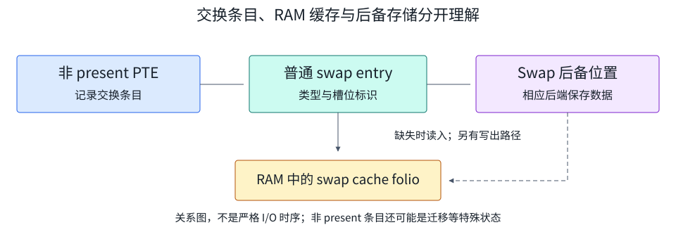
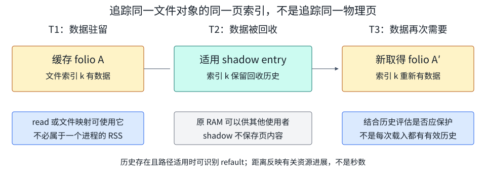
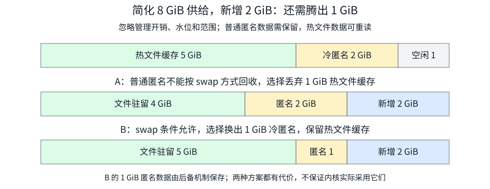
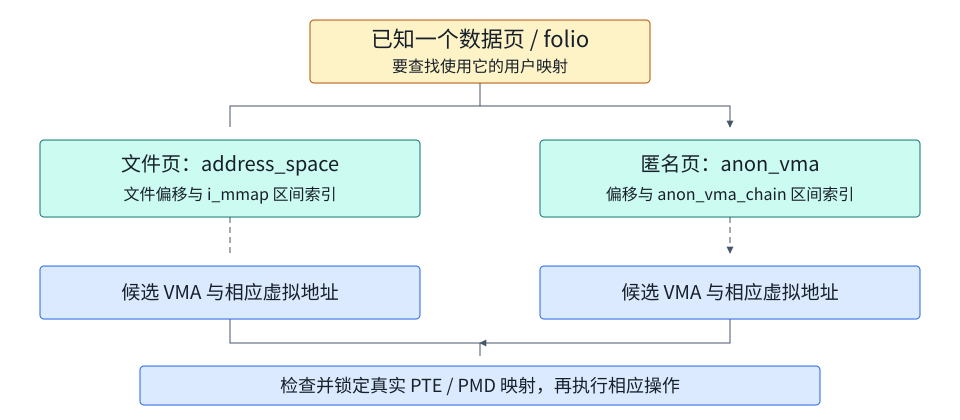
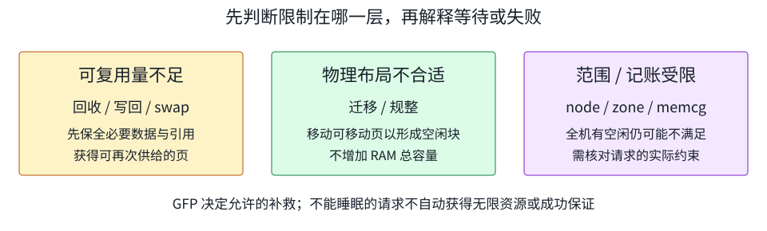
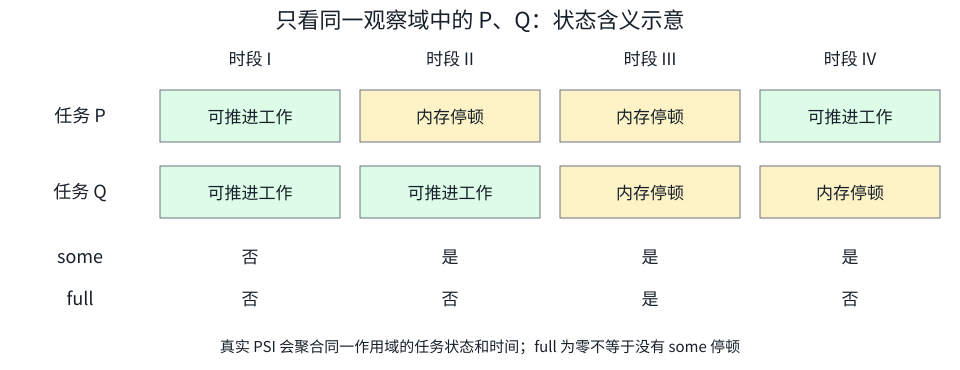

# 回收、反向映射与资源压力

已经理解 [分配](02-allocation.md) 和 [映射](03-address-space.md)，现在从资源端反向考虑：**页已被使用，内核怎样使它重新成为可供给资源？**

困难不只是挑选“不常访问的页”。还必须保全数据、找到使用者、处理引用，并判断页面是否能移动。

本文基于 arm64 Linux 6.1.158，解释主干关系，不穷举具体回收算法、swap 后端和全部并发分支。

## 1. 回收数据之前，先判断内容能否再取得

### 1.1 文件页与匿名页的保留条件不同

| 候选内容 | 再利用前要解决的问题 |
| --- | --- |
| 干净文件缓存 | 若仍可由后备对象重新取得，处理映射、引用等条件后可丢弃缓存 |
| 脏文件缓存 | 不能直接丢失修改，需要相应写回或其他保留协议 |
| 普通匿名内容 | 通常没有可直接重读的文件，适用时需要 swap 等保存方式 |
| 内核缓存对象 | 由相应缓存 / shrinker 判断对象能否结束使用，不是任意释放底层页 |
| 固定或受其他引用约束的页 | 即使很少访问，也不一定能回收或迁移 |

“干净”不保证当前没有使用者，“映射已解除”不保证所有引用消失，“很少访问”更不保证数据可以丢弃。

文件页写回与匿名页 swap 都涉及数据保留，但后备对象及恢复路径不同，不能画成一个统一的“写到磁盘然后 free”动作。

### 1.2 为什么还要判断活跃程度？

有些页可以回收，但马上又被访问会造成反复读入、换出和缺页。因此回收还需要选择候选、观察访问和控制扫描范围。

本树存在传统 LRU 与配置相关的 MGLRU，不能仅凭源码存在推断目标机启用了哪条路径。它们组织候选的方式不同，但都必须处理内容、映射、引用及可再利用条件。

阅读起点：`mm/vmscan.c` 的 `shrink_folio_list`，关注候选的 dirty、writeback、mapped、引用及保存状态。

### 1.3 传统 LRU 怎样区分候选？

在适用传统路径中，文件与匿名可回收内容分别组织 active / inactive 集合，还区分 unevictable 等情形。Inactive 是扫描候选的组织位置，不表示其中页已安全可释放；active 也不是永久保护。

访问可以通过页表访问状态，也可以通过文件访问等途径反映。`folio_check_references` 综合有关信息，决定保留、激活或继续检查。扫描时观察到访问或锁竞争，可能使本轮暂不回收。

`lruvec` 将相关集合与节点、适用 memcg 关联，避免把所有候选理解成全机一条完全统一的 LRU。具体扫描比例和重访处理属于进一步算法细节。

### 1.4 MGLRU 改变的是候选年龄表达

MGLRU 将类似访问新近程度的页分到不同 generation。Aging 观察访问并形成较新的代，eviction 从适用较老候选继续判断。Anon 和 file 的最老代推进还受 swap 等不同条件影响。

它还使用有关频度和 refault 反馈，不能把 generation 当作“每页精确访问时间戳”，也不能推断最老代页一定可释放。

两类实现改变候选管理和扫描成本，不改变“先保护数据与使用关系，再允许复用”的基本要求。源码读 `mm/vmscan.c`，设计说明见同树 `Documentation/mm/multigen_lru.rst`。

### 1.5 Swap 不是把所有内存统一写入一个文件 {#swap}

普通匿名内容没有可直接重新读取的原始文件，交换机制为适用内容准备后备位置，并把位置标识联系到有关非 present PTE。



普通 swap entry 编码后备类型和槽位信息；swap cache 则仍是 RAM 中的数据，以交换条目索引。已有交换条目或交换槽位，不表示原 RAM 页已经释放。

`add_to_swap` 为适用 folio 取得交换位置并建立 swap cache 联系。回收还处理用户映射、写出和引用条件。最终释放 RAM 必须保证必要数据与关系已处理，不能只将 PTE 改成非 present 就归还页。

再次访问普通交换条目时，`do_swap_page` 先确认当前状态，再从 swap cache 取得数据，缺失时走读入等处理，并重新建立适用映射。命中 RAM 中的 swap cache 不一定发生设备读取。

非 present 条目还可能表示迁移、设备页或错误等特殊状态，本树入口先分类，不将它们都当作真正换出。

未启用 swap、后备资源耗尽或资源组交换限制，都可能使一部分匿名内容难以按这条方式回收。文件缓存的后备读取和普通匿名 swap 的索引、写出与恢复协议也不同。

源码：`mm/swap_state.c`、`mm/swapfile.c`、`mm/page_io.c`、`mm/memory.c` 的 `do_swap_page`。

## 2. 工作集、refault 与反复回收 {#working-set}

### 2.1 当前驻留量不等于当前工作集

回收出一些页，分配可以继续，并不说明工作负载已经恢复稳定。若刚回收的数据很快又被需要，系统会反复取得、回收和再取得相同内容。

先区分几个口径：

| 量 | 回答的问题 | 不回答的问题 |
| --- | --- | --- |
| 虚拟区间容量 | 进程拥有多大地址范围？ | 这些地址是否驻留、是否近期使用 |
| RSS | 当前映射了多少驻留内存？ | 这些页是否独占、是否近期活跃 |
| PSS | 共享驻留页按映射者分摊后有多少？ | 实际访问热度及未来需求 |
| 工作集 | 指定对象在指定时间窗口访问了哪些页？ | 没有窗口或采样定义时的唯一精确值 |

对进程页集合，可用 `W(t, Δ)` 表示 `[t - Δ, t]` 内访问过的页。窗口变长，覆盖可能扩大；访问模式改变，集合也改变。它是分析访问行为的模型，不是某个 `/proc` 字段直接给出的万能数字。

文件缓存工作集又可以按工作负载需要的文件数据与页索引分析。Buffered read 使用的文件缓存可能不在该进程的 RSS 中，所以不能拿进程 RSS 直接代表这份文件数据工作集。

一次顺序读取也能访问很多页，但未必值得长期保留全部内容。要进一步看是否复用、间隔多长、资源是否能容纳，而不只看历史访问总量。

### 2.2 Refault 怎样补充“页已经不在内存里”的信息？

对文件数据，首次载入与被回收后再次载入是不同事件。页离开 RAM 后，若只删掉全部历史，回收器很难知道这是一次性流量，还是刚刚错误淘汰了经常需要的数据。



在适用路径中，内核可以在有关缓存索引位置保留 shadow entry，记录回收时的相关历史。后续再取得对应数据时，用历史评估 refault。Shadow 不保存页内容，也不保留原物理页；新载入数据可以使用另一份 RAM。

本树 `filemap_add_folio` 在存在适用 shadow、且满足相关条件时进入 `workingset_refault`。因此：

- Refault 不是 CPU page fault 的同义词；普通文件读取也可以发生缓存重访。
- 不是所有缓存 miss 都有可用历史，也不是每次新 folio 插入都按同一方式计入。
- `workingset_refault_file` 等计数是有关事件的页数口径，不是精确工作集大小或系统调用次数；大 folio 和当前启用路径也会影响解释。

### 2.3 重访距离为什么不是“过了几秒”？

传统相关路径用资源域的进展计数帮助估计距离：回收时记录一份历史，重访时再比较。它近似表达期间发生了多少有关页供给与活跃变化，不是墙上时钟，也不是全机每次内存访问的精确计数。

距离较小，可能说明数据刚被淘汰就重新需要。若资源条件允许，内核可以让它更积极地参与驻留竞争；否则仅反复把它当作一次性新页，可能持续驱逐真正活跃的内容。

这是一种带反馈的决策，不是识别“永久热页”的证明。本树还区分文件/匿名、回收域、swap 条件和 MGLRU 分支，不能将一个简化公式当作全部配置的阈值。

阅读起点：`mm/workingset.c` 的设计注释、`workingset_eviction`、`workingset_refault`，再连接 `mm/filemap.c` 和 `mm/memcontrol.c` 的统计接口。

### 2.4 为什么回收很忙，系统却更慢？

如果回收的页很快 refault，需要重新准备数据和映射，再次挤出其他内容，就会形成反复循环。Thrashing 描述这类资源周转严重干扰有效工作的情形，不是“看到一次 refault 就已经抖动”。

两个工作负载都可能回收 1 GiB：一次性读取的数据不再使用，释放能持续帮助供给；反复使用的数据马上读回，释放可能只是将成本推给下一次访问。

因此应结合访问模式、计数增量、数据取得成本和任务停顿判断。不能仅以 `pgsteal` 增加、回收页数变多或 free 短暂上升认定问题已解决。

### 2.5 有无 swap 会改变哪些候选？

选一个简化容量模型：可供讨论的 RAM 为 8 GiB，含 5 GiB 反复需要的干净文件缓存、2 GiB 暂时不使用但需保留的普通匿名数据、1 GiB 空闲。新增需求为 2 GiB，还需要取得 1 GiB。

假设页可按需要处理，忽略元数据、水位、范围、记账和固定限制；这是推演，不是目标机数据，也不模拟实际扫描策略。



| 选择 | 本次腾出了什么 | 后续可能承担什么代价 |
| --- | --- | --- |
| 普通匿名内容无法按 swap 回收，选择回收 1 GiB 热文件缓存 | 可以从文件再次取得的数据 | 后续重访需要重新取得数据，可能再次挤压缓存 |
| 后备与政策允许，选择换出 1 GiB 冷匿名内容 | 暂时不需要的匿名数据所占 RAM | 换出成本，及这份内容以后需要时的恢复成本 |

第二种选择可能保留更有用的文件缓存，但不保证一定更好。后备速度、匿名内容何时变热、交换限制、回收策略和资源保护都影响结果；图不表示内核默认一定这样选择。

由此可以回答：关闭 swap 不必然减少总体 I/O 或停顿，它也可能收窄可回收匿名候选，使压力转移到文件缓存。反过来，允许 swap 也不保证消除延迟。判断应比较有效工作和压力变化，而不是只看 swap 使用量。

### 2.6 用条件变化检验理解

若将上述 5 GiB 文件读取改为只读一遍、不再重访，保留其缓存的价值会怎样变化？若冷匿名内容立即又被访问，交换成本又会怎样变化？

这两处都改变数据复用和恢复代价，但没有增加 RAM。还要问：相同 RSS 是否能推导相同工作集？仅有 refault 计数是否能确定每次都发生设备 I/O？两者都不能，需结合统计对象、当前路径和访问模式判断。

## 3. 已知页，怎样找到映射它的进程？

### 3.1 页表适合正向查找，不直接回答反向问题

页表从 `mm + VA` 找数据位置。现在已经选中某个物理页，但它可能被多个进程、多个 VMA 使用，仅凭 PFN 并不知道这些 PTE 在哪里。

最朴素的方案是扫描全机地址空间和页表，代价与无关映射也相关。另一个直接方案是给每页保存所有 PTE 的链表，但维护和元数据开销会随映射关系增长。

对象式 rmap 利用既有映射对象和区间联系，先缩小候选，再确认真实映射。这是复杂结构存在的原因：让反向查找不必从全局无关对象开始，又避免把每页都直接做成完整 PTE 指针列表。

### 3.2 文件与匿名内容走不同的对象索引



文件页通过对应 `address_space` 与文件偏移，遍历 `i_mmap` 中适用 VMA。匿名页通过 `anon_vma` 及 `anon_vma_chain` 的联系，按适用偏移范围找到候选。

这里的匿名页按内核数据页类型理解，不是把所有 `MAP_ANONYMOUS` 都归为同一路径。共享匿名范围可以由 shmem 承接，相关缓存对象也有自己的映射和回收联系。

这里是逻辑关联，不建议直接解读 `page->mapping` 的裸指针。字段带有用途与编码语义，实际读取应跟随 helper 和当前页类型。

候选 VMA 的地址范围可能覆盖对应偏移，仍不保证其页表当前映射该页。COW、缺页和并发变化都会让“可能有关”与“真实使用”不同。

本树 `rmap_walk_anon` / `rmap_walk_file` 先遍历区间；相应操作通过 `page_vma_mapped_walk` 检查、定位并锁定真实 PTE / PMD 映射。

这些对象区间索引与 `mm_struct.mm_mt` 不是同一索引。后者从某个进程地址找 VMA；前者从文件或匿名数据对象找相关 VMA，服务不同查找方向。

因此图中的两层不能合并成“从 anon_vma 得到所有真实 PTE”。它们分别减少搜索范围与确认当前事实。

阅读起点：`mm/rmap.c`、`mm/page_vma_mapped.c`，声明和关系对象见 `include/linux/rmap.h`。

## 4. fork 与 COW 怎样影响匿名反向关系？

### 4.1 既要找到旧共享页，又要避免扫描所有无关后代

父子刚 fork 时，共享页的反向关系要能到达两方。COW 之后产生的新私有页，却没有理由每次都扫描整个进程家族的所有 VMA。

`anon_vma_chain` 连接 VMA 与有关 anon_vma，并参与区间索引，使关系能表达共享来源和后来分离。它不是单纯“每进程分配一个匿名页链表”。

可以沿两个状态推演：

```text
fork 后：旧页 P0 可能被父、子共同映射
子写入后：子使用新页 P1，父保留 P0
```

查询 P0 与 P1 的使用者时，候选范围应与这些关系相符；最终仍通过真实页表确认。

### 4.2 当前实现不能套用固定的每进程新建模型

本树 `anon_vma_fork` 先克隆有关联系，适用时可以复用已有 anon_vma，某些情形无需创建新对象。`anon_vma_clone` 的注释解释了避免结构无界增长的考虑。

所以历史文章的父子结构图适合解释关系形成，但不是所有 fork 都按同一组新增对象执行。正文只保留必要模型，继续深入时跟随实际分支和对象存活协议。

阅读起点：`mm/rmap.c` 的 `anon_vma_clone`、`anon_vma_fork`，然后连接 [COW](03-address-space.md) 的页关系更新。

## 5. 找到映射后，解除映射仍不是全部回收

### 5.1 用户访问关系与其他引用分开

`try_to_unmap` 尝试处理相应用户映射。可能失败、受限制或遇到仍在变化的状态；不能只调用一次就认定页已不再使用。

即使成功处理有关用户页表项，页缓存、固定引用或其他持有者也可能保留页。最终再利用还必须满足对应内容和引用条件。

本树回收代码在解除映射后继续检查状态，源码 `try_to_unmap` 的调用者也要求持有相应 folio 引用。不能用“找到全部映射”替代存活协议。

### 5.2 翻译同步保证旧地址不访问新使用者的数据

处理页表时还要落实 TLB 及有关通知协议。否则页被重新分配给新使用者后，CPU 仍可能沿旧翻译访问它。

所以回收和解除映射不是“删除 VMA 就 free”；页表状态、翻译同步与引用结束需要配合。

普通内核对象的释放则应遵守其对象协议，不因这里介绍用户 rmap 就给所有内核页额外构建用户反向映射。

## 6. 回收与规整分别改善什么？



### 6.1 回收增加适用的可复用供给

后台回收由 `kswapd` 等执行，直接回收由请求线程承担。两者工作上下文不同，直接回收把成本带到当前分配时延中。

供给不足时是否允许进入、如何重试和扫描多大范围，受实际 GFP、域和状态影响。不能将水位画成无条件触发所有请求相同行为的固定百分比。

### 6.2 规整改变布局，不增加 RAM 总容量

分散空闲页可能满足总量，却不能形成目标高阶块。规整通过迁移适用页尝试形成连续空闲块。

迁移需要目标存储、复制内容、维护映射和使用关系，并处理无法移动的页。程序虚拟地址可以不变，底层数据位置和对应描述符却可能改变。

这与普通分配 / 归还复用同一描述符不矛盾：迁移是在不同物理资源之间转移数据和关系。

固定或不可移动页限制结果，规整不是碎片问题的成功保证。若实际需求只需要虚拟连续，改变供给形态有时比坚持高阶物理块更合适。

阅读起点：`mm/compaction.c` 的 `try_to_compact_pages`、`mm/migrate.c` 的 `migrate_pages`。

## 7. 全机有内存，为什么请求仍受限制？

### 7.1 范围与记账是独立条件

Node 策略、zone 条件或 memcg 用量可能限制本次请求。某个资源组受压，不代表全机没有 RAM。

在 cgroup v2 中，`memory.high` 主要施加节流与回收压力；`memory.max` 是更强用量边界，不能减小用量满足限制时可能发生域内 OOM。它们不是同一种阈值。

记账限制不能简单通过改用 vmalloc 绕过；切换分配器只应改变其契约允许改变的形态或策略。

### 7.2 OOM 不是所有 NULL 的同义词

分配可能因大小、上下文、范围、元数据、记账或重试策略失败。不是每次失败都会调用 OOM killer，也不是每次 OOM 处置都会立即释放足够资源。

`GFP_ATOMIC` 不提供无限保留资源。遇到不可睡眠路径耗尽，仍需明确失败、降级、丢弃或延后策略。

阅读起点：`Documentation/admin-guide/cgroup-v2.rst`，`mm/memcontrol.c`、`mm/page_alloc.c` 的 `__alloc_pages_may_oom`、`mm/oom_kill.c`。

### 7.3 OOM 的目标是取得进展，不是修复每种分配约束

OOM 处置要先确定作用域和适用条件，再选择候选任务；选择还受资格、评分和相关策略影响，不等于无条件杀掉全机内存最大的进程。

任务被选择之后，退出和相关释放仍需要执行进展；持有的共享或固定资源也不必全部立即归还。因此不能将 OOM 看作同步取得指定页块的函数。

若限制主要是高阶碎片，杀任务也不保证目标物理块出现；若请求不允许相应工作或采用早期失败策略，也不会沿同一处置路径。失败原因应从范围、布局、状态和允许的工作解释。

## 8. 观测时先对应问题，不先堆工具

| 需要解释什么 | 可观察入口 | 不能直接推出什么 |
| --- | --- | --- |
| RAM 用量与估计可用量 | `/proc/meminfo` | `MemFree` 不等于所有可回收或可用量 |
| 各 zone 的供给和水位 | `/proc/zoneinfo` | 全机统计不能替代请求范围 |
| 各阶空闲块布局 | `/proc/buddyinfo` | 有总量不保证目标阶成功 |
| 对象缓存占用 | `/proc/slabinfo`，适用权限与配置 | 对象归还不必立即增加空闲页 |
| 进程区间与映射统计 | `/proc/<pid>/maps`、`smaps` | VMA 容量不等于独占物理量 |
| 资源组压力 | cgroup v2 对应 memory 文件 | 某组压力不等于全机耗尽 |

这些是读取方向，本轮没有在目标机采集数据或进行调参。文件统计受权限、配置及并发变化影响。

### 8.1 PSI 测量停顿，不是内存占用率 {#psi}

用量回答占用了多少，PSI（Pressure Stall Information）回答资源争用使任务受到多少时间影响。`/proc/pressure/memory` 表达系统范围；cgroup v2 的相应 `memory.pressure` 表达该资源组范围。



`some` 表示至少部分任务受该资源停顿影响的时间比例；`full` 表示观察范围内相关非 idle 任务同时停顿的时间比例。图只说明含义，不能从块宽推算真实 PSI。

Memory stall 不只表现为 CPU 完全闲置。任务在直接回收等内存压力处理中花费时间，也可能处于相应 stall 计量范围，所以 CPU 忙与工作负载有效推进不是同一个问题。

`full` 为零，不保证每个请求都没有停顿：一些任务可能等待，而其他任务仍能工作。PSI 升高也不直接证明是 swap、碎片或某个特定内核锁造成；仍需定位。

### 8.2 怎样解读格式和比较窗口？

下面是人为构造的格式示例，非机器采集结果：

```text
some avg10=12.00 avg60=4.00 avg300=1.00 total=12345678
full avg10=3.00  avg60=0.80 avg300=0.20 total=3456789
```

`avg10 / avg60 / avg300` 以百分比表达相应时间尺度的平均趋势，不是任务百分比或当前内存占用。`total` 是累计停顿时间，单位微秒；不能仅因运行更久、total 更大，就判断压力恶化。

同一范围两次读取的 total 差值，可以与采样时长结合观察短时变化。系统与资源组范围不同，父子组也可能有重叠，不直接把它们的百分比相加。

读取前确认目标 `CONFIG_PSI`、启用状态、接口和权限。以下只展示可用入口，未在本机执行；`CG` 须是已确认的实际资源组目录：

```sh
cat /proc/pressure/memory
cat /proc/pressure/io
cat "$CG/memory.pressure"
cat "$CG/memory.stat"
cat "$CG/memory.events"
```

源码：`Documentation/accounting/psi.rst`、`kernel/sched/psi.c`，以及 mm 的相应 `psi_memstall_enter` / `leave` 使用位置。

### 8.3 把机制、预期现象和局限连接起来

| 研究情形 | 同一窗口内可观察什么 | 仍不能直接断言什么 |
| --- | --- | --- |
| 文件数据刚回收就重新需要 | 适用 `workingset_refault_file` / activate 增量、数据取得和 I/O 停顿 | 计数不是精确工作集，也不说明每次必读设备 |
| 数据保持驻留但程序很少访问 | RSS / PSS 与访问模式或采样结果 | 驻留页不自动等于热数据，也不自动可释放 |
| 超过适用 `memory.high` 后任务变慢 | `memory.events` 的 high 增量、memory PSI、任务吞吐/延迟 | High 事件不证明全机耗尽或一定 OOM |
| 文件或匿名恢复成本进入关键路径 | memory / io PSI、相关 I/O 与应用时延 | Memory 和 I/O 指标可能重叠，不能简单相加 |

计数应比较增量，并核对当前版本、单位与作用域；需要区分局部和层级事件时，再看适用 `memory.events.local`。没有一个表格指标能替代实际工作负载的行为。

可以先在纸上改变“是否重访”“是否允许 swap”“保护谁”等条件，预测哪些现象会变，再设计受控验证。本轮只提供观察方案，不运行压测、清访问位或改资源组限制，也不把模型画成实测曲线。

至此，资源组织、分配、地址使用和再利用形成闭环。下一篇 [页粒度、位置与资源约束](05-placement-and-limits.md) 补充大页、CMA、NUMA、记账承诺和页面固定，解释它们怎样改变前面的条件。

深入到候选执行和安全退出，读 [回收专题](sub/reclaim/01-reclaim.md)；对象索引、真实页表确认和解除映射协议，读 [rmap 专题](sub/reclaim/02-rmap.md)。
