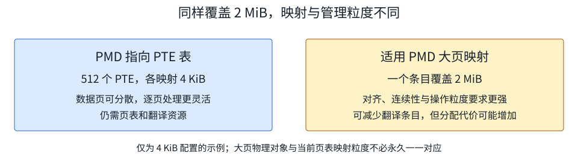
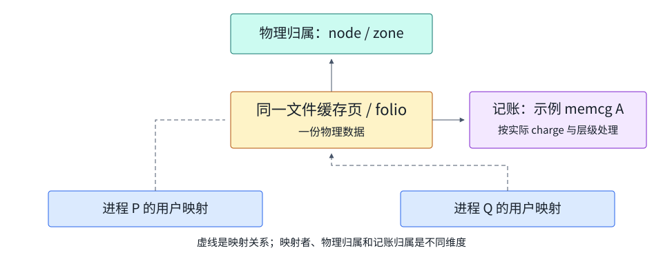
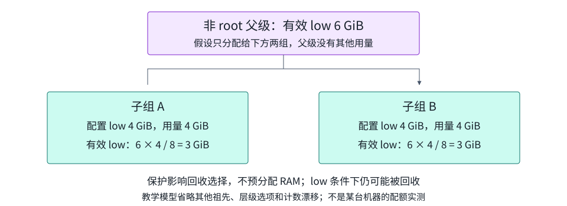

# 页粒度、位置与资源约束

前面按普通页理解分配、映射和回收。实际系统还需要回答：**一次请求使用多大的页、放在哪个节点、向谁记账、能否长期固定？**

这些不是 mm 之外的零散功能，它们改变前面机制的输入和约束。本篇补齐核心认识：每项为什么存在、基本怎样工作、与哪些机制连接。基线为 arm64 Linux 6.1.158，实际功能启用状态仍按目标配置确认。THP、CMA、NUMA 等名称的展开见 [术语速查](00-overview.md#glossary)。

<a id="hugepages"></a>

## 1. 大页改变的不只是分配字节数

### 1.1 为什么希望减少翻译条目？

较大工作集需要许多基本页映射，页表与 TLB 都要承担相应管理需求。若一段适用范围能用较大映射粒度覆盖，就可能减少页表条目和翻译压力。

取 4 KiB 基本页及相应 PMD 粒度示例：



2 MiB 范围可以由 512 个 PTE 分别映射，也可以使用适用的 2 MiB PMD 大页映射。后者对物理连续、对齐和操作粒度提出更强要求，并不是“拿到更多内存却没有代价”。

2 MiB 是选定配置的数值，不是所有 arm64 页配置的统一大页尺寸。

### 1.2 THP 与 HugeTLB 提供不同使用模型

| 机制 | 基本使用模型 | 与普通页路径的联系 |
| --- | --- | --- |
| THP | 对适用映射透明尝试较大页，失败可按相应策略使用普通页 | 缺页、khugepaged 合并、拆分、回收和迁移 |
| HugeTLB | 通过专门大页资源池、预留与显式映射等方式使用 | 资源池、映射许可、预留及实际分配 |

THP 不能保证每个地址始终由一个大页映射。是否尝试、是否允许规整、是否回退或后来合并，都受配置和路径影响。HugeTLB 也不能简单视作“普通分配失败就自动回退”的同一接口。

### 1.3 物理大页与映射粒度要分开

一个较大物理对象可能以较大条目映射，也可能在处理过程中改成多个 PTE。拆分页表映射与拆分物理大页不是同一个动作；引用和固定条件又可能限制物理拆分。

读源码时，先看当前 PMD 是下级表还是适用大页映射，再选择遍历和锁协议。不能在发现大页后继续无条件按普通 PTE 路径操作。

源码：`mm/huge_memory.c`、`mm/khugepaged.c`、`mm/hugetlb.c`；说明见同树 `Documentation/mm/transhuge.rst` 与 `Documentation/admin-guide/mm/hugetlbpage.rst`。

<a id="cma"></a>

## 2. CMA 为什么既预留，又允许适用页复用？

### 2.1 连续需求与长期资源利用的矛盾

部分设备或其他使用者需要较大连续物理范围。若等系统运行很久才寻找，碎片和固定页可能阻碍分配；若永久空着一大片，又降低日常 RAM 利用率。

CMA 在适用初始化阶段确定区域，运行期对其页面施加特定迁移类型和使用条件，使部分可移动需求可以使用这些页；真正连续分配时，再尝试取得并清理目标范围。

### 2.2 CMA 保留不等于永远移出 Buddy

本树 `cma_activate_area` 将区域交给相应初始化，`init_cma_reserved_pageblock` 清除早期保留状态、设置 `MIGRATE_CMA`，并把页交给页供给、调整管理量。

因此，早期的物理区域预留与运行期的 CMA 使用规则是不同阶段。不能把 CMA 容量永久作为普通 `reserved_pages` 从 managed 中扣除，也不能将它理解为另一份额外 RAM。

连续分配涉及区域位图、隔离、迁移与适用范围。占用页若无法移动、目标范围受限或迁移缺少进展，请求仍可能失败。

### 2.3 CMA 与 DMA API 不互相替代

CMA 解决适用连续资源的准备问题，不提供设备地址、CPU/设备一致性和传输完成契约。驱动通常从合适 DMA API 进入，是否使用 CMA 取决于平台和实现。

即使得到连续 CPU 物理范围，也不能直接把 CPU 指针或任意物理地址写给设备。相关入口见 [DMA 与设备资源](api.md#device-memory)。

源码：`mm/cma.c`、`mm/page_alloc.c` 的 `init_cma_reserved_pageblock`、`alloc_contig_range`，以及目标平台 DMA 实现。

<a id="numa"></a>

## 3. NUMA 策略决定适用页放在哪里

### 3.1 节点存在与策略选择是两个问题

资源篇介绍 node 表示位置。这里进一步问：访问成本不同，或调用者需要特定节点时，实际分配优先从哪里开始？

`mempolicy` 描述适用任务或地址范围的选择策略，cpuset 等约束又可能限制允许节点。策略不能越过实际资源范围，也不是将 RAM 永久划给该线程。

以普通用户数据页场景理解常见行为：

| 策略 | 应建立的认识 |
| --- | --- |
| 默认 / Local | 使用适用默认层次，通常从本地适用供给开始 |
| Preferred | 优先目标节点，条件允许时可回退 |
| Bind | 在适用的限定节点集合内寻找，不把无关节点当作通用后备 |
| Interleave | 按偏移或分配序列选择交错目标，不是随机分配 |

真实 nodemask、zone 和回退仍按路径核对；这不是所有内核分配接口统一遵守的简单四选一规则。

### 3.2 为什么改变策略不自动移动已有数据？

策略首先影响后续适用分配。已经驻留的页不会仅因设置新策略就全部换位置；若请求迁移，需要额外标志、权限和页面可移动条件。

任务默认策略与地址范围策略也不同。`set_mempolicy` 影响相应任务默认选择，`mbind` 面向具体范围；线程、fork 和 exec 的继承应按作用域核对。

普通文件缓存、共享对象和私有 COW 页也不必接受同样的策略。不能因为给文件 VMA 设了范围策略，就认定所有共享文件缓存必被重新放到指定节点。

源码：`mm/mempolicy.c`；作用域和使用说明见同树 `Documentation/admin-guide/mm/numa_memory_policy.rst`。

<a id="memcg"></a>

## 4. memcg 记账不等于每进程独占物理池

### 4.1 位置、使用者与记账分别表达什么？



同一文件缓存页可以位于 node 0 的某个 zone，按实际 charge 规则记到一个资源组，又被进程 P 和 Q 映射。

多个映射可以使多个进程各自报告相关驻留，但不因此产生多份物理页。记账的拥有者也不能仅由“现在谁映射它”推断。

### 4.2 Charge 把资源使用放入限制范围

在适用分配中，物理存储取得与 memcg charge 都需要成功。Charge 维护资源组及其层级的计数和限制；组内回收也要围绕该作用域寻找进展。

这解释了两个现象：

- Buddy 已有合适页，本次请求仍可能在记账处受限。
- 全机还有资源，某个资源组却在节流、回收或 OOM。

对象或页释放时也要按对应生命周期处理取消或归还记账。不能将一次申请的物理成功等同于整个对外分配成功。

<a id="memory-protection"></a>

### 4.3 保护与限制是两个方向

仅知道 high / max，还不能解释回收为何偏向某些资源组。用量限制关注“这组继续消耗时怎样施加压力”，保护则关注“回收选择时，哪些已使用内存应优先保留”。

| 控制项 | 主要作用 | 不提供什么 |
| --- | --- | --- |
| `memory.min` | 有效边界内的硬内存保护 | 不预先分配 RAM，也不允许任意扩大 max |
| `memory.low` | 有效边界内的尽力保护 | 不保证其他可回收供给耗尽时仍不回收 |
| `memory.high` | 超过边界后施加节流与回收压力 | 不等于严格用量上限 |
| `memory.max` | 更强用量边界，无法取得进展时可能域内 OOM | 不保证任何请求必然成功 |

保护作用于相应回收域的选择，不是固定几页到某个进程，也不等同于 mlock 或 DMA pin。正常使用结束后，调用者仍按自己的协议释放资源。

在有效 min 内，回收受硬保护约束；如果已经没有可回收的未保护供给，可能进入 OOM，而不是把 min 当作永远足够的备用池。Low 则允许在其他未保护候选不足时继续回收有关保护范围。

因此保护配置并非越大越好。它表达业务优先级与回收取舍，不能消除容量不足，也不能从指标中自动准确选出热数据。

### 4.4 配置量、实际用量与有效量为什么不同？

保护受祖先边界和当前使用量限制。子组配置之和超过父级可提供的有效保护时，不能让每个子组都无条件取得其配置数值。



采用一个简化模型：只讨论 low，父级有效保护 6 GiB，两个子组各配置 4 GiB，当前也各使用 4 GiB，没有父级额外用量和其他相关保护。实际要求的保护共 8 GiB，超过父级 6 GiB，所以按相应使用量比例，两组分别得到 3 GiB。

```text
每组的示例有效保护 = 6 GiB × 4 / (4 + 4) = 3 GiB
```

若 B 当前只使用 2 GiB，则在相同简化条件下，A 的 4 GiB 加 B 的 2 GiB 已不超过父级 6 GiB。B 不会因配置为 4 GiB，就预先占住另外 2 GiB RAM。

这不是所有层级选项下的完整计算公式，也不是本机采样。真实配置还要看祖先、当前计数、层级设置和回收作用域，不能只读叶子文件就推导精确保障。

这也解释了为什么“进程 RSS 相同”仍可能承受不同回收压力：保护、用量边界、共享记账和其他资源组供给都可能不同。观察时可关联 [PSI 与事件](04-reclaim-rmap.md#psi)，不只看一个容量数字。

### 4.5 high、max 与交换限制分开

`memory.high` 用于施加节流与回收压力，越过它本身不触发 OOM killer；`memory.max` 是更强用量边界。交换还受 `memory.swap.max` 等适用约束影响。

三者约束不同阶段。降低延迟、控制驻留和限制交换并非一个参数的三个名字；也不能用修改分配器来绕过记账。

源码：`mm/memcontrol.c` 的 charge、回收和高水位处理，以及同树 `Documentation/admin-guide/cgroup-v2.rst`。

进一步看保护决策，可读 `mem_cgroup_calculate_protection` 和 `mm/vmscan.c` 的对应使用点，区分配置数值、有效边界与实际回收分支。

<a id="overcommit"></a>

## 5. Overcommit 管理承诺，不是统计当前驻留

### 5.1 有地址范围后，未来写入可能需要多少存储？

映射建立时可以不为每页准备物理数据，但可写私有范围在未来触碰或 COW 时可能产生存储需求。Overcommit accounting 关注这类适用承诺，而非只统计当前 RSS。

它与 memcg charge 不是同一关：

```text
建立或扩大适用范围：按映射类型检查、记录有关承诺
实际提供数据页：选择节点、取得存储、处理适用 charge 和映射
```

文件只读映射、私有可写映射与共享对象有不同规则。不能把全部 VMA 长度相加，就当作已分配 RAM 或精确承诺。

### 5.2 三种策略意味着不同风险位置

| `vm.overcommit_memory` | 基本含义 |
| --- | --- |
| 0 | 启发式处理适用请求 |
| 1 | 允许 overcommit，但不取消其他资源、地址或权限约束 |
| 2 | 按适用承诺限制更严格地检查 |

`CommitLimit` 和 `Committed_AS` 可帮助观察承诺范围，但不等于 `MemFree` / RSS。严格检查也不应包装成任何后续分配、设备操作和资源组需求都绝不失败的保证。

这套机制连接 mmap、brk、mprotect、fork 等适用状态变化。源码入口为 `mm/util.c` 的 `__vm_enough_memory`，规则见同树 `Documentation/mm/overcommit-accounting.rst`。

<a id="pinning"></a>

## 6. 页面固定为什么限制回收与迁移？

### 6.1 CPU 映射可以改，外部使用者不一定允许页换位置

迁移时可以改变数据物理位置并更新 CPU 映射，使用户虚拟地址保持不变。但设备、直接 I/O 或其他持有者可能还依赖已取得的页，不能任意移动或释放。

仅观察用户页表没有映射，并不足以判断这种使用已结束。这是前文“解除映射后还要检查引用和固定”的具体原因。

### 6.2 普通引用与 DMA pin 分别表达什么？

`get_user_pages*` 和 `pin_user_pages*` 服务不同使用模型。Pin 包装设置有关内部标志和计数，用于跟踪相应固定；不是简单在调用点多加一次普通 `get_page`。

长期固定还要考虑 `FOLL_LONGTERM` 等限制。它会影响区域选择、迁移和回收，不能为了取得页面就绕过这些条件。

取得多个页也可能只部分成功，调用者要记录实际数量并清理。Pin 需配对 unpin；若页内容被修改，还要按相应脏状态接口和使用模型处理。它不自动建立设备 DMA 映射，也不替代设备完成或同步。

接口边界见 [用户页固定](api.md#pinning)。源码为 `mm/gup.c` 和 `include/linux/mm.h`，说明见同树 `Documentation/core-api/pin_user_pages.rst`。

<a id="hotplug"></a>

## 7. 热插拔说明哪些管理事实可以变化？

物理内存上线不仅是扩大一个计数，还要建立适用描述信息、节点/zone 联系并交给运行期管理。下线则需要隔离范围、停止新分配，并处理可移动的占用页；不满足条件时可能失败。

因此普通 alloc/free 里“描述符通常复用、归属通常不变”的结论有明确范围。热插拔是在改变可管理资源，不是普通释放接口的另一个名字。

固定、不可移动页、迁移目标供给和区域限制都可能影响下线。相关实现见 `mm/memory_hotplug.c`，使用边界见同树 `Documentation/admin-guide/mm/memory-hotplug.rst`。

## 8. 把这些机制重新放回同一次需求

若进程建立一段较大可写范围：

1. 地址管理和承诺规则决定范围能否建立。
2. 实际访问时，页粒度策略决定是否尝试适用大页。
3. 节点策略与允许范围决定存储从哪里取得。
4. 物理供给与 memcg charge 决定本次是否取得进展。
5. 后续 pin 或外部使用可能限制迁移与回收。
6. 结束映射、使用和资源持有后，才按各自协议再利用。

这是条件叠加，不是所有场景都依次调用这些机制。普通小对象、共享文件数据、设备缓冲区和 HugeTLB 请求各有适用组合。

本篇覆盖功能与基本机制，完整大页并发、CMA 隔离算法、策略继承细节和 memcg 内部实现仍可沿这些入口继续深入。回到 [总览](00-overview.md) 可以从同一张全景中查到它们的位置。

实现可以按问题分别进入 [THP](sub/page-size/02-thp.md)、[HugeTLB](sub/page-size/03-hugetlb.md)、[CMA](sub/page-size/04-cma.md)、[NUMA](sub/resource-control/02-numa.md)、[memcg](sub/resource-control/03-memcg.md) 和 [overcommit](sub/resource-control/04-overcommit.md)。各篇追踪自己的对象、决策和失败处理，不把这些独立机制拼成同一条调用链；全部入口见 [深入专题首页](sub/index.md)。
