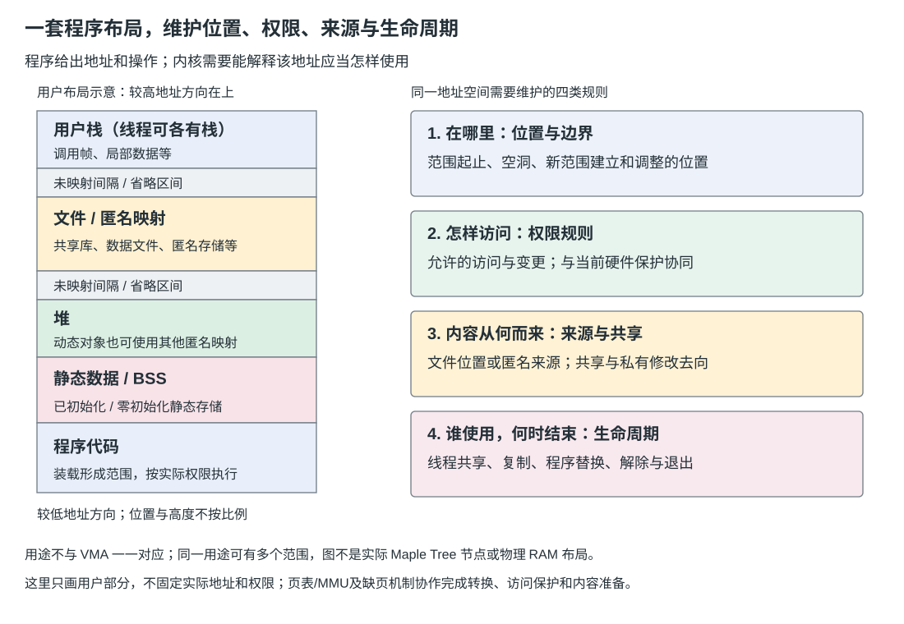
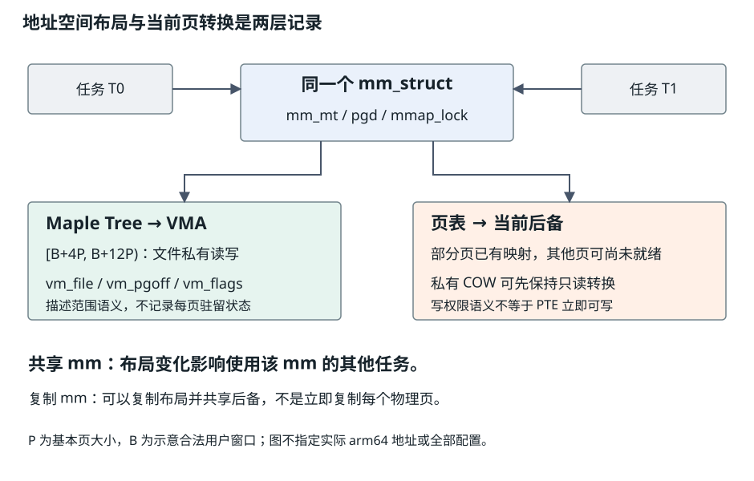
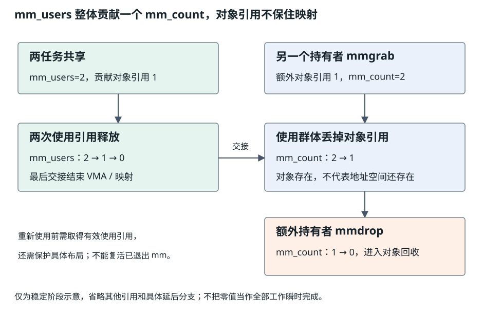
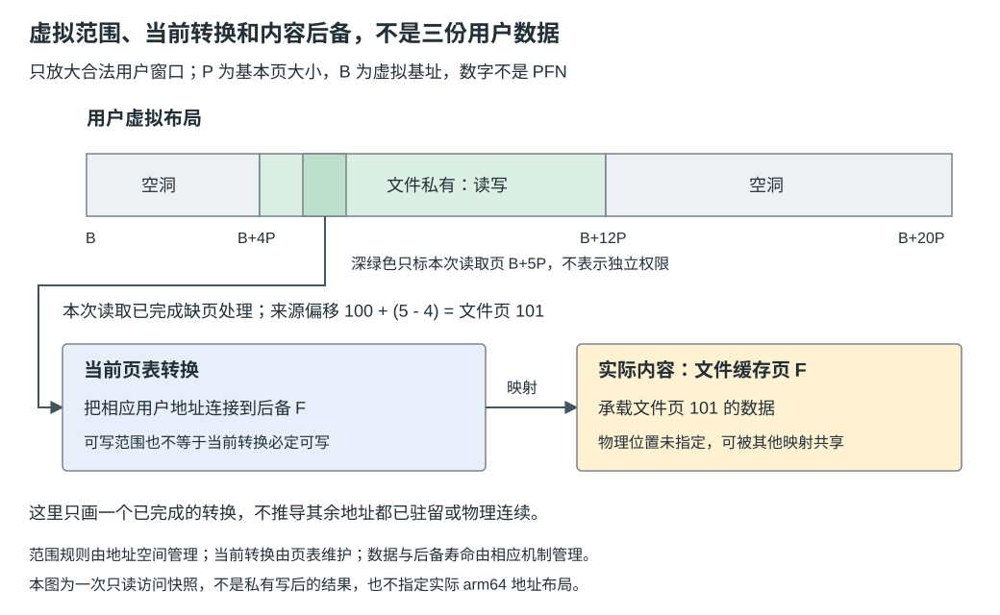
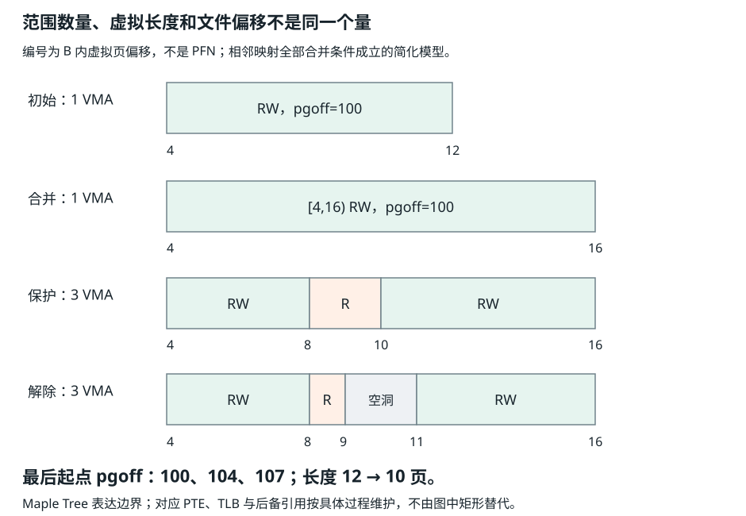
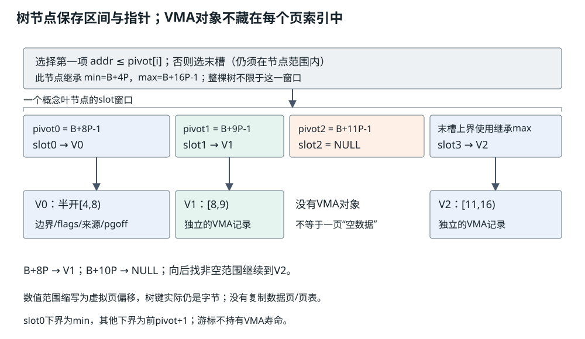
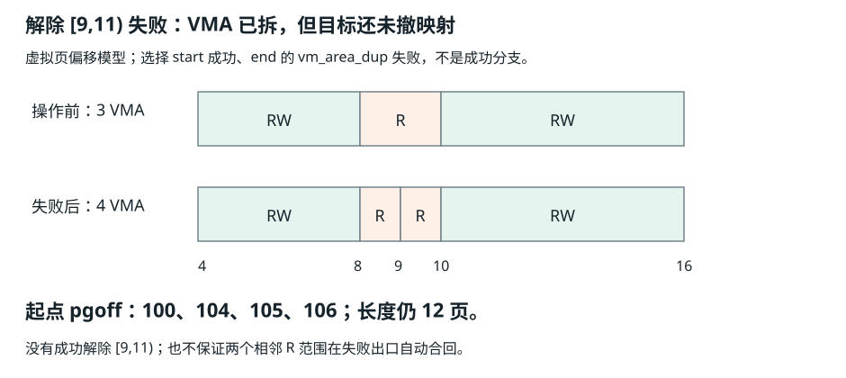

# 进程地址空间：程序内存布局与使用规则

**进程地址空间管理的主要目的，是为程序建立并持续维护一套用户内存布局，规定每段地址允许怎样使用、内容来自哪里，以及这些使用关系怎样建立、改变和结束。** 程序的代码、数据、堆、映射和用户栈在这套布局中运行；页表与缺页机制协作把允许的访问落实到实际数据。

本篇先解释整套布局的意义与管理职责，再对应到 mm、VMA 和范围索引。文件映射只是深入其中一段的案例，用来推演合并、拆分、查询和清理，不代替整个地址空间的目的。

## 阅读说明

- 本地 Linux **6.1.158**、arm64 / AArch64，源码按RT补丁前提；默认基础进程、VM和C知识，但先定义本专题对象。
- 前置：[总览](00-overview.md#addresses)。[页表](06-arm64-page-tables.md)和[缺页/COW](07-page-faults.md)承接转换与按需后备细节。
- 不固定实际地址布局、页大小或VA位宽。图中区间 `[a,b)` 简写合法用户窗口 `[B+aP,B+bP)`，P为基本页大小、B为示意基址，不是PFN或低地址映射建议。
- 本篇讲普通VMA、Maple Tree、共享/复制mm、范围修改、寿命与主要接口；不穷举特殊文件钩子、全部栈扩展或用户缺页扩展。
- 代码和数值仅作推演，未执行用户映射实验、编译模块或修改内核。

### 缩略词与入口

| 名称 | 含义 | 用途 |
| --- | --- | --- |
| mm | `struct mm_struct`地址空间对象 | 保存布局、页表入口、锁和统计等 |
| VMA | Virtual Memory Area | 某连续范围的访问语义记录，不是物理页 |
| VA | Virtual Address | 本文用户地址范围 |
| BSS | 零初始化静态存储对应的区域名称 | 程序布局用途，不固定对应一个 VMA |
| MMU / TLB | Memory Management Unit / Translation Lookaside Buffer | 执行与缓存当前转换和硬件保护 |
| PTE | Page Table Entry | 实际页映射和权限，不等于VMA |
| COW | Copy-on-Write | 私有写时按共享/独占条件处理映射与必要复制 |
| RSS | Resident Set Size | 驻留统计，不等于VMA长度 |
| RCU | Read-Copy-Update | 索引/延后机制，不自动保护任意VMA指针 |
| Maple Tree | 内核范围索引结构 | `mm_mt`按地址索引VMA |
| pgoff | page offset | 文件来源偏移，以基本页为单位 |

| 问题 | 入口 |
| --- | --- |
| 地址空间管理的主要目的是什么 | [程序布局与管理职责](#basic-model) |
| 装载、使用、共享和退出怎样改变布局 | [生命周期全景](#basic-cycle) |
| 一个文件范围怎样建立、访问和解除 | [深入案例](#range-changes) |
| mm、VMA和页表是什么关系 | [实现对象](#address-objects) |
| 共享任务和对象引用怎样计数 | [mm寿命](#mm-lifetime) |
| 局部权限和解除映射为何拆范围 | [连续实例](#range-changes) |
| find_vma为什么会返回空洞后继 | [查询](#lookup) |
| 修改失败后是否全部回滚 | [过程与失败](#operations) |
| 内核查询与用户API怎样使用 | [接口](#apis) |

<a id="basic-model"></a>
## 1. 主要目的：维护程序可使用的内存布局

### 1.1 先看一个运行中的程序需要什么

一个程序运行时，不只有一块待分配的缓冲：CPU 从代码区域取指，程序访问静态数据，动态分配使用堆或其他映射，函数调用使用用户栈，共享库及数据文件还会带来文件映射。这些区域共同构成程序看到的用户虚拟内存布局。



从布局图理解职责：程序只给出一个虚拟地址和要进行的访问，内核必须知道它落在哪里、允许什么操作、内容来源是什么，才能为后续访问或错误处理提供依据。地址随机化和装载方式会改变实际位置，但不会取消这些管理需求。

| 程序看到的区域 | 使用需求 | 内核必须维护的规则 |
| --- | --- | --- |
| 代码与共享库 | 从对应地址取指执行 | 装载范围、来源及实际执行/访问权限 |
| 静态数据、BSS | 读取或更新程序数据 | 相关范围、初始化来源及保护规则 |
| 堆与匿名映射 | 为动态对象提供存储 | 范围建立/调整与匿名内容语义 |
| 文件或共享映射 | 访问文件内容或交换共享数据 | 文件位置、共享/私有及允许权限 |
| 用户栈 | 保存调用帧等线程运行数据 | 栈范围、允许增长及相应限制 |

这些是用途，不是每种用途恰好一个内核范围对象。一个用途可以跨多个范围，多个线程也通常有各自用户栈但共享同一地址空间；内核不为每个 `malloc()` 业务对象单独建立布局记录。BSS 表示程序需要零初始化的静态存储，不保证独立对应一个 VMA，详见第 2.2 节。

图中只讨论用户部分，不用这些用户范围表示内核自身的映射。地址空间是虚拟布局及其管理，不是给程序切出一块独占、物理连续的 RAM。

### 1.2 管理这套布局，核心是四类规则

**建立和维护布局的价值，是让程序的内存需求具有明确边界、访问规则、来源和生命周期。** 这为程序运行、地址空间间的访问隔离及受控共享提供管理依据。隔离不意味着禁止共享，也不是单靠某个范围对象就完成全部硬件保护。

| 管理职责 | 必须回答的问题 | 对程序的实际意义 |
| --- | --- | --- |
| 位置与边界 | 哪些地址已有范围，哪里是空洞，新范围放在哪里 | 分配、扩大或替换范围时能判断冲突，局部操作不丢失两侧布局 |
| 访问权限 | 某范围允许怎样读、写、执行，能否改变权限 | 区分符合范围规则的访问与不允许的访问 |
| 来源与共享语义 | 来自文件哪个位置或匿名存储，修改共享还是私有 | 缺少内容时知道来源，写入时能决定应该改变谁的数据 |
| 生命周期 | 谁共享这套布局，何时复制、替换或结束 | 线程操作影响正确的共享者，退出和解除能结束对应使用关系 |

例如，程序请求扩大一段存储，首先要维护范围和来源；对只读范围写入，首先要检查规则而不是直接补页；文件私有映射发生写入，则需要按私有语义处理内容，而不能当作共享写直接改文件缓存。后面各个对象与算法都服务于这些判断。

这里保护的是范围和页访问，不自动检查每个 C 对象的边界。业务越界若仍落在允许访问的页中，并不保证被这一层发现；不能把地址空间管理当作完整的程序内存安全机制。

### 1.3 地址空间、页表和缺页怎样共同完成访问

程序需要的是“使用一个地址”，三个层次分别负责规则、当前转换和不足条件的处理：

| 参与层次 | 职责 | 与其他层次的关系 |
| --- | --- | --- |
| 地址空间管理 | 维护某地址应有的范围、权限和来源规则 | 为布局修改、查询和缺页判断提供依据 |
| 页表与 MMU/TLB | 记录、执行和缓存当前转换及硬件访问属性 | 正常有效访问可以直接完成，不必每次进入内核查询 VMA |
| 缺页处理 | 根据访问及范围规则处理当前转换不足 | 合法路径准备内容或改变映射；不合法或来源/资源失败则按错误协议处理 |

考虑程序写入刚建立的匿名范围。在普通按需路径中：

1. 建立范围时，内核记录位置、可写和匿名来源，并不要求当场为全部页准备数据。
2. 写入时如果已有有效、权限合适的转换，CPU 可以完成访问；否则可能进入缺页。
3. 缺页路径根据当前地址空间检查访问，只有适用规则允许时，才尝试取得内容、完成记账并建立对应转换。
4. 成功处理后重试访问；权限、来源或资源条件不满足时，不能把任何失败都“分配一页修好”。

这就是地址空间规则不能被页表替代的原因：**某地址现在没有转换，仍可能已经具有合法用途；也可能根本不允许使用。** 没有范围、权限和来源信息，无法决定下一步应该准备什么，还是报告错误。按需准备的详细过程由[缺页专题](07-page-faults.md)承接，本篇负责把规则建立并维护正确。

两个不同地址空间可以使用相同虚拟地址，却有不同布局和后备；同一后备也可按共享语义被多个地址空间映射。实际访问隔离依赖页表与硬件保护，地址空间管理则维护允许建立什么和怎样共享的规则，不能把二者混成一个动作。

<a id="basic-cycle"></a>
### 1.4 从程序装载到使用关系结束

整套布局会贯穿程序生命周期。下面先把正常阶段连接起来，不预设每个程序都走相同接口序列，也不把装载器或退出协议全部展开：

| 阶段或操作 | 地址空间管理做什么 | 没有这层规则会混淆什么 |
| --- | --- | --- |
| 装载程序 | 为代码、数据、用户栈等建立相应范围及来源，记录相关布局信息 | 程序入口、数据地址与来源不是随意数值 |
| 运行时取得更多存储 | 通过 brk/mmap 等建立或调整适用范围，后续访问再按条件取得内容 | 新用户范围不等于全部数据立即驻留 |
| 改权限或解除局部范围 | 维护边界和规则，并协调已有页表转换及引用 | 改树中的边界不等于旧访问自动停止 |
| 线程共享 | 多任务使用同一套布局及页表 | 一线程的范围修改可能影响其他共享者 |
| 普通 fork 复制 | 建立另一套布局；适用私有后备可暂时共享，再由写时复制分离 | 复制布局不等于立即复制所有数据页 |
| exec 替换程序 | 为新程序建立并切换地址空间，按协议结束旧使用关系 | 同一任务身份不意味着一直使用同一布局 |
| 最后使用者退出 | 解除该地址空间的映射、来源与相应持有，再结束管理对象关系 | 结束本套映射不等于共享物理数据无人再用 |

本篇后续重点是范围、索引、共享和寿命，不逐步讲 ELF 装载。对于本地 ELF 路径，`load_elf_binary()` 建立装载与栈相关布局，`mm_struct` 记录部分代码、数据、堆和栈位置；exec 的切换又是单独的交接。[相关源码](#source-program-layout)供需要追踪装载者继续深入。

### 1.5 后面的机制怎样服务于这个目的

mm 表示整套地址空间的管理对象，VMA 记录某一段范围的使用规则，Maple Tree 帮助按地址定位这些记录。接下来先解释这些实际对象，再选择文件映射的一段，推演范围、来源和权限的维护；最后解释同步、失败及清理。

因此，阅读算法时要一直追问“它怎样让布局和规则保持正确”，而不把字段和函数名单当作目的本身。数据缓存、物理资源选择及具体页表实现由各自专题承接。

## 2. 整体组成与关键对象

<a id="address-objects"></a>
### 2.1 三种对象，不是三份数据

`mm_struct` 表示一套地址空间的管理对象，包含用户范围索引、页表根及相关锁和统计。多个线程可以共享同一个mm，也可以有不同mm却映射同一物理后备。

VMA是其中某个连续区间的语义记录：左右边界、当前允许操作、内容来源和特殊操作等。一个VMA可覆盖很多页，不保证它们都已驻留、物理连续或具有完全相同当前PTE状态。

页表保存某个地址当前如何转换，实际数据在相应后备页里。VMA允许写不代表某PTE现在一定可写：私有COW可先保持只读转换，合法写缺页再处理。[依据 A1、A3](#source-model)



对象图：在第 1 节的基本模型上加入实际管理对象。两任务共享同一 mm，不各自复制一套 VMA；页表与 VMA 协作，但不是同一种对象的两套名字。

### 2.2 VMA不是“代码段/堆/栈各一个框”

代码、数据、堆、栈是使用者对范围用途的称呼，VMA是实际语义管理边界。一个文件可拆成不同权限范围，一个用途可有多个VMA；相邻兼容映射又可能合并。

malloc通常有自己的用户态分配管理，不承诺每次申请都调用mmap或brk；返回某个用户对象也不等于新增一个VMA。VMA数量、虚拟长度、RSS和物理后备数量各有口径。

`mm_struct` 的 `start_code/end_code`、`start_data/end_data`、`start_brk/brk`、`start_stack` 记录部分程序边界或起始位置，不能替代 VMA 索引。前者帮助描述装载形成的程序布局，后者负责按任意用户地址查找当前范围规则；新增文件或匿名映射也不能只靠这几个边界字段表示。

### 2.3 布局、来源和同步各有字段

| 对象/字段 | 具体作用 | 不能推导 |
| --- | --- | --- |
| `task_struct.mm` | 当前用户地址空间关系 | 所有任务都必定有用户mm |
| `mm_struct.mm_mt` | 内嵌Maple Tree，按地址索引VMA | 已获得该地址的物理页 |
| `mm_struct.pgd` | 地址空间页表入口 | VMA布局永远固定 |
| 程序代码/数据/堆/栈边界字段 | 记录部分装载布局及起点 | 代替整套 VMA 索引或逐页驻留状态 |
| `mmap_lock` | 普通布局读取/修改的保护 | 代替所有PTE锁或业务引用 |
| `vm_start/vm_end` | 左闭右开边界 | end也属于该VMA |
| `vm_flags/vm_page_prot` | 语义、当前允许权限和保护表达 | 每个PTE与该值位对位相同 |
| `VM_READ/WRITE/EXEC` 与 `VM_MAYREAD/WRITE/EXEC` | 当前语义权限与可申请权限上限 | 当前只读不代表永远禁止恢复写 |
| `vm_file/vm_pgoff` | 来源文件及起点偏移 | 私有写后的每页仍是文件缓存 |
| `map_count` | 当前VMA数 | 页数、映射引用数或RSS |

普通文件VMA中，第i个虚拟基本页对应来源文件页 `vm_pgoff+i`。拆分改变新的起点时，必须同步调整对应偏移，不能只改vm_start而把内容关系留在旧位置。

### 2.4 范围索引怎样服务布局管理

第 1 节的“找到地址所属范围”，在本版本通过 mm 中的 Maple Tree 范围索引实现。先区分索引节点和被索引的 VMA，再讨论它怎样选择区间。

Maple Tree保存“某个地址区间对应哪个VMA指针”，不是为每个用户页分配一份VMA。键是**虚拟字节地址**；VMA使用半开区间，树记录包含终点的闭区间，故store边界为`[vm_start,vm_end-1]`。

索引使内核能根据地址找到范围或空洞，为查询、修改与缺页提供入口。它不提供文件内容、页表转换或被索引对象的额外使用许可。第 3 节先形成一个实际范围变化的例子，再用其结果展开 pivot、slot 和 gap，避免在尚无场景时先记一套节点规则。

### 2.5 共享mm与复制mm

`CLONE_VM`路径取得同一mm的使用引用，共享范围和页表，某线程改变布局会影响同mm的其他线程。普通fork复制路径创建新的mm、复制VMA布局和适用映射；私有后备可以暂时共享并由COW分离，不等于每页数据立即复制。

内核线程通常没有普通用户mm；调度使用的active_mm借用关系与拥有用户地址空间不同。不能从active_mm非空就据此随意访问、长期持有或修改别人的VMA。[依据 A2](#source-lifetime)

<a id="mm-lifetime"></a>
### 2.6 mm_users与mm_count：地址空间与对象不同寿命

`mm_users`计地址空间使用引用，`mm_count`计mm对象引用。**全部mm_users整体贡献一个mm_count，不是每个使用者各加一个mm_count。**

假设两任务共享，另有一个纯对象持有者，没有其他额外引用：

| 阶段 | mm_users | mm_count | 结果 |
| --- | --- | --- | --- |
| 两任务共享 | 2 | 1 | 地址空间使用群体持有对象引用 |
| 额外持有者mmgrab | 2 | 2 | 加对象引用，不加地址空间使用 |
| 第一任务mmput | 1 | 2 | 尚有使用者，不销毁地址空间 |
| 最后使用引用释放及销毁完成 | 0 | 1 | exit_mmap等结束映射，保留额外对象引用 |
| 额外对象引用mmdrop | 0 | 0 | 进入对象回收 |



寿命图：mm_count 仍非零不保证 VMA、页表和用户映射还存在。表中的“销毁完成”包含对应交接，不承诺计数刚到零时所有底层工作已经同时结束。

`mmget/mmput`保护地址空间使用；`mmgrab/mmdrop`保护对象。稳定对象基础上的`mmget_not_zero()`只能取得尚未归零的使用引用，不能复活已结束地址空间。持有使用引用也不阻止其他任务mmap/munmap，仍要布局保护。

无界长期持有mm_users会拖住地址空间退出；长期仅持对象需要后续使用前再判断有效使用资格。RT的`mmdrop_sched()`有调度交接上的延后释放分支，不代表所有mmput/mmdrop一律延后或可以任意上下文调用。

## 3. 布局维护的规则：深入一个文件范围

<a id="range-changes"></a>
### 3.1 从整体布局中选择一段来观察

整套地址空间可以有多种用途。下面只选择其中一段普通私有读写文件映射，观察位置、来源、权限和解除怎样维护；这个窗口不代表整套布局只有文件映射，也不与第 1 节的全景图作数值对应。

设 P 为基本页大小，B 为合法对齐用户窗口基址，`[a,b)` 表示 `[B+aP,B+bP)`，数字不是 PFN。初始范围 `[4,12)` 的文件起点 pgoff=100，`B+5P` 因而对应文件页 101。假定文件足够长、来源和权限合法、所有操作成功，无并发、特殊钩子或其他相邻 VMA；不要求预填充/锁定全部页，尚未发生私有写 COW。



访问图：深绿色只标当前读取页，不是另一段权限。假设该读取已经完成缺页处理，转换连接到文件内容后备；其余页不因此全部驻留。这里区分应用建立范围与页表建立当前转换，物理位置未指定。

| 操作 | 维护哪条范围规则 | 正常结果 |
| --- | --- | --- |
| 建立 `[4,12)` | 位置、权限和文件起点 100 | 8 页虚拟范围，不要求全部后备当场就绪 |
| 首次读取 `B+5P` | 按已有规则解释文件位置 | 内容与当前转换准备后访问，布局长度不变 |
| 建立兼容相邻 `[12,16)`，文件起点 108 | 地址与来源接续，其他合并条件也成立 | 合成 `[4,16)`，12 页 |
| `[8,10)` 改只读 | 局部规则改变，保留两侧来源 | 三段范围，总长仍 12 页 |
| 解除 `[9,11)` | 结束目标使用关系，保留两侧 | 三段剩余范围，总长 10 页；目标成为空洞 |



范围变化图：绿色读写，黄色只读，灰色空洞。范围数、虚拟长度、来源偏移和实际后备不同；结束本套用户映射不保证共享后备同时释放。下面展开每次决策，最后用结果推演索引查询。

### 3.2 相邻合并：位置、来源与语义一起判断

在已选定无冲突的 `[12,16)` 建立同文件、同属性、起点pgoff=108的映射。文件偏移与原范围连续，假定其余兼容条件都满足，可合并成 `[4,16)`，pgoff仍100，map_count仍1。

它不代表mmap的地址hint必定选中12；示例是在地址已确定后推演布局。是否合并还受vm_ops、匿名关联、策略、属性等真实条件限制，权限相同、地址相邻不是充分条件。

本版本的必要检查应落实到具体对象，而不是只说“同一文件”：

| 条件 | 本地判断及变化例 |
| --- | --- |
| 范围相邻、偏移接续 | 前段pgoff加基本页数等于后段pgoff；100+8=108可接续，109则不行 |
| 文件对象 | `vm_file`指针相同，不是只看路径或inode；分别open同一文件可得到不同对象，dup描述符可共享对象 |
| flags与其他语义 | 比较相应flags时排除VM_SOFTDIRTY差异，其他真实限制仍需满足 |
| 文件操作 | 有`vm_ops`本身不直接否决；`vm_ops->close`存在时该合并检查拒绝，不是简单比较两个vm_ops指针 |
| 策略、通知与名称 | 对应内存策略、userfaultfd上下文和匿名名称等保持兼容；特殊配置依实际条件 |
| 匿名关联 | 非空anon_vma若不同不能直接合并；空值情况还要按具体链关系判断 |

`anon_vma`是匿名页反向映射的关联对象，用来联系匿名页与VMA，不是某个数据页，也不是VMA本身；文件私有映射在COW后也可能需要它。`anon_vma_chain`记录当前VMA与这些匿名关联的连接，复制等过程可能使其不止一个关系。最小兼容规则是：有一方为空且调用上下文无VMA或该VMA的anon_vma_chain是单关系时可以通过，否则比较anon_vma指针相同。不能只因“一方为空”就无条件合并。本篇只解释合并所需模型，完整rmap见对应专题。

所以把新段pgoff由108改为109，会保留两个相邻但文件内容不接续的VMA；之后同样保护和解除操作，可能最终留下四个VMA而非主例的三个。[依据 A3](#source-ranges)

### 3.3 局部权限改变：边界和文件偏移一起拆分

只将 `[8,10)` 改为只读，完整成功且没有额外可合并邻居时，需要三个VMA：

| 区间 | 权限 | 起点文件pgoff | 解释 |
| --- | --- | --- | --- |
| `[4,8)` | 读写 | 100 | 原起点不变 |
| `[8,10)` | 只读 | 104 | 起点前移四个基本页 |
| `[10,16)` | 读写 | 106 | 起点前移六页 |

map_count从1到3，虚拟总长度仍12页。VMA拆分不复制12页数据，也不必新建每个页的物理后备；已有PTE的保护变化由对应过程处理。

### 3.4 解除中间两页：删除语义和撤映射

再munmap `[9,11)`。它跨过只读范围尾部和右侧读写范围头部，成功后：

| 剩余区间 | 权限 | 起点pgoff |
| --- | --- | --- |
| `[4,8)` | 读写 | 100 |
| `[8,9)` | 只读 | 104 |
| `[11,16)` | 读写 | 107 |

对照第 3.1 节的范围变化图：变的是范围记录、保护和对应页表使用关系。剩余仍为三个 VMA，但虚拟长度 12→10 页；不能以“VMA 数没变”认为没有解除映射。

`[9,11)`变成空洞，原对应PTE、引用及反向映射关系要撤销。其物理页若还被页缓存、另一个mm或pin等持有，不因本mm解除就立即释放。[依据 A3、A4](#source-ranges)

<a id="lookup"></a>
### 3.5 按地址找规则：范围索引、包含与后继

到这里已经形成具体布局。将三个 VMA 分别称为 V0/V1/V2，B 仍是虚拟基址；Maple Tree 的字节索引对应如下：

| 字节索引范围 | 树中值 | VMA的半开边界 |
| --- | --- | --- |
| `[B+4P,B+8P-1]` | 指针V0 | `[B+4P,B+8P)` |
| `[B+8P,B+9P-1]` | 指针V1 | `[B+8P,B+9P)` |
| `[B+9P,B+11P-1]` | NULL，空洞 | 无VMA |
| `[B+11P,B+16P-1]` | 指针V2 | `[B+11P,B+16P)` |

一个范围节点把若干区间集中在同一块节点存储中。pivot 是相应 slot 所覆盖区间的包含终点；内部节点的 slot 指向下级节点，叶层的 slot 给出 VMA 指针或 NULL。请求地址选择区间，不是把 VA 当作数组槽号；这种高分支组织减少多层指针追逐，但不承诺固定工作负载收益。

定位先考虑节点继承的 min/max。概念上 n 个有效 slot 使用 n-1 个分隔 pivot：选择第一个满足 `addr <= pivot[i]` 的 slot；若都不满足而 addr 仍在 max 内，选择末槽。slot0 左界是 min，其余左界是前一个 pivot 加 1；末槽右界继承 max，不伪造额外 pivot。

图示窗口 min 为 `B+4P`、max 为 `B+16P-1`，分隔 pivot 依次为 `B+8P-1`、`B+9P-1`、`B+11P-1`，四槽值为 V0、V1、NULL、V2。实际节点容量和树高不由这个缩小模型规定，整棵树也不从本窗口才开始。



索引图：真实 `maple_range_64` 等保存 pivot/slot，分配型节点还记录 gap 以跳过不可能容纳申请的分支。VMA 是另一对象，索引不复制其全部字段、页表或文件内容。

针对上述最终范围：

| 地址 | 包含查询vma_lookup | find_vma包含或后继 |
| --- | --- | --- |
| `B+6P` | `[4,8)` | `[4,8)` |
| `B+8P` | `[8,9)` | `[8,9)` |
| `B+9P`或`B+10P` | NULL | `[11,16)` |
| `B+11P` | `[11,16)` | `[11,16)` |
| `B+16P` | NULL（本例此处无映射） | 有更高VMA则返回它，否则NULL |

find_vma非空不证明包含地址。普通包含判断是 `vm_start <= addr && addr < vm_end`，不能只检查addr<end而忘记start。end正好位于相邻下一范围时属于下一VMA，否则可以是空洞。

按上述规则逐步查：`B+8P` 大于 pivot0，但不大于 pivot1，选择 slot1，其左界为 pivot0+1，即 B+8P，值是 V1。`B+10P` 大于前两 pivot，不大于 pivot2，选择 NULL 的 slot2；包含查询失败，向后查找则越过空洞到 V2。

本地`vma_lookup`经`mtree_load`作当前索引查询，`find_vma`经`mt_find`找该地址或后面的非空范围。后者上界是整棵地址索引的ULONG_MAX，不以本篇画出的窗口结束；因此不能从“B+16P在本例之外”直接推导全mm没有更高VMA。

实际walk从树根依据地址和pivot逐层定位；`ma_state`保留当前index/last、节点及槽位位置，后续迭代可从当前路径继续，而非每次把所有VMA线性扫一遍。它只是一次树操作的游标，不是额外的VMA引用，放开布局保护后不能让游标或旧VMA指针无界代表新布局。

### 3.6 空洞容量为什么还要连接对齐和保护边界

在当前布局内，把新映射搜索窗口限为`[B+4P,B+16P)`，其中只有`[B+9P,B+11P)`这个两页空洞。B假设对齐到2P，普通页对齐的两页请求在几何上可放`[9,11)`；只把额外对齐要求改为2P，候选起点需从9移到10，终点12越过空洞11，于是这个空洞不能容纳。

树的gap信息回答“某分支是否可能有足够的连续NULL范围”，不是最终所有资格已通过。窗口边界、对齐偏移、栈保护间隔等仍需外层检查。本地`unmapped_area`还把align_mask加入搜索长度，预留最坏对齐开销，再从找到位置计算对齐候选；它可以比单纯长度比较更保守。default地址hint也不强制选择这里，例子只固定搜索窗口解释资格。

gap摘要的单位是字节，表达子范围的**最大连续NULL长度**，不是该范围内所有空洞的长度总和。两个各一页的洞被一个VMA分开时，摘要最大值是一页，不能据“两页总空闲”接受连续两页申请。

对二次幂对齐A，`align_mask=A-1`，要求的地址余数由align_offset给出；候选调整量为`(align_offset-gap_start)&align_mask`。树搜索的长度却先取`requested_len+align_mask`。本例默认无额外对齐、已有VMA边界都基本页对齐时，取mask=0、offset=0、len=2P，裁剪窗口后两页洞足够，候选仍9P。改成额外2P对齐，mask=2P-1、offset=0，保守搜索需4P-1字节，已在树阶段因洞不足而拒绝；几何候选10P也确实越过该洞。

保守与精确判断也可能不同：若独立空洞为`[B+9P,B+12P)`，len=2P、2P对齐的几何候选`[10,12)`能放下，但这个helper搜索长度4P-1仍大于三页洞。不能把“数学上存在一个可用地址”冒充此搜索算法一定返回它。加mask之前还检查长度溢出；有洞摘要也不是无条件地址分配许可。

把“可放2页”与“新VMA已经创建”分开：搜索返回候选后还需来源/权限、承诺和VMA/索引资源准备；这正是后文mmap失败仍可能没有新映射的原因。

### 3.7 范围权限不等于每个PTE即时状态

VMA保存语义和允许的操作。按需页尚无PTE，COW页可在可写VMA下保持只读PTE，换出的页又可能记录swap等状态。mprotect更新语义时还要按实际映射处理保护和TLB，munmap则撤使用关系，不能仅改Maple Tree而让旧访问继续合法。

`mmap()`成功可能只建立范围与来源，第一次缺页再取得内容。后续分配、文件I/O或memcg失败仍可能使访问失败；MAP_POPULATE、mlock等有额外条件，也不是“mmap一成功就永不失败”的保证。

## 4. 主要工作过程与协作

第一节给出整套布局的生命周期；本节深入运行期范围维护，以及最后使用者退出。mmap、mprotect 和 munmap 分别服务于位置/来源建立、权限改变和关系结束，具体步骤必须让范围规则、索引、转换和清理相互一致。

<a id="operations"></a>
### 4.1 mmap：先选择范围，再建立语义与来源

入口验证大小、地址对齐/溢出、标志、文件权限和安全条件，选择适用地址，计算vm_flags与文件页偏移；`mmap_region()`在布局保护下处理旧范围、合并或新VMA、文件映射操作、索引和统计。

文件钩子可能改变或拒绝映射，计数/承诺和管理对象也可能失败。新映射失败会清理相应准备资源，但MAP_FIXED替换旧映射等不能统一描述为“完整回滚至原布局”。建立范围与缺页物理后备是后续协作关系，不是同一函数把所有数据复制完。

<a id="mmap-four-cases"></a>
**先选初始内容，再选写入归属。** 另取一个小例来比较：文件映射时，初始内容对应文件偏移；匿名映射没有调用者指定的文件内容。`MAP_PRIVATE` 与 `MAP_SHARED` 决定修改是否沿同一后备共享，并不决定创建 VMA 时是否立即分配全部数据页。

| 普通映射 | 初始内容及首次使用 | 可写时，修改落在哪里 |
| --- | --- | --- |
| 私有匿名 | 初值为零；读可先用零页，写才取得私有页 | 进程自己的匿名后备 |
| 共享匿名 | 初值为零；本树以内部 shmem 对象承接，而非调用者指定的普通文件 | 共享此映射的使用方可经同一 shmem 后备看到修改，例如继承映射的父子进程；独立调用两次不会自动共享 |
| 私有文件 | 初值取自对应文件偏移，普通读可映射缓存页 F | 写入分离到匿名后备 Q，不通过这次私有写修改 F |
| 共享文件 | 对应相同文件偏移的缓存页 F | 经文件系统写入准备后修改同一 F，纳入脏页管理；共享可见不等于已持久化 |

在本树 `mm/mmap.c` 看 `do_mmap()` 如何形成 `vm_flags`，再看 `__mmap_region()` 对文件调用映射钩子、对共享匿名调用 `shmem_zero_setup()`。以原生 arm64、普通文件映射为例：把文件偏移 `S` 开始的两页映到 `[V,V+2S)`，`S` 为基本页大小，VMA 的 `vm_pgoff` 为 1。访问 `V+128` 仍在映射的第一页，落到文件页索引 1 的第 128 字节。可对照 `arch/arm64/kernel/sys.c` 的 `mmap` 入口和 `include/linux/pagemap.h` 的 `linear_page_index()`。

`MAP_POPULATE` 等适用情况下会触发后续预填工作；它不把地址范围、PTE 和数据后备合成一个对象，也不保证以后再无缺页。[首次访问的文件页分流](07-page-faults.md#file-fault-branches)沿同一 F/Q 案例继续，原理与旧实现的阅读入口见[资料对照表](reference-reading.md#address)。

例如重置到主例mprotect成功后的三个范围，用MAP_FIXED尝试替换 `[8,10)`：

| 失败位置 | 布局结果 |
| --- | --- |
| 入口参数/文件等检查拒绝，尚未进入旧范围解除 | 原三个VMA、12页范围和原对应映射保留 |
| 旧 `[8,10)` 已解除，后续普通私有写映射的承诺检查失败 | 保留 `[4,8)`、`[10,16)`，中间空洞；map_count=2，长度10页，没有新映射 |

本地`__mmap_region()`的旧范围解除在对应承诺检查、新VMA分配之前。这个失败对照不说所有错误都先删除旧映射，而是要求先找到实际停止位置。

### 4.2 mprotect：边界、语义和PTE保护

`mprotect_fixup()`尝试兼容合并，否则在局部边界拆VMA，调整文件偏移，然后更新flags/保护表达和已有映射。申请的权限仍受原可允许范围、文件属性、安全条件和特殊VMA操作约束。

不能把 `vm_flags=VM_WRITE` 作为任意PTE都应直接开写的依据：私有COW保持共享只读的场景仍需要写缺页处理。跨多个VMA时，每段检查和改变各有步骤，后段失败不保证前段全部未变。

当前权限和可申请上限又是两层。主例 `[8,10)` 降为只读时清除当前VM_WRITE，但不因此自动清掉VM_MAYWRITE；后来申请恢复读写，仍需通过上限、架构、安全和特殊操作检查。即使恢复了VMA写语义，某PTE仍可能因COW暂时只读。

普通文件通过只读文件描述符建立映射时，private写用于私有副本，可能保留可写上限；shared写要改变共享文件内容，受FMODE_WRITE等限制。只读shared建立过程中可去掉VM_MAYWRITE，之后mprotect不能仅凭当前只读段请求增加写权限。这里排除额外文件seal、安全拒绝等情况，不把“只读文件”概括成private/shared一律相同。

### 4.3 munmap：先隔离目标范围，再撤映射并结束关系

Maple-aware munmap先准备范围操作、按start/end拆边界，组织待移除VMA，随后从主索引摘掉目标，并调用对应页表、TLB、rmap/引用与VMA清理。

在主例中拆的是[9,10)与[10,11)两部分，保留[8,9)和[11,16)并正确调整右侧pgoff。拆分时可以暂时新增VMA，再删除目标，所以最终map_count与中间分配动作不同。

失败也可以留下结构变化。本地`do_mas_align_munmap()`先拆start边界，再处理end；后续分割或用户缺页通知准备失败，可保留前面已成功的拆分。**返回失败不普遍证明VMA结构未变，但也不能据已拆分就认为目标PTE已全部解除。** 必须跟踪实际失败位置，而非把全部修改叫原子事务。

沿主例mprotect成功后的布局，解除 `[9,11)` 时，明确选择**start拆分成功、end处`vm_area_dup()`分配失败**：

| 此时仍在布局中的范围 | 权限 | 起点pgoff |
| --- | --- | --- |
| `[4,8)` | 读写 | 100 |
| `[8,9)` | 只读 | 104 |
| `[9,10)` | 只读 | 105 |
| `[10,16)` | 读写 | 106 |

map_count=4、虚拟长度仍12页。本次尚未进入真正摘除目标和撤映射阶段，所以目标页并不因错误返回已经解除；相邻两个只读VMA也不保证在失败出口自动合回。



失败图：这是失败分支，不与第 3.1 节的成功结果混用。userfaultfd 准备失败只在对应功能启用及实际注册/请求条件下存在，不是普通解除必经的失败点。

### 4.4 exit_mmap与最后mm使用引用

最后mm_users归零进入`__mmput()`，结束相关AIO、KSM/大页等使用关系，再exit_mmap清理地址空间，最后丢掉使用群体对mm_count的对象引用。共享后备的寿命由其他引用继续决定，不是退出一个mm即删除所有原物理内容。

额外mm_count引用可让管理对象继续存在，不能保证其VMA仍在；要重新取得使用资格并保护布局，不能凭缓存的旧VMA地址继续读。[依据 A2、A4](#source-lifetime)

## 5. 索引更新与同步：布局不是一个字段

维护可用布局意味着读取者不能把未完成的范围修改当成当前规则。下面分别解释谁保持对象存活、谁稳定布局，以及规则从旧状态到新状态时哪些记录必须协调。

### 5.1 引用、布局锁、页表锁不是同一保护

| 保护 | 本文中的用途 | 不能替代 |
| --- | --- | --- |
| mm_users使用引用 | 使地址空间不会因最后使用引用退出而整体消失 | 其他线程改布局、PTE变化 |
| mm_count对象引用 | 保证mm对象存储仍有效 | 地址空间使用资格 |
| mmap_read_lock | 普通查询和使用期间稳定VMA布局 | 全部页面状态不变 |
| mmap_write_lock | 修改普通VMA布局和相关语义 | 不经页表协议直接改任意PTE |
| PTE/页级保护 | 具体转换、页引用与内容交接 | VMA长期指针或业务发布 |

缺页可以在适用mmap读保护下建立或改变PTE，具体还需页表锁和重检；布局稳定不等于RSS/PTE不变化。解锁后其他线程可拆分、移除或改原VMA；业务应复制所需值，而不是把借用指针无界传给异步工作。

本地mm_init初始化mm_mt并关联外部mmap_lock。Maple节点本身的RCU读机制不等于所存VMA在任意阶段都可供调用者使用，不能把更新索引和被索引对象寿命混为一件事。本文不搬用新版本才出现的其他VMA锁路径。

### 5.2 原对象、索引存储和待清理对象有不同生命期

对`[4,16)`降权为三个VMA的正常修改，必须一起维护三类事实：VMA对象的start/end/flags/pgoff，主树中相应字节区间的指针，以及mm的map_count/长度统计。只改VMA.end却让旧索引范围仍返回它，会使包含查询得到一个不包含地址的对象；只改索引而丢掉旧VMA清理，又会遗留来源/反向映射关系。普通布局写保护使读取方不能把这些中间状态当作完成布局。

Maple节点分配和VMA复制也是不同资源。`mas_preallocate`准备的是树修改所需节点，不等于`vm_area_dup`已经成功取得新VMA；后者又不等于复制数据页。因此“已为索引预分配”不能保证整次munmap/mprotect永不失败，原4.3的end拆分失败例仍成立。

以解除`[9,11)`为例，本地还建立临时`mt_detach`。它保存待移除VMA指针，主树负责今后地址查询，detach树负责后续撤页表及来源清理，不复制那些VMA或页数据：

| 阶段 | mm主树 | detach工作树 | 对象/后备 |
| --- | --- | --- | --- |
| 准备和拆边界 | 仍能找到已拆成的目标段 | 收集相应目标VMA | 目标尚未因收集而解除 |
| 主树目标区间写NULL | `[9,11)`成为索引空洞 | 仍可找到待处理目标 | 旧PTE/来源关系需随后结束 |
| unmap_region与remove_mt | 留下其余范围 | 用目标对象完成撤映射/清理 | 按实际引用结束，不销毁共享物理内容 |
| 工作结束 | 新布局继续有效 | 工作树节点销毁 | 不再以旧目标指针对外访问 |

关键源码对应`vma_mas_store`的`mas_set_range(...,end-1)`与`mas_store_prealloc`、munmap的主树NULL提交、`unmap_region`和`remove_mt`。分割/主树提交阶段需要布局写保护；符合条件时，后续撤映射可降为读保护，邻接可增长栈等情形另受限制。不是用RCU代替每一层锁，也不是一把mmap锁冻结全部PTE。

### 5.3 同一原VMA怎样变成中段，再留下哪些对象

给主例对象稳定命名：合并后的原VMA叫S，范围`[4,16)`、pgoff100。mprotect `[8,10)`选择未合并的分割路径：

| 步骤 | 原对象S | 新复制对象 | 对应主树store及map_count |
| --- | --- | --- | --- |
| 初始 | `[4,16)`，RW，100 | 无 | 原范围→S，1 |
| start处split，new_below=1 | S缩为`[8,16)`，pgoff104 | L=`[4,8)`，100 | 调整后store S，再store L，1→2 |
| end处split，new_below=0 | S缩为`[8,10)`，104 | R=`[10,16)`，106 | store R覆盖原S的尾段，树余段仍→S，2→3 |
| 更新本段权限/页表保护 | S改R，L/R仍RW | 不再复制VMA | 范围总12页不变 |

每个store把表内半开范围转为字节闭区间`[B+aP,B+bP-1]`。尤其第二次分割不必重复store每个不变指针区间：新R覆盖尾段后，树保留S对应中段；这与S字段缩短一起在写保护内完成。读者不能在这些中间步骤无锁同时取树范围和字段。分割还复制策略、匿名关联、文件持有及适用open合同，而不是复制数据页。

继续munmap `[9,11)`，它的split方向与上述mprotect不同。start分割new_below=0，原S保留`[8,9)`，新D为`[9,10)`、pgoff105；end分割new_below=1，新E为`[10,11)`、pgoff106，原R保留`[11,16)`、pgoff107。临时map_count先3→4→5，主树清目标后减两个对象为3；保留下来的始终是L/S/R，不是释放全部旧对象再造三份。

撤除和统计还分几个时点，假设允许降读锁、无其他并发布局改变：

| 时点 | 主索引/工作索引 | map_count / total_vm | 本阶段结束什么 |
| --- | --- | --- | --- |
| 两次边界拆分成功 | 主树含L/S/D/E/R，detach收D/E | 5 / 12页 | 还未撤目标PTE |
| 主树`[9,11)`写NULL | 主树剩L/S/R，detach仍D/E | 3 / 暂仍12页 | 此时可适用降锁，不能据新主树宣称清理全完 |
| unmap_vmas | 工作树定位D/E | 3 / 暂仍12页 | 撤目标PTE/rmap及相应映射持有 |
| free_pgtables及tlb_finish_mmu | D/E对象仍用于清理定位 | 3 / 暂仍12页 | 从文件/匿名候选索引解关联，按范围处理表页并完成对应失效/批次 |
| remove_mt逐个处理 | 处理D，再E | total_vm可12→11→10 | 记账、close/fput/策略释放，结束VMA对象寿命 |
| `__mt_destroy` | detach节点销毁 | 3 / 10页 | 结束工作索引存储，不替代前述对象/映射清理 |

这些是单一受控操作的阶段模型，不是承诺任意时刻读取多个计数能得到一致快照。原4.3的end复制失败发生在主树NULL提交前，因而不能套此成功链的“已撤PTE/长度已减”后果。

## 6. 接口与使用

<a id="apis"></a>
### 6.1 用户操作与内核内部入口

| 操作 | 用户接口 | 注意 |
| --- | --- | --- |
| 建立范围 | mmap | libc返回MAP_FAILED表示失败，不是NULL检查 |
| 改权限 | mprotect | 地址对齐、允许权限、部分变化可能性 |
| 删除范围 | munmap | 起点对齐、长度取整，可解除子范围；不要求匹配原mmap调用 |
| 传统堆边界 | brk及相应libc封装 | 不等于malloc每次请求 |

内核`do_mmap()`等并不是用户程序可直接调用的函数；其负错误编码与libc的MAP_FAILED/errno也不是同一种返回表示。驱动普通范围查询不要直接修改mm_mt或调用内部split/merge，必须遵循对应锁和接口所有者。

MAP_FIXED会在选定范围替换旧映射，不是安全hint；未知地址或并发共享mm下可能毁掉别的对象。MAP_FIXED_NOREPLACE在本版本对冲突提供拒绝语义，也不能替代地址、范围和返回值检查。

普通munmap并非vfree那种原分配基址配对：可以从已映射范围中间解除子区间，起点须基本页对齐，正长度按页边界向上取整，并检查用户范围和溢出。没有重叠VMA的普通空洞范围可返回成功；成功不证明此前有数据映射。

例如最终布局里的 `[9,11)` 已是空洞，再解除可成功而不改变map_count。非整页长度可能覆盖最后一个相交基本页，不能把字节长度当作只清其中部分字节。特殊映射另有约束。下面保存原地址/长度是为了管理本次取得的资源，不是接口要求证明原mmap出处。

### 6.2 用户范围骨架：处理成功、改权限失败与清理

这里只用实际基本页大小，不依赖主模型B，也不测试写只读页。假设没有其他线程同时改此私有范围：

```c
#define _GNU_SOURCE
#include <sys/mman.h>
#include <unistd.h>
#include <stdint.h>
#include <errno.h>

struct owned_range {
    unsigned char *addr;
    size_t len;
    int pending;
};

struct range_errors {
    int operation;
    int cleanup;
};

static int range_example(struct owned_range *owned,
                         struct range_errors *errors)
{
    long s;
    unsigned char *p;
    size_t len;

    if (!owned || !errors) {
        errno = EINVAL;
        return -1;
    }
    errors->operation = errors->cleanup = 0;
    if (owned->pending) {
        errors->operation = errno = EBUSY;
        return -1;
    }
    s = sysconf(_SC_PAGESIZE);
    if (s <= 0 || (size_t)s > SIZE_MAX / 3) {
        errors->operation = errno = EINVAL;
        return -1;
    }
    len = 3 * (size_t)s;
    p = mmap(NULL, len, PROT_READ | PROT_WRITE,
             MAP_PRIVATE | MAP_ANONYMOUS, -1, 0);
    if (p == MAP_FAILED) {
        errors->operation = errno;
        return -1;
    }
    owned->addr = p;
    owned->len = len;
    owned->pending = 1;
    p[0] = 1;

    if (mprotect(p + s, (size_t)s, PROT_READ))
        errors->operation = errno;
    if (munmap(owned->addr, owned->len)) {
        errors->cleanup = errno;
        return -1;
    }
    owned->pending = 0;
    owned->addr = NULL;
    owned->len = 0;
    if (errors->operation) {
        errno = errors->operation;
        return -1;
    }
    return 0;
}
```

调用者以零初始化的owned/errors记录开始；函数不会覆盖仍pending的旧记录。mmap失败没有新资源；mprotect失败保存操作errno并尝试完整清理；munmap失败另存清理errno，地址与长度仍保留，由调用者处理，不自动重试。

只有munmap成功才清空记录。pending表示尚未确认完整清理，不是这段地址仍全部可访问的保证；清理失败后不能继续按旧权限使用。两种错误都发生时不会丢掉其中一个。后续清理也应只在确认成功后清空记录，避免丢失或重复释放。

该代码不承诺真实map_count恰好从1变3：邻居、合并和原属性影响布局。它是接口责任骨架，未编译运行。

### 6.3 内核查询：使用引用加布局保护，返回值副本

以下在可睡眠任务上下文读取当前任务的一段VMA信息；输出指针是有效内核对象。成功只返回数值，不把VMA指针带出锁：

```c
#include <linux/errno.h>
#include <linux/mm.h>
#include <linux/sched.h>
#include <linux/sched/mm.h>

struct range_snapshot {
    unsigned long start, end, flags, pgoff;
};

static int snapshot_current_vma(unsigned long addr,
                                struct range_snapshot *out)
{
    struct mm_struct *mm;
    struct vm_area_struct *vma;
    int ret = -ENOENT;

    if (!out)
        return -EINVAL;
    mm = get_task_mm(current);
    if (!mm)
        return -ESRCH;

    mmap_read_lock(mm);
    vma = vma_lookup(mm, addr);
    if (vma) {
        out->start = vma->vm_start;
        out->end = vma->vm_end;
        out->flags = vma->vm_flags;
        out->pgoff = vma->vm_pgoff;
        ret = 0;
    }
    mmap_read_unlock(mm);
    mmput(mm);
    return ret;
}
```

get_task_mm取得使用引用，成功后必须mmput；无用户mm返回NULL，active_mm非空不能替代。未包含地址返回ENOENT，不能把输出当有效结果。

解除锁后这些数值只是一次快照，不保证地址仍可访问；真正拷贝用户内容、pin后备或异步使用要走对应接口，不能仅据flags含读写位就解引用用户指针。例子未运行，不给所有模块提供任意任务VMA操作权限。[依据 A1、A2](#source-lookup)

## 7. 边界、变体与常见误解

### 7.1 来源、驻留与共享分别观察

文件私有映射写后可产生匿名COW页，VMA仍保留文件来源/偏移语义。不能从vm_file非空判断全部PTE都指向文件缓存；也不能从两个mm具有相同VMA范围判断它们共享同一mm。

虚拟长度不等于RSS，map_count不等于映射页数；共享物理页的不同统计口径也不由本篇的文件偏移直接决定。`/proc/<pid>/maps`反映范围布局，不是完整逐页驻留表。

### 7.2 栈、特殊映射与生命周期

find_vma返回后继不等于允许自动填空洞。栈增长需要合法增长标志、地址限制、guard和相应路径；不能把查询函数非NULL当作扩展许可。

PFNMAP、MIXEDMAP、设备映射、userfaultfd、hugetlb等有特殊操作和限制，不把普通文件三次变化推广到所有VMA。进程退出、exec更换mm或线程共享布局变化也会使缓存指针失效；对象引用、布局保护和实际页持有都要按各自契约处理。

## 8. 总结与源码入口

本篇主要目的不是介绍一棵树，而是解释内核怎样维护程序可使用的内存布局：位置/边界、权限、来源与共享语义、生命周期。mm、VMA 和 Maple Tree 是承载并定位这些规则的实现，页表/MMU 与缺页则协作完成实际访问。

从整个程序看，装载建立布局，运行期调整范围，线程可以共享，复制与 exec 改变使用关系，最后使用者退出结束这套映射。文件案例只放大其中一段；虚拟范围、当前转换和真实后备仍不能互相代替。

同一文件映射从[4,12)合并到[4,16)，再拆权限，最后解除[9,11)：VMA边界、map_count、文件偏移与页表关系各有变化。只看一个数量，不能判断全部结果。

理解主干要连接“mm使用/对象寿命、VMA语义、范围索引、PTE/后备”。引用不代替锁，锁不代替页持有；find_vma后继不代替包含，失败不代替无副作用。

### 源码依据

<a id="source-program-layout"></a>
**A0：程序布局与访问协作**

- [binfmt_elf.c](../../../../linux-6.1.158/fs/binfmt_elf.c)：`load_elf_binary()`、`elf_load()`、栈准备及程序边界记录；本篇不展开完整装载算法。
- [exec.c](../../../../linux-6.1.158/fs/exec.c)：`begin_new_exec()`、`exec_mmap()` 与旧 mm 使用关系交接。
- [arm64 fault.c](../../../../linux-6.1.158/arch/arm64/mm/fault.c)：访问类型、范围查找和缺页处理交接，具体权限条件以本版本实际分支为准。

<a id="source-model"></a>
**A1 / A3：对象与范围**

- [mm_types.h](../../../../linux-6.1.158/include/linux/mm_types.h)：mm_struct、vm_area_struct与字段含义。
- [Maple Tree说明](../../../../linux-6.1.158/Documentation/core-api/maple_tree.rst)、[maple_tree.h](../../../../linux-6.1.158/include/linux/maple_tree.h)、[maple_tree.c](../../../../linux-6.1.158/lib/maple_tree.c)：字节范围、pivot/slot、游标、gap及索引节点生命周期。
- [mmap.c](../../../../linux-6.1.158/mm/mmap.c)：`vma_mas_store()`半开到闭区间、`vma_merge()`、`__split_vma()`及pgoff变化。

<a id="source-lookup"></a>
**A1：查询**

- [mm.h](../../../../linux-6.1.158/include/linux/mm.h)：`vma_lookup()`、相关查询接口。
- [mmap.c](../../../../linux-6.1.158/mm/mmap.c)：`find_vma()`、`find_vma_prev()`与mmap保护。

<a id="source-lifetime"></a>
**A2：mm寿命**

- [sched/mm.h](../../../../linux-6.1.158/include/linux/sched/mm.h)：mmget/mmgrab、not_zero及RT mmdrop_sched。
- [fork.c](../../../../linux-6.1.158/kernel/fork.c)：mm_init、copy_mm、get_task_mm、__mmput/exit_mmap/mmdrop交接。
- [active_mm说明](../../../../linux-6.1.158/Documentation/mm/active_mm.rst)：使用引用与对象持有。

<a id="source-ranges"></a>
**A3 / A4：修改、失败与清理**

- [mmap.c](../../../../linux-6.1.158/mm/mmap.c)：do_mmap、mmap_region、do_mas_align_munmap、exit_mmap和失败后的边界状态。
- 同文件的is_mergeable_vma/is_mergeable_anon_vma、文件权限形成VM_MAY*、do_mas_munmap的范围检查，区分支持语义与资源记录。
- [mprotect.c](../../../../linux-6.1.158/mm/mprotect.c)：mprotect_fixup、合并/分割、flags与页表保护。
- [util.c](../../../../linux-6.1.158/mm/util.c)：用户映射包装和锁交接。本文未执行这些路径。

<a id="review-result"></a>
## 独立挑战审阅

以下是外部图解增补前的审阅记录；增补范围见[本轮对照](reference-reading.md#address)。

第 1 轮曾通过，但用户指出主要目的仍模糊。本次调整整体布局、四类管理职责与生命周期，把文件案例及索引推演移到后面；同一挑战者 Kant 已完成第 2 轮全文、七图与本地源码复核，技术与教学分别通过，无未关闭实质挑战。依据与历史见[本次记录](review/review-entry-05.md)，等待用户统一 review，不等于用户验收或运行验证。

此前 [Chandrasekhar 记录](review/review-pedagogy-05.md)及 [Aquinas 记录](review/review-process-address.md)保留为历史，不自动套用通过结论。未编译运行示例或内核，未执行映射及文件 I/O 实验。
