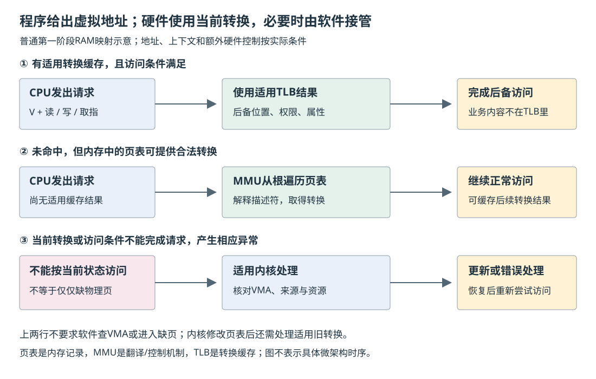
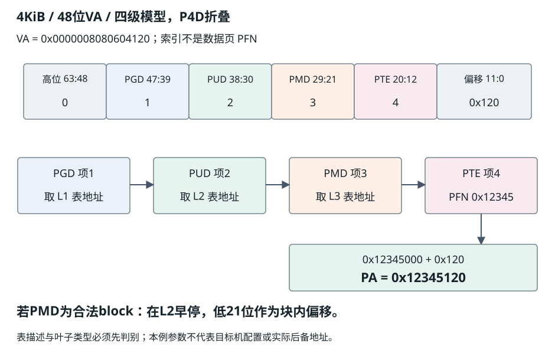
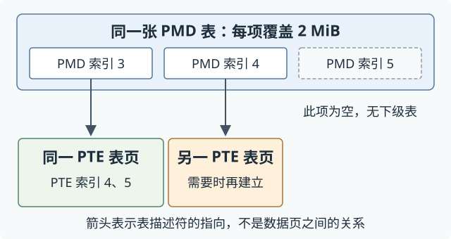
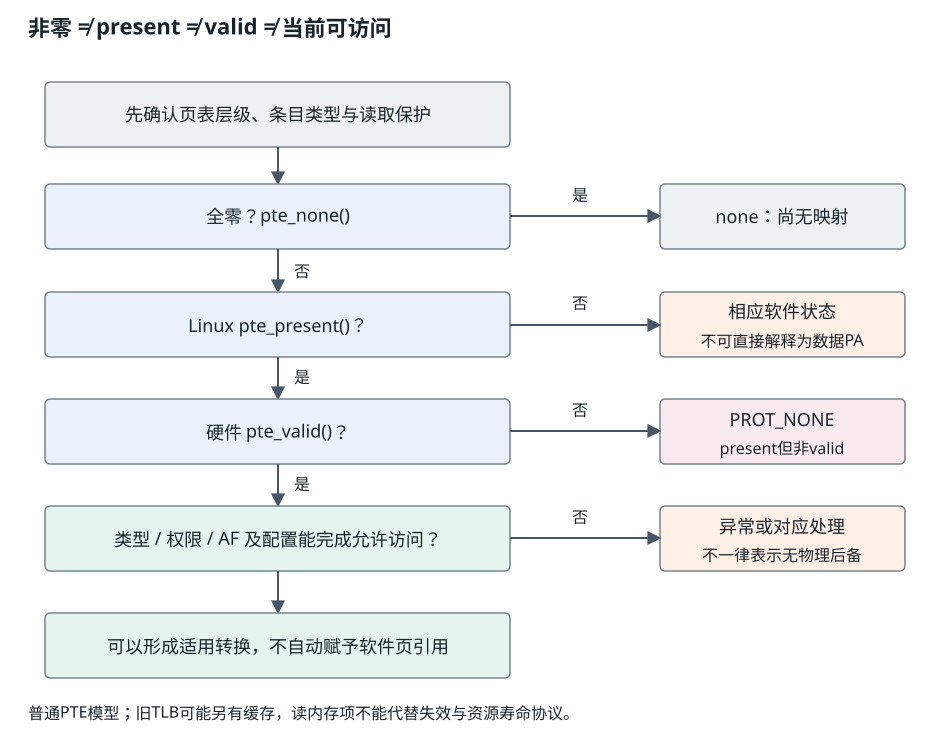
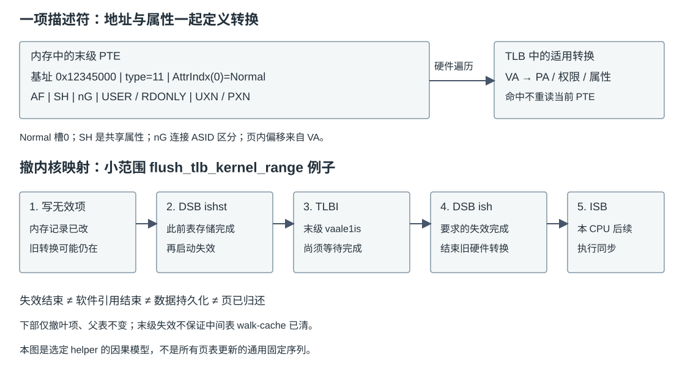
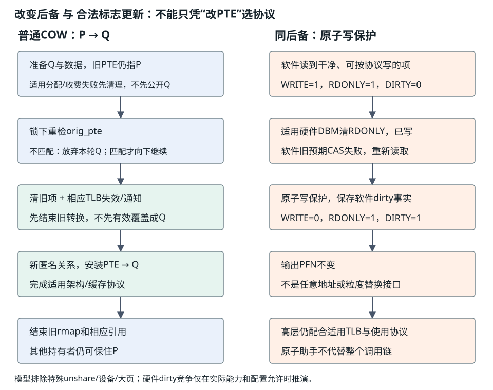
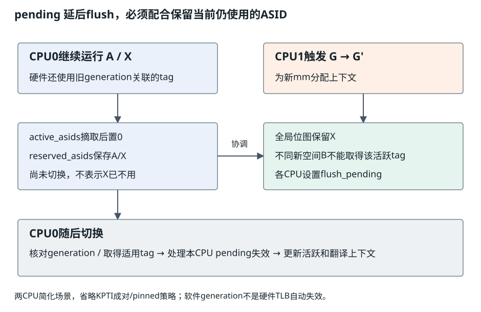
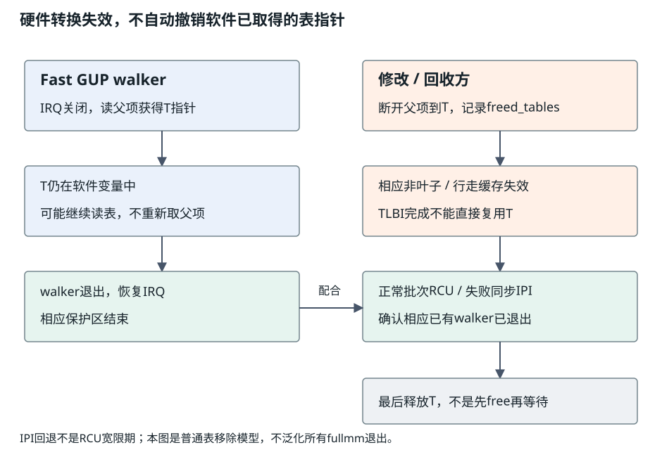

# arm64 页表与 TLB：转换结构和更新协议

页表是内存中的转换记录，MMU使用它们决定某地址落到哪里、能否访问；TLB则缓存转换结果。**修改一项内存记录，不等于所有CPU已停止使用旧记录的结果。**

它们共同服务于一个目标：**让程序使用虚拟地址时，硬件能够找到当前后备并实施相应访问控制；映射变化后，不能继续凭旧转换访问已经改用途的资源。** 页表保存内核建立的记录，MMU解释记录，TLB减少重复查表，三者不是同一份结构。

本篇先跟踪正常访问与软件接管的边界，再用明确的四级例子理解地址分解，深入条目状态、后备替换、硬件并发标志更新和安全回收。它不提供从模块手动修改页表或翻译寄存器的实验。

## 阅读说明

- 本地Linux **6.1.158**、arm64 / AArch64，按RT补丁前提；前置[进程地址空间](05-process-address.md)和[内核虚拟映射](04-kernel-virtual.md)。
- 位段/容量例子显式使用 **4KiB基本页、48位VA、四级翻译、未标记合法普通地址**，不是目标配置。PA位宽、HAF/DBM、MTE、contiguous、隔离等另按实际条件。
- 本文解释普通第一阶段地址转换、条目/更新和回收协议，不展开KVM第二阶段或全部ASID分配策略。
- 数据地址、表地址和状态数字用于模型；没有修改寄存器、页表或运行目标机实验。

### 缩略词与入口

| 名称 | 含义 | 用途 |
| --- | --- | --- |
| VA / PA / PFN | Virtual/Physical Address / Page Frame Number | 输入地址、输出地址与基本页位置 |
| MMU | Memory Management Unit | 转换和权限检查 |
| TLB | Translation Lookaside Buffer | 转换缓存，不是数据缓存 |
| PGD/P4D/PUD/PMD/PTE | Linux页表层次接口名称 | 实际层数不足时折叠 |
| ASID | Address Space Identifier | 区分适用地址空间的转换 |
| TTBR | Translation Table Base Register | 翻译表根及配置控制下的标识字段 |
| TCR | Translation Control Register | 控制翻译配置及ASID来源等 |
| MAIR | Memory Attribute Indirection Register | 条目属性索引所选的内存类型 |
| AF / DBM | Access Flag / Dirty Bit Management | 访问与适用硬件脏管理 |
| DSB / ISB | Data / Instruction Synchronization Barrier | 相应更新和执行同步 |
| BBM | Break-Before-Make | 先结束旧有效映射再建立新有效映射的适用协议 |
| RCU | Read-Copy-Update | 适用软件遍历/表页延后回收保护 |
| MTE | Memory Tagging Extension | 条件化标签同步与检查 |

| 问题 | 入口 |
| --- | --- |
| 程序访问时页表、MMU和TLB如何协作 | [正常访问与职责](#access-model) |
| 页表与条目是什么 | [基本结构](#model) |
| 一次VA怎样逐级变成PA | [位段推演](#walk) |
| present为什么不等于valid或可访问 | [条目状态](#states) |
| 后备替换为什么不能先覆盖后刷新 | [替换协议](#replace) |
| 硬件更新dirty时软件如何保护 | [原子标志更新](#atomic-flags) |
| TTBR/ASID和TLB失效是什么作用 | [标识与失效](#context) |
| 表页何时能释放 | [回收及接口](#reclaim) |

## 1. 定位、职责与问题

<a id="access-model"></a>
### 1.1 为什么合法的程序地址还需要转换记录

程序取指、读堆对象、访问用户栈或读取文件映射，给CPU的都是虚拟地址。地址空间管理已经说明某个范围“可以怎样使用”，但这个说明不直接给硬件指出这次访问应落到哪一份RAM或其他后备。对于普通驻留映射，内核还需建立**虚拟范围到物理后备、访问权限及内存属性的转换记录**，由arm64第一阶段翻译机制使用。

例如两个进程都访问虚拟地址V：A应读到自己的页P，B应读到自己的页Q。另一个例子是fork后父子可以都读P，但私有写不能直接改变对方的数据。仅保存“VMA允许读写”不能表达当前到底指向P还是Q，以及现在是否必须用写保护捕获私有写。这些事实由相应页表记录、上下文标识和更新协议共同落实。

页表不是数据本身：程序读到的内容在后备页，表项只是描述如何到达和使用它。TLB缓存的也不是这些业务字节，而是适用的转换结果；数据缓存/I-cache服务于内容访问，是另一类缓存。

### 1.2 一次正常访问：不必每次进入内核

固定普通有效用户RAM映射，地址、访问类型、上下文和其他硬件控制均合法：

1. CPU发出对V的读、写或取指请求；MMU按当前翻译上下文判断转换和访问控制。
2. 如果存在适用TLB结果，可以使用缓存的后备位置、权限和属性完成访问，不重新查询VMA，也不要求每次重新读取内存中的PTE。
3. 若TLB没有适用结果，硬件可从当前页表根开始逐级遍历。描述符有效且相应权限/属性允许时，取得转换并继续访问，可形成供后续使用的缓存结果。**这只是硬件查表，不自动构成一次软件缺页。**
4. 如果当前转换/访问条件不能完成该请求，产生相应异常。普通可处理的用户缺页才交给内核：检查范围和来源，准备后备或改变合法转换；也可能拒绝访问或返回来源/资源错误。恢复成功后再尝试原访问。



图0是三类过程，不是规定每次访问依次经历三行。上两行可在不进入软件缺页处理的情况下完成；下行中的“更新或错误”由实际异常类型和来源决定。硬件还有访问标志等具体条件，后文再展开，不把所有非成功状态简化为“页不在RAM”。

### 1.3 内核改映射时，多了一项协调责任

正常访问解释了为何需要TLB，也带来更新问题。假设V原来指向P，内核准备把它改成Q：即使内存中的表项已经写成Q，CPU仍可能缓存V→P。若此时把P归还给分配器，P被其他用途重用，旧转换就可能读写别人的数据。只检查当前PTE不再指P，不能证明旧访问能力已经结束。

因此管理职责有两部分：**建立能被硬件正确解释的转换；在修改、撤销和回收时协调旧记录、缓存结果与后备寿命。** 后备切换、同后备标志更新、新表发布与旧表回收是不同协议，后文分别推演。VMA提供高层规则，缺页/映射操作决定改变什么，页表助手和TLB维护落实改变，引用与回收协议决定何时能复用资源。

这些协作是正常程序运行、fork私有写、mprotect降权、munmap解除以及内核映射撤销的共同底层需求，不只是页表调试时才出现。[依据 T1、T3、T5](#source-layout)

<a id="model"></a>
### 1.4 表页、描述符和数据页

页表是一组保存描述符的内存。表描述符指向下一层表，适用叶子描述符指向数据页或较大块；描述符含类型、地址和属性，不是struct page，也不是把数据内容复制进表项。

硬件通常使用表的物理位置和VA索引推进遍历；内核软件通过适用映射地址和层级助手读写这些表。取得一个表项位置，与取得对应数据页引用是不同操作。

VMA表达合法范围语义，MMU不每次查Maple Tree来完成硬件转换。TLB命中可直接使用适用转换；TLB未命中而页表有效，硬件遍历后访问成功，不必进入缺页处理。[依据 T1](#source-layout)

### 1.5 Linux名称不等于硬件多出一层

Linux通用代码用PGD/P4D/PUD/PMD/PTE接口。示例四级arm64真实层对应PGD/PUD/PMD/PTE，P4D折叠，不增加一张实际表。每层实际存在和跨度依PAGE_SHIFT、VA_BITS及CONFIG_PGTABLE_LEVELS。

表也占真实后备。若此前没有任何相关表，孤立路径需要相应表页；实际新映射往往复用已有上层，不能按“每次访问四级”就说每次新申请四页元数据。

## 2. 整体组成与关键对象

<a id="walk"></a>
### 2.1 4KiB/48位例子：索引不是PFN

一表页4096字节、每条目8字节，容量512，每完整层索引9位，页内偏移12位。示例位段：

| Linux / 硬件层 | VA索引 | 单项覆盖的VA跨度 |
| --- | --- | --- |
| PGD / L0 | 47:39 | 512GiB |
| PUD / L1 | 38:30 | 1GiB |
| PMD / L2 | 29:21 | 2MiB |
| PTE / L3 | 20:12 | 4KiB |
| 页内偏移 | 11:0 | 基本页内字节 |

选择索引1/2/3/4、偏移0x120，得到：

```text
VA = (1 << 39) + (2 << 30) + (3 << 21) + (4 << 12) + 0x120
   = 0x0000008080604120
```



图1：前三层选中表描述符，末层选数据页。示例PFN为0x12345，与索引1/2/3/4没有相等关系。

1. 从根表的第1项取得L1表地址。
2. L1第2项取得L2表地址，L2第3项取得L3表地址。
3. L3第4项取得PFN0x12345对应基址0x12345000。
4. 加页内偏移0x120，最终PA=0x12345120。

改变低12位只改变这个基本页内落点；跨基本页则换PTE，后备PA未必连续。索引越界、类型错误、无映射或权限条件不满足会触发对应异常，不把所有情况叫“找不到物理页”。

<a id="sparse-tables"></a>
**为什么值得多走几级？** 在这个 4 KiB / 48 位模型中，若用一张扁平表为整个 48 位空间的每个基本页预留 8 字节条目，即使实际只映射两页，表存储也要 `2^(48−12) × 8 = 512 GiB`。这只是对照模型。多级组织让未覆盖的子树不用准备下级表，代价是 TLB 未命中时硬件可能多读几级描述符。



假设上面的索引 1/2/3/4 路径已经建好，新映射也按基本页建立。把末级索引从 4 改成 5，两条映射共用一张 PTE 表页；保持 PGD/PUD 索引，只把 PMD 从 3 改成 4，若该项原来为空，就需准备另一个 PTE 表页，但仍复用上层。对照 `arch/arm64/include/asm/pgtable-hwdef.h` 的跨度以及 `mm/memory.c` 的 `__pte_alloc()`。图的组织借鉴[页表资料](reference-reading.md#translation)，位段和层级仍按本树 arm64。

### 2.2 叶子可早停，但条件不是省略一层名字

若本例PMD是适用block而非下级表，覆盖2MiB，遍历在L2停止，低21位作为块内偏移。输出基址必须满足该块对齐和类型/属性条件，不能仍把低12位当全部偏移。

普通表描述符与block/page类型不同；取到一个非零PMD就继续当下级表指针，会把数据后备误当表页。大映射要求相应连续对齐后备，不让任意分散的512个页自动成为一个PMD block。

变PAGE_SHIFT时，一表容量是`1 << (PAGE_SHIFT-3)`，页内偏移和每层索引相应变化；顶层还可能只使用部分位，不把本例9位四层照搬到16/64KiB配置。真实地址/PA编码走架构助手，52位PA等分支不只是无条件掩掉低12位。[依据 T1](#source-layout)

<a id="states"></a>
## 3. 条目状态与访问条件

### 3.1 none、present、valid、可访问分别判断

| 普通PTE状态 | 软件解释 | 硬件结果 / 注意 |
| --- | --- | --- |
| 全零，pte_none成立 | 无该映射记录 | 不能从零值取得有效后备 |
| 非零且非present | swap、迁移等软件编码的可能形式 | 不把编码中的位直接当PA |
| PROT_NONE标记，VALID=0 | Linux pte_present可成立 | 并非硬件valid映射，不允许普通访问 |
| VALID=1 | 硬件类型/地址表达有效的前提之一 | 还要检查层级、权限、AF和属性 |
| VALID且权限满足 | 可成为正常转换 | 仍不等于软件调用者持有页寿命 |

本地`pte_present()`检查VALID或PROT_NONE，`pte_valid()`只看VALID。pte_pfn/pte_page等须在适用类型和保护下用，不能先从任意非零条目提取PFN，再把它当成普通RAM。



图2：软件present不是“CPU马上可读写”。TLB还可能持旧转换，所以读取内存中的VALID也不能代替失效协议。

### 3.2 属性位不等于独立的权限布尔表

先把图1的“PTE指向数据页”展开成一项完整记录。沿4KiB、48位VA例子，另限定PA不需要52位特殊编码，末级条目可按以下模型理解：

```text
描述符 = 输出页基址编码 | 末级page类型 | 内存属性 | 访问与执行控制
输出页基址：0x12345000
末级类型：PTE_TYPE_PAGE，低两位为11
内存类型：PTE_ATTRINDX(k)，索引k选择MAIR的一个属性槽
访问控制：AF、AP对应的USER/RDONLY、UXN/PXN等
```

这是说明组成的模型，不是可直接写入任意页表的常量：真实安装用pfn_pte、保护组合及架构助手，还要处理软件位和功能条件。输出地址回答“访问哪份后备”，属性回答“以什么权限和内存类型访问”，两者一起构成转换。

在本例编码中，基址占适用地址位，AttrIndx在[4:2]、USER/RDONLY在[6]/[7]、AF在[10]，不把这些属性加进页内偏移。MMU选择PTE后先按类型和控制条件解释它，再以页基址加VA低12位；MAIR槽存的是内存类型编码，不是下一层表或数据页地址。改k但保留PFN，后备不变，却可能改变访问属性，因而不能按“没改地址”就省略必要更新协议。



图6上部把一项内存描述符与其转换结果分开：TLB缓存适用的地址、权限和属性等转换信息，不是每次命中再重读当前PTE。下部用撤内核映射展示更新的完成边界。

再把k落实到本版本普通用户只读RAM页：概念上调用`pfn_pte(0x12345, PAGE_READONLY)`，假设仍采用上述4KiB/普通PA编码，无额外标签等修改。`PAGE_READONLY`展开为以下组合：

| 部分 | 本地组合与含义 |
| --- | --- |
| 地址 | PFN移入适用地址位，得到0x12345000 |
| type / AF | `_PROT_DEFAULT`包含page类型和AF=1 |
| SH | `PTE_SHARED`使SH为inner-shareable，描述内存共享属性；不是MAP_SHARED，不表示两个进程共享数据 |
| AttrIndx | `MT_NORMAL=0`；MAIR初始化把槽0设为`MAIR_ATTR_NORMAL=0xff`，普通Normal缓存属性，而非Device槽 |
| 数据权限 | USER=1、RDONLY=1、WRITE=0，普通用户只读 |
| 执行权限 | PXN/UXN都为1，不允许相应执行 |
| nG | `PTE_NG=1`，非全局转换按适用ASID区分，不允许把不同mm相同VA的转换无条件通用 |

因此此简化编码结果为`0x0060000012345fc3`；它是源码保护组合的推演，不是建议手写值安装。全局/非全局说的是转换的标识匹配，非文件共享方式：父子即使共享同一个P，仍可各有受ASID区分的用户转换。SH也不替代同步屏障；它与后文共享域操作各自有职责。实际Normal/Device及缓存属性的选择应走来源映射接口，不能随意给普通RAM换Device属性。

本地宏表达普通属性：AF记录访问标志；USER/RDONLY参与EL0数据访问；UXN/PXN限制相应执行；AttrIndx选择MAIR中的内存类型。只看单个位不能判断全部语义，例如execute-only用户映射也不能按USER位简单当kernel映射。

固定为合法普通末级页、上层允许、无额外PAN/MTE等限制，USER=1、AF=1、RDONLY=1、WRITE=0、UXN=1、PXN=1：

| 操作 | 这个条目的结果 | 改哪项条件会改变判断 |
| --- | --- | --- |
| EL0数据读 | 允许相应转换 | USER/上层/其他访问控制仍须满足 |
| EL0数据写 | 当前只读，权限异常 | 是否允许COW/写恢复由VMA及高层协议决定，不因VALID就可写 |
| EL0取指 | UXN禁止 | 合法执行映射需相应执行权限/缓存协议 |
| EL1取指 | PXN禁止 | 不因它是用户页而默认允许kernel执行 |

另将WRITE置1、RDONLY仍1，表示可按相应协议写的干净项：硬件DBM/脏管理实际启用时，可在合法首写中清RDONLY并记录硬件脏状态；未启用时需权限异常后的软件处理。软件pte_write资格不是当前RDONLY已清的保证。

只改AF为0并保持读权限满足：硬件访问标志更新实际启用时可以置AF继续访问，不必异常；否则可发生Access Flag异常并由对应软件处理。不能仅据AF=0断定总要新分配页，或只看CONFIG选项就假定CPU/控制寄存器已启用相应能力。

Linux `PTE_WRITE`复用DBM位，脏状态由软件DIRTY和适用硬件状态组合：

```text
pte_dirty = 软件 PTE_DIRTY
            或 (PTE_WRITE 已设置 且 PTE_RDONLY 已清除)
```

| 稳定示意 | WRITE | RDONLY | 软件DIRTY | 含义 |
| --- | --- | --- | --- | --- |
| 干净只读 | 0 | 1 | 0 | 不按普通写语义访问 |
| 干净但可按协议写 | 1 | 1 | 0 | 首写由适用硬件DBM或缺页处理推进 |
| 已脏且可写 | 1 | 0 | 任意 | 硬件状态可表达脏 |
| 已脏后写保护 | 0 | 1 | 1 | 保存脏事实，当前禁止普通写 |

硬件HAF/DBM是否支持及启用按实际能力；不支持时软件缺页等维护相应状态。PTE dirty不是folio的Dirty/Writeback，也不是文件已经持久化；其与文件脏页的协作在[页缓存/回写](08-page-cache-writeback.md)解释。[依据 T2](#source-state)

<a id="replace"></a>
## 4. 更新协议：后备替换与标志修改

### 4.1 普通COW替换：重检后先撤旧，再装新

用同一合法VA，原PTE指向页P，准备新页Q。仅讨论普通基本页复制安装，排除特殊unshare、设备页和大页：

先区分两种计数：mapcount记录相应页的映射关系数量，页引用还包含映射持有、临时get_page、pin或其他持有。临时引用保护存储不被回收，不等于保证没有别人写入数据。

假设父子各有一个只读PTE映射普通匿名P，映射数为2；子进程的复制处理另外临时持有P。准备Q期间旧子PTE仍存在，不能先从rmap/mapcount中排除它。成功切换后才结束旧映射计数和对应映射持有，临时持有在本轮退出时另行释放。

| 阶段 | 页表/转换 | 后备与关系 |
| --- | --- | --- |
| 准备 | 旧PTE仍指P | 取得Q、复制数据及适用收费，不能先公布Q |
| 重新持PTE保护 | 比较当前项与原orig_pte | 匹配才继续；不匹配不能覆盖其他线程的新结果 |
| 清旧并失效 | ptep_clear_flush_notify结束旧项和相应旧转换 | 保持旧关系交接正确，不提前减旧mapcount |
| 装新 | 建新匿名关联，经set_pte_at_notify安装Q | 更新对应管理/缓存协议 |
| 结束旧关系 | PTE已切换 | 去旧rmap/引用，P仍有其他持有者可继续存在 |



图3：两者不是一个模板。后备切换需要避免P/Q转换混用；同后备合法标志更新有自己的原子协议。

若先有效覆盖成Q再清旧TLB，有的CPU已经使用Q，有的还用P，会出现同VA的混用窗口。本地wp_page_copy的注释和调用顺序明确先清/失效再安装。`set_pte_at()`包含架构维护，不是自动撤掉所有旧转换的全包函数。

另一反例是提前让rmap/mapcount表示子进程已退出P的映射，而子进程其他线程仍能通过旧PTE/转换读P：别的进程在相应独占/复用协议中可能把P当成不再被该子映射共享，开始写P，旧读取者便会看到不应共享的新写入。P的临时引用即使还在，也只保住存储，不能解决这种数据可见性错误。

这不是说本版本只看mapcount=1就无条件复用；真正复用还有独占标记、引用等检查。反例解释的是各协议观察到的rmap事实不能早于旧实际访问关系结束。实际调用链先撤旧/失效、装Q，再page_remove_rmap及映射引用交接；过量保留旧计数可以保守，提前少计却会破坏共享状态。

若准备Q期间其他线程已经改变PTE，重检不匹配则放弃本轮安装，清理Q和临时持有，不把“Q已分配/复制”当作写入权。准备收费失败也在安装前处理，旧映射不能凭失败被无条件撤掉。[依据 T3](#source-update)

<a id="atomic-flags"></a>
### 4.2 写保护遇到硬件脏更新

软件读取旧项 `(WRITE=1,RDONLY=1,DIRTY=0)`，准备写保护。期间硬件在允许DBM的场景清RDONLY为0，表示发生写入：

1. 软件按旧值做条件更新，会因当前项已变而失败。
2. 重新读取硬件脏状态，再用pte_wrprotect计算新项。
3. 将潜在硬件dirty转存软件DIRTY，清WRITE、设置RDONLY，条件提交。

结果为 `(WRITE=0,RDONLY=1,DIRTY=1)`，不能用第一次读取的干净值覆盖而丢掉写事实。本地ptep_set_wrprotect使用比较交换循环；PTE软件锁不停止硬件AF/dirty更新，不能据持锁就跳过这类协调。

合法访问标志更新则用ptep_set_access_flags合并AF/WRITE/DIRTY及更宽松的适用RDONLY，保留地址和其他位，必要时失效旧只读转换。它不能拿来替换PFN，也不等于任意权限收紧可不用同步。

这些助手没有代替高层全部协议：写保护之后的TLB和共享/COW交接仍由对应调用链处理，不把某助手名字当作“所有CPU已同步”。[依据 T2、T3](#source-update)

### 4.3 新下级表准备成功仍要重检

固定用户mm下已存在上层、PMD仍为空且没有大映射竞争，线程A/B同时需要PTE表。本地`__pte_alloc`各自用`pte_alloc_one`取得候选T/U，表清零及页表锁等元数据初始化在发布前完成：

| 阶段 | A的候选T | B的候选U | 共享PMD |
| --- | --- | --- | --- |
| 锁外准备 | T已初始化但未连接 | U已初始化但未连接 | none |
| A先取得`pmd_lock` | 重检none，增加表计数 | 尚不能安装 | 仍none |
| A发布 | `smp_wmb`排序初始化，再`pmd_populate`编码T物理地址，清本地候选指针 | 等待同一安装锁 | 指向T |
| B随后取得锁 | T已属于页表 | 重检非none，不安装U | 保持T，不覆盖 |
| 调用结束 | 本地候选为NULL，不释放T | 候选仍U，用`pte_free`回收 | 仍指T |

锁确保只由一个线程选择并安装；`smp_wmb`确保其他CPU看见父连接时，不会按此发布顺序先读到尚未完成的子表初始化。源码还说明软件遍历的依赖读取与该发布配合；仅有安装锁不能替无锁遍历建立全部可见性保证。arm64的`pmd_populate`将表页物理位置和TABLE/PXN组合存入父项，不是把内核虚拟指针原值塞进去。

两次`__pte_alloc`均可返回0：B没有用上自己的U，但所需下级表已由A建立，竞争输家不是必然ENOMEM。真正候选分配失败才在此处返回-ENOMEM；更上层仍要按实际页表状态推进。这是“未发布候选”的立即清理，不是6.1中“旧已发布表”的TLB/RCU延迟退出。内核表建立另用`init_mm.page_table_lock`及对应kernel助手，不能把本例pmd_lock套作所有层级统一锁。

<a id="context"></a>
## 5. 标识、失效与可见性

### 5.1 TTBR根与ASID来源不同

正常Linux第一阶段配置中，用户/内核地址使用对应TTBR0/TTBR1根；合法范围、TCR、标签和隔离等决定实际使用，不能对任意地址只测最高位就完成判断。

ASID区分适用非全局用户转换，避免不同mm同VA混用。根选择与ASID字段来源不能混同：**本地cpu_do_switch_mm因TCR.A1已设置，把ASID写入TTBR1；SW TTBR0 PAN条件下还向TTBR0保存相应副本。** 不能泛化成“用户根在TTBR0，所以ASID只来自TTBR0”。

本地根据CPU能力识别8或16位ASID，未确认芯片不固定。软件context id还含generation，硬件转换只使用相应标识字段；软件换generation不自动擦掉旧TLB条目。

例如原mm用tag X缓存 `V→P`，以后另一个mm重用硬件tag X并映射 `V→Q`，若缺少旧转换处理，tag和VA相同仍可能命中P。实际allocator在rollover时保留仍活跃的ASID，标记各CPU flush_pending，后续切换在适用点执行本地失效再使用对应上下文。不是所有上下文切换都全量flush，也不是generation变化后无需任何硬件操作。[依据 T4](#source-context)

用两个CPU把reservation与pending连接起来。CPU0继续运行旧generation G的mm A/tag X；CPU1需要新的上下文并触发G→G'，省略KPTI成对和pinned策略：

| 阶段 | CPU0与全局管理 | 为什么 |
| --- | --- | --- |
| rollover摘取活跃记录 | active_asids[0]取出G/X并置0，保存reserved_asids[0]，全局位图保留X | 软件字段置0不停止CPU0当前硬件执行 |
| 标记pending | 各CPU需在适用后续切换处理旧缓存，CPU0此时还没flush | 延后失效不证明当前ASID已不用 |
| CPU1分配新mm B | 不能把位图中保留X直接给不同活跃空间B | 保证仍运行旧A和新B不以同一全局ASID表示不同空间 |
| CPU0继续未切换 | 硬件仍用旧A/X；若再rollover而active已0，仍用reserved记录保留X | 不丢掉尚在运行上下文的唯一管理痕迹 |
| CPU0随后切换 | 重新核对generation/取得适用ASID，处理本CPUpending失效，再更新活跃状态和翻译上下文 | 失效完成点与真正新使用相连 |



图4：active_asids、reserved_asids是软件协调数据，不是直接清除硬件当前标识。只留下“下次切换flush”而不保留正在使用的ASID，会错误地把尚活跃标识当可重用；这里只推演必要不变量，不穷举位图搜索。

### 5.2 同步步骤依具体操作选择

设合法内核末级页映射V→P正被其他CPU使用，调用者已经按高层协议撤掉叶项，**父表连接保持不变**，随后调用小范围`flush_tlb_kernel_range`。把内存记录、硬件缓存和执行上下文分成三个观察对象：

| 顺序 | 此时改变/保证什么 | 为什么不能只保留后一步 |
| --- | --- | --- |
| 写无效项 | 内存页表不再公布V→P | 旧TLB可能仍能访问P，普通存储不是失效通知 |
| `dsb(ishst)` | 在相应共享域完成此前页表存储，为随后失效建立顺序 | 若表更新尚未可见，失效后新遍历仍可能读旧连接；不能仅凭C语句先后推断硬件顺序 |
| `TLBI vaale1is` | 对指定范围发出末级转换失效，不据此清中间表walk-cache | 发出操作不等于所需失效已经完成；换成撤父连接必须改用相应表级协议 |
| `dsb(ish)` | 等待本序列要求的失效完成 | 之后才可依此边界结束旧硬件转换的使用，不让旧访问与P复用交错 |
| `isb()` | 同步本CPU后续指令执行上下文 | 不是远程CPU的软件引用回收，也不是把P数据写回存储 |

`ish`表示inner-shareable作用域，`st`限定该首道屏障的存储完成要求；它们是此helper选定的架构操作，不是“加一个任意屏障就都同步”。图6中的箭头表示先后和完成边界，不表示P已经可归还。高层还须处理其他映射、引用、设备访问及必要软件walker；表页的额外保护见6.1。

本地小范围实现正是此序列；较大范围走`flush_tlb_all`。用户`flush_tlb_page`则由nosync部分做首道屏障/末级失效，再做`dsb(ish)`，没有同样的末尾ISB。不能把kernel范围例写成所有用户更新固定四步，更不能把末级失效用于断开中间表。TLBI操作数编码和步进依PAGE_SHIFT等，不固定基本页始终4KiB。

set_pte对适用新的有效kernel项有对应屏障，但不承担所有旧转换回收；用户set_pte_at还处理适用执行映射I/D-cache同步和MTE标签，条件与普通数据映射不同。数据缓存维护、指令同步和TLB失效不能用“flush”一个词互相替代。

### 5.3 失效范围和层级要匹配操作

| 入口类别 | 主要作用域 | 不能替代 |
| --- | --- | --- |
| flush_tlb_page | 适用用户单页/末级转换 | 任意中间表walk-cache失效 |
| flush_tlb_range | 用户mm/范围，适用层级协议 | 另一mm或任意kernel范围 |
| flush_tlb_mm | 相应用户地址空间/ASID | 无条件等价kernel全局转换失效 |
| flush_tlb_kernel_range | 内核映射范围 | 所有用户mm全部转换 |
| 对应表级失效 | 中间表遍历缓存 | 单个数据页寿命 |

例如移除下级表，不仅旧数据项可能被缓存，上层行走结果也需处理。不能因为单页flush成功，就立刻宣称旧表不会再被硬件或软件使用。5.2的**小范围kernel helper同样采用末级vaale1is**，不能承担旧父连接回收；`__flush_tlb_kernel_pgtable`使用vaae1is处理相应表遍历缓存，用户range/gather又按层级状态选择。较大kernel范围的全量分支不授权把小范围末级保证扩大。[依据 T5](#source-tlb)

<a id="reclaim"></a>
## 6. 回收与接口边界

### 6.1 mmu_gather连接撤销、失效和释放

`struct mmu_gather`是一次批量解除/回收工作的实际管理对象，保存目标mm、范围、清除层级/表变化标志和待释放批次，不是永久的VMA或全局TLB对象。批量解除映射不是清PTE后逐页无条件立即释放。

本地tlb_flush_mmu先执行tlbonly，再free批次；表页还要考虑软件遍历。arm64选择MMU_GATHER_RCU_TABLE_FREE，适用表批次使用RCU延后；它不替代硬件TLB/行走缓存失效，也不表示每个普通数据页释放都无条件走RCU。

数据页若还有别的PTE、页缓存或pin引用，也可能在本映射解除后继续存在。表页没有业务数据的同样用途，却仍不能在旧遍历访问会误用时复用。两种寿命各由对应协议保证。

沿下级表T被移除的普通范围操作，软件Fast GUP walker已在IRQ关闭的保护期间读父项并取得T指针：

1. 修改方断开父项到T的关系，记录freed_tables；不把T立刻当普通空闲页复用。
2. arm64根据freed_tables不再仅限叶子层：last_level为false，不能提供仅一个确定叶子的层级提示，处理相应行走缓存。
3. 硬件失效完成后，新的硬件遍历不能再依赖旧父连接；但已有软件walker的C指针不会因TLBI自动被撤销，它仍可能读T。
4. 正常表批次在适用RCU等待后回收，使已有这类软件遍历退出。表页释放不能只看TLBI已返回。



图5：硬件缓存与软件已取得指针有不同保护。Fast GUP的IRQ关闭区不是随意指针寿命；它与本地表页释放协议配合。

表批次存储也可能分配失败。本地tlb_remove_table在失败分支先做相应表失效，再走单表同步IPI；IRQ关闭的已有walker需先退出才能处理并确认该IPI，之后才单表释放。这不是RCU宽限期，不宣称所有表都经call_rcu，也不是没批次内存就忽略同步。

fullmm退出还结合ASID重用规则选择失效方式，不能把上述普通范围序列当作每个退出场景固定同样范围flush。数据页的其他引用仍由相应持有协议处理。[依据 T5](#source-tlb)

### 6.2 已有接口与使用责任

| 需求 | 代表接口/类别 | 必须确认 |
| --- | --- | --- |
| 取得受保护PTE位置 | pte_offset_map_lock / pte_unmap_unlock | 上层/条目类型、布局与对应锁 |
| 解析页来源 | pte_pfn / pte_page | 适用present类型，不能解析任意swap编码 |
| 安装项 | set_pte_at及高层映射协议 | 旧状态、缓存/标签、引用、失效责任 |
| 原子标志更新 | ptep_set_access_flags / ptep_set_wrprotect | 操作合法性，地址不替换，后续TLB由调用链配合 |
| 解除与批量回收 | mmu_gather对应流程 | 先撤销、同步，再安全释放 |

这些是内核内部机制，不提供可加载模块随意修改别人页表的骨架。用户用mmap/mprotect/munmap，驱动按其映射类型使用对应高层接口，不能从有PTE指针就取得修改和后备寿命权限。

## 7. 边界与误解

四级4KiB例子不是全arm64布局；更大页、更宽PA、折叠层、contiguous提示、MTE、隔离和检查条件会改变表达/维护。contiguous是一组映射的硬件提示，不是额外对象所有权，不能任意改单项忽略组协议。

TLB不是缓存全部页内容，PTE dirty不等于文件已写盘，VMA可写不等于每个PTE立即可写。新PTE准备成功不表示能覆盖旧项，页引用也不保证地址仍映射；不同层的不变量不能用一次flush或一次get_page代替。

## 8. 总结与源码依据

先把职责分开：VMA说明允许的使用，页表记录当前转换，MMU执行翻译和控制，TLB缓存适用结果。正常有效访问可以直接完成；需要软件接管时才按来源和范围处理。深入查表时再分解VA、按类型逐级取表或早停，解析输出与权限。更新时根据“后备/粒度改变”或“合法标志修改”选协议，并把重检、可见性、失效和资源寿命连接起来。

<a id="source-layout"></a>
**T1：布局与类型**

- [pgtable-hwdef.h](../../../../linux-6.1.158/arch/arm64/include/asm/pgtable-hwdef.h)：PAGE_SHIFT相关层数/跨度、条目容量和类型/地址位。
- [pgtable.h](../../../../linux-6.1.158/arch/arm64/include/asm/pgtable.h)与[通用pgtable.h](../../../../linux-6.1.158/include/linux/pgtable.h)：索引、折叠配合、pte_pfn及52位PA编码。

<a id="source-state"></a>
**T2：权限与脏状态**

- [pgtable-prot.h](../../../../linux-6.1.158/arch/arm64/include/asm/pgtable-prot.h)：WRITE/DBM、DIRTY、PROT_NONE和保护组合。
- [memory.h](../../../../linux-6.1.158/arch/arm64/include/asm/memory.h)、[sysreg.h](../../../../linux-6.1.158/arch/arm64/include/asm/sysreg.h)、[proc.S](../../../../linux-6.1.158/arch/arm64/mm/proc.S)：Normal索引、MAIR属性及初始化；[pgalloc.h](../../../../linux-6.1.158/arch/arm64/include/asm/pgalloc.h)：下级表地址发布。
- [pgtable.h](../../../../linux-6.1.158/arch/arm64/include/asm/pgtable.h)：pte_present/valid/dirty、pte_wrprotect与set_pte_at。

<a id="source-update"></a>
**T3：更新与竞争**

- [memory.c](../../../../linux-6.1.158/mm/memory.c)：wp_page_copy重检、clear_flush、new_rmap、set_pte_at_notify及旧关系结束。
- [arm64 fault.c](../../../../linux-6.1.158/arch/arm64/mm/fault.c)：ptep_set_access_flags原子合并；pgtable.h写保护比较交换。

<a id="source-context"></a>
**T4：上下文**

- [arm64 context.c](../../../../linux-6.1.158/arch/arm64/mm/context.c)：get_cpu_asid_bits、generation/reservation、flush_pending和cpu_do_switch_mm。

<a id="source-tlb"></a>
**T5：失效与释放**

- [tlbflush.h](../../../../linux-6.1.158/arch/arm64/include/asm/tlbflush.h)：page/range/mm/kernel和表级操作。
- [mmu_gather.c](../../../../linux-6.1.158/mm/mmu_gather.c)、[通用tlb.h](../../../../linux-6.1.158/include/asm-generic/tlb.h)、[arm64 Kconfig](../../../../linux-6.1.158/arch/arm64/Kconfig)：失效、页批次与RCU表回收。
- [arm64 tlb.h](../../../../linux-6.1.158/arch/arm64/include/asm/tlb.h)：freed_tables、last_level和层级选择。
- [gup.c](../../../../linux-6.1.158/mm/gup.c)：Fast GUP软件遍历的IRQ关闭保护；与表页RCU及批次失败IPI配合。
- [本地cache/TLB说明](../../../../linux-6.1.158/Documentation/core-api/cachetlb.rst)：概念补充，实际arm64操作以目标实现为准。

<a id="review-result"></a>
## 独立挑战审阅

以下是外部图解增补前的审阅记录；增补范围见[本轮对照](reference-reading.md#translation)。

本次由新只读挑战者 Mill 完成第 1 轮全文/七图审阅，技术与教学分别通过，无未关闭实质挑战，见[本次记录](review/review-entry-06.md)。[原约定](review/contract-arm64-page-tables.md)、[前次补全记录](review/review-pedagogy-06.md)与[初次记录](review/review-arm64-page-tables.md)保留历史。等待用户统一 review；未运行页表/寄存器修改，不将源码或审阅当作目标配置验证。
