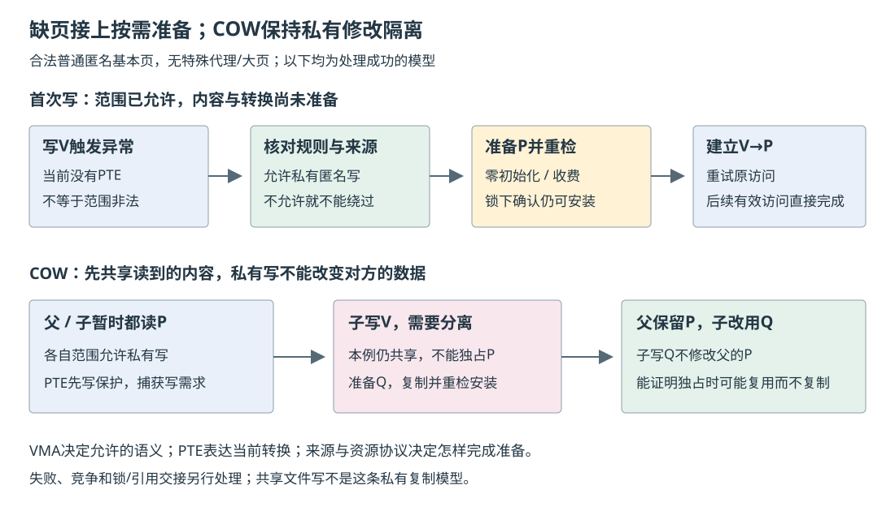
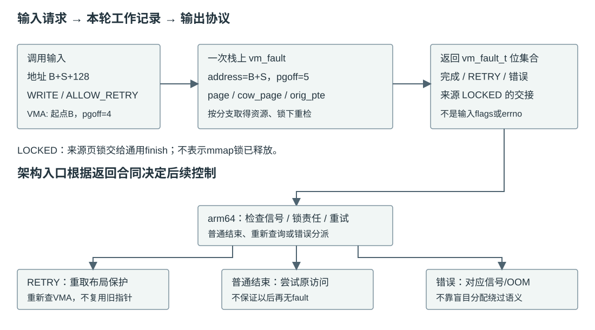
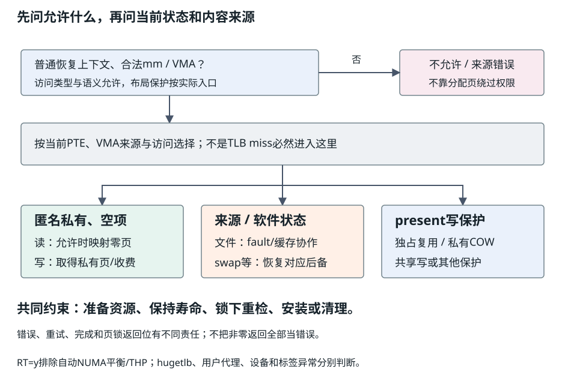
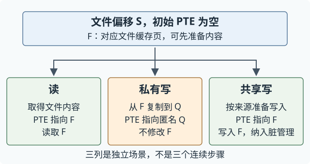
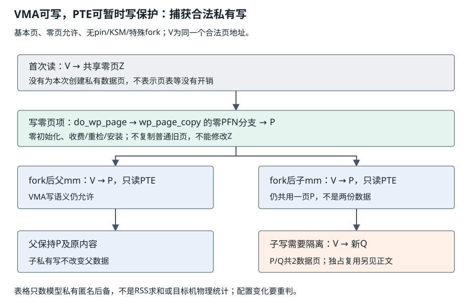
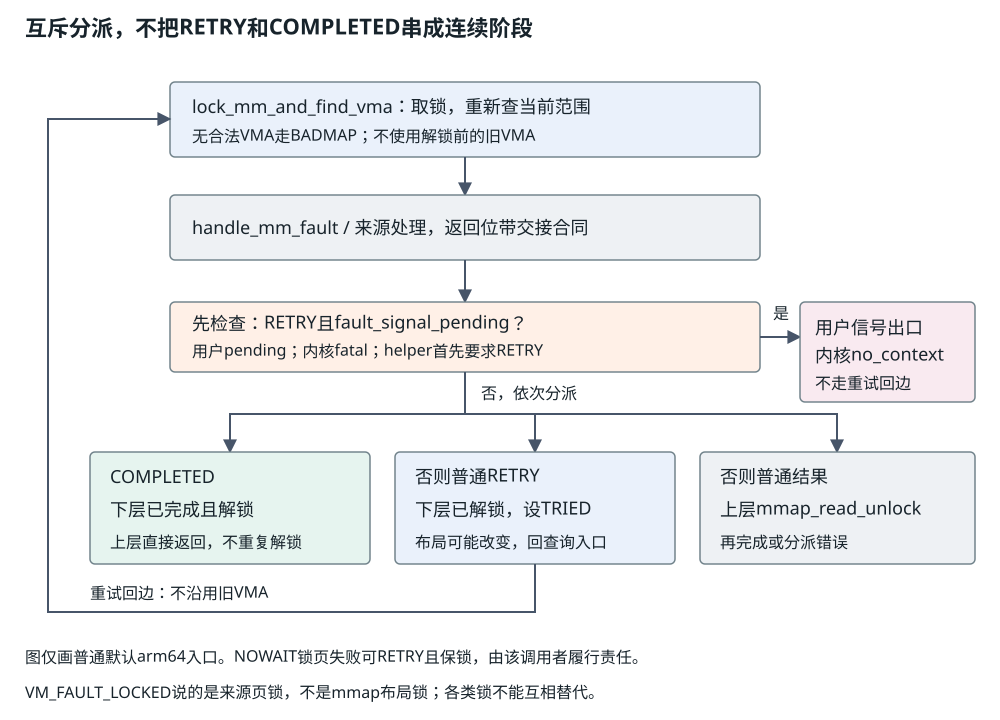

# 缺页与 COW：从访问异常到映射决策

缺页处理不是“发现没有内存就分配一页”。一次CPU访问异常可能是合法按需映射、写时复制、共享写准备，也可能是地址/权限错误或后备无法取得。

缺页处理的主要任务，是在访问暂时不能完成时，**依据已建立的使用规则决定能否恢复，并把合法需求落实为可用内容与转换**。COW则保持私有修改的隔离语义，让共享内容可以先不复制，确需分离时再处理。两者不是异常后无条件“补内存”的服务。

本篇先说明按需准备与私有写隔离出现在什么场景，再沿一个匿名页的读、写、fork和子写推演，把合法性、来源、当前PTE、复制/复用、准备资源和重试协议连接起来。

## 阅读说明

- 本地Linux **6.1.158**、arm64、RT补丁分析前提；前置[地址空间](05-process-address.md)、[页表](06-arm64-page-tables.md)、[页分配](01-page-allocation.md)。
- 主例普通私有可读写匿名VMA、基本页、零页路径允许，无KSM、大页、用户缺页代理或设备特殊映射；实际页大小/功能不固定。
- 其他分支解释必要边界，不穷举全部来源操作。所有数字和页身份是模型，不是目标机采样。
- 不执行用户异常、fork写页、内核补页或压力实验；源码只读。

### 缩略词与入口

| 名称 | 含义 | 用途 |
| --- | --- | --- |
| COW | Copy-on-Write | 私有写时分离共享后备，可能复用而非总复制 |
| VMA/PTE | 范围语义/页表项 | 允许操作与当前转换不同 |
| TLB | Translation Lookaside Buffer | 未命中不自动进入软件缺页 |
| OOM | Out Of Memory | 相应域的耗尽处理，不是每种异常的结果 |
| RSS | Resident Set Size | 驻留统计，不直接等于去重物理页数 |
| KSM | Kernel Samepage Merging | 特殊合并页，影响独占验证 |
| PTL | Page Table Lock | 具体页表项保护，不是mmap_lock |
| `vm_fault` | 一次通用缺页的工作对象 | 地址、标志、页和保护/返回状态 |
| minor/major | 软件缺页统计类别 | 不直接表示新页数或I/O字节量 |

| 问题 | 入口 |
| --- | --- |
| 缺页和COW是什么，为什么正常程序会用到 | [用途与基本过程](#basic-fault) |
| 哪种访问需要什么处理 | [入口与决策](#decision) |
| 零页、私有页、fork共享如何变化 | [同页主线](#anonymous-example) |
| 什么时候不必复制 | [独占复用](#reuse) |
| 准备失败或他人先完成怎样处理 | [复制与清理](#copy) |
| RETRY返回后锁和VMA怎样处理 | [返回协议](#retry) |
| 计数与错误应该如何解释 | [边界和统计](#boundaries) |

## 1. 定位、职责与问题

### 1.1 已允许使用，不等于此刻已能访问

应用扩展堆或建立匿名映射后，内核可以先记录一段允许读写的用户范围，而不立即为每个地址准备专有数据页；文件映射也可以先建立范围，内容等到访问时再取得。程序随后通过指针访问，硬件却需要一个满足本次访问的当前转换。**允许使用的范围与现在可用的内容/转换之间，可能还差一次准备。**

缺页处理就在这样的交接处工作：CPU的相关访问异常把地址和访问类型交给内核，内核检查规则，再按匿名、文件、交换等来源处理。这使未实际使用的范围不必都提前占用完整数据后备，也让按需读取、私有写分离和驻留恢复能够与普通指针访问衔接。

这里“缺页”不是内存条少了一页，也不必是页内容完全不在RAM。已经驻留的共享页需要私有写分离、当前映射被写保护，或后备在交换缓存中，都可能需要软件处理。非法地址、禁止写入或来源失败则不能通过随意建立可写映射来修复。

### 1.2 一次最小正常过程：首次写一个匿名地址

固定普通私有可读写匿名范围，选合法页地址V，当前没有对应PTE，也没有本次私有数据页；无需等待其他任务或特殊来源：

1. 程序写V，当前硬件转换不能完成请求，进入相应用户缺页路径。
2. 内核找到包含V的范围，确认允许本次写，并判断其来源是普通私有匿名内存。若这里不合法，后续不能靠分配页越过规则。
3. 为该地址准备零初始化的私有页P及必要管理资源，完成适用memcg收费；在页表保护下重检当前状态。
4. 状态仍适用时，建立P的匿名管理关系和对应转换。处理结束后重新执行原访问，数据写入P；后续有效访问通常可直接完成，不每次再补页。

若改成普通文件范围，第3步应先按文件来源取得有效内容，而不是零初始化后冒充文件数据；若改成只读匿名范围，则第2步就不允许这次普通写。同一次访问请求，范围和来源改变便会改变处理，而不只是“有没有空闲页”的区别。

图0上行给出首次匿名写的准备过程，下行给出COW的语义变化，具体引用、重检和失败清理在后文展开。图中“恢复”限定处理成功，不承诺所有异常均可恢复。

### 1.3 COW的目的：先共享内容，仍保持私有修改

普通fork后，父子可以各有自己的地址空间和VMA规则，却暂时映射同一份匿名数据P。这样创建子进程时不必立即复制它尚未修改的所有内容。**私有语义没有被改成任意共享写：父的写不应改变子所看到的原数据，反之亦然。**

为捕获需要处理的私有写，相关PTE可以先写保护；VMA仍允许写。子写V时，软件据这个组合识别合法的写分离需求。父子仍共享P时，子不能独占修改P，需要准备Q复制原内容并让子改用Q；成功后父仍用P，子写Q。若共享关系已经变化，例如父已结束该映射，还需证明子能独占复用P，才可能避免复制。名称中的“复制”描述典型手段，真正目标是保持正确私有写语义，不是每次写保护异常都必须memcpy。

这也解释了与共享文件写的区别：MAP_SHARED的合法修改应作用于共享内容并维护脏状态，不能因为PTE写保护就总给调用者复制私有Q。来源、共享方式与当前项要一起判断。[依据 F2、F3、F4](#source-dispatch)

### 1.4 TLB未命中、异常和软件恢复

TLB没有相应转换时，硬件可遍历页表并继续访问，不必陷入软件。异常则是当前转换或访问条件无法按该次访问完成，需要相应异常入口处理。

VMA合法不保证PTE当前存在或可写；PTE非有效也不保证真的没有后备。软件结合访问、范围和来源决定是否恢复，不能用页分配绕过本来不允许的访问。

普通用户写私有COW页是合法写语义下的保护异常；写只读VMA则不属于同一种恢复。错误地址、文件超出可用内容、收费失败等也有不同处理结果。

### 1.5 arm64入口先把“这次访问”带进通用层

本地do_page_fault从异常状态和当前任务取得地址/访问类型，按untagged_addr处理相应地址，结合用户/内核上下文和缺页是否允许，调用lock_mm_and_find_vma，再验证范围访问语义，进入handle_mm_fault。

具体访问掩码及EPAN差异放在[返回与入口约束](#access-mask)，先保留主线：这次访问的输入、当前范围与页表状态共同决定处理，不从某个函数名推断结果。

没有用户mm或不允许普通缺页处理的上下文，不能照搬可睡眠用户恢复；内核uaccess等还有异常表/修复协议。RT不使NMI、硬中断或严格原子区域自动获得补页权限。[依据 F1](#source-entry)

## 2. 整体组成与关键对象

### 2.1 一次缺页工作对象

`struct vm_fault`是一次通用处理在栈上建立的工作记录。它把调用者输入带给页表/来源处理，再存放本轮取得的页、原项快照及锁状态，处理结束后不会作为永久“缺页请求”留在VMA里。

固定基本页大小S，VMA起点B、vm_pgoff=4，本次访问`B+S+128`。普通`__handle_mm_fault`设置对齐address=`B+S`、real_address=`B+S+128`、pgoff=5及适用gfp_mask；这里real_address是传入通用层的未按页对齐地址，arm64入口此前已按其协议去标签，不把它称为原始带标签FAR。

输入flags是处理请求：WRITE说明要求写语义，ALLOW_RETRY说明调用者接受相应重试交接，TRIED说明至少尝试过。输出`vm_fault_t`则描述这轮发生了什么，例如RETRY、LOCKED、OOM；两组位不是同一个字段，不能把输入ALLOW_RETRY当作“已经释放mmap锁”。

图4：上下两条线分别是数据/工作状态与调用者控制。`vmf.page`只在适用分支交付后备，返回RETRY不交付一个可供旧VMA继续安装的永久对象。

| 信息/对象 | 作用 | 不能推导 |
| --- | --- | --- |
| mm/VMA | 当前地址空间与允许的来源语义 | 地址后备已驻留 |
| vm_fault.address/flags | 本次对齐地址、读写/重试等上下文 | 永久稳定的请求 |
| orig_pte / pte / ptl | 原项快照、当前位置及保护 | 准备后不用再重检 |
| vmf.page / 临时引用 | 来源或待处理页 | 裸指针可以无界使用 |
| vm_ops.fault/page_mkwrite等 | 文件/特殊来源协作 | 所有来源都等同匿名页 |
| vm_fault_t返回位 | 完成、重试、错误和页锁等协议信息 | errno式单值返回 |

例如普通文件空项分支，来源fault成功可把锁定页F放到vmf.page并返回LOCKED，通用finish随后建立映射；私有写分支还可用cow_page保存本轮准备Q。另一线程先改项时orig_pte是比较依据，不是仍可解引用的旧pte位置或安装权。`pte/ptl`只能在各分支规定的保护期内使用，不能跨释放锁的I/O等待保持其使用许可。

mmap读保护稳定普通布局，PTL保护具体项，folio锁/引用/文件协议保护后备，各自不能替代。工作记录也不凭包含这些指针就自动持有每一对象的寿命。

这里的page是基本页描述符；folio把一个或多个连续基本页作为一个管理单元，内容、锁和引用按该单元管理。本篇普通基本页P属于单页folio，`page_folio(P)`指向管理同一份后备的对象，不是复制出第二份数据，也不是一种独立的锁外访问许可。

### 2.2 来源与PTE状态共同决定路径

图1：只画普通主干，用户缺页代理、特殊设备及大映射按配置/对象另行判断，不塞进一个“都分配页”的框。

| 访问与状态 | 代表处理 |
| --- | --- |
| 无合法范围或语义不允许 | 对应错误/上下文处理，不靠分配页绕过 |
| 匿名私有、PTE为空、读 | 允许条件下零页映射 |
| 匿名私有、PTE为空、写 | 取得专有零初始化页及适用收费/管理 |
| 非匿名PTE为空 | do_fault及来源回调，文件页缓存等协作 |
| 非present软件状态 | swap或相应软件编码恢复，不将编码直接当PFN |
| 可访问VMA下PROT_NONE探测状态 | 配置允许的相应处理，不等同所有PROT_NONE都属NUMA |
| present写保护且VMA可写 | 区分独占复用、私有复制、共享写准备与其他保护 |

共享文件write fault可调用page_mkwrite等准备共享页并记脏，不因“PTE不可写”总复制一个私有Q。MAP_PRIVATE文件写可产生匿名后备，VMA仍有文件来源语义。来源就绪和回写细节在[页缓存](08-page-cache-writeback.md)，swap在[回收交换](09-reclaim-swap.md)。[依据 F2、F4](#source-dispatch)

### 2.3 放大文件分支：一份初始内容，三种交付结果

沿用[四类 mmap](05-process-address.md#mmap-four-cases)的普通文件：`V+128` 落在文件页索引 1，页起点偏移为 `S`（一个基本页），对应缓存后备 F。假定该页在文件有效范围、无并发截断，访问符合 VMA 权限，初始 PTE 为空。每行从同一初态独立演算。

| 访问 | 本树 `mm/memory.c` 的代表分支 | 为什么这样交付 |
| --- | --- | --- |
| 读 | `do_read_fault()`；适用时先尝试 `do_fault_around()`。未尝试，或尝试后返回 0（可能已映射邻页，但未解决目标地址），都继续通过 `__do_fault()` 向来源取页，再在成功时完成映射 | 交付文件内容即可；对于以后必须 COW 的私有映射，不因读成功直接给可写 PTE |
| 私有写 | `do_cow_fault()`；普通路径先准备匿名页 Q，从来源取得 F，再复制并安装 Q | 这次写只影响 Q，不能污染其他映射所见的 F |
| 共享写 | `do_shared_fault()`；取得 F、在适用时调用 `page_mkwrite`，再完成映射和共享脏处理 | 修改应进入同一份文件缓存；文件系统先处理必要的写入准备，不能仅凭 VMA 可写就开放 PTE |

如果先读、再写，PTE 已存在且写保护，就不是上表两个“空 PTE 写”入口，而由 `do_wp_page()` 按私有/共享语义处理。`fault-around` 尝试为适用、已在缓存中的邻近页安装映射；[文件预读](08-page-cache-writeback.md#read-ahead)是准备缓存内容。两者减少的工作不同，既不要求同时发生，也不保证本次无需 I/O。

do_swap_page的名称也不表示每次从交换设备读数据：非present项可带迁移等特殊软件编码，先解码，再等待/处理对应状态。页已经在swapcache与需要真正后备I/O又是不同分支，不把“函数名含swap”当作存储读取证明。

本树自动NUMA平衡与透明大页THP均依赖 `!PREEMPT_RT`。已打RT补丁不等于所有MM专题已确认RT配置；**若PREEMPT_RT=y，这两条功能路径排除**，不能继续当作“可能启用”。这不排除hugetlb显式大页或普通NUMA放置策略。

## 3. 核心原理与决策规则

### 3.1 同一匿名页：读零页，写入再取得私有后备

设V为合法私有可读写VMA中的一个基本页，尚无PTE，允许本版本零页路径：

1. 首次读触发缺页；可以映射共享零页Z，不为本次创建一页私有匿名数据。
2. 写V仍不能改Z，因为其他映射也可读它；写处理取得零初始化P及相应收费。
3. 在PTL下确认原状态仍适用，建立新匿名关系和可写/脏等PTE状态，完成映射。

“收费”指memcg charge：把后备内存用量记入所属内存控制组，检查相应资源域的限制。物理分配回答有没有P，charge回答该组能否承担P，RSS回答某个mm的驻留统计；三者不相同。没有启用适用内存控制器时，charge助手按禁用分支成功返回，不意味着存在一份额外物理资源。

把这三步接到实际分派：空项读由`do_anonymous_page`建立特殊零页PTE。之后首次写时**已有present但写保护的零页项**，`handle_pte_fault`转到`do_wp_page`，不再走空项处理。`vm_normal_page`不把特殊零页当普通匿名旧页交付，vmf.page为NULL；私有写转`wp_page_copy`，其中识别orig_pte的零PFN，直接分配零初始化P，免去从普通旧页复制。然后收费、PTL下重检、撤旧零页项并安装P；零页不按普通P的rmap/映射引用方式结账。

对照：如果跳过首次读，直接写尚为空的PTE，才由`do_anonymous_page`直接取得零初始化P。两条路径都可产生第一份私有数据，但进入时的旧项和旧页持有不同。4.1的“临时持有旧P并复制Q”限定fork后普通共享P，不能套到Z；4.2解释直接写空项的并发。

页表和其他元数据仍可能占用资源，不能将“没有新私有数据页”说成“没有任何内存开销”。特殊标记零页也不按普通匿名页的映射/引用方式随意处理。

### 3.2 COW 是共享语义与实际映射的配合

继续P已经写入的场景，普通fork且没有pin/KSM/特殊复制规则：

| 阶段 | 父PTE | 子PTE | 本模型私有匿名数据页 |
| --- | --- | --- | --- |
| fork前 | V→P，可写 | 无 | P，共1页 |
| fork后 | V→P，写保护 | V→P，写保护 | 同一P，共1页，不是两个mm各复制一份 |
| 子写，不能独占P | 保持P | 准备/安装Q | P、Q共2页 |
| 子写完成 | 读P原内容 | 读写Q私有内容 | 两个mm相同VA可有不同数据 |

图2：VMA可写语义与写保护PTE并存，捕获私有写以分离数据。这里计的是特定模型私有后备，不是任意进程RSS或系统去重总量的即时采样。

两个mm都映射普通匿名P时，各自可按对应RSS口径记录一页；总和不证明已有两份物理数据。子写产生Q才增加本模型数据份数。pin或其他持有改变复制/共享条件，不能把本表当全部fork的固定实现。

### 3.3 写时分离不等于每次都复制

#### 先分两类独占证明

`PageAnonExclusive`是匿名后备的独占保证标记，不是`refcount==1`的别名。沿主例，新P建立独占匿名关系时设标记；普通fork将它共享给父子时按rmap协议清标记；后来父映射退出不会仅凭这一动作自动替子证明所有持有均已消失。保守验证成功后，`page_move_anon_rmap`把P关联到当前VMA的匿名关系并重新设置标记，再复用。

这个保证允许处理与额外合法引用并存的情况；反过来，无标记时“只有一份映射”仍不是完整证明。下表的引用阈值只用于无标记的保守分支。

如果在子写之前，父已结束P映射，仍不能仅据“只剩一份用户映射”判断复用。本地do_wp_page的普通匿名分支有两类证明：

| 条件 | 代表结果 |
| --- | --- |
| PageAnonExclusive已成立 | 进入复用，不再用普通引用唯一性检查替代这个标记的保证 |
| 没有独占标记 | 排除KSM/明显额外引用，处理适用局部LRU状态，尝试folio锁和swapcache释放，锁下再确认 |
| 保守验证满足 | 更新匿名关联、复用P，不必复制Q |
| 不能证明、无法取得必要锁或不适用 | 转复制路径，不能把推测当独占写权 |

没有标记时，swapcache或局部暂存引用会影响早期检查；锁下要确认不是KSM且达到该普通分支要求。KSM不一定仅通过引用数就能识别。已标记独占路径则不被“任何额外引用必复制”的简单规则替换。

#### 没有标记时，怎样逐步缩小不确定性

把没有AnonExclusive的普通基本页分支落到具体量：早期明显额外引用/KSM可以直接放弃；适用局部LRU暂存处理后，若引用数大于 `1 + 是否在swapcache` 就转复制。尝试取得folio锁、处理swapcache后，最终还要确认非KSM且引用恰好1，即只剩本映射持有。

检查顺序服务于一个问题：能否证明不会通过其他普通持有/共享关系观察到本次私有写？局部drain去掉适用暂存的不确定性，锁定后去除可释放的swapcache持有，再做最终检查；它不是逐项强制取消其他人的引用。任何一步不能证明就保守复制，在可能多花一页与错误共享修改之间选择前者。

| 无独占标记的稳定示例 | 结果 |
| --- | --- |
| 无KSM/swapcache/额外持有，引用1且folio锁取得 | 锁下可证明唯一映射持有，进入复用 |
| 无swapcache，另有一普通临时引用，引用2 | 不能按唯一性证明，转复制 |
| swapcache额外一引用，共2，锁定后成功去除该缓存引用 | 最终1，可复用 |
| 去除缓存后仍有额外引用，或锁无法取得 | 不能证明则复制 |

这里的额外普通引用不是pin计数编码模型，也不说局部drain能清掉任意远程引用。若AnonExclusive已经成立，先走它的直接复用保证，不把上表套成所有匿名页的统一阈值。

因此两种常见推理都不成立：“父退出所以必复用”“有额外引用所以所有场景必复制”。实际依据独占标记、页类型、具体引用与保护。rmap、pin的保证在[页寿命](11-page-lifetime-rmap.md)进一步展开。[依据 F3](#source-cow)

## 4. 准备、安装与失败清理

### 4.1 准备页不是安装许可

复制路径临时持有旧P，释放PTL再准备Q/复制/收费，然后重新取得PTL，核对orig_pte。mmap布局保护与PTL不同：准备期间其他线程仍可完成同地址的PTE处理。

沿父子仍共享P、子请求写的主例，本轮工作状态为：

| 本轮状态 | 子进程实际PTE | 本轮持有/权限 |
| --- | --- | --- |
| PTL下观察 | 仍是P的只读项 | 保存orig_pte，并临时持有P |
| 锁外准备 | 可被同mm其他线程合法改变 | 本轮拥有Q准备资源；复制/收费不取得覆盖权 |
| 再取PTL | 若仍等于orig_pte则接管；否则放弃 | 安装分支与失败分支在此分开结账 |
| 成功安装Q | 转换已按协议切换Q | 新映射接管对应持有；结束旧映射持有及本轮临时P |
| 放弃本轮 | 保持他人安装的R或当前合法状态 | 清理未交付Q和临时P，不替其他线程撤项 |

这使“数据已经复制”与“本轮请求真正改变映射”有可检查的分界，后面的错误表据此解释资源去向。

| 结果 | 本轮资源与映射处理 |
| --- | --- |
| Q分配失败 | 不安装新项，结束本轮临时P持有；对应OOM返回 |
| Q已取得、收费失败 | 清理Q及临时P，不因收费失败强制清原项 |
| Q复制后发现PTE已由他人更新到R | 丢弃本轮Q及临时持有，不覆盖R |
| 原项仍匹配 | 清旧/相应失效，建立Q关系并安装，之后结束旧rmap/映射引用和临时持有 |

收费失败时Q尚未成功取得本次charge，释放新Q并结束临时P引用，不撤销仍有效的P映射。收费成功但重检发现R时，Q未进入新映射；释放它的最后持有走小folio释放及memcg uncharge，撤销Q的用量，而R的映射/记账不受影响。结束临时P引用也不等于删除P在其他mm中的有效映射。

本节顺序属于已有写保护PTE的`wp_page_copy`。空项文件私有写的`do_cow_fault`先分配、收费目标页，再调用来源fault取得文件数据，随后复制和完成映射；不能从一种路径推导所有COW都有“先复制再收费”的统一顺序。

例如线程A准备Q期间线程B先把V从P切到R，A锁下比较orig_pte失败。即使Q内容看起来相同，也不能覆盖B的新结果；Q没有成为成功后备，清理自己的准备资源是正确完成，不等于重置整个地址空间。

无错误返回也不普遍证明本轮已安装Q。页表状态变化或复制过程的某些未完成情况，本地代码可退出，让用户随后再次触发fault再处理；硬件错误等另行分派。vm_fault_t的控制协议、架构处理函数返回和最终用户访问是否成功，不是同一个观察。

成功替换还保持一个COW不变量：**旧映射关系的计账不能早于旧实际访问能力结束。** 沿父子共享普通P、子准备Q的例子，如果子尚可通过旧PTE/TLB读P，却先减掉其rmap/mapcount，父侧独占判断会观察到一个过早缩小的共享关系。相应复用协议若因此获得独占保证并写P，子旧读取就可能看到本应分离的父修改。

保留一份临时P引用只能防止P存储被回收重用，不能阻止上述原地数据变化；所以顺序是锁下重检、清旧及失效、建立Q关系并安装，再移除旧P的rmap与映射持有。本轮临时P持有在退出时另put，准备Q的持有成功时交给新映射，失败时自行清理。这三份责任不能合并为“最后put一次即可”。真实复用不是只测mapcount=1，仍有3.3的独占/引用条件；这里说明其依据的共享状态为何不能提前少计。过量保留旧映射计账可以保守，提前排除仍能访问的关系会破坏数据隔离。

[页表更新](06-arm64-page-tables.md#replace)承接架构同步细节，不代替本篇的COW共享不变量。[依据 F3](#source-cow)

### 4.2 首次匿名写也要处理并发和来源失败

do_anonymous_page准备零初始化页、相应收费和匿名管理，之后在PTL下确认项仍为空及地址空间稳定。若别人已经设置该PTE，释放本轮新页而不是重复插入。

空项路径还可能涉及必要页表的分配失败或上层大映射变化；“没有PTE”不保证只有数据页这一种资源。用户缺页代理等注册状态有额外交接条件，不在主例中假定存在。

文件来源失败与匿名资源不足不同：范围在VMA内，仍可能由于文件内容/截断、I/O等不能取得有效页。不是所有失败都转成同一个信号或必定杀一个进程。

## 5. 返回协议与锁责任

### 5.1 普通arm64调用链不是只返回errno

返回至少分三层看：来源回调向通用层交付页/状态；`handle_mm_fault`向架构入口返回位集合；架构入口处理锁、重试或信号后，异常返回路径才尝试继续原用户访问。`do_page_fault`的整数返回是架构异常分派合同，不是用户read/write的字节数，也不是vm_fault_t的原值。

例如本轮空项安装成功，无需RETRY的普通返回让架构入口解锁并结束处理，原指令可再次执行；若准备期间别人已解决同地址，本轮可以不安装而让后续访问用已有结果。RETRY则在内核重新查询范围；SIGBUS/OOM等进入相应分派。即使架构处理函数正常返回，也不能据此保证用户指令随后必成功或永久不再缺页。

本地普通用户路径采用默认允许重试等标志，经lock_mm_and_find_vma取得适用布局保护和当前VMA。返回后有信号、完成、重试和其他状态分派：

| 结果/阶段 | 当前mmap读锁责任 | 控制流 |
| --- | --- | --- |
| 查找没有合法VMA | helper处理未取得/已释放的锁 | 上层进入BADMAP分派，不用不存在的VMA |
| RETRY且fault_signal_pending成立 | 普通入口的下层已交出布局锁 | 用户返回处理信号；内核转no_context，不重新取锁 |
| VM_FAULT_COMPLETED | 下层已完成包括释放mmap锁 | 上层直接返回，不再解锁/用旧VMA |
| 普通路径VM_FAULT_RETRY | 本路径下层按约定已释放 | 设FAULT_FLAG_TRIED，重新取锁并查询 |
| 非上述普通完成/错误 | 上层仍持相应锁 | 先mmap_read_unlock，再按结果分派 |

图3：retry回到查询入口，不是拿解锁前的VMA继续安装。mm对象或使用引用有效也不阻止期间布局变化。

实际检查顺序为信号→COMPLETED→RETRY→普通解锁。`fault_signal_pending`首先要求RETRY：用户上下文有待处理信号即可成立，内核上下文要求致命信号；不是任意返回遇到任意信号都走该出口。

另一个调用者若指定FAULT_FLAG_RETRY_NOWAIT，碰到已被其他任务锁定的来源folio，`lock_folio_maybe_drop_mmap`尝试锁失败后不等待，文件fault可返回RETRY而**保留mmap读锁**。此时调用者仍负责自己持有的锁，不能照搬普通arm64的重试回边；也不能仅凭RETRY断言执行过后备I/O。TRIED是已尝试标志，不是统一“只允许一次重试”的计数。

### 5.2 页锁、PTL和mmap锁分别交接

VM_FAULT_LOCKED涉及来源页锁状态，不是mmap锁已经释放。文件fault回调和finish步骤按相应约定接收页及锁；PTL保护安装与原项比较，folio锁保护来源内容/归属，mmap_lock保护普通布局。

一个callback返回位可能组合多种事实，不能将ret非零一律当错误。源代码中VM_FAULT_ERROR是相应位集合，普通完成、NOPAGE等有各自合同；不随意将它们当作“没有任何有效映射”。

异常处理主要在触发访问的任务路径执行，不固定由后台缺页线程负责；等待/工作协作不改变调用者必须遵循实际上下文和锁协议。[依据 F1、F5](#source-return)

### 5.3 arm64入口如何检查访问语义

本地入口先构造访问掩码，再检查 `vma->vm_flags & vm_flags` 是否非零，**不是要求掩码各位全部满足**：

| 本次访问 | 入口访问掩码 |
| --- | --- |
| EL0取指 | VM_EXEC |
| 写 | VM_WRITE |
| 读，有EPAN | VM_READ \| VM_WRITE |
| 读，无EPAN | VM_READ \| VM_WRITE \| VM_EXEC |

例如仅有VM_EXEC的VMA，无EPAN时可通过这里的读检查，有EPAN时不能；这只是此入口的范围许可判断，不保证其他硬件访问条件成立。此处落实1.5的合法性判断，不把VMA标志直接等同全部硬件权限位。[依据 F1](#source-entry)

## 6. 接口与使用

### 6.1 用来源接口，而非自己模拟一次硬件缺页

| 需求 | 相关接口域 | 责任 |
| --- | --- | --- |
| 用户建立/改范围 | mmap/fork/mprotect等 | 语义与错误、资源记录，不能保证以后无fault |
| 内核合法访问用户数据 | uaccess相应接口 | 异常修复/返回与上下文，不随意解引用 |
| 持有用户后备 | GUP/pin系列 | 访问标志、COW和释放，见页寿命专题 |
| 文件/特定来源补页 | vm_ops.fault等 | 按来源合同交付page/状态/锁，不混同匿名路径 |
| 通用内部处理 | handle_mm_fault | 调用者已建立的VMA/布局/上下文协议，不是模块任意地址工具 |

本篇为内核内部机制，不捏造一个“传地址即可补页”的新API或模块骨架。普通用户资源取得/清理代码见[地址空间](05-process-address.md#apis)，其清理失败保留记录的责任仍成立。

### 6.2 返回与后续访问分开判断

调试或观测一个页的读/写/fork，需要控制编译器消除访问、预触页、大页、共享、统计刷新和来源状态。本文只推演，不运行故意写只读、制造OOM或目标机实验。

一次恢复后，后续COW、交换、解除/重映射或权限改变仍可产生异常。MAP_POPULATE不等于以后所有访问永不fault，成功也不永久赋予对旧指针的访问权。

## 7. 边界、变体与常见误解

### 7.1 按错误来源和执行上下文分派

普通用户范围缺失、权限不允许，与文件来源/资源失败不同。本地用户路径对BADMAP/BADACCESS走相应SIGSEGV语义，SIGBUS等返回位走来源错误处理，OOM调用相应pagefault_out_of_memory流程。内核模式错误还有异常表/内核错误分派，不能统一等同用户SIGSEGV。

例如普通文件映射覆盖四页，来源文件后来截短到两页，第三页访问仍在VMA内且权限允许，但来源页索引已超出当前文件长度。适用filemap_fault可返回SIGBUS，不能为此无条件补一页匿名数据把范围“修好”。这与Q分配或收费失败的OOM返回不同；两个例子都不是VMA地址必然缺失。

大页、KSM、设备、userfaultfd、硬件错误或标签异常会改变路径；不是所有异常都属于普通按需匿名分配。自动NUMA平衡和THP在PREEMPT_RT=y时按本树依赖排除；hugetlb与普通NUMA策略另行核对，不把所有PROT_NONE都当探测。

### 7.2 minor/major不是数据页或I/O量

本地mm_account_fault不把所有硬件异常都计为成功fault：错误与未完成RETRY先不按这一成功口径计数；最终成功有VM_FAULT_MAJOR或带FAULT_FLAG_TRIED，可计major，否则计minor。

因此新匿名页、零页映射、文件缓存命中和等待后的完成可能有不同统计。major不是“从磁盘读了多少页/字节”的直接标签，min_flt也不是匿名页分配次数。GUP调用的regs条件与perf事件更新又有区别，读计数要明确入口和口径。

沿主例，首次读取零页与后续私有写不代表相同物理开销；fork后两个RSS记录也不代表两份数据。计数、映射和后备应分别解释。[依据 F6](#source-accounting)

若主例的首次零页读和后续匿名写都立即完成、返回不带MAJOR且没有TRIED，两次各记一次minor；前者不创建本次私有数据页，后者取得P。相同minor增量却有不同数据后备开销，不能拿min_flt差值直接当分配页数。

## 8. 总结与源码入口

正常主线是“这次访问合法吗→当前项和来源是什么→读零页/取页/恢复/共享写/复制或复用→准备资源→锁下重检→安装或放弃→按返回协议重新访问/重试/错误”。每一步都不能由“PTE不可写”或“VMA存在”代替。

**F1：arm64入口**

- [fault.c](../../../../linux-6.1.158/arch/arm64/mm/fault.c)：do_page_fault、__do_page_fault、untagged/访问类型、锁返回与错误分派。

**F2 / F4：状态与来源**

- [memory.c](../../../../linux-6.1.158/mm/memory.c)：handle_pte_fault、do_anonymous_page、do_fault、do_cow_fault、wp_page_shared。
- [filemap.c](../../../../linux-6.1.158/mm/filemap.c)：filemap_fault及来源等待/返回。

**F3：复制与复用**

- [memory.c](../../../../linux-6.1.158/mm/memory.c)：do_wp_page独占/保守检查、wp_page_copy和wp_page_reuse、临时引用及收费/重检/清理。
- [rmap.c](../../../../linux-6.1.158/mm/rmap.c)：匿名关联和独占标记配合，不以mapcount独自提供使用权。
- [rmap.h](../../../../linux-6.1.158/include/linux/rmap.h)、[page-flags.h](../../../../linux-6.1.158/include/linux/page-flags.h)：fork共享与独占标记；[memcontrol.h](../../../../linux-6.1.158/include/linux/memcontrol.h)、[swap.c](../../../../linux-6.1.158/mm/swap.c)：charge禁用分支与最终释放撤销记账。

**F5：返回合同**

- [mm_types.h](../../../../linux-6.1.158/include/linux/mm_types.h)：vm_fault_t及FAULT_FLAG_*。
- [memory.c](../../../../linux-6.1.158/mm/memory.c)与[mm.h](../../../../linux-6.1.158/include/linux/mm.h)：lock_mm_and_find_vma、信号与通用工作/页锁约定。
- [signal.h](../../../../linux-6.1.158/include/linux/sched/signal.h)：fault_signal_pending；[init/Kconfig](../../../../linux-6.1.158/init/Kconfig)、[mm/Kconfig](../../../../linux-6.1.158/mm/Kconfig)：自动NUMA平衡/THP与RT依赖。

**F6：统计**

- [memory.c](../../../../linux-6.1.158/mm/memory.c)：mm_account_fault及major/TRIED、未完成/错误与regs/perf差异。

本文所有事实按目标源码，未编译运行任何访问异常或页分配实验。

## 独立挑战审阅

以下是外部图解增补前的审阅记录；增补范围见[本轮对照](reference-reading.md#translation)。

本次由新只读挑战者 Pascal 完成第 1 轮全文/五图复核，技术与教学分别通过，无未关闭实质挑战，见[本次记录](review/review-entry-07.md)。[原约定](review/contract-page-faults.md)、[前次补全](review/review-pedagogy-07.md)与[初次记录](review/review-page-faults.md)保留历史。待用户统一 review，不代表运行或学习效果验证。
