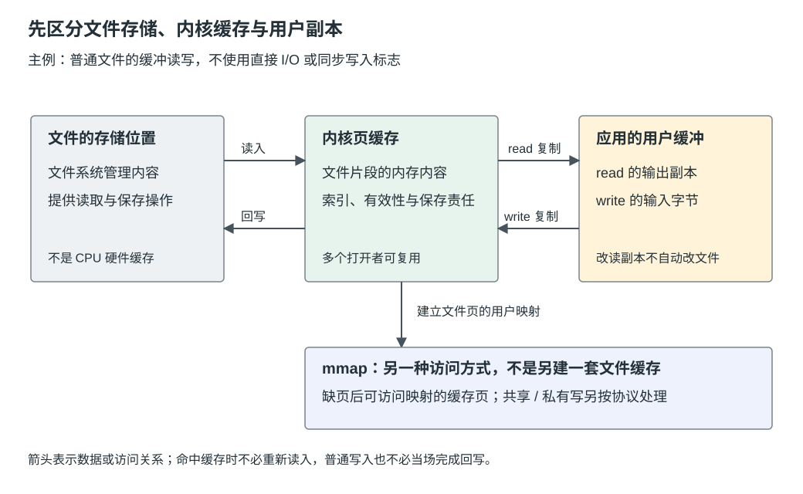
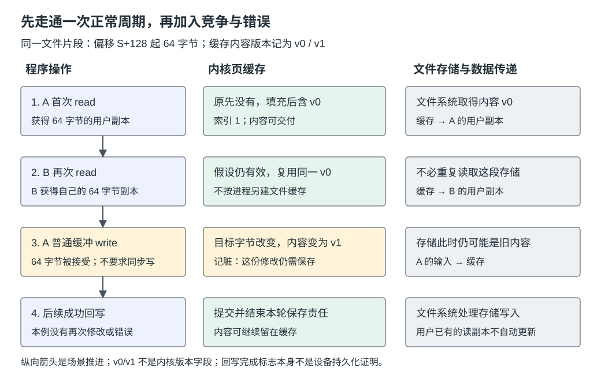
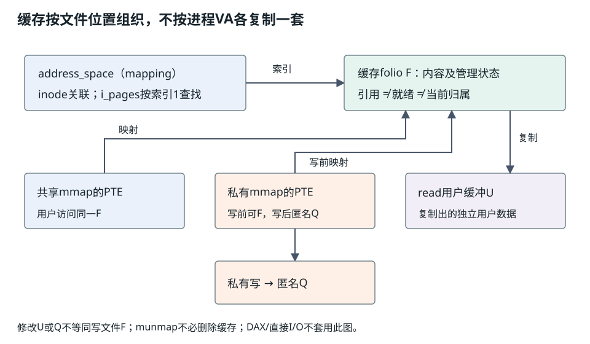
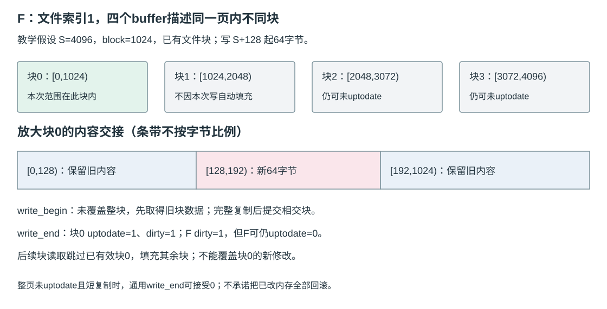
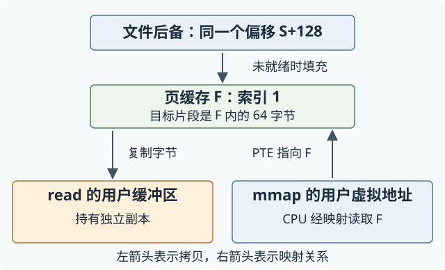
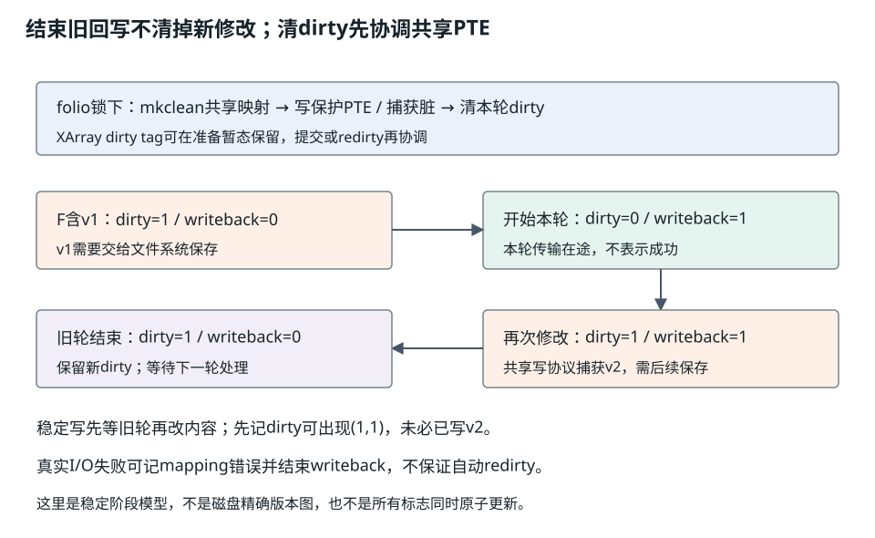
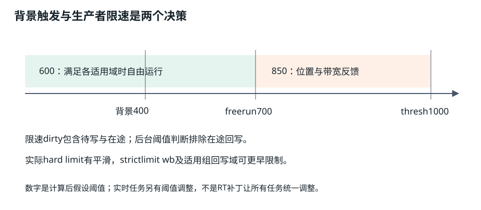
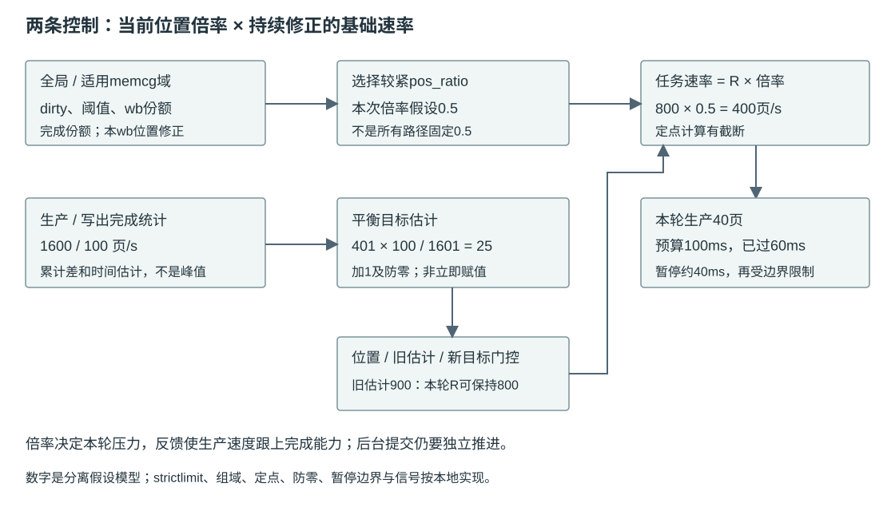

# 文件页缓存与回写：从文件偏移到数据交付

程序读取普通文件时，内核可以把文件内容保留在内存中，让后续访问复用；程序修改文件时，新内容也可以先留在内存，再由内核组织保存。这两件事分别引出了**文件页缓存**和**回写**：前者管理文件内容在内存中的缓存，后者把需要保存的修改交给文件系统处理。

本篇先沿一次普通文件的读取、复用、修改和保存建立基本模型，再解释缓存如何查找、数据何时可用、共享映射如何记脏，以及写入速度为什么会受到限制。

## 阅读说明

实现基线为本地 Linux **6.1.158**、arm64 / AArch64、已打 RT 补丁源码。主例采用普通存储文件的常规缓冲读写，不使用直接 I/O 或同步写入标志；涉及具体实现时再说明文件系统操作与配置条件。基本页大小记为 S，不固定芯片或页大小。

前置[内存管理总览](00-overview.md)。涉及用户映射和写保护时，可结合[缺页](07-page-faults.md)与[页表](06-arm64-page-tables.md)；理解第 1 节的普通文件读写模型不依赖先读完这两篇。直接 I/O、DAX、tmpfs 等差异放在文末边界，不套用主例。

本文不执行读写、截断或回写实验。图示与数值是分析模型，不是目标机测量，也不把内存管理的回写完成标志等同设备持久化保证。

### 缩略词与入口

| 名称 | 含义 | 本篇用途 |
| --- | --- | --- |
| I/O | Input/Output | 文件系统与存储传输 |
| VMA/PTE | 范围语义/页表项 | 文件来源与当前用户访问 |
| COW | Copy-on-Write | 私有修改与文件缓存分离 |
| BDI/wb | Backing Device Info / bdi_writeback | 后备设备信息与回写管理对象 |
| DAX | Direct Access | 不沿用普通数据页缓存路径 |
| folio | 连续基本页管理单元 | 主例单页，管理同一份数据及其锁/引用 |
| XArray | 按整数索引组织条目的容器 | i_pages中的缓存索引及标记 |
| errseq_t | 错误序列状态 | 异步错误与观察游标交接 |

| 需要回答 | 入口 |
| --- | --- |
| 页缓存和回写是什么，在哪些操作中出现 | [基本场景与模型](#basic-model) |
| 一次读取、复用、修改和保存如何连接 | [最小读写周期](#basic-cycle) |
| read与mmap是否各有一份文件缓存 | [对象地图](#objects) |
| 查到folio为何仍不能读 | [就绪与竞争](#ready) |
| PRIVATE/SHARED写入改变谁 | [共享与私有](#sharing) |
| dirty与writeback如何共同变化 | [回写主线](#writeback) |
| 为什么写入成功后来fsync仍失败 | [异步错误](#errors) |
| 写入为何在内存耗尽前等待 | [节流](#throttle) |
| 主要接口如何正确交接 | [接口](#apis) |

<a id="basic-model"></a>
## 1. 从普通文件读写建立基本模型

### 1.1 它出现在哪里：读文件、改文件和映射文件

设程序 A 打开一个普通数据文件，读取偏移 S+128 起的 64 字节；程序 B 随后也读取这一段；稍后 A 把这一段改成新内容。即使应用只看见 `read()` 和 `write()`，内核也要解决几个问题：

- 第二次读取能否使用已经取得的数据，而不重复访问存储？
- 多个打开者访问同一文件位置时，是否需要在内核中各保存一份缓存？
- 新内容已经进入内存、尚未保存时，谁记录这份责任并推动后续保存？
- 应用产生修改的速度超过存储处理能力时，如何避免待保存内容持续积累？

普通缓冲读写正是页缓存与回写最直接的使用场景。文件 `mmap()` 也会参与同一缓存体系，但它通过用户地址访问数据，与 `read()` 的复制方式不同。下面先讲缓冲读写，再接上映射。

### 1.2 页缓存是什么：内核管理的文件内容缓存

**文件页缓存是文件内容在内存中的缓存，由内核按文件身份和文件位置组织。** 它使用物理内存存放内容，并配有索引、引用和状态管理；不是存储设备里的另一块区域，也不是 CPU 的硬件 cache。

文件可以很大，页缓存只保留其中已经取得或正在准备的部分，不要求把整个文件装进内存。一次读取先查所需位置是否已有可用缓存；若没有，内核通过文件系统取得内容。缓存保留期间，后续访问可以复用这些内容，减少重复读取和等待。

还要分清三个数据位置：

| 位置 | 谁管理 | 本例中的内容与用途 |
| --- | --- | --- |
| 文件的存储位置 | 文件系统及存储栈 | 保存文件的数据；如何定位和传输由文件系统处理 |
| 内核页缓存 | 内核内存管理与文件系统协作 | 保存文件片段的内存内容，供读写与映射使用 |
| 用户缓冲 | 应用使用，内核按进程地址空间管理其内存 | `read()` 复制结果放到这里；`write()` 从这里取得输入 |



图：读取方向是文件系统填充缓存、再复制给用户；写入方向是用户数据进入缓存、再通过回写交给文件系统。箭头表示数据流，不表示每个调用都必须执行所有步骤。

`read()` 成功后，用户缓冲中是复制出来的数据。应用随后只修改这个缓冲，不会自动修改文件；需要调用 `write()` 等文件写入接口。同样，页缓存以后改变，也不会自动更新先前的 `read()` 副本。

`mmap()` 建立用户地址与文件内容的访问关系；访问触发缺页后，可以把对应缓存页映射给进程，不必像 `read()` 那样再复制到另一个用户缓冲。共享写与私有写的归属不同，见[第 4.3 节](#mapped-writes)。这里只需先记住：**用户访问方式不同，不意味着内核按每个进程重新创建一套文件缓存。**

### 1.3 回写是什么：把内存中的修改交给文件系统保存

在本例的普通缓冲写入中，内核把应用提供的新字节写入页缓存，并记录这些内容还需要保存。**回写是内核组织这些待保存修改、调用文件系统提交并跟踪传输完成的过程。** 文件系统负责把文件位置转换为自己的存储操作，页缓存层不直接规定所有文件系统如何写设备。

缓存中需要保存的修改称为**脏数据**；“脏”不是损坏，而是还有保存责任。回写在途表示某一轮保存操作尚未结束。两者分别回答“还有什么要保存”和“哪一轮传输还没结束”，后面会对应到 `dirty` 与 `writeback` 状态。

为什么不把每次普通写入都变成同步保存？先在内存中接收修改，允许后续集中组织提交，也使同一区域的重复修改有机会合并处理。但这种方式留下了待保存内容和异步失败，因此需要后台回写、主动同步以及对写入者的限速；不能只建缓存而不管理保存过程。

不使用同步标志的普通 `write()` 可以在数据尚未完成存储提交时返回。应用需要文件同步时使用 `fsync()` 等相应接口，由文件系统执行数据、必要元数据及存储同步协议并报告错误。**写入被接受、某轮回写结束、同步调用成功是不同观察点**，不能仅凭页状态判定掉电后的恢复结果。

<a id="basic-cycle"></a>
### 1.4 沿同一片段走完最小读写周期

沿用 1.1 的文件，文件长 4S，目标片段是 `[S+128, S+192)`，位于索引 1 对应的页内。先假设缓存中没有这一页，排除并发、截断、传输错误和同步写入标志。只讨论一次正常周期，后文再逐个改变条件。



| 阶段 | 内核页缓存 | 用户与存储侧发生什么 |
| --- | --- | --- |
| A 首次读取 | 取得承载该文件位置的内存，并通过文件系统填入有效内容 v0 | A 的用户缓冲获得目标 64 字节的副本 |
| B 再次读取 | 假设内容仍在缓存且有效，复用同一缓存内容 v0 | B 获得自己的副本，不必为这一片段重复读取存储 |
| A 普通缓冲写入 | 目标 64 字节改成新值；整个缓存页的内容版本记为 v1，并记录待保存责任 | 写入返回已接受量；存储此时仍可能是旧内容 |
| 后续成功回写 | 组织并提交本轮修改；没有后续新修改时，这份待保存责任完成 | 文件系统处理存储写入；用户已有的读副本不自动改变 |

这里 v0/v1 是帮助跟踪整个缓存页内容变化的教学记号，不是内核为每页保存的版本号，也不是存储快照承诺。图省略了块映射、锁、预读和设备缓存等细节；真实提交粒度由文件系统决定，不由应用这次写入的 64 字节直接决定。

这个周期也说明缓存复用的边界：内容可以被修改、截断或回收，第二次访问并不永久保证命中。普通干净文件缓存可以在满足回收条件后丢弃，再按文件来源重新读取；仍待保存的修改不能当作“有文件副本”就直接丢掉。回收内部见[回收与交换](09-reclaim-swap.md)，本篇负责解释数据是否有效、保存责任如何交接。

### 1.5 从基本过程到实现分工

最小周期需要三组职责协作，而不是一个“文件缓存函数”包办全部工作：

| 基本问题 | 主要分工 | 后文对应 |
| --- | --- | --- |
| 同一文件位置的内容在哪里，何时可用 | 页缓存组织内存与索引；文件系统填充内容 | 对象、查找与读取 |
| 谁可以修改，哪些修改需要保存 | 缓冲写入或共享映射协议协调内容与脏状态 | 写入准备、共享与私有写 |
| 何时提交，如何结束，积累过多怎么办 | 回写组织选择待处理文件；文件系统提交；统计反馈限制生产者 | 回写、错误与节流 |

接下来把“缓存的一页内容”“按文件位置查找”“一轮保存”分别对应到实际对象与状态。先有上述职责，再看结构体，可以避免把文件缓存管理对象误认成进程地址空间，或把回写标志误认成持久化证明。

<a id="objects"></a>
## 2. 对象、索引与状态

### 2.1 文件、缓存管理对象与内容单元

**inode 表达文件身份及元数据，`struct address_space` 管理该文件的缓存。** 代码通常把指向后者的指针命名为 `mapping`，打开文件对象通过 `file->f_mapping` 访问它。这里的 address_space 不是进程的 `mm`，也不是一条 VA 到 PA 的映射；它组织的是“这份文件内容有哪些缓存”。

**folio 是内核一起管理的一组连续基本页及其状态。** 本篇主要采用只含一个基本页的 folio F；它承载第 1 节那一页文件内容。folio 不等于文件缓存整体，`struct folio` 也不是又复制一份数据；page 是基本页描述符，`folio_file_page(F,i)` 选择 F 中对应文件索引的页，不复制内容。

**XArray 是按整数索引查找条目的容器。** `mapping->i_pages` 用它把文件页索引关联到缓存内容。它解决查找和组织，不负责从存储填充字节，也不自行保证内容就绪。由此，第 1 节的“先查缓存”才落到具体的管理对象和索引。



对象图：在第 1 节的数据位置之上加入实际管理对象。箭头分别表示索引、映射和复制，不把 read 缓冲画成第二套文件页缓存。

设文件字节偏移为 x，则索引为 `floor(x/S)`，页内偏移为 `x % S`。沿第 1 节的 x=S+128，先找索引 1 对应的 F，再选择 F 内偏移 128 起的 64 字节。查找键是文件位置，不是 A/B 的用户虚拟地址，因此不同打开者可以找到同一 F。

大 folio 可以覆盖多个索引，但不是每个索引都拥有独立副本；XArray 也可存放回收后留下的 shadow 等编码条目，不能将所有非 NULL 结果都当作 folio。下面的连续例保持单页 F，避免把管理粒度变化混入主线。

`address_space` 把基本模型中的不同职责放在一起：

| 成员 | 对应问题 |
| --- | --- |
| `i_pages` | 按文件索引找缓存 F |
| `i_mmap` | 找可能映射这份文件内容的 VMA，随后再处理实际页表 |
| `a_ops` | 通过文件系统操作填充、记脏和提交内容 |
| `wb_err` | 记录这份文件内容的回写错误，供打开者按协议观察 |

文件系统提供的 `read_folio` 是填充一个内容单元的操作，`writepages` 是按回写请求组织缓存提交的操作；两者由适用文件系统实现或采用通用助手，不是普通模块任意替换的缓存开关。F 的 `mapping` 关联表示其当前缓存归属；重检它不是重检某个用户 PTE。

### 2.2 找到、持有、可读与待保存是不同状态

第 1 节把“有效缓存”当作已知条件；实现必须分别保证对象仍可使用、仍属于所查文件，以及内容已准备好。回写又需要单独记录待保存与在途责任：

| 维度 | 含义 | 不能单独证明 |
| --- | --- | --- |
| mapping/index | 缓存当前归属与覆盖文件位置 | 等待后仍属原文件 |
| 引用 | 防止本次持有对象被回收重用 | 内容就绪、索引稳定、允许修改 |
| folio锁 | 串行适用填充、截断和状态交接 | 已写到存储 |
| uptodate | 内容可作为有效文件数据交付 | 页已映射或持久化 |
| dirty | 有需要保存的修改 | 本轮I/O已提交 |
| writeback | 一轮回写尚未结束 | 成功、无新修改 |
| XArray tags | 支持按脏/回写等条件扫描 | 与folio标志每时刻原子一致 |

文件缓存引用、用户映射引用和临时查找引用有不同责任。解除一个用户映射不自动删除缓存；持有 F 的引用也不能证明它仍在原文件的索引里。第 3 节沿这些区别解释读取和竞争。

### 2.3 从脏内容到后台回写组织

第 1 节的“后续回写”需要有人记录待处理文件、安排工作并观察完成能力。**BDI 描述后备设备的回写能力和约束，`bdi_writeback`（wb）是具体回写管理对象。** wb 持有脏 inode 队列、工作项、完成统计和写带宽估计。默认 wb 属于 BDI；启用适用 cgroup writeback 时还可有按组归属的 wb，不等于每个文件各有一个回写线程。

职责关系为 **BDI → wb → 待处理inode → address_space → i_pages中的F**。页记脏通过来源dirty_folio等更新folio/tags/统计并标记inode有脏页；inode进入相应待回写组织。wb_workfn处理工作，选择inode、形成writeback_control，再调用来源writepages等扫描该mapping。

同wb下两个文件的mapping彼此独立，但带宽反馈与设备份额属于共同wb，因此可能共同影响限速。实际队列还有回写中/后续轮次等状态，不把此职责链当固定无条件指针链或全部排队算法。

<a id="ready"></a>
## 3. 找到、填充与交付

### 3.1 一次读取的连续推演

回到最小周期的首次读取：文件长 4S，从 S+128 读 64 字节，缓存索引 1 尚不存在。现在把第 1 节的“填充后复制”拆成实际交接，主要采用单页 F、整页内容就绪的模型：

1. 查i_pages，未命中；按访问状态发起同步预读或取得待填充F。预读可准备相邻页，不意味着用户本次全读这些页。
2. 通过文件系统read_folio等填充。F可已发布在索引中但未uptodate；其他任务查到它必须协调锁/就绪，不能复制未完成内容。
3. 就绪后检查当前大小和有效范围，交付F中128起的64字节。read复制到用户缓冲并推进读取位置；mmap缺页则交付后备给通用映射完成路径。
4. 释放本次临时持有；F可继续驻留缓存，供下一次访问复用。

主例采用整folio就绪模型。普通缓冲读还可能通过来源is_partially_uptodate判断请求范围就绪：在文件系统块小于folio、迭代器等条件适用时，即使整folio未uptodate，所读64字节覆盖的块已有效，也可不重新读整页。对应filemap_range_uptodate/filemap_update_page；filemap_fault的交付检查不是同一范围判定。7.1骨架主动返回EAGAIN是一种保守调用者选择，不是所有read的固定结果。

若缓存未命中但数据已由另一任务填好，等待后可直接用其结果，不必重复I/O。相反，“命中”但未就绪仍可能需要等待或重新读取。

<a id="read-ahead"></a>
**沿索引 1 放大预读。** 若顺序访问触发预读并为索引 1、2、3 准备缓存后备，本次 `read` 仍只交付索引 1 中请求的 64 字节；对 2、3 提前安排读取，不等于都已完成 I/O，更不等于用户页表已经指向它们。后续访问触及标有 readahead 的缓存对象时，可按状态继续窗口。`mm/filemap.c` 的 `filemap_get_pages()` 区分未命中时的同步预读调用、命中标记后的异步续读调用；`mm/readahead.c` 的 `ondemand_readahead()` 决定代表路径的窗口。这里的“同步”描述请求触发方式，不保证整个预读窗口已就绪。文件 mmap 也可触发自己的预读，另有[对已缓存邻页尝试建映射](07-page-faults.md#file-fault-branches)的工作。

### 3.2 两个创建者和截断竞争

本地`__filemap_get_folio`创建路径分配F，再调用filemap_add_folio。若B先插入同索引的G，A得到-EEXIST，释放自己未发布成功的F，重新查找G；不是用F覆盖G。

查询先取得引用再等锁时，截断可能已将F从mapping移除。锁下发现`F->mapping != mapping`，需解锁、put并重新查找。引用保护的是F存储寿命，不保护它仍代表该文件位置。

另设文件从4S截为2S，索引3的mmap访问仍落在原VMA中。filemap_fault在进入及锁下交付前重检当前i_size；超出按页向上取整的有效索引会返回SIGBUS。最后一个部分页与完全超出EOF的页不同，不因VMA合法就补匿名页“修复文件”。

失效端也必须参与：来源在串行写入/截断的保护下先更新i_size，再调用truncate_pagecache解除超出范围的映射、截断缓存，再次解除映射以覆盖期间产生的私有COW；之后才能按文件系统协议释放来源块。已有PTE因此不能永久绕过新大小检查，下一次访问可重新fault。

截断扫描锁定F，必要时等待writeback结束，再删除缓存和结束持有；不能先让F存储被重用，再等待旧I/O向它完成。writeback位不自持普通引用，正是由此等待协议保护；folio_end_writeback另临时持有F保护清位到唤醒的间隔。适用invalidate_lock写保护使块失效与共享保护下的缓存填充不能交错成“来源块已失效却把旧读取重新发布”，但它不替代mmap锁、页锁或所有文件系统串行锁。

### 3.3 缓冲read与fault的返回不同

`filemap_read`在已有字节复制后遇到后续错误，可返回短的正字节数；尚未复制时才返回负错误。应用必须按返回量推进剩余请求，不能把短读当全部完成，也不能在已交付字节后盲目从原偏移重复。

filemap_fault采用vm_fault_t协议：成功交付通常带VM_FAULT_LOCKED，来源页锁随之交给通用finish；若为I/O释放mmap锁并持有文件fpin，清理folio/文件临时引用后返回RETRY，由上层重新查询VMA。NOWAIT保锁例外见[缺页协议](07-page-faults.md#retry)。

<a id="sharing"></a>
## 4. 写入准备、共享修改与私有修改

### 4.1 块小于页时，局部有效与整页有效不同

先明确选定来源的两个粒度：folio是页缓存管理单元；文件系统块是该来源组织内容/块映射的粒度。本例的buffer_head保存一个块的映射和uptodate/dirty等状态，它不是另一份页数据。一个单页folio可关联多个buffer_head，它们描述同一页内不同片段。

仅为以下推演选S=4096字节、文件系统块1024字节、普通已有映射块，无delayed/unwritten/new块等变体。文件仍长4S，缓存F在索引1且整页未uptodate；四个buffer起初均未uptodate。写`S+128`起64字节，目标只落在F的块0：



| 阶段 | 块0：[0,1024) | 块1–3 | 整folio |
| --- | --- | --- | --- |
| 初态 | 内容还不能作为有效来源数据 | 同样未就绪 | uptodate=0 |
| write_begin准备 | 写范围未覆盖整块，先读/确认块0旧数据 | 不因本次局部写自动填充 | 可仍uptodate=0 |
| 完整复制64字节 | [128,192)变新数据，[0,128)与[192,1024)保留旧内容 | 不受本次复制影响 | 修改只发生在目标范围 |
| write_end提交 | 块0有效且dirty；通过mark_buffer_dirty传递页脏责任 | 仍可能未uptodate | dirty=1，但可仍uptodate=0 |

因此“成功写64字节”不要求整页四块全部先有效。本地`__block_write_begin_int`对未完全覆盖的已有块读入，对整块覆盖则可省旧读取；`__block_commit_write`只把提交相交块标有效/脏，只有其余块也有效时才发现整页uptodate。后续`block_read_full_folio`跳过已有效块，读取其他缺失块，不能把整页未uptodate误解为可以覆盖块0的新内容。

改变覆盖范围为整个块0：[0,1024)，完整复制能提供整块内容，无需为保存该块旧字节先读它；改为来源新分配块，则未写片段按新块初始化协议处理，而不是读取旧文件块。后者不在表中已有块假设内。这里的4096/1024只服务粒度模型，其他arm64页大小或来源不直接照搬。

### 4.2 缓冲write怎样取得脏责任

仍在4S文件的S+128写64字节，选择使用generic_perform_write并由block_write_begin/generic_write_end等完成交接的代表来源，不推广为全部文件系统：

1. 通用层先按页边界算本轮字节并预触适用用户源范围，避免持有目标页时才反向缺页到相同数据导致死锁。
2. write_begin取得锁定缓存F，通过来源块准备协调所写范围；部分覆盖现有块时必要的旧数据必须保留/读入，新块未覆盖部分按协议初始化。不是拿一页未初始化RAM直接覆盖整个文件页。
3. 将用户数据复制到F的128起位置，记录copied。write_end决定真正接受量，维护对应块就绪/脏责任及适用i_size，并结束页锁/持有；通用层不能把“复制了多少”直接等同来源接受了多少。
4. 成功接受64，则局部位置从S+128到S+192、written增加64，进入适用脏页限速。上层写迭代器据成功量推进iocb位置；文件长4S不因页内写改变。

若已uptodate的F本轮只复制/接受32字节，则只把这32字节计入written，余32继续处理。若后续来源失败，已有正完成量优先返回，应用从已完成之后继续；不能错误回报64或回滚已接受数据。

本地block_write_end还有另一条件：目标页未uptodate且copied小于请求len时，保守将接受量降为0，避免未被正确标为有效的部分块写被后续来源读覆盖。通用层回退未接受的迭代器消耗，若copied非零则缩小重试长度，重新write_begin。返回0不推进pos/written；这不是每种短复制都必然报EFAULT。

沿4.1改为请求64但只复制32，整页仍未uptodate：实际内存可能已改[128,160)，`block_write_end`把提交copied改0，再按新块清理/提交规则收尾，不承诺把所有内存字节恢复原样。调用者只能将本轮视为未接受并重试，不能据内存曾复制32就回报成功32。此通用助手故意保守，即使本例块0已经读有效，也不能让调用者自行跳过它的整页短复制判定。

write_begin失败时该来源释放自己的页锁/引用并返回错误，通用层不执行write_end；write_end已被调用时由该回调完成其交接，通用层不得再次put同一页。复制后来源返回负错误，迭代器按本地规则回退未接受量，最终仍按已完成字节优先规则返回。

<a id="mapped-writes"></a>
### 4.3 用户映射和read副本

沿索引1，两个进程各以只读PTE映射同一缓存F；假定文件及权限允许对应模式：

| 操作 | 用户后备变化 | 文件缓存变化 |
| --- | --- | --- |
| A通过MAP_PRIVATE写 | A取得匿名Q；B仍F | 不因A的私有写而修改F |
| B通过MAP_SHARED写 | B继续F，经来源准备恢复可写 | 修改F并维护脏状态 |
| read复制后修改用户缓冲 | 修改用户缓冲本身 | 不是对F的文件写 |
| 解除A/B映射 | 删除适用用户映射持有 | 可能仍有缓存F及其他持有 |

共享写fault的page_mkwrite等回调协调文件系统分配、归属、锁与稳定写要求；它不是“无条件把PTE改可写”的通知。通用路径还要锁下重检原项，随后完成共享页记脏及映射，不能跳过来源协议。

文件后备与匿名Q对应不同回收策略：普通干净文件F可按来源重读；Q没有“重读原文件就恢复私有修改”的保证。[回收](09-reclaim-swap.md)承接后备可恢复性，而不是替本篇解释写入归属。

<a id="buffered-vs-mapped"></a>
### 4.4 从全路径比较 buffered read、mmap 和 direct I/O

仍读文件偏移 `S+128` 的 64 字节。把 Java 等运行时的缓冲区实现先拿掉，只比较普通文件的内核路径：



| 维度 | 普通 `read` / `pread` | 普通已建立的文件 `mmap` |
| --- | --- | --- |
| F 未就绪 | 本次系统调用内走缓存查找、填充或等待 | 本次内存访问可能触发缺页，由文件来源填充或等待 |
| F 已就绪 | 仍要将请求的字节复制到调用者缓冲区 | 若尚无 PTE，仍需建立映射；定址和权限有效后，CPU 可直接访问映射 |
| 修改结果 | 只改读出的用户副本，不等于文件写入；真正的缓冲 `write` 将数据送入缓存 | 共享写改 F，私有写分离到 Q；同步请求另按 [回写与错误](#writeback) 区分 |

因此 mmap 省去这里的**内核缓存到独立用户缓冲区**那次拷贝，不意味着没有存储到 RAM 的传输、缺页、页表或 TLB 成本。缓存冷热和 PTE 是否已建立是两个维度；不能从 Java API 名或一组 benchmark 推出普遍快慢。

`O_DIRECT` 又是另一种选择：在文件系统和对齐等条件支持的真正 direct 路径上，数据 I/O 不把这份普通文件页缓存当中转；路径仍可能要处理与既有缓存/写回的一致性。它不是 `mmap` 的别名，也不是“使用堆外缓冲区就启用”。本树可从 `fs/ext4/file.c` 的 `ext4_file_read_iter()` 分开追踪普通 buffered、direct 和 DAX 分支；不把 ext4 的决定推广到所有文件系统。三篇 JDK 对照材料见[资料对照表](reference-reading.md#file-io)。

<a id="writeback"></a>
## 5. 一轮回写为什么不等于永久干净



状态图：在第 1 节“修改后保存”的周期上加入共享映射和再次修改。表中是受协议保护后可观察的稳定阶段，不宣称 PTE、folio 标志、XArray tags 由一个原子操作同时切换。

### 5.1 先捕获修改，再准备传输

脏标志分布在PTE、folio、文件系统私有结构及扫描tags等位置。只清folio dirty而保留无限期可写的共享PTE，会让后续CPU写入绕过重新记脏。

本地folio_clear_dirty_for_io要求folio锁；对可回写mapping，先通过folio_mkclean遍历相关共享映射，清理脏/写保护PTE并执行适用失效。若从映射发现脏，还调用folio_mark_dirty把影响交给文件系统，然后清本轮folio脏标志及记账。

此时XArray dirty tag可暂留供并发同步扫描发现对象；writepage最终开始writeback或重新记脏时再协调。这个不一致仅是特定锁下准备阶段，不能当作遗漏修正或任意清标记许可。

### 5.2 F从v1到v2的连续状态

假定文件系统允许本轮传输期间再次修改，初始存储内容v0、内存F已改为v1：

| 阶段 | dirty | writeback | 数据与责任 |
| --- | --- | --- | --- |
| 写后 | 1 | 0 | v1待保存 |
| 为本轮准备、开始回写 | 0 | 1 | 本轮提交其所管理的修改 |
| 又经共享写协议产生v2 | 1 | 1 | 新修改仍需保存，不能被旧完成覆盖 |
| 本轮结束 | 1 | 0 | 结束本轮传输，v2的脏责任仍在 |
| 后续一轮成功、无新修改 | 0 | 0 | 本轮MM回写责任已结束，持久化仍看上层协议 |

稳定写要求的是：相关后备传输依赖的folio内容，在本轮writeback结束前不被再次修改。是否要求它由mapping的`AS_STABLE_WRITES`等来源/后备设置表达；本地`mapping_stable_writes`检测该位，`folio_wait_stable`仅在成立时等writeback。RT补丁、dirty或writeback位本身都不自动启用此要求。

以`filemap_page_mkwrite`为代表：取得folio锁、重检归属，先mark_dirty，再`folio_wait_stable`，然后带LOCKED交回通用finish，之后才允许完成本次可写映射。若旧回写在途且稳定写成立，本次内容v2必须等待，不能按表中允许并发修改的时序立即写；**dirty/writeback仍可短暂为(1,1)，只是尚未发生v2内容修改**。标志组合不是内容版本的精确证明。未设稳定写位时该等待助手不等旧回写，其他来源仍可能有自己的约束。

folio锁使这一等待与后续内容准备保持串行；若调用者不持锁，只等到一轮结束并不阻止新回写立刻开始。不能强制所有文件系统出现同一时序，也不能从上述状态推导磁盘精确版本或I/O快照实现。

`folio_end_writeback`结束回写并唤醒等待者，不清掉后续的新dirty，也不独自证明传输成功。它内部保护唤醒阶段的对象寿命；不能由“writeback位自己持有一份引用”解释所有回收同步。

### 5.3 后台扫描与完整性同步

writeback_control是一次来源回写的工作约束：sync_mode区分后台清理与完整性同步，nr_to_write是扫描提交预算，range_start/end限定范围，range_cyclic从mapping记录位置推进。它不是保存了文件内容的快照。

| 索引标记 | 用途 |
| --- | --- |
| DIRTY | 寻找待保存修改 |
| WRITEBACK | 标识在途回写对象 |
| TOWRITE | 固定本轮待提交扫描集合，避免不断追逐后来新增的脏对象 |

以本树write_cache_pages代表扫描，要把两个独立决策分开：

| sync_mode / tagged_writepages | 扫描标记 | F仍脏且在途时 |
| --- | --- | --- |
| WB_SYNC_NONE / 0 | DIRTY | 跳过，留待以后 |
| WB_SYNC_NONE / 1 | 先建立TOWRITE集合再扫描 | 仍跳过，不因tagged变成等待 |
| WB_SYNC_ALL / 任意 | 先建立TOWRITE集合再扫描 | 等旧回写，再启动需要的新提交 |

所有候选仍要锁下重检归属/dirty。NONE可按预算结束；选择TOWRITE由ALL或tagged决定，等待在途页由sync_mode决定。本树后台来源确有NONE与tagged=1组合，不把两种条件合成一个“同步”开关。

因此后台跳过F不等于丢新dirty；完整性扫描也不能只因旧回写曾开始就认为新修改已处理。TOWRITE约束的是提交集合与收束，不冻结字节内容，也不取代文件系统fsync的元数据、错误和设备持久化协议。来源可以提供自己的writepages实现；这里是明确的代表通用扫描，不是所有文件系统逐行流程。

<a id="errors"></a>
### 5.4 暂缓提交与真实I/O错误

暂缓writepage可按协议redirty，表示仍需后续尝试。真实I/O失败则可能记录mapping错误、结束writeback，而不自动再次置dirty；因此(0,0)也不是成功保存证明，更不能承诺所有错误无限重试。

设文件打开对象A/B已采样相同旧错误游标；A的缓冲write返回已复制字节，随后异步回写EIO。文件系统通过mapping_set_error等记录到mapping->wb_err。适用fsync路径调用file_check_and_advance_wb_err：A检查新序列，报告错误并推进A的f_wb_err；B的独立打开对象仍有自己的游标，也可观察到未见的新错误。

同一打开文件对象的dup共享该游标，不是每个整数fd各一份。重复检查没有新错误可能返回0；错误发生后才新打开的对象可能采样新基线而不再次报告同一旧错。不能将“此刻fsync没再次返回EIO”解释成前次失败已自动修复。

<a id="throttle"></a>
## 6. 脏页节流的决策模型

### 6.1 回写为什么还需要限制写入者

最小周期只产生一次修改，后台能够处理它；持续写入时，应用却可能不断产生新脏数据。把应用看作生产者、把文件系统回写完成看作处理进展：若长期生产多于完成，未完成保存的内存就会增加。

控制因此需要回答三个问题：何时推动后台提交、当前允许应用产生多快的新脏数据、何时让写入者等待。后台回写增加处理进展，前台节流减少生产速度，两者作用不同。第 2.3 节的 wb 组织工作并保存完成统计，是连接这两端的实际对象。

下面先用页数阈值判断是否进入控制，再讲位置倍率、基础速率和暂停。阈值单位是页，速率单位是页/秒，倍率没有单位；这三类量不能互相替代。

### 6.2 先区分观测量和启动门槛

生产脏数据速度长期高于保存速度，会积累大量不能直接丢弃的页，挤压可分配/回收内存。因此后台启动回写与前台限速是不同动作，不等到页分配失败才干预。



本地balance_dirty_pages结合全局/适用memcg脏域、wb份额、估算写带宽与脏位置控制。背景阈值用于推动后台工作；freerun与位置反馈决定是否限制生产者；不是越过一个配置值就立即OOM。

先明确口径：普通全局限速控制量dirty包含 **NR_FILE_DIRTY + NR_WRITEBACK**，不是单纯待提交量；wb_over_bg_thresh的后台判断则排除在途回写，结合待写量与适用wb阈值。因此600页都待写与100待写+500在途，虽限速总量同为600，后台是否继续推动提交不能据总量作同一判断。

仅演示普通全局位置控制：设**计算完成后的假设阈值**thresh=1000页、bg_thresh=400页，则 `freerun=(1000+400)/2=700`。dirty=600且适用其他域也低于其freerun，可自由运行；dirty=850进入反馈区，允许速率受wb估计和位置比率控制，并可能暂停；接近实际hard limit时位置比率降至0，须等待进展。

### 6.3 位置偏差怎样成为倍率

`dirty_throttle_control`（dtc）是本次限速计算的工作记录，保存域阈值、当前dirty、wb份额和pos_ratio；全局与适用memcg可以各有一份。它不是脏页列表，也不是一份新的资源配额。pos_ratio是给生产速率乘的无量纲倍率，源码以`1 << RATELIMIT_CALC_SHIFT`表达1.0。

沿上一例，另假定本轮hard limit已算为1000、无strictlimit，先单看全局控制曲线，setpoint=`(freerun+limit)/2=850`。忽略定点截断和分母防零的实数模型为：

```text
x = (setpoint - dirty) / (limit - setpoint)
global_ratio = clamp(1 + x*x*x, 0, 2)
```

dirty=850时x=0、倍率1；dirty=925时x=-0.5、倍率约0.875；dirty越接近1000，倍率越接近0。低于平衡点可高于1以补回写供给，不是“任何进入反馈区都只能减速”。三次方使近平衡点的小误差响应较缓、大误差响应更强；这是对应本地公式的解释，不声称已测量控制稳定性。

真正`wb_position_ratio`还按wb_dirty、wb_setpoint、带宽跨度及保留区修正，strictlimit则有不同门控；上式只是全局基础曲线，不等于最终dtc.pos_ratio。适用memcg与全局都算完后，普通路径选择较小pos_ratio的dtc，避免满足整机而突破组内限速。各域门槛来自其可用量和wb份额，不是memory.high的另一种单位名称。

wb份额来自该域近期完成量的比例估计，`__wb_calc_thresh`先从总thresh扣全局最小份额保留，按wb完成分子/域分母分配，再加本wb最小份额、限制最大份额。较快完成的wb通常获得较大额度，减少快设备饥饿及慢设备积压；这不是把任务写入量直接当永久份额。适用cgroup writeback又调整各wb的min/max，不把BDI比例无条件重复给每个组wb。

沿thresh=1000，假设无最小保留、最大比例不收紧，本wb完成份额1/2，则wb_thresh=500，wb_bg_thresh约200。普通非strictlimit位置修正可用以下实数模型推演；固定全局dirty=850，global_ratio=1，已估写带宽B=100页/秒，忽略定点、防零和额外保留区：

```text
q = wb_thresh / thresh = 0.5
wb_setpoint = setpoint * q = 425
span = (thresh - wb_thresh + 8*B) * q = 650
intercept = wb_setpoint + span = 1075
wb_multiplier = max((intercept - wb_dirty) / span, 1/4)
```

wb_dirty=425时修正倍率1；只改该wb_dirty到750，同时其他wb用量减少使全局仍850，修正倍率约0.5。因此同样全局dirty下，本wb已超过自身合理位置的生产者会更受限。两值都不进入wb_dirty<wb_thresh/2的保留区；进入该区时本地还有防供给不足的加速修正，不能把最后一行当全部范围公式。普通wb超过500也不如strictlimit那样立即硬停；当前例仍按修正倍率推进。

### 6.4 倍率、带宽与暂停怎样连起来

wb保存基础生产速率R=`dirty_ratelimit`，不是存储峰值速度；写出完成统计形成`avg_write_bandwidth`，最近生产累计量差形成dirty_rate。任务实际目标速率为：

```text
task_rate = R * chosen_pos_ratio
平衡目标估计 ≈ task_rate * write_bandwidth / dirty_rate
本轮预算时间 ≈ pages_dirtied / task_rate
待暂停时间 ≈ 预算时间 - 自上一节流时点已经经过的时间
```

前三行的源码分别在`balance_dirty_pages`和`wb_update_dirty_ratelimit`；更新估计还把task_rate加1、用dirty_rate|1除法防零、限制目标不超过写带宽，再过滤方向并限制R的更新步长。因此估计不是立即赋给R的承诺，带宽与生产速率也都不是精确恒定测量。

为演示本轮定点与基础R更新，固定最终选定倍率恰为0.5、R=800页/秒，沿用估计写带宽100页/秒、最近总生产1600页/秒：任务目标为400页/秒，更新估计使用加1后的401，候选平衡速率为`401*100/(1600|1)=25`页/秒。如果四个同样生产者各接近400，总生产约1600，超过100，降低生产速率有助于消除积累；生产者数量是解释模型，源码不用精确枚举四任务再简单均分。

但候选25不必让R立即下降。普通非strictlimit分支在dirty<setpoint时，只允许R低于`min(旧平衡估计, 新候选, 加1后的任务速率)`才形成向上步长；dirty≥setpoint时，只允许R高于三者最大值才形成向下步长。它要求速率修正与当前位置的调整方向一致，并以旧估计抑制骤变。

| 固定dirty=850、setpoint=850、R=800、新候选25、任务估计401 | 前置步长与本轮R |
| --- | --- |
| 上一轮平衡估计600 | max=600，前置向下步长200；shift=800/(2×200+1)=1，最终步长ceil((200>>1)/8)=13，本轮R=787 |
| 只改上一轮估计为900 | max=900，800并不更高，步长0，本轮R保持800 |

第二种情形仍保存本轮新平衡估计25供后续使用，不是完全丢弃反馈。接近目标时滤波可能让步长很小或为0；反向位置分支也不能拿低候选强行降R。暂停计算使用本次读取的基础速率与选定倍率，不能把候选25直接替换成任务当前速率。

再固定当前任务本轮生产40页、目标400页/秒，预算约100ms；已过60ms，未考虑上下界前还需约40ms。`wb_min_pause`/`wb_max_pause`、jiffies、信号等再限制实际等待，异步BDP_ASYNC可返回EAGAIN而不是睡眠。目标0时按最大暂停/重新检查处理，不能除以0，也不能把图直接当生产环境延迟预测。



反馈图：位置倍率限制“当前该生产多快”，生产/完成反馈修正基础 R；两者不是只有一个静态阈值。后台推进保存与前台等待通过统计反馈协作，不互相替代。

### 6.5 实际条件仍需分开

本地domain_dirty_limits还按`rt_task(current)`增加阈值，依据当前任务调度属性，而不是因仓库打RT补丁便对所有写入者统一调整。适用memcg脏域另依赖CONFIG_CGROUP_WRITEBACK及来源能力，不将memory控制器存在直接等同组回写域已经生效。

真实hard limit可平滑历史阈值，不保证恰等1000；strictlimit设备可能更早按本wb限制，适用memcg域也可成为更紧约束。示例不是调参建议，不从图形直接算生产环境暂停时长。

## 7. 实现与接口合同

<a id="apis"></a>
### 7.1 本版本缓存查找

`__filemap_get_folio(mapping,index,fgp_flags,gfp)`在本树普通失败返回**NULL**，不是其他版本的ERR_PTR。普通folio成功增加引用，需要folio_put；FGP_LOCK要求调用者最后解锁，FGP_ENTRY可能返回编码条目而非普通folio。创建/取锁可睡眠，不能因传了原子GFP就认为组合API整体无等待。

下面只示例已存在、普通folio的锁定查找，不填充、不修改、不直接copy数据：

```c
struct folio *f;

/* Caller already holds a valid mapping lifetime and sleepable context. */
f = __filemap_get_folio(mapping, index, FGP_LOCK, GFP_KERNEL);
if (!f)
        return -ENOENT;
if (!folio_test_uptodate(f)) {
        folio_unlock(f);
        folio_put(f);
        return -EAGAIN;
}
/* Inspect only the state allowed by the caller's file protocol here. */
folio_unlock(f);
folio_put(f);
```

本助手已在锁下重检mapping归属；调用者仍负责mapping寿命、文件范围和内容操作协议。不得把这个片段改成“任意模块清dirty并当fsync”。C骨架未编译运行。

### 7.2 来源操作与保护分工

| 层次 | 主要入口 | 交接责任 |
| --- | --- | --- |
| 应用 | read/write、mmap、msync/fsync | 短传输、错误、文件长度与并发、已有资源清理 |
| 文件系统读 | read_folio/readahead | 填充就绪及锁结束，错误不伪装uptodate |
| 文件系统写 | dirty_folio/writepages等 | 脏扫描、提交、完成及错误记录 |
| 缓冲写准备 | write_begin/write_end | 来源准备、实际接受量、页锁/持有与失败收尾 |
| 共享fault | page_mkwrite等 | 归属/内容准备及页锁合同，失败不擅装可写项 |
| 缓存容器 | XArray保护 | 索引发布/删除，不替代内容锁和引用 |
| 失效范围 | invalidate_lock等 | 缓存填充与适用失效协作，不替代PTL |

应用共享映射的失败清理沿[地址空间接口](05-process-address.md#apis)：mmap失败时无新映射；成功后msync/fsync错误须保留错误结果，再按已有记录解除映射和关闭文件。munmap失败不能假装资源已清完。

## 8. 边界与源码导航

普通干净缓存可重读不等于随时可释放：仍需解除映射、处理私有附属状态及引用。tmpfs的缓存式索引不代表有普通文件磁盘后备；DAX和直接I/O不服从本例。RT不把回写、存储或页锁等待变成无延迟流程。

| 本文机制 | 目标源码 |
| --- | --- |
| 页缓存基本职责、普通缓冲读取与修改 | [concepts.rst](../../../../linux-6.1.158/Documentation/admin-guide/mm/concepts.rst)、[filemap.c](../../../../linux-6.1.158/mm/filemap.c) 的 `filemap_read` / `generic_perform_write` |
| 文件同步调用与文件系统交接 | [sync.c](../../../../linux-6.1.158/fs/sync.c) 的 `vfs_fsync_range`、[vfs.rst](../../../../linux-6.1.158/Documentation/filesystems/vfs.rst) 的回写及错误协议 |
| 查找/插入竞争、read短返回、fault锁及大小重检、wb_err | [filemap.c](../../../../linux-6.1.158/mm/filemap.c) |
| 预读窗口与来源调用 | [readahead.c](../../../../linux-6.1.158/mm/readahead.c) |
| 脏状态、tags交接、位置控制与节流 | [page-writeback.c](../../../../linux-6.1.158/mm/page-writeback.c) |
| wb队列与后台来源调用 | [fs-writeback.c](../../../../linux-6.1.158/fs/fs-writeback.c)、[backing-dev-defs.h](../../../../linux-6.1.158/include/linux/backing-dev-defs.h) |
| 截断等待、解除映射与缓存移除 | [truncate.c](../../../../linux-6.1.158/mm/truncate.c) |
| 共享映射清脏与写保护 | [rmap.c](../../../../linux-6.1.158/mm/rmap.c) |
| 回写完成/错误具体来源例 | [buffer.c](../../../../linux-6.1.158/fs/buffer.c) |
| flags、引用及来源合同 | [pagemap.h](../../../../linux-6.1.158/include/linux/pagemap.h)、[fs.h](../../../../linux-6.1.158/include/linux/fs.h) |
| 错误序列与采样 | [errseq.c](../../../../linux-6.1.158/lib/errseq.c)、[open.c](../../../../linux-6.1.158/fs/open.c) |

本篇主线可以归结为：文件内容先由内核缓存，普通读取复制给应用，缓冲写入或共享映射产生需要保存的修改，回写与节流共同管理这份责任。它不是每进程一套缓存，也不把用户读副本的变化当作文件写入。

进入实现后，应能沿 F 判断：命中但未就绪要等待或填充，锁后归属变化要放弃重查，PRIVATE 写产生 Q，共享写修改 F，旧回写结束不消除新 dirty，异步错误必须通过错误协议观察。后续[回收与交换](09-reclaim-swap.md)解释何时真正能释放后备。

<a id="review-result"></a>
## 独立挑战审阅

以下是外部图解增补前的审阅记录；增补范围见[本轮对照](reference-reading.md#file-io)。

用户指出上一版没有先解释页缓存与回写的基本概念及场景，本次重写入口与对象过渡，保留并连接后续实现细节。新只读挑战者 Hubble 完成第 1 轮全文与七图审阅，分别给出技术静态审阅和教学解释审阅通过结论，无实质挑战；当前待用户试读。写前任务、入口复述与结论依据见[入口模型重写与挑战](review/review-entry-08.md)。

此前 [Kepler 记录](review/review-pedagogy-08.md)、[原约定](review/contract-page-cache.md)与 [Godel 记录](review/review-page-cache.md)保留为历史；它们的通过结论不自动适用于本次改写稿。未执行内核、C 骨架或目标机 I/O 验证。
