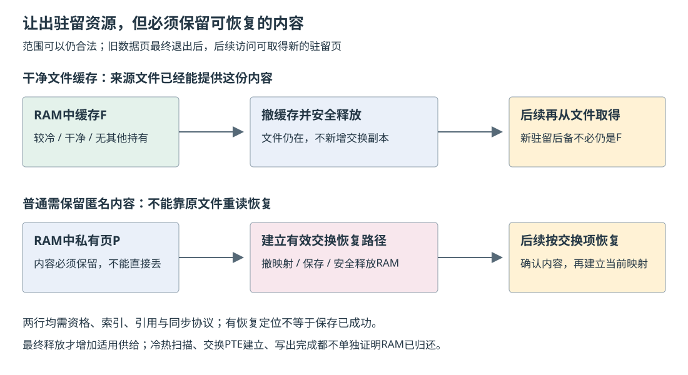
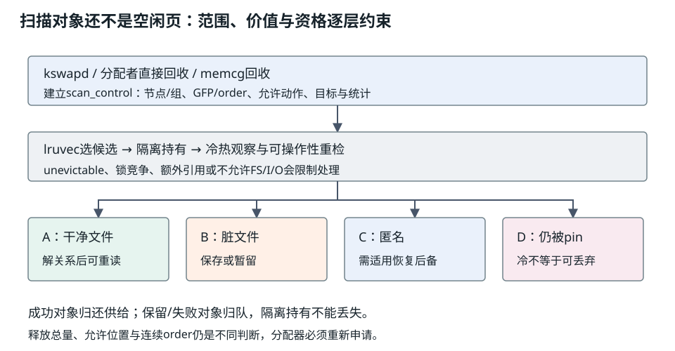
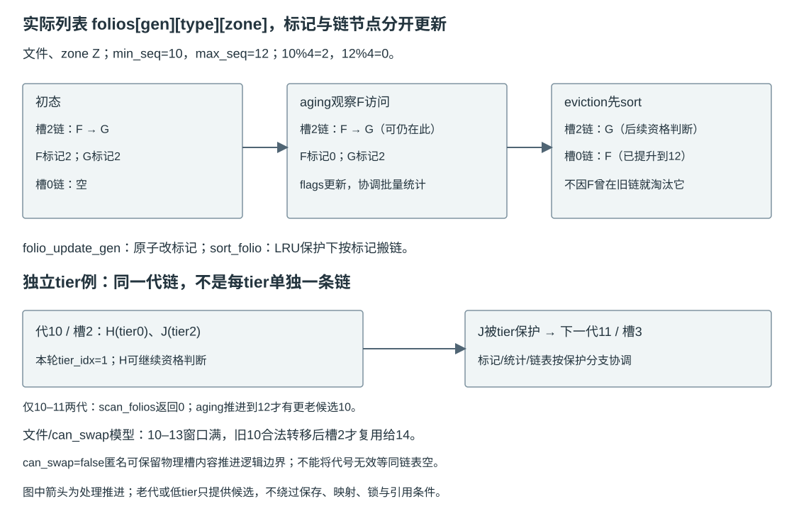
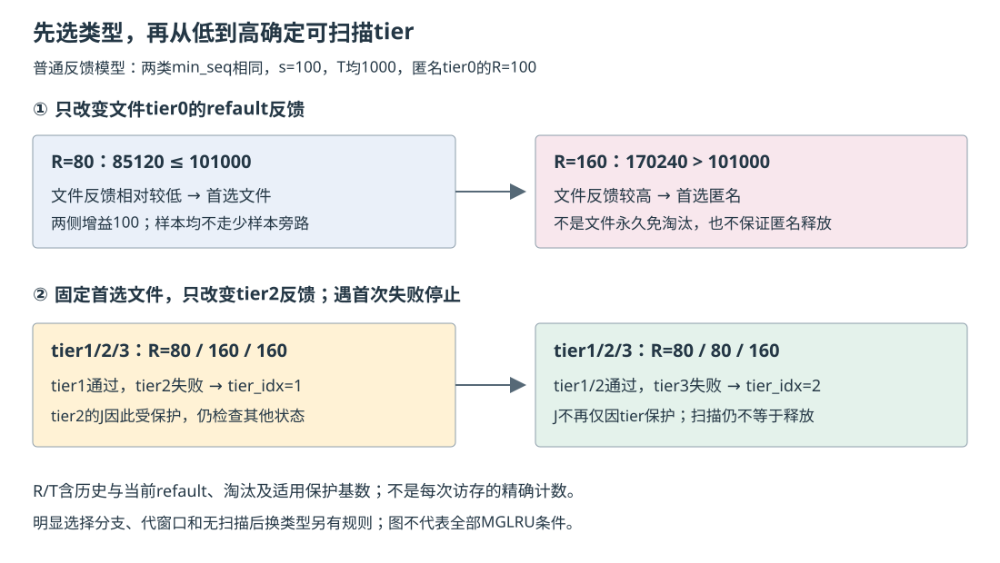
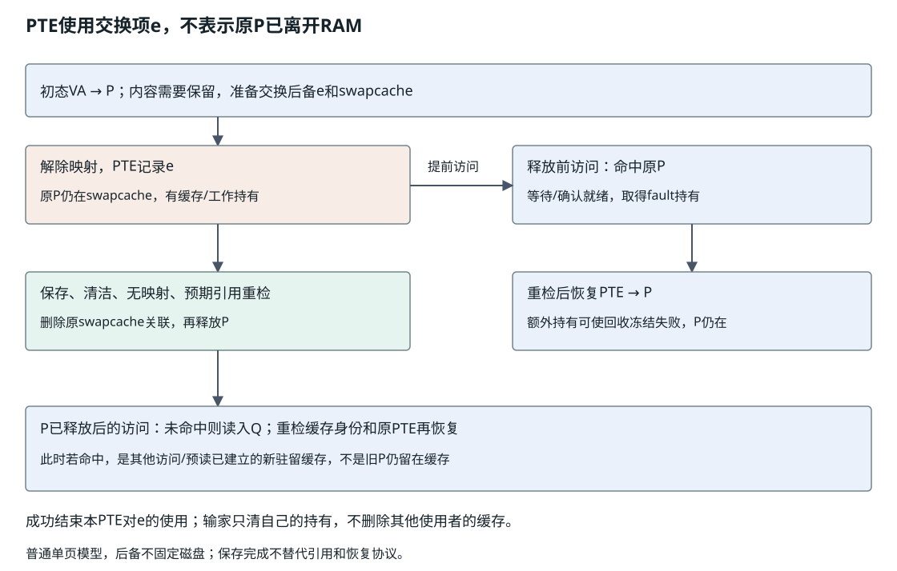

# 回收与交换：冷数据何时可以离开RAM

扫描到一页不等于回收到一页，冷数据不等于允许丢弃的数据。回收需要同时证明“暂时不值得驻留”和“解除当前关系后仍可恢复或允许放弃”；交换为需要保留的匿名数据提供后备。

这层机制的主要目的，是**在有限RAM中重新分配驻留机会，让不必继续占住内存的数据或缓存把资源让给新需求，同时不丢失必须保留的内容**。不是仅在OOM前才“清空缓存”，也不是把所有进程数据都写到交换设备。

## 阅读说明

本地Linux **6.1.158**、arm64、已打RT补丁。以普通基本页folio、传统LRU为主线，主例不采用向较低层内存搬移的demotion；MGLRU另给独立组织模型，按配置与运行启用状态判断，不假定目标机已开启。前置[页分配](01-page-allocation.md)、[页缓存](08-page-cache-writeback.md)、[缺页](07-page-faults.md)。

不执行drop_caches、交换启停、回收触发、耗尽或压力实验。页身份/数量都是稳定阶段模型，不是运行采样。

### 缩略词与入口

| 名称 | 含义 | 用途 |
| --- | --- | --- |
| LRU | Least Recently Used | 近似冷热管理，不是每次访问严格排序 |
| MGLRU | Multi-Generation LRU | 代、访问通道和反馈的替代组织 |
| rmap | Reverse Mapping | 从后备找到候选用户映射并重检 |
| memcg | Memory Cgroup | 回收范围、保护和记账 |
| swapcache | 交换缓存 | 交换项与驻留folio的关联 |
| PTE/PCP | 页表项/每CPU空闲页缓存 | 使用关系与归还供给 |
| refault | 被淘汰后重新取得数据 | 衡量淘汰代价的反馈，不等同每次CPU异常 |

| 问题 | 入口 |
| --- | --- |
| 回收什么，交换为什么与丢缓存不同 | [资源循环与基本过程](#basic-reclaim) |
| 后台/直接/组内回收谁决定范围 | [对象与作用域](#scope) |
| 冷、脏、匿名、pin页怎样分流 | [候选决策](#candidates) |
| 活跃/非活跃如何观察引用 | [传统LRU](#classic) |
| 多代如何变老与选择 | [MGLRU](#mglru) |
| 交换PTE建立后为何P还在RAM | [交换主线](#swap) |
| 怎样证明最后能移除缓存 | [释放协议](#release) |
| 返回非零是否等于申请成功 | [进展与接口](#apis) |

## 1. 职责：把驻留资源转回供给

<a id="basic-reclaim"></a>
### 1.1 回收的对象：仍驻留、却可能不必继续占住RAM的资源

一个服务读过的数据文件、已写入但暂时不用的匿名缓冲，以及内核为加速操作留下的缓存，都可能继续占用内存。应用没有主动释放，并不表示每份数据都应永久驻留；反过来，暂时没有访问，也不表示内容可以随意销毁。

**回收**是内核选择适用对象，结束它们可解除的使用关系，必要时先保存内容，再把能够安全归还的物理资源重新交给分配体系的过程。程序的合法虚拟范围可以仍存在，后续访问再按来源恢复内容；这与用户munmap主动删除一段地址范围不同。内核对象缓存则走其自己的释放合同，不全都按用户页交换。

因此回收同时回答两个问题：保留哪份驻留数据更有价值，以及这份候选现在能否安全处理。前者需要近似访问历史，后者需要来源、脏状态、映射、引用与执行上下文；仅有“很冷”不能完成第二个判断。

### 1.2 最小正常过程：让出一页干净文件缓存

固定普通干净文件缓存页F，内容可从文件重新取得，无剩余用户映射、pin或附属状态；没有并发变化，普通基本页模型：

1. 内核在允许的节点/组范围内选到F，取得本轮合法工作持有，判断它暂时不值得继续驻留。
2. 确认来源与内容状态允许移除：文件后备已能提供这些内容，无需再为F写一份交换副本；持有与索引仍要按相应协议重检。
3. 从文件缓存索引移除F，结束缓存及本轮持有，满足最终释放条件后把其物理页归还供给。
4. 分配器可以重新尝试新请求，但仍检查位置、阶数、水位和类型。若原程序之后再访问该文件位置，缓存缺失时重新取得内容，得到的新页不必还是F。

这个过程没有取消文件本身，也没有靠删除一个索引就跳过引用与同步。将条件改成F尚脏，移除前必须考虑保存；改成仍被合法持有或重新使用，本轮可能保留/归队。后文的冻结与dirty重检就是落实这里“安全移除”的条件，不是另一个与正常过程无关的技巧。

### 1.3 为什么匿名内容通常需要交换，而干净文件缓存不用

匿名页P里的私有数据通常不能通过重新读取原文件恢复，MAP_PRIVATE写后的新匿名内容也一样。普通需要保留的P若要离开RAM，需要另有有效恢复位置。**交换**提供这样的定位与保存协议：建立交换资源，在适用时把内容保存到后备，用户页表记录以后如何恢复；再次访问再按缺页协议取得驻留内容。

交换不是搬动整个进程，也不是把虚拟地址变成交换设备地址。范围规则仍由地址空间管理，CPU不能把交换软件项当普通物理映射直接访问。交换项、RAM中暂存的页和后备已保存内容还可能同时存在，所以“PTE变成交换项”与“RAM页已归还”是两个时点。



图0仅表示选定普通成功路径：干净文件从来源重读，匿名内容需要有效交换保存与恢复。二者都要通过映射、引用和最终释放协议；有交换位置不保证当前写出已成功，MADV_FREE等允许丢弃的匿名内容另有合同。

### 1.4 谁启动、谁选择、谁结束关系

节点后台kswapd按相应水位和需求提前做回收；允许等待的分配调用者也可能直接回收，因而承担延迟；组限制可以触发针对某个memcg子树的回收。它们共享候选处理机制，但范围、目标与允许动作不同，不是全机任何地方的冷页都可用来满足当前请求。

LRU在这里是近似访问价值的管理方法：把候选按匿名/文件及活跃程度等组织，不记录每条CPU访存的精确时间顺序。实现按节点与适用memcg组成候选管理单元lruvec；具体列表与MGLRU替代组织在后文展开。folio表示作为整体管理内容、锁与引用的一组连续基本页，本篇普通单页例只有一个基本页。

回收选择候选后，rmap协助结束真实用户映射，文件/交换来源协助保存和撤缓存，最终页释放归还供给；内核缓存另由shrinker等子系统回调处理。**冷热组织负责挑谁，来源与寿命协议负责能否释放，分配器负责释放后是否满足请求。** [源码入口](#reclaim-source)按这个分工列出。

### 1.5 回收、迁移与规整的边界

回收改变驻留状态，必要时先保存数据；迁移改变数据物理位置，规整改善连续空闲分布。回收4页但散在不允许的zone或不同高阶块中，不保证当前order-2请求成功。

对普通文件干净缓存，来源可重新读取，因而不必为其创建交换副本。对普通需要保留的匿名数据，原文件重读无法恢复私有修改，需要交换等适用后备。MADV_FREE等允许丢弃内容是另一合同，不代表全部匿名页都可无后备释放。

另一条条件化路径是demotion（向较低层内存迁移）：本地需要numa_demotion_enabled、未被scan_control.no_demotion禁止且有next_demotion_node等条件，并需实际迁移成功。它可无交换地腾出**当前节点**供给，但数据仍驻留另一个节点RAM；nr_reclaimed可含成功demotion量，不必等于整机驻留页减少。正文交换/丢缓存主例明确排除此路径，迁移算法由[迁移专题](10-migration-compaction.md)承接。

<a id="scope"></a>
## 2. 管理对象与作用域



| 对象 | 负责什么 | 不负责什么 |
| --- | --- | --- |
| scan_control | 本轮目标、order/GFP、允许unmap/writepage/swap、统计及目标组 | 永久拥有全部页 |
| lruvec | 节点与适用memcg组合下的候选组织 | 全机单一严格时间序列 |
| folio | 同一份数据的标记、引用、来源与管理状态 | 单凭cold就授权释放 |
| 隔离列表 | 暂从LRU取出供判断的对象和隔离持有 | 对象已空闲 |
| shrinker | 子系统可释放缓存的计数/扫描回调 | 任意slab对象自动交换 |

kswapd是节点后台回收，按水位/请求等工作；直接回收在允许的分配调用者路径执行，影响该任务延迟；memcg回收缩到目标组及相关子树，而不是无视组边界释放整机所有页。

传统lruvec有匿名/文件的active、inactive以及unevictable等组织。active是较受保护的候选，不是“CPU正在执行它”；inactive也不是已释放。访问证据、列表大小、回收成本与作用域保护共同影响扫描。

组范围与保护还要分别判断。设目标父组T下子组L/M各使用40页，均在允许节点，包含冷干净文件页；已经计算的有效low(L)=50、有效min(M)=50。首轮L因低于low暂被跳过，M因低于min硬保护被跳过，并非数据不冷。无其他进展且曾跳过low时，回收可带memcg_low_reclaim重试L并记录low事件；不能同样突破M的有效min。改成目标树外子组或禁止节点时，是范围排除，非保护算法。配置值怎样得到有效预算见[组记账](12-memcg-oom.md)，这里不把预算当预留物理页池。

<a id="candidates"></a>
## 3. 选择价值与操作资格分开

### 3.1 同一轮四个候选

假设合法回收范围内四个基本页A/B/C/D，均较冷；无特殊大页/设备迁移：

| 候选 | 数据后备 | 本轮可能结果 |
| --- | --- | --- |
| A：普通干净文件页 | 可从文件重读 | 解除映射/私有附属状态，移除缓存，满足引用条件才释放 |
| B：普通脏文件页 | 新修改还在RAM | 推动适用回写或暂留；不是所有直接回收都可现场写 |
| C：普通匿名页 | 需要保留私有内容 | 若允许且有交换资源，建立保存路径；无适用后备则留住 |
| D：仍有不可解除pin | 异步使用者依赖RAM | 冷热不能替代设备停止/持有解除，不能直接释放 |

若A被另一个任务重新访问，价值判断变化；若A仍有额外引用，即使价值不变也不能按预期引用释放。若B的调用上下文禁止文件系统/I/O，资格变化而不是“回收算法失效”。若D解除pin并满足其他条件，才可能成为可处理对象。

mlock把适用页放入不可正常换出的管理，不同于设备pin，也不保证永不迁移。folio锁拿不到、回写在途、rmap解除失败等也会保留或激活候选，不可遗漏隔离引用。

具体到B的普通脏file-LRU分支：本地shrink_folio_list只允许满足条件的kswapd现场写文件页；普通直接回收即便用GFP_KERNEL，也会在此设置reclaim标记并激活/留待后台，不因可睡眠就直接writepage。kswapd还需B已带reclaim、节点PGDAT_DIRTY成立，再通过引用结果、may_enter_fs及may_writepage等检查，才进入pageout；提交后仍要看dirty/writeback与来源返回，不能承诺本轮立即释放。

NOFS抑制进入文件系统，NOIO还抑制I/O，二者不是同一个开关。swapcache在有__GFP_IO且不需SWP_FS_OPS时，may_enter_fs另可允许相应路径；这不能拿来给普通脏文件页豁免上述门控。

<a id="classic"></a>
### 3.2 传统LRU怎样解释再次访问

工作集是近期反复需要、值得保持驻留的一组数据，不是一个固定大小的预留池。`workingset`页标记保存适用历史，例如曾从active被老化的页；缓存淘汰时shadow保留其相应历史标记、淘汰域和非驻留年龄，内容本身已不在该shadow中。`nonresident_age`由相应淘汰/激活事件按页量推进，refault distance比较现在与淘汰时的计数，不是毫秒年龄或访问指令数；量化和溢出按实际编码处理。

访问证据包括PTE young及folio referenced；rmap观察涉及检查/清理相应证据，不是比较每页最后访问的精确时间戳。

以普通file-LRU、非锁定/非执行映射、单PTE引用、无rmap竞争的F为例；两轮之间不另重置标记：

| 本轮观察 | 原folio referenced | 本轮结果 |
| --- | --- | --- |
| 第一次PTE引用1 | 0 | 设置referenced并KEEP，让其再走一轮 |
| 之后再次访问，第二次PTE引用1 | 1 | ACTIVATE，进入更受保护组织 |
| 对照：下一轮PTE引用0 | 1 | RECLAIM_CLEAN，只在干净等条件满足时考虑释放 |
| rmap锁竞争返回-1 | 任意 | KEEP，不能把未能观察当未访问 |

多个PTE引用或执行文件映射可更早激活；VM_LOCKED还有unevictable处理。active扫描把适用对象老化到inactive，inactive扫描再按上述证据与资格处理。没有新访问并不是“立即销毁”，它只是解除较强保护的依据。

沿两次引用后已active的普通非执行文件F，`shrink_active_list`把一批对象隔离到l_hold，检查可回收性及引用；普通F清active、设置workingset、归入本轮l_inactive，再在lru_lock下归队。它此时仍驻留、仍可映射，没有因为进入inactive就释放。后续inactive扫描才走引用/保存/撤映射/最后释放。

改变F为观察到引用的执行文件映射，本地可把它归入l_active，多给一轮active机会；不是全部有引用页都按同一条件留active。unevictable则另行放回对应管理。两类临时列表和隔离持有各有去向，list移动不等于调用页释放器。

### 3.3 匿名/文件扫描比例不是常量

#### 先选扫描方式，再算比例

本地get_scan_count先处理资格：may_swap为假或无匿名可回收路径时只考虑文件；组内回收且swappiness=0也选择文件。全局swappiness=0不等同“任何条件绝不交换”，必须读实际分支。

前置资格之后还先检查极低priority分支：`priority=0 && swappiness!=0`选择SCAN_EQUAL，早于file_is_tiny。EQUAL表示不再用cost比例平衡，两侧各按适用列表规模形成扫描量，不表示匿名与文件恰好扫描同样页数。

具体变条件：全局回收、may_swap成立、有交换或其他匿名可回收资格、**未命中上述EQUAL分支**、file_is_tiny成立时，在比例权重前会强制SCAN_ANON，即使swappiness=0也可扫描匿名。组内swappiness=0的提前FILE分支不能套入这个例子；无资格也不能靠file_is_tiny越过前置检查。保留文件极小及其他资格，仅改priority=0、s=100，先选EQUAL而非ANON；s=0则不会命中这个EQUAL条件。

`file_is_tiny`不是仅看“文件页少”。传统路径的prepare_scan_count用节点active+inactive文件页、空闲页以及managed zones累计high水位判断：

```text
file + free <= total_high_wmark
且 may_deactivate 中未允许 DEACTIVATE_ANON
且 (inactive_anon >> priority) 非零
```

这识别文件/空闲侧接近极小，而匿名inactive仍有可扫描供给、匿名active又未老化的情形，避免反复挤压很小的文件缓存工作集。模型设file=20、free=10、累计high=40，inactive_anon=64、priority=4，未允许匿名去活跃，三个条件都成立；在前述全局/交换资格下强制匿名。仅把inactive_anon改8，则8>>4=0；仅允许DEACTIVATE_ANON，或把file+free改50，标志同样不成立，回到后续方式选择，而非保证此时一定比例扫描。

#### cost是近期代价反馈，不是单页耗时

普通比例SCAN_FRACT路径使用sc中anon_cost/file_cost快照。lruvec中的cost累计适用pageout页数，以及workingset_refault判定可恢复工作集等条件成立时的成本事件；它不是纳秒耗时、精确命中率或每次CPU缺页都加1。`lru_note_cost`还向祖先lruvec传播，并在总cost超过相应LRU规模的1/4时将两侧减半，保留近期事件更大的影响。

沿同一个文件偏移的干净缓存F被淘汰、索引留下shadow，再取回新folioG。限定传统LRU、淘汰域仍有效、单页、忽略编码量化/溢出，已算工作集比较规模W=20，淘汰年龄100；下表是三个独立条件变化：

| refault时年龄 / shadow历史标记 | 距离与结果 |
| --- | --- |
| 130 / 任意 | 距离30>20，仅记录适用refault，不据此激活或增加restore成本 |
| 110 / workingset=0 | 距离10≤20，激活G并记录activation，但没有恢复历史工作集标记，不因此增加cost |
| 110 / workingset=1 | 距离合格且有历史，激活、恢复workingset并记restore，lru_note_cost_folio按单页增加该侧cost，随后仍受衰减 |

本地W按淘汰lruvec的active文件量，以及类型/可用swap条件下的其他LRU量形成，不固定20；事件记到实际新归属域、判断可用淘汰域，两者不必永远相同。shadow既不持有F数据，也不等于一次fault必需磁盘I/O，表只解释此恢复反馈的判断。页数成本与重新需求证据结合后才影响下次比例，不能把refault、activation、restore三个计数当同一事件的三种名字。

假设读到的非负快照A=anon_cost、F=file_cost，swappiness=s。在此普通比例分支，本地转换为：

```text
T  = A + F
Ca = T + A = 2*A + F
Cf = T + F = A + 2*F
C  = Ca + Cf = 3*(A+F)
ap = floor(s * (C+1) / (Ca+1))
fp = floor((200-s) * (C+1) / (Cf+1))
denominator = ap + fp
```

同样s下，某侧成本增大使其分母相对更大、压力相对下降；加入共同T限制成本反馈的偏斜，不让另一侧仅因一段历史就永久不扫描。`+1`让零成本也能计算。s表达匿名与文件重新取回成本的偏好权重，不是内存容量使用百分比。

| 快照A/F与s | ap / fp | 相同扫描基数下的方向 |
| --- | --- | --- |
| 0 / 0，s=100 | 100 / 100 | 两侧相同 |
| 0 / 0，s=60 | 60 / 140 | 匿名权重较低 |
| 10 / 0，s=100 | floor(3100/21)=147 / floor(3100/11)=281 | 匿名相对份额约147/428 |
| 0 / 10，s=100 | 281 / 147 | 文件代价较高，文件相对压力减小 |

这里变化的是快照输入，不假设一次refault恰好加10。高代价侧仍可扫描；无资格、强制单侧或SCAN_EQUAL等分支不套这组权重，前面的file_is_tiny例也不受ap=0的普通比例结果约束。

#### 权重还要乘各自的列表规模

本地先取适用zone范围的lruvec列表规模，按有效min/low保护调整扫描基数，再右移sc.priority，最后乘`fraction[type]/denominator`。所以ap/fp不直接等于扫描页数，更不等于释放页数。

固定普通在线组、无保护折减，每个选定inactive列表各400页、priority=2，扫描基数各100。用147/281权重，匿名扫描floor(100×147/428)=34，文件floor(100×281/428)=65，整数截断不要求两者相加恰100。仅将文件列表增到800，文件基数200，扫描变131；匿名仍34。先看各列表规模，再谈权重，不能从约34%直接说全机匿名回收34%。

<a id="mglru"></a>
## 4. MGLRU：按代表示近似访问时期



MGLRU不是在传统active/inactive上再贴时间戳。每lruvec维护年轻代max_seq及匿名/文件各自最旧代min_seq；序列单调推进，folio标志保存截断的代索引，列表以环形槽组织，因此槽号不等于永远递增的实际代号。

aging观察页表访问证据，更新热页到较年轻代，并推进年轻代边界；eviction消费老代，选择类型及需要保护的tier，老代空后推进相应min_seq。tier表示文件描述符访问频率层次，不各自拥有一套独立代链表；refault反馈比较类型/tier的代价。

实际列表是`lrugen.folios[gen][type][zone]`：gen为代环槽，type为匿名/文件类别，zone再区分可扫描位置。folio只有一个lru链节点，代标记与频次在flags中表达；tier不是第三份独立链表。完整逻辑序号由min_seq/max_seq窗口解释，不能只读截断gen就说“这是第0代最老页”。

简化设文件F在代10，G也在10。aging观察到F被访问，提升到当前年轻代12；G无新证据仍在10。淘汰可先选择较老G，但G若脏/锁定/有持有，仍须保存或保留；F也不获得永久免淘汰权。年轻边界以后推进到13，未被提升对象相对变老，不要求CPU每次访问同步移动链表。

把“提升”分为标记与链表两步。固定一个zone的文件列表、min_seq=10、max_seq=12：

| 阶段 | F的解码gen | 实际链表 | G |
| --- | --- | --- | --- |
| 初态 | 10%4=2 | F/G在folios[2][file][Z] | 代标记2 |
| aging见到F的young证据 | 更新为12%4=0，并协调相应批量统计 | F可仍链接在槽2，不在页表遍历时立即搬链 | 未见证据，仍2 |
| eviction扫描旧槽2并sort_folio | 看到F标记0不等旧槽2 | 把F移到folios[0][file][Z]，不将其当旧10淘汰 | G仍可进入后续资格判断 |

`folio_update_gen`比较交换flags，`sort_folio`在LRU保护下实际移动；观察后已被隔离的对象还会记录referenced供后续处理。两步协作既避免页表扫描时逐项大锁搬链，也让eviction不把已提升的F误当冷页；这是源码对应的机制解释，不把统计和链表说成同时原子变化。

匿名/文件最旧代不同是因为干净文件可独立于交换限制淘汰。aging与eviction共享窗口和反馈，但冷热组织不能绕过后续映射、后备和引用协议。CONFIG_LRU_GEN可编译支持，LRU_GEN_ENABLED决定默认启用，运行接口还可改变状态；本稿不宣称实际目标已启用。

### 4.1 同代tier与有限窗口的变条件

本地文件描述符访问跟踪用近似频次N，refs表达扣除最初标记的访问，tier由order_base_2(refs+1)计算。N=0/1落第一tier，N=2到tier1，N=4到tier2；不等于CPU执行N条load/store，页表访问证据是另一通道。

设同一最旧文件代10有H/J，H在tier0、J在tier2，反馈选择本轮tier_idx=1。H通过其余资格后可隔离淘汰；J因tier>tier_idx被保护，推进到下一代11并归队，而不是永久驻留代10。改变反馈使tier_idx=2，J不再仅因tier受此保护，仍要检查dirty/锁/映射。反馈阈值来自各tier refault比例与增益比较，不是“次数≥4永不淘汰”。

本地MIN_NR_GENS=2、MAX_NR_GENS=4。以下限定文件类型及匿名can_swap成立的情形：min_seq为10、max_seq=13，窗口已经覆盖10–13四代，max到14前需推进相应min。消费或合法转移旧10对象后，10%4=2的槽才用作14%4=2；不能覆盖仍需管理的页。

MIN_NR_GENS还限制普通淘汰，不只是容量常量。只剩min=10、max=11两代时，scan_folios直接返回0，不能因为10较老就继续把它作为普通淘汰候选；适用aging推进到max=12后，三代窗口才有超出最年轻两代的旧10可扫描。此时只是扫描资格改变，旧10仍要通过类型、tier、后备和映射/引用条件。窗口后来回到仅两代，又需相应推进，不能把一次aging说成释放一批页。

匿名can_swap=false时是另一分支：inc_min_seq可直接推进逻辑边界而不搬走旧槽folio，inc_max_seq专门协调槽重叠及兼容active/inactive大小。此时“旧代号不再有效”不等于“物理槽链表已经空”；保留内容不是丢页，也不能套用前一模型要求所有类型先搬空。

### 4.2 反馈怎样决定先扫描哪类、保护到哪个tier

前面的H/J例给定tier_idx，用于解释门槛对对象的影响；现在补齐这个门槛怎样得到。MGLRU不是把传统cost权重直接套进代链表。本地`isolate_folios`先作明显选择：swappiness=0选文件；否则匿名min_seq比文件更老时先选匿名；再检查s=1选文件、s=200选匿名；其他条件才进入类型反馈比较。明显选择分支使用同类型tier0作为保护比较基准，增益比1:2；普通反馈分支则先在两类tier0间比较，再以另一类型tier0检查选中类型的更高tier。

反馈输入由`read_ctrl_pos`组成，不是精确I/O耗时：R为历史平均与本次历史槽的refaulted之和；T为历史avg_total与当前evicted之和，对高tier还加相应protected量。后者让已经保护、没有真正淘汰的对象也进入比较基数，不能只用当前refault次数排名。历史在相应代推进时按半衰平均更新；下面固定一次稳定快照，不把一次新fault无条件等同R增加1。

`ctrl_pos`的SP/PV是两份比较记录，gain是相应增益，不是实际页数。arm64本地MIN_LRU_BATCH=BITS_PER_LONG=64；`positive_ctrl_err(SP,PV)`满足任一条件时为真：

```text
PV.R < 64
或 PV.R * (SP.T + 64) * SP.gain
   <= (SP.R + 1) * PV.T * PV.gain
```

第一条避免少量refault样本过早取得强保护；第二条比较带平滑余量/增益的相对反馈。类型判断以匿名tier0为SP、文件tier0为PV，真选文件、假选匿名。选中后，从tier1递增，用另一类型tier0作SP；某tier首次不满足就停止，tier_idx为它的前一tier，不跳过失败tier继续随意放行更高tier。最后仍需代窗口、候选与释放资格。

固定can_swap成立、两类min_seq相同、s=100、所有相关T=1000、历史/protected贡献已计入快照，无整数溢出。匿名tier0的R=100，两边gain均100：

| 只改变文件tier0反馈 | 比较 | 首选类型 |
| --- | --- | --- |
| R=80 | 80×1064=85120 ≤ 101×1000=101000 | 文件 |
| R=160 | 160×1064=170240 > 101000 | 匿名 |

同一基数下文件refault反馈升高，文件成为更应保护的一侧，先扫描匿名；这不是承诺匿名一定能释放。两种样本均≥64，确实走第二条比较而非少样本旁路。

再固定第一行的文件首选，把文件tier1/2/3的R设为80/160/160，T仍1000，SP仍为匿名tier0：tier1通过，tier2失败，得到tier_idx=1，前述tier2的J被保护。**只把tier2的R降为80**，tier1/2都通过而tier3失败，门槛变为2，J不再仅因tier被保护。这里给出改变反馈到改变决策的全过程，不是事先指定门槛。



图5固定上述普通反馈条件；明显选择的同类型1:2增益分支不能套图中100:100数值。选定类型本次若没有可扫描进展，`isolate_folios`还可尝试另一类并重新计算tier，s=0则不转去扫描匿名。因此“首选文件”也不等于本轮只能扫描文件。

<a id="swap"></a>
## 5. 匿名P怎样交换出去并恢复

交换项e编码交换类型/位置；swapcache把e联系到驻留folio；交换PTE保存未来访问的恢复定位。三者不是同一个资源：P可仍在RAM，e仍被PTE使用，后备传输可能尚未完成。



主例普通uptodate匿名基本页P，需保留内容，无MADV_FREE/KSM/特殊设备，允许交换：

1. **准备e。** folio锁下add_to_swap取得交换资源并加入swapcache，标脏以保证必要内容保存。分配e失败不能丢P；缓存加入失败，按put_swap_folio等协议释放本次未交付交换资源。
2. **解除映射。** rmap找到并重检真实PTE，安装适用交换项并失效旧转换。PTE对e的使用计数继续维持恢复位置；RAM中的P还有swapcache及隔离等持有，不能据非present项宣布已释放。
3. **保存。** 适用pageout/swap_writepage提交保存，在途状态与等待阻止提前丢弃；已有有效交换副本且未再修改时可不重复写。swap后备不限于磁盘分区，其他后备层改变传输，但仍要有有效恢复协议。
4. **移除驻留缓存。** 已满足保存、清洁、无剩余映射等资格，按下一节冻结预期引用并重检，移除swapcache后归还P。只要PTE仍使用e，就不能顺带将e当无人使用释放。
5. **再次访问。** 在步骤4已删原swapcache并释放P的主线上，缓存未命中时按协议分配/读入新Q，锁下重检原交换PTE后恢复映射。若此时命中，必须是其他访问/预读已经重新建立的驻留缓存，不是已释放P仍留在缓存里。失败结束本次准备资源，不覆盖他人已完成的映射。

另一时点是在步骤4之前：P仍在swapcache时访问交换PTE，do_swap_page可命中P、等待/确认就绪后恢复，不必新读Q。取得的额外fault持有会影响回收冻结，原P可能因此未能释放。这是“尚未完成驻留释放”的分支，不沿图的释放P后回边复活旧对象。

普通交换BIO写失败在本树设置错误并重新标脏，再结束writeback，避免未保存P被当干净释放。文件回写错误不都如此，不能从交换完成回调推出“所有I/O错误都会自动redirty”。

并发fault可在P尚在swapcache时取得额外引用，阻止回收按预期冻结；回收须保留P而不是强行取消引用。交换读失败走来源缺页错误，不把e的存在当内容必然可恢复。

<a id="swap-read-ahead"></a>
**放大第 5 步：预读有两种“邻近”。** 在走 `swapin_readahead()` 的普通缓存未命中路径，本树可按同一交换区域的相邻条目读入，也可从当前 VMA 的虚拟地址附近取实际交换 PTE 所指条目。前者的邻近是交换槽编号，后者是应用访问地址；相邻 VA 不保证交换槽连续。若同时准备了相邻地址对应的 R，也只是把 R 读入交换缓存，**当前缺页只处理当前地址的映射恢复**。对照 `mm/swap_state.c` 的 `swap_use_vma_readahead()`、`swap_cluster_readahead()`、`swap_vma_readahead()`；此解释不覆盖绕过预读入口的特殊 swapin。[原文流程图入口](reference-reading.md#translation)

### 5.1 恢复成功与竞争退出分别结账

只看普通缓存命中恢复路径，不含KSM复制或直接swapin特殊分支：

| 结果 | 本PTE对e的使用 | swapcache关系 | fault持有 |
| --- | --- | --- | --- |
| 原交换PTE仍匹配，成功恢复present项 | 本地先swap_free结束本项使用并调整mm统计 | 按额外资格可尝试移除，不强制删除 | 成功路径把适用取得引用用于新映射，不再当失败临时引用put |
| 另一任务已把PTE改为R | 不替R再结束一次e使用 | 不因输家退出删除共享缓存 | 解锁并folio_put本次持有，保留R |
| 锁后folio不再是e的swapcache身份 | 尚未成功接管本项 | 不再把该folio当原e内容 | 退出并释放本次持有，由后续访问重查 |

锁下既检查folio仍在swapcache且其entry身份仍为e，也在PTL下重检原PTE；引用和pte_same不能替代缓存身份检查。folio_free_swap还要求缓存存在、无writeback、无剩余交换使用及存储未挂起等条件；失败不表示present映射无效。丢临时引用与删除整个缓存/释放其他PTE所用位置是不同动作。

若恢复后`folio_free_swap`满足条件并成功，本地先删除swapcache/释放相应交换关联，再把仍驻留的folio重新标Dirty。即使应用没有再次写入，旧交换位置已不再是这份内容可依赖的恢复后备；以后再交换需重新建立有效保存路径。这是**保留RAM内容、结束交换后备关联**的状态交接，不是交换写失败的redirty，也不是第5步之前“撤swapcache后释放RAM页”的回收结果。失败则没有完成这个关联退出，不能无条件套用成功后的脏状态。

<a id="release"></a>
## 6. 释放的最后一道协议

### 6.1 为什么先冻结引用，再看dirty

对已经解除映射、可移除缓存的普通基本页F，示例只剩缓存引用1和隔离持有1。`__remove_mapping`在来源/索引保护下尝试冻结预期引用 `1 + folio_nr_pages(F)`，主例为2。多一个临时引用就冻结失败，保留F；这个2不是所有页释放的统一阈值。

冻结使相应无锁查找不能再取得正常引用，然后重检dirty。若另一使用者曾修改、标脏并放引用，后检查dirty能看到需保存内容；若反过来先检查干净，使用者随后写脏再放引用，最后单看“引用够少”会错误丢数据。

冻结后发现dirty就恢复计数并保留；满足条件才删除缓存索引/适用shadow与记账，结束持有并走最终释放。shadow记录淘汰信息供后续refault反馈，不是还能直接读的数据页。

### 6.2 隔离对象必须有去向

候选从LRU隔离时取得工作持有。成功对象归还供给；KEEP/激活/未能解除映射对象放回适用列表并结束隔离持有；不同来源私有状态还需对应release操作。不能把列表删除当作释放，不可只清空失败链表。

同时扫描shrinkers处理可释放内核缓存。SLUB空slab可能最终归还页，但“slab对象都能按匿名页交换”不成立。[对象分配](03-kernel-objects.md)解释其自身寿命。

<a id="apis"></a>
## 7. 进展、上下文与接口

| 使用场景 | 入口 | 责任/限制 |
| --- | --- | --- |
| 普通内核分配 | 正确GFP与作用域 | 表达可等待/FS/I/O能力；不在冲突锁内硬调回收 |
| 直接回收内部 | try_to_free_pages等 | 由合法内部路径建立回收状态，避免递归回收和依赖冲突，处理结果 |
| 子系统缓存 | shrinker回调 | 报可释放对象、锁/GFP及部分进展；不销毁仍在用对象 |
| 用户驻留/提示 | mlock/madvise等 | 有权限/语义/失败；不保证物理地址恒定 |
| 观测 | vmstat/组事件/trace | 对齐范围和区间，扫描不等于释放 |

本地do_try_to_free_pages若nr_reclaimed非零返回该值，但nr_reclaimed=0且compaction_ready可返回1，以提示继续规整而非过早OOM。非零返回不能一律当精确已释放页数，更不能当当前申请成功；分配器仍需在允许zone/order/水位下重新申请。

GFP_NOFS/NOIO约束可进入的回收依赖，作用域接口见[虚拟分配](04-kernel-virtual.md)及[页分配](01-page-allocation.md)。RT不取消这些约束，也不把直接回收变为固定无睡眠路径。

### 7.1 shrinker回调合同

| 字段/结果 | 合同 |
| --- | --- |
| count_objects | 返回可释放**对象数**，不是页数；确定空缓存返回SHRINK_EMPTY |
| count返回0 | 不能确定或本轮需跳过/低于可缩阈值，不等同确定空 |
| shrink_control.nr_to_scan | 本次应尝试扫描的对象预算 |
| nr_scanned | 回调应记录实际处理数，默认预算不是永远真实扫描数 |
| scan_objects | 返回本次释放对象数，可扫描20却只释放3 |
| SHRINK_STOP | 潜在死锁使不能进展，当前回收上下文不再继续调用该scan |

count不应通过死锁检查取消本应累计的压力；依赖冲突在scan处理，使未能执行的预算可留待适用上下文。支持NUMA/memcg的shrinker另按nid/memcg定位对象；回调仍需维护本子系统锁和对象寿命。返回3个对象不保证归还3个物理页，SLUB里页是否可归还另需整slab资格。

“扫描很多、释放很少”可能是热数据、pin、脏/在途、范围或保护；“已释放不少仍失败”可能是位置/连续性与当前申请约束。两者要分开诊断，OOM范围与选择在[记账和OOM](12-memcg-oom.md)。

<a id="reclaim-source"></a>
## 8. 源码与延伸

| 本文机制 | 目标源码 |
| --- | --- |
| 范围、两LRU组织、引用观察/扫描比例、候选与冻结释放 | [vmscan.c](../../../../linux-6.1.158/mm/vmscan.c) |
| 隔离归队/引用最终释放 | [swap.c](../../../../linux-6.1.158/mm/swap.c) |
| e与swapcache建立、查找及失败 | [swap_state.c](../../../../linux-6.1.158/mm/swap_state.c)、[swapfile.c](../../../../linux-6.1.158/mm/swapfile.c) |
| 交换I/O及写失败redirty | [page_io.c](../../../../linux-6.1.158/mm/page_io.c) |
| 映射解除及交换PTE恢复 | [rmap.c](../../../../linux-6.1.158/mm/rmap.c)、[memory.c](../../../../linux-6.1.158/mm/memory.c) |
| refault反馈 | [workingset.c](../../../../linux-6.1.158/mm/workingset.c) |
| MGLRU模型与启用边界 | [实现说明](../../../../linux-6.1.158/Documentation/mm/multigen_lru.rst)、[Kconfig](../../../../linux-6.1.158/mm/Kconfig) |
| 代窗口/tier及shrinker合同 | [mmzone.h](../../../../linux-6.1.158/include/linux/mmzone.h)、[mm_inline.h](../../../../linux-6.1.158/include/linux/mm_inline.h)、[shrinker.h](../../../../linux-6.1.158/include/linux/shrinker.h) |

结论是“先判断价值，再验证资格；需要时保存内容，解除关系后证明最后可释放”。[迁移与规整](10-migration-compaction.md)继续解释为什么空闲总量不足以代表高阶供给能力。

<a id="review-result"></a>
## 独立挑战审阅

以下是外部图解增补前的审阅记录；增补范围见[本轮对照](reference-reading.md#translation)。

本次新只读挑战者 Arendt 完成第 1 轮全文/五图复核，C1–C3均关闭，技术与教学分别通过，见[本次记录](review/review-entry-09.md)。[原约定](review/contract-reclaim.md)、[前次补全](review/review-pedagogy-09.md)与[初次记录](review/review-reclaim.md)保留历史。待用户统一 review，不代表运行或学习效果验证。
