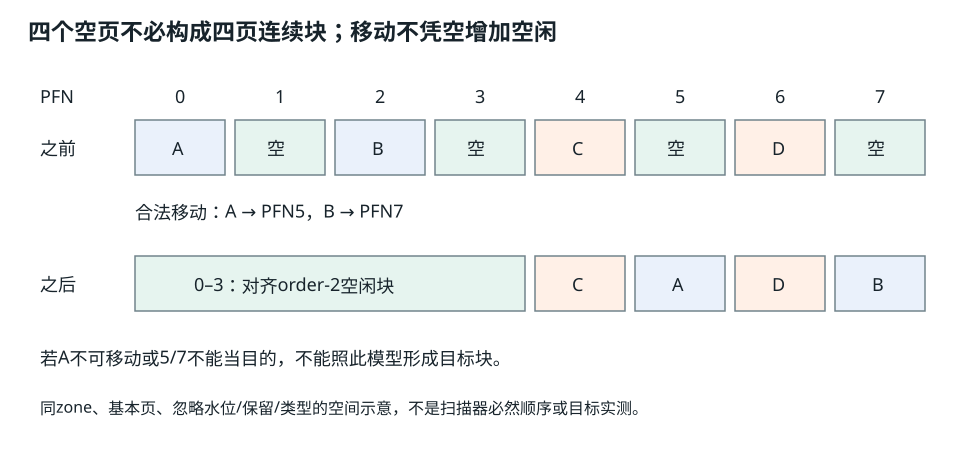
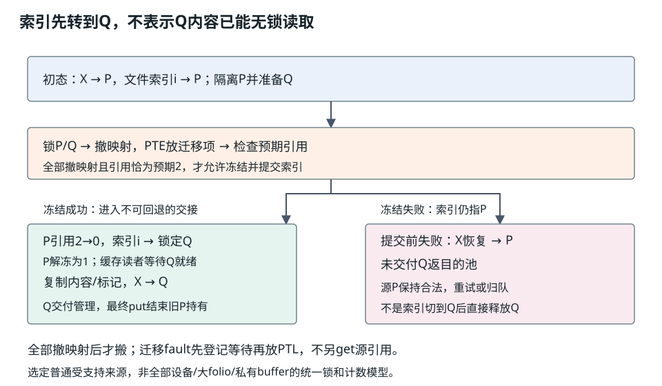
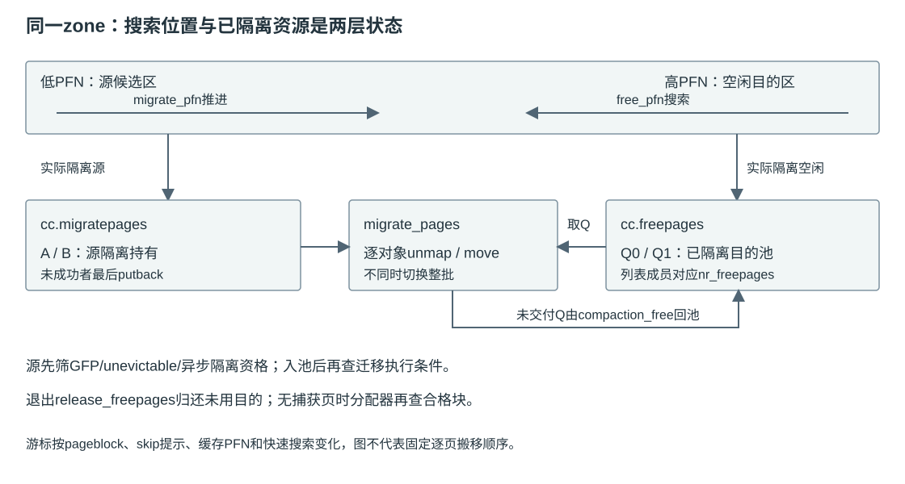
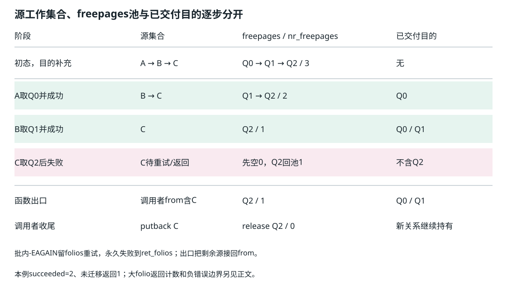

# 页迁移与内存规整：保持内容，改善位置与空闲分布

迁移不能只做memcpy：用户仍按VA访问，缓存仍按文件偏移查找，异步使用者仍可能持有旧页。必须交接内容、索引、映射与寿命，规整才可能利用搬移形成更好的连续空闲块。

迁移的主要任务是**把仍要保留的数据安置到新的物理位置，维护原来可继续使用的逻辑内容与关系**；规整则利用合法迁移把零散空闲集中成对分配更有用的连续块。二者改变的是位置和分布，不是凭空增加RAM，也不保证任何已有页都可搬。

## 阅读说明

本地 Linux 6.1.158、arm64、已打RT补丁源码，迁移和规整按对应配置条件解释。前置[页分配](01-page-allocation.md)、[回收](09-reclaim-swap.md)。NUMA策略、大页和设备迁移只说明交接，不全面展开。

| 名称 | 含义 |
| --- | --- |
| PFN | Page Frame Number |
| NUMA | Non-Uniform Memory Access |
| LRU | Least Recently Used |
| PTE | Page Table Entry |
| compaction | 以迁移等能力改善连续空闲空间 |

| 问题 | 入口 |
| --- | --- |
| 为什么需要迁移与规整，各自交付什么 | [用途和基本协作](#basic-movement) |
| 源、目的、迁移项与隔离列表是什么 | [对象模型](#objects) |
| P迁到Q期间访问者怎样等待 | [迁移主线](#migration) |
| 额外引用/回写如何改变结果 | [条件变化](#conditions) |
| 八页有四空闲为何仍不能order-2 | [规整推演](#compaction) |
| 一批成功两页失败一页怎样结账 | [批量资源](#batch) |
| 返回与接口怎样正确使用 | [接口](#apis) |

## 1. 定位、职责与问题

### 1.1 为什么内容还在用，却需要改变位置

页分配器给出物理后备后，后续需求不一定一直适合原位置。例如NUMA应用希望已有热数据靠近实际访问者；内存下线需要把可搬的数据撤出目标区域；高阶申请需要连续物理块，却发现空闲页被仍在用的数据隔开。这些需求都不能通过“有多少空闲字节”单独回答。

**页迁移**处理已有内容从源P到目的Q的交接。源和目的有不同的页描述符/PFN，内核必须让原有逻辑使用关系切换到新后备，而不是要求普通程序把所有用户指针改成另一个地址。它不是把P描述符改为代表另一个PFN，也不是让P描述符本身消失：成功后逻辑内容由Q所代表的物理页承载，旧P的物理页满足条件才归还。原来通过某VA或文件位置使用的内容与语义，才是需要保持的关系。

适用NUMA位置调整和内存下线使用迁移能力，但有不同的选择、目的和区域约束；并非每次迁移都为了连续块。本篇以普通受支持文件页的交接及zone内规整为主，后文不把设备pin、文件系统附属状态或下线要求简化为同一复制操作。

### 1.2 最小迁移过程：访问位置不变，物理后备变了

固定普通可迁移文件页P，程序地址X与文件缓存位置i都指向它；目标Q合格，无额外pin/附属持有、并发失败或回写：

1. 调用方选中P、取得合法工作持有，并准备适用的空闲Q。此刻Q只有准备资源，还不能向访问者交付“内容已搬好”的保证。
2. 协调已有访问：锁住适用内容/来源，撤掉P的普通用户转换并建立迁移中的等待状态。访问者不能继续写P，也不能读取尚未完成的Q。
3. 按来源协议把缓存位置i和对应持有交接给Q，复制内容与管理状态。索引已指Q与Q内容可以无保护读取不是同一时点。
4. 恢复X的适用映射到Q，结束等待和旧持有。成功后程序仍通过X、文件缓存仍通过i访问原逻辑内容；旧P满足最终释放条件后回到供给。

中途不能完成时，恢复适用的P映射并清理未交付Q，或按该阶段保持合法可重试状态。第3节会解释为什么需要引用冻结、锁和页表等待，而不是把这些名字作为额外“实现复杂度”列出来。

### 1.3 规整的目标：把已有空闲变成合格的连续空闲

**内存规整（compaction）**组织一次区域搜索与迁移，选择能够搬走的源，把它们安置到合适空位，使某些物理对齐范围尽可能空出来，供高阶分配使用。它不是把内核虚拟地址重新排版；vmalloc的虚拟连续也不能替代某个调用者实际需要的物理连续。

下面用同zone八个基本页、四份内容A/B/C/D的空间示意：开始有四个空页，却被内容交替隔开。若A/B可合法搬到5/7，0–3可形成对齐四页空闲块，内容仍有四份，空闲总量也仍四页。此图只解释位置分布，水位、保留与实际扫描顺序在第4节另行推演。

如果A不可移动，或高端空位不合格，这个排布方案就不能实现；扫描很多并不等于已经得到目的资源，也不等于捕获了一块可直接交给申请者的页。

### 1.4 协作：规整挑对象，迁移交接，分配器检查结果

规整搜索可移动源与空闲目的，建立本轮隔离工作集合；迁移根据来源、引用、锁和模式交接P/Q；未成功源须归队，未用目的须归还。旧源释放与Buddy合并、必要的局部暂存处理使连续块成为实际供给，分配器再按请求资格取得它；直接规整的页捕获是后文单独说明的交付分支。

直接规整发生在申请者路径，后台kcompactd在另一个工作时机组织规整；位置调整也可由其他调用者发起迁移。发起者和时机不同，不取消上述资源与访问协议。[源码入口](#source)按迁移、规整与捕获分工给出。

## 2. 整体组成与关键对象

源folio、目的页、适用缓存索引与用户映射、隔离列表及迁移条目共同描述一次移动。`compact_control` 保存区域、扫描位置、模式及候选；它不是页数据的业务所有者。

目的页必须满足位置、大小、用途及当前供给约束。可移动属性不是“可以随意复制内存”的许可；普通页、folio、非LRU移动对象和设备页有不同迁移操作。

folio是管理一组连续基本页的对象；主例为单页folio，源P与目的Q各管理自己的数据，不是一个对象的两个字段。迁移项是页表中的非普通present软件状态，保留源定位及适用读写/独占等语义，让fault走等待/重试；它不是交换设备位置，也不是可以直接给CPU读的Q。

| 状态/关系 | 所有者和用途 |
| --- | --- |
| P的缓存mapping/index | 迁移前文件位置关联，来源操作负责替换 |
| P的用户映射 | rmap定位真实项，页表协议协调撤除/恢复 |
| 源隔离持有 | 迁移调用者合法隔离，保持P直到完成或归队 |
| Q的准备持有/锁 | 本轮准备资源；成功由新关系接管，失败返回目的池 |
| compact_control.migratepages/freepages | 一轮隔离源与空闲目的管理，不是业务数据所有者 |

文件页、匿名页、swapcache及__PageMovable来源分别通过适用操作搬移；普通页的“可移动类型”只是组织意图，真正迁移还需当前引用/锁/来源资格。

## 3. 单页迁移的状态交接

### 3.1 三个稳定阶段

假设进程地址X映射源页P，迁移到Q：

| 阶段 | X的后备关系 | 内容 |
| --- | --- | --- |
| 之前 | P | P提供有效数据 |
| 迁移协调期间 | 适用迁移软件状态/等待协议 | 不能向访问者暴露未完成Q |
| 成功后 | Q | Q具有原数据，引用/索引转移后才可归还P |

虚拟地址保持X并不表示PTE没有变化。失败时需要恢复适用旧映射/索引或保留合法源状态，归还未交付目的资源，而不是删除所有关系后只返回错误。

具体到一种普通受支持的文件缓存迁移路径：迁移条目关联源folio，遇条目的缺页者按协议等待源锁，唤醒后重新检查映射/重试，不把等待返回当作可以直接读Q。源和目的锁及就绪协议协调搬移；缓存归属可能先转到Q，但查询拿到Q的引用不证明其数据已就绪，合法读取仍需相应锁/就绪判断。

成功路径将适用迁移PTE恢复为指向Q；失败则恢复为P，释放本轮目的资源并维护剩余源归属。锁、缓存索引、数据复制和PTE恢复配合，不能靠某一处指针先转到Q就跳过其余步骤。设备页、文件系统私有操作等仍需各自协议。

### 3.2 一次普通文件缓存迁移的细化

固定普通干净基本页P、受支持migrate_folio来源，无私有附属引用/额外持有；初态VA X→P、mapping索引i→P：

这里的**引用冻结**是原子比较预期计数并暂时置0，不是另一个睡眠锁，也不是调用最后一次folio_put。页锁保护内容/来源交接，XArray锁保护索引修改，但合法缓存查找可以在RCU下不取这两把锁，先读索引、尝试取得非零引用。因此修改方还须暂时封住新的正常取引用：若计数不是预期2便失败-EAGAIN，不能强减到0；恰好2才把计数置0进入交接。

沿全部用户映射已经撤除的P，计数2由缓存1+隔离1组成。成功冻结2→0，修改方仍承担P的工作寿命，没有经过最后put的释放路径；给Q增加对应缓存持有并把索引i替换Q，再将P解冻为`expected_count - nr_pages = 1`，结束旧缓存持有而保留隔离持有。最终工作put使P的1→0，才按实际最终释放路径结束P存储。冻结的0与最后put后的0不能凭数值混为同一种寿命状态。

缓存读者若先读到旧索引P：在冻结窗口取引用失败就重新查找；若在冻结前已成功取得额外引用，会使本轮预期2冻结失败。即使取引用成功，读者还用xas_reload验证索引是否仍指相同对象，不匹配便put并重查；成功取得Q也须等其锁/就绪。取引用和索引重验是配合协议，不授权对任意裸P指针“从0复活”。

1. P从LRU隔离取得工作持有，分配适用Q，锁定源/目的。需要锁却拿不到时可重试或失败，不能先发布可读Q。
2. try_to_migrate在真实PTE保护下撤销P映射、建立指向源的迁移项及失效，保证搬移期间CPU不继续修改旧P。匿名关系需要时另持有anon_vma，不能因mapcount降为0就释放其定位依据。
   调用之后还必须确认`!folio_mapped(P)`。若仍有映射，不能进入冻结/内容搬移；已建立的迁移项恢复到P，然后结束适用锁/目的持有，重试或归队。调用try_to_migrate不等于全部撤除完成。
3. 来源migrate_folio调用folio_migrate_mapping等，在XArray锁下冻结预期源引用。主例映射已撤，剩缓存1+隔离1，预期2；若另有普通引用，冻结失败-EAGAIN，尚未切索引。
4. 成立后转移index/mapping及缓存引用到Q、替换缓存索引；随后复制内容/迁移标记。**索引可先指Q，但Q仍锁定**，查缓存得到引用的读者必须等待并验证就绪，不能直接读未搬完数据。
5. 成功将Q加入适用LRU并恢复迁移PTE指向Q，结束锁/暂持与P隔离持有。主例的冻结失败发生在第3步、索引提交之前；此时恢复PTE→P、释放未交付Q并保留P供重试/归队。选定普通受支持来源一旦冻结成功并切换索引，后续复制/标记走成功完成路径，不是把已发布到索引的Q直接释放并回退P；其他来源的失败合同需分别核对。

迁移保持的是“X与文件位置i访问原来那份逻辑内容”，不是P描述符/PFN永远不变。上述先后属于选定本地来源路径；私有buffer来源还有附属结构转移，不能统一按裸2引用判断。

**迁移fault等待者的交接。** 它在PTL下读取并核实迁移项；迁移方必须持有有效源引用且修改该项需同一PTL，所以此时源仍有效。migration_entry_wait_on_locked在等待队列锁下检查锁位/登记等待，**登记后才释放PTL**，再按唤醒标志等待；唤醒后结束等待并让访问重新走fault检查。此路径不额外get源引用，否则会无端增加第三个引用、阻碍迁移冻结。它也不在释放PTL后靠裸P指针随意检查数据；等待标志与队列协议避免丢唤醒/寿命竞争。缓存读者查到锁定Q而持引用等待，是另一条协议，不能混用。

### 3.3 模式与状态改变结果

| 条件变化 | 本地代表行为 |
| --- | --- |
| 源锁拿不到，MIGRATE_ASYNC | 不阻塞等锁，返回适用重试结果 |
| 同步模式但直接回收PF_MEMALLOC上下文 | 不因“同步”便无限等待源锁，防分配/预读依赖死锁 |
| 源writeback在途，ASYNC或SYNC_LIGHT | 不等待完整回写，适用分支返回EBUSY |
| 完整SYNC、force条件满足 | 可等writeback后再搬，仍需其他资格 |
| 多出一个临时引用 | 普通缓存冻结失败，恢复迁移项到P，不强制减少他人引用 |
| 来源无专用操作且有dirty/private | fallback可要求保存/释放私有状态并重试，不保证当场成功 |

三种普通模式要区分：ASYNC避免阻塞等源锁/回写；SYNC_LIGHT在适用force阶段可等源锁，但不等完整writeback；SYNC允许适用完整等待。此批次unmap调用传`pass > 2`作为force，所以前几次源锁忙仍返回重试，后续才放宽，且PF_MEMALLOC仍排除阻塞源锁；不是用户传入SYNC就从第一次无限等待。

沿同一P：源锁忙，ASYNC始终不等；SYNC_LIGHT前期不等，后期force且非PF_MEMALLOC可等锁。P已在writeback，即使SYNC_LIGHT取得源锁仍返回EBUSY；SYNC还需force，才能等待旧回写再查资格。

再把P改成脏文件页且来源无专用migrate_folio：ASYNC/SYNC_LIGHT的fallback返回EBUSY；完整SYNC可调用writeout，先清本轮脏并**恢复迁移项到P**，再让来源writepage保存。写出破坏了此前状态证明，本次不继续memcpy/Q安装；返回EAGAIN要求重走流程，真实写错误可返回EIO，来源没有writepage则失败。Q仍按失败目的清理，不把启动保存当迁移成功。

pin是另一类使用合同，不能复制Q后擅自把设备仍用的P回收。mlock表达驻留，支持的页可迁移并重新建立驻留管理，不等于所有mlock页都固定PFN。

## 4. 规整：双扫描怎样改善空间分布

### 4.1 需要可移动对象和目的资源

一段八页中四页空闲，但交替夹杂数据，可能无法满足连续四页。将可移动数据安置到其他合适空位置后可以集中四页；若不可移动页卡在范围中或无足够目的资源，扫描并不保证成功。

规整维护迁移/空闲扫描和跳过等状态，模式、order和水位影响是否值得继续。已经满足高阶检查时可以无需再搬移；太少空闲资源时又可能先跳过规整，因为没有迁移目的地。

具体以同zone的PFN0–7、目标order-2对齐块为模型，忽略保留/类型/水位：

| PFN | 0 | 1 | 2 | 3 | 4 | 5 | 6 | 7 |
| --- | --- | --- | --- | --- | --- | --- | --- | --- |
| 之前 | A | 空 | B | 空 | C | 空 | D | 空 |
| 搬A→5、B→7后 | 空 | 空 | 空 | 空 | C | A | D | B |

初始四个空页但没有连续四页；移动两份数据后0–3成为对齐四页，4–7仍有四份内容，**总空闲仍4**。若A不可移动且卡在0，不能靠仅移动B形成目标块；若5/7不允许当目的，也不能照表完成。这是空间模型，不声称扫描器实际必按此两步或PFN从0开始。

典型migration scanner从低PFN找可移动源，free scanner从较高端找空闲目的，pageblock跳过提示/缓存位置减少无用扫描；不是两指针每次各走一页。隔离目标、批量迁移、归还旧页与必要drain/合并配合，最后分配器才能重新检查高阶块。

compaction_suitable区分已有供给可成功、空闲不足不宜搬移、可以继续；compact_finished还判断扫描相遇、实际order可用和竞争/信号。完成一轮不等同一定分到目标块，其他分配者可能抢先使用，watermark和类型资格也仍有效。

### 4.2 适宜性与停止的决策推演

固定普通非手动compact_memory入口、允许zone、无额外保留/CMA折减、PAGE_ALLOC_COSTLY_ORDER=3的本地规则。设有效min=10页、low=16页：

| 假设 | 决策 |
| --- | --- |
| 请求order-2，已满足请求阶水位且适用Buddy块可用 | COMPACT_SUCCESS，不必再搬 |
| order-2无块，基本页可用12 | 目的可能存在，但12不足min+compact_gap(2)=10+8=18，SKIPPED |
| order-2无块，可用24，其他检查均满足 | 通过18页余量门槛，CONTINUE扫描 |
| 保持24，改order-4且无块 | costly order需low+compact_gap(4)=16+32=48，SKIPPED |

compact_gap(order)=`2 << order`给目的隔离/拆分留余量，不是保证分配成功的精确最低页数。真实水位检查还扣不可用资源与lowmem reserve；costly order通过供给后还可因碎片指数门槛不适宜。图1八页模型故意省略这些门控，用于说明分布，不拿它当完整实际可运行zone。

扫描相遇表示已完成或部分跳过本轮覆盖，返回COMPLETE/PARTIAL_SKIPPED，不自动等同SUCCESS。另一结束分支需发现适用order/类型块并满足检查；归还旧页、必要drain促进Buddy合并后再查。没有实际捕获页时，即使判断成功也需分配器再申请，不能把已扫描全zone当拿到所有空闲。

### 4.3 两个扫描位置、两个隔离池

`compact_control`是一轮zone工作记录，不是永久分配器。`migrate_pfn`推进源扫描，`free_pfn`定位从高端搜索的目的区域；`migratepages/freepages`分别保存当前已隔离的源和可用目的。PFN游标表示搜索位置，列表表示已取得资源，不能从游标经过某页就认定已持有它。

沿4.1的空间模型，目标是把低端A/B移往较高端合格空位，但实际搜索按pageblock、缓存PFN、skip提示和快速列表查找推进，不是固定逐页左右交换。`isolate_migratepages`返回NONE时可以继续扫描而没有本批源；ABORT时先putback已有源，结束本轮；SUCCESS才把源列表交给migrate_pages。

目的不是一次性随整个zone预分配：`compaction_alloc`从freepages取页，若空则由`isolate_freepages`补池，仍空才返回NULL。取出Q同时删除链节点并减nr_freepages；目的暂时只属于本轮迁移。成功交付给新映射/来源后不再回池；失败由compaction_free加回链表并增计数。源与目的各自保留持有，不能把同一个lru节点同时留在两个列表。

源也有**扫描阶段**的资格筛选，先于3.3的迁移执行。普通file-LRU基本页的代表条件为：

| 改变源/上下文 | 扫描入选与之后的分界 |
| --- | --- |
| GFP不含__GFP_FS、P有适用文件mapping | 扫描排除，先结束本次检查引用；不是入池后再等文件锁 |
| P在unevictable，未设ISOLATE_UNEVICTABLE | 不入源池；mlock不禁止所有迁移，不等于普通规整必扫描 |
| cc.mode为ASYNC或SYNC_LIGHT，P在writeback | 两者都启用ISOLATE_ASYNC_MIGRATE隔离约束，扫描排除；不能据SYNC_LIGHT名字认为已入池等回写 |
| 相同隔离约束、P脏且来源无migrate_folio | 适用页锁重检后排除；有回调也需先取得检查锁，不能凭callback存在保证成功 |
| 完整SYNC，不启用异步隔离约束 | 可通过上述异步特有筛选，之后仍有3.3源锁、force、回写等待及来源迁移资格 |
| 已合法入池但后来状态改变 | 执行阶段重新判断，失败保留/恢复源、归还未交付目的，再按第5节结账 |

`isolate_migratepages`按sysctl_compact_unevictable_allowed决定该标志。其初始值来自COMPACT_UNEVICTABLE_DEFAULT，本树在PREEMPT_RT时默认0、否则默认1；构建与运行值未确认就保留条件，不能因“已打RT补丁”固定实际开关。CMA等其他隔离入口可有不同约束，不套为全部移动请求的统一筛选。

一轮compact_zone迁移返回后，对未成功源putback；处理order对齐块推进时，适用`lru_add_drain_cpu_zone`把延后旧页释放向供给推进，促进Buddy合并，再由compact_finished决定继续或停止。退出即使没有满足order，也必须release_freepages归还未用目的，更新相应缓存搜索位置，不把跨轮遗留隔离资源当下一轮默认可用。

直接规整在申请者路径执行，后台kcompactd在另一工作时机执行；搜索、资格及资源清理仍要满足。前面的“成功后再申请”是**没有已捕获页**的通常路径：本地直接规整还可用capture_control，在释放合并中接住页块，不让它先进入普通空闲列表；有captured page时分配器对它prep_new_page后直接交付，没有则再搜freelist。捕获不是compact_result一个枚举值，而是实际已取得的page输出。

捕获控制必须属于适用申请者、尚未取得页且zone相同，块order必须恰好等于请求order。本树还拒绝CMA/ISOLATE来源，以及`order < pageblock_order && migratetype == MIGRATE_MOVABLE`的块：低阶捕获不能借此向MOVABLE pageblock引入不合适的使用。pageblock_order取实际配置，不固定为某个页数。这不是“请求类型必须逐字等于空闲块类型”的规则，UNMOVABLE/RECLAIMABLE之间仍可交叉捕获。

例如本轮请求order为k，释放合并形成同阶MOVABLE块，且实际`k < pageblock_order`：它不满足捕获资格，仍沿普通释放/空闲列表路径处理。后续普通分配器若自己的水位、类型回退等条件成立，仍可能从freelist取得该块；“不能捕获”不等于“永远不能分配”，也不保证后续申请成功。[源码：compaction.c与page_alloc.c](#source)

## 5. 批次：成功对象与剩余资源分别结账

### 5.1 批内工作列表不等于一批同时切换

`migrate_pages`把调用者from的一批候选摘到局部folios，批内逐folio执行unmap，再在适用成功状态执行move；不是整批先撤完所有PTE、再同时发布全部Q。-EAGAIN可留在批内源列表重试，永久失败转ret_folios；批结束残留并入返回集合，函数出口把未成功者接回调用者from。因此返回时from不是输入列表的原样副本，也不是所有曾准备过Q的集合。

一轮普通基本页规整可以明确两类列表：`migratepages`保存已隔离源，`freepages`保存隔离的空闲目的。`compaction_alloc()`取目的，列表为空时尝试补充，仍无目的则返回失败；已取得但迁移失败的目的可由`compaction_free()`放回空闲隔离列表。

例如源A/B/C、目的Q0/Q1/Q2，A/B成功而C在已取得Q2后失败：成功目的交给对应新所有者，C留在失败源集合，Q2回目的隔离列表。调用者随后把失败源归还适用LRU/管理，并将未使用目的释放回供给；不能只清空列表或遗漏隔离引用。这个模型中成功量为2、未迁移量为1，不能把返回正数1当成“成功一页”。

`migrate_pages()`有未迁移量/错误及ret_succeeded等约定，大folio还存在特殊计数；负错误也不免除剩余源清理。目的释放回调允许NULL，使用实现默认处理；规整提供自己的回调是为了把资源还给其隔离池，不是所有调用者都必须提供相同回调。

| 本轮结果 | 目的页 | 源页与管理 | 调用者后续 |
| --- | --- | --- | --- |
| A/B成功 | Q0/Q1被新缓存/映射关系接管 | 旧A/B结束隔离持有并释放 | 不再把成功目的当空闲池资源 |
| C失败 | Q2回compaction_free目的列表 | C仍在未成功集合，已有迁移项恢复 | putback_movable_pages归队 |
| 结束还有未用目的 | 未发布给新所有者 | freepages仍有工作资源 | release_freepages归还供给 |
| 下一次目的分配失败 | 无新Q | 剩余源仍合法存在 | 错误/重试不免除归队 |

“成功两页、返回未迁移1”与“成功一页”不同；大folio拆分时返回单位还不能直接等于基本页失败数。ret_succeeded提供成功页统计，调用者仍应读本地合同。列表暂态、默认释放及来源成功的所有权交接分开看，不能看到NULL释放回调就认定泄漏。

沿A/B/C模型进一步对齐实际池状态，假定本轮合法隔离、无其他持有，C失败已恢复迁移项；Q2为本轮未交付目的：

| 稳定工作点 | 源工作集合 | freepages及计数 | 已交付目的 |
| --- | --- | --- | --- |
| 目的已补充 | A/B/C | Q0/Q1/Q2，3 | 无 |
| A取Q0并成功 | B/C | Q1/Q2，2 | Q0 |
| B取Q1并成功 | C | Q2，1 | Q0/Q1 |
| C取Q2，迁移失败 | C仍待重试/返回 | Q2先出池0、失败回池1 | 不含Q2 |
| migrate_pages结束 | 返回from含C，成功源不在内 | Q2仍1 | Q0/Q1 |
| 调用者结束本轮 | C已归队 | Q2释放回供给，0 | 由新使用关系管理 |

这里“源工作集合”可跨本地folios/ret_folios阶段，不把它们误画成同一固定head；图3分别标明出口。源码实现成功后旧源何时最后put还依来源/映射持有，表固定普通无额外持有模型，不能将成功量当永久消除所有引用。

### 5.2 大folio计数的三种结果

以本地可支持的四基本页大folio为独立计数模型，不声称目标启用THP。仅有该一个初始对象，忽略负错误：

| 结果 | ret_succeeded基本页数 | 剩余from | 最终返回 |
| --- | --- | --- | --- |
| 未拆分整体成功 | 4 | 空 | 0 |
| 拆成四小folio，两个成功两个失败 | 2 | 两个失败小folio | 原大folio拆分作为1个失败计入，不按两失败页计2 |
| 拆分后四个全部成功 | 4 | 空 | 出口因from为空改为0，不能只读批次拆分失败累计 |

拆分失败记在原大folio层，不重复给拆出小folio累计同一失败对象；成功统计按实际基本页。负错误时仍可能已有成功量和剩余列表，必须清理剩余资源。源码旧注释把ret_succeeded写作folio数量，但实际累加nr_pages并赋stats.nr_succeeded，本稿按本地实现解释，不把注释当精确单位。

### 5.3 保护分工与实现位置

| 要同时保持的事实 | 对应保护/路径 | 不能由什么替代 |
| --- | --- | --- |
| 源仍可安全搬、目的内容尚不对外就绪 | 源/目的folio锁与持有，__migrate_folio_unmap/move | 一个源引用不授权改内容 |
| 文件索引指针、缓存引用、预期源计数一起交接 | folio_migrate_mapping的XArray保护及冻结 | 先memcpy再裸改mapping |
| 实际PTE从P到迁移项再到Q/P | rmap定位、PTL核项、失效与remove_migration_ptes | 候选VMA存在不证明仍映射P |
| 目的池成员与nr_freepages对应 | compaction_alloc/free的本轮列表操作 | NULL回调不等同不释放 |
| 隔离源结束后仍有去向 | migrate_pages返回集合及调用者putback | 非零/负错误不免除清理 |

迁移可能需要I/O，模式与分配上下文限制源等待和来源回写；第3节已解释这些条件，不再用一份函数目录代替协议。

## 6. 接口与使用

用户的move_pages、mbind等可提出位置调整或查询需求；返回状态、权限、目标节点和部分失败必须按具体接口处理。改变策略不等于全部已有页立即迁移。

内核迁移操作不是普通驱动对任意页自行memcpy然后改PTE的接口。调用者必须提供合法候选和目的页/释放回调，并维护未成功列表。由于候选类型和引用协议不同，本文不提供通用“任意页迁移”模块骨架。

| API/角色 | 关键合同 |
| --- | --- |
| migrate_pages(from,get_new_page,put_new_page,private,mode,reason,&succeeded) | from是已合法隔离列表，非任意page数组；结果为未迁移对象数或负错误 |
| get_new_page | 返回满足源类型/大小/目标约束的已取得资源，NULL表示目的失败 |
| put_new_page | 清理未交付目的；可NULL走默认put，特殊池提供自己的回调 |
| putback_movable_pages | 结束剩余隔离对象并归队，不能再对成功源重复处理 |
| 来源migrate_folio/movable_operations | 转移内容和来源附属状态，履行锁/返回协议 |
| move_pages/mbind | 查询与移动分开、逐页状态/权限/部分失败，不等同改策略全成功 |

显式移动失败后的应用核对不应只看一个整体返回值；已有成功页可能留在新节点，需查询实际位置。NUMA接口的掩码和策略安装责任见[NUMA](13-numa-policy.md)，本文已经解释底层部分成功与资源清理，不将其外包。

## 7. 边界、变体与常见误解

mlock主要表达驻留要求，不自动禁止所有迁移；pin会施加不同约束。大页可有拆分/迁移条件，设备页使用专门操作。内存下线涉及更强的区域隔离与不可移动使用检查，不能只调用规整并宣布全部移走。

## 8. 总结与源码入口

必须能解释“内容如何保持、旧使用者如何等待、失败如何恢复、旧页何时可归还”。规整改变空闲空间结构，不保证每次高阶请求成功。

[migrate.c](../../../../linux-6.1.158/mm/migrate.c)、
[compaction.c](../../../../linux-6.1.158/mm/compaction.c)、
[rmap.c](../../../../linux-6.1.158/mm/rmap.c)、
[迁移文档](../../../../linux-6.1.158/Documentation/mm/page_migration.rst)、
[migrate.h](../../../../linux-6.1.158/include/linux/migrate.h) 为主要依据；文档中的历史描述与本地实现不一致时以源码核对。未运行移动或规整实验。

实现定位：migrate.c的__migrate_folio_unmap/move、folio_migrate_mapping、migrate_folio_done对应锁/项/索引与完成；compaction.c的compaction_alloc/free、compact_zone、release_freepages对应目的池和扫描。迁移等待还核对[filemap.c](../../../../linux-6.1.158/mm/filemap.c)的migration_entry_wait_on_locked和[swapops.h](../../../../linux-6.1.158/include/linux/swapops.h)的软件项。

规整余量公式见[compaction.h](../../../../linux-6.1.158/include/linux/compaction.h)；模式、批次force及拆分出口均以migrate.c实现为准。

捕获与无捕获再申请的分界见[page_alloc.c](../../../../linux-6.1.158/mm/page_alloc.c)的compaction_capture、__alloc_pages_direct_compact；本稿未执行规整或捕获实验。

冻结与缓存无锁查找配合另见[page_ref.h](../../../../linux-6.1.158/include/linux/page_ref.h)、[filemap.c](../../../../linux-6.1.158/mm/filemap.c)的mapping_get_entry；unevictable默认与RT条件见[MM Kconfig](../../../../linux-6.1.158/mm/Kconfig)。

## 独立挑战审阅

本次用途、逻辑内容与基本协作修订由新只读挑战者Gauss完成第2轮全文/四图复核，C1–C3关闭，技术与教学分别通过，待用户统一review，见[本次记录](review/review-entry-10.md)。[原约定](review/contract-migration.md)、[前次补全](review/review-pedagogy-10.md)与[初次记录](review/review-migration.md)保留历史，不自动适用于新稿。
