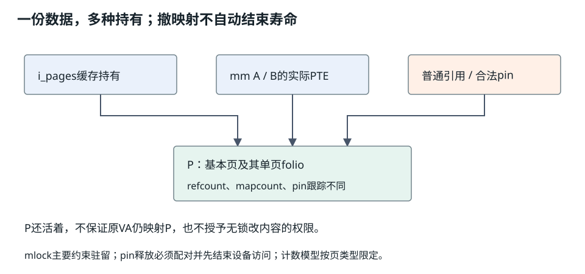
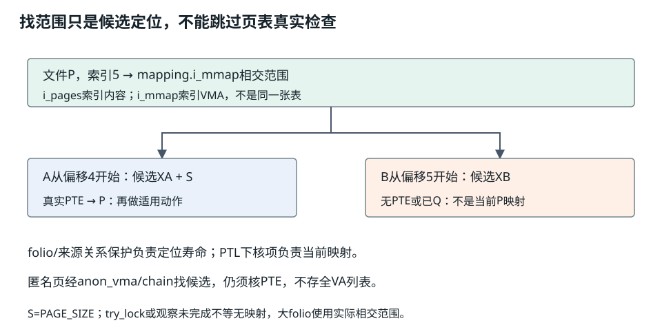
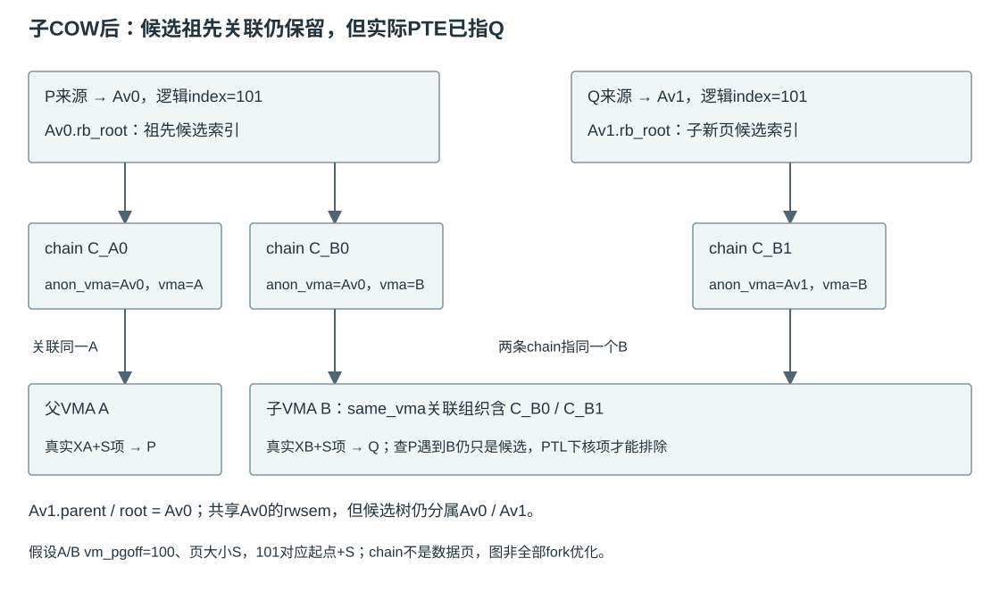
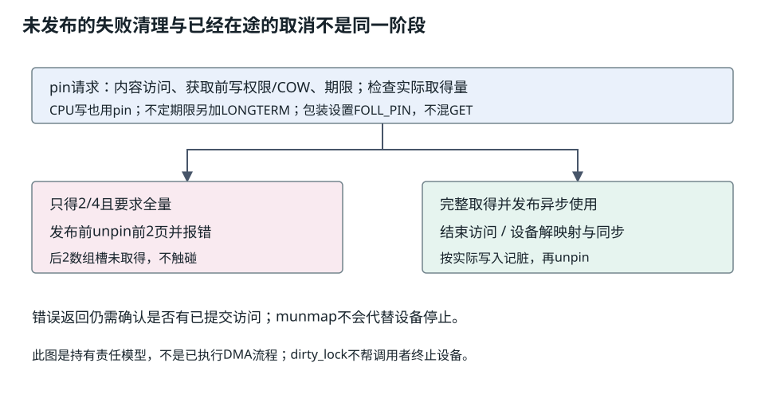

# 页生命周期与反向映射：协调仍在使用的同一份数据

本篇回答一个贯穿缺页、回收、迁移和设备访问的问题：**一份页数据被多方使用时，怎样知道谁还在用、怎样结束某一种使用，又何时才能归还它的存储？** 从两个进程共享文件页开始，再展开引用、反向映射和pin协议。

## 阅读说明

本地 Linux 6.1.158、arm64、已打RT补丁源码。前置为[缺页](07-page-faults.md)及[页缓存](08-page-cache-writeback.md)。本文解释普通页/folio的寿命与查找关系，不把全部设备页或复合页当作同一精确计数模型。

| 名称 | 含义 |
| --- | --- |
| GUP | Get User Pages，用户页获取接口族 |
| pin | 特定页持有与跟踪契约，不等于普通引用或mlock |
| rmap | reverse mapping，从选定页定位相关映射 |
| VMA / PTE | 范围语义 / 页表项 |
| DMA | Direct Memory Access |
| IOMMU | Input/Output Memory Management Unit，设备侧地址转换与隔离机制 |

| 问题 | 入口 |
| --- | --- |
| 引用/映射数/pin/mlock分别承诺什么 | [基本关系](#objects) |
| 两个mm撤映射后P何时能释放 | [寿命主线](#lifetime) |
| rmap如何从P找候选VA并核实 | [反向定位](#rmap) |
| 匿名fork关系为何不是一个mm一条链 | [匿名关系](#anonymous) |
| pin偏置、COW、长期限制怎样判断 | [pin模型](#pins) |
| 部分取得与实际写入如何归还 | [接口骨架](#apis) |

## 1. 定位、职责与问题

### 1.1 地址范围属于进程，数据页却可以被多方使用

设普通文件的一页内容已读入RAM，由文件页缓存保存为P。进程A把它映射在XA，进程B把同一份内容映射在XB；两个虚拟地址不同，但实际PTE都指向同一份物理后备P。文件缓存保留P是为了以后读取，A/B建立映射是为了当前访问，其他内核组件还可能合法取得P供自己的操作使用。

因此有两个不同的寿命：**A的地址映射寿命**回答XA是否还能按这条映射访问；**P的存储寿命**回答这份物理数据是否仍被合法持有、能否归还并用于别的内容。解除A的一条映射只结束该关系，不能顺便清除B正在读的数据，也不能丢掉缓存或组件的持有。本篇讨论普通单页后备；它不是把每种来源统一交给一个全局“生命周期管理器”，而是说明各路径共同遵守的持有和访问协议。

### 1.2 一次正常结束，为什么分成几步

先选无pin、无额外组件引用的干净普通文件页，忽略暂态，沿同一个P看完整过程：

1. 文件缓存保存P，A/B各建立一条实际映射；A/B能通过自己的虚拟地址访问相同内容。
2. A解除映射并完成必要的旧转换失效与映射持有释放。XA不再按这条关系访问P，B仍可访问，缓存仍保留P。
3. B也解除并完成相应交接。此时没有A/B实际PTE指P，**仍不等于P已经成为空闲页**：文件缓存还保存它，后来的读取可复用内容。
4. 回收者在合法取得工作持有后，检查来源、干净状态和其他使用条件；只有能够安全移除缓存关系、结束剩余持有，最终释放路径才把存储归还。若另有合法组件引用或新映射，不能按这条简化成功过程强行释放。

步骤2/3说的是实际映射结束；它们可以来自范围删除，也可以只撤PTE而保留VMA。范围是否仍存在与P是否仍驻留要分别判断。后文§3.1固定“只撤PTE、保留VMA”推演引用和候选索引，不把两种操作混为一件事。

### 1.3 三类关系各自承担什么责任

**引用**是对后备对象的持有：在合法取得与释放协议中，仍需使用它的一方保留自己的持有，最终结束才能让存储进入释放路径。引用不等于允许无锁改内容，也不保证原来的虚拟地址仍然指P。

**反向映射（rmap）**解决另一个方向的查找。页表通常从“mm中的VA”找后备；回收和迁移已经选中了P，却需要知道有哪些用户映射必须观察、撤除或恢复。rmap沿P的来源关系找出相关VMA和候选地址，再在页表保护下核实是否仍真正映射P。文件位置对应的范围可能仍在，但PTE可能为空或已COW到Q，所以它不是每页自带的“所有VA清单”，更不是由候选直接改项。

**pin**是通过适用用户页获取接口建立的特定后备持有和跟踪契约，用于按该契约访问数据，典型场景是内核取得用户后备供I/O使用。它与普通引用采用不同获取/归还责任；异步使用时还要先结束访问再unpin。mlock主要表达驻留要求，不替代这种持有，不保证物理位置永远固定。

图中的`i_pages`就是按文件位置保存P的缓存索引；`mm A/B的实际PTE`代表两个已建立的用户映射；P以基本页描述符及其单页folio表示同一份后备。底部的refcount、mapcount和pin跟踪分别记录持有、映射及特定pin状态，具体口径到§2展开，不能把它们直接相加当同一类使用者数量。



### 1.4 怎样连接其他模块

缺页建立新的后备/映射关系；解除映射结束具体地址的访问；回收利用rmap撤除适用映射并判断剩余持有；迁移暂时撤项、把内容与关系交给新后备，而不是简单销毁旧页；pin使用者维护自己获取、发布访问与结束的责任。它们都要使“存储仍有效”和“具体访问仍合法”同时成立，但分别使用引用、来源保护、页锁、页表锁及设备同步，不靠一个计数包办。

本篇先讲普通文件页的寿命主线，再解释文件/匿名rmap怎样定位，最后展开pin的COW、长期限制和部分取得清理。页缓存内容有效与回写决策由[页缓存](08-page-cache-writeback.md)展开；普通迁移提交由[迁移](10-migration-compaction.md)展开。这里必须解释闭合的是各自的持有与访问交接，不把它们藏到链接后面。

## 2. 整体组成与关键对象

<a id="objects"></a>

page是基本页描述符，folio管理一个或多个连续基本页及相应共享标记/引用。主例普通order-0页P和其单页folio指向同一份数据，不是两个独立分配。`_refcount`表示实现中的持有计数；`_mapcount`采用编码，不能把裸字段直接当用户映射数量。

先分三层：引用回答存储能否继续被使用；rmap来源关系回答哪些VMA可能使用这份数据；实际PTE检查回答当前是否仍有该映射。pin在合法获取过程中又要求自己的跟踪、独占/访问与释放协议。rmap查到一个候选不自动增加页引用，持有页引用也不自动把它加入rmap。

对于本例可映射的非复合普通页，`page_mapcount(P)=atomic_read(&P->_mapcount)+1`，因此无映射时裸值-1、一份映射时0、两份时1；API返回的逻辑数量才是后文表中口径。SLAB及某些特殊页复用该存储，大folio又有其他计数，不能把这条公式当所有struct page的通用检查器。

| 关系 | 回答什么 | 不保证什么 |
| --- | --- | --- |
| 普通引用 | 对象仍被持有 | 数据/页表可无锁修改 |
| mapcount相关状态 | 用户映射关系 | 全部内核/设备使用者已退出 |
| FOLL_PIN相关跟踪 | 需按pin契约管理的持有 | CPU地址与DMA地址相同 |
| mlock驻留要求 | 不应被正常换出 | 永远不迁移、物理位置恒定 |
| anon_vma / address_space | 候选用户映射的来源关系 | 所有候选都有当前有效PTE |

普通引用、映射和pin不是简单可互换的计数。某些pin跟踪可能用偏置或其他folio状态，不能对任意refcount按固定公式倒推出精确pin次数。

**持有不等于无锁权限。** 先在合法来源保护/查找协议下取得引用，才能跨阶段使用P；不能从已经失效的裸指针调用get_page“复活”旧页。引用阻止存储被归还重用，folio锁保护适用内容/归属操作，PTL保护具体映射，mmap锁保护普通范围，设备/IOMMU同步保护异步访问；没有一个计数可以替代这些协议。

## 3. 持有与撤项：页寿命不是地址寿命

### 3.1 一页怎样经历解除映射

<a id="lifetime"></a>

普通文件页P由缓存持有，同时mm A和B映射。A解除其映射后，B和缓存仍需要P；B也解除后，缓存仍可能保留P以便后续读取。只有全部不可解除使用关系已经结束、缓存能够安全移除等条件满足时，才可归还后备。

这是一条关系变化链，不是适用于所有folio和配置的精确引用加法式。已分配高阶块又须区分复合页寿命；配对见[页分配](01-page-allocation.md#release)。

进一步限定普通order-0文件页、无pin/其他引用、观察稳定阶段：缓存持有1个引用，成功PTE安装持有相应映射引用。只撤PTE但保留VMA的示例为：

| 阶段 | 引用数 | 逻辑用户映射数 | i_pages缓存 | i_mmap候选VMA |
| --- | --- | --- | --- | --- |
| 缓存建立后、临时创建引用已释放 | 1 | 0 | P存在 | 取决于文件映射范围 |
| A/B都已映射P | 3 | 2 | P存在 | A/B范围可存在 |
| A的PTE撤除及相应延迟引用释放完成 | 2 | 1 | P存在 | A的VMA若未删仍可在候选索引 |
| B同样撤除后 | 1 | 0 | P存在 | 两个范围仍可能是候选 |
| 回收者另取得一个合法临时引用 | 2 | 0 | P存在 | 不因缓存移除而自动删除VMA |
| 满足移除条件、缓存引用结束 | 1 | 0 | P移除 | 候选范围仍可存在 |
| 本轮最后引用释放 | 0 | 0 | 无P | 页进入相应最终回收 |

这是明确假设下的逻辑引用模型，不把裸`_mapcount`编码当作映射数，也不声称撤PTE瞬间就释放引用；TLB批量释放、临时引用和检测机制可影响暂态。`i_pages`按文件位置索引缓存数据，`i_mmap`索引相关VMA范围，后者不是前者的另一个名字；真正munmap删除范围时另维护候选索引。

改变一个条件：B撤PTE后另一个内核使用者仍合法持有P，则缓存1+该引用1仍存，不因mapcount=0立即释放。回收者隔离后预期缓存+隔离=2，实际多出该引用，冻结失败，必须保留；使用者结束后才可重试。[回收协议](09-reclaim-swap.md#release)解释先冻结再重检dirty，不能擅减“多余引用”。

再改变一条件：A把原VA重新映射到R，但组件仍持P引用。P存储有效，原VA却已不代表P，访问该VA与访问持有P不是同一操作；组件应按自己的地址/映射协议处理，不拿P引用当原用户地址长期合法的凭证。

**范围通知协调另一套访问关系。** 有些使用者在Linux CPU页表之外维护次级转换或映射，并向目标mm注册`mmu_notifier`订阅。通知把某个用户地址范围的映射变化交给这些订阅者，不是CPU的TLB刷新，也不是普通页引用。即使CPU PTE已清，订阅者的转换缓存或在途使用仍可能依赖P。

start/end在相应mm布局或反向关系保护下配对，要求失效临界区内不新建该范围的相应次级项；不能保证不再取得引用的实现还有invalidate_range等配合责任。订阅者若仍有在途I/O，必须通过初始映射持有或通知回调保持必要引用，不能等CPU侧put后再补引用。结束相应次级使用、同步次级TLB与最后引用释放又需按订阅者合同协调，不把通知当自动unpin或自动停止所有DMA。

沿本例锁定的普通文件P：folio锁使P不能在通知结束前被从缓存替换成新Q；PTL保护CPU项重检和撤项；CPU TLB失效结束对应旧CPU转换；通知协调订阅者的次级关系；各自引用维持尚未结束的存储使用。文件来源锁允许此分支的相关通知在范围结束点协调，而不是每次清PTE都必须把所有次级完成塞进PTL区。匿名后备替换等有不同的锁下通知要求，不从本文件页例推广统一时点。

**一次实际撤项。** 固定普通文件P、已持folio引用与锁、无VM_LOCKED/userfaultfd/大页/特殊设备，选择不延迟TLB失效的分支：rmap找到A候选并建立范围→在PTL外调用mmu_notifier_invalidate_range_start→walker取得PTL并确认项仍映射P→清PTE并使旧转换失效→把旧PTE的dirty证据交给folio→调整适用RSS→page_remove_rmap减少映射关系→folio_put结束这份映射持有→walker结束PTL→PTL外结束范围通知。此时VMA及缓存仍可存在，不能删一次PTE就销毁P。

范围开始通知可通过适用回调阻塞，不能放进上述PTL保护区；等待期间PTE也可变化，因此通知之后仍须PTL下重检。它与某些特定分支在PTL内调用的invalidate_range不是同一个交接点，无订阅者也不授权颠倒通用锁顺序。

两种退出条件改变过程：A现在有VM_LOCKED且未要求IGNORE_MLOCK，则恢复适用mlock管理并拒绝此解除，原项不按上面清空；调用者仍检查P是否映射。另一CPU已清PTE却尚未page_remove_rmap时，非同步walker可能在预检查发现无项而跳过PTL，try_to_unmap返回时mapcount仍暂非零；TTU_SYNC要求同步核查以等待这类交接。故不能把“没找到PTE”当所有映射引用已释放，vmscan还检查folio_mapped决定下一步。

批量延迟TLB失效只有架构/flags满足条件才采用，尚需后续flush协议，不能将上述即时分支的失效完成时点套到全部路径；本稿不以其他架构实现作arm64保证。

## 4. 反向定位：来源关系与真实PTE分两次判断

### 4.1 文件rmap首先找到候选

<a id="rmap"></a>

匿名页依靠anon_vma及其与VMA的关联，普通文件页依靠address_space的映射索引等定位。不是每页内存里存一份所有虚拟地址清单。

假设文件第5个基本页：VMA A从文件页4开始，VMA B从文件页5开始。一个基本页模型中候选地址为：

| VMA | 候选地址 |
| --- | --- |
| A，起始VA为XA | `XA + (5-4)*PAGE_SIZE` |
| B，起始VA为XB | `XB + (5-5)*PAGE_SIZE` |

候选只表示文件位置与范围相交；B若尚无PTE，就没有当前B用户映射可解除。遍历还需检查PTE是否仍指P、页/folio范围和并发变化。不能只算地址就修改任意条目。



文件rmap读取folio的mapping/index，在folio锁保护来源寿命下取得i_mmap读保护，按文件偏移区间找VMA；page_vma_mapped_walk在实际页表保护下再判断。A若已COW到匿名Q，则虽然其文件VMA仍是候选，当前PTE不映射文件P，不能把它当P映射撤除。

候选地址推算只适用于页范围相交且使用相应page偏移；大folio有多页范围，不把一个起点当其全部映射。rmap_walk_control的rmap_one执行观察/解除/恢复等特定动作，done可在满足目标时结束，try_lock竞争可报告contended；“没完成观察”不是“确定无映射”。

<a id="anonymous"></a>
### 4.2 匿名来源与fork的关联

匿名页没有普通文件i_mmap，因此用anon_vma与anon_vma_chain连接来源页偏移和相关VMA。anon_vma保存相关VMA区间树、root/parent及保护；chain是VMA和一个anon_vma的关联记录，同时链接该VMA的多个匿名关系及该anon_vma的候选索引，不是数据页。

普通匿名页的mapping存储经过类型编码的anon_vma关联，不按文件address_space直接解引用；index保存该页在相应VMA坐标中的逻辑页偏移。给定基本页大小S、VMA起点X、vm_pgoff=100，P映射在X+S，index为101。rmap在页关联anon_vma的区间树找覆盖101的chain，再用相交VMA坐标计算候选VA，最后核真实项。这个index不是匿名页“在磁盘文件中的第101页”，也不是PFN。

普通fork共享P时，子VMA保留可查原匿名关系，并可有用于子新匿名页的anon_vma；P仍关联能找到父子候选的来源。子COW得到Q后，Q的新关联服务于子自己的私有页；rmap不会因此给每页复制一张所有VA列表。

沿P：父/子相同VA各有只读PTE，候选两者都可成立；子COW→Q后原关系可能仍列子VMA，但PTL下核项PTE→Q就不计作P的实际映射。父退出后，不能单凭候选树剩一个范围或mapcount=1证明可独占写；PageAnonExclusive及无标记保守证明见[缺页复用](07-page-faults.md#reuse)。

anon_vma读保护/引用使定位期间关系不会消失；迁移已经撤完PTE仍需保存对应匿名定位依据，不能以mapcount=0当作anon_vma可立即丢弃。相关root锁、VMA链修改保护及PTL各负责自己的层次。

用一个无复用优化的具体模型：父VMA A的anon_vma为Av0，Av0.root=Av0。fork为子VMA B新建Av1，Av1.parent=Av0、root=Av0，复制祖先关联，再加子新关联：

| 阶段 | 页的匿名来源 | A关联 | B关联 | 来源候选索引 |
| --- | --- | --- | --- | --- |
| fork前新独占P | P→Av0 | A–Av0 | 无 | Av0含A |
| 普通无pin fork共享P | P仍Av0 | A–Av0 | B–Av0、B–Av1 | Av0含A/B，Av1含B |
| 子COW新独占Q | P仍Av0，Q→Av1 | 不变 | 不因本次COW删除祖先chain | P查Av0找到A/B候选；Q查Av1找到B |

此后查P遇B的PTE→Q便排除，候选关联保留不代表实际仍共享P。本地可以复用既有anon_vma，表选择新建分支用于说明，不声称每次fork必分配Av1。root主要提供同一匿名家族共用rwsem锁；实际候选遍历从页关联的anon_vma.rb_root开始，不是无论P/Q都扫root的一张全局树。



图4：C_A0、C_B0、C_B1是三个实际关联对象的教学命名，不是三个页。C_B0/C_B1均指同一个B，一边进入各自anon_vma的rb_root，一边链接B的same_vma组织。复制chain并不复制P的数据，子COW也不为P的候选表自动删掉B。

沿前述偏移101，并限定A/B的相应起点分别XA/XB、vm_pgoff都100：查P→Av0时，C_A0给候选XA+S，C_B0给XB+S；A的PTE→P可处理，B已PTE→Q则排除。查Q→Av1时由C_B1得到XB+S并核到Q。若B对该处尚未建立PTE，同样只是候选而不是实际映射；两种来源索引不靠“chain还在”证明当前后备。

**安全取得来源保护。** 普通已映射页的folio_lock_anon_vma_read等在RCU下识别匿名mapping、检查folio_mapped、尝试root读锁并复检映射；需阻塞时先安全取得非零anon_vma引用并复检，再离开RCU等锁。单独folio引用不保证anon_vma仍是原对象，裸mapping解码不能替这些条件。

迁移恢复时mapcount已经降0，不能再套“必须仍映射”的普通取得助手。迁移在撤映射前通过folio_get_anon_vma取得并保留合法引用，恢复rmap再按该已保证的来源寿命取读保护，结束后put_anon_vma；通用raw rmap_walk路径不能被误用成对任意无映射匿名页安全定位的模块API。

### 4.3 查找、来源寿命和撤项保护怎样接起来

| 阶段 | 保护的实际事实 | 条件改变时 |
| --- | --- | --- |
| 合法取得P | 页存储不会因自己的使用期结束前被回收重用 | 裸指针已失效时不能直接get |
| 安全取得anon_vma/i_mmap来源保护 | 定位期间来源对象及候选索引按相应协议有效 | 映射已退出，普通匿名取得助手可能不交付来源 |
| 按逻辑偏移找chain/VMA | 该范围可能包含这份数据 | 候选可仍有COW后Q或空项 |
| 取得适用PTL并核实际项 | 本次观察/撤除对应的确是P | 他人已替换则跳过，不覆盖Q |
| 清项/失效、转脏证据、计数与引用交接 | 使用关系的结束不早于相应访问退出 | 仍有映射或pin时不得据一次解除就释放P |

前两层保护对象和来源，后二层保护真实访问与关系更新；它们不是“持同一把锁直到全部结束”。3.1中的notifier范围开始需要在PTL外协调，回到PTL后还要重检；4.2的迁移保存anon_vma引用又是已有PTE退出后的定位特例，不把表格当可直接调用的统一锁顺序。

## 5. pin：获取与异步使用之间的契约

<a id="pins"></a>
### 5.1 pin建立了不同释放责任

`pin_user_pages*()`包装设置内部FOLL_PIN，调用者不应随意混用FOLL_GET。长期pin还涉及FOLL_LONGTERM和页类型限制。停止设备访问、解除相关映射/同步等设备协议完成后，才可unpin；普通munmap不替代设备停止。

先按用途决定是否确需取得用户后备页；普通用户字节复制优先走uaccess相应接口，不为了每次copy构造长期页数组。确需取得页面、且**没有采用下面充分失效通知协调的例外协议**时，主要选型为：

| 需求 | 获取与期限合同 | 归还 |
| --- | --- | --- |
| 只操作struct page描述符，不触其数据 | 普通get_user_pages类引用，保持所需页状态保护 | 对应put_page等，不用unpin |
| 取得页后短暂访问/写内容，完成期由本次内核操作控制 | pin_user_pages类；写内容取得前请求FOLL_WRITE，CPU写入也不能因无DMA改用普通GET | 使用结束后unpin，实际写过按来源用dirty_lock等配对 |
| 将页持续注册给使用者，期限不确定或由用户决定何时撤销 | 支持该标志的pin接口加FOLL_LONGTERM；是否可写另独立指定，不能用“几毫秒”阈值替代寿命判断 | 停止新提交、结束在途访问与映射同步，再按写入事实unpin |

**充分通知协调是另一种合同，不是“注册过回调就不用PIN”。** 本地pin说明CASE 3保留普通GUP路径：使用者订阅目标范围失效，在通知要求的时点停止该范围的设备/次级访问、同步在途使用并归还普通GUP持有，使文件来源与mm的page_mkclean、munmap等能够安全推进。其持有按普通GET合同put，不因文档泛称“unpin”而改用FOLL_PIN的释放API。具有可重放缺页的硬件还可能只撤次级页表、避免持续持页，但也必须满足完整通知与重建协议。

这与§3.1通知模型接在一起：CPU项退出不自动停止次级使用，订阅者必须实际完成自己的访问/引用交接。仅注册一个不终止访问的回调、收到通知后继续DMA，或普通CPU写数据却无上述协调，都不能据此改用GET；写入仍先取得相应写权限并维护脏状态。该例外要求使用者和来源共同满足协议，不提供任意驱动绕过pin跟踪的通用捷径。

FOLL_LONGTERM不是“短期pin过了某个计时点再补”的标记，而是获取前声明更强的寿命需求。fs-DAX缺少普通页缓存式的长期持有与文件来源寿命协调，本地拒绝相关长期请求；文件页长期pin也仍有文件系统协调限制，不凭传flag便保证安全。CMA/可移动区域被不定期限固定会阻碍连续空间再利用，适用长期获取路径先迁到允许位置，迁移失败则不能交付这种持有。具体页类型、构建与API可用组合仍按本树检查，不要求所有GUP包装支持同一flag。

本地小folio用GUP_PIN_COUNTING_BIAS=`1 << 10`（1024）叠加到引用计数，而不是独立位段。限定普通单页P已有3份普通引用，再成功pin一次，计数成为1027；结束pin减1024，普通持有仍3。用普通put_page只减1，既没正确结束pin也破坏记账，不能拿两种释放互换。

folio_maybe_dma_pinned对小folio是保守判断：1024个普通引用也可造成true假阳性；false表示此检测模型下没有pin跟踪，true不证明有精确1个pin。大folio改用独立compound_pincount及适用普通引用；零页则特殊“假pin”且不改变这些计数，但仍用正常unpin API配对，不能让调用者自行判跳过。

### 5.2 pin与COW不能靠事后补dirty修复

设父子按普通fork共享匿名P。组件要写子进程数据，取得前必须请求FOLL_WRITE，让GUP按写权限/COW和独占要求取得正确后备；可能得到子自己的Q或适用独占复用结果。只读取页后直接写P，即使之后标dirty，也无法修复对父共享内容的错误修改。

本地pin匿名后备还要求适用PageAnonExclusive保证，读pin也不能把不独占共享页随意固定；需要时走unshare/fault等处理。pin期间后续fork按共享/独占协议处理，不把普通无pin fork例机械套为总能共享。

两种前后对照说明这不是写权限升级：

| 请求/初态 | 处理后的后备 | 被保护的语义 |
| --- | --- | --- |
| 父子共享匿名P、无独占，子请求只读pin | gup_must_unshare要求隔离，slow fault用FAULT_FLAG_UNSHARE；普通共享例需要子新Q，父仍P，子再pin其独占后备 | 只读pin也应有稳定后备，不授予新写权限；UNSHARE与WRITE标志不同时设置 |
| 父P已合法pin且独占，再普通fork | fork共享检查不能清独占把P随机共享；适用copy_present_page为子复制Q，父及pin继续P | 以后父写不应随机替换设备/持有者固定的P，子仍需私有COW语义 |

若无标记但已可保守证明独占，unshare也可复用，不承诺每次只读pin必复制；表专门选真正父子共享P。零页、KSM或特殊设备另有处理，不能照表推理。对父页的pin检测还允许保守假阳性，复制子页不证明存在精确DMA pin数量。

FOLL_LONGTERM是更严格的pin而非毫秒阈值。fs-DAX可因长期pin返回EOPNOTSUPP；CMA/可移动区域的页可能需在完成长期pin前迁移到允许位置，失败必须停止交付。本地fast失败可回退慢路径，这与请求最终失败不是同一结论；不把所有远程/快速API都当可传完全相同的长期标志。

### 5.3 部分获取、发布和取消分三个阶段

部分GUP成功不是全量成功：已经取得的数组前缀仍必须归还。程序退出也不自动说明所有设备I/O已完成。



四页请求得到前两页时，后两页数组槽未被有效填入；若组件要求全量，就在未发布异步使用前unpin前两页并报失败，不遍历未初始化槽。若决定接受部分量，长度和使用范围必须同步缩小，不能仍启动四页设备访问。

已成功发布使用后的取消是另一阶段：先阻止新提交、确认已提交访问停止、按实际设备映射合同解除/同步，再按写入事实记脏和unpin。提交失败也须看是否已有部分异步操作在途；不能因为“返回错误”就立即释放可能仍被设备使用的P。

### 5.4 对应实现而非通用“计数检查器”

rmap.c的rmap_walk_anon/file和page_vma_mapped.c对应候选→实际项；try_to_unmap_one对应3.1撤项协议；gup.c的获取/独占处理与unpin系列对应第5节前后责任。folio锁、来源索引保护、PTL和引用各维护不同事实，不能用一个mapcount/refcount阈值替代这些过程。共享/私有、交换缓存、大页和KSM改变相应证明条件，必须先确认来源和页类型，再使用相应助手，不能按普通页模型解析任意对象。

## 6. 接口与使用

<a id="apis"></a>

| 取得 | 归还 | 注意 |
| --- | --- | --- |
| get_user_pages*普通引用 | put_page等适用配对 | 查询与访问契约 |
| pin_user_pages* | unpin_user_pages* | 不能用普通put替代pin配对 |
| 可能写过的pin页 | dirty_lock等适用归还 | 按实际写入和来源维护脏状态 |

仅演示当前任务、普通页、页对齐地址、短期pin且不写数据的清理骨架，未进行设备使用：

```c
static int pin_two_pages(unsigned long addr)
{
    struct page *pages[2];
    int n;
    if (!PAGE_ALIGNED(addr))
        return -EINVAL;
    n = pin_user_pages_fast(addr, 2, 0, pages);
    if (n < 0)
        return n;
    if (n != 2) {
        if (n > 0)
            unpin_user_pages(pages, n);
        return -EFAULT;
    }
    unpin_user_pages(pages, 2);
    return 0;
}
```

实际组件包含mm/errno等头文件，确认合法上下文、地址范围和权限。这个例子只说明部分成功清理，不是DMA流程；写入或长期持有需要额外契约。

本示例要求当前有效mm、允许睡眠且不持有冲突锁；`fast`路径可能回退慢GUP，不是不可睡眠许可。仅持有描述符/普通引用与需要pin跟踪的数据访问要按用途选择。写数据须在获取前请求相应写权限/FOLL_WRITE，不能先按只读取页、写错COW后再补一个脏位来修复。

确实写过且按对应协议允许的pin页，归还可使用`unpin_user_pages_dirty_lock(pages, n, true)`等实际接口维护脏状态；长期pin还检查FOLL_LONGTERM、页类型及设备使用终止。本只读例子使用`unpin_user_pages()`，不假装已经完成这些额外责任。

`dirty_lock`中的锁负责适用页记脏，不替组件停止设备，不帮调用者在错误COW后备上恢复数据。短期只读骨架只检查2页前缀清理；生产组件还要验证整个用户范围的溢出/权限、当前mm寿命和异步发布状态。远程GUP还必须按具体API保持mm与布局锁/locked返回责任，不能复用本当前任务骨架的所有假设。

### 6.1 远程取得：页结果和锁结果分开处理

本树`get_user_pages_remote(mm, start, nr_pages, flags, pages, vmas, locked)`及`pin_user_pages_remote`操作指定目标mm，而非默认current->mm。调用者先按合法任务/mm取得协议保持有效目标地址空间寿命，例如get_task_mm取得后在全部相关使用结束时mmput；只保存一个可能退出的任务指针或只保留失效VMA不够。进入接口前还须持适用mmap布局锁；以下明确选**读锁、允许fault重试**的调用形式。

传非NULL `int *locked`时，调用者已经持mmap读锁并将`*locked=1`，同时`vmas`必须为NULL。缺页重试可能释放锁；即使内部后来重新取得锁继续补页，只要原保护临界区中断过，本地出口也放锁并返回`*locked=0`告知调用者。页数结果不代替这一锁状态：

| 返回的locked | 调用者怎样结束/继续 |
| --- | --- |
| 1 | 返回时锁仍由调用者持有；不再需要布局保护时自己mmap_read_unlock。即使页数不足或返回错误，也按锁状态清理。 |
| 0 | 返回时不持该锁，不能再解锁一次；调用前保存的VMA/布局判断不能沿用，需要重新取锁并重新查范围。 |

返回的有效页前缀另按GET或PIN合同归还；`locked=0`不代表这些持有自动结束，页取得成功也不保证原VA当前仍映射它。不能返回0锁状态后继续解引用旧VMA，或为了清理页数组而重复解锁。

本地`__get_user_pages_remote`还明确拒绝`FOLL_LONGTERM`与非NULL `locked`组合，返回-EINVAL；它需要的DAX检查与允许重试的VMA合同不兼容。选择支持LONGTERM且`locked=NULL`的形式时仍须按该入口保持布局保护、权限、页类型和获取/归还责任，不靠传NULL免除锁或长期pin条件，也不要凭其他版本接口签名推断本树参数。§5.1的用途选型、§5.2的独占/COW和§5.3的发布后停止访问仍分别适用。

## 7. 边界、变体与常见误解

mlock、普通引用、pin、内核映射和用户PTE并非同义。零页与大folio有特殊计数；设备内存又有设备寿命。引用保护对象，锁保护状态，两者互不替代。

## 8. 总结与源码入口

生命周期要同时解释“谁持有、谁映射、谁仍可访问”；rmap是候选定位与真实检查，不是直接反转页表。

[rmap.c](../../../../linux-6.1.158/mm/rmap.c)、
[gup.c](../../../../linux-6.1.158/mm/gup.c)、
[mm.h](../../../../linux-6.1.158/include/linux/mm.h)、
[pin_user_pages说明](../../../../linux-6.1.158/Documentation/core-api/pin_user_pages.rst)、
[mlock.c](../../../../linux-6.1.158/mm/mlock.c) 为主要依据。未运行pin、设备或内核实验。

匿名关联结构与fork共享约束见[rmap.h](../../../../linux-6.1.158/include/linux/rmap.h)，rmap候选真实核项见[page_vma_mapped.c](../../../../linux-6.1.158/mm/page_vma_mapped.c)；get/put及最终释放由[swap.c](../../../../linux-6.1.158/mm/swap.c)等适用路径完成。mapcount、pin偏置和PageAnonExclusive都有各自用途，不存在通用“计数归零即可越过映射/设备协议”。

范围通知的次级访问与引用交接见[mmu_notifier.h](../../../../linux-6.1.158/include/linux/mmu_notifier.h)、[本地通知说明](../../../../linux-6.1.158/Documentation/mm/mmu_notifier.rst)；本例文件页可延至范围结束的依据是rmap.c中的锁定文件folio分支。

<a id="review-result"></a>
## 独立挑战审阅

本次用途、正常寿命与rmap基本关系修订由新只读挑战者Lovelace完成第1轮全文/四图复核，C1/C2关闭，技术与教学分别通过，待用户统一review，见[本次记录](review/review-entry-11.md)。[原约定](review/contract-lifetime.md)、[前次补全](review/review-pedagogy-11.md)及[Euler记录](review/review-lifetime.md)保留历史。
