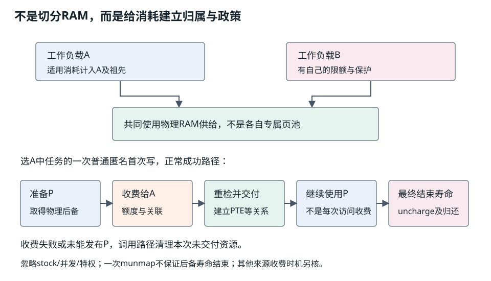
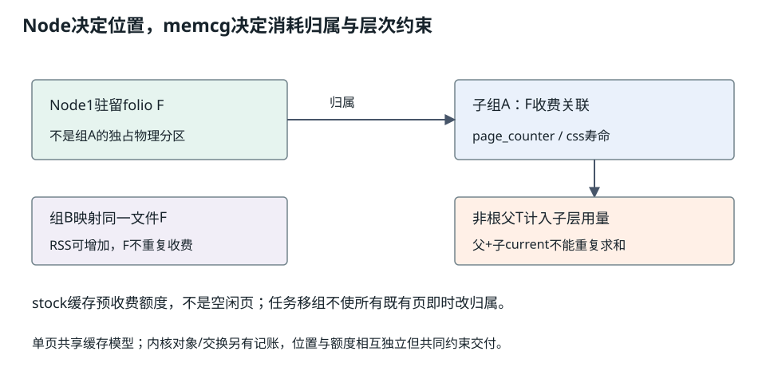
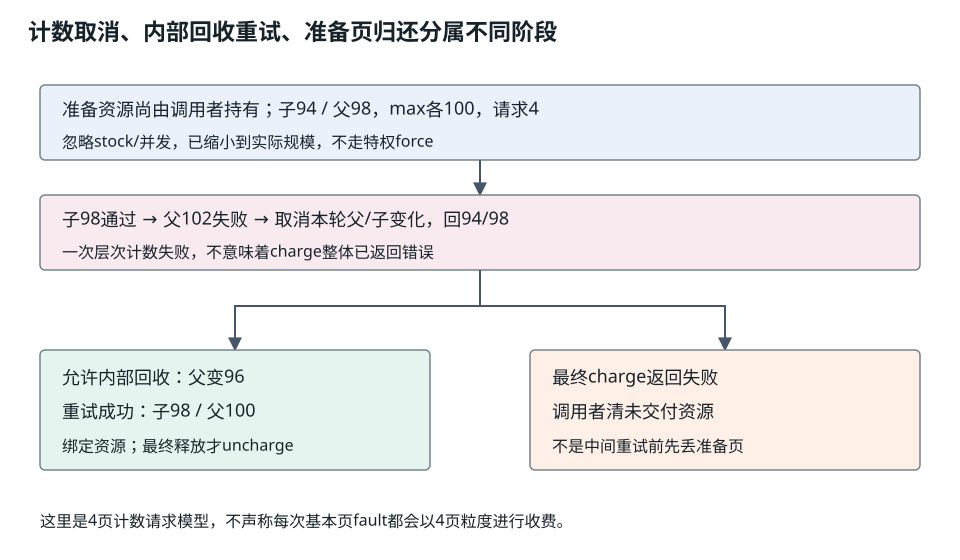
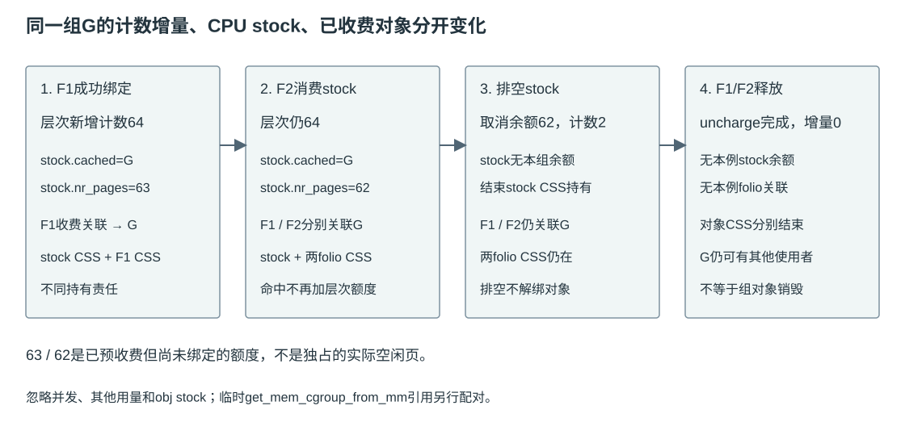
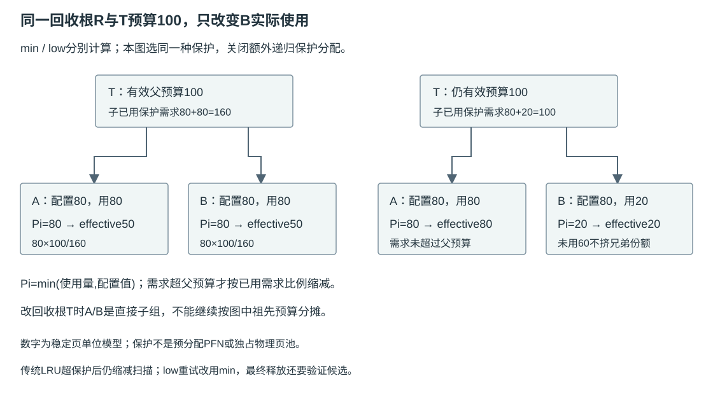
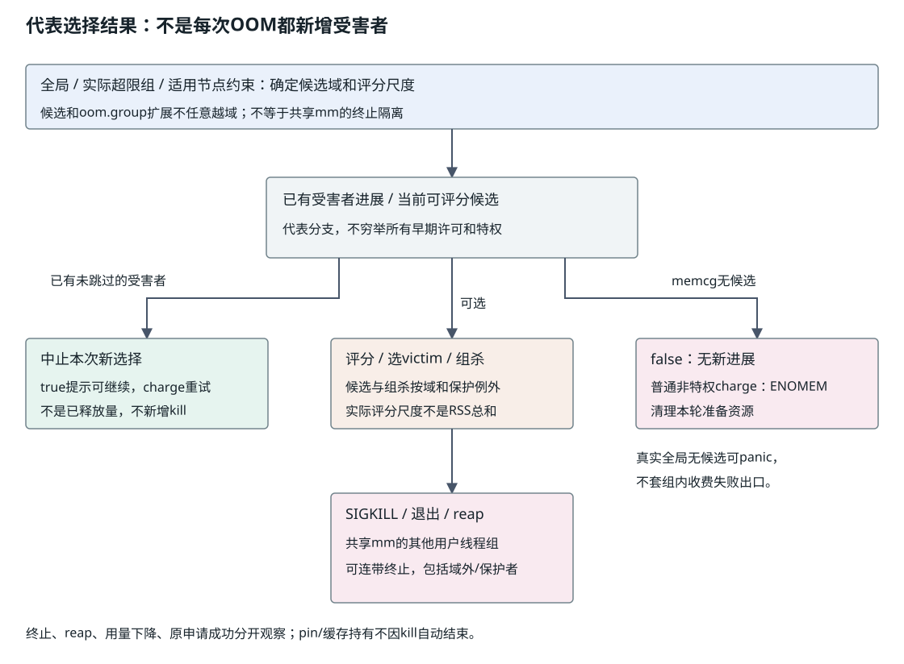

# 内存记账、限制与 OOM：共享RAM中的工作负载资源域

多个服务共享机器RAM时，页分配器解决“从哪里取得合格页”，但还需要回答“这份消耗算给哪个工作负载、它还能增加多少、回收时该优先保护谁”。本篇先建立memcg的消耗归属与控制模型，再展开层次收费、high/max/min/low以及OOM失败处理。

## 阅读说明

本地 Linux 6.1.158、arm64、已打RT补丁源码；以cgroup v2内存控制为例，控制器启用及挂载方式需确认。前置[回收](09-reclaim-swap.md)和[页分配](01-page-allocation.md)，不实施资源限制或耗尽实验。

| 名称 | 含义 |
| --- | --- |
| memcg | memory cgroup，内存控制组 |
| OOM | Out Of Memory |
| RSS | Resident Set Size，驻留集合指标，与memcg统计不同 |
| PSI | Pressure Stall Information，压力停顿信息 |
| CSS | Cgroup Subsystem State，控制器在某cgroup的状态及寿命 |

| 问题 | 入口 |
| --- | --- |
| 同一页在哪个节点、算给哪个组 | [记账对象](#objects) |
| 父层收费失败是否先归还准备页 | [收费主线](#charge) |
| high/max/min/low怎样改变行为 | [限额与保护](#limits) |
| 申请地址范围成功为何仍可能缺页失败 | [承诺与驻留](#commit) |
| OOM候选怎样选择、为何释放不即时 | [OOM过程](#oom) |
| 控制文件写入或回收不足有哪些残留 | [接口](#apis) |

## 1. 定位、职责与问题

### 1.1 为什么在页分配器之外还要有资源域

设机器同时运行服务A和B，它们都产生匿名数据、文件缓存和适用内核对象消耗。只知道整机还剩多少RAM，无法表达“限制A的增长，避免把B的工作集一起挤掉”，也无法把子服务消耗归到共同的父工作负载。

cgroup把任务组织成管理层次；**memcg是其中内存控制器对应的资源域**，把适用内存消耗关联到组，并依据层次额度和保护规则参与分配、回收与失败处理。它不是独立物理分配器，不按PFN把RAM永久切成A/B专属分区。P可以位于某个物理Node，却算在A的消耗中；NUMA回答位置问题，memcg回答归属和资源政策问题。

本篇把**charge称为收费或记账**：为适用资源申请组/祖先的计数额度，成功后关联资源与收费组；**uncharge**结束相应消耗记账。它们不是金额，也不意味着每次访问P都收费一次。收费归属由该来源的分配/创建上下文选择，不能把“当前运行的任务属于A”推广为任意页必属A。

### 1.2 一次匿名页使用如何接入记账

选普通非根组A中的任务、有效mm与私有可写匿名范围，第一次写尚无后备的一页；排除特殊豁免、竞争和换入，暂忽略stock预收费。这条最小正常过程是：

1. 缺页确认范围允许本次写，页分配路径先准备物理后备P。此时有了RAM资源，不等于已经允许交付给该工作负载。
2. 缺页路径用目标mm的适用归属请求memcg收费；额度可用时，成功记账并把P关联到收费组A，相应祖先计数也受本次收费影响。
3. 页表保护下重检成功，缺页建立P的匿名关系与PTE，任务恢复写入。后续反复读写同一P，不再按访问次数重复收费。
4. 这份后备最终结束所有相关使用、进入实际释放路径时，按相应协议uncharge并归还物理存储。一次munmap若仍有共享/其他持有，不保证立刻结束全部收费。

若第2步最终不能收费，准备页由调用路径清理，不能先安装成可用后备再忽略失败。charge内部可以回收/重试，期间准备页仍由调用者持有；若收费成功后第3步重检发现他人已安装后备，也要释放本次未交付P并结束它的收费，不能把“已收费”当必须发布PTE的理由。§3.1再用数字区分计数尝试回滚与整次收费失败。



该图选正常成功路径，不把额度画成预先分配的一堆物理页。文件缓存和内核对象同样需要适用消耗归属，但收费时机与寿命不同；例如A创建的共享文件页后来被B映射，不为B重复创建/收费同一份后备，详见§2。

### 1.3 限制增长与保护已有消耗是两个方向

有了归属才能应用政策。四个主要阈值不是一个从小到大排列的分配开关：

| 政策 | 控制的问题 | 基本行为 |
| --- | --- | --- |
| memory.high | 工作负载增长是否需要付出回收/节流代价？ | 越过后可继续使用资源，但触发适用压力处理；high本身不触发OOM killer。 |
| memory.max | 普通消耗能否继续取得组/祖先额度？ | 遇限时按上下文回收、重试，无法满足可失败或进入适用组内OOM；不是任意瞬间绝不可越过的物理隔离墙。 |
| memory.min | 哪部分已使用资源应获硬保护？ | 有效保护内限制普通回收，不能像low那样因缺少未保护资源而放宽；不是提前保留RAM。 |
| memory.low | 哪部分已使用资源应优先少回收？ | 尽力保护，未保护资源不足时允许适用重试突破；不是永久免回收。 |

有效额度/保护要结合层次和本次回收范围。A的直属max尚未达到，仍可先遇父层限制；A声明low/min，也不代表无条件得到全部声明保护。后文用父子数字、回收根变化和扫描量说明这些规则，不从阈值名称猜行为。

### 1.4 OOM为何接在这条协作链上

OOM表示适用资源请求在当前约束下遇到严重供给/额度不足，进入对应失败处理；**不是所有分配错误的别名，也不是每次max受限就立刻杀最大进程**。需要确定全局或超限组的域、上下文资格与候选，必要时促使退出，再异步结束相应使用和释放资源。机器仍有空闲RAM不排除某个组额度不足；杀了任务也不保证原请求立即取得页。

缺页/对象创建负责准备资源与交付，memcg负责归属和政策，回收负责寻找可释放内容，OOM是某些允许路径中的进一步失败处理，最终释放负责结束对象消耗与持有。下面先解释实际记账对象，再沿收费→限制/保护→OOM→接口残留展开。

## 2. 整体组成与关键对象

<a id="objects"></a>

mem_cgroup代表控制层次里的资源域，不是物理页池；page_counter以基本页单位记录用量和层次限制，folio的适用收费关联记录归属。css引用保持收费组对象寿命，per-CPU stock缓存已经预收费的额度以减少重复层次更新，**不是一批给该组独占的实际空闲页**。子组消耗进入祖先的相应统计/限制，不能将父子memory.current简单相加作为全机占用。

css展开为cgroup_subsys_state，mem_cgroup内含其CSS；它不是“已收费多少页”的计数。查到所属组的临时CSS引用、stock缓存的CSS引用、成功folio关联的CSS引用分别有去向，不因一个查找助手退出就结束所有收费对象寿命。



以下普通账本和限额例子采用**非根组**，父T也不是控制层次的全局根。cgroup v2顶层对应root_mem_cgroup，普通folio的try_charge在根组旁路通常的限额计数检查；它仍可有归属关联，不意味着根组page_counter提供整机完整内存用量。根组接口也与普通子组不同，不能据顶层没有memory.current/high/max/events判控制器失效。

“回收根”则是当前回收所针对子树的起点，可为全局根或任意非根组T，不等于“普通账本的父组”。图1展示A收费进入非根父T；保护例的R只标回收范围起点，不让读者把R当另一份可求和的普通current。

共享页收费并非每个映射者重复一份；进程被移动也不意味着所有既有页即时改记到新组。RSS、文件缓存、内核对象、交换统计又是不同口径。

内核对象还有obj_cgroup等按对象/来源的记账，不把一个slab页全部平均分给每个对象使用者，也不把普通匿名folio收费当所有对象统一规则。source helper选择归属与对象生命期各有合同，普通模块应使用适用GFP/API，不手改memcg_data。

具体内核对象O可在SLUB对象记账记录中关联obj_cgroup；objcg再指向适用memcg并维护自己的引用/已收费字节。对象charge按字节请求，通过按页额度及obj stock剩余字节协调层次计数，释放O归还对应对象额度/引用，不等同拿整slab页直接调用folio uncharge。一个slab里多个组对象可以分别归属，不是每个对象都独占该slab的物理页；对象组下线/重挂还有自身协议。

设同一普通文件缓存F被组A/B各一mm映射，创建时收费给A：两个mm可各有一份RSS记录，缓存后备只有F一份，B后来映射不再收费一份F；A任务移组后F也不因任务移动自动更换归属。结束A映射仍有B/缓存使用时，F不会仅因A离开就uncharge。

## 3. 收费、限制与保护分别控制什么

### 3.1 先能取得资源，还要能完成收费

<a id="charge"></a>

物理页取得后，适用收费失败会导致不能交付，调用路径须归还准备资源。stock/批量收费降低开销，因此统计和限额操作不是每个小对象都仅更新一个简单原子值；本地try_charge会先尝试stock及批量，必要时缩到实际请求再检查。

普通匿名缺页的代表路径可以用mm关联的owner等取得适用memcg，并处理RCU/css引用与重试，而不是仅把“当前任务属于某组”当作所有共享mm/页类型的统一规则。成功charge后将收费关联到folio并持有相应组状态；真正释放按对应路径uncharge、清关联及释放引用。

设子/父计数分别94/98页，max都为100，申请4页，且忽略stock、并发并已采用实际规模：子暂增至98可通过，父暂增至102失败；page_counter会撤回父这次增加，并取消已经更新的子计数，回到94/98。这仅是一次计数尝试失败，尚未绑定成功收费，也不等于整个charge已返回错误。

charge内部在允许条件下可以回收并重试，**原准备页仍由缺页调用者持有，不能提前归还**。若其他资源释放使父为96，内部重试成功可成为子98/父100，再把收费绑定到该准备对象。只有charge最终返回错误，调用者才进入相应清理路径归还准备页；成功交付的4页最终uncharge后恢复子94/父96。

共享文件页的首次缓存创建收费由其适用创建上下文决定；其他组后来映射同一已有页不重复按映射者收费。任务迁移或其他显式收费调整另有规则，不能由这条匿名闭环推断全部对象行为。



真实try_charge_memcg先尝试stock，批量计数失败时缩小到实际nr_pages，再在允许条件下回收/排空stock/重试。批量预收费不是申请者真正已经取得那么多数据页；取消计数尝试只撤本次变化，不能取消准备folio引用。

#### 预收费额度怎样逐步绑定对象

**64页额度如何只绑定两个单页。** 这是独立于前面父子失败例的stock模型：同一CPU、同一非根组G、空stock、层次容量足够，无并发及其他暂持；本地MEMCG_CHARGE_BATCH=64：

| 稳定阶段 | 本例新增层次计数 | stock剩余额度 | 已绑定单页folio | 相关长寿命引用 |
| --- | --- | --- | --- | --- |
| 第一次申请1，允许64批量计数 | 64 | 63 | F1 | stock持G的CSS；F1另持CSS |
| 第二次申请1，命中同组stock | 仍64 | 62 | F1/F2 | 命中不新计层次额度，F2绑定另持CSS |
| 排空这份stock | 2 | 0 | F1/F2 | 取消62余额并结束stock CSS，不解绑F1/F2 |
| F1/F2最终释放并uncharge完成 | 0 | 0 | 无 | 两个folio关联CSS各结束 |

临时get_mem_cgroup_from_mm引用在助手结束时另put，不替代表内stock/folio持有。消费和补充stock在本地local_lock_irqsave保护下检查cached组和余额；换cached组先排空旧额度/引用，再持新组CSS。RT下遵循local_lock实现，不假定一段普通关中断就足够替代所有CPU局部保护。这里忽略独立obj stock字节缓存，不把两类stock混成一项物理页数。



图4中的cached/nr_pages是本地stock记录的信息，F1/F2分别保留自己的收费关联与CSS持有；箭头表示工作推进，不是把63个物理空闲页移入stock。排空stock结束余额与缓存组持有，不能顺带解绑已成功交付的F1/F2。最终释放对象再撤其计数/关联，才结束它们各自的责任。

若实际收费仍失败且不能阻塞，可直接走失败；NORETRY/RETRY_MAYFAIL等影响后续重试/OOM资格。PF_MEMALLOC及NOFAIL/HIGH等特权路径可强制记账暂时超过限制以促进进展，故max不是每个内部路径任何瞬间都绝不可超出的物理隔离墙。普通主例排除这些豁免，不让使用者任意拿特权标志绕过组政策。

成功__mem_cgroup_charge关联folio后，最终释放的uncharge路径在独占处理阶段清相应关联、批量撤计数并释放组引用；页交换到后备有相应内存/交换记账转移，不能从一次munmap直接推断全部用量归零。

### 3.2 high与max不是两档相同开关

<a id="limits"></a>

假设普通可收费请求、high=100、max=128页且祖先不更紧：

| 使用情况 | 主要响应 |
| --- | --- |
| 由96增到104 | 可超过high，触发适用批量回收/节流；超过high本身不触发OOM killer |
| 当前124再申请8，超出max | 收费尝试会遇限制；在允许条件下回收/重试，无法降低时可能组内OOM |
| 相同max情况但请求不能等待 | 可能直接失败；不保证先走完整回收/杀进程 |

逻辑数值模型忽略stock/统计暂态，不是实际阈值实验。high有批量/用户返回路径等处理，不能画成每次超过瞬间同样同步阻塞。

正常charge超过high后可记录任务的over_high待处理量；mem_cgroup_handle_over_high在适用返回用户路径做回收及惩罚等待，再检查当前层次high。内核非任务上下文可安排high_work，不能把高阈值画成每次charge内部即时等同阻塞。

本地还有同步入口：当前任务累计`memcg_nr_pages_over_high > MEMCG_CHARGE_BATCH`（严格大于64），非PF_MEMALLOC且本次GFP允许阻塞时，try_charge_memcg可在返回前直接调用handler。正好64不因这一门槛走同步入口，之后仍可有用户返回处理；不能只根据一个新页是否越high预测是否当场等候。

进入handler也不保证睡眠。它取出并清任务待处理量、尝试reclaim_high，再按本组/祖先的相对超额及本任务贡献计算延迟；延迟很小可直接退出，有回收进展或剩余尝试时优先继续回收，最终需要惩罚时才作受上界限制的killable等待。请求在不能阻塞的上下文也不能照搬这条同步路径。这与max失败时能否收费成功是不同控制问题。

max失败域可能是祖先，不一定是分配者直属组。例中子max=128但父剩4，子请求8也可先遇父限制，回收/OOM范围随实际超限域确定；“子current还低于子max”不排除父域耗尽。

### 3.3 有效保护受层次约束

memory.min在有效保护内不会因为普通回收不足而像low那样放宽；memory.low是尽力保护，首次可跳过，但未保护供给不足时可带low_reclaim重试并记录low事件。两者都先看**回收根及有效保护**，不是配置值永久不变地适用于任何回收。

先给通用的受限层分配规则，再看数值。限定当前组不是回收根的直接子组、使用量非零、父层有效保护已按自顶向下顺序算出，并关闭memory_recursiveprot。令每个子组已使用的声明保护Pi=`min(usage_i, setting_i)`，父可给予子树的有效保护为Ep，兄弟合计使用保护为ΣP：

```text
若 ΣP > Ep：effective_i = floor(Pi * Ep / ΣP)
否则：effective_i = Pi
```

先按实际使用量限制需求，能让声明但未使用的额度不挤占兄弟份额；超过父预算才按需求比例缩减。min/low各有对应计数与effective值，不把两者相加成一个新保护池。实际并发统计可能非同时读到，例子使用稳定假设；回收根直接子组和递归未声明保护分配是下面单独的条件。

固定层次R→T→A/B，回收根为R，T已取得有效保护100，A/B设置同一种保护各80，关闭额外递归未声明保护分配、无其他组/暂态：

| A/B实际使用 | 各受保护用量min(usage,setting) | T下总需求 | A/B有效保护 |
| --- | --- | --- | --- |
| 80 / 80 | 80 / 80 | 160超过100 | 80×100/160=50，各50 |
| 80 / 20 | 80 / 20 | 100不超过100 | 80 / 20，不继续各50 |



图5保留回收根R及T的已计算预算100，只改变B的实际使用。节点内数字是页单位的保护判断，不是给A/B预留专属PFN。把回收根改T时不能继续套这张图的祖先预算，直接子组规则见下文。

换成回收根T，A/B为根的直接子组，本地calculate_protection直接采用其配置min/low（各80），不再按T的100预算作上述分摊。B只用20时，不能把“有效设置80”当额外60页物理保留。

**目标自身还有“提前跳过”和“扫描缩减”两层，不能只读后者。** 本地mem_cgroup_protection在`root == memcg`时交付零扫描保护，表达对目标自身不应用那层扫描缩减；calculate_protection同条件直接返回、保留已有emin/elow。但传统LRU的shrink_node_memcgs先用mem_cgroup_below_min/low判断是否整组跳过，才进入shrink_lruvec及其扫描助手。提前判断直接使用已有有效值，未排除非根目标自身，所以不能由零扫描保护推导整个定向路径必定忽略该保护。

选一个与A/B份额图不同的状态模型：全局根下的非根叶组T，min=80、usage=40，先前全局遍历已使T.emin=80；随后定向回收T，采用传统LRU且无并发改变：

| 控制流 | 本次实际状态 |
| --- | --- |
| mem_cgroup_iter以T为目标 | 遍历包含T自身，不只返回它的子组 |
| calculate_protection(T,T) | 直接返回，已有emin仍80 |
| below_min(T) | 80≥40成立，整组提前跳过 |
| 目标零扫描保护助手 | 本轮尚未进入该扫描阶段，不能用它否定前面的跳过 |

这是本树控制流与缓存有效状态的静态反例，未做运行实验，不断言任何定向回收都必定跳过，也不把它推广到MGLRU或其他版本。low还有允许重试突破的条件；min与low及缓存值的时序要分别核对。[vmscan.c](../../../../linux-6.1.158/mm/vmscan.c)与memcontrol.h共同决定实际路径，不能只沿源码注释推断所有入口行为。

low可能在无未保护可回收资源时被突破；min/low不是预先保留的物理页池。保护过度也可能让别处更难回收，不是免除整体耗尽。

启用memory_recursiveprot还会把父层未被子显式使用的有效保护按未保护用量继续分配，是另一条件，不能把上表搬作全部挂载情形。计算依赖自顶向下遍历的父层状态，不能孤立调用calculate_protection查询一个永远有效的值。

#### 有效份额怎样变成实际扫描压力

保护不是“边界内完全跳过、略超一点就恢复全量扫描”的唯一二态。先由范围/保护检查决定是否整组跳过：低于有效min硬保护时不能按普通low重试突破；低于有效low时首轮可跳过，无未保护进展后带memcg_low_reclaim再试。已进入扫描的组，**传统LRU** get_scan_count还按保护占用比例降低扫描基数。

令该列表适用规模L、组用量U。本轮low>min且尚未low重试时用protection=low，否则用min；在乘类型权重之前：

```text
U = max(U, protection)
scan_base = L - floor(L * protection / (U+1))
有保护时 scan_base = max(scan_base, SWAP_CLUSTER_MAX)
随后 scan_base >>= priority，再应用所选扫描方式/类型权重
```

独立稳定模型：非根组U=100页、所选文件列表L=100、有效low=80/min=40、priority=1、无其他范围折减，已能进入本轮扫描。首轮按low：100-floor(8000/101)=21，再取最低32、右移得16；low重试改用min：100-floor(4000/101)=61，右移得30；没有保护时对应基数为50。这里16/30/50还不是最终释放量，后续类型权重、候选和实际操作继续筛选。

若U/L改81而low仍80，虽略超low，仍经比例缩减与最小基数，不突然等同无保护81页全扫；若用量在low内被首轮整组跳过，就没有上述首轮扫描过程。突破low后min仍有缩减作用，不等于取消全部保护。MGLRU有自己的扫描/反馈路径，不能把本传统公式当未知配置下所有算法的统一规则。

<a id="commit"></a>
### 3.4 地址承诺、RSS与charge各在什么阶段

overcommit回答可承诺的虚拟内存规模，memcg charge回答具体资源能否归入该组，RSS回答某mm当前驻留。普通私有可写匿名映射6页，在适用承诺规则下可按6页记commit，却未立即取得6页私有数据；首次写某页才分配/收费后备。共享映射求RSS和不是物理去重数，已在前面解释。

全局overcommit模式0为启发式、1允许过量承诺、2检查配置额度。模式2/MAP_NORESERVE等条件以本树承诺规则为准，不等同“以后所有节点、高阶、组额度、pin请求都绝不失败”。因此mmap失败可以发生在范围/承诺阶段，已成功mmap后的缺页也可能在物理供给或memcg收费阶段失败；不把所有ENOMEM都归为同一个计数器。

## 4. OOM：选域、选人、组杀与异步释放

<a id="oom"></a>

严重耗尽要区分全局OOM和组内OOM范围，选择可用受害者并促使退出。候选扫描和memory.oom.group扩展不能任意越出OOM域；这不是进程终止隔离，共享同一个mm的其他用户线程组另有连带终止，见4.3。



### 4.1 先确定域与候选资格

OOM不是“扫描失败立即杀最大进程”：先确定全局/组内及cpuset/mempolicy等约束，再看是否能促使已有退出任务或其他适用释放进展、是否允许选择、候选资格及政策，最后发送终止并安排退出/异步回收。没有适用mm、内核线程、全局init、adj=-1000、MMF_OOM_SKIP或vfork等不能靠大RSS重新取得评分资格。

选择过程可以不产生新受害者。普通非sysrq扫描遇到已有OOM victim且其mm未标MMF_OOM_SKIP，会中止并用chosen哨兵表示等待既有进展，out_of_memory返回true但不再发一轮新的kill；普通charge据此重试，不能把true当已经释放所需页数。

另一个结果是memcg域没有可杀候选：chosen为空，out_of_memory返回false；普通无NOFAIL/HIGH特权的收费沿nomem返回-ENOMEM，调用者清理准备资源，不无条件进入无限等待或强制记账。真实非sysrq、非memcg的全局OOM到达该无候选分支则可panic，不能把组内收费失败出口当全部全局OOM规则。早期许可、特权等其他分支仍按其条件处理。

### 4.2 候选评分不是只按RSS排序

totalpages来自当前OOM域，不是候选RSS总和。memcg OOM用`mem_cgroup_get_max(实际超限域)`（零时取1），由该域memory.max及可用交换限制形成；无约束全局默认用totalram_pages+total_swap_pages；适用cpuset/内存策略受限分支按对应允许节点页量与swap形成尺度。改域会改变adj的缩放量，同时也可能改变候选资格，不能只在原候选列表上换一个常数。

正常候选扫描流程的缩小评分例子：假设候选资格均满足、缩放totalpages=1000页、swap和页表页数都为0。A的RSS400页且adj=0，分数400；B的RSS250页但oom_score_adj=300，分数250+300*(1000/1000)=550，可优先选择B。源码还计入swap和页表页数；受保护adj=-1000、无适用mm、已跳过等资格不能靠高RSS覆盖。

把此例限定为memory.max=1000、没有可计入swap的memcg域，可推出该尺度；仅换成max=2000且候选资格仍成立，B变为250+300*(2000/1000)=850，A仍400。除法按本地整数顺序，不把调整值解释成候选自己占用了额外600页。

先确定OOM范围与候选，再评分/选择；适用memory.oom.group可能扩展到该工作负载的组杀并处理受保护例外，随后退出与异步回收仍非立即全部释放。

### 4.3 工作负载组杀仍不能越出OOM域

**父子都标组杀时选谁。** 设全局根R下T含子A/B，T和A的oom.group都为1，B为0，已选受害者在A。全局OOM的域为R，沿A向R寻找标记，会选择域内最高标记T，组杀遍历T的子树，因此B也可能被组杀，直接组杀成员选择仍排除adj=-1000任务。改成OOM域A，查找在A停止，仅选A，组杀扩展不跨到域外T或兄弟B。

这不是把组内每任务重新按普通oom_badness排名一遍；组杀另按成员和保护例外执行。若受害者已异步移动到OOM域外，本地忽略组杀扩展，避免越界选组。选中的组还有CSS持有到执行完成，不因找到指针就可无界使用。

上述adj=-1000保护限定于候选资格和直接组杀成员选择。选中victim后，`__oom_kill_process`另扫描其他线程组中共享victim同一个mm的用户进程，向它们发送SIGKILL，以避免共享mm退出中的锁争用阻碍释放；该循环不再检查这些进程的memcg或adj。全局init和内核线程等有对应排除。

例如A域已选victim V，域外用户进程Z与V不是同一线程组、却共享同一个mm，Z的adj=-1000：Z未作为A域候选，也未被oom.group扩展选中，仍可能在这个共享mm循环收到SIGKILL。若仅是两进程映射同一文件folio，mm不同，就不属于此例。**“候选/组杀不越域”不能推导“域外任务绝不会因本轮OOM被终止”**，保护分组不是这种故障隔离保证。

### 4.4 终止信号、reap与额度下降分开观察

OOM reaper帮助异步解除部分受害者mm的映射，不是重新扫描并释放该进程所有对象。它尝试取得mmap读锁，跳过不适用范围，并对可处理匿名或私有VMA解除映射；共享文件等不按同样方式立即取回。它需要非阻塞通知等协议，冲突可重试或最终跳过；解除映射也不结束设备pin和缓存引用。

沿已选择的受害者A：发送终止可先完成，A的mm尚未退出；reaper可解除一部分PTE，P仍有外部pin或缓存持有；A退出再结束自身其他资源，相应用量才逐步下降；原收费或物理申请还要重新满足其域/order/位置条件。**杀死任务、完成某mm的reap、用量下降、原申请成功是四个观察时点**，不能由oom_kill一次增长推导同步拿回全部内存。

### 4.5 事件说明发生了什么，不是资源清空证明

| 事件 | 含义与不能推出的结论 |
| --- | --- |
| oom | 对应限制且考虑OOM选项的失败风险事件，不覆盖全部分配失败 |
| oom_kill | 记录适用OOM终止事件，可来自全局OOM；本树按mm owner归属记账，不等于该组所有被终止进程数量 |
| oom_group_kill | 组杀事件，不能当作被杀任务总数 |

默认未启用memory_localevents挂载选项时，events含子树，events.local是本层；启用memory_localevents会停止事件向祖先传播，events也按本层解释。需确认挂载条件，再结合约束日志和对应范围判断，不能从父层无增长推出子组无事件。

共享mm会进一步影响归属和计数。`__oom_kill_process`在发送victim信号前调用memcg_memory_event_mm，它在RCU下按`mm->owner`所属memcg记录一次oom_kill；后面的其他线程组共享mm连带SIGKILL循环不为每个进程再次记录该事件。owner与victim的任务分组也不必总相同，不能按victim所在目录替代源码归属规则。

沿§4.3另加确定条件：不进行oom.group扩展，V及mm owner在A，Z在B且共享该mm，无并发移组及其他OOM。V/Z都可收到SIGKILL，这次调用给A本层记一次oom_kill，**不因Z连带终止再给B本层记一次**；祖先传播另按挂载条件处理。若A/B有公共非根祖先，它可收到A事件，不是把V/Z逐个求和。因此“实际被终止的进程集合”“各组本层oom_kill增量”“含子树事件”是三个口径，不能互相代替。

对照：整机尚有RAM但子组达到max且只能留住pin数据，可出现组内OOM；整机节点/策略供给受限的全局OOM也可能终止相关任务，并在mm owner属于该组时增加其oom_kill。单读该组oom_kill无法判断是哪一种，需要同时看oom/max事件、日志约束和父层状态。

## 5. 接口与使用

<a id="apis"></a>

| 接口 | 使用含义 |
| --- | --- |
| memory.current/stat | 相应消耗及类型/状态，不等于单进程RSS |
| memory.high/max | 节流压力 / 更强额度限制 |
| memory.min/low | 有效层次保护，不是独占分区 |
| memory.events/local | 默认含子树 / 本层；memory_localevents改变events传播 |
| memory.reclaim | 主动请求回收，可不足并返回相应错误 |
| memory.oom.group | 工作负载整体处理及适用例外 |

本文不写入控制文件。实际配置应先确认控制器可用、层次、工作负载和权限；不能将一条echo作为无风险诊断。先读相同范围的current/stat/events与PSI，避免把父层包含子层的统计重复计算。

本树上述current、高低限额及events等普通控制文件带NOT_ON_ROOT，不在cgroup v2顶层提供同样接口。读取本组与非根祖先后，到控制层次根停止按这一表查限额；整机容量另从对应proc/节点接口解释。根目录缺这些文件是预期接口差异，不自动意味着控制器失效；普通非根目录缺项仍需检查控制器启用、权限、挂载及版本，不能补0。

### 5.1 控制接口的返回和残留

本树memory_high_write先更新high，随后尝试回收，信号或进展不足可结束并返回写入长度；memory_max_write先替换max，再回收/必要时考虑OOM。成功返回不保证读取current已立刻低于新值，不表示限制操作无副作用。

假设current=120，管理员把max写为100，期间收到信号退出收敛循环：新max已经安装、current可能仍120，写可返回成功。后续收费按新限制继续处理，不自动恢复旧max；这个例子选择更新后退出阶段，参数解析失败则尚未安装值。

memory.reclaim请求主动回收目标字节量，本地可部分完成后因无进展返回EAGAIN或信号EINTR，已经回收部分不整体回滚。它不是释放用户指定page数组，不保证精确回收该字节数，也不是触发OOM试验的无害接口。本稿不执行任何写入。

### 5.2 读取型使用

令P为目标实际PAGE_SIZE字节，不固定arm64为4KiB：

| 输出 | 实际口径 |
| --- | --- |
| memory.current、high/max、min/low数值 | 字节；限额还可为字符串max |
| memory.stat的anon/file/slab等容量 | 字节，各key有包含关系，不能全行求和 |
| memory.stat的pgfault/pgmajfault、workingset_refault等 | 累计事件或页事件计数，不乘P当容量 |
| memory.events中的high/max/oom/oom_kill等 | 累计事件次数，不是被使用字节 |
| memory.pressure的avg10/60/300 | 停顿趋势百分比，不是容量比例 |
| memory.pressure的total | 累计微秒，可对同范围时间区间做差 |

在前述独立stock模型中，新增计数64页对应current新增64P字节；再申请1命中后仍64P，排空余62后为2P，两个folio最终释放后为0。这里只描述该模型增量，实际读取还含其他对象、层次和并发/统计暂态，不期待直接观察全组current恰为这些数字。stat的输出转换由各key实现决定，例如内核栈内部KB计数转换成字节，不能统一把每行乘PAGE_SIZE。

| 要核对 | 读取与解释 |
| --- | --- |
| 层次额度 | 本组和祖先high/max及current，不重复求父子和 |
| 消耗类型 | stat按key、单位及包含关系，不把file/anon与LRU所有行全相加 |
| 事件来源 | 未启用memory_localevents时events含子树，local本层；启用后不向祖先传播 |
| 停顿 | memory.pressure的时间口径，不能用current比例替代 |
| 交换额度 | swap.current/high/max按实际启用，swapcache交叉统计不是凭名字即可相加 |

读不到文件可能是控制器未启用、权限/挂载/版本等，不应默认该值为0并宣布无压力。没有完整.config不否定RT补丁分析前提，也不能证明内存控制器及组写回功能全已开启。

## 6. 边界、变体与常见误解

memory.stat的类型统计与active/inactive列表口径可不同；swap cache等在不同资源维度计数不等于重复收费错误。承诺策略overcommit与当前收费、驻留不同。回收内存不能保证满足某个高阶/指定节点请求。

## 7. 总结与源码入口

记账连接对象生命期与控制层次，high/max控制不同路径，OOM还有资格与异步释放边界。组内限制可在整机仍有资源时失败。

[cgroup v2文档](../../../../linux-6.1.158/Documentation/admin-guide/cgroup-v2.rst)、
[memcontrol.c](../../../../linux-6.1.158/mm/memcontrol.c)、
[page_counter.c](../../../../linux-6.1.158/mm/page_counter.c)、
[oom_kill.c](../../../../linux-6.1.158/mm/oom_kill.c)、
[overcommit](../../../../linux-6.1.158/Documentation/mm/overcommit-accounting.rst) 为主要依据；未改控制文件或执行耗尽实验。

实现定位：try_charge_memcg及__mem_cgroup_charge、uncharge_folio对应准备/计数/绑定/释放；handle_over_high对应延后回收/节流，memory_*_write对应控制更新残留；oom_badness/out_of_memory/__oom_reap_task_mm对应资格/评分/回收。辅助结构见[memcontrol.h](../../../../linux-6.1.158/include/linux/memcontrol.h)、[page_counter.h](../../../../linux-6.1.158/include/linux/page_counter.h)，承诺检查还核对[util.c](../../../../linux-6.1.158/mm/util.c)。

<a id="review-result"></a>
## 独立挑战审阅

本次工作负载资源域、收费周期与政策基础修订由新只读挑战者Carson完成第1轮全文/六图复核，C1/C2关闭，技术与教学分别通过，待用户统一review，见[本次记录](review/review-entry-12.md)。[原约定](review/contract-memcg.md)、[前次补全](review/review-pedagogy-12.md)及[Averroes记录](review/review-memcg.md)保留历史。
