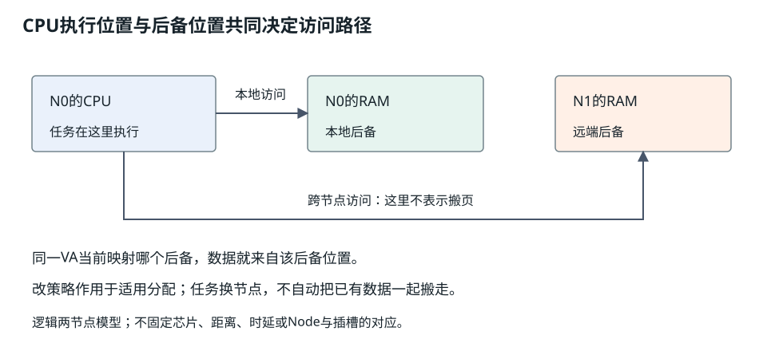
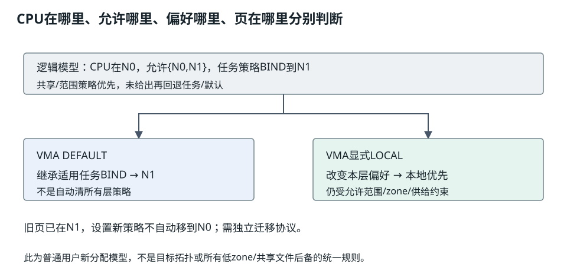
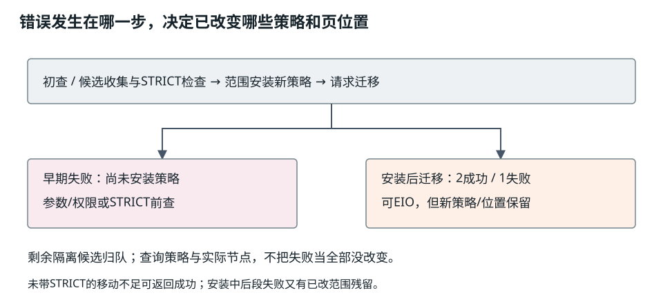
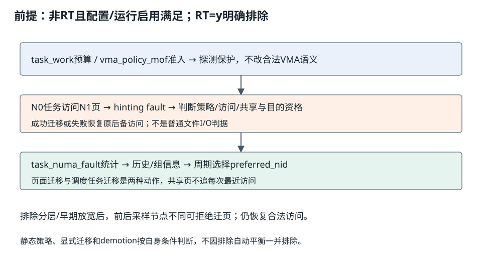
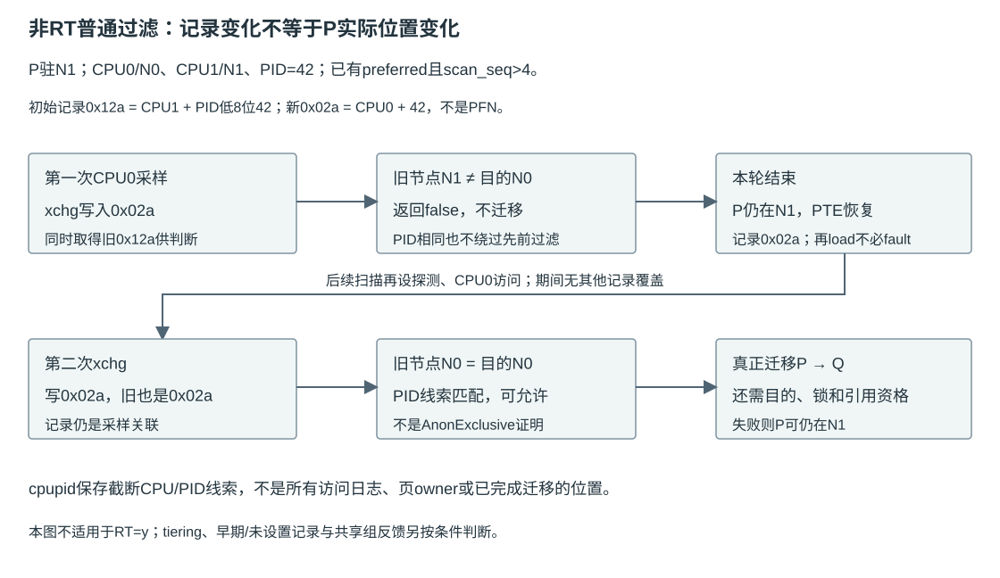

# NUMA 内存放置与策略：执行位置、允许范围和数据位置

同一任务访问不同节点的RAM，代价可能不同。NUMA内存管理要把新数据放到适当位置，并在需要时调整已有数据，同时满足允许范围、策略和真实供给。本篇从本地/远端访问及一次新页分配开始，再深入策略选择、重绑定、部分迁移和条件化的自动反馈。

## 阅读说明

本地 Linux 6.1.158、arm64、已打RT补丁源码；NUMA及自动平衡需按配置/运行设置确认。前置[页分配](01-page-allocation.md)、[迁移](10-migration-compaction.md)。示例两节点为逻辑模型，不声明目标拓扑。

本地 `NUMA_BALANCING` 直接依赖 `SMP && NUMA && MIGRATION && !PREEMPT_RT` 等条件。已打补丁不等于启用RT；若构建 `PREEMPT_RT=y`，本文自动平衡部分不能当作该构建的可用功能，而是非RT且其余依赖满足的分支。静态策略和显式迁移按自身条件另行判断。

| 名称 | 含义 |
| --- | --- |
| NUMA | Non-Uniform Memory Access |
| VMA | Virtual Memory Area |
| cpuset | 管理任务允许CPU/内存节点的约束 |
| mempolicy | 位置策略，不等于memcg额度 |
| MPOL | Memory Policy模式，指定放置意图 |
| MOF / MORON | migrate on fault / migrate on protnone reference on node；内部迁移意图与访问节点选择，不是用户直接拼入mode的标志 |
| cpupid | CPU与截断PID组成的采样记录；非RT自动平衡的访问关联线索，非页所有者身份 |

| 问题 | 入口 |
| --- | --- |
| 四个位置维度与策略对象怎样配合 | [对象](#objects) |
| DEFAULT为何不等显式LOCAL | [选择主线](#selection) |
| 交错分配如何算、何时不重新分配 | [交错](#interleave) |
| cpuset变化时static/relative怎样重绑 | [节点重绑定](#rebind) |
| mbind哪种失败会留下新状态 | [修改与迁移](#changes) |
| 自动平衡采样怎样连接页/任务 | [非RT自动平衡](#balancing) |
| 查询和移动接口怎样正确使用 | [接口](#apis) |

## 1. 定位、职责与问题

### 1.1 NUMA首先是访问位置与代价的关系

NUMA（非一致内存访问）描述这样一类系统组织：CPU访问内存的代价与CPU、内存所在位置有关，不是所有可访问RAM都具有相同延迟和带宽关系。Linux用Node组织相关拓扑与内存资源；Node不必等于一个插槽，也不保证每个Node同时有CPU和RAM。具体距离、容量、互连和节点类型取实际平台，本篇不指定arm64芯片的拓扑或时延数字。

先选一个有CPU和RAM的两节点模型N0/N1。任务在N0的CPU执行，访问驻留N0的数据称为本地访问，访问驻留N1的数据称为远端访问；同一个用户VA当前指向哪份物理后备，决定数据位置。页表/MMU仍负责转换和权限，NUMA策略不是每条load/store重新决定从哪个节点取一份副本。

图只表达访问路径，不声称本地永远最快或一定可分配。共享数据可能同时被多个节点使用，特定平台还有不对称带宽/容量；拓扑收益要和负载、允许范围、合格资源一起考虑。

### 1.2 为什么还需要内存放置策略

任务能访问某节点，不等于应把所有数据都放在那里。把频繁使用的数据放得更近可能减少访问代价；多个节点分散分配可能利用更多供给/带宽；工作负载也可能要求限制在某一组节点。CPU调度只改变任务在哪执行，不决定全部数据应该如何放置。

因此这层机制负责把**适用的新分配需求**转成首选节点、节点集合或交错选择，并把它交给页分配器；需要时通过独立迁移调整已有后备。它不创造内存，不取消cpuset管理约束，不替memcg提供额度，也不靠更改策略立即重写全部现存页表。

四个位置维度必须分开：任务当前在哪执行、允许从哪些内存节点取资源、当前适用策略提出什么意图、已有后备实际在哪。后面的DEFAULT/LOCAL/BIND等模式，都是在这组关系里改变某一项，不是四者自动同步。

### 1.3 一次新匿名页分配怎样协作

固定任务在N0执行、允许内存节点为{N0,N1}，某私有匿名范围显式采用LOCAL，普通首次写一页；假定N0有符合本请求的资源、memcg收费可完成，排除特殊页和并发：

1. 缺页确认范围和写权限，需要为该地址准备新后备，向适用VMA分配入口提出需求。
2. 策略选择确定本范围的LOCAL，结合当前执行位置和允许范围形成本地首选N0。策略只是位置请求，尚未交付物理页。
3. 页分配器检查zone、类型、水位和order等供给条件，取得位于N0的Q；缺页再完成适用收费和页表重检，建立映射后恢复写入。
4. 后续正常访问沿当前PTE/TLB到Q，不重复执行一次新页放置算法。若任务以后被调到N1，Q仍驻留N0，这些访问就可能成为远端访问。

改变第3步的条件：N0无合格供给，本地偏好可以在适用允许路径回退N1，也可能最终失败；LOCAL不是无条件“必须拿到N0”。再改变策略为BIND等，候选过滤与回退规则就不同，§3具体解释。物理取得成功仍不能替代收费或页表重检成功。

### 1.4 改新分配意图，不等于已经搬走旧数据

设旧页P已在N1，现在任务来到N0或把范围偏好改为N0。P不会仅因这次变化自动搬到N0：后续新页可以按新意图分配，旧P继续按实际后备访问。显式移动请求必须满足迁移资格与目的供给，还可能只成功一部分；策略和旧页位置可能长期不同。

自动NUMA平衡是另一个有条件的反馈机制：通过采样判断任务/页关系，再选择调整任务或页的位置，不是每次远端访问都搬页。本地RT=y构建明确排除该功能，不能用它补齐静态策略模型中的旧页迁移；非RT分支仅在§5按依赖和运行条件展开。

本篇的主线是新分配选择→策略/允许集合修改→已有页调整与失败残留→条件化反馈→接口查询。先能区分这些动作，再追踪mempolicy对象和模式算法；内存位置的变化仍由[迁移协议](10-migration-compaction.md)完成，不由策略指针直接完成。

## 2. 整体组成与关键对象

系统默认、任务策略、VMA及适用共享对象策略决定分配位置偏好；节点掩码和cpuset限制资源范围，zonelist提供搜索顺序。mempolicy保存模式、节点集合、flags与寿命；每个线程的任务策略不能无条件当作整个进程所有现存线程的统一策略。

自动NUMA平衡还维护访问观察、扫描和任务/页位置选择，它不是每次访问都执行的精确硬件迁移决策。

mempolicy是有寿命的策略对象，包含mode、有效节点集合、用户掩码/重绑信息及home_node等条件字段，不是一组已经分配的页。VMA的vm_policy规定范围策略，来源get_policy可交付共享策略，task.mempolicy规定任务回退；共享策略返回可能增加引用，分配后需mpol_cond_put，不能把裸策略指针无限缓存。

| 维度 | 来源/作用 | 不能推出 |
| --- | --- | --- |
| 执行CPU/节点 | 调度/亲和性 | 新旧数据必定同节点 |
| 允许内存节点 | cpuset/在线内存节点 | 某组还剩多少收费额度 |
| 偏好/限制 | 适用mempolicy/GFP/zone | 一定有符合order的可用页 |
| 当前后备位置 | 实际folio/page所在node | 改策略后已经移动 |

普通用户分配先确定适用策略，再结合允许范围、首选位置、zone和供给；node与zone不是同一层级，BIND的策略掩码也不无条件应用到所有低zone请求。

## 3. 新分配：先选策略，再形成位置请求

| 模式 | 主要意图 | 边界 |
| --- | --- | --- |
| DEFAULT | 清除本层显式策略，按查询路径回退 | 不等于显式LOCAL |
| LOCAL | 显式采用本地偏好 | 仍受允许节点和资源约束 |
| PREFERRED | 优先指定位置，允许适用回退 | 不等于BIND |
| BIND | 限制在策略集合的适用位置 | 结合cpuset、区域类型等实际规则 |
| INTERLEAVE | 按规则分散适用页位置 | 不保证每节点字节精确均分 |
| PREFERRED_MANY | 多节点偏好与适用回退 | 本版本含该实现，不照搬更早模式列表 |

### 3.1 一个新页与一个旧页

假设任务在N0执行，普通允许节点为{N0,N1}：

- 新页按适用local偏好可先尝试N0，N0不足时可在允许路径回退N1。
- 若任务策略BIND到N1，则不能仅因N0更近而无视策略；具体候选还需区域和cpuset判断。
- 策略改为偏好N0后，已有驻留N1的页不会仅因设置策略立即搬迁，需要单独迁移条件/操作。
- cpuset只允许N1时，不能把“local到N0”当成自动越过管理限制的承诺；掩码重绑定和特殊分配另有规则。

### 3.2 策略怎样变成首选节点和过滤掩码

有效策略先查询适用范围/共享对象策略，未给出时回退任务策略，再到默认；随后才形成首选节点/掩码和页分配约束。假设任务BIND=N1、CPU在N0、普通允许两节点：把某VMA设DEFAULT可继续继承任务BIND，显式LOCAL则改变本层偏好，不能认为两者完全相同。

对应一条实际新匿名页主线：vma_alloc_folio取得VMA/来源或任务策略；LOCAL取当前适用节点作偏好，PREFERRED指定首选，BIND在apply_policy_zone及有效允许集合条件下传过滤掩码；随后交__alloc_pages等，并在使用完策略后结束适用引用。策略选择、物理取得及memcg收费三个阶段不能由前一个成功取代后一个。

**BIND的zone门槛。** policy_zone由初始化时最高非MOVABLE zone等本地规则形成，不固定目标布局；若策略节点仅含可移动内存、与N_HIGH_MEMORY不相交，apply_policy_zone把动态门槛改为ZONE_MOVABLE。请求gfp_zone需达到该门槛：

| BIND条件 | policy_nodemask结果 |
| --- | --- |
| 请求zone达到动态门槛，策略集合与允许节点有效相交 | 返回策略nodes过滤 |
| 请求zone低于门槛 | NULL，不应用此BIND过滤 |
| 允许节点交集已不适用 | NULL，继续按下游约束/重试处理 |

假设有正常内存的策略节点、policy_zone=ZONE_NORMAL：普通GFP_HIGHUSER_MOVABLE请求可达到门槛；假设有效低zone请求仅到ZONE_DMA则低于门槛。此为假设布局而非指定arm64必有这些zone。NULL不取消cpuset、水位或GFP本身的zone资格，也不代表页已取得。

在独立三节点模型中，PREFERRED_MANY集合{N1,N2}、普通允许{N0,N1,N2}：本地先在偏好集合尝试并避免此首轮直接回收/NOFAIL，失败后以原GFP和不含该偏好过滤的请求再试，仍受cpuset等约束。因此可回到N0；BIND不是这种“先偏好集合再任意回退”合同。home_node可影响BIND/MANY搜索起点，不替换节点资格集合。

### 3.3 交错规则按偏移或任务状态选择

普通基本页的VMA INTERLEAVE先形成适用偏移`n = vm_pgoff + (addr-vm_start)/PAGE_SIZE`，本地offset_il_node再按`target = (unsigned int)n % nnodes`选择集合中的节点序号。以下小偏移都可由unsigned int完整表示，因此先按直观的偏移取模推演：偏移从0开始、两节点N0/N1，连续四个新页首选依次N0、N1、N0、N1。无VMA的任务交错则按任务轮转状态，不是按任何VA固定计算。共享文件缓存已有后备不为每个映射者重新交错分配；私有COW的新匿名后备使用相应新分配策略。

变条件vm_pgoff=5，则前四个页偏移为5/6/7/8，首选N1/N0/N1/N0。选择的是掩码中有序节点序号，不是物理nid直接对2取模；集合{N0,N2}也按集合位置0/1轮换。本地节点集合先取稳定本地副本再计算，不能边读变化掩码边假定节点数不变。供给不足可造成适用回退，实际驻留字节数不保证精确一半。

转换不是可省略的实现细节：在本arm64 C类型模型中unsigned int为32位，n先保留低32位，再对nnodes取模。独立三节点{N0,N1,N2}模型、n=`2^32`时，完整偏移对3取模为1，但本地转换得到0，实际选集合序号0即N0。该偏移需要适用映射/页大小/VA条件能表达，不声明目标配置具备；两节点小例不能证明任意大偏移都按未截断公式选择。空节点集合还有本地节点回退，不用模0构造结果。

## 4. 修改与重绑定：策略和已有页分别变化

set_mempolicy类任务策略主要影响之后适用分配；mbind还可以指定范围策略，并按flags请求处理已有页。严格检查、移动和移动共享页有不同权限/资格，可能部分失败，不能将成功设置策略解释为“所有数据现在已在目标节点”。

STRICT要求相应已有页位置检查，MOVE尝试适用非共享页，MOVE_ALL允许更宽的共享页移动并要求CAP_SYS_NICE等资格。错误发生阶段不同：参数/权限初查可能尚未安装策略；而策略已经逐范围安装后迁移部分失败，STRICT等条件下可返回EIO，没有整体恢复全部旧策略/旧位置。

例如三个页起初在N0，范围已装入BIND=N1，后续两页迁移到N1、第三页失败，最终报错时策略可仍为N1且位置混合。调用者应重新查询，不将错误返回视为完全没改；这个例子选择后续失败阶段，不声称所有STRICT失败都发生在安装之后。

### 4.1 策略修改的失败阶段

| 阶段/结果 | 策略状态 | 页位置与清理 |
| --- | --- | --- |
| 参数/掩码/权限失败 | 尚未安装本次新策略 | 无本次成功移动 |
| STRICT单独检查已有错位，早期返回EIO | 检查在安装循环前失败 | 不误称所有EIO都已装新策略 |
| 安装多个VMA期间后段失败 | 前面范围可能已改变 | 隔离候选仍需归队，不全局恢复旧策略 |
| 全范围安装后MOVE迁移两成功一失败，带STRICT报EIO | 新策略可仍成立 | 两页新节点、一页原节点，剩余隔离持有归队 |
| 相同迁移不足但未带STRICT | 可返回成功 | 不保证全部旧页到目标 |

修改VMA受mmap写保护，可能分割/合并并替换策略引用；队列收集在前，安装在后，迁移又在安装后执行。失败保留状态取决于阶段，调用者需要同时查询策略和实际位置，不把errno当完整事务回滚。

### 4.2 cpuset变化如何重绑定

mode flags中的STATIC_NODES保存物理节点身份，RELATIVE_NODES按允许集合中的序号解释，二者互斥。以下四节点模型限定BIND/INTERLEAVE重绑定分支：允许{N0,N2}，用户relative掩码第1位对应N2；允许改为{N1,N3}后同序号对应N3。static选择物理N2时则与新允许集合求交，不自动把N2当“第2个允许节点”。

本地BIND/INTERLEAVE等重绑定分支若交集空，可退到新允许集合，不简单保留一个永远无效掩码。无flag时还有依旧/新允许集合重映射的规则。设置掩码校验与运行后重绑不是同一个阶段；cpuset不是永久固定节点快照，不把static误作越权申请许可。

PREFERRED/PREFERRED_MANY本地使用另一rebind回调更新允许集合记录，不按上述BIND/INTERLEAVE方式重写偏好nodes；LOCAL又无须同样重绑，不能把四节点例套到全部模式。

并发更新时cpuset在task锁及mems_allowed_seq写序列保护中，先将允许集合设为旧∪新，重绑任务策略，再置最终新允许集合并结束序列；VMA策略还按mmap保护更新。分配者局部掩码副本只保证一次计算稳定，不代表task允许集合/策略已构成全局一致快照。

例如任务BIND掩码在更新前后与task允许集合短暂不相交，慢路径check_retry_cpuset可放下失配过滤并重试，或发现允许序列变化而在最终失败/OOM前重试。它仍遵守最终cpuset约束，不能把暂态失配当必然永久ENOMEM，也不授权越过下游节点限制。

**管理更新还可以另行申请迁移旧页。** 上面重绑改变的是新分配规则，不能据此推断整次cpuset管理动作只改掩码。本地更新任务内存节点时，取得目标mm、重绑VMA策略后，若`is_memory_migrate(cs)`成立，就把旧/新节点集合与mm交给cpuset_migrate_mm；否则结束mm持有，不由这条分支安排旧页迁移。

该迁移工作持有有效mm并异步排队，worker调用do_migrate_pages，完成后mmput并释放工作记录。默认cgroup层次初始化会设置CS_MEMORY_MIGRATE；其他层次/控制值及编译能力仍按实际确认，不能把“可选开关”解释成所有默认配置都不迁移。目的集合相同、工作记录分配失败、候选或目的页不合格等都有自己的退出，已排队也不保证全部旧页移动成功。有些控制路径会等待该队列完成，但**等待完成不等于逐页全部成功**。

所以改变cpuset后应分开检查允许集合、重绑后的策略与实际页位置：即使前两项已改变，旧页仍可因未请求、未完成或部分失败留在旧节点。这是cpuset管理动作发起的显式迁移协作，不是NUMA hinting自动平衡；RT=y不因排除NUMA_BALANCING就一并排除它，迁移与拓扑能力仍须满足自身条件。它与§4.1的mbind残留类似地要求查询实际位置，但不是同一API/标志合同。

## 5. 非RT自动平衡：访问证据驱动位置调整

### 5.1 扫描、探测异常与恢复

适用扫描临时调整页表保护以观察NUMA hinting faults，再结合访问与现有位置判断任务或页的调整。多个访问者、共享、资源和迁移失败都会影响选择；不是仅看最近一次CPU就无条件移动页。

**仅非RT且依赖/运行开关满足的分支。** task_tick_numa触发适用task_work，task_numa_work按扫描时期/预算选择可访问、可迁移等VMA，跳过相关只读文件/不可访问范围，用change_prot_numa设置探测保护。VMA本来的合法访问语义没有被用户改成PROT_NONE。

先定义两个内部策略标志：MOF表达该策略允许按fault检查是否迁移，MORON让适用PROT_NONE访问以访问CPU所在节点作为迁移方向，并进入任务/页关联过滤。它们是mempolicy.flags里的意图，不是保证每次异常都迁移成功；用户接口不能直接把内部位随意OR到mode中。`vma_policy_mof`决定是否准入相应扫描，`mpol_misplaced`再按模式/标志决定目的及是否调用访问过滤。

扫描还有vma_policy_mof准入：默认回退的本地节点preferred策略带MPOL_F_MOF/MORON，可进入；显式LOCAL或普通BIND通常没有该标志，不能仅因VMA可访问/可迁移就扫描。用户MPOL_F_NUMA_BALANCING只允许配BIND，转换成这两个内部标志；其他依赖、范围及运行条件仍须满足，不把它当RT构建的豁免。

随后任务在N0访问驻留N1的P，触发hinting fault：缺页路径在保护下确认项，按策略/共享/访问证据判断错位与迁移；若成功可恢复映射到本地后备，失败则恢复可访问的原后备并记录适用失败，不把合法访问永久挡住。task_numa_fault收集CPU/内存节点、私有/共享与迁移结果，任务位置算法基于历史/组信息周期判断preferred_nid并尝试调度迁移。

页面迁移与任务迁移是两种控制动作：持续访问N1数据可能更适合把任务调到N1，而共享P被两节点共同访问时也不能追随每个最近访问来回搬。目的供给、允许CPU/节点、策略和观察成本限制收益，hinting fault增多不直接等于真实存储I/O。

### 5.2 cpupid记录先更新，再用旧证据判断

cpupid不是精确“最后一次访问者”或页所属进程，而是参与这条NUMA采样判断的CPU/PID压缩线索。本地NUMA_BALANCING分支将CPU编号和PID低8位组合；记录可位于page flags或独立_last_cpupid，取决于位布局。PID可能截断碰撞，所谓private/shared访问关联也不等于rmap映射数量或PageAnonExclusive。

`should_numa_migrate_memory`的普通非memory-tiering分支先组成this_cpupid，再由`page_cpupid_xchg_last`写入本次并取得last_cpupid。后面的过滤用旧记录，**即使返回false，新记录也已留在P中**，为以后提供证据；不是迁移成功才更新这个字段。

图4选择CPU0/N0、CPU1/N1、当前任务PID=42且CPU编码能表达0/1的逻辑拓扑，排除memory-tiering、早期放宽及未设置记录。0x12a对应CPU1和PID低8位42，0x02a对应CPU0和42，不是页PFN。

两轮之间还要有新的探测：第一次拒绝移动后，do_numa_page恢复该PTE的合法可访问保护；紧接着再load通常直接访问P，不再进入cpupid交换。下表第二轮假设后续扫描时期允许task_numa_work再次覆盖该地址并设置探测保护，随后任务仍在或再次来到CPU0访问，产生新的hinting fault。期间P未被替换，没有其他采样或重置覆盖其记录，才会取得上次留下的0x02a；不是每条访问指令都采样一次。

| 步骤 | 传给判断的旧记录 | P中保存的新记录 | 判定与实际位置 |
| --- | --- | --- | --- |
| 第一次在CPU0/N0采样P（P驻N1） | CPU1/N1、PID线索42 | CPU0/N0、42 | 旧节点不等目的N0，拒绝本轮移动，P仍N1 |
| 后续扫描重新设探测保护，再由CPU0访问采样 | 上次CPU0/N0、42（期间未被覆盖） | 当前CPU0/N0、42 | 通过同节点过滤，PID线索匹配可允许策略侧迁移判断 |
| 真正执行迁移 | 不凭采样字段直接搬数据 | 后续仍可有新采样 | 还需目的/锁/页类型/引用等资格；失败不使P凭空到N0 |

记录更新是控制证据变化，实际后备位置变化是迁移协议的结果。即使第二次访问的PID线索相同，也不能据此断言匿名数据独占；完整共享组比较与任务调度还有历史统计，当前模型只解释普通过滤与它的下一次证据。

具体拒绝例：排除memory-tiering分支，旧cpupid有效，任务已有preferred节点且numa_scan_seq>4，不走首次/早期放宽。上一采样CPU在N1，本次候选目的CPU在N0，last_cpupid节点不等dst_nid，should_numa_migrate_memory可先返回false；尚未进入后面的私有/共享组比较。两次节点相同也只是通过这一过滤，不保证迁移成功。这个检查建立较稳定的任务/页联系，不追一次短暂访问搬页。

若PREEMPT_RT=y，本树NUMA_BALANCING因依赖排除，上述时序不是该构建可执行能力；静态策略、显式迁移及内存分层demotion仍按各自配置/资格判断，不一并排除。

### 5.3 实现的几种状态各有保护

| 状态 | 实际维护点 | 不能代替的后续工作 |
| --- | --- | --- |
| 策略对象/任务或VMA关联 | mempolicy创建、条件引用、task/mmap保护 | 不取得页或收费额度 |
| 允许掩码与重绑定 | cpuset锁/序列及相应rebind回调 | 局部副本不证明全局组合一直不变 |
| 页采样关联 | mm.h的cpupid编码交换、fair.c普通过滤 | 不等于页已迁移或数据独占 |
| 页表探测与恢复 | task_numa_work、do_numa_page、迁移/恢复 | 探测不能永久改变合法用户访问语义 |
| 任务位置统计/调度 | task_numa_fault和周期位置决策 | 不无条件搬走所有已有数据 |

内核/中断或特殊保留分配未必采用普通用户任务策略；上述用户模型不作为任意调用者都可套的单一流程。

## 6. 接口与使用

| 需求 | 接口族 | 应处理 |
| --- | --- | --- |
| 当前任务策略 | set/get_mempolicy | 线程作用范围、模式、掩码 |
| 指定虚拟范围策略 | mbind | 对齐、范围、迁移flags与失败 |
| 查询/移动页 | move_pages等 | 逐页状态、权限、共享和部分失败 |
| 管理允许范围 | cpuset | 和程序策略不同，不是单独额度控制 |

本文不修改策略或执行迁移。读者可以先按示例区分“设置策略”“查询实际节点”“申请移动”三种任务，避免把一次返回值当作全部页面迁移成功。

| 接口合同 | 必须处理 |
| --- | --- |
| set_mempolicy(mode,nodemask,maxnode) | 当前线程作用域，节点bit掩码及本树输入导入边界，不是字节数；DEFAULT去掉任务显式策略 |
| mbind(addr,len,mode,mask,maxnode,flags) | 页对齐/溢出、区间和掩码校验、STRICT/MOVE/MOVE_ALL分开、修改后残留 |
| move_pages(pid,count,pages,NULL,status,flags) | 查询模式，逐项status可为节点或负错误；未驻留不是节点0 |
| move_pages传目标nodes | 请求移动，整体返回与逐页状态都要看，不假定全量成功 |
| get_mempolicy的地址/节点查询flags | 地址策略查询不回退任务；ADDR+NODE实际节点查询可触页，不统称零副作用读 |

### 6.1 先构造合法输入，再解释返回状态

策略接口的nodemask是**节点编号的bit集合**，不是逐页目的数组。本地mpol_new要求DEFAULT/LOCAL为空集合，LOCAL还拒绝STATIC_NODES/RELATIVE_NODES；BIND、INTERLEAVE、PREFERRED_MANY需有效非空集合，并按允许节点、模式/flags转换等继续校验。PREFERRED无这些重绑标志且集合为空时可转LOCAL，不把此特例套到BIND。STATIC与RELATIVE互斥，用户NUMA_BALANCING标志只允许配BIND，不令RT构建自动具备平衡功能。

输入还必须按**目标源码的原始入口**处理maxnode。本树get_nodes先`--maxnode`，再导入该数量的bit，最后一字会按位数裁剪；这不是数组字节长度，也不是可以省略的“最高节点”描述。假定原生arm64、合法用户缓冲、选N1且它在线/有适用内存并在允许集合：

| 传入意图 | 本地导入结果 |
| --- | --- |
| DEFAULT或LOCAL，nodemask=NULL、maxnode=0、无模式flags | 形成空集合，满足该模式的基本输入要求；不保证其他地址/上下文检查成功 |
| BIND，mask=`1UL << 1`、maxnode=2 | 先减为1，只导入bit0，bit1被裁掉，空集合不能建立该BIND |
| 同一BIND，mask=`1UL << 1`、maxnode=3 | 导入bit0/1，保留N1；其他权限、允许范围与资源条件仍需成立 |

此表是本树get_nodes控制流的静态推演，未调用系统接口，不把它写成所有内核或用户库的统一ABI约定。使用libnuma等封装时核对它实际形成的掩码、maxnode及目标版本，不把“有两个节点”直接当合法参数值。mbind还需合法对齐/长度、无溢出范围，以及自己的STRICT/MOVE/MOVE_ALL合同；输入解析通过不等安装/迁移成功。

move_pages则传count个用户地址，移动时另传count个**整数nid**，例如[N1,N1,N0]，不是一个`1UL << nid`掩码；查询时nodes=NULL。状态数组也至少容纳count项并保留未写入标记。目标nid需在有效范围、在线且具有内存，并属于本次目标任务的允许集合；查到全机存在N1不能代替目标资格。

本地move_pages允许的flags位只有MPOL_MF_MOVE和MPOL_MF_MOVE_ALL（可为0），不接受mbind的STRICT等其他位。MOVE_ALL先检查CAP_SYS_NICE，即使nodes=NULL查询也会经过这个入口检查；普通查询用0即可，不能为“更全面”随意加该标志。pid=0指定当前任务mm，其他pid还经过PTRACE_MODE_READ_REALCREDS与security_task_movememory等权限检查，并安全取得目标mm/允许集合。跨任务读取或移动不是只知道pid就获许可；页共享门控及部分返回在下面独立解释。

### 6.2 查询与移动的结果不能混用

沿任务BIND=N1、VMA DEFAULT、旧页在N0的同一例子：

| 查询/决策 | 回答 |
| --- | --- |
| get_mempolicy带MPOL_F_ADDR、不带NODE | 该地址VMA/来源策略可返回DEFAULT，不自动报告任务BIND |
| get_mempolicy不带ADDR/NODE，addr=0 | 当前任务显式策略为BIND N1 |
| 下一次适用新分配的get_vma_policy | 地址无策略，回退任务BIND N1 |
| get_mempolicy带MPOL_F_ADDR \| MPOL_F_NODE | 查询实际页节点；本地lookup_node经GUP，可触发补页 |
| move_pages的nodes=NULL查询 | 对现存后备报告节点或逐项错误，不为未驻留项自动实例化普通页 |

因此地址策略查询DEFAULT和新分配使用BIND不矛盾；查实际节点N0也不证明新策略没装。NODE单独还有任务交错等特定规则，不当作任意地址节点查询。

例如查询整体成功且三个status为[N1,N0,-ENOENT]：前两项是本次报告的后备位置，第三项表示**本次查询未取得可报告节点的页**，不能统计为N0，也不能直接证明不存在驻留后备。不能省略“整体成功”的条件：

| move_pages模式/返回 | 结果数组使用 |
| --- | --- |
| 查询返回0 | 请求数组已处理，逐项节点或错误仍需分别解释 |
| 查询返回-EFAULT等整体错误 | 输入/输出分块可提前停止或部分拷贝，status不保证全部有效 |
| 移动返回0 | 请求处理完成，但逐项查询/隔离错误可已写入status，不等所有页移动成功 |
| 移动返回正值 | 迁移失败量及尚未尝试的余项可计入；该批次成功节点不保证统一写完 |
| 移动返回负错误 | 初查或途中失败，先前成功可能保留，数组也可能不完整 |

选一个三页同目的批次：两页迁移成功、一页失败，可返回正1，而该失败批次不继续把成功节点统一写入status；不能将数组原先的0当作真实N0。调用前用不混淆合法值的未写入标记初始化，整体异常/正返回后不无条件消费全部槽位，应重新执行查询确认残留位置。查询再次失败仍保留“未知/待确认”，不编造节点；恢复策略若需进行是另一次显式操作。

本地move_pages查询使用FOLL_DUMP而不带FOLL_FORCE；例如非RT自动平衡中，普通P已驻留却仍处NUMA hinting探测保护，follow_page可因pte_protnone不能跟随而返回NULL，查询记-ENOENT。未驻留是可能原因而非唯一原因；RT=y排除这个特定自动探测反例，不让错误状态在其他情形自动变成节点0。查询错误应保留其含义和未知状态，不能用它估算精确驻留量。

共享资格还须区分接口：**mbind的MPOL_MF_MOVE**在选定普通folio路径使用folio_estimated_sharers==1判断；**move_pages移动**对普通页使用`page_mapcount(page)>1 && !migrate_all`门控，migrate_all表示本次MOVE_ALL请求，超过时拒绝相应移动。不能把前者的sharers说明接到后者当统一规则，也不能将两种计数解释成精确不同进程数。MOVE_ALL涉及CAP_SYS_NICE等资格；通过这些门控仍不绕过pin、附属引用、锁或目的不足。

用户接口的能力和源码内部vma_alloc_folio等调用前提不同，后者要求VMA/mm布局保护，不是任意裸VMA指针的模块工具。

## 7. 边界、变体与常见误解

普通页分配、文件共享页、hugetlb、设备内存可有不同策略适用范围；不能将模式表作为所有内存对象通用规则。自动平衡可能增加观察缺页与工作，不保证每种负载都改善。内存分层降级与NUMA访问局部性又有不同目标。

## 8. 总结与源码入口

NUMA需要同时解释“范围资格、位置偏好、新分配、旧数据调整”。代码跑在某节点不是页必在那里的证据。

[mempolicy.c](../../../../linux-6.1.158/mm/mempolicy.c)、
[NUMA策略文档](../../../../linux-6.1.158/Documentation/admin-guide/mm/numa_memory_policy.rst)、
[migrate.c](../../../../linux-6.1.158/mm/migrate.c)、
[fair.c](../../../../linux-6.1.158/kernel/sched/fair.c)、
[memory-tiers.c](../../../../linux-6.1.158/mm/memory-tiers.c) 为主要入口。未进行拓扑、调度或迁移实验。

RT排斥条件见 [init/Kconfig](../../../../linux-6.1.158/init/Kconfig) 的NUMA_BALANCING依赖。

策略重绑另核[cpuset.c](../../../../linux-6.1.158/kernel/cgroup/cpuset.c)，接口模式/flags见[mempolicy.h](../../../../linux-6.1.158/include/uapi/linux/mempolicy.h)。核心实现位置为get_vma_policy、policy_node/nodemask、interleave_nid、alloc_pages_preferred_many及do_mbind；自动采样联动memory.c的do_numa_page和fair.c的task_numa_work/fault，不由普通用户mprotect模拟。

cpupid编码/交换与截断PID见[mm.h](../../../../linux-6.1.158/include/linux/mm.h)、[page-flags-layout.h](../../../../linux-6.1.158/include/linux/page-flags-layout.h)；判定更新时点见fair.c的should_numa_migrate_memory，MOF/MORON定义和转入条件以本地mempolicy.h/mempolicy.c为准。

## 独立挑战审阅

本次NUMA基本概念、访问场景与新旧页协作修订由新只读挑战者Locke完成第1轮全文/五图复核，C1–C3关闭，技术与教学分别通过，待用户统一review，见[本次记录](review/review-entry-13.md)。[原约定](review/contract-numa.md)、[前次补全](review/review-pedagogy-13.md)及[Confucius记录](review/review-numa.md)保留历史。
