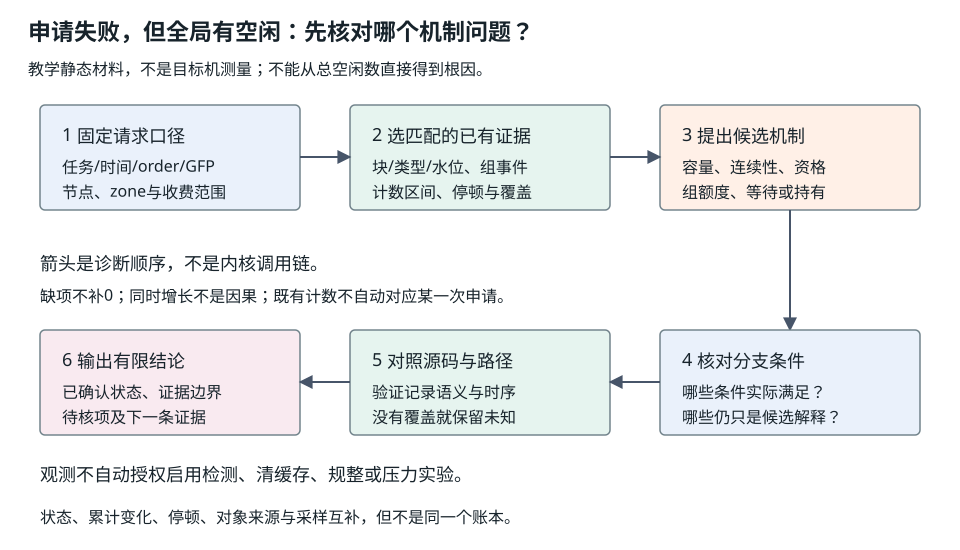
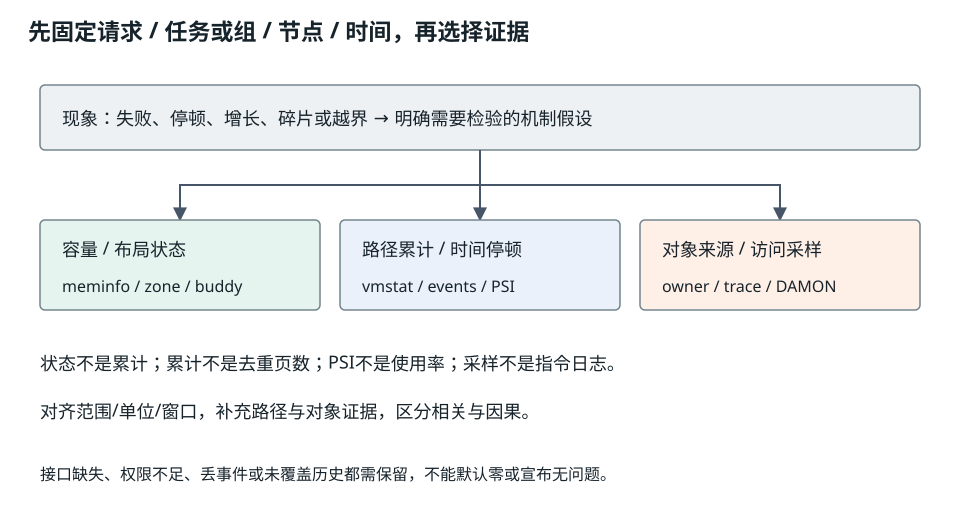
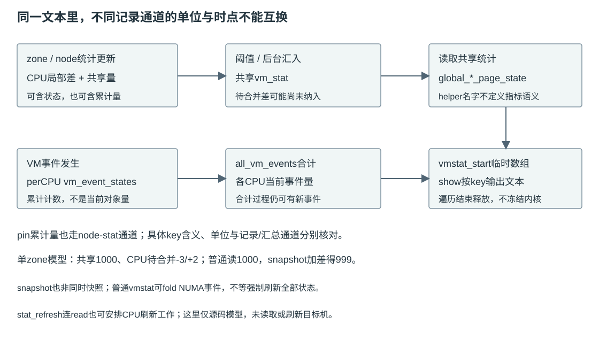
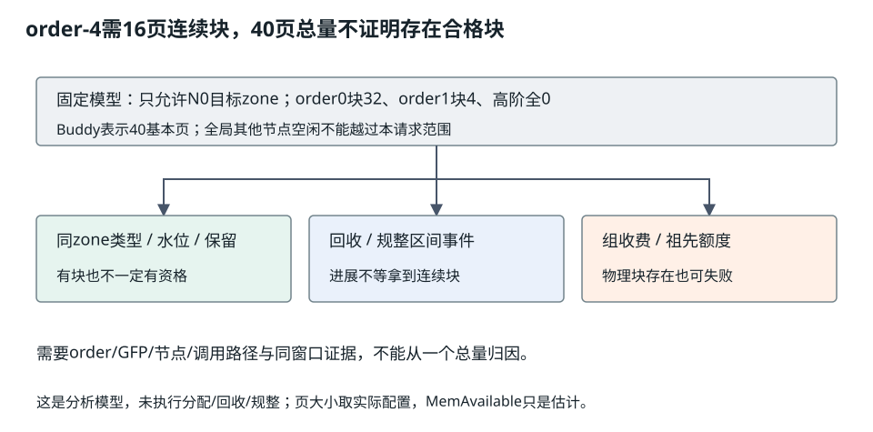
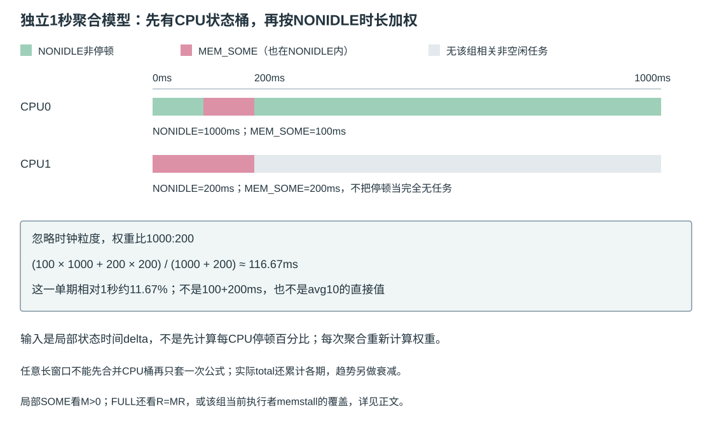
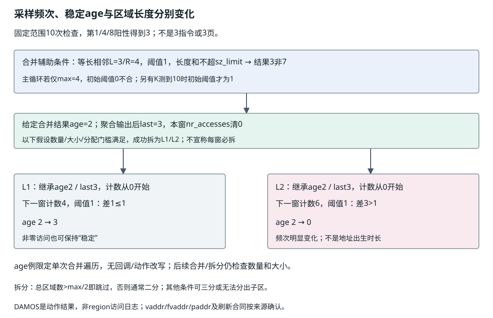

# 内存观测与诊断：把现象转成可核对的机制问题

一次申请失败、服务停顿或驻留增长，通常不能由一个“空闲内存”数字解释。本篇先走一遍从现象到有限结论的诊断过程，再说明各类证据由什么机制产生、能回答什么，以及如何用源码核对推理边界。

## 阅读说明

本地 Linux 6.1.158、arm64、已打RT补丁源码。本文的独立主题是**观测口径与诊断推理**，扩展能力作为定位入口，不假称THP/CMA/HMM等全部已有完整源码专题。配置、权限和运行环境需确认；不运行监控、启用检测或执行调参。

| 名称 | 含义 |
| --- | --- |
| PSI | Pressure Stall Information，压力停顿信息 |
| DAMON | Data Access MONitor，数据访问监测 |
| THP / CMA / KSM / HMM | 透明大页 / 连续内存分配 / 同页合并 / 异构内存管理 |
| KASAN / KFENCE | 内存错误检测机制，检测方式与成本不同 |
| PFN / GFP | 物理页号 / 分配行为标志 |
| DAMOS | DAMON-based Operation Schemes，基于采样范围的操作方案 |

| 问题 | 入口 |
| --- | --- |
| 状态、累计、停顿与采样分别说明什么 | [证据地图](#evidence) |
| 同窗口计数如何做差，缺项怎样处理 | [计数模型](#counters) |
| 有40空闲页为何order-4仍失败 | [分配案例](#allocation-case) |
| PSI some/full为何不是任务时间相加 | [时间压力](#psi) |
| DAMON为何3次阳性不等3次load | [采样模型](#damon) |
| page owner/错误检测怎样选择证据 | [对象证据](#object-evidence) |
| 读取与主动动作有哪些边界 | [接口](#apis) |
| THP/CMA等怎样接入主干 | [扩展导航](#extensions) |

## 1. 定位、职责与问题

### 1.1 观测什么，谁产生证据，谁做诊断

设某组件的一次高阶页申请失败，但工程师看到全局还有空闲RAM；另一个场景中服务响应变慢，却没有明显的全机内存使用率增长。需要回答的不是“Linux总共有多少内存”，而是**这次请求受哪些约束，哪个阶段没有满足，它是否造成了当前工作负载的停顿**。

**内存观测**是取得内核已有状态、发生过的事件、等待时间或抽样结果，并保留它们的范围、单位、时点和覆盖条件。**诊断**是在这些证据上提出并核对机制解释，缩小原因。它不是内核里一个统一的“自动诊断模块”：分配器、回收、memcg、PSI及采样/检测各维护不同记录，工程师或采集组件选择和关联它们。

容量快照回答某时点的分类状态；累计计数回答此前发生过多少对应操作，分析区间要做差；停顿时间回答资源等待对工作推进的影响；对象来源或错误报告提供具体对象/访问线索；采样提供估计而非逐条精确访问历史。这些证据不在同一计量维度，不能全部相加为占用，也不能只凭同时变化就认定因果。

观测与控制还要分开：读取已取得的状态、解释已有日志，并不自动授权启用跟踪、清缓存、规整、设置限额或启动压力实验。有些看似read的接口自身也安排刷新工作，§6说明其合同；本篇示例不采集或操作目标机。

### 1.2 一次最小诊断：有空闲，但没有合格的高阶块

下面全部是**给定静态材料的教学模型**，不是本机日志或测量。已知一次order-4申请需要16个基本页组成的合格块，只允许N0的目标zone；给定材料还包括相应窗口的全局计数，以及接近事件时点的该zone Buddy快照。先走完整过程，再在§3.2细化资格。

1. **固定请求。** 记录组件、工作负载、时间、order、GFP、允许节点与目标zone；未提供的字段保留未知。这里已知需要N0中的order-4，不拿其他节点可用页替代它。
2. **选择相匹配的证据。** 全局MemFree只能描述全局容量状态；该zone的Buddy块分布才能接近“有没有现成可拆分的高阶块”这个问题。组收费疑点还需要组/祖先证据，停顿疑点还需要相应范围的时间数据。
3. **推演供给状态。** 给定order-0块32个、order-1块4个、其他阶全0，共40基本页，却没有现成order-4及更大块。可以确认此快照时点的Buddy缺少该高阶供给；不能把40页容量当可交付的16页连续块。
4. **核对解释，不升级为根因。** 给定相同全局回收口径的区间扫描增50、成功回收增10，只能说明该全局口径发生回收进展，范围比这次N0申请更广。它不证明全部由本请求发起，也不证明回收后形成合格高阶块。即使规整计数增长，还需类型、水位、可移动性及对应路径证据；不能直接宣布“碎片就是唯一原因”。
5. **给出有限结论与缺口。** 当前材料支持“全局有空闲与指定zone缺少现成高阶块不矛盾”；要确认失败瞬间的具体阶段，还需匹配的路径/时序、类型和约束材料。若memcg收费状态、PCP或GFP细节未给出，它们仍是待核项，不补成0、不假定通过。

这样得到的是可继续核对的机制问题，而不是一句万能故障标签。已有证据够用就明确其支持范围；证据不足就保留未知并指出缺什么，不默认通过主动动作制造新现象。



### 1.3 观测怎样接回各个内存模块

分配器的块/类型/水位材料帮助核对供给资格，回收计数描述扫描和进展，页缓存/回写状态帮助解释脏数据与等待，memcg账本/事件说明资源域与限制，PSI从时间维度描述停顿，来源追踪和采样进一步定位对象或访问。它们提供互补线索，不共同构成一个同时冻结的全机快照。

例如“服务停顿但全局空闲不少”，既可能要核对该组额度/回收，也可能要核对指定位置的供给或回写等待；先确定受影响范围再取相应证据。组PSI升高不定位哪一页，某条错误报告也不证明未覆盖对象全无错误。本文的职责是把这些推理规则讲清，具体算法回到对应专题和源码。

后文按证据类别与记录通道→计数/分配/PSI推演→DAMON采样与动作→对象覆盖→读取接口展开。THP/CMA/KSM/HMM等末尾只说明接入主干的位置，**不宣称这些扩展的独立机制专题已经完成**。修复后的效果比较仍应采用同任务/范围和口径；真正改系统或运行试验需要另行确认。

## 2. 证据种类与记录来源

### 2.1 各种证据不是同一账本

<a id="evidence"></a>



| 证据 | 回答什么 | 不证明什么 |
| --- | --- | --- |
| meminfo等容量快照 | 统计分类下的总体状态 | 当前特定order请求必成功 |
| buddyinfo/pagetypeinfo/zoneinfo | 块、类型、区域与水位 | PCP/任务约束的全部状态 |
| vmstat与跟踪事件 | 累计变化和路径 | 每个计数等于实时对象数量 |
| PSI | 停顿时间影响 | 内存使用率或某页的位置 |
| memcg统计/事件 | 组与层次压力 | 等于单进程RSS或全机口径 |
| page owner/检测报告 | 分配归属或错误线索 | 采样之前全部历史都已记录 |
| DAMON | 地址区域的估计访问行为 | 每一字节每一次访问的精确日志 |

状态量是当前分类用量；累计事件记录发生过的次数/页事件；PSI记录资源停顿时间；对象来源追踪提供具体分配身份；采样估计某范围访问行为。这不是五份可以直接相加的“内存占用”。

读取文件也不形成全机原子快照：per-CPU统计合并、组统计刷新、并发访问及跨文件读取时差都影响证据。每次记录采样起止时间、节点/组路径、版本与单位，不用无关范围的两个数作因果证明。

### 2.2 指标语义与记录通道分别判断

指标是状态量还是累计量，由具体key的定义和更新决定；源码放在哪一类统计桶、怎样汇总，是另一条分类轴。SMP的zone/node统计可先累计到CPU局部差值，再按阈值或后台工作汇入共享vm_stat；**该通道也包含累计量**，不是只有容量状态。CONFIG_VM_EVENT_COUNTERS等条件满足时，VM-event通道另累加per-CPU vm_event_states，输出用all_vm_events合计。缺相关key不自动解释为0次事件。

| key示例 | 指标语义 | 本地记录/输出通道 |
| --- | --- | --- |
| nr_free_pages | 相应分类下的空闲状态量 | zone-stat局部差与共享量 |
| nr_foll_pin_acquired/released | 累计逻辑pin跟踪量，差值也非去重页数 | node-stat局部差与共享量，不由all_vm_events输出 |
| nr_dirtied/nr_written | 对应累计页量 | node-stat通道，不能因前缀nr判实时存量 |
| pgscan_direct | 相应路径累计扫描量 | VM-event计数，经all_vm_events合计 |

因此pin累计量也可能存在待合并差和读取滞后；用累计差量分析仍要看同范围、区间和刷新条件。page_state等助手名称不是“当前存量”的语义保证，不能据名称把一次累计增长解释成新增驻留页。



例如在一个无并发、其他贡献固定的zone模型里，共享状态计数1000，两个CPU待合并差值-3/+2。普通zone_page_state读共享量1000；zone_page_state_snapshot还加待合并差值，得到999，但真实并发时它也不是原子快照。将“加了差值”称为更完整，不等于与其他文件同时一致，更不等于所有PCP/请求资格均已纳入。

`vmstat_start`按不同类别读取当前共享状态、阈值和事件合计，形成一次seq遍历的临时数组，vmstat_show再按key输出；采集各类别的时点不同，临时数组不使原来变化的内核状态变成同时快照。分配输出数组失败是读取错误，不能转换为全字段0。下一次遍历也可能重新形成数组，不把打开fd当作永久冻结全部统计。

本地读取vmstat还可执行适用NUMA事件的fold，但这不是把所有CPU状态差都强制刷新。`/proc/sys/vm/stat_refresh`则在本树连read也会安排各CPU刷新工作，有主动成本；不能为了“更准确”默认偷偷调用，更不能承诺刷新后所有跨文件观察原子。单CPU等其他构建采用不同更新分支，本文未读取目标机这些接口。

## 3. 按口径推演变化与停顿

### 3.1 先固定口径再做差

<a id="counters"></a>

累计计数需要相同范围和间隔。假设同一回收口径中扫描增50、成功回收增10，10/50=20%可以描述这段观察的相应比例，但不单独说明失败原因；背景活动、批量策略和计数单位也需核对。

父组events可包含子树，events.local局限本层；类型stat与LRU列表stat不能随便相加比较。计数重置、热插拔、并发采样和单位不同会让简单相减失真。

父events含子树是默认未启用memory_localevents挂载选项的情形；启用后events不再向祖先传播。[memcg](12-memcg-oom.md#apis)解释该条件，不因父层无增量就否定子层事件。

以同一`/proc/vmstat`采样窗口的真实key为例：

| key | 类型/单位 | 起值→终值 | 解释 |
| --- | --- | --- | --- |
| nr_free_pages | 相应空闲状态，基本页 | 1000→990 | 净状态减少10，不是累计“释放负10页” |
| pgscan_direct | 对应直接扫描累计事件，页单位 | 100→150 | 本窗口增量50 |
| pgsteal_direct | 对应直接回收累计事件，页单位 | 20→30 | 本窗口增量10 |

同scope、同时间且无重置时可计算10/50；扫描增量为0时比例记为不可解释/不适用，而不是随意给0或无穷。不能混用memcg的pgscan与全局pgsteal_direct，也不能仅凭20%断言pin或某文件系统是原因；NR_FREE_PAGES等还须遵循已讨论的局部统计口径。

本地全局pgscan_direct/pgsteal_direct的相应更新要求`!cgroup_reclaim(sc)`，不是所有“当前任务直接执行的回收”都会进入这两个key。启用适用memcg统计、只发生组定向回收且无其他全局回收时，组的pgscan/pgsteal可增长，而上述两个全局key保持不变；全局零差值不能否定组内回收，MGLRU计数也保留范围区别。

pgsteal等回收进展在适用demotion情形还需结合pgdemote：腾出当前节点不等整机驻留减少。nr_foll_pin_acquired/released的差量表达逻辑持有跟踪，不是去重物理页数，也不自动定位哪个驱动；累计变化还可能落在不同窗口或批处理暂态。

### 3.2 分配失败：先检验请求资格

<a id="allocation-case"></a>

设请求order-4（16基本页）、只允许N0的相应zone，其他节点虽空闲仍不在本次范围；目标页大小为P字节：

| N0目标zone的Buddy阶 | 0 | 1 | 2 | 3 | 4及以上 |
| --- | --- | --- | --- | --- | --- |
| 模型块数 | 32 | 4 | 0 | 0 | 全0 |

Buddy统计代表的空闲页为32×1+4×2=40，容量40P，但没有可拆出order-4的块。全局MemFree再大也不证明本请求可用；MemAvailable是估计可用容量，不是该order、zone、节点和GFP的成功保证。



下一步读同zone的pagetypeinfo区分可用迁移类型，zoneinfo看水位/保留及局部计数；结合PCP及允许回退规则确认供给，不简单把buddyinfo某列0等同整机OOM。若同窗口pgscan_direct增50、pgsteal_direct增10且compact_stall增长，可提出“进入直接回收/规整但仍未得到合格高阶块”的假设；没有对应请求路径/时序证据，不能断言这50次扫描全部由本请求造成。

反例：目标已有order-4块但因类型/水位/禁止回退不可用，是资格失败；另一例memcg max收费失败，是额度失败，未必没有物理块。必须把页分配失败日志的order/GFP/节点/调用栈、组事件和相应机制联起来，不用一个碎片图替代全部判断。

### 3.3 PSI是时间维度

<a id="psi"></a>

memory PSI度量停顿导致的潜在生产能力损失。some/full在本地实现先按CPU记录局部停顿状态，再以各CPU非空闲时间加权汇总；不能在多CPU下直接把所有任务停顿取并集/交集当接口值。avg10/60/300是平滑趋势百分比，total是累计微秒，不是页数。

`psi_group`是一份目标范围的压力记录，系统与适用组有各自实例；其per-CPU `psi_group_cpu`记录该CPU相关任务计数、当前状态掩码和持续时间。任务进入/退出内存停顿先改变NR_MEMSTALL等计数，test_state形成MEM_SOME/FULL及NONIDLE状态，record_times累计此前状态持续时间。它不是把每个任务的停顿秒数直接相加。

局部计数只针对这个组在这个CPU上的任务：M=NR_MEMSTALL包含处于内存停顿的相关任务，即使已阻塞；R=NR_RUNNING包含尚可运行的相关任务，不仅当前执行者；MR=NR_MEMSTALL_RUNNING是R中仍处于内存停顿的一部分，能够区分正在主动回收与真正生产工作的执行。

| 局部状态 | 本地基本判定 |
| --- | --- |
| MEM_SOME | M>0，有相关内存停顿 |
| MEM_FULL | M>0且R==MR，相关可运行任务都属memstall；R=MR=0且有阻塞memstall也可成立 |
| 当前执行覆盖 | 该组在此CPU处于ONCPU、当前任务in_memstall时另置MEM_FULL，即使R中还有普通任务 |
| NONIDLE | 有相关I/O等待、memstall或可运行任务，不限实际指令执行忙碌 |

沿同CPU、同组A/B的独立切换模型：A处memstall且仍可运行，B普通可运行，M=1/R=2/MR=1保持不变。B当前执行时SOME=1、基本FULL=0，也无覆盖；切换到A主动回收时SOME仍1，当前执行覆盖使FULL=1；再切回B，覆盖消失，FULL回0。变化来自当前执行者及生产能力损失，而不是又增加一个停顿任务。这与后面A/B均阻塞的模型是不同条件，不能用“还有一个可运行任务”永远否定局部FULL。

get_recent_times取得一致的本CPU状态/时间快照并补上仍在持续的区间，减去该聚合器上一快照，得到本轮各桶delta；collect_percpu_times才把CPU桶合为group.total。内部时间桶及total按纳秒记，接口total输出再换成微秒，以下示例可统一换成ms便于推演。以某个资源状态s为例，单次聚合近似规则为：

```text
w_i = 将CPU i本轮NONIDLE时长转换为jiffies
本轮group时间增量[s] = sum(delta_time[i][s] * w_i) / max(sum(w_i), 1)
```

时间delta是状态桶持续时间，不是该CPU自身停顿百分比；NONIDLE还包括有停顿任务的状态，不等于CPU实际忙于执行指令。权重在每次聚合重算，不能把任意长窗口先汇总每CPU，再只套一次公式冒充实际累计；趋势平均还另按聚合周期及历史衰减。局部seq保护也不提供跨CPU同时快照。

先限定单CPU、任务不迁移、仅A/B两个非空闲任务、停顿时阻塞而非占CPU主动回收、其余状态稳定的10秒模型：A在第1–3秒内存停顿，B在第2–4秒停顿；该CPU的some桶覆盖并集3秒，full桶覆盖同时阻塞1秒。忽略时钟粒度/汇总边界时，自定义区间比例30%/10%，不是简单相加40%；avg10仍不要求恰等这个人工窗口值。

改为A/B分别固定在两个CPU，每CPU在该窗口持续有一个非空闲任务，各阻塞2秒、其余时间生产工作：局部some/full桶各为2秒，两个非空闲权重相同，汇总可近似20%/20%，不是全局任务并集30%/交集10%。该CPU当前任务处在memstall主动回收时还可被记full，不能将full解释成整个系统所有CPU绝无生产任务的严格证明。

再给一个**单次聚合的独立1秒桶模型**，不套用前面的10秒任务时序：CPU0本轮NONIDLE=1000ms、MEM_SOME=100ms；CPU1的NONIDLE=200ms、MEM_SOME=200ms，其余800ms无该组相关任务。忽略时钟粒度，权重比1000:200，增量为`(100×1000+200×200)/(1000+200)≈116.67ms`，相对这一秒约11.67%。不是简单相加300ms，也不是先算两个CPU各自百分比再等权平均；avg10仍不要求等于这个自定义单期比例。



图5中NONIDLE覆盖停顿片段：CPU1虽只在前200ms保有停顿任务，仍形成200ms权重，并非把停顿期间当完全无任务而丢掉。时钟/jiffies转换、聚合次数和组范围影响实际结果，图示没有采样目标机。

高使用率可以没有同等停顿，低全局占用也可能有组/位置压力。full体现加权未能生产工作的影响，不定位是哪页或哪个来源导致；全局与组pressure范围不同，不能用全局低full否定组内严重停顿。配置、运行、汇总及覆盖条件仍需确认。

## 4. DAMON：区域估计、调整与动作

### 4.1 区域采样怎样形成估计

<a id="damon"></a>

context选择虚拟/物理操作，target给出对象，region组织范围，采样和聚合统计访问，并按条件调整区域。采样、聚合、更新间隔及最小/最大区域数影响分辨率和成本。虚拟地址观察不等于已知每页PFN，也不保证始终遍历全部后备。

这些对象不是页分配器的LRU：damon_ctx持操作/间隔/目标集合，target关联进程或物理观察对象，region是[start,end)地址区间及抽样地址/nr_accesses/age等估计状态。scheme定义匹配范围和可能动作，动作配额/水位是额外约束，不因发现冷范围就自动释放所有页。

age表示访问频次在相应阈值下保持稳定的**近似年龄**，初始0；正常单次聚合比较本窗nr_accesses与last_nr_accesses，差异不大则age加1，明显变化则清0。它不是地址创建时间，也不只在冷区增加：稳定热区同样可能增长。源码在合并遍历里更新age，多轮合并、区域加权/继承及动作还会影响它，不能把age无条件换成精确连续稳定秒数。

本版本sysfs支持的operation应由avail_operations及配置确认；vaddr可以适用自动更新目标范围，固定虚拟或物理范围模式另有用户提供范围责任。监测和DAMOS动作不是同一件事，动作还要考虑匹配条件、配额和水位。

假设一个范围保持不变、一个聚合窗口有10次抽样检查，只有第1/4/8次呈阳性，区域nr_accesses可为3。这表示抽样检查发现访问的次数，不是执行了3次load/store，也不是访问了3个页。聚合边界可输出`damon:damon_aggregated`结果，然后保存相关上一窗信息并清零本窗nr_accesses。

区域合并/拆分后范围和估计含义改变，不能把不同长度/窗口的“3”直接当同一访问率。详细区域结果可由本版本聚合跟踪点取得；sysfs中的DAMOS nr_tried/nr_applied等是动作统计，不替代逐区域抽样结果。开启跟踪仍需另确认配置、权限与成本，本篇没有执行。



以vaddr代表路径细化：为每个region选一个抽样地址，页表协议下清/老化相应访问证据，等采样间隔，再检验该位置是否变young并增加区域阳性计数；大范围只采若干代表位置，不能据某次0宣布范围内从未访问。

聚合时比较相邻区域频次及大小限制并按规则合并，输出当前区域统计、保存上一窗并清本窗计数，再在数量约束下拆分以尝试恢复细粒度。更新间隔另刷新目标范围，处理mmap/munmap变化；它不同于“每次抽样都重建全部VMA”。vaddr可自动更新范围，fvaddr/paddr等需按操作合同指定/维护范围，不把三种来源统一解释。

本地主要调整门控为：

| 调整 | 实际条件与变化 |
| --- | --- |
| 初始相似阈值 | 聚合边界以check_accesses返回的max_nr_accesses/10整数值开始，不是固定阈值1 |
| 单次age更新 | abs(nr_accesses-last_nr_accesses)>threshold则0，否则加1 |
| 相邻合并 | 同target中地址相接、频次差≤threshold、两者长度和≤sz_limit |
| 大小上界 | sz_limit按目标总范围长度/min_nr_regions（非0时）形成，至少DAMON_MIN_REGION；它不是页表块大小 |
| 数量超max | 本轮合并后数量仍超max时可扩大threshold、继续合并，达到适用上界停止；并非一定能消除不相邻或超长区域 |
| 拆分数量门槛 | 当前总区域数>max_nr_regions/2便不拆；否则通常尝试每区二分，保存的上次数量相同且当前数<max/3时可尝试三分 |
| 真正分出子区 | 还要足够大、切点合法及新region分配成功；子区继承age/last，并非已有独立采样 |

因此“每窗拆分”或“数量设置max就绝不超出”都不成立。强制多轮合并也会多次经过age更新，不能将这种暂态当每窗仅加1的硬保证；本文下面的age例限定单次遍历、无回调/动作改写。

具体估计账本：两个等长相邻区域L/R，本窗nr_accesses为3/4，差阈值至少1且合并长度不超sz_limit，无scheme或回调修改。合并得到 `(3×长度+4×长度)/(2×长度)` 的整数值3，范围变大，但输出不是次数相加7。合并也按长度处理age；被删除R不再有独立统计。

这首先是**合并辅助函数的条件模型**。若上下文只有这两个区，max_nr_accesses=4，主循环初始阈值为0，差1不能在首轮合并；如果同窗另有区域K测到10，初始阈值1便能满足此相似条件，还须检查地址/长度及数量。不能从加权算术成立反推实际主循环一定合并L/R。

聚合输出后last_nr_accesses保存3、本窗清零，再拆成L1/L2：两个子区域本窗从0开始，继承拆分来源的age和last_nr_accesses=3，**不是已经各测到3次**；下一窗抽样才积累各自证据。实际主循环在合并后、输出清零前可执行回调/DAMOS动作，动作可拆分或改变age，因此这里无动作假设不能套到全部scheme组合。

给同一拆分结果补充明确状态：合并后的age为2，拆分成功后L1/L2均age=2、last=3、本窗0。下一窗由其他区域的max=10使初始threshold=1，且只走一次合并遍历、无动作改写：

| 子区本窗计数 | 与last=3的差 | 本次age更新 |
| --- | --- | --- |
| L1=4 | 1，不大于阈值1 | 2→3，即使并非冷区也可“稳定” |
| L2=6 | 3，大于阈值1 | 2→0，访问模式变化 |

L1/L2频次差2也超此阈值，不能在首轮互相合并；后续是否再次合并或拆分仍由数量/大小门控决定。继承last/age只是估计历史的起点，不把两个子区说成从未变过或各自已经观察了两窗。

代价与精度可用变条件判断：相同10个采样点，热点若集中在未选位置可能漏报；把区域拆小增加代表点，覆盖机会改变但扫描成本也增长。nr_accesses/10只能表示本模型抽样阳性比例，不是某页访问指令率或整个区域精确访问概率。

采样访问证据会与其他young/idle观察交互，按本地实现和管理约束解释，不把启用DAMON视为零扰动读取。DAMOS的尝试/应用字节与次数还需区分；sysfs stats的刷新命令及快照时点有自己的合同，重复读取存储值不保证实时更新，本任务不自动写update_schemes_stats等控制命令。

### 4.2 DAMOS结果与刷新合同

| 运行态累计字段 | 单位/含义 |
| --- | --- |
| nr_tried | 操作尝试计数 |
| sz_tried | 尝试范围的字节累计 |
| nr_applied | 返回非零应用字节的操作计数，不是成功应用全部范围的次数 |
| sz_applied | 实际应用字节累计 |

设一个允许尝试的8192字节范围，操作只应用4096字节：四字段增量为1、8192、1、4096；nr_applied=1不代表8192都已完成，也不把次数当页数。这里是独立字节模型，不指定arm64页大小；动作类型、配额及来源仍决定实际能应用多少。

接口根为`/sys/kernel/mm/damon/admin/`，展示值位于其下相应 `kdamonds/<N>/contexts/<M>/schemes/<K>/stats/`。本地刷新需向该kdamond的`kdamonds/<N>/state`写`update_schemes_stats`请求，由运行上下文回调复制统计到sysfs展示对象，命令等待处理或上下文结束。普通read stats不会自行刷新；已有待处理请求可EBUSY，未运行可EINVAL，异常/停止等不能简单解释成新统计为零。

本稿没有注册/运行监测或发刷新请求。无授权或刷新失败时保留已有值并注明快照时间未知/陈旧及错误，不能为“得到最新值”偷偷启动监测、清计数或执行回收动作。

## 5. 对象来源与错误检测的覆盖

<a id="object-evidence"></a>

vmstat提供统计输出，trace/events中的kmem/vmscan等提供事件；DAMON core、操作实现与sysfs表达context/target/region/scheme。接口存在不证明目标构建启用；历史文档推荐的后续版本行为不当作当前已实现事实。

观测数据可能延迟、采样或受读取范围影响。page owner、KASAN、KFENCE等要核对编译/启动条件、覆盖和开销；检测报告指向错误线索，不保证所有未报告路径无错误。

### 5.1 对象来源与内存错误不是同一种证据

| 工具/记录 | 主要证据 | 覆盖边界 |
| --- | --- | --- |
| page owner | 分配调用栈、order、迁移等来源线索 | 依赖PAGE_OWNER/启用与记录阶段，不等全部访问者历史 |
| kmem/vmscan/migrate等trace | 区间内执行路径及参数 | 缓冲丢事件、未启用/未覆盖时间，不直接等对象永久寿命 |
| KASAN | 适用模式下越界/UAF等访问检测 | 模式/编译/硬件依赖，未报告不等全部路径无错误 |
| KFENCE | 有限保护池中的抽样对象错误 | 抽样未入池对象不能据此排除错误 |

要查高阶块被谁长期占用，page owner能提供分配来源，但不能只凭该来源名确认pin或罪因；要查UAF，回收计数不够，需要对应访问、对象寿命与检测线索。选择应由问题和已有启用条件决定，不默认重启、加载检测或修改配置。

## 6. 接口与使用

<a id="apis"></a>

读取型工作也应处理文件不存在、权限、格式变化和单位。按key解析stat而不是依靠固定行序。本篇不给自动写sysfs开启监测/动作的脚本，避免监控请求变成调参或主动回收任务。

例如要判断高阶失败，先记order/GFP/节点，再看对应Zone的块、类型与保留，结合已讨论的PCP门控；要判断组停顿，结合该组events/local与PSI，不从全局MemFree倒推出没有问题。

### 6.1 只解析已有文本的骨架

下面只演示已取得的vmstat文本，不读取目标机、打开监控、改变配置或运行回收：

```python
def parse_vmstat(text):
    values = {}
    for line in text.splitlines():
        fields = line.split()
        if not fields:
            continue
        if len(fields) != 2 or fields[0] in values:
            raise ValueError("invalid or duplicate vmstat field")
        values[fields[0]] = int(fields[1])
    return values

def reclaim_ratio(before, after):
    deltas = {}
    for key in ("pgscan_direct", "pgsteal_direct"):
        delta = after[key] - before[key]  # Missing keys remain explicit errors.
        if delta < 0:
            raise ValueError("counter reset or incompatible snapshots")
        deltas[key] = delta
    scanned = deltas["pgscan_direct"]
    return None if scanned == 0 else deltas["pgsteal_direct"] / scanned
```

纯文本主例结果为0.2；字段缺失不自动补0，负差值不输出“负回收效率”，零扫描返回无比例。函数不验证两个输入真的同范围/同间隔，那是调用者记录的元数据责任；也不把算出0.2升级为pin或碎片因果结论。源码模型数字不是目标机采样。

### 6.2 读取、跟踪与主动动作分界

| 需求 | 使用合同 |
| --- | --- |
| 已有proc/cgroup状态 | 确认文件/权限/单位/范围，按key解析，保留时间与缺失 |
| PSI阈值通知 | 注册触发器需写相应接口并持有fd，结束要关闭；不是纯read，另需授权 |
| vmstat与stat_refresh | 普通输出也有适用汇总；stat_refresh的read会主动安排刷新，不自动执行 |
| trace启用/清空/扩大缓冲 | 会改变观测状态与成本，不能自动当只读诊断 |
| DAMON启动/范围/刷新stats | 有操作和控制命令合同，监测与DAMOS动作分开 |
| drop_caches/compact_memory/memory.reclaim | 主动改变资源，不是读取观测数据 |

pagetypeinfo收集本身可能昂贵，不把高频读取所有文件当无成本默认；跟踪丢失/权限错误要留在结果中。组件采集失败时关闭已取得fd/停止其已授权监测，而不是把失败当无事件；本文未启动任何采集组件。

## 7. 扩展能力在主干中的位置

<a id="extensions"></a>

| 能力 | 主干接入 | 需要单独深入的边界 |
| --- | --- | --- |
| THP/hugetlb | 大块供给、映射、缺页与回收 | 管理、预留和拆分不同；大folio不等于已用大页映射 |
| CMA | 连续需求、区域分类、迁移 | 保留与可移动借用资格，不是全部DMA唯一入口 |
| KSM | 匿名共享与COW | 合并、写隔离和寿命条件 |
| zswap/zram | 压缩后备与交换 | 压缩交换缓存/块设备不同，仍占RAM |
| 热插拔 | 存在、上线、隔离与迁移 | 被持有不可移动页可阻止下线 |
| HMM/设备内存 | 特殊描述、地址空间和迁移 | 普通RAM规则不全部适用 |
| 内存硬件故障 | 受影响页、映射和任务 | 不是普通分配失败或回收 |

这一表是扩展导航，不作为这些机制的完整实现说明。需要展开时仍按独立专题大纲和挑战协议处理。

本树THP与自动NUMA平衡依赖!PREEMPT_RT，RT=y时明确排除，不标成“未知配置可能启用”；hugetlb显式大页不因此一起排除。CMA、KSM、DAMON、ZONE_DEVICE/HMM等按各自Kconfig/来源资格确认，源码有钩子不证明该arm64构建可达。KMSAN在本地arm64不作为可用检测入口，不能用其他架构资料推广。

导航可按当前问题定位：连续需求先查[页分配](01-page-allocation.md)与[迁移规整](10-migration-compaction.md)，私有共享/寿命先查[缺页](07-page-faults.md)与[页寿命](11-page-lifetime-rmap.md)，组停顿先查[memcg](12-memcg-oom.md)。HMM设备迁移等完整机制不在这些普通页模型里假装已展开；后续专题须另建范围和挑战。

## 8. 总结与源码入口

观测核心是“范围、单位、时间、机制和覆盖”。先确定当前数据能回答什么，再补缺少的证据，不用一个指标替代全部判断。

[vmstat.c](../../../../linux-6.1.158/mm/vmstat.c)、
[PSI说明](../../../../linux-6.1.158/Documentation/accounting/psi.rst)、
[DAMON设计](../../../../linux-6.1.158/Documentation/mm/damon/design.rst)、
[DAMON使用](../../../../linux-6.1.158/Documentation/admin-guide/mm/damon/usage.rst)、
[DAMON源码](../../../../linux-6.1.158/mm/damon/core.c)、
[cgroup v2](../../../../linux-6.1.158/Documentation/admin-guide/cgroup-v2.rst) 为依据。本文没有运行监测、修改配置或产生目标机测量结果。

抽样准备与聚合结果另见 [vaddr.c](../../../../linux-6.1.158/mm/damon/vaddr.c) 和 [damon跟踪定义](../../../../linux-6.1.158/include/trace/events/damon.h)。

接口及配置核对：[sysfs.c](../../../../linux-6.1.158/mm/damon/sysfs.c)、[DAMON Kconfig](../../../../linux-6.1.158/mm/damon/Kconfig)、[MM Kconfig](../../../../linux-6.1.158/mm/Kconfig)、[init Kconfig](../../../../linux-6.1.158/init/Kconfig)。容量估计见[meminfo.c](../../../../linux-6.1.158/fs/proc/meminfo.c)及page_alloc.c的si_mem_available，对象追踪见[page_owner.c](../../../../linux-6.1.158/mm/page_owner.c)，事件定义见[kmem](../../../../linux-6.1.158/include/trace/events/kmem.h)、[vmscan](../../../../linux-6.1.158/include/trace/events/vmscan.h)。

PSI多CPU权重及局部memstall full判定以[psi.c](../../../../linux-6.1.158/kernel/sched/psi.c)为准，不能只按接口说明中的抽象“全部任务”短语推导实际计量。

PSI局部任务计数见[psi_types.h](../../../../linux-6.1.158/include/linux/psi_types.h)；统计key语义及分类见[mmzone.h](../../../../linux-6.1.158/include/linux/mmzone.h)，pin累计量更新见[gup.c](../../../../linux-6.1.158/mm/gup.c)。DAMON age字段见[damon.h](../../../../linux-6.1.158/include/linux/damon.h)，更新及合并/拆分门控以core.c为准。

状态局部差与snapshot口径见[vmstat.h](../../../../linux-6.1.158/include/linux/vmstat.h)；vmstat.c的vmstat_start/show/stop、all_vm_events及vmstat_refresh分别对应输出数组、事件合计和主动刷新。PSI过程对应test_state、record_times、get_recent_times与collect_percpu_times，不把采样输出格式当底层状态模型。

<a id="review-result"></a>
## 独立挑战审阅

本次观测目的、静态诊断周期与证据协作修订由新只读挑战者Cicero完成第1轮全文/六图审阅，无实质挑战，技术与教学分别通过，待用户统一review，见[本次记录](review/review-entry-14.md)。[原约定](review/contract-observability.md)、[前次补全](review/review-pedagogy-14.md)及[Franklin记录](review/review-observability.md)保留历史。扩展仍仅导航，不宣称全部内部深挖。
