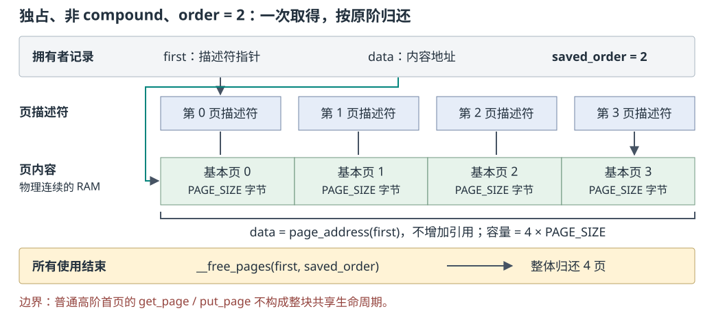
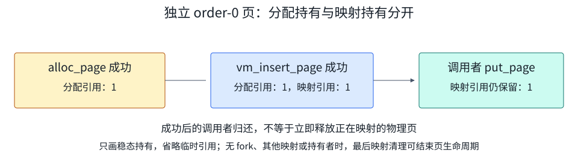

# 内核内存 API 详细参考

本页用于实际开发时按函数名或需求查询，提供参数、返回值、调用条件、所有权和失败清理。[API 选型指南](api.md) 负责需求比较与最短使用骨架，详细契约以本页及所标目标源码为准。

基线为 **Linux 6.1.158、arm64 / AArch64**。签名去掉了部分属性；宏和 inline 包装按调用形式展示，不将其都称为独立导出函数。源码路径相对该内核根目录。

尚未指定目标 `.config`；页大小、分配器和调试选项按实际配置确定。示例使用 `PAGE_SIZE/PAGE_SHIFT`，不把 arm64 页大小固定为 4 KiB，也不将一种配置的上限写成通用常量。

示例是可供改造的教学函数或明确标注的片段，不是完整模块，**未编译、加载或运行**。默认允许睡眠的任务上下文；设备示例要求设备有效、已按硬件能力设置地址范围，并由调用者处理实际完成。所有示例都不允许在资源仍被使用时销毁或扩容。

用户态 `mmap/munmap/mprotect`、NUMA 库接口及控制文件见 [API 选型指南](api.md#userspace)。本页重点是内核调用者，不穷举内部回收或页表函数。

## 1. 需求与配对速查

| 需求 | 取得 / 操作 | 结束 / 释放 | 直达 |
| --- | --- | --- | --- |
| 小字节块、清零、数组 | `kmalloc/kzalloc/kmalloc_array/kcalloc` | `kfree` | [字节与数组](#bytes) |
| 柔性数组和安全容量 | `struct_size/array_size/check_mul_overflow` | 按最终分配方式 | [容量计算](#sizes) |
| kmalloc 块扩容 | `krealloc/krealloc_array` | `kfree` | [扩容](#resize) |
| 固定类型缓存 | `kmem_cache_create/alloc/zalloc` | `kmem_cache_free/destroy` | [缓存](#cache) |
| 按阶连续页块 | `alloc_page/alloc_pages` | `__free_page/__free_pages`，按模型选择引用协议 | [页块](#pages) |
| 指定容量的连续页 | `alloc_pages_exact` | `free_pages_exact`，保存原 size | [Exact](#exact) |
| CPU 可变工作区 | `kvmalloc/kvzalloc/kvcalloc` | `kvfree` | [工作区](#virtual) |
| 动态内核映射 | `vmalloc/vzalloc` | `vfree` | [工作区](#virtual) |
| 已有页组成映射 | `vmap` | 普通模式 `vunmap` 后另行归还页 | [Vmap](#vmap) |
| 局部页访问 | `page_address/kmap_local_page` | Local 接口配对 `kunmap_local` | [内容访问](#access) |
| 用户数据复制 | `copy_from_user/copy_to_user/get_user/put_user` | 按返回值处理，非资源分配 | [用户访问](#uaccess) |
| 普通独立页映射到用户 | `vm_insert_page` | 映射清理与调用者引用分别处理 | [单页映射](#insert-page) |
| vmalloc 存储映射到用户 | `vmalloc_user/remap_vmalloc_range` | VMA 存活结束后再释放后备对象 | [共享缓冲区](#user-map) |
| 设备资源用户映射 | `vm_iomap_memory/remap_pfn_range` | 资源、VMA 和设备协议 | [PFN 资源](#pfn-map) |
| 用户页固定 | `pin_user_pages` | `unpin_user_pages` 或适用 dirty 变体 | [Pin](#pin) |
| DMA 新缓冲区 | `dma_alloc_coherent` | `dma_free_coherent` | [DMA](#dma) |
| 已有 DMA 缓冲区映射 | `dma_map_single/dma_map_sg` | 匹配 unmap，原存储另行释放 | [Streaming](#streaming) |
| 设备小块 DMA 池 | `dma_pool_create/alloc` | `dma_pool_free/destroy` | [DMA Pool](#dma-pool) |
| 预留元素供给 | `mempool_create_kmalloc_pool/alloc` | `mempool_free/destroy` | [Mempool](#mempool) |

失败不是统一的 NULL：字节分配多为 NULL，映射函数常为负 errno，GUP 返回实际页数，用户复制返回剩余字节，SG 映射失败为 0，MMIO 资源 helper 可能返回错误指针。

<a id="gfp"></a>

## 2. GFP 与允许的工作

GFP 用于资源范围和分配策略，不是性能等级或成功保证。示例优先 `GFP_KERNEL`；不能因缓存可能命中，就在不可睡眠路径使用它。

| 选择 | 允许工作 / 目的 | 主要边界 |
| --- | --- | --- |
| `GFP_KERNEL` | 普通可睡眠分配，可直接回收 | 调用路径不能持有禁止睡眠或会被回收递归依赖的资源 |
| `GFP_KERNEL_ACCOUNT` | 加入适用内核资源组记账 | 不表示可以绕过组限制 |
| `GFP_NOWAIT` | 不由当前线程做直接回收 | 可以失败，必须有应对 |
| `GFP_ATOMIC` | 适用非睡眠请求，可使用部分紧急供给 | 仍可能失败；本树不支持 NMI 等某些严格情境 |
| `__GFP_ZERO` | 对支持它的分配请求清零 | 不代替锁、链表、引用初始化，也非所有池 API 都支持 |

`__GFP_NORETRY`、`__GFP_RETRY_MAYFAIL`、`__GFP_NOFAIL` 是不同重试策略，不任意叠加。尤其不把 nofail 当成所有尺寸和上下文的通用修复。

### NOFS / NOIO 作用域

头文件 `<linux/sched/mm.h>`，save 返回的是待恢复的状态：

```c
unsigned int memalloc_nofs_save(void);
void memalloc_nofs_restore(unsigned int flags);
unsigned int memalloc_noio_save(void);
void memalloc_noio_restore(unsigned int flags);
```

NOFS 防止适用分配通过回收递归进入文件系统，NOIO 进一步限制有关 I/O。它们不表示禁止睡眠，不自动传播成其他工作线程的同一上下文。

```c
/* 片段：临界区实际依赖由调用者说明，所有退出分支都应恢复。 */
unsigned int saved = memalloc_nofs_save();

/* 在适用的文件系统回收依赖范围中工作。 */

memalloc_nofs_restore(saved);
```

不要将固定 0 传给 restore；嵌套调用需恢复各自 save 的结果。对于涉及 vmalloc 的 FS/IO 路径，不能只给表层传 NOFS 就假定内部都使用该掩码，应该核对作用域。

源码：`include/linux/gfp_types.h`、`include/linux/sched/mm.h`；同树 `Documentation/core-api/gfp_mask-from-fs-io.rst`。

## 3. 字节、容量与扩容

<a id="bytes"></a>

### 3.1 kmalloc / kzalloc / kcalloc

头文件 `<linux/slab.h>`：

```c
void *kmalloc(size_t size, gfp_t flags);
void *kzalloc(size_t size, gfp_t flags);
void *kmalloc_array(size_t n, size_t size, gfp_t flags);
void *kcalloc(size_t n, size_t size, gfp_t flags);
void kfree(const void *p);
```

| 参数 / 结果 | 使用时要记住 |
| --- | --- |
| `size` | 字节数；数组接口另传元素个数 |
| 非零请求返回 NULL | 未取得存储，按调用者策略退出或降级 |
| 零大小 | 可能得到 `ZERO_SIZE_PTR` 等特殊结果，不可作为有效数据区 |
| 对齐与连续性 | 至少 `ARCH_KMALLOC_MINALIGN` 字节对齐；请求大小为二次幂时，还保证至少按该大小对齐。物理连续不等于已取得 DMA 地址 |
| `kfree(p)` | 必须是相应取得的基址，不传内部偏移或页描述符 |

`kzalloc/kcalloc` 清零，`kmalloc/kmalloc_array` 不承诺清零。缓存档位不一定只有二次幂，也不将一种页配置的最大缓存尺寸硬编码为所有 arm64 的上限。

只使用请求容量，不因为实际桶较大就越界写；若确需桶容量，应按目标接口明确申请和核对。数组首选独立个数、大小参数，避免调用前先溢出。

源码：`include/linux/slab.h`、`mm/slab_common.c`，选定 SLUB 的对象路径见 `mm/slub.c`。

<a id="sizes"></a>

### 3.2 struct_size / array_size / check_mul_overflow

头文件 `<linux/overflow.h>`。这些是容量计算 helper，不分配存储：

```c
bytes = struct_size(p, array_member, count);
bytes = array_size(count, element_size);
overflow = check_mul_overflow(count, element_size, &bytes);
```

`struct_size/array_size` 的适用计算溢出返回 `SIZE_MAX`；`check_mul_overflow` 用布尔结果报告。用 `size_t` 接收尺寸，检查后再传分配器；不要缩成较窄整数。

<a id="resize"></a>

### 3.3 krealloc / krealloc_array

```c
void *krealloc(const void *p, size_t new_size, gfp_t flags);
void *krealloc_array(void *p, size_t new_n, size_t element_size,
                     gfp_t flags);
```

前提是来自相应 kmalloc 家族的块，且不存在并发、异步或用户映射等要求地址稳定的使用者。

- `p == NULL` 时按新的分配处理。
- 非零新请求失败返回 NULL，原块仍有效。
- 成功可能移动，也可能原地返回；原指针及其内部指针必须重新判断，不再额外释放旧块。
- 新大小为 0 会释放旧块并返回特殊零大小结果，不按普通失败处理。
- 保留范围不等于新增长部分全部已初始化；示例显式清零新增元素。

#### 柔性数组安全扩容骨架

以下函数共用所示声明，调用者独占 `*owner`，`nr` 是有效的已初始化元素数。上限 1024 是示例策略，不是内核通用限制。

```c
#include <linux/errno.h>
#include <linux/overflow.h>
#include <linux/slab.h>
#include <linux/string.h>
#include <linux/types.h>

struct ref_item {
    u32 flags;
    u32 value;
};

struct ref_vector {
    size_t nr;
    struct ref_item items[];
};

static int vector_create(struct ref_vector **owner, size_t nr)
{
    struct ref_vector *v;
    size_t bytes;

    if (!owner)
        return -EINVAL;
    *owner = NULL;
    if (!nr || nr > 1024)
        return -EINVAL;
    bytes = struct_size(v, items, nr);
    if (bytes == SIZE_MAX)
        return -EOVERFLOW;
    v = kzalloc(bytes, GFP_KERNEL);
    if (!v)
        return -ENOMEM;
    v->nr = nr;
    *owner = v;
    return 0;
}

static int vector_resize(struct ref_vector **owner, size_t nr)
{
    struct ref_vector *tmp;
    size_t old_nr, bytes;

    if (!owner || !*owner || !nr || nr > 1024)
        return -EINVAL;
    old_nr = (*owner)->nr;
    bytes = struct_size(*owner, items, nr);
    if (bytes == SIZE_MAX)
        return -EOVERFLOW;
    tmp = krealloc(*owner, bytes, GFP_KERNEL);
    if (!tmp)
        return -ENOMEM;
    if (nr > old_nr)
        memset(tmp->items + old_nr, 0,
               (nr - old_nr) * sizeof(tmp->items[0]));
    tmp->nr = nr;
    *owner = tmp;
    return 0;
}

static void vector_destroy(struct ref_vector *v)
{
    kfree(v);
}
```

`vector_create` 只能用于尚未持有资源的输出位置。Resize 先保存旧元素数，以免成功移动后再访问旧结构；失败不覆盖 `*owner`。容量结构有内核管理字段时，也不能把整个对象不加选择地复制给用户。

源码：`mm/slab_common.c` 的 `krealloc/__do_krealloc`；数组包装及 overflow helper。

<a id="cache"></a>

## 4. 对象缓存及用户复制范围

头文件 `<linux/slab.h>`：

```c
struct kmem_cache *kmem_cache_create(
    const char *name, unsigned int size, unsigned int align,
    slab_flags_t flags, void (*ctor)(void *));
struct kmem_cache *kmem_cache_create_usercopy(
    const char *name, unsigned int size, unsigned int align,
    slab_flags_t flags, unsigned int useroffset, unsigned int usersize,
    void (*ctor)(void *));
void *kmem_cache_alloc(struct kmem_cache *s, gfp_t flags);
void *kmem_cache_zalloc(struct kmem_cache *s, gfp_t flags);
void kmem_cache_free(struct kmem_cache *s, void *obj);
void kmem_cache_destroy(struct kmem_cache *s);
```

| 项目 | 说明 |
| --- | --- |
| `size/align` | 对象大小和对齐要求，字节单位 |
| 创建 `flags` | `slab_flags_t`，不等于分配对象的 GFP |
| `ctor` | 对新对象槽位的构造机制，不保证每次分配都调用 |
| `useroffset/usersize` | 可用户复制部分在对象中的偏移与长度，必须落在对象内 |
| 分配结果 | 普通失败 NULL；对象必须归还同一 cache |
| 销毁前提 | 没有在用或将要使用的对象、回调、工作任务 |

常见标志需要理解而非照抄：

- `SLAB_HWCACHE_ALIGN` 是对象布局选择，不提供 DMA 一致性。
- `SLAB_PANIC` 改变创建失败处理，不用于普通可恢复错误路径。
- `SLAB_TYPESAFE_BY_RCU` 不等于延迟对象复用；地址仍存在时，也可能已经成为另一个对象。

#### 只允许 payload 用户复制的 cache

```c
#include <linux/slab.h>
#include <linux/stddef.h>
#include <linux/types.h>

struct ref_message {
    u32 internal_state;
    u8 payload[64];
};

static struct kmem_cache *message_cache_create(void)
{
    return kmem_cache_create_usercopy(
        "mm_ref_message", sizeof(struct ref_message),
        __alignof__(struct ref_message), 0,
        offsetof(struct ref_message, payload),
        sizeof_field(struct ref_message, payload), NULL);
}
```

创建后检查 NULL；取得对象用 `kmem_cache_zalloc`，随后初始化真实状态；归还用 `kmem_cache_free`，最后销毁 cache。基本配对示例见 [原示例](api.md#object-cache)。

Usercopy 范围不是授权机制，不免除对用户输入、目标对象存活和返回值的检查。即使未启用有关检查，也不应将内核指针、锁或未初始化数据复制给用户。

源码：`include/linux/slab.h`、`mm/slab_common.c`、所选分配器的实现。

## 5. 物理页与内容地址

<a id="pages"></a>

### 5.1 alloc_page / alloc_pages 与归还

**适用场景：内核调用者需要由自己持有、最终整体归还的普通物理连续页块。** 这组接口按阶分配，不按任意字节数分配，也不提供 DMA 地址。只要求 CPU 虚拟连续的工作区不必承担高阶物理连续分配的失败风险。

直达：[参数与返回](#pages-arguments) · [GFP 与上下文](#pages-gfp) · [地址与所有权](#pages-ownership) · [完整示例](#pages-example) · [变体选择](#pages-variants) · [真实调用者](#pages-callers)。

<a id="pages-signatures"></a>

#### 调用形式、头文件与可见性

包含 `<linux/gfp.h>` 获取分配、归还声明和 GFP 标志；访问描述符及使用 `page_address/get_page/put_page` 时包含 `<linux/mm.h>`。下列是本树的接口形式，后两项实际是宏，不是独立的导出函数：

```c
struct page *alloc_pages(gfp_t gfp, unsigned int order);
void __free_pages(struct page *page, unsigned int order);

#define alloc_page(gfp_mask) alloc_pages(gfp_mask, 0)
#define __free_page(page) __free_pages((page), 0)
```

`alloc_pages` 在 `CONFIG_NUMA=y` 时由 `mm/mempolicy.c` 实现并导出；否则是 `<linux/gfp.h>` 中的 inline 包装，最终使用已导出的 `__alloc_pages`。`__free_pages` 在 `mm/page_alloc.c` 中导出。不能仅因宏或 inline 没有同名导出就判定它不可用；实际模块可用性仍需结合目标配置和构建环境。

<a id="pages-arguments"></a>

#### 参数、单位、成功与失败

| 参数 / 结果 | 可直接用于调用的规则 |
| --- | --- |
| `gfp` | `gfp_t` 策略位组合，无字节或页数单位；选择基础策略后再加必要修饰，见下表 |
| 分配的 `order` | `unsigned int`，单位是阶；合法范围 `0 <= order < MAX_ORDER`。请求负数后强转、直接传页数或传字节数都不合法 |
| 页数与容量 | 页数 `2^order`，容量 `PAGE_SIZE * 2^order` 字节。成功得到的整个块在物理上连续；实际使用长度须由调用者记录 |
| 分配成功 | 返回该块第一个基本页的 `struct page *`；不是内容地址，也不是一个已分配的 `struct page *` 指针数组 |
| 分配失败 | 返回 `NULL`，不是 `ERR_PTR`，也不返回负 errno；必须先检查，再访问或归还 |
| 归还的 `page` | 原分配返回的第一个描述符，并且仍由调用者按本节模型持有；不能传内容地址、块内其他页、已归还的页或 `NULL` |
| 归还的 `order` | 必须是取得该块时的原阶；不是当前已用字节数计算出的阶 |
| 归还的返回值 | `void`。接口不替调用者校验所有权，也不返回“阶配错”的错误码 |

例如，`alloc_page(gfp)` 得到 1 个基本页，`alloc_pages(gfp, 2)` 得到 4 个基本页；**3 个基本页的容量需求需取阶 2，最终归还仍传 2，而不是 3。**

`MAX_ORDER` 是排他的上界，不是最大合法阶。arm64 的 `ARCH_FORCE_MAX_ORDER` 在 4 / 16 / 64 KiB 基本页配置下默认分别为 11 / 12 / 14；不能把 `order < 11` 写成所有 arm64 系统的限制。这里没有目标 `.config`，应使用目标构建的 `MAX_ORDER` 和 `PAGE_SIZE`，也不能把“阶合法”理解成“肯定能分配到”。

正常策略下的 `NULL` 只表明请求未成功：可能没有满足要求的连续块、允许的节点 / zone / 水位不满足要求，或启用内存记账时收费失败；它不是“全机所有物理内存都用完”的诊断。越界阶在本树 `__alloc_pages` 入口被拒绝，可能警告后返回 `NULL`；应在调用前检查，不把该检查当正常控制流。

**字节数转阶：** `get_order(unsigned long size)` 返回容纳非零字节数所需的最小阶，不执行分配，也不保证结果小于 `MAX_ORDER`。arm64 的 `size_t` 与 `unsigned long` 均为 64 位。本树明确规定 `get_order(0)` 的结果没有有效契约；必须先拒绝或单独处理零长度。若字节数来自 `count * element_size`、长度加头部等运算，应先用 `check_mul_overflow/check_add_overflow` 检查，不能对已经回绕的结果调用 `get_order`。取得阶后还需检查上界；自行计算页数、容量前也应防止移位和乘法溢出。完整示例演示后两项检查。

<a id="pages-gfp"></a>

#### GFP 选择与允许上下文

| 调用需求 | 本组的典型选择 | 不能忽略的约束 |
| --- | --- | --- |
| 普通内核缓冲区，允许等待 | `GFP_KERNEL` | 可直接回收、可睡眠；不在中断或禁止睡眠的临界区调用，也不持有可能被回收路径递归获取的资源 |
| 需按用户触发的内核资源记账 | `GFP_KERNEL_ACCOUNT` | 睡眠约束同上；记账行为取决于 memcg 配置，不能当作成功保证 |
| 当前路径不能直接回收，失败可退出 / 延后 | `GFP_NOWAIT` | 不进入直接回收，但仍可唤醒后台回收；易失败，不保证固定时延 |
| 非睡眠关键路径确有紧迫需求 | `GFP_ATOMIC` | 可使用部分紧急储备，但仍可能失败；不能作为任意上下文下的通用修复 |
| 缓冲区要求初始内容为零 | 在所选策略上加 `__GFP_ZERO` | 初始化整个成功分配的块；不带该位时，调用者不能依赖某个系统恰好启用了自动清零 |
| 可睡眠，但高阶失败后有廉价退路 | 例如 `GFP_KERNEL | __GFP_NORETRY` | 仅做较轻量的回收尝试，仍可能睡眠；失败后执行既定退路，不原地无限循环 |
| 可睡眠且愿意做更多回收尝试 | 例如 `GFP_KERNEL | __GFP_RETRY_MAYFAIL` | 仍须处理失败；不是 `__GFP_NOFAIL`，也不能消除物理碎片 |

本树 `gfp_types.h` 明确说明 **`GFP_ATOMIC` 和 `GFP_NOWAIT` 均不支持 NMI 及持有 raw spinlock 等严格上下文**。`__free_pages` 的 kernel-doc 则允许中断上下文或持有普通 spinlock，但禁止 NMI 和持有 raw spinlock。分配策略与释放约束要分别核对，不能只检查分配时的 GFP。

不要为保证高阶成功添加 `__GFP_NOFAIL`：本树对 `order > 1` 的这种使用明确警告。对范围可变或外部输入的高阶申请，应限制规模、处理失败或换选型，不能承诺无限等待会得到所需连续块。

本节独占缓冲区不使用 `__GFP_COMP`、`__GFP_MOVABLE` 或 `__GFP_HIGHMEM`。`__GFP_COMP` 改变页对象的引用模型，见下节；`__GFP_MOVABLE` 要求调用者真正具备迁移 / 回收协议，不能只是为了提高成功率给长期持有的固定地址缓冲区加上它。`GFP_DMA/GFP_DMA32` 是 zone 约束，不会生成 DMA 地址或完成缓存同步；设备缓冲区仍按 [DMA 契约](#dma) 选型。

GFP 的作用域限制详见 [§2](#gfp)；本树会继承当前 NOFS / NOIO 等约束。以上策略不是要求覆盖调用者已经建立的合法作用域。

<a id="pages-ownership"></a>

#### 页描述符、内容地址与所有权边界

对本节普通 arm64 RAM、`GFP_KERNEL` 得到的页块，内容通过 `page_address(first)` 访问。例如：

```c
/* 片段：first 已分配成功，且整个块仍归当前调用者持有。 */
unsigned char *data = page_address(first);

data[0] = 0x5a;
```

`first` 指向管理元数据，`data` 指向页内存的内容；`memcpy(first, ...)` 不是向缓冲区写入，而是在破坏描述符。取得内容地址不增加引用，也不会把页块的所有权转交给地址。不要 `kfree(data)`，更不能把 `data` 当作 `struct page *` 传入 `__free_pages`。具体访问接口和 local 映射约束仅由 [§5.3](#access) 说明。



按普通高阶块使用时，调用者必须保存首页描述符 `first` 和原 `order` 这两项信息。**`compound_order(first)` 不能替代保存原 order**：普通非 compound 分配的首页没有 `PageHead` 标记，本树 helper 会返回 0，即使实际分配阶大于 0。

| 生命周期模型 | 正确结束方式 | 不能套用的假设 |
| --- | --- | --- |
| 本节示例：独占普通按阶块，没有拆分或额外引用 | 所有内容访问结束后，`__free_pages(first, saved_order)` 一次整体归还 | 不能对每个基本页分别 `__free_page`，也不能对普通高阶首页只 `put_page` |
| 独立 order-0 页，已建立合法的共享引用协议 | 初始拥有者可按接口归还自己的引用，其他持有者以实际 `get_page/put_page` 配对；最后引用结束才回收 | 获取内容地址不等于获得共享引用 |
| 高阶对象需要由页引用计数决定整块何时释放 | 从分配时就明确 compound 等协议；本树 kernel-doc 指出应分配 compound 页并以 `put_page` 管理 | 不能先分配普通高阶块，再在首页临时加引用，便认为整块变成共享对象 |
| 已拆分、被某个子系统接管、用户 pin 或其他专用页来源 | 使用该来源的归还协议 | 本组不是任意 `struct page *` 的通用销毁函数 |

这个边界在本树有实际实现差异：**普通非 compound 高阶首页单独 `put_page` 到零，只回收该基本页，不会记起原 order 去归还整块。** 反过来，若普通高阶首页仍有额外引用，拥有者调用 `__free_pages(first, order)` 时，本树可先归还后续页、留下首页由最终引用释放。因此，`get_page(first)` 也不能保证其余页在拥有者归还后继续存活。不要把这种用于处理首页额外引用的行为写成整块共享模板。

不匹配的阶没有可靠的纠错路径：阶过小可能留下其余页，阶过大可能归还不属于自己的内存、触发检查或破坏系统。**保存原阶、只归还一次、归还前结束所有借用**，是调用者自己的责任。

<a id="pages-example"></a>

#### 完整教学示例：独占 CPU 线性缓冲区

限定场景：普通可睡眠任务上下文；内核自己提出已验证的非零容量；普通 arm64 RAM；只供 CPU 同步访问，不映射给用户、不交给设备、不拆页、不加页引用。`*owner` 事先初始化为 `NULL`，所有调用由外层串行化，拥有者记录不可复制成两份资源所有权。

示例返回 `0` 表示成功；`-EINVAL` 表示无输出槽或零长度，`-EBUSY` 表示输出槽已持有资源，`-E2BIG` 表示所需阶超出范围，`-EOVERFLOW` 表示容量运算不可表示，`-ENOMEM` 表示两次分配中至少一次失败。失败不改变 `*owner`，页块取得后若记录分配失败，会按尚保存在局部变量中的原 order 归还。

```c
#include <linux/errno.h>
#include <linux/gfp.h>
#include <linux/mm.h>
#include <linux/mmzone.h>
#include <linux/overflow.h>
#include <linux/slab.h>
#include <linux/types.h>

struct ref_page_block {
    struct page *first;
    unsigned char *data;
    unsigned int order;
    size_t bytes;       /* Requested usable bytes. */
    size_t capacity;    /* Full allocation, including rounding. */
};

static int ref_page_block_create(struct ref_page_block **owner, size_t bytes)
{
    struct ref_page_block *b;
    struct page *first;
    unsigned int order;
    size_t capacity;

    if (!owner || !bytes)
        return -EINVAL;
    if (*owner)
        return -EBUSY;

    order = get_order(bytes);
    if (order >= MAX_ORDER)
        return -E2BIG;
    if (order >= sizeof(size_t) * 8)
        return -EOVERFLOW;
    if (check_mul_overflow((size_t)PAGE_SIZE, (size_t)1 << order,
                           &capacity))
        return -EOVERFLOW;

    first = alloc_pages(GFP_KERNEL | __GFP_ZERO, order);
    if (!first)
        return -ENOMEM;

    b = kzalloc(sizeof(*b), GFP_KERNEL);
    if (!b) {
        __free_pages(first, order);
        return -ENOMEM;
    }

    b->first = first;
    b->data = page_address(first);
    b->order = order;
    b->bytes = bytes;
    b->capacity = capacity;
    *owner = b;
    return 0;
}

static void ref_page_block_destroy(struct ref_page_block **owner)
{
    struct ref_page_block *b;

    if (!owner || !*owner)
        return;

    b = *owner;
    *owner = NULL;
    __free_pages(b->first, b->order);
    kfree(b);
}

static int ref_page_block_example(void)
{
    struct ref_page_block *b = NULL;
    int ret;

    ret = ref_page_block_create(&b, 3 * PAGE_SIZE);
    if (ret)
        return ret;

    /* order is 2, capacity is 4 * PAGE_SIZE, usable bytes are 3 * PAGE_SIZE. */
    b->data[0] = 0x5a;
    b->data[b->bytes - 1] = 0xa5;

    ref_page_block_destroy(&b);
    return 0;
}
```

容量检查只能保护收到的 `bytes`，不能修复调用者此前已经溢出的长度表达式；外部输入还应有业务上限。`destroy` 把输出槽置空方便串行使用，**这不是并发同步措施**，也不会撤销其他别名。实际驱动若有异步借用，应在任务、回调或设备完全结束后再调用它。

这个示例刻意用两个不同分配器：页块归还用 `__free_pages`，记录本身归还用 `kfree`；二者不可互换。示例只做源码契约和静态用法核对，未编译、未运行，不是可以直接加载的完整模块。

<a id="pages-variants"></a>

#### 相关变体：需要改变什么才换接口

| 需求 / 变体 | 调用与返回的区别 | 归还和使用边界 |
| --- | --- | --- |
| 仅一个基本页：`alloc_page(gfp)` | 宏，等价于 `alloc_pages(gfp, 0)` | 独占使用配 `__free_page(page)`；不要对高阶块用它 |
| 指定优选节点：`alloc_pages_node(nid, gfp, order)` | 参数顺序先 `int nid`；`NUMA_NO_NODE` 表示选择当前 CPU 最近的内存节点，否则节点需有效且在线；返回 `struct page *` | 同样保存 order 并配 `__free_pages`；“优选”不是禁止回退到其他节点，严格节点约束需另核对策略 |
| 直接要内容地址：`__get_free_pages(gfp, order)` | 返回 `unsigned long` 形式的 CPU 地址，失败为 0，不是页描述符；只用于适用的直接映射存储 | 配 `free_pages(addr, saved_order)`；地址形态变了，按阶所有权没有变 |
| 单页直接地址并清零：`get_zeroed_page(gfp)` | 返回 `unsigned long`，失败为 0；内部添加 `__GFP_ZERO` 并取阶 0 | 配 `free_page(addr)`；不是任意长度的 `kzalloc` |
| 非幂次页数但仍要物理连续：`alloc_pages_exact` | 按字节数申请、释放多余基本页，返回内容地址 | 只按 [§5.2](#exact) 的原 size 配 `free_pages_exact`，不保留普通高阶归还模型 |
| 不要求物理连续的 CPU 工作区 | 考虑 `kvmalloc/vmalloc` 等，而非强求高阶成功 | 使用 [§6](#virtual) 中该分配器的归还方式 |

节点变体和地址变体没有让普通高阶块自动具备整块引用语义。本节不展开 compound / folio 的完整用法；也不把内部的 `__rmqueue_smallest` 等执行函数列成外部 API。拆分与合并机制由 [Buddy 实现专题](sub/page-allocation/01-buddy.md) 承接。

<a id="pages-callers"></a>

#### 真实调用者：为何保存阶，而不是最后猜阶

**用例一：按固定 order 创建页元素的 mempool。** 本树 `include/linux/mempool.h:99` 的初始化包装将阶放在 `pool_data` 中；`mm/mempool.c:544` 与 `:551` 是真正的分配、释放回调。以下仅摘录回调主体，保持原语义：

```c
/* mm/mempool.c:544 */
void *mempool_alloc_pages(gfp_t gfp_mask, void *pool_data)
{
    int order = (int)(long)pool_data;
    return alloc_pages(gfp_mask, order);
}

/* mm/mempool.c:551 */
void mempool_free_pages(void *element, void *pool_data)
{
    int order = (int)(long)pool_data;
    __free_pages(element, order);
}
```

这里一个 pool 元素就是一个按固定阶取得的完整页块；释放回调从同一 `pool_data` 取回原阶，不依赖首页是否是 compound，也不根据元素当前用了多少字节重新算阶。回调的 `void *element` 实际装的是页描述符，不能把它当成内容地址。**pool 使用者仍把元素交回 `mempool_free(element, pool)`，由 pool 决定保留还是调用释放回调**；不能照着回调直接归还已借出的 pool 元素。完整 pool 契约保留在 [§11.1](#mempool)。

**用例二：arm64 可使用的 ARM LPAE IOMMU 页表分配路径。** `drivers/iommu/io-pgtable-arm.c:202` 的 `__arm_lpae_alloc_pages` 根据内部页表大小计算 order，用 `alloc_pages_node(dev_to_node(dev), gfp | __GFP_ZERO, order)` 取得普通页块，然后通过 `page_address` 得到内容地址。它是 IOMMU 页表的私有 helper，不是对外通用分配 API。

它的失败清理值得参考：分配失败直接返回；非一致性遍历路径的 DMA map 失败跳到 `out_free`，只做 `__free_pages(p, order)`；map 已成功但地址不符合该 IOMMU 的要求时，先走 `out_unmap` 撤销 map，再落到同一个页块归还点。成功后的 `__arm_lpae_free_pages` 在 `:240` 按相同页表大小重算同一阶，先撤销适用的 DMA map，再 `free_pages`。这不是“map 失败也 unmap”的模板，DMA 地址等于物理地址的检查也是该 IOMMU 的专门约束，不能搬成普通设备规则。

这个真实代码可以重算阶，是因为它的生命周期保存并传回同一内部页表大小；通用缓冲区的“当前有效长度”通常会变，不具备同样的前提。因此上面的教学拥有者显式保存 `order`。这里只核对该源码路径，未假定目标系统已启用该 IOMMU 配置或实际执行它。

#### 本组源码核对位置

| 核对事项 | 本地 Linux 6.1.158 位置 |
| --- | --- |
| 声明、宏、NUMA / 非 NUMA 包装、节点参数和地址变体 | `include/linux/gfp.h:249` 至 `:320`；`mm/mempolicy.c:2264`、`:2288` |
| 阶边界、作用域 GFP、失败返回及记账失败清理 | `mm/page_alloc.c:5578` 至 `:5641` |
| 普通页初始化与仅在相应标志下建立 compound | `mm/page_alloc.c:2474`、`:2536` |
| 归还签名、原阶要求、引用边界及允许上下文 | `mm/page_alloc.c:5677` 至 `:5708` |
| 首页非 compound 时 `compound_order` 返回 0 | `include/linux/mm.h:737` |
| `put_page` 及普通单页的最终回收 | `include/linux/mm.h:1224`；`mm/swap.c:93`、`:113` |
| GFP 策略、NMI / raw spinlock 限制与高阶 NOFAIL 警告 | `include/linux/gfp_types.h:145`、`:267`；`mm/page_alloc.c:3853` |
| 非零 size 的转阶契约与 arm64 使用该 helper | `include/asm-generic/getorder.h:11`；`arch/arm64/include/asm/page.h:52` |
| arm64 最大阶默认值与内容地址映射 | `arch/arm64/Kconfig:1532`；`include/linux/mmzone.h:27`；`include/linux/mm.h:1868`；`arch/arm64/include/asm/memory.h:339` |
| 完整页块的固定阶拥有者与失败回滚用例 | `include/linux/mempool.h:99`；`mm/mempool.c:544`；`drivers/iommu/io-pgtable-arm.c:202`、`:240` |

同版本官方说明可从本树 `Documentation/core-api/memory-allocation.rst`、`Documentation/core-api/mm-api.rst` 阅读；参数与特殊引用行为最终以以上本地实现为准。源码目录有 `localversion-rt`，但没有目标 `.config`，本组不把实际 PREEMPT_RT 启用状态当作已知事实。

<a id="exact"></a>

### 5.2 alloc_pages_exact / free_pages_exact

```c
void *alloc_pages_exact(size_t size, gfp_t flags);
void free_pages_exact(void *addr, size_t size);
```

返回满足容量的最少基本页所组成的连续区域，仍按页向上取整，不保证每字节独立管理。内部取得较大阶后释放多余页，仍受高阶供给和 `MAX_ORDER` 限制。

保存原始非零 size，释放时传相同值；不换成 `kfree` 或任意 order。Flags 不应包含 `__GFP_COMP` / `__GFP_HIGHMEM`。

```c
#include <linux/errno.h>
#include <linux/gfp.h>
#include <linux/mm.h>

static int exact_example(void)
{
    const size_t bytes = 3 * PAGE_SIZE;
    unsigned char *p;

    p = alloc_pages_exact(bytes, GFP_KERNEL | __GFP_ZERO);
    if (!p)
        return -ENOMEM;
    p[0] = 1;
    free_pages_exact(p, bytes);
    return 0;
}
```

示例独立使用，不引入用户映射、设备持有或分拆引用。源码：`make_alloc_exact`、`alloc_pages_exact`、`free_pages_exact`。

<a id="access"></a>

### 5.3 page_address / kmap_local_page

普通有效 arm64 RAM 且具有直接映射时，`page_address(page)` 取得内容地址，不增加页引用、不分配存储。

`<linux/highmem.h>` 的 Local 配对示例：

```c
/* 片段：page 已由调用者按有效协议持有。 */
void *addr = kmap_local_page(page);

/* 在相应局部使用范围内访问内容。 */

kunmap_local(addr);
```

保持页存活与访问映射是两件事。Local 地址不交给异步工作长期保存；本树普通非 HIGHMEM 路径可以直接返回已有地址，也不应据此破坏接口契约。

没有普通 RAM 页描述或适用映射的资源，不靠这些 helper 变成可用缓冲区。源码：`include/linux/mm.h`、`highmem.h`、`highmem-internal.h`、arm64 `memory.h`。

## 6. 虚拟工作区与已有页映射

<a id="virtual"></a>

### 6.1 kvmalloc / vmalloc 与释放

头文件 `<linux/slab.h>`、`<linux/vmalloc.h>`：

```c
void *kvmalloc(size_t size, gfp_t flags);
void *kvzalloc(size_t size, gfp_t flags);
void *kvcalloc(size_t n, size_t size, gfp_t flags);
void kvfree(const void *p);
void *vmalloc(unsigned long size);
void *vzalloc(unsigned long size);
void vfree(const void *addr);
```

| 选择 | 保证和限制 |
| --- | --- |
| `kvmalloc/kvzalloc` | 接受 kmalloc 或 vmalloc 结果，不依赖整体物理连续 |
| `kvcalloc` | 数组容量检查并清零 |
| `vmalloc/vzalloc` | 明确动态虚拟区域，存储与映射一起管理 |
| `kvfree` | 兼容相应 kmalloc / vmalloc / kvmalloc 来源 |
| `vfree` | 释放对应动态分配，不用于普通 vmap 保留所有权模式 |

使用非零 size，失败 NULL，保存原基址清理。示例采用可睡眠任务上下文；本树 kvmalloc 不支持通用 `GFP_ATOMIC/GFP_NOWAIT` 回退，也不任意传 `__GFP_NORETRY`。较大请求的回退另有大小等限制。

`kvmalloc_node` 在 `size <= PAGE_SIZE` 的失败路径不尝试 vmalloc；进入较大回退时还检查 `size > INT_MAX` 等条件。不要把这个回退检查当作所有 kmalloc 家族的统一尺寸定义。

动态地址不能直接传普通 `virt_to_phys` 或 `dma_map_single`，更不能把指针的整数值给设备。实际需要用户映射，见 [vmalloc_user](#user-map)。

### 6.2 kvrealloc 的旧大小必须正确

本树签名不是只传新大小：

```c
void *kvrealloc(const void *p, size_t oldsize, size_t newsize,
                gfp_t flags);
```

保存真实可用的原分配容量。增长失败返回 NULL、旧块保留；成功可能取得新存储、复制 oldsize 并释放旧块。旧大小填错可能造成越界读取。

本树 `oldsize >= newsize` 时直接返回原指针，包括缩到零的这种分支，不按 `krealloc(..., 0)` 释放旧块。若希望结束使用，直接匹配 `kvfree`；不要由零大小推断各 realloc 家族行为相同。

源码：`mm/util.c` 的 `kvmalloc_node`、`kvfree`、`kvrealloc`，`mm/vmalloc.c`。

<a id="vmap"></a>

### 6.3 vmap / vunmap 的两种所有权

```c
void *vmap(struct page **pages, unsigned int count,
           unsigned long flags, pgprot_t prot);
void vunmap(const void *addr);
```

Count 是页数，flags 是虚拟区域标志而非 GFP，prot 是映射保护。页数组有效、count 非零，所持页引用覆盖映射使用期间；接口失败 NULL。

| 模式 | 调用者仍负责什么 | 清理 |
| --- | --- | --- |
| 普通 `VM_MAP` | 页数组与页存储 / 引用 | `vunmap`，再按原页协议清理 |
| `VM_MAP_PUT_PAGES` | 按约定转移数组与相应页引用，不能重复释放 | 后续 `vfree` 处理转移部分 |

转移模式要求数组自身来自相应 kmalloc / vmalloc 存储，不使用栈数组。本树仅在映射成功后保存转移的数组和页引用；返回 NULL 时仍由调用者释放数组、归还页，不能将失败当作已经转移。基础示例只用普通模式。

`vunmap` 必须在允许的任务上下文，不从 IRQ 调用。普通模式的完整部分失败清理见 [已有页示例](api.md#existing-pages)。

源码：`mm/vmalloc.c` 的 `vmap`、`vunmap`、`__vunmap`。

<a id="uaccess"></a>

## 7. 访问用户数据，不直接解引用

头文件 `<linux/uaccess.h>`。代表性调用形式：

```c
unsigned long copy_from_user(void *dst, const void __user *src,
                             unsigned long bytes);
unsigned long copy_to_user(void __user *dst, const void *src,
                           unsigned long bytes);
err = get_user(value, user_pointer);
err = put_user(value, user_pointer);
```

| 接口 | 返回判据 |
| --- | --- |
| `copy_from_user/copy_to_user` | 返回未复制字节，0 才表示全部成功 |
| `get_user/put_user` | 0 成功，错误码表示失败 |
| `access_ok` | 不能证明之后复制一定成功，也不替代权限、存活和结果检查 |

这些访问可能触发缺页；示例在允许用户访问和缺页处理的任务上下文，不在持有 spinlock 的临界区、IRQ 或任意内核线程中套用。

```c
#include <linux/errno.h>
#include <linux/string.h>
#include <linux/types.h>
#include <linux/uaccess.h>

struct ref_request {
    u32 length;
    u8 payload[64];
};

static int request_from_user(const struct ref_request __user *src,
                             struct ref_request *out)
{
    struct ref_request tmp;

    if (copy_from_user(&tmp, src, sizeof(tmp)))
        return -EFAULT;
    if (tmp.length > sizeof(tmp.payload))
        return -EINVAL;
    *out = tmp;
    return 0;
}

static int reply_to_user(struct ref_request __user *dst)
{
    struct ref_request reply;

    memset(&reply, 0, sizeof(reply));
    reply.length = 1;
    reply.payload[0] = 1;
    return copy_to_user(dst, &reply, sizeof(reply)) ? -EFAULT : 0;
}
```

`out` 是有效内核目标。失败时不使用部分 request 做业务，也不发布它；成功后仍验证长度、标志等语义。输出包括未使用字节和可能的 padding，必须初始化，不能直接复制含内核指针和锁的管理结构。

普通 `copy_from_user` 对短复制有尾部清零语义，但不能因此忽略失败。不要将 raw、`__copy_*` 或 inatomic helper 当作绕过检查的普通替代。

源码：`include/linux/uaccess.h`、`arch/arm64/include/asm/uaccess.h`。

## 8. 将内核后备存储映射给用户

<a id="insert-page"></a>

### 8.1 vm_insert_page：独立页及引用

头文件 `<linux/mm.h>`：

```c
int vm_insert_page(struct vm_area_struct *vma, unsigned long user_addr,
                    struct page *page);
```

0 成功，负 errno 失败。user_addr 是 VMA 中适用的页对齐用户地址，page 须符合本树的页类型及表示规则。本节选择独立 order-0 页；compound 等情形须另核对，不能从任意 kmalloc 对象取 slab 页后映射整页。

| 本树常见错误 | 应检查什么 |
| --- | --- |
| `-EFAULT` | 用户目标是否落在 VMA 内 |
| `-EINVAL` | 页计数、页类型及相应使用模型 |
| `-ENOMEM` | 需要的页表等资源未能取得 |
| `-EBUSY` | 目标条目已有映射，不能当作替换接口覆盖 |

本树会校验页类型。通常在 `file_operations.mmap` 中、持有相应 mmap 写锁时调用；其他位置需要核对 `VM_MIXEDMAP`、锁和回调契约，不直接在 fault 回调中照搬。



成功插入取得相应映射引用；调用者自己的分配引用仍需处理。下面仅展示一次分配、一次映射，没有后备指针交给其他工作者：

```c
#include <linux/errno.h>
#include <linux/gfp.h>
#include <linux/mm.h>

static int mmap_one_zero_page(struct vm_area_struct *vma)
{
    struct page *page;
    int ret;

    if (vma->vm_end <= vma->vm_start ||
        vma->vm_end - vma->vm_start != PAGE_SIZE ||
        vma->vm_pgoff != 0)
        return -EINVAL;
    if (!(vma->vm_flags & VM_SHARED) ||
        (vma->vm_flags & VM_EXEC))
        return -EINVAL;

    vma->vm_flags &= ~VM_MAYEXEC;
    vma->vm_flags |= VM_DONTEXPAND | VM_DONTDUMP;
    page = alloc_page(GFP_KERNEL | __GFP_ZERO);
    if (!page)
        return -ENOMEM;
    ret = vm_insert_page(vma, vma->vm_start, page);
    put_page(page);
    return ret;
}
```

仅从有效 `.mmap` 上下文进入，外层驱动仍负责访问授权和文件操作设置。失败未取得映射引用，put 归还分配页；成功 put 只结束调用者持有，用户映射仍保持页存活。

这里直接调整 `vm_flags` 按 6.1.158 语境编写，不照搬到接口已变化的其他版本。不要添加 `SetPageReserved` 作为普通页映射的通用步骤。

源码：`mm/memory.c` 的 `validate_page_before_insert`、`insert_page_into_pte_locked`、`vm_insert_page`。

<a id="user-map"></a>

### 8.2 vmalloc_user / remap_vmalloc_range

头文件 `<linux/vmalloc.h>`：

```c
void *vmalloc_user(unsigned long size);
int remap_vmalloc_range(struct vm_area_struct *vma, void *addr,
                        unsigned long pgoff);
```

`vmalloc_user` 取得清零且具有适用用户映射标志的区域，失败 NULL。普通 vmalloc 结果不自动具有相同契约。

`remap_vmalloc_range` 覆盖当前 VMA；pgoff 是从内核区域开始的页数偏移，不是字节。0 成功，负 errno 失败；面积、对齐、区域标志和偏移都要符合条件。

本树参数或区域检查不满足时常返回 `-EINVAL`；页插入还可能返回对应资源或已有条目错误。它并非对所有失败都保证“完全没有修改”，因此错误退出还要考虑部分页表清理。

#### 保持后备对象直到最后 VMA 结束

以下骨架共用声明。创建函数返回一份拥有者引用；外层文件或组件负责在不用时 `buffer_put`。Mmap 调用期间拥有者必须保持有效，大小和地址不改动。VMA 保留自己的引用，open 处理后续分裂 / 复制等适用回调。

```c
#include <linux/errno.h>
#include <linux/kref.h>
#include <linux/mm.h>
#include <linux/slab.h>
#include <linux/vmalloc.h>

struct ref_shared_buffer {
    struct kref refs;
    void *data;
    unsigned long bytes;
};

static void buffer_release(struct kref *ref)
{
    struct ref_shared_buffer *b;

    b = container_of(ref, struct ref_shared_buffer, refs);
    vfree(b->data);
    kfree(b);
}

static void buffer_put(struct ref_shared_buffer *b)
{
    kref_put(&b->refs, buffer_release);
}

static struct ref_shared_buffer *buffer_create(void)
{
    struct ref_shared_buffer *b;

    b = kzalloc(sizeof(*b), GFP_KERNEL);
    if (!b)
        return NULL;
    b->bytes = 4 * PAGE_SIZE;
    b->data = vmalloc_user(b->bytes);
    if (!b->data) {
        kfree(b);
        return NULL;
    }
    kref_init(&b->refs);
    return b;
}

static void buffer_vma_open(struct vm_area_struct *vma)
{
    struct ref_shared_buffer *b = vma->vm_private_data;

    kref_get(&b->refs);
}

static void buffer_vma_close(struct vm_area_struct *vma)
{
    buffer_put(vma->vm_private_data);
}

static const struct vm_operations_struct buffer_vm_ops = {
    .open = buffer_vma_open,
    .close = buffer_vma_close,
};

static int buffer_mmap(struct ref_shared_buffer *b,
                       struct vm_area_struct *vma)
{
    unsigned long offset, map_bytes;
    int ret;

    if (vma->vm_end <= vma->vm_start)
        return -EINVAL;
    if (!(vma->vm_flags & VM_SHARED) ||
        (vma->vm_flags & VM_EXEC))
        return -EINVAL;
    if (vma->vm_pgoff >= b->bytes / PAGE_SIZE)
        return -EINVAL;
    offset = vma->vm_pgoff << PAGE_SHIFT;
    map_bytes = vma->vm_end - vma->vm_start;
    if (map_bytes > b->bytes - offset)
        return -EINVAL;

    vma->vm_flags &= ~VM_MAYEXEC;
    ret = remap_vmalloc_range(vma, b->data, vma->vm_pgoff);
    if (ret)
        return ret;
    vma->vm_private_data = b;
    vma->vm_ops = &buffer_vm_ops;
    kref_get(&b->refs);
    return 0;
}
```

检查创建结果并在实际 `.mmap` 上下文使用。初始成功映射显式 get 一次，不假定内核替驱动调用初次 open；后续适用 open/close 再配对。关闭 fd 不等于所有 VMA 已关闭。

若 helper 部分映射后返回错误，外层 mmap 错误清理负责相应 VMA 页表撤销；拥有者仍需按其原引用协议退出，不能把映射失败当成后备对象已被自动销毁。

Kref 只解决存活，不串行化共享数据，也不提供 DMA 一致性；驱动仍需数据访问和完成协议。所有可能触发最后 release 的调用点须符合本例 vfree 的上下文。不能对仍映射的区域 krealloc、kvrealloc 或另行 vfree。

源码：`mm/vmalloc.c` 的 `vmalloc_user`、`remap_vmalloc_range_partial`；`kernel/fork.c`、VMA 复制与销毁的回调使用位置。

<a id="pfn-map"></a>

### 8.3 设备资源与 PFN 映射

```c
int vm_iomap_memory(struct vm_area_struct *vma, phys_addr_t start,
                     unsigned long len);
int remap_pfn_range(struct vm_area_struct *vma, unsigned long user_addr,
                    unsigned long pfn, unsigned long size, pgprot_t prot);
```

两者成功 0，失败负 errno。Start / PFN 表达适用 CPU 物理资源，len / size 为字节，user_addr 是用户虚拟地址；DMA 地址不是可直接传入的 PFN。

前提是调用者拥有明确适用资源，并处理 VMA、范围、权限、属性、设备存活和锁协议。`vm_iomap_memory` 面向常见资源映射并检查偏移等条件，不能省去外层授权。

不要从用户请求接受任意物理地址，也不要用 `virt_to_page(kmalloc_ptr)` 或整数转换映射整块内核内存。独立普通页、vmalloc 区域、设备资源应按前两节和实际类型选接口。

本页不给任意 PFN 的通用 mmap 模板。源码：`mm/memory.c` 的相应实现；arm64 的设备属性见 [地址空间篇](03-address-space.md#tlb-cache)。

<a id="pin"></a>

## 9. 用户页固定与部分成功

头文件 `<linux/mm.h>`：

```c
long pin_user_pages(unsigned long start, unsigned long nr_pages,
                    unsigned int gup_flags, struct page **pages,
                    struct vm_area_struct **vmas);
void unpin_user_pages(struct page **pages, unsigned long nr_pages);
void unpin_user_pages_dirty_lock(struct page **pages,
                                 unsigned long nr_pages, bool make_dirty);
```

本树有最后一个 vmas 参数，可为 NULL；不要复制其他版本的签名代替它。调用面向相应当前用户 mm，不在无用户 mm 的内核线程、IRQ 或禁止缺页等待的路径套用。

**`pin_user_pages` 要求调用者已经持有当前 mm 的 `mmap_lock`，可读锁或写锁。** 它不是自行加锁的包装；只确认 `current->mm` 非空并不满足调用条件。传入 `vmas` 时，返回的 VMA 指针也只在相应锁仍持有期间有效；固定页的存活不等于 VMA 的存活。

需要由接口自行管理 mmap 锁时，本树另有四参数 `pin_user_pages_unlocked(start, nr_pages, pages, gup_flags)`，参数次序不同，不应在已经持有该锁时直接套用。它在本树不支持 `FOLL_LONGTERM`；长期固定仍须选择支持该标志的入口并遵守其锁协议，不能只替换函数名。

| 参数 / 行为 | 正确处理 |
| --- | --- |
| `start/nr_pages` | 用户页范围；计算首尾偏移、覆盖页数并检查溢出 |
| `pages` | 有效输出数组，容量至少 nr_pages |
| `FOLL_WRITE` | 需要可写页时，按权限及 COW 取得，不仅是描述设备方向 |
| `FOLL_LONGTERM` | 适用长期固定，受额外页类型 / 区域约束 |
| FOLL_PIN / FOLL_GET | Pin 包装自行设置 PIN，不混入普通 GET 模型 |
| 返回值 | 负值错误，非负实际页数可能小于请求数 |

#### 要么取得全部，要么归还部分

该 helper 用于需要完整、可写页集合的示例。调用它时外层尚未持有 mmap 锁，由 helper 配对取得和释放读锁。Pages 数组由调用者准备并保证容量；1024 是示例上限。这里只固定，不创建 DMA 映射，不改页内容。

```c
#include <linux/errno.h>
#include <linux/mm.h>
#include <linux/mmap_lock.h>
#include <linux/overflow.h>
#include <linux/sched.h>

static int pin_all_writable_pages(unsigned long start,
                                  unsigned long count,
                                  struct page **pages)
{
    unsigned long end;
    long nr;

    if (!current->mm || !pages || !count || count > 1024 ||
        !PAGE_ALIGNED(start))
        return -EINVAL;
    if (check_add_overflow(start, count * PAGE_SIZE, &end))
        return -EOVERFLOW;
    mmap_read_lock(current->mm);
    nr = pin_user_pages(start, count, FOLL_WRITE, pages, NULL);
    mmap_read_unlock(current->mm);
    if (nr < 0)
        return (int)nr;
    if ((unsigned long)nr != count) {
        if (nr)
            unpin_user_pages(pages, nr);
        return -EFAULT;
    }
    return 0;
}
```

成功后由调用者保存页数并保证最终 unpin。设备或其他使用者已停止、无需再保留内容访问时，再按是否修改过数据选择普通 unpin 或 dirty 变体。失败阶段没有对内容写入，本例只归还已取得的部分。

Pin 不免除 DMA 映射、方向、同步、完成和进程生命周期处理。不是用一次普通 `put_page` 结束所有 PIN，也不因用户解除 VMA 就认定设备已结束。

源码：`mm/gup.c` 的 `pin_user_pages`、`__gup_longterm_locked`、`__get_user_pages_locked` 及 unlocked 包装；声明见 `include/linux/mm.h`，锁接口见 `include/linux/mmap_lock.h`。同树 `Documentation/core-api/pin_user_pages.rst` 解释 PIN 与普通引用的使用模型，但不能代替具体入口的锁条件。

## 10. DMA 与设备资源

<a id="dma"></a>

### 10.1 Coherent 分配与成对参数

头文件 `<linux/dma-mapping.h>`：

```c
int dma_set_mask_and_coherent(struct device *dev, u64 mask);
void *dma_alloc_coherent(struct device *dev, size_t bytes,
                        dma_addr_t *dma_handle, gfp_t flags);
void dma_free_coherent(struct device *dev, size_t bytes,
                       void *cpu_addr, dma_addr_t dma_handle);
```

Mask 必须符合真实设备能力，设置返回值要检查，不硬编码全部设备统一位宽。分配失败 NULL，成功分别保存 CPU 地址与 DMA 地址。

以下记录保留释放所需参数；dev 由调用者保证有效至最后释放，不由代码自动取得设备引用。Block 必须是有效、尚未持有资源的对象。

```c
#include <linux/dma-mapping.h>
#include <linux/errno.h>

struct ref_dma_block {
    struct device *dev;
    void *cpu;
    dma_addr_t dma;
    size_t bytes;
};

static int dma_block_create(struct ref_dma_block *b,
                            struct device *dev, size_t bytes)
{
    if (!b || !dev || !bytes)
        return -EINVAL;
    b->dev = dev;
    b->bytes = bytes;
    b->cpu = NULL;
    b->dma = 0;
    b->cpu = dma_alloc_coherent(dev, bytes, &b->dma, GFP_KERNEL);
    return b->cpu ? 0 : -ENOMEM;
}

static void dma_block_destroy(struct ref_dma_block *b)
{
    if (b->cpu)
        dma_free_coherent(b->dev, b->bytes, b->cpu, b->dma);
    b->cpu = NULL;
    b->dma = 0;
    b->bytes = 0;
    b->dev = NULL;
}
```

调用 destroy 前，必须确认设备、回调和所有 CPU 访问都已结束。Coherent 不替代描述符发布顺序、屏障或访问同步。不要将这块存储传 `kfree`，也不由 CPU 指针推算替代 DMA 地址。

<a id="streaming"></a>

### 10.2 Streaming 映射与同步

代表性签名 / 调用形式：

```c
dma_addr_t dma_map_single(struct device *dev, void *cpu_addr,
                          size_t bytes, enum dma_data_direction dir);
void dma_unmap_single(struct device *dev, dma_addr_t dma_addr,
                      size_t bytes, enum dma_data_direction dir);
int dma_mapping_error(struct device *dev, dma_addr_t dma_addr);
void dma_sync_single_for_cpu(struct device *dev, dma_addr_t dma_addr,
                             size_t bytes, enum dma_data_direction dir);
void dma_sync_single_for_device(struct device *dev, dma_addr_t dma_addr,
                                size_t bytes, enum dma_data_direction dir);
```

Map failure 用 `dma_mapping_error`，不假设 DMA 地址 0 一定无效。缓冲区必须满足单块映射契约，普通 vmalloc 地址不能直接套用。

不要使用栈对象、内核或模块镜像中的静态对象作为普通 DMA 缓冲区，也不要把 `kmap_local_page` 的结果直接交给 `dma_map_single`。对可能非一致的 arm64 平台，缓冲区范围还要满足 DMA 缓存行对齐与隔离要求，避免设备写入和 CPU 修改其他字段共享一条缓存行；不随意映射分配对象的内部小字段。

| 方向 | 设备行为 |
| --- | --- |
| `DMA_TO_DEVICE` | 设备读已有数据 |
| `DMA_FROM_DEVICE` | 设备向存储写入 |
| `DMA_BIDIRECTIONAL` | 两方向都需要，按实际协议选择 |

CPU 数据准备、map、设备使用、完成、unmap 和原存储释放分别有边界。映射保持复用时，CPU/设备之间的交接还需适用 sync；sync 不等待任意设备自动完成。

失败不要 unmap 未成功取得的地址；成功清理时 dev、地址、大小与方向匹配原操作。Unmap 不释放原 kmalloc 或页存储。

### 10.3 SG 映射：两个数量不能混淆

```c
int dma_map_sg(struct device *dev, struct scatterlist *sg,
                int original_nents, enum dma_data_direction dir);
void dma_unmap_sg(struct device *dev, struct scatterlist *sg,
                  int original_nents, enum dma_data_direction dir);
```

源 SG 表先正确建立并持有存储。Map 返回 0 表示失败，正数是映射后段数，可能因合并而少于原段数。

给设备的地址和长度通过 `sg_dma_address/sg_dma_len` 及对应 DMA 段取得；不要继续使用未映射的 CPU 物理地址。结束时 unmap 传原 original_nents，不能传合并后的数量。

原始段数、返回段数与字节数保存为不同字段。Scatterlist 和原存储的释放在设备完成和撤映射之后进行；不因 SG map 返回正数就转移了它们的全部所有权。

源码：`include/linux/dma-mapping.h`，实际 DMA ops；同树 `dma-api-howto.rst`、`dma-api.rst`。

<a id="mmio"></a>

### 10.4 MMIO 资源映射

```c
void __iomem *devm_ioremap_resource(struct device *dev,
                                  const struct resource *res);
```

声明在 `<linux/device.h>`，访问用 `<linux/io.h>` 的适用 accessor。返回 `ERR_PTR` 型失败，用 `IS_ERR/PTR_ERR`，不是只查 NULL。

它处理已有设备内存资源，不新分配寄存器。Devm 清理前也必须结束设备与并发访问；权限、资源类型、宽度、顺序和副作用由实际驱动协议确定。源码：`lib/devres.c`、arm64 I/O 映射。

## 11. 内存池与小块 DMA 池

<a id="mempool"></a>

### 11.1 Mempool 的 min_nr 不是硬上限

头文件 `<linux/mempool.h>`：

```c
mempool_t *mempool_create_kmalloc_pool(int min_nr, size_t element_bytes);
void *mempool_alloc(mempool_t *pool, gfp_t flags);
void mempool_free(void *element, mempool_t *pool);
void mempool_destroy(mempool_t *pool);
```

创建在合适任务上下文完成，失败 NULL。它预先准备元素供给，并通过正常分配器和保留元素应对压力；min_nr 表示保底库存，不限制所有同时在用元素的最大数量。

本树不支持将 `__GFP_ZERO` 当作 mempool_alloc 的通用清零方式，取出后明确初始化。允许直接回收的请求在供给耗尽时可能等待元素归还，不保证固定时延；NOWAIT 等不允许等待的情形可失败。

```c
#include <linux/errno.h>
#include <linux/gfp.h>
#include <linux/mempool.h>
#include <linux/string.h>

static int pool_example(void)
{
    mempool_t *pool;
    unsigned char *item;

    pool = mempool_create_kmalloc_pool(2, 64);
    if (!pool)
        return -ENOMEM;
    item = mempool_alloc(pool, GFP_NOWAIT);
    if (!item) {
        mempool_destroy(pool);
        return -ENOMEM;
    }
    memset(item, 0, 64);
    item[0] = 1;
    mempool_free(item, pool);
    mempool_destroy(pool);
    return 0;
}
```

注意 `mempool_free(element, pool)` 的参数顺序。真实组件应长期准备池并明确耗尽政策，不为每次请求创建一次；销毁前所有借出元素和并发访问结束。

若持有归还元素所需的锁却等待分配，预留池仍不能解决依赖死锁。源码：`include/linux/mempool.h`、`mm/mempool.c`。

<a id="dma-pool"></a>

### 11.2 DMA Pool 服务设备小块对象

头文件 `<linux/dmapool.h>`：

```c
struct dma_pool *dma_pool_create(const char *name, struct device *dev,
                                 size_t size, size_t align, size_t boundary);
void *dma_pool_alloc(struct dma_pool *pool, gfp_t flags,
                     dma_addr_t *dma_handle);
void dma_pool_free(struct dma_pool *pool, void *cpu_addr,
                   dma_addr_t dma_handle);
void dma_pool_destroy(struct dma_pool *pool);
```

Size 是固定对象字节数；align 须符合接口的二次幂对齐要求。Boundary 为 0 时不添加对应跨界限制，非零值须满足接口的二次幂及大小条件，不混入任意取值。Pool create/alloc 以 NULL 表示失败。

每个对象取得 CPU 与 DMA 两种地址，完成设备使用后用原 pool 和地址对配对归还。全部对象和使用者结束后才能 destroy；不能把对象直接传普通 `kfree`。

本树另有 `dma_pool_zalloc` 清零包装，但仍需初始化真实描述符状态与发布顺序。它不同于 kmem_cache，也不同于 mempool 的保底语义；选择由使用者和设备协议决定。

源码：`mm/dmapool.c`、`include/linux/dmapool.h` 和同树 DMA 指南。

## 12. 调用前后的最后核对

| 阶段 | 检查 |
| --- | --- |
| 取得之前 | 来源、容量、溢出、上下文、许可和当前所有者 |
| 返回之后 | NULL、负 errno、部分计数、剩余字节或映射失败各按自身接口处理 |
| 交给使用者 | 数据初始化、引用 / 映射、地址类型、同步和完成协议 |
| 结束之后 | 原基址、原 size/order/计数、相同 cache/pool/dev，与恰当释放上下文 |

参数声明存在不等于可供任意模块使用。本轮核对了所列常用接口及相应宏、包装和公开实现，部分变体或实际目标配置仍有条件。页表内部遍历、回收和 rmap 函数继续作为机制阅读点，不纳入外部调用速查。

参考与源码位置集中在 [核对附录](99-evidence.md#api-reference)。示例仅做静态契约与主要路径核对，未编译运行、未执行用户映射、DMA、固定或系统调参。
