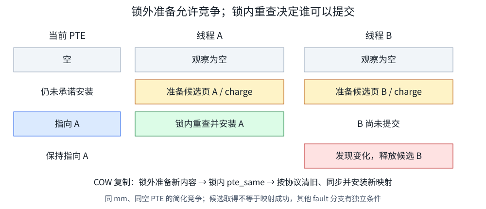

# arm64 缺页与 COW：从条目分类到锁内提交

基于 Linux 6.1.158、arm64。先限定普通基本页、私有匿名地址与非特殊 fault，不把 KSM、pin、大页和 userfaultfd 合成相同分支。背景见 [地址空间篇](../../03-address-space.md)。

缺页处理不是发现空条目就分配一页：它先确定访问是否允许、当前条目代表哪种状态，再准备数据。准备数据可能等待，所以安装时要在页表锁内重新确认旧状态；本篇用首次写入和 COW 说明这个“准备与提交分开”的协议。

## 1. 异常信息怎样成为公共 mm 的处理条件？

`arch/arm64/mm/fault.c` 根据 FAR 对应地址、ESR、执行级和异常原因形成 flags；取得适用 VMA，检查许可，再进入 `handle_mm_fault`。

FAR（Fault Address Register，故障地址寄存器）提供相关故障地址，ESR（Exception Syndrome Register，异常综合信息寄存器）记录异常类型及附加信息。下表中的 EPAN 是 Enhanced Privileged Access Never，相关扩展会影响特权访问检查；是否支持、启用仍按目标 CPU 与配置判断。

| 检查层 | 依据 | 不满足时 |
| --- | --- | --- |
| 可否处理当前异常 | mm、处理上下文、uaccess 异常表等 | 不做普通用户页安装 |
| VMA 是否覆盖 | 查询/扩展后的范围 | 用户错误或相应异常路径 |
| 操作许可 | VM_WRITE/EXEC/读许可及 EPAN 条件 | 不把权限错误修复成可写页 |
| 公共页表状态 | PMD/PTE、present、写保护等 | 分派到对应后备或特殊处理 |

读 fault 的 VMA 许可在本树不是只测试 VM_READ。取指、写入和 EPAN 等条件必须按 arm64 入口理解。

VMA 的可写规则也不等于当前 PTE 可写：COW 正是允许写入的私有范围暂时通过写保护条目共享内容。

## 2. PTE 分类为什么先于“分配页”？

`handle_pte_fault` 所做的主决策：

```text
PTE 尚不存在/为空：
    私有匿名 -> do_anonymous_page
    文件后备 -> do_fault 与文件回调
非 present 且有编码：
    swap、迁移、设备或其他特殊状态按类型处理
present：
    锁内核对 orig_pte
    适用写保护 -> do_wp_page
    否则按需更新 young/dirty 等访问属性
```

Non-present 不等于从未取得内容。把所有 non-present 都替换为新零页，会破坏被换出或正在迁移的数据。

PMD 若是大页，也不能把条目值当作下级页表地址；进入 PTE 之前已经存在对应大页分派。

## 3. 首次读为什么可用零页，写为什么要私有页？

读匿名零初始化内容可以在适用配置下映射共享零页。写入需要私有后备，不能把公共零页标为可写。

普通写路径在 `do_anonymous_page` 中先取得零初始化页、charge、设置 uptodate 并准备 PTE；**分配在 PTE 锁外，安装在 PTE 锁内**。

```c
/* mm/memory.c：do_anonymous_page 的提交检查摘录。 */
vmf->pte = pte_offset_map_lock(vma->vm_mm, vmf->pmd,
                              vmf->address, &vmf->ptl);
if (!pte_none(*vmf->pte))
    goto release; /* 当前路径未安装的候选归还。 */
/* 原实现继续检查地址空间稳定性、userfaultfd，建立 rmap/LRU 等。 */
set_pte_at(vma->vm_mm, vmf->address, vmf->pte, entry);
```

这段不能独立调用。它的意义是不能用锁外“当时为空”授权一次后来的覆盖。



## 4. 双线程首次写：到底增加了几张页？

同一 mm、同一个空 PTE，两个线程分别准备 A、B，均通过本例的 charge：

| 完成点 | 当前映射 | 当前 mm 匿名驻留变化 | 资源 |
| --- | --- | --- | --- |
| 两候选已准备 | 仍未安装 | 尚不能把两候选都记成已驻留映射 | A、B 由各自路径持有 |
| A 锁内成功提交 | 指向 A | 此位置增加一个匿名驻留页 | A 成为映射后备 |
| B 锁内发现不再为空 | 保持 A | 不增加第二个该地址驻留页 | B 没有获得映射身份，结束候选 |

两个成功物理分配不代表最终需要两张驻留页。返回零也不都表示该线程亲自安装：有的竞争退出由其他线程已经解决异常，访问可重试。

## 5. Fork 复制的是什么？

普通已驻留、无特殊 pin 的私有匿名路径在 `copy_present_pte/copy_page_range` 中建立父子共享、引用与反向关系，并写保护适用条目：

```text
原：父 mm 一条可写映射 -> P
后：父写保护 -> P <- 子写保护
VMA 仍允许私有写入；当前 PTE 写保护实施共享期间的 COW
```

文件 VMA 和未驻留地址不必都逐项复制现有 PTE；特殊 pin/匿名独占约束也可能改变复制选择。因此不能写成所有 fork 无条件共享全部数据页。

## 6. Do_wp_page 的复用判定不能缩成 refcount==1

本树先处理 userfaultfd 写保护和普通页识别，再区分匿名、共享映射等情形。

对于普通匿名页：

1. `PageAnonExclusive` 已明确该页独占时，沿对应复用分支。
2. 未有该保证时，排除 KSM/过多引用等不适合复用的情况。
3. 按需 drain LRU 暂存，在 folio 锁内重查引用和 swapcache 等状态。
4. 满足条件时调整匿名关系并复用；否则持有旧页临时引用、释放 PTE 锁，进入复制。

这些判断先后顺序很重要：锁外检查可优化，但不能代替锁内最终判定。mapcount 是映射关系数量，不是全部 pin、缓存和临时引用的数量。

普通共享可写文件映射的写保护解除通常联系文件脏化，不套用私有匿名复制。

## 7. 真正 COW 的集合变化

给定无特殊分支：父子各有一个基本页映射 P，`page_mapcount(P)=2`（不是原始 `_mapcount` 字段值），子写触发复制。

| 阶段 | 父映射 | 子映射 | 物理内容 | 映射数量 |
| --- | --- | --- | --- | --- |
| 原共享 | P，只读属性 | P，只读属性 | P | P 为 2 |
| 新 Q 准备完成 | P | 仍为 P | P、Q，Q 尚未映射 | P 仍为 2 |
| 子成功提交 | P | Q，可写 | P、Q | P 为 1，Q 为 1 |

普通匿名到匿名的替换不会把子进程这一地址的匿名驻留从一变二；全局却可能增加一张实际后备。若原来是文件内容，相关 file/anon 统计则需改变类别。

## 8. Wp_page_copy 怎样在竞争中安装 Q？

复制/charge 在锁外完成，旧页有必要临时引用。提交前建立相应 MMU notifier 范围，再拿 PTE 锁：

```c
/* mm/memory.c：wp_page_copy 中关键提交条件和顺序，其他更新省略。 */
if (pte_same(*vmf->pte, vmf->orig_pte)) {
    /* 准备新条目、执行相应 cache 操作。 */
    ptep_clear_flush_notify(vma, vmf->address, vmf->pte);
    page_add_new_anon_rmap(new_page, vma, vmf->address);
    /* 原实现继续处理 LRU、属性及相应统计。 */
    set_pte_at_notify(mm, vmf->address, vmf->pte, entry);
    /* 再按源码顺序结束旧页的映射关系和临时引用。 */
}
```

如果另一个线程已经把子 PTE 改为 R，旧 `(P,属性)` 不再匹配，Q 不能覆盖 R。本路径结束未安装候选和临时持有，不减少一个自己没有替换成功的旧映射。

清旧与翻译失效先于新映射，不是无关优化。否则不同 CPU 可同时持有同一 VA 的新旧翻译；旧映射关系还未正确结束却提前复用物理页，会让地址继续访问新使用者内容。

## 9. 锁、引用与翻译同步各管什么？

| 保护 | 关键职责 |
| --- | --- |
| mmap 读/写保护 | VMA 范围与规则存活，不串行化所有 PTE fault |
| PTE/PMD 锁 | 条目重查和提交 |
| 页/folio 引用 | 锁外准备期间旧/新对象存活 |
| folio、anon_vma 等保护 | 复用条件和匿名关系 |
| MMU notifier/TLB helper | 与其他翻译使用者协调，结束旧翻译 |

文件 fault 等回调可能释放 mmap 锁并返回 RETRY，上层必须重新找 VMA。不能把持有文件引用误认为旧 VMA 仍有效。

arm64 实际属性与失效实现见 `arch/arm64/include/asm/pgtable.h`、`tlbflush.h`；本文用 helper 的逻辑属性解释，不把单个硬件 bit 当成所有配置下相同的写许可。

## 10. 核对路线

从 `arch/arm64/mm/fault.c` 到 `mm/memory.c` 的 `handle_pte_fault`、`do_anonymous_page`、`copy_present_pte`、`do_wp_page`、`wp_page_copy`，逐项记录：观察到的旧条目、持有引用、候选身份、提交结果、实际统计和失败清理。

文件后备看 [页缓存](../page-cache/01-cache-writeback.md)，PMD 分支看 [THP](../page-size/02-thp.md)，反向关系看 [rmap](../reclaim/02-rmap.md)。所有时序为源码推演，未运行 fork/COW 或追踪实验。
