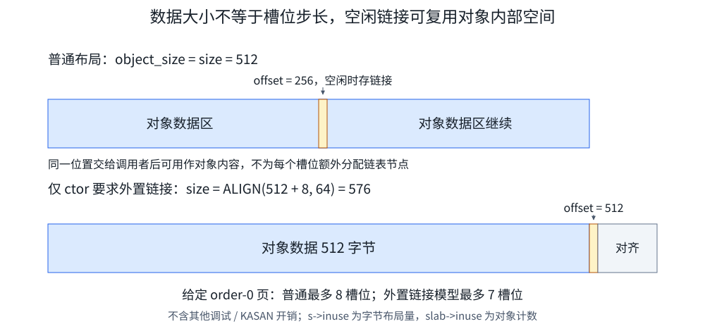
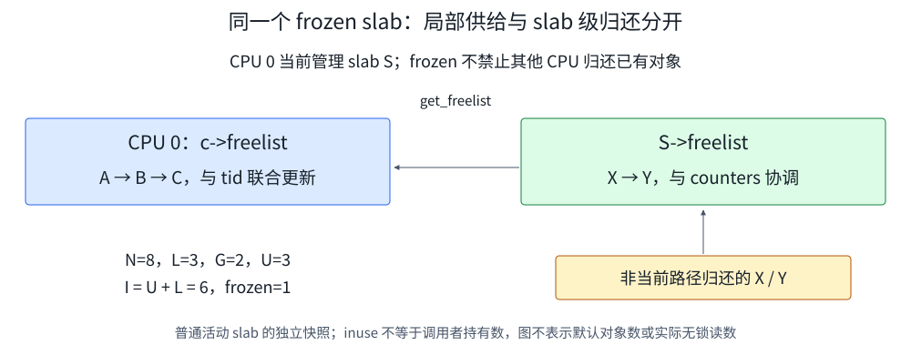
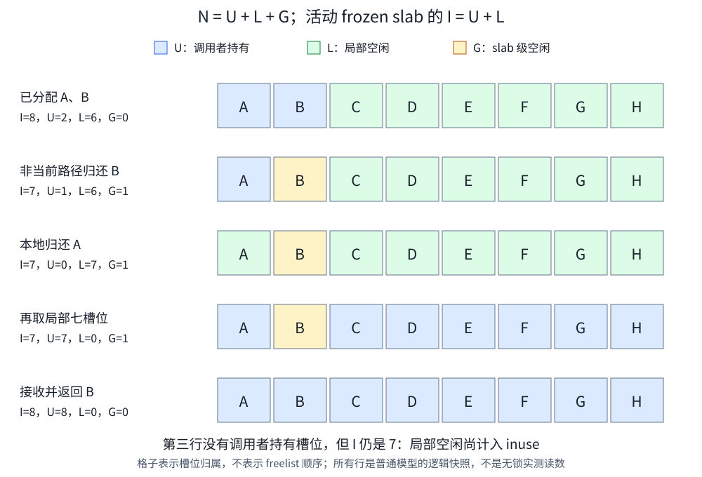
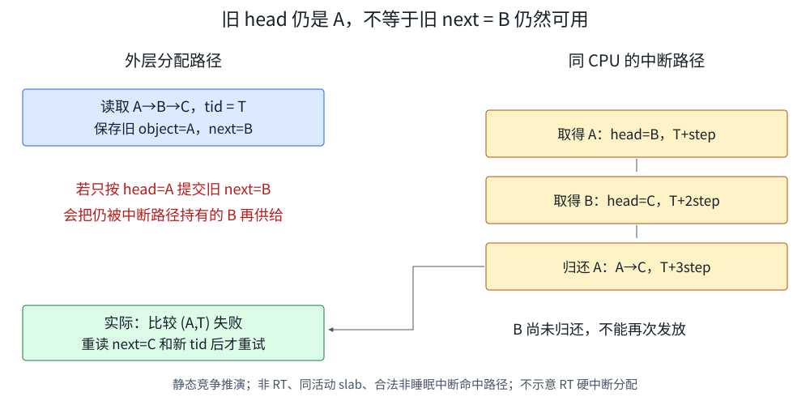
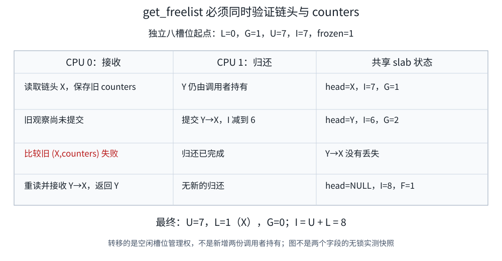
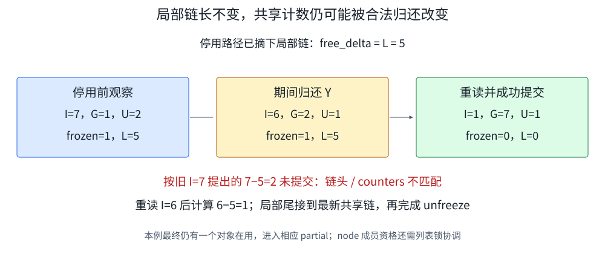

# SLUB：对象布局、CPU 供给与 slab 回收的实现

SLUB 的核心优化不是简单地“把一页切成小块”，而是**把一组槽位的分配权批量交给 CPU，让高频分配只修改局部状态；非局部归还和 slab 集合变化再通过另一套协议协调**。

本篇基于 Linux 6.1.158、arm64 的 `CONFIG_SLUB` 实现。先推演普通 cache：不进入改变对象复用的调试、quarantine 或 KFENCE 路径。无锁快路径部分另限定非 RT 分支；目标 `.config` 未提供，这些是讲解条件，不是实际运行配置。八槽位例子是限定模型，未执行内核实验。

读完应能从字段变化解释一次分配、远程释放、局部补给和 slab 停用，并能回到源码判断竞争分支。用法查询仍放在 [对象缓存 API](../../api-reference.md#cache)，这里不把内部函数列成驱动可调用接口。

<a id="layout"></a>

## 1. 一次对象申请怎样变成槽位布局？

### 1.1 类型大小、槽位步长和底层页数是三个量

普通小块 `kmalloc` 可使用相应大小档位的 cache；`kmem_cache_alloc` 从指定 cache 取得对象。这里讨论进入 SLUB 的对象路径，不把较大 kmalloc 的页分配分支混进来。

每个 cache 的几何规格在 `calculate_sizes` 中确定：

| 字段 | 单位与含义 | 不能混淆的量 |
| --- | --- | --- |
| `s->object_size` | 对象数据大小，字节 | 不是带所有元数据的槽位步长 |
| `s->size` | 相邻槽位的步长，字节 | 可能大于对象数据大小 |
| `s->offset` | 空闲链接相对对象地址的偏移，字节 | 不是对象个数 |
| `s->align` | 槽位对齐要求，字节 | 不把某款芯片的 cache line 大小当通用常量 |
| `s->inuse` | 对象及相应 redzone 之后的位置，字节 | 与 `slab->inuse` 的对象计数不是同一含义 |
| `s->oo` | 优选 slab 阶及该阶可容纳对象数的编码 | 不保证每次底层分配都使用优选阶 |
| `s->min` | 容纳槽位的最小阶及相应对象数 | 供优选阶失败时考虑回退 |

`kmem_cache` 定义在 `include/linux/slub_def.h:90`。这里最容易读错的是两个 `inuse`：cache 的是布局量，slab 的是计数量。

对于 kmalloc 大小档位，`object_size` 是这个 cache 的对象规格，未必等于某次调用实际请求的字节数。请求容量与 cache 布局仍需分别理解。

### 1.2 空闲链接为什么可以放在对象内部？

对象未交给调用者时，SLUB 用槽位中的一部分存放下一空闲对象的信息；分配后这段位置可以恢复为对象内容。这样无需为每个槽位另建一个外部分配描述符。

本树普通布局把 freepointer 放在对象中部附近，而不是固定在第一个机器字：

```c
/* mm/slub.c:4250：calculate_sizes 中普通布局分支摘录。 */
s->offset = ALIGN_DOWN(s->object_size / 2, sizeof(void *));
```

源码注释的理由是让链接位置离槽位边缘较远，降低相邻对象小范围越界直接击中链接的机会。这不是对越界访问的安全保证。

读写通过 `get_freepointer/set_freepointer` 完成。前者访问 `object + s->offset`；配置相关的编码、KASAN tag 和安全读取也通过 helper 处理。不能把所有配置的该位置都直接解释成明文 `next` 指针。



如果有 ctor、`SLAB_TYPESAFE_BY_RCU`、poisoning 等要求，不能随意覆盖对象内容，`calculate_sizes` 会采用相应的外置链接布局；redzone、tracking、KASAN 还可能增加空间。

取一个明确的 arm64 布局模型：基本页 4 KiB、对象 512 字节、对齐 64 字节，无额外布局开销，给定 order-0 slab。

| 布局模型 | offset | 槽位步长 | 该底层页最多容纳 |
| --- | --- | --- | --- |
| 普通内置链接 | 256 字节 | 512 字节 | 8 个 |
| 仅加入要求外置链接的 ctor，其他条件不变 | 512 字节 | `ALIGN(512 + 8, 64) = 576` 字节 | 7 个 |

这是给定阶的计算，不是承诺这个 cache 的优选阶一定为 0。它说明：增加一个指针不一定只损失八字节，最终对齐会改变步长和每 slab 对象数。

### 1.3 为什么优选阶可能比最小阶大？

`calculate_order` 在可接受阶、最少对象数和空间浪费之间取舍。较大 slab 可以让一次底层准备提供更多槽位，减少频繁换 slab；代价是更高阶物理连续分配更困难，且部分对象长期占用会保留更大底层区域。

本树逐步放宽可接受的余量、降低所需最少对象数，寻找布局；不是简单使用“对象大小除以页大小”的一次计算。

`allocate_slab` 先按 `s->oo` 尝试，失败后可按 `s->min` 回退。因此实际 `slab->objects` 来自此次使用的 order/objects 编码，不应拿 cache 的优选对象数替代每一个 slab 的实际对象数。

源代码入口：`mm/slub.c:4190` 的 `calculate_sizes`、`:3965` 的 `calculate_order`、`:1923` 的 `allocate_slab`。

<a id="objects"></a>

## 2. 一个 slab 由哪些对象管理？

SLUB 用一个 `struct slab` 表示底层存储和其槽位状态。它复用页描述符的存储，**不是在每个对象前面各加一个完整 `struct slab`**。内容地址与描述符地址仍然不同。

| 管理对象 | 保存什么 | 生命周期角色 |
| --- | --- | --- |
| `kmem_cache` | 类型规格、CPU/node 管理入口及策略 | 一类对象的分配设施 |
| `kmem_cache_cpu` | 活动 `slab`、局部 `freelist`、`tid`、适用 CPU partial | 该 CPU 当前的直接供给和暂存 |
| `struct slab` | 所属 cache、slab 级空闲链、计数和 frozen 状态 | 一组底层存储的管理对象 |
| `kmem_cache_node` | node partial 集合、计数与列表锁 | 可由不同 CPU 接管的供给集合 |

`mm/slab.h:23` 的 SLUB 布局将下面两部分相邻组织：

```c
/* 摘录：其他字段与配置分支未列出。 */
void *freelist;
union {
    unsigned long counters;
    struct {
        unsigned inuse:16;
        unsigned objects:15;
        unsigned frozen:1;
    };
};
```

`counters` 是这些计数字段的组合表示。原子更新可以同时验证链头和计数，避免只拿到彼此不匹配的一半状态。

此外要区分两种成员资格：

- `c->slab` 表示当前直接服务分配的活动 slab。
- `c->partial` 在适用配置下保存一组待接管的 slab，不是对象链。

`frozen` 本身不编码“由几号 CPU 持有”。实际管理关系由上述 CPU 指针和集合表示；frozen 表示它正在 CPU 管理协议中，不能被当作普通 node partial slab 任意接管。

<a id="accounting"></a>

## 3. 两条 freelist 与 inuse 的准确关系

### 3.1 为什么分成局部链和 slab 级链？

设 CPU 0 正在使用 slab S：

- `c->freelist` 是 CPU 0 已经接管、可以直接取得的空闲槽位。
- `S->freelist` 是 slab 级空闲链，可以接受非当前 slab 释放路径归还的槽位。

其他 CPU 不需要找到并修改 CPU 0 的局部 freelist。它知道对象属于 S，就能通过 S 的链与 counters 归还；CPU 0 日后再批量接收。



这种分工减少高频局部操作对共享 slab counters 和 node 集合的修改。代价是必须协调两份互不重叠的空闲供给，不能用一个 `inuse` 当作调用者持有数。

### 3.2 用三个集合推导计数，而不是背字段解释

对**普通、无延迟复用干预的活动 frozen slab**，在操作完成后的逻辑快照中定义：

```text
N = slab->objects
G = slab 级 freelist 中的槽位数
L = 当前 CPU 局部 freelist 中的槽位数
U = 已交给调用者且尚未归还的槽位数
I = slab->inuse
```

一个槽位在这个模型中只能属于三种集合之一：调用者持有、CPU 局部空闲、slab 级空闲。因此：

```text
N = U + L + G
I = N - G
I = U + L
U = I - L
```

`inuse` 对应的是**没有留在 slab 级空闲链中的槽位数**，其中包括 CPU 已接管但尚未交给调用者的 L。

这些等式用于推演源码更新；不能无锁读取几个字段和链表长度后，声称拿到了实际系统的原子快照。Quarantine、调试路径和其他状态也不能无条件套用这一模型。

### 3.3 八槽位的完整数值序列

设 S 有八个槽位 A～H，普通非 RT 路径，不触发节点切换和 CPU partial 分支。CPU 0 将取得的 B 合法交给 CPU 1 使用，然后 CPU 1 归还它。表格记录每一步完成后的 S，不拼接其他 slab 的状态。

| 步骤 | 操作 | Frozen | I | G | L | U |
| --- | --- | --- | --- | --- | --- | --- |
| 0 | 新 slab 尚未发布，八槽位在 slab 链 | 0 | 0 | 8 | 0 | 0 |
| 1 | CPU 0 接管供给，本次返回 A | 1 | 8 | 0 | 7 | 1 |
| 2 | CPU 0 再取得 B | 1 | 8 | 0 | 6 | 2 |
| 3 | CPU 1 归还 B，进入 slab 链 | 1 | 7 | 1 | 6 | 1 |
| 4 | CPU 0 归还 A，进入局部链 | 1 | 7 | 1 | 7 | 0 |
| 5 | CPU 0 陆续取走局部七个槽位 | 1 | 7 | 1 | 0 | 7 |
| 6 | 接收 slab 链中的 B，并返回 B | 1 | 8 | 0 | 0 | 8 |
| 7 | 再次取对象，S 两条链都空，退出活动管理 | 0 | 8 | 0 | 0 | 8 |

步骤 4 最值得注意：所有调用者都已归还，但 `inuse` 仍是七，而不是零。因为七个空闲槽位仍由 CPU 0 局部链管理。它们在停用 slab 时才从这层计数中扣除。

步骤 7 不表示整次对象申请一定失败：S 已 full，分配器可以继续寻找另一组供给。也不表示 S 被释放，它还有八个调用者持有对象。

该步的 L=0 指 S 已经不再持有局部供给，不包含随后另一个活动 slab 的 freelist。



<a id="acquire"></a>

## 4. 供给怎样被接管，什么时候需要原子比较？

### 4.1 私有新 slab：先建链，后发布

`allocate_slab` 为此次实际阶设置 `objects`，先令 `inuse=0`、`frozen=0`，再建立槽位链。非随机化建链分支按 `s->size` 前进，通过 `set_freepointer` 连接；ctor 等初始化在 `setup_object` 中处理。

`___slab_alloc` 收到一个尚未交给其他使用者的新 slab 后，可以直接进行：

```c
/* mm/slub.c:3181：未共享的新 slab 分支摘录。 */
freelist = slab->freelist;
slab->freelist = NULL;
slab->inuse = slab->objects;
slab->frozen = 1;
```

这不是已共享 slab 都能省略 CAS 的证据。此时整条链由当前路径持有，之后在 local lock 下重新检查 `c->slab`，再装入 CPU 管理状态。

分配底层页时可能暂时放开 CPU 定位保护，回来以后 CPU 或其活动 slab 已变化。因此 `retry_load_slab` 必须检查并处理这期间出现的活动供给，不能用早先观察直接覆盖 `c->slab`。

### 4.2 Node partial 接管：为什么有列表锁还需要 CAS？

设一个 node partial slab 当前 `N=8, I=2, G=6`，两对象在用。`acquire_slab(..., mode=1)` 希望把六个空闲槽位批量交给 CPU：

```text
旧状态：slab.freelist = 六槽位链，I=2，frozen=0，位于 node partial
目标： slab.freelist = NULL，I=8，frozen=1，六槽位链转交局部路径
```

核心摘录：

```c
/* mm/slub.c:2163：acquire_slab 的 mode=1 路径，调用者持 n->list_lock。 */
freelist = slab->freelist;
counters = slab->counters;
new.counters = counters;
new.inuse = slab->objects;
new.freelist = NULL;
new.frozen = 1;

if (!__cmpxchg_double_slab(s, slab,
        freelist, counters, new.freelist, new.counters, "acquire_slab"))
    return NULL;

remove_partial(n, slab);
return freelist;
```

为什么不能在列表锁内直接清链？因为某些归还只改变 slab 链和计数，不改变 node 集合，不需要拿这把列表锁。

例如另一路归还 X，使 `I:2→1`、`G:6→7`。如果接管者清空新链却仍返回早先六槽位链，就会遗漏 X。联合比较失败使旧观察不能提交，partial 成员资格也没有被错误移除。

当前 `acquire_slab` 在这次比较失败时返回 NULL；它不是在 helper 内无条件忙等成功。上层搜索和供给路径按自己的分支处理。

### 4.3 接管后的首次返回

取得的链先由函数局部变量持有，随后 `retry_load_slab/load_freelist` 在 CPU 管理保护下装入活动 slab，取走链头，把剩余链作为 `c->freelist`，推进 tid。

因此 `I:2→8` 的变化不是突然有六个新调用者；是六个空闲槽位的管理权转移。首个对象真正返回后才是 `U:2→3`、`L:6→5`。

<a id="local"></a>

## 5. 本地分配与 tid：为什么链头相同仍不能提交？

### 5.1 一次无竞争取对象改变了什么？

`slab_alloc_node` 对适用 cache 执行前置处理，然后读取 CPU 数据；活动 slab、node 和快路径条件满足时，取得链头和下一对象，以一组比较更新局部链和 tid。

```c
/* mm/slub.c:3300 起的函数内摘录；前后 hook 与慢路径分派未列出。 */
c = raw_cpu_ptr(s->cpu_slab);
tid = READ_ONCE(c->tid);
barrier();
object = c->freelist;
slab = c->slab;

next_object = get_freepointer_safe(s, object);
if (!this_cpu_cmpxchg_double(
        s->cpu_slab->freelist, s->cpu_slab->tid,
        object, tid, next_object, next_tid(tid)))
    goto redo;
```

比较的旧值是 `(object, tid)`，目标是 `(next_object, next_tid(tid))`。此步骤只影响局部管理，不逐个更新 slab 的 `inuse`：

```text
取对象：L 减一，U 加一，G 不变，因此 I = U + L 不变
```

`barrier()` 是编译器屏障，用于保持这段观察的次序，不能把它当作所有 CPU 的对象发布屏障。

### 5.2 一个能实际说明问题的 ABA 序列

初始局部链 `A→B→C`，tid 为 T。外层分配路径观察 `object=A, next=B, tid=T`，随后同 CPU 的合法非睡眠中断路径也使用该 cache：

| 步骤 | 局部链 | tid | 关键事实 |
| --- | --- | --- | --- |
| 外层已观察 | A→B→C | T | 保存了旧 next=B |
| 中断取得 A | B→C | T+step | A 暂时被中断路径持有 |
| 中断取得 B | C | T+2step | B 仍由中断路径使用 |
| 中断归还 A | A→C | T+3step | 链头回到 A，但 A 的 next 已变成 C |
| 外层尝试旧提交 | 仍是 A→C | T+3step | 旧 tid 不匹配，提交失败 |

如果只验证链头 A，外层可能把 B 重新设为链头，导致仍被使用的 B 再次进入供给。这就是为什么“指针还是同一个”不能证明列表从未变化。

重新读取后，外层看到 `next=C` 和新 tid，按新的观察提交，才不会把 B 再发出去。图只推演非 RT 的该快路径，中断分配使用适用非睡眠策略，不是允许在中断中调用 `GFP_KERNEL`。



### 5.3 Tid 怎样区分操作与 CPU？

本树 `next_tid` 加 `TID_STEP`；在 `CONFIG_PREEMPTION` 下，step 为 `roundup_pow_of_two(CONFIG_NR_CPUS)`，tid 初值取 CPU 编号。不同 CPU 的标识与后续局部操作序列参与比较。

外层读取时可能被抢占，最终 per-CPU 原子操作使用当时的 CPU 数据。如果不在原 CPU 或局部序列已经变化，相应比较不能沿用旧观察。

这是具体实现中的有限宽度事务标识，不是一张无限历史表。也不为调用者提供业务对象的身份或引用计数。

### 5.4 本地释放是同一组状态的逆向操作

`do_slab_free` 中，若 `slab == c->slab`：

```text
在已结束调用者使用的对象中写入指向当前局部链的链接
联合验证旧 freelist 与 tid
成功则将对象链挂到 c->freelist，推进 tid
失败则重新读取并重新接链
```

在模型中 `U` 减一、`L` 加一，`I` 不变。写空闲链接不等于获得了一把业务对象锁；调用者必须先保证没有其他合法内容访问者。

<a id="remote"></a>

## 6. 非当前 slab 释放与局部补给如何竞争？

### 6.1 “远程”不只指换了 CPU

真正的分派条件是被释放对象的 slab 是否等于**当前 CPU 现在的** `c->slab`。即使在原 CPU 上释放，如果它已经切换活动 slab，也会走 `__slab_free`。

对象通过适用页 / slab 关系找到所属 cache 和 slab，不靠在每个对象中保存“拥有者 CPU 编号”来追踪局部链。

### 6.2 归还到仍 frozen 的 slab

普通 `__slab_free` 将归还的单个对象或对象链接到 `slab->freelist`，同时减少 `inuse`：

```c
/* mm/slub.c:3512：循环主干；节点集合判断另在下文解释。 */
prior = slab->freelist;
counters = slab->counters;
set_freepointer(s, tail, prior);
new.counters = counters;
was_frozen = new.frozen;
new.inuse -= cnt;

/* 原循环通过 cmpxchg_double_slab 联合提交 head 与 new.counters，
 * 失败时重新读取 prior/counters 并重新连接尾节点。 */
```

`U` 减 `cnt`、`G` 加 `cnt`，`L` 不变，于是 `I=N-G` 相应下降。Frozen 仍为一时，这次归还通常不需要改 node 列表，因为 slab 仍处于 CPU 管理协议。

这不是任意 CPU 无保护地写 slab 字段。联合比较验证完整旧状态，失败不能继续用旧尾链接覆盖后来归还的对象。

### 6.3 CPU 局部链用完以后，怎样接收 slab 链？

`___slab_alloc` 在 local lock 下再次检查活动 slab 和 `c->freelist`。局部链仍为空时调用 `get_freelist`：

```c
/* mm/slub.c:2971：get_freelist 的主体；要求 CPU 管理保护。 */
do {
    freelist = slab->freelist;
    counters = slab->counters;
    new.counters = counters;
    VM_BUG_ON(!new.frozen);
    new.inuse = slab->objects;
    new.frozen = freelist != NULL;
} while (!__cmpxchg_double_slab(s, slab,
        freelist, counters, NULL, new.counters, "get_freelist"));
return freelist;
```

若接收到 k 个槽位，管理权从 G 转到局部路径：`G→0`、`I→N`，局部链获得 k 个槽位。本次返回链头后，剩余 k−1 个留在 CPU 链。

若在验证时两条链都没有可用对象，原子更新将 frozen 清零，helper 返回 NULL，调用路径清除相应活动状态并找其他供给。不是永远保持一个已 full 的 slab 为局部供给。

### 6.4 一次归还与接收竞争的完整数值

下面是独立于前面 A～H 序列的八槽位起始快照：局部链为空，slab 链只有 X，`I=7,F=1,U=7`。Y 是其中一个调用者持有的槽位。

| 时刻 | CPU 0 接收供给 | CPU 1 归还 Y | slab 当前状态 |
| --- | --- | --- | --- |
| 观察 | 读到链头 X、I=7、F=1 | 尚未提交 | G=1，U=7 |
| 归还 | 尚未比较 | 接为 Y→X，I 变 6 | G=2，U=6，F=1 |
| 旧提交 | 比较 `(X,旧 counters)` 失败 | 已完成 | Y→X 没有被抹掉 |
| 重读并接收 | 比较新状态成功，清 slab 链、I=8 | 无新变化 | 两槽位交到局部路径 |
| 返回 Y | 剩余 X 留在局部链 | 无新变化 | G=0，L=1，U=7，I=8 |

仅清链头或只更新计数，都会把归还和转移的集合变化割裂。正确实现既验证旧链头，也验证 counters。



<a id="partial"></a>

## 7. 局部供给彻底用完以后，怎样找下一块 slab？

### 7.1 空局部链不等于没有现成对象

`___slab_alloc` 按当前状态处理：

1. 当前 slab 匹配 node 和 pfmemalloc 等条件时，先再查局部链和 slab 级链。
2. 不适用或已退出活动状态时，考虑配置相关的 CPU partial。
3. 再通过 `get_partial` 搜索 node partial，包含适用节点选择。
4. 没有合适现成供给才尝试 `new_slab`。

这不是每次都完整执行的总调用链。节点不匹配、调试分配、抢占后的状态变化会改变路径；每次回来都要验证相关观察，而不是直接套用第一次取得的 CPU 指针。

### 7.2 CPU partial 存的是整组供给，不是对象链

普通 full、unfrozen slab S 的 `G=0,I=N`。一次非当前 slab 释放使 `G>0,I<N`，如果 cache 可以使用 CPU partial，`__slab_free` 会在同一状态提交中把它 frozen，再交给 `put_cpu_partial`。

例如 N=8、归还一个槽位：

```text
旧：full、frozen=0、I=8、G=0
新：frozen=1、I=7、G=1
随后：挂入释放路径所在 CPU 的 partial 集合
```

它不是立刻成为 `c->slab`，也不需要把七个仍在用的对象搬到另一个 CPU 的物理内存。

Node partial 搜索还可在接管一个活动 slab 的同时，冻结额外 slab 留作 CPU partial。`acquire_slab` 的 `mode=0` **保留 slab 级 freelist 和原 inuse**，仅改变 frozen 与集合；不能把 mode=1 的清链、I=N 规则套过来。

### 7.3 暂存容量与 drain

本树 `slub_set_cpu_partial` 将对象数量参考换算为 slab 数量限制，并采用近似半满假设；`put_cpu_partial` 实际检查 partial slab 计数。

达到适用 drain 条件时，先在 local lock 内摘下旧集合、接入新 slab，实际 unfreeze 放到局部临界区外。`__unfreeze_partials` 在 node 保护下清 frozen，决定加入 node partial 还是回收空 slab。

CPU partial 没有活动局部对象链需要再归还，所以这一步不执行活动 slab 的 `inuse -= L`。这又说明 frozen=1 不能单独证明“某个 CPU 的活动 freelist 有 N 个槽位”。

<a id="deactivate"></a>

## 8. Deactivate_slab 怎样真正结束活动管理？

### 8.1 先从 CPU 字段摘下，再处理共享 slab

`flush_slab` 或活动切换路径在 local lock 下保存旧 `c->slab` 和 `c->freelist`，清 CPU 指针并推进 tid。后续 `deactivate_slab` 接管这条局部空闲链。

这样局部链不会同时被新分配路径消费。函数收到的 `freelist` 参数是要归还的供给，不是一次任意无锁链表遍历。

本节沿用 L 表示**停用函数持有的原局部空闲链长度**。此时 `c->freelist` 字段已清空，但这组槽位尚未接回 slab 链；不能把字段为空误读成没有待归还供给。

### 8.2 第一阶段为什么要数 free_delta？

`deactivate_slab` 遍历传入链，计算 `free_delta` 并记住尾对象。普通正常链中 `free_delta=L`。

这是因为本地释放和分配没有逐次改变 slab 的 inuse。退出 CPU 管理时，必须一次把这 L 个空闲槽位从 I 中扣除，并接回 slab 链。

源码还检查链损坏；异常隔离分支不按本文正常等式强行继续。扫描成本取决于这条链长，不把所有 slab 停用都当作 O(1)。

### 8.3 第二阶段同时接链、扣计数、解除 frozen

设一个新的独立快照：N=8、I=7、G=1、L=5、U=2。停用后的目标是：

```text
新 G = 1 + 5 = 6
新 I = 7 - 5 = 2
新 L = 0
新 frozen = 0
调用者仍持有两对象，没有新分配或释放
```

核心摘录：

```c
/* mm/slub.c:2471：deactivate_slab 第二阶段。
 * 原实现还选择 mode、按需取得 node 锁，再执行联合比较。 */
old.freelist = READ_ONCE(slab->freelist);
old.counters = READ_ONCE(slab->counters);
new.counters = old.counters;
if (freelist_tail) {
    new.inuse -= free_delta;
    set_freepointer(s, freelist_tail, old.freelist);
    new.freelist = freelist;
} else {
    new.freelist = old.freelist;
}
new.frozen = 0;
```

这里扣的是当前 L，而不是所有空闲对象。G 中的对象此前已经通过 slab 级归还减少过 inuse，不能重复再扣一次。

### 8.4 数完 L 后又有人归还，为什么还要重试？

局部链已摘下，L 不再由当前 CPU 消费；但另一个 CPU 仍可合法归还尚在使用的对象。

| 时刻 | 停用路径观察 / 目标 | 共享实际状态 |
| --- | --- | --- |
| 数完局部链 | L=5 | I=7，G=1，F=1，U=2 |
| 读取旧状态 | 计划 I=2、G=6、F=0 | 仍是旧快照 |
| 另一路归还 Y | 旧计划暂未提交 | I=6，G=2，F=1，U=1 |
| 提交旧计划 | 链头 / counters 比较失败 | 新归还没有丢失 |
| 重读并接链 | 用 I=6 扣五，尾链接到新链头 | I=1，G=7，F=0，U=1 |

重试不是重复扣同一个已提交的 L：失败没有提交新计数，每一轮从新读到的旧 counters 构造目标。



### 8.5 Frozen 改变与 node 成员资格为什么要协调？

`deactivate_slab` 根据目标状态选择 mode，并在需要加入 partial / 跟踪 full 集合时拿 node `list_lock`，**比较成功后才执行相应入队**。比较失败则释放这轮取得的锁，重新计算目标。

如果先把仍 frozen 的 slab 挂入 node partial，其他 CPU 会从可接管集合看到一个尚未完成交接的对象。反过来，如果清 frozen 后不协调成员资格，最后一次归还可能尝试从一个尚未正确入队的集合退出。

Node 锁不是禁止所有归还：不改变成员资格的 slab 链更新仍可进行。它保证需要改变 node 集合的相关路径不会越过交接边界，slab 联合比较再保证状态本身匹配。

### 8.6 Partial、full、empty 分别去哪里？

| 提交后状态 | 主要去向 | 需要理解的策略 |
| --- | --- | --- |
| G>0、仍有在用对象 | node partial | 保留现成供给，供后续 CPU 接管 |
| G=0、I=N | full 状态 | 普通配置不必挂 full 链表；跟踪配置另处理 |
| I=0、node partial 已达到适用 min_partial | discard 路径 | 不必再为热供给保留这组空资源 |
| I=0、适用保留条件未满足 | 可留在 node partial | 空 slab 仍可能作为可复用库存 |

例如 `s->min_partial=5`：在这一判断点 `n->nr_partial=4` 的空 slab 可保留为第五个；计数已是五时，同样空 slab 可以进入 discard。五只解释该限定快照，不是每个 cache 固定的默认行为或全局容量。

并发中其他路径还会改变 node 集合，这是一项保留策略检查，不是保证整个系统永久维持一个精确 partial 数量的硬下限。

八槽位总表中的步骤 4 可以在这里继续：U=0、L=7、G=1、I=7。停用时扣七并接回一，得到 G=8、I=0；随后才按 node 保留策略决定是否释放底层页。

<a id="release"></a>

## 9. 结束最后一个对象后，底层页怎样回到分配器？

普通非当前 slab 释放在已经 unfrozen 的状态下，可能需要维护 node partial：full→partial、partial→empty 等状态转换会触发相应集合操作，不只是更新一个 freepointer。

CPU partial 可用时，某些 full→partial 转换会冻结并暂存；不用 CPU partial 时，才沿相应 node 集合路径处理。完整分派在 `__slab_free`，不能用“非当前释放都拿 node 锁”替代这些条件。

最终普通销毁链是：

```text
确认槽位和成员资格满足回收
  -> discard_slab：减少适用 node slab 统计
  -> free_slab：按是否需要 RCU 延后选择
  -> __free_slab：结束 slab 类型、记账和页管理状态
  -> __free_pages：以实际底层阶归还
```

`__free_slab` 用实际 folio 阶，不拿 `s->oo` 优选阶作为释放参数。前面实际分配可能回退，这里的配对必须以当前存储为准。

`SLAB_TYPESAFE_BY_RCU` 使整组底层页的回收走相应 RCU 延后，并不使每个已归还槽位都保持旧对象身份直到宽限期结束。槽位可能重新使用，读者仍需按实际对象协议检查身份和取得引用。

<a id="arm64"></a>

## 10. arm64、RT 和调试条件怎样影响以上实现？

### 10.1 两类双字比较不要混用

| 操作 | 比较的二元状态 | 要解决的竞争 |
| --- | --- | --- |
| `this_cpu_cmpxchg_double` | CPU freelist 与 tid | 当前 CPU 序列变化 / CPU 定位变化导致旧观察失效 |
| `cmpxchg_double_slab` 等 | slab freelist 与 counters | 共享归还、批量接管、unfreeze 的状态变化 |
| node `list_lock` | 相应集合的成员资格 | node partial / 跟踪集合的取得、加入和移除 |

本树 arm64 选择相应双字原子与 SLUB 页描述符对齐支持；`arch/arm64/include/asm/percpu.h` 的局部包装在最终操作时处理抢占定位，`cmpxchg.h` 区分 local 和带相应顺序的版本。

这要求配对数据的大小、相邻位置和对齐符合 helper 约束。不能据函数名规定每一款芯片固定使用同一种机器指令，也不能把局部操作的完成当作业务对象对其他 CPU 发布的全部屏障。

### 10.2 RT 不是把相同快路径原样运行

`mm/slub.c:172` 的配置分支在 PREEMPT_RT 下令 `USE_LOCKLESS_FAST_PATH()` 为 false，CPU 定位与 local lock 的处理也有相应变化。本地释放可转到 local lock 内验证和更新字段。

因此第 5 节中断 ABA 图只是非 RT 快路径模型，不能当作该 RT 分支的硬中断运行示例。Slab 级比较 helper 还存在按标志和能力选择的 bit-lock 回退；具体分配和释放上下文应遵循目标树 API。

### 10.3 调试和延迟复用会改变模型边界

调试 cache 可以走单对象 partial 分配、额外元数据检查或跟踪集合，而不是普通 frozen 批量转移。`SLAB_STORE_USER` 的 full 跟踪不是所有 full slab 都有的一条常驻列表。

KASAN 相关 hook 可以暂缓某些对象复用，KFENCE 可能提供不同存储，memcg 前后置处理也可能影响分配结果。本篇没有删掉这些事实，但核心计数表先限定普通路径，避免把不同协议拼成同一张状态表。

## 11. 从源码与实际问题中检验理解

| 现象或问题 | 应先解释什么 | 定向入口 |
| --- | --- | --- |
| 已归还业务对象，inuse 仍非零 | L 是否仍计入 I；是否为活动 frozen slab | `get_freelist`、`deactivate_slab` |
| 远程归还后局部链暂未增加 | 对象是否在 G 等待批量接收 | `__slab_free`、`get_freelist` |
| 局部链头没变但比较失败 | tid / CPU 序列是否已经改变 | `slab_alloc_node`、`next_tid` |
| partial 接管持列表锁仍比较失败 | 另一路是否只改变了 slab 链与 counters | `acquire_slab`、`__slab_free` |
| slab 没有对象在用仍保留页 | 局部链是否归还、库存或 RCU 条件是否满足 | `deactivate_slab`、`free_slab` |
| 同 cache 的 slab 对象数不同 | 是否发生实际底层阶回退或布局影响 | `allocate_slab`、`calculate_sizes` |

一条局部取对象路径省去哪些共享工作，可以从实际写集看到；但 hooks、cache miss、重试和慢路径使整次分配不能用一个 O(1) 标签代表固定时延。

理解统计时也要区分业务持有、局部库存、slab 库存和底层页保留。本文没有采集 `/proc/slabinfo`、修改 debug 配置或运行压力实验。

本篇已从对象布局和集合计数推导到关键更新、两类竞争、partial 交接及底层回收；完整 cache 合并、NUMA 搜索策略和每一种调试 / hardening 分支仍有独立阅读空间。具体源码位置与算例核对集中在 [核对附录](../../99-evidence.md#slub-rewrite)。
