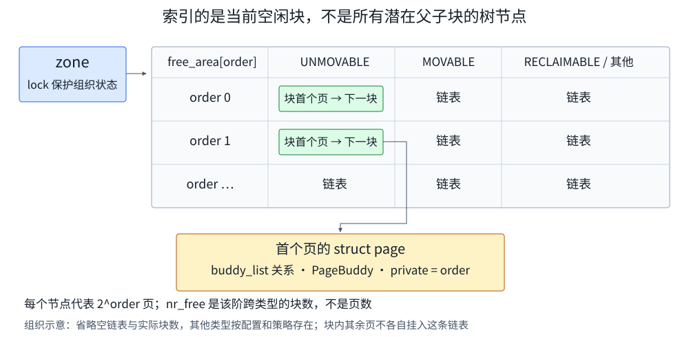
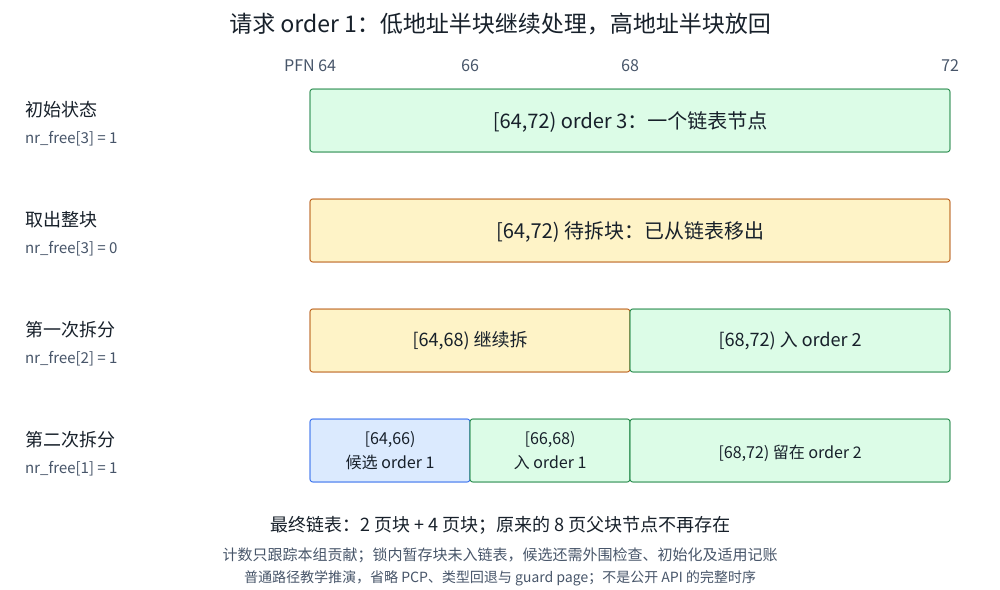
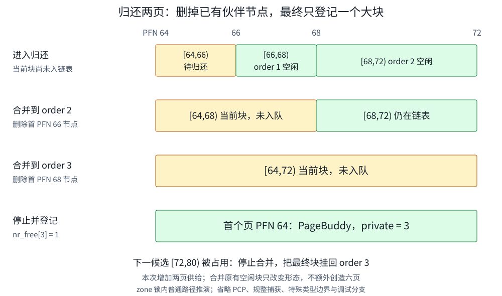
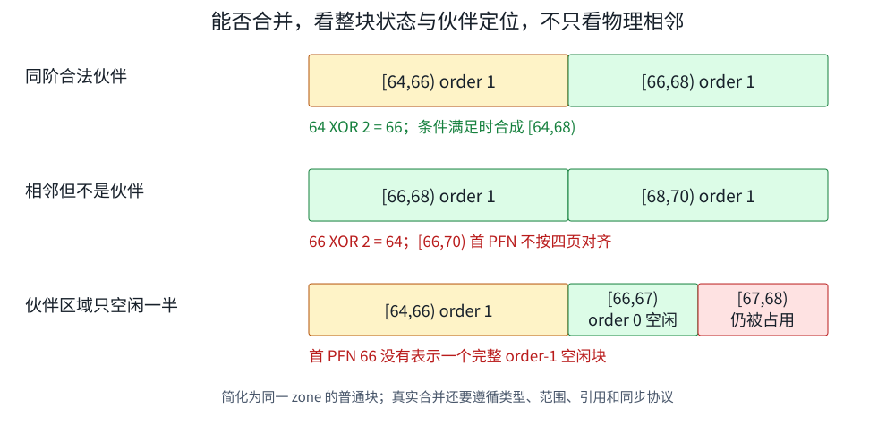

# Buddy：空闲页块的组织、分配与合并

[分配篇](../../02-allocation.md) 已经介绍了按阶页块、PCP、对象缓存和虚拟工作区的分工。本篇进一步回答：**一个空闲块在源码里怎样表示？申请较小块时改变了什么？归还时凭什么可以合并？**

基线为 Linux 6.1.158、arm64。图和算例是源码规则的推演，不是目标机运行记录。页数使用基本页计量，不预设实际 `PAGE_SIZE`。

## 1. 先限定 Buddy 在分配路径中的职责

一次 `alloc_pages` 请求不只是查空闲链表。外围需要决定允许使用的节点和 zone、检查水位、选择供给路径，必要时进入慢路径。Buddy 负责其中一项工作：**在给定 zone 中，维护按阶组织的空闲块，取出或归还符合条件的块。**

先把两类决策分开：

| 决策 | 本篇关注到哪里 |
| --- | --- |
| 从哪个 node / zone 取，能否动用相应供给？ | 已有总览和分配篇解释，本篇假定相应条件满足 |
| 当前 zone 的哪些空闲块能满足阶和类型？ | 本篇主线 |
| 目标阶没有块时，怎样从大块拆出小块？ | 本篇主线 |
| 归还块时，怎样与已有空闲块合并？ | 本篇主线 |
| 无块时要回收、规整、重试还是失败？ | 留给慢路径专题，不拼接成固定流水线 |

源码连接关系可以分段阅读：

```text
公开页分配入口
  -> __alloc_pages
  -> get_page_from_freelist：范围、水位等检查
  -> rmqueue：选择 PCP 或直接 Buddy 路径

直接 Buddy 路径：
  rmqueue_buddy -> __rmqueue -> __rmqueue_smallest

PCP 需要补给时：
  rmqueue_bulk -> __rmqueue -> __rmqueue_smallest
```

这是有条件的路径关系，不表示每次请求都会依次执行两条分支。CMA、HIGHATOMIC 和类型回退可能改变 `__rmqueue` 内部选择；本篇先固定普通迁移类型且不触发回退，随后再加入边界。

实现位置：`mm/page_alloc.c` 的 `__alloc_pages`、`get_page_from_freelist`、`rmqueue`、`rmqueue_buddy` 和 `rmqueue_bulk`。

<a id="representation"></a>

## 2. 源码里保存的是空闲块首个页，不是一棵显式二叉树

### 2.1 两个索引维度：阶与迁移类型

Buddy 将空闲块限定为 `2^order` 个连续基本页。一个 order-3 块是八页，首 PFN 必须按八页对齐。

Linux 没有为每个潜在父子块创建一套树节点。它通过 PFN 计算伙伴关系，通过链表索引当前实际存在的空闲块：

```c
/* include/linux/mmzone.h：摘录，zone 的其他字段省略。 */
struct free_area {
    struct list_head free_list[MIGRATE_TYPES];
    unsigned long nr_free;
};

struct zone {
    /* ... */
    struct free_area free_area[MAX_ORDER];
    /* ... */
    spinlock_t lock;
    /* ... */
};
```

查找的方向是：

```text
zone
  -> free_area[order]
  -> free_list[migratetype]
  -> 某个空闲块首个页的 struct page
```



`order` 决定块大小；`migratetype` 决定放置与回退分类。普通类型包括 `MIGRATE_UNMOVABLE`、`MIGRATE_MOVABLE`、`MIGRATE_RECLAIMABLE`；另有 HIGHATOMIC 和按配置存在的 CMA、ISOLATE 等类型。

类型分类旨在减少不易迁移的内容散落在可移动区域中的情况，但它不是具体页永远可迁移的保证，也不是不同类型一概不能互相使用。回退有专门规则，不能把所有链表简单合成“任意可用页”。

### 2.2 一个块由哪些信息共同表示？

对于普通 Buddy 空闲块，首个页描述符保存如下信息：

| 信息 | 表示什么 | 不表示什么 |
| --- | --- | --- |
| `page->buddy_list` | 首个页挂在哪条空闲链表中 | 不是块内每个页都各挂一次 |
| `PageBuddy(page)` | 该描述符是 Buddy 空闲块首个页 | 不是所有未被调用者使用的页都有这个标记 |
| `page_private(page)` | 在 Buddy 状态下记录块的 order | 不能对任意 `struct page` 都解释成阶 |
| 页所属的 zone | 资源归属与合并边界 | 不由物理相邻关系自动证明相同 |
| 页引用状态 | 当前是否仍有适用引用 | 引用计数不保存普通按阶分配的原始大小 |

在本树中，`PageBuddy` 通过 `include/linux/page-flags.h` 的 `PAGE_TYPE_OPS(Buddy, buddy)` 实现，不需要套用旧版本的 `PG_buddy` 位布局。

`set_buddy_order` 同时设置 `private` 和 Buddy 类型；`del_page_from_free_list` 移除链表节点、清除 Buddy 类型并将 `private` 置零。**这些字段是分配器的元数据，调用者不能为了“让页可释放”自行修改它们。**

还有一个阅读上的细节：本树的 `get_page_from_free_area` 用 `struct page.lru` 取链表节点，增删函数则使用 `buddy_list`。两者在 `include/linux/mm_types.h` 中属于同一 union 的存储位置，不能据此推断该页同时在活跃 LRU 和 Buddy 链表中。

### 2.3 nr_free 计数的单位是块

`free_area[order].nr_free` 统计该阶的空闲块数，跨该阶的迁移类型汇总，不是基本页数。

例如：

| Order | nr_free | 对应基本页数 |
| --- | --- | --- |
| 0 | 0 | 0 |
| 1 | 1 | 2 |
| 2 | 1 | 4 |
| 3 | 0 | 0 |

这四阶链表中有两个块，覆盖六个基本页。换算关系为：

```text
链表中块覆盖的基本页数 = Σ nr_free[order] × 2^order
```

这里算的是当前 Buddy 链表中的块。它不包括留在 PCP 中的页，也不等于某次请求必然能用的页数；类型限制、水位、范围和隔离状态仍需分别判断。

<a id="allocation"></a>

## 3. 一次分配：从 order-3 块取出 order-1 块

### 3.1 先固定初始状态

选择便于计算的局部 PFN，而不是某款 arm64 芯片的实际物理布局：

- `[64,72)` 是同一 zone、同一普通迁移类型中的一个 order-3 空闲块。
- 该类型的 order 1、2 链表没有其他可供本例选择的块。
- 请求 order 1；范围与水位已允许，直接讨论 Buddy 核心过程，不加入 PCP 中间供给。
- 不启用本例中的 guard-page 分支；`MAX_ORDER` 足以容纳 order 3。
- 表中计数只追踪这组局部块对 `nr_free` 的贡献，zone 的其他块保持不变。

目标不是凑两张任意空闲页，而是取得一个按两页对齐的连续两页块。

### 3.2 先选块，再把剩余部分放回



`__rmqueue_smallest` 从请求阶向上找，取该类型中最小的可用阶：

```c
/*
 * mm/page_alloc.c：__rmqueue_smallest 的主干摘录。
 * 省略类型记录、trace；上层已持有 zone->lock。
 */
for (current_order = order; current_order < MAX_ORDER; ++current_order) {
    area = &zone->free_area[current_order];
    page = get_page_from_free_area(area, migratetype);
    if (!page)
        continue;

    del_page_from_free_list(page, zone, current_order);
    expand(zone, page, order, current_order, migratetype);
    /* 原实现还记录相应类型并触发事件。 */
    return page;
}
return NULL;
```

“最小”说的是符合本次类型选择的可用阶，不是遍历所有 zone、所有类型后求一个全局最优块。链表内也不是逐页扫描寻找连续区间，而是直接取一个已经组织好的块首个页。

本例找到 order 3 后，先将 `[64,72)` 整块移出 order-3 链表。随后 `expand` 每下降一阶，将高地址半块放回，低地址半块继续拆分：

| 步骤 | 保留继续处理的部分 | 放回链表的部分 | nr_free 的局部变化 |
| --- | --- | --- | --- |
| 取出 order-3 块 | `[64,72)` | 无 | order 3：1 → 0 |
| 下降到 order 2 | `[64,68)` | `[68,72)`，order 2 | order 2：0 → 1 |
| 下降到 order 1 | `[64,66)` | `[66,68)`，order 1 | order 1：0 → 1 |

最终选择了 `[64,66)`，链表中剩下 `[66,68)` 与 `[68,72)`。不能保留原来的 `[64,72)` 父块节点，否则同一物理页会同时被较大块和较小块索引，造成重复分配。

理解 `expand` 的重点，是下面这段循环的含义：

```c
/*
 * mm/page_alloc.c：expand 的普通路径摘录。
 * 原实现还检查范围并处理调试 guard page。
 */
size = 1UL << high;
while (high > low) {
    high--;
    size >>= 1;
    add_to_free_list(&page[size], zone, high, migratetype);
    set_buddy_order(&page[size], high);
}
```

`page[size]` 是高地址半块的首个页描述符。每轮 `size` 减半，正好给该半块设置对应的新阶。低地址半块继续沿用 `page`，所以这段代码不需要创建父节点，也不需要为拆出的每个基本页分别建立链表节点。

### 3.3 取出候选块，不等于公开 API 已成功

`__rmqueue_smallest` 返回后，外围还会检查候选页，并在 `get_page_from_freelist` 中执行 `prep_new_page`。它涉及分配后初始化，以及按请求建立 compound 等状态。

`__alloc_pages` 返回前还可能因适用 memcg charge 失败而归还候选块、最终返回 NULL。因此，“Buddy 找到了块”与“调用者取得了可用分配”是两个不同完成点。

这也解释了职责边界：

- Buddy 不决定普通请求是否清零；具体初始化在外围路径完成。
- Buddy 空闲块的首个页不等于成功返回后必然是 compound head。
- 原始申请阶不能通过成功返回页的 `page_private` 重新猜测，使用者必须按 API 契约保存和释放。

接口用法只在 [页分配 API 详细参考](../../api-reference.md#pages) 维护，本篇不复制另一份分配释放例程。

<a id="merge"></a>

## 4. 一次归还：怎样逐阶合并回原来的大块？

### 4.1 异或得到的是候选位置

按阶块的首 PFN 对齐于 `2^order`。在这样的输入下，第 `order` 位表示它是父块中的低半块还是高半块，翻转这一位，就得到同阶另一半：

```text
buddy_pfn = pfn XOR (1 << order)
parent_pfn = pfn AND buddy_pfn
```

本例归还 `[64,66)`，当前阶为 1：

```text
64 XOR 2 = 66       候选伙伴：[66,68)
64 AND 66 = 64      合并后块：[64,68)

64 XOR 4 = 68       下一阶候选：[68,72)
64 AND 68 = 64      合并后块：[64,72)
```

`mm/internal.h` 的 `__find_buddy_pfn` 负责地址计算；`find_buddy_page_pfn` 还通过 `page_is_buddy` 检查候选。这不是“异或算出一个地址就马上合并”。

### 4.2 合并需要哪些条件？

对本例的普通空闲块，核心检查如下：

| 检查 | 为什么需要 |
| --- | --- |
| 当前块具有正确阶及 PFN 对齐 | 任意起点不能解释成合法按阶块 |
| 候选是 Buddy 块首个页 | 有空闲基本页，不代表整个同阶块空闲 |
| 候选记录的阶相同 | 不能把不同大小的块当成两半 |
| 候选与当前页属于同一 zone | 分配器不能跨归属边界合并 |
| 候选页引用状态符合空闲协议 | 仍被使用的资源不能加入可分配供给 |
| pageblock 级类型规则允许 | 特殊区域的隔离和记账不能被合并破坏 |

候选描述符的有效性也依赖分配器已有的范围与内存模型约束，不能对任意用户提供的 PFN 调用这些内部 helper。

本树的 `page_is_buddy` 还允许相应调试 guard page；`__free_one_page` 对其另行处理。本例只推演普通 Buddy 链表，不把该分支压成“guard page 也是普通空闲页”。

### 4.3 合并时先删掉伙伴，最后才登记新的块

假定分配者已经结束使用 `[64,66)`，相应页引用和释放准备已完成，且直接进入本篇的 Buddy 归还过程。另假定下一候选 `[72,80)` 有效但被占用，因此合并最终停止在 order 3。



| 步骤 | 当前待合并块 | 被删除的 Buddy 节点 | 本组链表计数 |
| --- | --- | --- | --- |
| 刚进入归还 | `[64,66)`，order 1，尚未入链表 | 无 | order 1：1；order 2：1 |
| 合并第一轮 | `[64,68)`，order 2 | 首 PFN 66，order 1 | order 1：0；order 2：1 |
| 合并第二轮 | `[64,72)`，order 3 | 首 PFN 68，order 2 | order 1：0；order 2：0 |
| 停止并登记 | `[64,72)`，order 3 | 无 | order 3：1 |

中间的“当前块”由释放过程持有，不会每合并一次就先挂入链表再立即删掉。它连续向上尝试，停下后统一设置新首个页的 Buddy 状态与阶，并入链表。

以下是按 `__free_one_page` 普通路径整理的**教学伪代码，不是可调用的内核实现**：

```text
前提：调用者持有 zone 锁，当前块满足释放与范围协议

登记本次新归还的基本页数
while order < MAX_ORDER - 1:
    计算并验证同阶伙伴
    if 不存在合格伙伴:
        break
    if 已达到 pageblock 粒度且类型规则不允许合并:
        break

    从原阶链表删除伙伴
    将当前首 PFN 改为父块首 PFN
    order += 1

在当前首个页记录最终 order 和 Buddy 状态
将最终块挂入相应阶及类型的链表
```

新归还的是两页；原有六页本来就属于空闲供给。合并改变块的形态与索引，不再凭空增加六页。因此，**块计数变化和基本页供给变化必须分别记账**。

实际实现还处理 compaction capture、guard page、入队位置和 page reporting。尤其当规整捕获满足条件的块时，会转交该块而不执行本段最终入链表；不能把伪代码当作所有配置和运行情形的完整实现。

<a id="boundaries"></a>

## 5. 为什么“相邻且有空闲页”仍可能不能合并？



### 5.1 相邻，不一定是同一父块的两半

`[66,68)` 和 `[68,70)` 都是合法 order-1 区间，也相邻。但：

```text
66 XOR 2 = 64
68 XOR 2 = 70
```

它们不是彼此的伙伴。若强行合成 `[66,70)`，首 PFN 66 不按四页对齐，后续伙伴定位规则就失去基础。

### 5.2 伙伴区域内部分空闲，不代表同阶块存在

释放 `[64,66)` 时，需要首 PFN 66 表示一个 order-1 空闲块。如果 `[66,67)` 是 order 0 空闲页，而 `[67,68)` 仍被占用，就不能合并。

即使后来两页都空闲，它们也需要先按自身释放路径组成合法 order-1 Buddy 块；留在 PCP 中的页不会仅因物理相邻就直接出现在这次 Buddy 查询中。

### 5.3 迁移类型规则不是简单的“必须相同”

`__free_one_page` 在 `order >= pageblock_order` 时读取伙伴所在 pageblock 的类型。当前类型与伙伴不同，并且任意一方不属于可相互回退的普通类型时，停止合并。

本树 `migratetype_is_mergeable` 将 UNMOVABLE、MOVABLE、RECLAIMABLE 这些普通类型视为可合并类别。因此不能写成“任何不同类型都禁止合并”；也不能写成“物理连续就无视 CMA、HIGHATOMIC 或隔离边界”。

Pageblock 是记录迁移类型等策略的粒度，Buddy order 是当前块的大小，两者并非同一个索引。`pageblock_order` 的值受配置影响，本篇不把它固定为某个 arm64 通用常量。

### 5.4 为什么有些刚释放的块放到链表尾？

停止本轮合并，不代表它永远不能形成更大块。`buddy_merge_likely` 会检查更高一阶的伙伴是否空闲。如果存在继续形成大块的可能，释放路径可把当前块放到链表尾，降低马上被重新分配的机会。

这是保留合并机会的策略，不是“等待其他页释放”的阻塞操作。原实现还会考虑 `FPI_TO_TAIL` 和 shuffle 分支，不能把所有入尾动作归因于同一个判断。

### 5.5 首选类型没有块，为什么回退先看大块？

`__rmqueue_smallest` 的“从请求阶向上找”只是在已经选定的类型中取最小合适块。普通类型耗尽后，`__rmqueue_fallback` 寻找可以转入当前供给的候选，采用不同的策略。

| 请求类型 | 普通回退次序 |
| --- | --- |
| UNMOVABLE | RECLAIMABLE，再 MOVABLE |
| MOVABLE | RECLAIMABLE，再 UNMOVABLE |
| RECLAIMABLE | UNMOVABLE，再 MOVABLE |

类型不只是大小相同的三条任意链：长期把不可移动内容散落到可移动pageblock，会使以后形成大连续块更困难。

本树fallback先从大阶向下找，近似寻找包含较多空闲页的区域，以便在允许时协调候选及相应pageblock分类。持有大量适用空闲供给，比分散拿小块更可能减少未来混合占用。

```text
首选类型的 smallest 失败
-> 找到适用fallback候选与 can_steal 结果
-> 按规则转移候选/相关空闲供给的分类
-> 返回true
-> __rmqueue 再次从首选类型执行 smallest，取块与拆分
```

这不是fallback直接把任意一个普通页指针返回给最终调用者。重新分类和实际取块是不同完成点。

两个限制改变搜索：

1. `ALLOC_NOFRAGMENT` 约束下的小阶请求可提高fallback最小阶到pageblock粒度，避免过早混合其他区域。
2. 当不能整体接管、请求是MOVABLE且原候选更大时，本树另从小阶向上找，避免不必要破坏较大可用块。

所以不能写“所有Buddy搜索都先最小”，也不能把fallback都写成先最大。当前GFP派生许可、请求类型和接管判断共同决定。

这里改变的是空闲链/区域分类，不等于执行内容迁移。CMA和HIGHATOMIC的特殊供给也不按普通三类次序自由混用；`__rmqueue` 中CMA许可及相应比例还有优先考虑该供给的分支。

实现见 `mm/page_alloc.c` 的 `fallbacks`、`__rmqueue_fallback`、`steal_suitable_fallback`、`__rmqueue`。前面八页拆分例子仍限定同类型，不把回退的额外变化拼成它的必经步骤。

<a id="concurrency"></a>

## 6. 谁保证这些状态不会被另一个 CPU 改掉？

假设 CPU A 已经确认一个块可用，CPU B 同时将它移出链表；若 A 继续拆分，就可能重复发放同一组页。因此链表查找、删除、拆分、合并及相关状态修改必须遵循同一保护协议。

`zone->lock` 是这里的主要互斥边界：

| 路径 | 持锁位置与保护内容 |
| --- | --- |
| 直接取块 | `rmqueue_buddy` 持锁进入 `__rmqueue`，保护选块与拆分 |
| PCP 批量补给 | `rmqueue_bulk` 持同一 zone 锁，一次取多个块 |
| 直接归还 | `free_one_page` 持锁进入 `__free_one_page` |
| PCP 批量归还 | `free_pcppages_bulk` 在已有 PCP 保护下持 zone 锁，移出块并执行合并 |

源码使用 `spin_lock_irqsave` 等操作；具体抢占和 RT 语义仍取决于目标配置，不从函数名推断所有环境都相同。关键是看谁持锁，以及锁覆盖了哪些共享状态。

PCP 列表另有自己的保护，不能以 zone 锁替代所有 CPU 局部状态的协议；具体获取方式留给 PCP 专题。

图中的拆分、合并中间状态发生在这个保护范围内，不是外部调用者可以自由观察或操作的对象状态。`nr_free`、链表成员资格和 Buddy 阶必须作为一组理解，不能仅以某个计数不为零就绕开锁取块。

`buddy_order_unsafe` 使用 `READ_ONCE`，并要求调用者处理无锁读取中的无效值。它不是获取分配所有权的接口，也不使一次“检查 Buddy 标记，再读阶”的组合自动变成原子操作。

另一个边界是**锁与资源存活不同**：zone 锁保证分配器组织状态一致，不保护分配成功后的缓冲区访问。调用者仍须结束工作线程、设备访问或其他持有者，之后才能按 API 协议归还资源。

<a id="reading"></a>

## 7. 怎样把机制与源码、实际问题连接起来？

### 7.1 按状态变化阅读，而不是从文件第一行开始

| 要核对的问题 | 当前源码入口 |
| --- | --- |
| 一个空闲块挂在哪里？ | `include/linux/mmzone.h`：`free_area`、`zone.free_area`；`include/linux/mm_types.h`：`buddy_list` |
| 如何表示块首个页和阶？ | `mm/page_alloc.c`：`set_buddy_order`、`del_page_from_free_list`；`include/linux/page-flags.h`：Buddy 类型操作 |
| 怎样选择最小可用阶？ | `mm/page_alloc.c`：`__rmqueue_smallest` |
| 怎样把大块的另一半放回？ | `mm/page_alloc.c`：`expand`、`add_to_free_list` |
| 怎样定位并验证伙伴？ | `mm/internal.h`：`__find_buddy_pfn`、`find_buddy_page_pfn`、`page_is_buddy` |
| 合并时改变哪些对象？ | `mm/page_alloc.c`：`__free_one_page`、`del_page_from_free_list` |
| 类型与入队策略怎样影响结果？ | `__free_one_page`、`buddy_merge_likely`；`include/linux/mmzone.h`：`migratetype_is_mergeable` |

读每个函数时，记录四件事：输入块处于什么状态；本次判断依据是什么；哪些元数据改变；退出时资源由谁持有。这样能把函数名还原为状态转移，而不只是记住调用链。

### 7.2 有空闲量，却拿不到目标块，应该先区分什么？

最直接的两个问题是：

1. **形态不满足**：很多低阶块并不能在不迁移占用内容的情况下组成目标高阶块。
2. **许可不满足**：已经存在高阶块，也可能因范围、水位或类型规则不允许本次使用。

本树 `__zone_watermark_ok` 对高阶请求不仅判断供给余量，还检查相应阶是否存在允许类型的块。只用全机空闲字节数判断这次分配，丢失了这两类条件。

理解 Buddy 后，才能判断下一步需要研究的是 PCP 暂存、回收增加供给，还是规整改变布局；不是看到 NULL 就直接等同于 OOM。

### 7.3 可用哪些观测入口？

以下只是观察方案，本文没有在目标机执行或采集数据：

```sh
cat /proc/buddyinfo
cat /proc/pagetypeinfo
```

- `/proc/buddyinfo` 按 zone 列出各阶块数。需要乘以 `2^order` 才能换算相应基本页数；它没有单独展示 PCP 库存。
- `/proc/pagetypeinfo` 进一步按迁移类型拆分，并提供 pageblock 信息。读取时仍是动态状态；本树实现还会对特别大的链表计数设置遍历上限。
- `kmem:mm_page_alloc_zone_locked` 对应 Buddy 选出块的事件，包含本次阶、类型及 PCP refill 相关字段；其中的阶不是被拆分前大块的原阶，不能仅凭事件推断完整拆分过程。本树在该触发点按阶和类型计算 `percpu_refill`，也不能仅凭此字段断言调用一定来自 PCP 补给路径。
- `kmem:mm_page_pcpu_drain` 可对应 PCP 向 Buddy 归还；`kmem:mm_page_alloc` 对应公开分配主路径的最终结果。这些事件不是同一个完成点。

使用事件还需确认目标内核的追踪配置、权限和实际事件格式。计数和事件都不能证明所有并发时刻保持同一个快照，也不承诺下一次分配成功。

声明与触发位置见 `include/trace/events/kmem.h`、`mm/page_alloc.c`；proc 实现见 `mm/vmstat.c`。官方说明作为入口，当前字段和统计方式以本树实现核对，参见 [证据附录](../../99-evidence.md#buddy)。

## 8. 读完以后，应能独立推演什么？

用下面几种条件检验理解：

| 条件变化 | 应能解释的结果 |
| --- | --- |
| 请求 order 1，但同类型只有 order 3 块 | 取出大块，依次放回 order 2、1 余块；不能保留父块节点 |
| 两个 order-1 块相邻，但首 PFN 分别为 66、68 | 它们不属于同一对伙伴，不能合成合法 order-2 块 |
| 同阶候选区域只空闲了一半 | 没有完整同阶伙伴，停止合并 |
| 候选伙伴空闲，但属于另一 zone | 不能合并 |
| 页已释放到 PCP，尚未回到 Buddy | 不能根据物理相邻直接期待这次 Buddy 合并 |
| 链表中有高阶块，但当前请求不能使用相应供给 | 找到形态不等于满足外围许可 |

本篇讲清了 Buddy 的核心组织、普通拆分/合并及关键类型回退选择，不声称覆盖整个页分配器。继续阅读 [PCP](02-pcp.md) 和 [分配慢路径](03-slowpath.md)；全部专题见 [原理与实现入口](../index.md)。完整pageblock接管启发式、隔离与特殊供给仍有独立细节。
