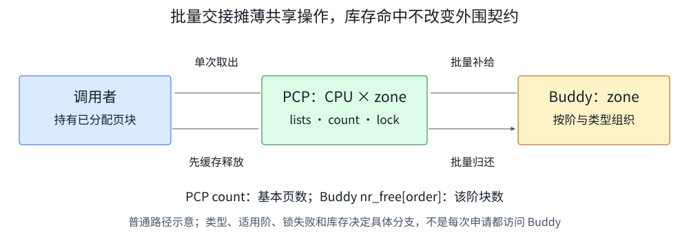

# PCP：列表索引、批量交接与库存回收的实现

PCP（Per-CPU Pages，每 CPU 页缓存）把一部分空闲页块暂存在 CPU 局部。它减少频繁取页、还页对 Buddy 公共链表的访问；不足时批量补给，库存过多或需要集中管理时批量归还。后者在源码中常称为 drain，即排出局部库存。

本篇基于 arm64 Linux 6.1.158，先限定普通迁移类型、不触发隔离和特殊保留区。沿“本地列表取块 → 空列表补给 → 缓存归还 → 批量回到 Buddy”追踪状态，重点区分基本页数和链表块数。背景见 [分配机制](../../02-allocation.md) 与 [Buddy](01-buddy.md)。

## 1. 缓存的是块，count 却按基本页计量

一个 zone 的 `per_cpu_pageset` 提供各 CPU 的 `struct per_cpu_pages`。CPU 只是暂时管理供给，不得到一块专属物理地址区间。

| 状态 | 单位 / 含义 |
| --- | --- |
| `lists[pindex]` | 相应阶与 PCP 迁移类型的块链 |
| `page->pcp_list` | 一块的首个页描述符节点 |
| `count` | 所有列表覆盖的基本页总数 |
| `batch`、`high` | 批量交接和库存高水位参考，按路径换算 |
| `free_factor` | 连续释放影响批量规模的状态 |
| `lock` | 列表和对应字段的保护 |

对普通低阶列表，`order_to_pindex` 按阶和类型构造索引，逆转换恢复阶。`pcp_allowed_order` 允许 `order <= PAGE_ALLOC_COSTLY_ORDER`；本树该常量为 3，THP 配置还有相应额外阶。不能把本树画成只有三条单页链。

低阶编码为 `pindex = MIGRATE_PCPTYPES × order + migratetype`，逆向用整除恢复阶。本树三种普通PCP类型时，order1、MOVABLE类型1得到pindex4；它是一个两页块列表，不是第四阶。

THP额外阶使用低阶表之后的专用位置；`pindex_to_order` 识别这段位置并返回pageblock_order，不能继续只用整除结果当实际阶。

若一个 CPU/zone 中有两个 order-0 块、三个 order-1 块、一个 order-2 块：

```text
节点数 = 2 + 3 + 1 = 6
count = 2×1 + 3×2 + 1×4 = 12 基本页
```

一次移出 order-2 节点必须减四，不能减一。源代码在 `include/linux/mmzone.h`、`mm/page_alloc.c` 的索引 helper。



## 2. 命中为什么只需要局部库存操作？

`rmqueue` 根据适用阶、类型及 CMA 许可尝试 PCP；`rmqueue_pcplist` 获取 CPU 定位与 PCP 保护，进入 `__rmqueue_pcplist`。

```c
/* mm/page_alloc.c：列表非空分支，省略检查失败后的循环。 */
page = list_first_entry(list, struct page, pcp_list);
list_del(&page->pcp_list);
pcp->count -= 1 << order;
```

这次没有修改 Buddy 链，所以不需要为“从已缓存列表取一个块”再拿 zone 锁。但外围仍检查范围、水位，并做页初始化和适用记账。命中不改变 GFP 上下文，也不意味着最终 charge 必成功。

PCP 尝试锁失败会返回空供给结果，使外围尝试直接 Buddy。这种返回不表示物理资源已耗尽。

## 3. 空列表补给：batch 不是每次取得的节点数

`__rmqueue_pcplist` 根据请求阶换算补给规模：

```c
/* mm/page_alloc.c：普通补给主干摘录。 */
batch = READ_ONCE(pcp->batch);
if (batch > 1)
    batch = max(batch >> order, 2);
alloced = rmqueue_bulk(zone, order, batch, list,
                      migratetype, alloc_flags);
pcp->count += alloced << order;
```

限定 `order=1`、读到 `batch=6`，本次得到三个合格块：

| 操作 | 相关列表节点数 | 本组基本页 count |
| --- | --- | --- |
| 初始列表为空 | 0 | 0 |
| `max(6 >> 1, 2)=3` 块补入 | 3 | 6 |
| 本次取走一个两页块 | 2 | 4 |

每个补给节点是完整 order-1 块，不是把六张任意页组装成三个连续块。`rmqueue_bulk` 在一次 zone 锁内反复执行 Buddy 取块，期间仍可能拆大块、触发检查或提前停止。

它区分循环中移出 Buddy 的量和真正加入 PCP 的 `allocated`。如果检查隔离了某块，不能因为它没进入 PCP，就忘记已经改变 Buddy 供给。补給失败时也不能假定总是取得 batch 个块。

## 4. 为什么归还之后还没有发生 Buddy 合并？

适用页引用结束并通过释放准备后，`free_unref_page_commit` 执行：

```c
/* mm/page_alloc.c：普通缓存归还片段。 */
pindex = order_to_pindex(migratetype, order);
list_add(&page->pcp_list, &pcp->lists[pindex]);
pcp->count += 1 << order;
```

块现在属于 PCP 链，不是 Buddy 链。物理伙伴即使在 Buddy 中，也不能把这个 PCP 节点当作一个已经登记的 `PageBuddy` 首页直接合并。

归还路径保存/处理原类型与 PCP 分类。CMA、HIGHATOMIC 的分类处理与普通三类不同，ISOLATE 不能成为普通 PCP 库存；不能只看列表下标就覆盖 pageblock 原属性。

## 5. High、batch、free_factor 怎样决定 drain？

有效 high 受库存配置、zone 回收状态、高阶释放等影响。连续释放可增大归还批量，分配则减弱这类趋势；它不是一个不随状态变化的硬容量。

限定示例：初始上述十二页，`high=16,batch=8,free_factor=0`，无降低 high 的条件，普通 order-1 释放：

| 操作 | count | 结果 |
| --- | --- | --- |
| 归还第一块两页块 | 14 | 未达到本次 high |
| 归还第二块两页块 | 16 | 触发归还 |
| 本次选择归还八基本页 | 8 | 相关块返回 Buddy |

本例可从该两页列表取四块满足八页。一般 drain 按块前进，最后一个高阶块可能超过剩余基本页目标，所以“归还量”不能机械视为恰好一个节点数。

`nr_pcp_free` 将基准 batch、连续释放趋势和保留量结合；`free_high` 等分支可要求更积极归还。本例只固定一次决策，不是内核默认参数或延迟保证。

## 6. Drain 必须同时维护两边的成员资格

`free_pcppages_bulk` 在 PCP 保护下拿 zone 锁，移除 PCP 节点、减基本页 count，再交给 `__free_one_page` 合并和入队。

```text
PCP：删除一块，count 减 2^order
Buddy：按伙伴状态形成最后块，再改变相应 nr_free
```

归还四个单页可能最终成为一个 order-2 块，所以 PCP 减四不要求 Buddy 的 `nr_free[0]` 加四。页数守恒与块形态变化是两件事。

顺序不能倒过来：先登记 Buddy 却仍保留 PCP 节点，会让同一物理资源被两条供给路径发放。

## 7. CPU 定位、PCP 锁与 zone 锁各管什么？

| 保护 | 对象 |
| --- | --- |
| `pcpu_*` 定位辅助 | 保持操作针对正确 CPU 数据，RT / 非 RT 有条件实现 |
| `pcp->lock` | 局部列表、count 及批量交接状态 |
| `zone->lock` | Buddy 列表、伙伴合并和相关供给状态 |

Drain 可由其他 CPU 发起，中断也可能重入相应路径；per-CPU 不是唯一执行者。`drain_pages_zone/drain_all_pages` 与普通命中共享这些状态，不能用一个无锁 count 观察替代所有权。

## 8. 对应源码和可检验结果

入口均在 `mm/page_alloc.c`：索引 helper、`rmqueue_pcplist/__rmqueue_pcplist`、`rmqueue_bulk`、`nr_pcp_high/nr_pcp_free`、`free_unref_page_commit/free_pcppages_bulk`。

读完应能自己重算混合阶 count，解释补给为什么一次移动多个块，以及释放为何没立即进入 Buddy。事件只能对应发生的交接，不能把某个 refill 相关字段当作完整调用者证据。本文未运行追踪；分配许可与补救见 [慢路径](03-slowpath.md)，使用见 [API](../../api-reference.md#pages)。
