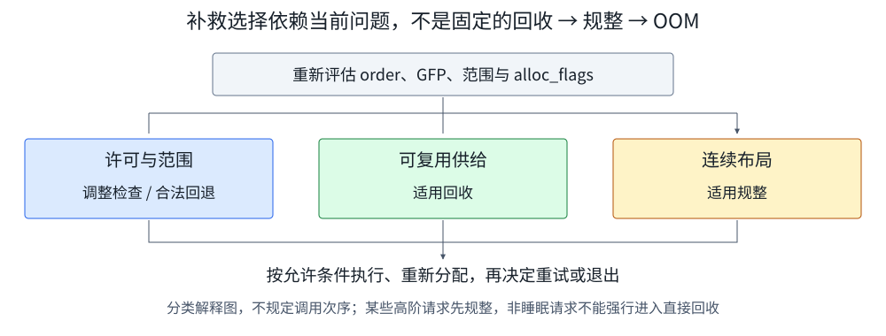

# 页分配慢路径：水位、规整、回收和重试的决策

快路径没有取到页，可能是允许范围或水位不满足，也可能是页数不足，或没有目标阶的连续块。慢路径先重新检查这些条件，再按允许的工作尝试回收、规整或重试；每次有进展后，仍要重新取得实际页块。

基线为 arm64 Linux 6.1.158。这里沿“失败原因 → 可做的补救 → 是否值得再试”解释决策，不把回收、规整和 OOM 串成固定流程。前置认识见 [分配条件与水位](../../02-allocation.md#slowpath)。

## 1. 一次请求需要保留哪些输入？

| 状态 | 决定 |
| --- | --- |
| `order` | 连续块形态、costly 判断及规整目标 |
| `gfp_mask` | 当前线程可执行的工作与重试政策 |
| `alloc_context` | zonelist、nodemask、最高 zone、迁移类型 |
| `alloc_flags` | 这轮水位和保留供给等内部许可 |
| `compact_result` / 重试优先级 | 规整是否可继续、是否推迟 |
| 回收进展与无进展轮数 | 当前重试是否仍有意义 |
| cpuset / zonelist 版本观察 | 睡眠后是否需要重建范围 |

`__alloc_pages` 首次尝试使用较保守标志，失败才进入 `__alloc_pages_slowpath`。GFP 与内部 alloc_flags 不是可互换的两组公开参数。

## 2. 水位为什么不是简单比较 free 与 min？

`__zone_watermark_ok` 先估计本次不可使用供给，再考虑选定 mark、低 zone 保护和内部许可；高阶还检查是否有允许类型的合适块。

限定无特殊保留、无 HIGH/OOM 等调整的模型，order 2，本次选中 mark=100、`lowmem_reserve=20`：

```text
本次形态扣除量 = 2^2 - 1 = 3
剩余可讨论 free 必须 > 100 + 20
还必须有允许类型的 order >= 2 块
```

| Free 基本页 | 扣除后 | 余量检查 | 高阶块检查 |
| --- | --- | --- | --- |
| 140 | 137 | 通过 | 无合格块仍失败 |
| 122 | 119 | 失败 | 即使已有四页块也不能由此绕过水位 |

100 是本次 mark，而不是所有请求统一的 WMARK_MIN。CMA、高原子保留、不同 alloc_flags 会改变扣除与门槛。目的不是藏起一片 RAM，而是避免一种申请把其他重要需求的适用供给耗尽。



## 3. 进入慢路径先重建什么？

源码在 restart 附近重置进展状态，取得 cpuset/zonelist 观察，重新计算 alloc_flags 与优选 zone。

```text
重新建立范围与许可
必要时唤醒 kswapd
再尝试现有供给
```

这次可因许可变化或他人归还成功，并不需要先主动释放页。唤醒后台线程也不是“等待其完成”，更不是给当前请求预留结果。

## 4. 为什么高阶可能先规整，而不是先回收？

本树在允许直接回收、允许规整、相应 costly 或非 MOVABLE 高阶条件、且不属于特定 pfmemalloc 情境时，先尝试 direct compaction。

如果空闲页已够但排列破碎，继续释放不相关文件缓存可能增加 I/O，却没形成目标连续块。规整迁移可移动内容，使适用范围重新出现大块。

```text
目标四页区间：[空闲，内容A，空闲，内容B]
其他适用位置能够接收 A、B
迁移并更新使用关系后，目标区间才可能变成四页空闲
```

固定 A、没有目的页或区域不适用都会阻止该结果。它不是只交换两个 PFN 数字，更不保证每次扫描成功；迁移和隔离见 [CMA](../page-size/04-cma.md)。

## 5. 回收和规整后的“再分配”为什么不可省？

`__alloc_pages_direct_reclaim` 和 direct compact helper 将补救与再次取得块联系起来。补救可能睡眠，其他线程可消费腾出的资源；进展数字不转移某个块的所有权。

普通可睡眠段落可抽取成如下条件流程：

```text
再试适用范围
若不允许直接回收，或当前已经是不能递归的回收上下文：按退出规则
直接回收并尝试取块
仍失败则适用规整并再试
根据 NORETRY / costly / 进展 / 规整结果决定重试
范围已变化则 restart
只在适用条件下考虑 OOM
```

这是该段源码的删节逻辑；早期规整、保留供给与 NOFAIL 有独立条件，不能当一次调用必经的总链。

## 6. 进展判断怎样避免没有意义的重复？

`should_reclaim_retry` 同时看可讨论供给、扫描进展和无进展轮数；`should_compact_retry` 看规整结果、优先级和重试政策。

| 返回信息 | 应解释 | 不说明 |
| --- | --- | --- |
| 回收有进展 | 一些执行条件可能改善 | 当前获得同量独占连续块 |
| 规整被推迟 / 跳过 | 这次时机或供给不适合 | 所有未来同阶必失败 |
| 规整仍可再试 | 进一步成本可能有意义 | 只需无限循环一定成功 |
| cpuset 观察失效 | 原范围判断需重建 | 可以无视新范围继续分配 |

`__GFP_NORETRY` 不进入后续无限重试，先前允许的工作仍可能等待；costly 阶通常还需要可规整与适用 RETRY_MAYFAIL 条件。不能凭“GFP_KERNEL”猜一个固定重试次数。

## 7. OOM helper 并不是每个 NULL 的共同原因

`__alloc_pages_may_oom` 需要协调 OOM 决策、再次检查供给，并有上下文、请求阶等限制。进入它不保证选中进程，也不保证立即得到目标块。

```text
无关进程退出 -> 某些引用和供给可结束
但不必解除设备 pin，不必生成指定区域连续块
也不必使严格节点或组限制失效
```

尤其不能用高阶 NOFAIL 请求代替业务失败方案；本树对 `order>1` 的此类使用明确警告。

## 8. 把一个失败定位到决策层

应同时记录阶、GFP、范围和本次执行点，再区分：

1. 水位/范围许可没满足。
2. 基本供给不足，适用候选又不能回收。
3. 形态不满足，迁移或规整受阻。
4. 已取块但后续 charge 等步骤失败。

源码：`mm/page_alloc.c` 的 `__zone_watermark_ok`、`__alloc_pages_slowpath`、direct reclaim/compact、retry helpers、OOM helper。对象如何回收见 [回收执行](../reclaim/01-reclaim.md)，组许可见 [memcg](../resource-control/03-memcg.md)。

以上模型未实测。源码分支解释决策，不提供通用延迟保证，也不允许据此直接修改目标系统的水位。
