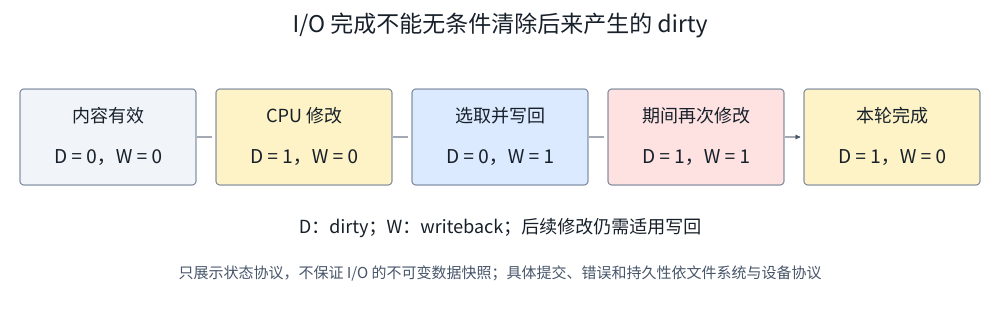

# 页缓存与写回：对象成员资格、索引标记与 I/O 状态

基于 arm64 Linux 6.1.158，主线为普通文件 page cache。DAX、直接 I/O、swap 和具体文件系统日志不是同一条完整流程。

页缓存把“文件偏移”连接到 RAM 中的内容，使普通文件读写和文件映射可以复用同一份数据。找到缓存对象、读到有效内容、提交修改、完成写回是不同阶段，本篇先追踪这些阶段，再解释索引标记和锁。前置关系见 [页缓存机制](../../03-address-space.md#page-cache)。

## 1. 内容对象怎样被三个方向索引？

| 关系 | 实现 | 用来回答 |
| --- | --- | --- |
| 文件位置到内容 | `address_space.i_pages` 的 XArray | 这个索引的缓存在哪里？ |
| 内容到候选映射 | `address_space.i_mmap` | 哪些 VMA 可能使用该文件范围？ |
| inode 到写回工作 | inode/writeback 集合 | 哪个文件还有需要处理的脏状态？ |

Folio 的引用、mapping、index 和锁将它与这些关系联系起来。进入 XArray 不表示读入已完成，存在引用不表示它仍是原 mapping 成员。

`filemap_add_folio` 要建立索引成员资格并处理适用记账与 shadow；buffered read、write、mmap 可复用同一内容对象，而非每个进程各有独立文件副本。

## 2. 索引存在和 uptodate 为什么分开？

新 folio 可以先发布到缓存索引，其他查询者于是找到同一对象，而不重复创造同位置内容；完成读入前，它还不是可直接消费的有效数据。

```text
锁定的缓存对象进入索引
后备读入提交/完成
按协议标记有效内容、结束相应锁
其他引用者验证状态后读取
```

锁等待和 uptodate 检查把“找到对象”与“获得可用内容”分开。不同文件系统/大 folio 的部分有效范围有自己的接口，不一律等同于普通 filemap fault 的整对象检查。

## 3. Filemap_fault 两次大小检查的意义

先根据 `i_size` 和 `vmf->pgoff` 拒绝超范围。找到或创建 folio 后，取得锁，再检查：

1. folio 是否仍属于原 mapping，是否覆盖所需 index。
2. 内容是否 uptodate；不满足则按读入/错误/重试路径。
3. 期间若释放了 mmap 锁，返回 RETRY 重找 VMA。
4. 锁内重新核对 i_size，才交出适用数据页。

例如第一次查询 index 7 合法，等待时文件缩到只含索引 0～3。引用保证旧 folio 对象未消失，却不保证 index 7 仍代表合法文件数据。继续安装会把旧内容错误暴露为当前文件范围。

返回 `VM_FAULT_LOCKED` 也不是已经安装用户 PTE；公共 fault 路径继续处理映射提交和结束持有。

## 4. Dirty 的三层状态

| 状态 | 作用 |
| --- | --- |
| folio dirty | 内容有待保存的修改 |
| XArray DIRTY/TOWRITE 等 mark | 有效寻找本轮候选，不每次全索引扫描 |
| inode 的脏/待写状态 | 把相关文件送入写回协调 |

`folio_mark_dirty` 调用适用 `a_ops->dirty_folio`，以文件系统/通用 helper 完成这些副作用。直接设置一个位不能代替索引、inode 和统计更新。

私有文件写产生的匿名 COW 页不因原 VMA 有文件就自动写回原文件；共享写路径则协调文件缓存和 PTE 脏状态。

## 5. Clear_dirty_for_io 为何不是“所有脏标记马上归零”？

本树在 folio 锁下通过 `folio_mkclean` 等协调用户 PTE 和缓存修改，再清 folio dirty、调整统计。**缓存索引的 DIRTY mark 可以暂时保留**，直到开始写回的阶段按状态处理。

这避免候选已被选中但 I/O 起始尚未完成时，被索引扫描错误地彻底遗忘。临时不同步必须按协议解释，不能由观察者“修正”一个看起来不一致的 mark。

## 6. 一个 folio 的完整位/标记序列

限定使用通用 writeback tags 的正常可写回 mapping，省略具体块 I/O：

| 时刻 | Folio dirty | DIRTY mark | Writeback | WRITEBACK mark |
| --- | --- | --- | --- | --- |
| 已脏化 | 1 | 1 | 0 | 0 |
| clear_dirty_for_io 完成 | 0 | 可仍为 1 | 0 | 0 |
| start_writeback 完成，没再次脏化 | 0 | 0 | 1 | 1 |
| I/O 期间再次修改 | 1 | 1 | 1 | 1 |
| 本轮 I/O 结束 | 1 | 1 | 0 | 0 |

`__folio_start_writeback` 在相应 XArray 锁内设置 WRITEBACK mark，只有 folio 没有新 dirty 时才清 DIRTY mark。`__folio_end_writeback` 结束 WRITEBACK 标记和计数，不抹掉新脏化。



表是状态协议，不保证所有文件系统制作不可变 I/O 快照。具体字节的一致性、重新写入和块提交要按文件系统协议保证。

## 7. 持续写入时，一轮扫描怎么结束？

`write_cache_pages` 等通用逻辑通过范围、`nr_to_write` 和适用 TOWRITE 标记组织一轮任务；同步写回或 tagged_writepages 等条件可选择先给候选集合标记。

```text
确定本轮范围/目标
标记或选取适用候选
取得 folio 锁，重新检查成员资格与 dirty/writeback
按文件系统回调处理
推进索引和预算，而不是永远追逐新增 dirty
```

这不是冻结全部内容的全局快照，也不是所有文件系统都必须直接使用同一个扫描函数。候选标记解决扫描与进展，数据版本由另一层协议管理。

## 8. 谁结束 I/O，谁报告错误？

文件系统 `writepages` 等实际处理块映射和提交；完成路径调用 `folio_end_writeback`，更新统计并唤醒等待者。错误还要进入相应 mapping/inode 的错误报告机制。

Writeback 位归零只表示这轮对象状态结束，不证明文件数据、元数据、日志与设备缓存已经满足 fsync 的持久性要求。

`fs/fs-writeback.c` 的 `__writeback_single_inode` 协调文件级任务；mm 的 helper 不替文件系统决定日志顺序和设备持久化。

## 9. 写入者节流为何不是一次 write 对应一次同步 I/O？

`balance_dirty_pages_ratelimited` 联系 dirty 产生速度、写回域、后端进度和阈值，适用时让写入者承担等待，避免持续累积挤压可回收供给。

它同时需要区分 dirty 与 writeback：前者待提交，后者已在进行。把两者只加成一个“占用量”，不足以说明哪一层产生瓶颈。

## 10. 锁和引用分工

| 保护 | 作用 |
| --- | --- |
| folio 引用 | 对象存活 |
| folio 锁 | 读入、截断及关键内容状态转换 |
| invalidate 相关保护 | 阻止错误地在失效范围创建/读入内容 |
| XArray 锁 | 成员资格和 marks |
| mmap / PTE 保护 | 用户映射规则与实际安装 |
| inode/writeback 保护 | 文件工作集合、统计和 I/O 协调 |

`filemap_fault` 等待时可能释放 mmap 锁；再次读取不能继续沿用旧 VMA。最后回收还要冻结引用、验证 dirty 并退出索引，见 [回收执行](../reclaim/01-reclaim.md)。

源码：`mm/filemap.c` 的插入、fault、完成；`mm/page-writeback.c` 的 dirty、clear、start/end、扫描与节流；`fs/fs-writeback.c` 的文件协调。本文没有实际提交 I/O 或改写目标机文件。
