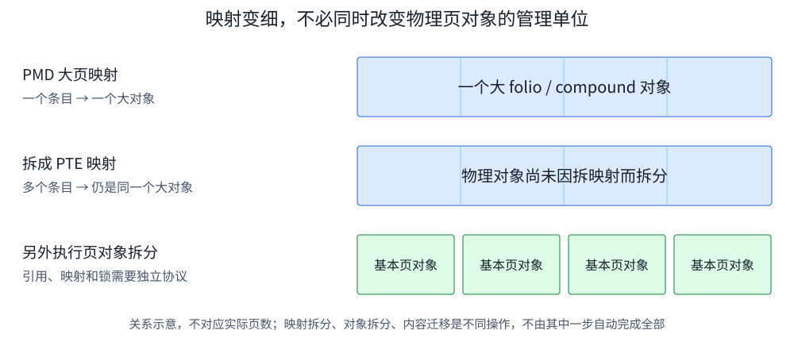

# THP：大页候选、PMD 提交、合并与拆分

Linux 6.1.158、arm64，主线为适用 PMD 匿名 THP，不套用后续版本的其他尺寸策略。页大小和 THP 启用状态未知，算例单独限定。

THP（Transparent Huge Pages，透明大页）尝试让较大的物理对象以较少翻译条目覆盖一段地址，降低页表和 TLB 压力。它既要处理“首次访问时能否取得大页”，也要处理“已有基本页能否合并，以及以后怎样拆开”；这些操作的资源和引用条件不同。基础关系见 [大页机制](../../05-placement-and-limits.md#hugepages)。

## 1. 大物理对象和大页映射是两个事实

`folio`/compound 保存物理对象的引用与成员关系；PMD/PTE 保存翻译粒度。一个大对象可以通过多个 PTE 映射，拆 PMD 不一定拆 folio。



讨论 THP 要同时看 VMA 适用性、PMD 范围、物理连续对象和后备/引用条件，而不只是把 `alloc_pages` 的阶调大。

## 2. 首次 fault 的候选阶段

`do_huge_pmd_anonymous_page` 检查范围适用性，准备匿名关系、适用策略和页供给。读缺页还可能使用巨大零页；写缺页准备私有大页。

```text
VMA/对齐范围满足 -> vma_thp_gfp_mask
-> 按 HPAGE_PMD_ORDER 取得 folio
-> 适用 charge
-> 准备页表资源、清零与 uptodate
```

候选 charge 失败在本路径可返回 FALLBACK；PTE 表资源失败则可返回 OOM。不能把所有失败都视为相同“降到小页”结果。

## 3. 已取得大页，为什么还检查 PMD？

`__do_huge_pmd_anonymous_page` 取得 PMD 锁，重查 `pmd_none`、地址空间稳定性和 userfaultfd 条件。

```c
/* mm/huge_memory.c：普通提交片段，其他检查与清理未列出。 */
vmf->ptl = pmd_lock(vma->vm_mm, vmf->pmd);
if (!pmd_none(*vmf->pmd))
    goto unlock_release;
/* 原实现建立新匿名 rmap、LRU、属性。 */
pgtable_trans_huge_deposit(vma->vm_mm, vmf->pmd, pgtable);
set_pmd_at(vma->vm_mm, haddr, vmf->pmd, entry);
```

另一线程可能已安装下级 PTE 表或大页。旧候选不能覆盖它，需要结束自己的 folio/页表资源。安装前的 uptodate 及屏障保证先准备内容，后暴露翻译。

## 4. 为什么大页旁还保留 PTE 表？

`pgtable_trans_huge_deposit` 保存相应页表资源，以便后续拆映射等操作使用。一个 PMD 条目减少翻译条目，不等于整套辅助页表管理对象永远都不存在。

这也说明“看到大 PMD 就 free 所有下级表”的外部操作不安全。表的取得、保存、取回和最终释放属于同一协议。

## 5. Khugepaged 合并的真实完成点

已有普通 PTE 范围的合并包括：

1. 扫描适用范围及候选，判断引用、映射和内容条件。
2. 放开 mmap 读锁，准备/charge 新大页。
3. 重取规则保护，并在需要的写锁下重查 VMA/PMD。
4. 通过 notifier 和 PMD 失效暂时撤掉旧表关系。
5. 在相应锁内隔离旧页，复制内容，建立大页关系。
6. 保存原 PTE 表资源，安装 PMD。

它不是从页表看见连续 VA 就把物理页“原地拼成一块”。可能需要新的连续后备和复制。

## 6. 合并的临时资源量为何重要？

限定 4 KiB 基本页、一个2 MiB PMD 范围，旧512张匿名页只被本mm使用，无其他保留；省略页表与记账库存等元数据。

| 时刻 | 原内容后备 | 新候选 | 内容页总量 |
| --- | --- | --- | --- |
| 原小页映射 | 512 页 | 0 | 512 |
| 新大页准备并 charge | 512 页 | 512 页 | 1024 |
| 成功替换并结束旧页持有 | 0 | 512 页 | 512 |

最终内容容量不变，准备阶段却可能需要额外物理供给与组额度。接近限制时，不能以“最后还是2 MiB”保证合并成功。

若旧页还有其他持有，最终也不保证立即全部消失。算例不是所有 arm64 页大小的通用数值。

## 7. 撤掉旧 PMD 后失败，怎样恢复？

`collapse_huge_page` 可能在隔离旧页阶段发现不适用。原表引用已经暂时撤下，不能只释放新大页就离开。

本树错误路径用 `pmd_populate` 重新建立原普通页表关系，并结束相应保护；不能用仅用于大页条目的 `set_pmd_at` 替代“恢复下级表”。

这种回滚是原映射协议的一部分，不是把失败简单重标为“仍使用小页”。VMA 在等待期间改变时也有不同退出路径。

## 8. 拆 PMD 与拆对象的算法边界

`__split_huge_pmd` 改变一个大翻译为适用的小翻译；`split_huge_page_to_list` 改变页对象引用组织。

对象拆分前 `can_split_folio` 比较映射引用、实际引用与已知 cache 持有：

```text
folio_mapcount == folio_ref_count - extra_pins - 1
```

匿名且不在 swapcache 的限定例子：mapcount=1，refcount=2，包含一份调用者临时持有，条件可符合。若再多一个非预期持有而mapcount不变，就不能据同一条件直接拆分。

这是预检而非唯一完成条件；随后还要冻结引用、协调匿名/缓存对象、映射和 LRU。迁移另改变 PFN，不等同于两种拆分。

## 9. 对应源码

`mm/huge_memory.c` 的 PMD fault、提交、映射拆分与对象拆分；`mm/khugepaged.c` 的扫描、`collapse_huge_page`、隔离与复制；arm64 页表/TLB helper。具体 NUMA 落点还经过 [策略](../resource-control/02-numa.md)，失败的 charge 见 [memcg](../resource-control/03-memcg.md)。

本篇讲普通流程及真实回滚，没有把 KSM、HugeTLB 或所有 large folio 变体拼入同一时序。未开启 THP、运行合并或做延迟测量。
