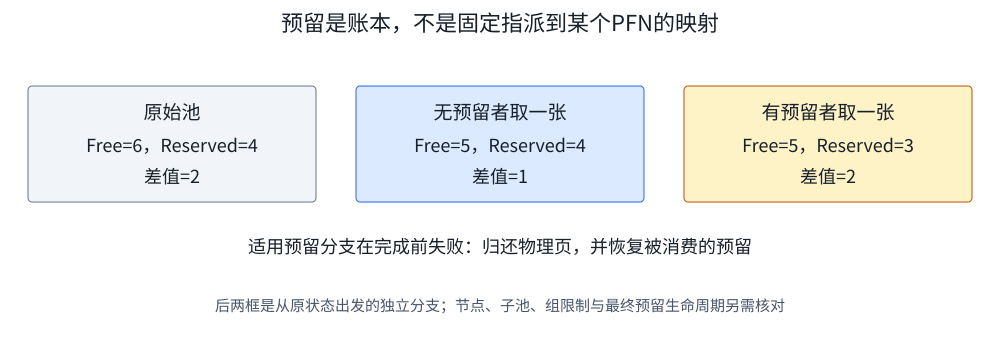

# HugeTLB：池、预留、fault 实例化与归还

arm64 Linux 6.1.158。HugeTLB 不是“不能回退的 THP”：它有按大小组织的池、预留账、文件/子池关系和专用 fault。

显式使用大页时，系统要分别回答“池里实际有多少页”和“其中多少已承诺给未来访问”。HugeTLB 用资源池与预留协议连接这两个问题，缺页实例化再把承诺变成具体内容和映射。因此，池中有空闲页不一定意味着任意请求都能消费它。先读 [大页使用模型](../../05-placement-and-limits.md#hugepages)，本篇按预留、取页、实例化和归还展开。

## 1. 三张账各保存什么？

| 状态 | 含义 |
| --- | --- |
| `hstate` 总量/空闲/surplus | 某种大页大小的物理池 |
| `resv_huge_pages` 等预留 | 后续实例化的资源承诺，不是已安装条目 |
| VMA/file/subpool/cgroup 关系 | 哪个范围可消费何种预留、受哪个限制 |

物理空闲页不能被所有请求无条件取走；其中一部分已经为适用预留服务。每个hstate大小及节点库存也要分开。

## 2. 可自由消费量的最小模型

`available_huge_pages` 用 `free_huge_pages - resv_huge_pages`。限定一个合法池、普通页、六张空闲、四张预留，无额外节点/子池约束：

| 动作 | Free | Reserved | 差值 |
| --- | --- | --- | --- |
| 原池 | 6 | 4 | 2 |
| 新无预留请求取一张 | 5 | 4 | 1 |
| 从原状态，有权消费预留者取一张 | 5 | 3 | 2 |

后两行是两个独立分支，不连续相加。消费已承诺的资源同时结束一份对应预留，不使自由供给差值同样减少。



这只是入口判定模型；实际还要看 node、nodemask、subpool 和 HugeTLB cgroup，不从全局差值推出必成功。

## 3. Dequeue 怎样记录失败后需要恢复的账？

`dequeue_huge_page_vma` 检查是否有权用预留及 avoid_reserve，按节点策略从池取得页；消费预留时：

```c
/* mm/hugetlb.c：相应预留消费条件中的摘录。 */
SetHPageRestoreReserve(page);
h->resv_huge_pages--;
```

Restore 标记联系后续清理：物理页已取出，但实例化若未完成，必须恢复被消费的承诺，而不只把 Free 加回。

限定上述预留分支在适用错误路径恢复：Free5→6，Reserved3→4，账本回到原始差值2。普通最终结束、子池下限等还有自己的预留处理，不套同一固定增减。

## 4. Fault 为什么按 mapping/index 串行化？

`hugetlb_fault` 用文件mapping和大页索引选哈希mutex，协调同一内容实例化竞争。多个mm映射同一个大页位置时，不应都先消耗一张池页，最后才发现另一线程已完成缓存实例化。

它取得 HugeTLB VMA 读保护，再定位/创建对应大页页表资源，防止相关 unshare 使旧 ptep 失效。之后才按 entry 是否 present、迁移或错误等分派。

这些锁不是一个“全局锁同时保护所有内容”。范围/索引实例化、VMA稳定和真实条目各有责任。

## 5. No-page 分支的状态顺序

```text
计算文件大页位置与预留要求
查找已有缓存内容或取得新池页
完成相关记账、内容初始化/身份
在适用页表保护下再次检查旧条目
安装映射，完成预留/缓存协议
结束候选及锁的剩余责任
```

候选取得成功不等于安装成功。错误清理要分辨是否已进入缓存、是否消费预留、是否有映射引用，不能统一调用一次普通 `__free_pages`。

## 6. Private 子进程为什么不一定持父预留？

本树 dequeue 注释明确区分私有映射的父子预留资格。子进程 COW 请求不能任意偷用原本属于父范围的资源，仅因为两VMA来自fork就判定都持同一份预留。

`hugetlb_fault` 对适用私有写保护路径先处理 reservation 记录，再在相应页表锁内处理复制/共享。它不使用普通匿名页COW的全部资源模型。

## 7. 最后一份引用结束，回的是哪个分配器？

`free_huge_page` 要求相应引用、映射结束，联系hstate、subpool、组记账和RestoreReserve状态，然后选择：

- 普通池保留：进入hugepage freelist，Free及节点计数变化。
- Temporary/surplus等适用情况：结束池成员身份并归还更底层资源。
- 需要恢复预留：先协调对应账，而不是只加Free。

因此最后unmap不保证立刻回Buddy；它可能回到HugeTLB池等待下次使用。

## 8. 本实现的核对入口

`include/linux/hugetlb.h` 的 hstate；`mm/hugetlb.c` 的 available/dequeue、`hugetlb_fault/hugetlb_no_page`、reservation辅助与`free_huge_page`。

操作未知配置的池大小或预留不是本文的实验。这里重算账本和实例化保护，未运行大页映射；与动态大页比较见 [THP](02-thp.md)，连续底层供给见 [CMA](04-cma.md)。
