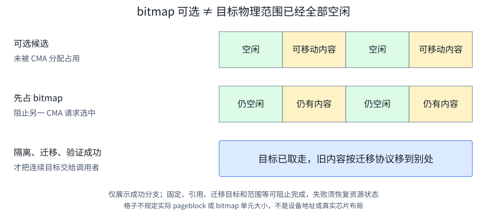

# CMA：位图占位、隔离、迁移与连续页取得

Linux 6.1.158、arm64。主线是一个已经合法创建并激活的CMA区域，不把任意物理地址当成可调用范围。

CMA（Contiguous Memory Allocator，连续内存分配器）允许准备好的区域平时容纳适用的可移动内容，连续请求到来时再迁走目标范围中的占用。位图只协调 CMA 请求的占位，真正取得物理页还要经过隔离、迁移和验证。先读 [CMA 使用模型](../../05-placement-and-limits.md#cma)，再按这几个完成点追踪源码。

## 1. Bitmap 和 Buddy 各回答什么？

| 状态 | 管理事实 |
| --- | --- |
| CMA bitmap | 哪些单元被CMA请求占用或预先占位 |
| pageblock 迁移类型 | 普通分配/隔离应遵守的区域政策 |
| Buddy / PCP | 当前空闲物理块在哪些供给组织中 |
| 内容引用/映射 | 哪些页仍被使用，能否迁移 |

Bitmap零不证明物理页空闲。激活后的适用区域可以让可移动内容借用；申请连续区间时必须整理这些内容。



## 2. 位图单位怎样换算？

`order_per_bit` 表示每bit覆盖 `2^order_per_bit` 个基本页：

```text
bitmap_count = ALIGN(requested_pages, 2^order_per_bit) >> order_per_bit
PFN = base_pfn + (bitmap_index << order_per_bit)
```

请求六页：

| 粒度 | 占位bit | 覆盖粒度 | 物理目标 |
| --- | --- | --- | --- |
| order_per_bit=0 | 6 | 六页 | 六页 |
| order_per_bit=2 | 2 | 八页 | 仍请求六页 |

粗粒度多覆盖的两页不自动变成返回给调用者的容量；释放时也按同一请求及换算恢复位图。

## 3. 对齐为什么还涉及 base_pfn？

对齐参数是页数阶，不是字节数：

```text
align_order > order_per_bit 时：
mask = 2^(align_order-order_per_bit)-1
offset = (base_pfn & (2^align_order-1)) >> order_per_bit
```

候选位图位置要结合offset，才能使物理PFN满足对齐。直接对bitmap index按字节对齐会用错坐标系。

假定合法区域起点A满足本例四页对齐、每bit一页，前四个bit已占用，请求六页且align_order=2：可候选index4，即物理 `[A+4,A+10)`。它不是普通Buddy order3八页请求。

## 4. Cma_alloc 为什么先占bit再释放spinlock？

本树在锁内找候选并set bitmap，然后放开锁，拿相应迁移协调并执行 `alloc_contig_range`。

```text
位图：原候选空 -> 临时占位
物理：可能仍有内容，并未直接交给调用者
```

如果先放锁再占位，另一CMA请求可选择同一区域；如果拿spinlock等待整个迁移，可能在不允许等待的情境执行复杂回收/I/O。

## 5. 指定范围为什么要隔离更大政策单元？

`alloc_contig_range` 标记相关pageblock为ISOLATE，drain适用PCP，迁移目标范围内容，再验证隔离结果。

目标范围与pageblock/Buddy块边界不同，所以扩大处理范围，取出目标后归还非目标余页、恢复原区域类型。不能把隔离页数、位图覆盖页数和返回页数写成同一数量。

隔离是阻止新的普通供给进入，不凭空结束已存在内容引用。

## 6. 迁移不是只做 memcpy

旧页有用户/缓存使用关系，迁移需要：

1. 取得可承载的新存储，稳定旧对象与相关元数据。
2. 用rmap及相应迁移条目/保护阻止旧映射被继续当正常映射修改。
3. 转移内容和适用对象身份、统计及引用。
4. 恢复实际使用者映射到新后备，结束旧资源。

固定、不可迁移内容、没有目的页或文件系统约束均可阻止完成。复制成功不说明最后引用和映射都能迁移。

## 7. 验证空闲以后才真正取走

本树还执行 `test_pages_isolated`，再用适用空闲范围隔离取得实际目标。处理边界余页后，原区域属性恢复，而目标页已不在普通可分配供给中。

这一步的成功才使CMA请求得到完整连续页集合；位图set、迁移有进展都不是相同完成点。

本树对初步迁移返回EBUSY还可能继续最后验证：忙页可能在此期间被合法归还，不能把一次暂时忙直接等同于最终失败。其他不可继续的错误则退出；最终隔离检查仍不满足时才按相应错误恢复。

## 8. Busy 重试和回滚必须分开

`cma_alloc` 失败先清旧bitmap占位。EBUSY等适用情形可换候选，推进依据对齐mask：

```text
start = old_bitmap_index + mask + 1
```

不是总按请求count推进。上述每bit一页、index4、mask3时，下次起点8；与旧六页候选可部分重叠，但旧占位已按协议撤销，下一次必须重新在锁内检查。

其他错误可能直接结束；`alloc_contig_range` 的错误退出也必须恢复隔离。回滚的是资源管理状态，不承诺已迁移的内容全部搬回原PFN。

## 9. 归还与设备使用的边界

调用者必须保存原 CMA 区域、返回的首页和实际请求页数，以同一组参数调用 `cma_release`。本树 `cma_pages_valid` 主要检查参数非空及首页 PFN 是否落在区域内；后续尾界还有 `VM_BUG_ON`，但这些检查不验证完整分配身份，也不能替调用者发现任意错误的 count。错误页数即使仍在区域边界内，也可能归还不属于本次请求的页或破坏位图。

归还前必须结束设备与其他使用者的访问。`cma_release` 结束连续资源并清相应占位，不等待设备完成，也不从 CMA 页自动生成适用设备 DMA 地址。

DMA/IOMMU/缓存及完成协议见 [DMA参考](../../api-reference.md#dma)，它不是连续物理资源整理的替代。

源码：`mm/cma.c` 的bitmap helper、alloc/release；`mm/page_alloc.c` 的 `alloc_contig_range`；`mm/page_isolation.c`、`mm/compaction.c`、`mm/migrate.c` 的隔离和迁移。本文未实际隔离、迁移或分配目标机内存。
