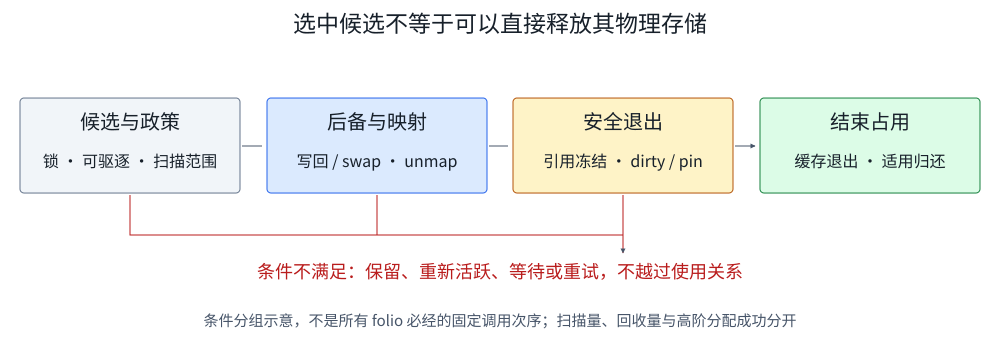

# 回收执行：folio 从候选到可复用资源的状态转换

回收策略交来的候选仍可能有映射、引用或未保存内容。执行阶段负责逐项判断：能否结束这些关系并安全归还页，还是必须保留、激活或转交其他处理。

基线为 arm64 Linux 6.1.158。先理解 [回收与反向映射的整体关系](../../04-reclaim-rmap.md)，再沿一份候选列表跟到输出集合。候选选择策略另见 [传统 LRU](03-lru.md) 和 [MGLRU](04-mglru.md)。

## 1. 扫描者交来的不是“没有引用的页”

`shrink_folio_list` 接收已从候选组织隔离的 folio 列表。隔离意味着列表成员资格转移，不意味着内容、映射或引用已经结束。

| 字段/条件 | 执行决策 |
| --- | --- |
| `scan_control.may_unmap/may_swap` | 本次能否进行相应使用关系/后备处理 |
| folio 锁 | 当前能否稳定处理对象 |
| evictable、访问证据 | 是否应保留或重新活跃 |
| dirty/writeback | 内容保存和正在进行的 I/O |
| mapped、pin、refcount | 是否还有使用关系与额外持有 |
| mapping/私有元数据 | 缓存退出及文件系统相关资源 |

`nr_scanned` 按基本页增加，而不是按列表节点增加。大 folio 拆分后还需要避免原页数被重复统计。



## 2. Keep、activate 与 free 是不同输出集合

没有取得锁、不能处理当前后备或状态改变，可能回到保留集合；访问/保护等证据可使对象重新活跃；真正安全退出的对象才进入适用释放集合。

```text
输入隔离列表
  -> trylock 与执行资格
  -> 引用/后备/映射检查
  -> 保留、激活、适用 demotion 或安全退出
```

不同对象走不同分支，不把“unmap、写回、swap、free”当作每个对象都执行一次的顺序。

例如一次处理四个独立基本页：

| 对象 | 状态 | 本轮可能结果 |
| --- | --- | --- |
| A | 干净文件页，无额外引用 | 安全退出缓存并归还 |
| B | 正在 writeback | 按上下文保留/等待处理，不立即归还 |
| C | 仍被 pin | 不结束底层资源 |
| D | 访问证据满足激活 | 回到适用候选组织 |

扫描量可以为四，真正普通释放量只有一。本例不把 demotion 等“进展”计数统一解释为全机 RAM 减少。

## 3. 干净文件页的闭环

首先确认内容可从后备再取得；处理真实用户映射，再结束私有状态及缓存成员资格。在最后阶段仍验证引用与 dirty，才可脱离索引、结束相应记账和底层持有。

文件页干净不代表无人访问；它可以仍被用户映射，也可能有读入者、pin 或文件系统引用。PTE 移除后也不能跳过这些检查。

`try_to_unmap` 返回后会再看 `folio_mapped`。失败或竞争使映射仍存在时走保留/激活分支，不以“遍历过 rmap”当完成证明。

## 4. 脏页与 writeback 为何不共用同一种处理？

Dirty 表示仍需保存，writeback 表示已在进行。本树根据 kswapd/组回收、IO/FS 许可、拥塞和后备类型决定等待、标记、保留或提交适用写回。

特别不能让所有直接回收线程都无条件提交文件系统 I/O，增加栈深和递归依赖。匿名 swap 与文件回写也不是同一种 flusher 工作。

若新的内容在写回期间产生，本轮结束不清除新 dirty；否则回收会丢失修改。具体标记闭环见 [页缓存写回](../page-cache/01-cache-writeback.md)。

## 5. 匿名页为什么先建立 swap 后备？

普通有用匿名内容没有文件位置可再读。适用 swap 路径用 `add_to_swap` 等取得后备身份与缓存关系，再把用户映射转成相应 swap entry；必要时完成脏内容保存。

```text
匿名物理内容 -> swap 后备/缓存关系
真实用户 PTE -> 非 present 的后备编码
内容保存与引用结束 -> 才可释放物理存储
```

这不是“先 free，再把旧内容补写到 swap”。分配 entry 失败、大 folio 需拆分、无权限或固定都会改变处理。

恢复时 `do_swap_page` 先分类非 present 编码；真实 swap entry 可在 swapcache 找到已有内容，也可触发适用 swapin 读入/预读。迁移、设备与错误 entry 另处理，不生成通用零页。

## 6. Swapin 也不能省略原 PTE 重查

恢复取得页和等待可能很久：此地址可能已被另一路处理，entry 本身还可能重用。最终在页表锁内核对旧条目和实际内容身份，处理 charge、映射、LRU 与旧后备引用。

若已变为另一个条目，不能覆盖它，也不能把没安装的候选当作已驻留页统计。缓存命中不证明全部映射安装完成，更不保证每次 swapin 都读设备。

源码位置：`mm/memory.c` 的 `do_swap_page`、`mm/swap_state.c` 的 `swap_cache_get_folio/swapin_readahead`，I/O 在 `mm/page_io.c`。

## 7. 最后移出缓存，为什么冻结引用再看 dirty？

`__remove_mapping` 在 folio 及相应缓存索引保护下，使用本路径预期引用数：

```c
/* mm/vmscan.c：__remove_mapping 关键条件。 */
refcount = 1 + folio_nr_pages(folio);
if (!folio_ref_freeze(folio, refcount))
    goto cannot_free;
if (folio_test_dirty(folio)) {
    folio_ref_unfreeze(folio, refcount);
    goto cannot_free;
}
```

“1+基本页数”是这条缓存退出路径的已知持有组成，不是任意 folio 可释放的通用数值。冻结不是随意清零引用，而是原子确认它只剩本路径允许的持有。

若先检查 dirty=0，再等引用满足，另一引用者可在中途写内容、置 dirty、结束引用。回收者随后得到一个看起来引用合格的对象，却使用了过时的“干净”观察。当前顺序和相应内存序避免这次丢数据。

## 8. 退出索引不等于丢掉全部历史

适用 `workingset_eviction` 可把 shadow 放回索引，记录驱逐位置的历史。原 folio 的内容和物理身份已经退出，新加载不是旧 PFN 必然回归。

传统 refault 路径用：

```text
distance = (当前 nonresident_age - 驱逐时 age) & EVICTION_MASK
```

其单位是相应工作集活动计量，不是秒。文件候选的竞争大小以 active file 等集合为基础，并受适用 swap 条件影响。

限定例子，假设所选范围无额外桶化误差或回绕：驱逐 age=100、refault age=160，差六十；相关竞争窗口八十，则可能符合恢复/激活条件。若 age=250，差一百五十，不能用原八十窗口解释成仍该立即保护。

大 folio 的 nr_pages、shadow 精度和 MGLRU 分支有条件，不能把上述数字当所有算法共同门槛。

## 9. 如何对照实现？

从 `mm/vmscan.c` 的 `shrink_folio_list` 记录一次对象的锁、引用证据、后备、mapped/pin、dirty、mapping 和输出集合。再读 `__remove_mapping`；候选变热见策略篇，真实映射验证见 [rmap](02-rmap.md)。

进展、扫描、释放、形成高阶块和全机占用下降不是同一个指标。本文的表格是有前提推演，未执行 swap 或回收实验。
