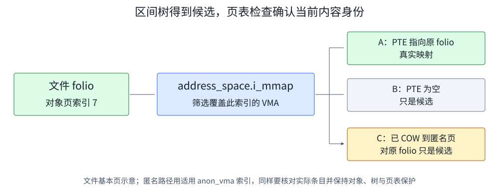

# Rmap：候选地址计算、页表验证与映射解除

基于 arm64 Linux 6.1.158。Rmap 不为每页维护一份永远有效的所有 PTE 指针数组，而以内容对象的位置筛选 VMA，再在正确保护下核对实际条目。

从进程地址查页，可以走页表；回收先拿到一页，却要反过来找到用户地址。Rmap（reverse mapping，反向映射）先用文件或匿名对象的区间索引缩小范围，再检查候选地址的真实页表。先读 [反向映射机制](../../04-reclaim-rmap.md)，本篇进一步推演位置计算、确认和撤销。

## 1. 索引键是什么？

| 对象 | 候选索引 | 输入 |
| --- | --- | --- |
| 文件 folio | `mapping->i_mmap` VMA 区间树 | 文件页位置及 folio 覆盖范围 |
| 普通匿名 folio | 相应 anon_vma 的链式关系/区间树 | 匿名关系位置与 folio 范围 |

`rmap_walk_anon/rmap_walk_file` 用 `folio_pgoff` 和 `folio_nr_pages` 形成位置区间。位置不是物理 PFN，不能因为迁移换了 PFN就丢掉内容对象的索引身份。

锁/引用稳定归属，区间索引缩小范围，页表验证确认真实映射，这三层缺一不可。



## 2. 一个真实可计算的候选地址

限定普通基本页线性文件 VMA，以符号 V 表示适用起点：`vm_pgoff=4`、长度四页，对象 index=7。

```text
候选地址 = V + (7-4)×PAGE_SIZE = V + 3×PAGE_SIZE
```

它在范围内。Index=8 已超过这段 VMA，不能生成一次合法候选。

真实实现使用 `vma_address` 等 helper，并处理大 folio 覆盖范围、特殊映射和越界。不是让调用者对任意页直接套减法访问页表。

## 3. 三个候选怎样只留下一个真实映射？

三段 VMA 都在对象索引中覆盖 index 7：

| VMA | 目标条目 | 对当前文件 folio 的结果 |
| --- | --- | --- |
| A | Present，PFN 对应该 folio | 真正映射 |
| B | None，尚未访问 | 候选但没有映射 |
| C | 私有 COW 后指向匿名 Q | 候选但不是原文件内容 |

`i_mmap` 表达文件范围关系，不因每次缺页或 COW 都变成原 PFN 的精确列表。因此查询者必须核对 PTE/PMD，而不能只数候选 VMA。

## 4. Anon_vma_chain 为何比“每进程一张链”复杂？

Fork 需要保留旧共享内容的候选关系，COW 后新内容又要能够减少不相关分支扫描。一个 VMA 可以通过多个 chain 联系相关匿名对象；它们不是物理页副本。

`anon_vma_clone` 复制相应关系，`anon_vma_fork` 还尝试复用合适 anon_vma。不能把每一次 fork 固定画成“必新建一个完全独立对象树”。

新页的 `page_add_new_anon_rmap`、复用时 `page_move_anon_rmap` 等与这些关系协作。内容分支改变和索引链分配是不同事实。

## 5. 遍历框架怎样调用具体操作？

```c
/* mm/rmap.c：try_to_unmap 使用的控制主干。 */
struct rmap_walk_control rwc = {
    .rmap_one = try_to_unmap_one,
    .arg = (void *)flags,
    .done = page_not_mapped,
    .anon_lock = folio_lock_anon_vma_read,
};
```

`rmap_walk` 选择文件/匿名路径，计算覆盖区间，调用每个候选的 `rmap_one`。回调返回值和 done 条件允许提前结束。

同一框架可服务访问检查、unmap、迁移等，遍历本身不固定执行物理页释放。TTU_RMAP_LOCKED 还表达调用者已经持有相应保护的约定，不是任意省锁标志。

## 6. Page_vma_mapped_walk 的确认阶段

Helper 定位对应页表层，取得适用锁，检查条目类型和 PFN/folio 覆盖关系。PTE-mapped 与 PMD-mapped 大页不同，迁移条目也不能解释成普通可直接访问内容。

如果条目在查询期间变化，不能继续修改旧指针。提前停止 walker 需要结束适用页表映射与锁，不能长期保存一个 PTE 地址作为该页的永久反向指针。

这也是为什么 “已知 folio” 不使整个 VMA 页表稳定：每一个真实条目都要按自己的保护和验证完成操作。

## 7. Unmap 修改哪些状态？

普通回收回调在真实映射锁内取得条目，处理 dirty 信息、RSS/映射关系、适用后备编码和引用，执行相应翻译失效。匿名需保留后备时生成 swap entry；迁移则使用其专用编码和恢复协议。

```text
旧：用户 PTE present -> P
回收适用后：PTE 不再 present，可能记录 swap 后备
P 的用户映射数量下降
但缓存、临时引用或 pin 仍可能保持 P
```

不同类型不都变成空 PTE。无后备的有用匿名内容不能照文件干净页一样丢弃。

## 8. 为什么 void 返回还要看 mapped？

`try_to_unmap` 的回调可能因保护、竞争或其他条件提前退出，外层通过 `folio_mapped` 等检验仍有多少使用关系。一次返回不是“所有候选全部成功解除”的证明。

即使 mapcount 已为零，底层引用和缓存成员资格未必结束；最终回收在 [执行篇](01-reclaim.md) 的引用冻结和 dirty 验证处继续。

## 9. 三层保护与文件截断

| 保护 | 稳定的内容 |
| --- | --- |
| folio 锁/引用 | 当前归属及对象存活 |
| anon_vma 或 i_mmap 保护 | 候选关系集合 |
| PTE/PMD 锁 | 真实条目读取和修改 |

`rmap_walk_file` 依赖 folio 锁稳定 mapping，才能安全取得其 `i_mmap_rwsem`；引用只是对象没释放，不足以证明仍是原文件成员。

共享集合读锁也不冻结所有 mm 的 PTE。只有三层协议联合起来，候选定位才能成为一次正确的映射操作。

## 10. Arm64 翻译完成点

撤销软件条目后，还需适用 TLB/MMU notifier 协调。批量失效可以延后具体指令，但不能省掉资源重用之前必须完成的协议。

源码：`mm/rmap.c` 的对象取得、walk 与回调；`mm/page_vma_mapped.c` 的条目确认；arm64 `pgtable.h/tlbflush.h`。图例和地址计算未在目标机运行，完整 KSM/HugeTLB 分支需按专用类型继续读。
