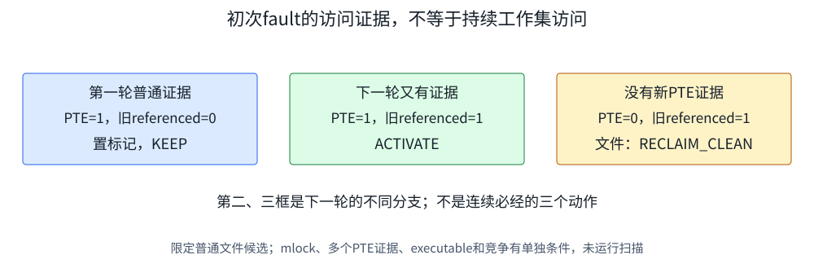

# 传统 LRU：访问证据、列表转换和扫描预算

基于 arm64 Linux 6.1.158 的传统 LRU 分支，不把 MGLRU 启用后的路径当作同一实现。对象真正释放见 [回收执行](01-reclaim.md)。

LRU（Least Recently Used）在这里不是一条精确记录每次访问时间的队列。内核收集页表和文件访问证据，让页在 active/inactive 等集合中获得不同的再次检查机会，再结合代价和保护决定扫描量。先理解 [工作集与重访](../../04-reclaim-rmap.md#working-set)，再看“访问证据 → 集合转换 → 扫描预算”的实现。

## 1. Active/inactive 不是“正在用/已经没用”

一个 node/memcg 的 lruvec 组织匿名与文件的 active、inactive 列表及不可驱逐对象。列表按回收策略管理年龄与再次检查机会，不保存精确的所有 CPU 使用时间。

新页的 fault 会设置访问证据，但第一次证据可能只是建立映射的必然结果。如果每个 fault 立即永久保护，冷页也很难退出。

## 2. Folio_check_references 怎样区分一次和重复访问？

它读取/清理适用 PTE 访问证据，取得之前的 folio referenced 标记，再做分类：

| 条件 | 当前决策思想 |
| --- | --- |
| VM_LOCKED | 转入适用保护，不按普通冷候选处理 |
| rmap 竞争不能取得可靠证据 | KEEP，而非假定完全没访问 |
| 当前 PTE 有证据，此前未标记 | 设置 referenced，普通情况再给一次机会 |
| 又有 PTE 证据且此前标记，或多个 PTE 证据 | ACTIVATE |
| 文件 executable 的相应证据 | 有优先激活分支 |
| 没有当前 PTE 证据，但此前 referenced 的文件页 | RECLAIM_CLEAN，脏的留给写回 |
| 无其他保护证据 | RECLAIM |

```c
/* mm/vmscan.c：普通有访问证据分支摘录。 */
folio_set_referenced(folio);
if (referenced_folio || referenced_ptes > 1)
    return FOLIOREF_ACTIVATE;
/* 原实现还处理 executable 文件分支。 */
return FOLIOREF_KEEP;
```

普通 mapped 文件页：第一轮 `PTE证据=1、旧referenced=0`，保留并标记；第二轮又有证据且旧标记为1，说明不是只因初次映射，进入激活。

标记会被清读，循环必须结合这轮证据，不能把一次 PG_referenced 置位当成永远热。



## 3. Active 怎样再次成为候选？

`shrink_active_list` 隔离相应 active 项，检查访问、不可驱逐等条件，决定保留或降到 inactive。它不是简单复用上一节所有分支，也不使普通 active 对象永远免于扫描。

列表转换在 lruvec 保护下更新成员资格和基本页计数，隔离后的对象再由执行路径按 folio 锁处理。不能一边保留原列表节点，一边交给释放列表重复管理。

## 4. 扫描多少先于能释放多少

`get_scan_count` 根据 lruvec、scan_control、供给资格、成本和保护形成每个列表的 nr。

它先分派：

- 当前不允许/不能回收匿名内容时选 FILE。
- 特定组回收中 swappiness=0 也选 FILE。
- 逼近特定严重压力且允许相应处理时可选 EQUAL。
- file_is_tiny、cache_trim_mode 等改变类型选择。
- 其余才进入按成本加权的 FRACT。

这些条件的优先级不能被一条“按 swappiness 比例”代替。匿名资格还可联系适用 demotion，不仅是一个 swap 文件是否存在。

## 5. 当前成本公式与可重算例子

限定无 memcg 保护、在线组、无前述特殊选择、priority=2，成本快照 `sc.anon_cost=1,file_cost=1`：

```text
c = 1+1 = 2
anon_cost = c+1 = 3；file_cost = c+1 = 3
total = 6
ap = floor(swappiness × (total+1) / (anon_cost+1))
fp = floor((200-swappiness) × (total+1) / (file_cost+1))
```

Swappiness=100 时 ap=fp=175。若某 inactive anon 列表128页、file列表64页：

```text
先按 priority：128>>2=32；64>>2=16
再按 fraction：anon=16；file=8
```

相同权重不等于相同扫描页数，因为基数不同。

若成本快照改为 anon=1,file=9：归一化后分别11、19，total=30；ap=258、fp=155，总413。相同基数和优先级下预算为 `floor(32×258/413)=19`、`floor(16×155/413)=6`。

成本反映该策略估计的回收/重访等代价，不是这里测得的毫秒。例子不预测实际负载下一轮值。

## 6. 组保护怎样进入预算？

本树先按保护和实际组用量缩放列表扫描量，设置必要最小工作量，再按 priority 右移和类型 fraction 处理。Low 保护可能在后续失败重试中按不同政策处理，min 也有层级有效量。

不能把有保护解释成“以后任何压力都一页不扫”，也不能把上节无保护计算直接套到受保护组。

## 7. 预算交给哪条执行路径？

`shrink_lruvec` 等协调 active/inactive 扫描，`shrink_inactive_list` 隔离候选，再进入 `shrink_folio_list`。执行失败的候选仍可能回到列表或激活。

```text
策略给预算 -> 隔离候选 -> 单对象条件检查 -> 实际进展
```

Nr=16 不等于一定释放16页，更不等于为一个高阶申请保留了16页。

## 8. 核对与边界

源码为 `mm/vmscan.c` 的 `get_scan_count`、`folio_check_references`、`shrink_active_list/shrink_inactive_list` 及执行函数；lruvec 声明在 `include/linux/mmzone.h`。

要解释“为何今天扫文件多”，必须看特殊类型选择、成本、列表大小、priority 和保护，而不是只读一个旋钮。本文公式与两个样例按源码整数运算验算，未修改系统策略或测量时延。
