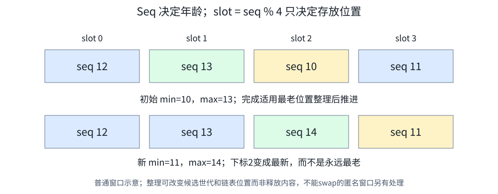

# MGLRU：世代推进、延迟排序和 refault 反馈

基于 arm64 Linux 6.1.158 的 `CONFIG_LRU_GEN` 实现。启用配置与运行时能力未知，不能把这篇代替 [传统 LRU](03-lru.md) 的实际执行说明。

MGLRU（Multi-Gen LRU，多代 LRU）按访问新近程度把候选分到多个代：收集访问证据时形成或更新年轻代，回收时从适用的较老代寻找对象，再用重访反馈调整选择。它把“收集证据”和“选择淘汰者”联系起来，但仍由 [回收执行](01-reclaim.md) 判断最终能否释放。

## 1. Generation 和 tier 分别回答什么？

| 维度 | 主要问题 |
| --- | --- |
| generation | 访问证据把对象放在哪个年龄窗口？ |
| anon/file type | 后备代价与回收资格哪里不同？ |
| zone | 相应物理范围的供给是什么？ |
| tier | 相关访问频次与 refault 代价是否值得额外保护？ |

Generation 不是引用计数，tier 也不是“第几个 CPU 访问”。两维一起影响候选，不能只画一个最老到最新队列代表全部策略。

本树对通过文件描述符访问的频次，用 `order_base_2(N)` 等分层思想表示tier，并用referenced、workingset及适用计数位保存证据。Tier变化主要是flag上的原子操作，不等于每次buffered访问都搬动generation链表；实际移动到另一代的集合操作仍需LRU保护。

## 2. Seq 与数组下标为何必须分开？

`lru_gen_struct` 保存 `max_seq`、两个 `min_seq`、按 gen/type/zone 的列表和页数、历史 refault/evicted/protected 等状态。

选本树四槽位的普通窗口示意，seq 10～13：

| Seq | 下标 seq % 4 |
| --- | --- |
| 10 | 2 |
| 11 | 3 |
| 12 | 0 |
| 13 | 1 |

下标0不一定最老。最老由 min_seq 表示，不通过下标大小排序。



## 3. Aging 怎样收集证据？

适用硬件 young/能力条件下，遍历 mm 的页表，把访问证据联系到 folio，`folio_update_gen` 更新相应 flag；缺少该能力或不走 mm walk 时，还有当前源码的邻近检查等路径。

`folio_update_gen` 用 try_cmpxchg 更新标记，若对象已经被隔离，还会改成适用 referenced 证据供执行阶段使用。不能把已离开 generation 列表的对象强插回原集合。

访问证据更新与链表迁移可以分开：列表在 eviction 等路径懒排序，看到一个旧列表节点不能忽略它 flag 中可能已经更新的 generation。

## 4. Max_seq 推进不是覆盖一个数组元素

`inc_max_seq` 在 lruvec 锁下处理窗口已经满的类型，通过 `inc_min_seq` 等整理最老位置，然后发布新 max_seq 和时间信息。

可回收的普通例子：最老seq10列表已清空或对象按规则移到后续世代，min_seq推进到11，新的seq14才可复用下标2。

该整理不一定释放物理内容。`inc_min_seq` 可以提高候选generation并移动链表，以避免强制扫描时冷热倒置；在不能 swap 的匿名情形还有专门处理和兼容计数规则。

因此不能写“每推进一次max_seq就回收最老全部页”。序列推进、候选迁移和物理释放是不同步骤。

## 5. 为什么 anon 与 file 有两个 min_seq？

文件干净内容可从后备再取得，匿名内容可能受 swap/迁移能力限制。`try_to_inc_min_seq` 检查最老实际有对象的列表，并按 can_swap 选择适用类型。

File 的最老边界可能推进而 anon 留后。环形槽、兼容active/inactive计数和不能swap场景由实现共同处理，不能拿一个全局 min_seq 抹掉不同后备政策。

## 6. Eviction 如何决定先看哪个类型？

`isolate_folios` 优先处理明显条件：swappiness=0 选择 file；某些更老匿名窗口、特定边界设置有专门选择；其余通过 `get_type_to_scan` 比较反馈。

选择后 `scan_folios` 检查实际 generation、保护和 tier，把适用对象隔离交给执行；没有形成候选时可试另一类型，而不是无条件把整个最老列表丢掉。

## 7. Refault 反馈的实际比较

`ctrl_pos` 组合移动历史均值与当前窗口的 refaulted/evicted，较高 tier 的 total 还含相应 protected。它没有记录每个页精确的设备读入毫秒。

令 M=`MIN_LRU_BATCH`，`positive_ctrl_err` 的本树主条件：

```text
pv.refaulted < M
或者
pv.refaulted × (sp.total+M) × sp.gain
 <= (sp.refaulted+1) × pv.total × pv.gain
```

`get_type_to_scan` 用 anon/file 的控制位置，gain 分别联系 swappiness 与 `200-swappiness`。两者处于可比较窗口时，示意取 `swappiness=100`，两个 gain 都为 100：

```text
anon：refault=4M，total=100M
file：refault=2M，total=100M
比较：2M×101M <= (4M+1)×100M
```

条件成立，当前布尔类型选择倾向 file。它不是纯比较两个裸 refault 数；total、gain、小样本条件都会影响判断。

本树 arm64 的 M 为 64。上述模型可代入 anon refault=256、file refault=128、total 各 6400，并保留两个 gain=100：左项为 `128 × (6400+64) × 100 = 82,739,200`，右项为 `(256+1) × 6400 × 100 = 164,480,000`，条件成立。这些是控制式算例，不是采集的系统计数。

## 8. Tier 保护怎样与这个选择协作？

`get_tier_idx/get_type_to_scan` 还逐级比较 tier 与基准控制位置，形成此次扫描的 tier 门槛。扫描看到更值得保护的对象，可调整generation、记录 protected，再继续寻找其他候选。

Protected 进入后续 total，避免只从“已驱逐者”取样却漏掉已被保护的群体。移动均值在窗口转换时更新，不让一个很久以前的比例永久支配新负载。

这说明 MGLRU 不是“带时间戳的传统LRU”：证据收集、懒排序、类型选择和反馈窗口都有不同状态。

## 9. 真正释放仍要走执行条件

候选进入 `evict_folios/shrink_folio_list` 后仍检查引用、dirty/writeback、mapped/pin 和后备。Generation 旧不等于安全可 free，tier 低也不等于没有使用者。

基本页数量与 folio 个数不同，异步/批量统计还可能只是最终一致，不从一个短暂计数推断对象损坏。

## 10. 对照实现

源码在 `mm/vmscan.c`：`folio_update_gen`、`inc_min_seq/inc_max_seq`、`try_to_inc_max_seq`、控制位置函数、`isolate_folios/scan_folios/evict_folios`；结构在 `include/linux/mmzone.h`。

先跟一条访问证据如何改变flag与位置，再跟一个窗口如何更新控制位置和候选，最后连接 [回收执行](01-reclaim.md)。本文不是运行时启用证明或全量性能实验，也不将普通示例外推到所有能力分支。
