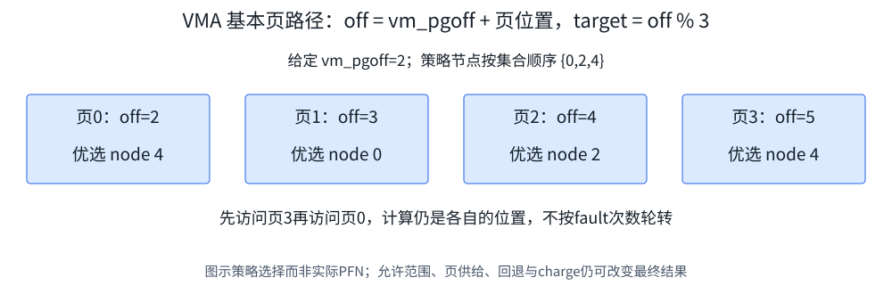

# NUMA：策略对象、地址落点与新旧页位置

Linux 6.1.158、arm64。先以适用用户VMA页分配解释策略落点；普通内核buffer和已经存在的共享缓存不保证都按同一VMA政策新分配。

NUMA（Non-Uniform Memory Access）系统中，CPU 访问不同内存节点的代价可能不同。内存策略先决定优选节点和允许集合，页分配器再寻找实际供给；已经驻留的数据要换位置，则需要另一条迁移路径。背景见 [节点与策略](../../05-placement-and-limits.md#numa)，本篇先推演新页落点，再看已有页。

## 1. Policy 不是存储池

`mempolicy` 保存mode、nodes、flags和相关节点偏好。`get_vma_policy` 先取适用文件/VMA策略，再回退任务/默认策略；共享政策还有取得/结束引用的约定。

| 结果 | 保存什么 |
| --- | --- |
| preferred node | 先尝试哪里 |
| nodemask | 本次适用的节点集合 |
| GFP zone | 在这些节点可用哪些资源类型 |
| cpuset 等 | 当前任务适用范围 |

只看一个preferred node不能抹掉nodemask，只有合法节点集合也不保证它们有相应阶供给。

## 2. Interleave 为何可由地址确定？

本树 `interleave_nid` 的VMA分支：

```text
off = vm_pgoff >> (shift-PAGE_SHIFT)
off += (addr-vm_start) >> shift
target = off % nodes_weight(policy.nodes)
在节点集合中取第target个node
```

普通页shift=PAGE_SHIFT；大页需把基本页单位vm_pgoff换成对应粒度。无VMA路径还可使用任务的动态轮转状态，不套地址公式。

## 3. 乱序访问的可重算例子

设普通页VMA，vm_pgoff=2，policy nodes={0,2,4}，索引按集合次序：

| VMA内页序号 | off | 集合序号 | 目标node |
| --- | --- | --- | --- |
| 0 | 2 | 2 | 4 |
| 1 | 3 | 0 | 0 |
| 2 | 4 | 1 | 2 |
| 3 | 5 | 2 | 4 |

先访问第3页再访问第0页，目标仍由各自位置确定，不因这是“第一次/第二次fault”变成node0/node2。



目标是优选/适用落点，实际页分配还处理水位、回退和失败；这张表不是目标机PFN记录。

## 4. Bind、preferred 和 preferred-many 如何不同？

`policy_nodemask` 对适用BIND路径施加节点集合，`policy_node` 协作计算起点。某些较低zone对政策应用有条件。

Preferred提供偏好而不是所有分支绝不回退；PREFERRED_MANY先在偏好集合尝试，实际helper还有扩展搜索等选择。不能一律给它们加THISNODE，破坏政策的范围表达。

`vma_alloc_folio` 还对适用THP偏好做专门尝试：本地/指定node与轻量政策优先，允许直接回收等条件下可进一步尝试其他供给。

## 5. 位置何时真正确定？

```text
选择有效policy -> 得到node/mask -> 取得物理候选
-> charge/映射检查 -> 安装到地址空间
```

未来落点政策与当前PFN是不同完成状态。候选没通过后续阶段就应清理，不能把一次选择结果写成已经驻留位置。

## 6. 改策略为何没有搬旧页？

已安装页不因任务换CPU、修改后续VMA政策就重新执行上面的分配。显式迁移或NUMA balancing需要另一条内容/映射转换协议。

本树 `mpol_misplaced` 在适用政策下判断当前页位置是否应考虑变化；随后真正迁移还看引用、pin、目的存储和竞争。

判断“不是期望node”不等于已经迁移成功，也不授权把用户PTE直接写成新PFN。

## 7. Policy 生命周期和竞争

共享政策需要按helper约定保护引用。`offset_il_node` 使用本地nodemask副本并保持相应观察次序，避免一段枚举中集合改变造成互不匹配的节点选择。

它不是使所有node永远在线或所有CPU不迁移。Cpuset/zonelist变化仍会使更外层需要重建范围；已有内容位置也需要单独观察。

## 8. 内核分配不都使用用户政策

`alloc_pages` 的目标树NUMA包装、显式node参数、slab节点选择和VMA策略分配有不同调用者。Device buffer不能凭用户mempolicy取代设备地址能力约束。

同一文件cache页被第二个映射者使用时，也不意味着立刻为其政策再复制一份；要区分cache命中和真正创建新后备。

源码为 `mm/mempolicy.c` 的策略取得、`interleave_nid/offset_il_node`、`policy_nodemask/policy_node`、`vma_alloc_folio`、`mpol_misplaced`。本文未迁移页面或修改NUMA政策；实际分配失败可与 [memcg](03-memcg.md) 无关或同时受其影响。
