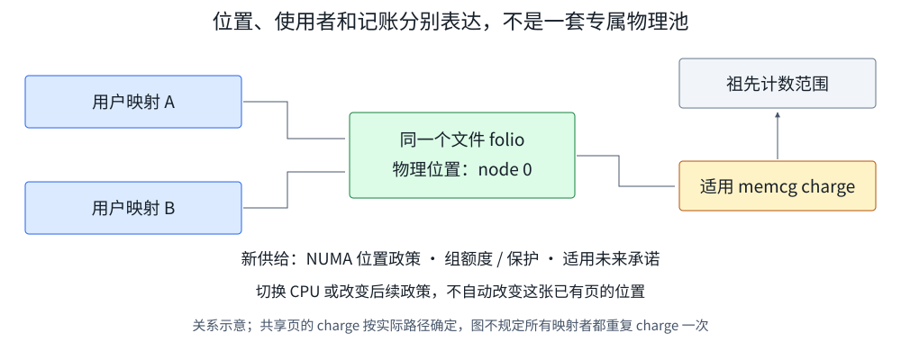
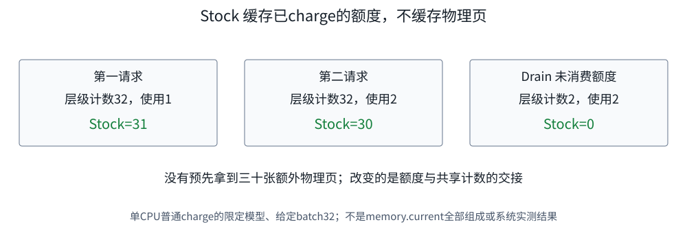

# Memcg：层级 charge、批量额度与超限回收

基于 arm64 Linux 6.1.158，主线为适用普通folio charge。它管理计入哪个层级范围，不为每个组预先割出一个物理页池。

Memcg（memory cgroup，内存控制组）把相关内存使用计入组及祖先，并在增长和回收时施加限制或保护。Charge 是记账操作，不是再分配一份物理页；批量 stock 缓存的也是额度，不是页面。先读 [组限制与保护](../../05-placement-and-limits.md#memcg)，本篇再追踪层级增加、失败撤销和超量处理。

## 1. 物理页、记账组与映射者分开

页可位于node0，被多个mm使用，同时按实际创建/使用路径计入某个组。映射者变多不自动复制物理页，也不一定逐映射者重复charge。

`mem_cgroup` 联系CSS/层级、memory等page_counter、LRU与事件；`page_counter` 联系usage、max/high、保护和parent。

这里 CSS 指 `cgroup_subsys_state`，即控制器在相应 cgroup 中的状态对象；其引用和层级关系参与组身份的存活管理。



## 2. 层级限制为何不能只查叶组？

`page_counter_try_charge` 从当前counter逐层沿parent走：

```c
/* mm/page_counter.c：主要判定，失败回滚在原函数后半段。 */
new = atomic_long_add_return(nr_pages, &c->usage);
if (new > c->max) {
    atomic_long_sub(nr_pages, &c->usage);
    *fail = c;
    goto failed;
}
```

先尝试加再验证，某层失败就撤销该层并回滚此前成功的子层。它不是先读所有计数，再无锁同时写入。

## 3. 一个祖先失败的闭环

仅看memory counter，忽略其他供给，C属于父P：

| 状态 | C usage/max | P usage/max |
| --- | --- | --- |
| 初始 | 10/100 | 95/100 |
| 尝试charge8：先C | 18/100 | 95/100 |
| 到P，超限 | 18/100 | 临时103后撤回95 |
| 失败回滚C | 10/100 | 95/100 |

叶组有余量仍失败。失败点告诉调用者哪层约束阻止完成；不能只增加叶组上限解释此案例。

临时计数和设置max之间也要有相应顺序；其他并发小请求可能提早看到压力，不能用一次观察证明所有线程在同一快照。

## 4. 为什么 batch charge 与物理页数不同？

`try_charge_memcg` 先尝试匹配当前组的 `consume_stock`。不足时按批量额度调整层级counter，余量通过 `refill_stock` 留在适用per-CPU stock。

限定单CPU、普通一页请求、给定batch32、无其他使用：

| 阶段 | 层级已charge量 | 已用于本组对象 | Stock剩余 |
| --- | --- | --- | --- |
| 原始 | 0 | 0 | 0 |
| 首个一页请求成功 | 32 | 1 | 31 |
| 第二个一页请求消耗stock | 32 | 2 | 30 |
| drain未消费stock | 2 | 2 | 0 |

Stock存的是已计入额度，不是三十张预先分配的物理页。PCP反而存实际页块，两个设施不能混用。



表不是memory.current所有内容的完整组成；实际还有其他对象、CPU stock和统计时序。

## 5. Batch 失败为何缩成实际页数重试？

祖先只剩八页额度，batch32会失败，但当前请求只需一页。源码在batch大于nr_pages时缩成实际量，重新尝试，而不是直接认定该一页不能完成。

Stock切换组时还要结束旧额度和对应CSS持有；不能将一个组预先charge的stock直接给另一个组使用。

## 6. 实际需求也失败以后，怎样取得进展？

`try_charge_memcg` 检查等待许可，针对超限组及适用范围回收，按余量、stock drain、NORETRY、回收进展和其他条件重试，再考虑相应OOM。

不能等待的请求不会无条件进入同一回收过程；PF_MEMALLOC等用于避免递归死锁的特殊分支也不是普通调用者可任意绕过限制的方法。

物理候选已取到而charge最终失败，外层须结束候选。记账失败不等同于全机RAM耗尽。

## 7. High 为什么可以先允许charge再处理？

成功charge/restock后，源码检查当前组及祖先的high等状态，给相应任务记录过量页数和通知，在适用返回路径执行回收/节流；非任务上下文还有后台工作分支。

High不是max的同义词。超过high可能让任务变慢，但不自动把这次charge当失败，也不以这一步必然OOM。

`mem_cgroup_handle_over_high` 在实际执行点重查条件，不能把一次排队标志当作以后组状态永远不变。

## 8. Low/min 为什么不是“从RAM预留”？

保护用于选择和缩放回收压力，还要结合实际用量、父层有效额度和兄弟分配。`mem_cgroup_calculate_protection` 计算层级有效保护，扫描者据此处理。

配置low/min不能创造新供给，也不保证所有新charge都成功。Max/high在增长控制一侧，保护在回收选择一侧，缺少任何一侧都不能解释整个组行为。

## 9. 身份与生命周期

页/folio得到适用组身份后，映射、swapout/in、释放及某些迁移过程有不同记账规则；不因任务换CPU自动换组，也不把线程迁组等同于所有共享cache旧charge重写。

同一内容从RAM转到swap还涉及相应swap记账，不能把memory和swap额度混成总物理页池。

源码：`mm/page_counter.c`；`mm/memcontrol.c` 的consume/refill/drain、try_charge、charge_memcg、高水位和protection；调用者见fault、cache等路径。本文未修改组限制或触发OOM。
