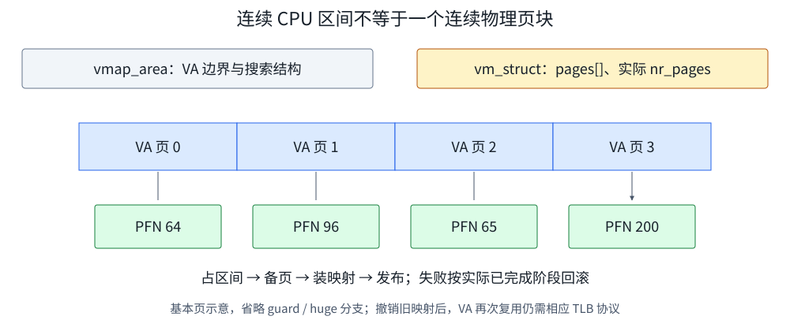
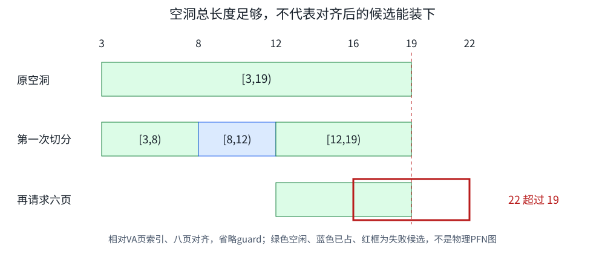

# Vmalloc：区间搜索、后备页提交与延迟地址复用

基于 arm64 Linux 6.1.158。它管理内核动态虚拟工作区，不是用户 mm 中的 VMA。要解释一个返回指针，必须同时解释**地址区间、后备页、页表映射**三类状态。

Vmalloc 先找到满足长度和对齐的虚拟空洞，再准备底层页和映射；这使 CPU 可以用连续地址访问不要求整体物理连续的存储。地址空洞足够不代表后续一定成功，失败时也要按实际完成阶段撤销资源。前置选型见 [连续虚拟工作区](../../02-allocation.md)。

## 1. 两个描述对象为什么不能合成一份“分配信息”？

| 对象 | 核心字段 | 角色 |
| --- | --- | --- |
| `vmap_area` | `va_start/va_end`、树和链表节点 | 地址搜索、占用和回收 |
| free 节点 | `subtree_max_size` | 空闲子树可容纳长度的辅助信息 |
| busy 节点 | 对应 `vm_struct` | 联系已登记用途 |
| `vm_struct` | addr、size、flags、pages、nr_pages | 后备资源与用途生命周期 |

`vmap_area` 的联合字段依 free/busy 状态使用，不能同时把它读成可用长度和管理指针。普通 size 还可能包含 guard，应通过 helper 理解有效区间，不当用户有效字节数。



## 2. 增广空闲树解决什么问题？

每次申请要满足长度、对齐、允许范围。按地址组织空闲节点，并记录子树最大空洞，可以跳过不可能容纳请求的部分；最后仍要对齐并核对实际候选。

`subtree_max_size >= size` 只是可能适合，不证明对齐以后仍装得下。搜索和分裂实现见 `__alloc_vmap_area`、`classify_va_fit_type/adjust_va_to_fit_type`。

## 3. 四种分裂不是四种物理页分配

| 请求占用空洞的位置 | 当前源码类别 | 剩余空洞 |
| --- | --- | --- |
| 全部覆盖 | FL_FIT_TYPE | 原 free 节点移出 |
| 从左边界开始 | LE_FIT_TYPE | 调整 va_start |
| 在右边界结束 | RE_FIT_TYPE | 调整 va_end |
| 左右都有余量 | NE_FIT_TYPE | 两个剩余 free 节点 |

中间切开必须有另一个区间描述符。本树尝试预加载节点；必要分配失败时不能只改边界而丢掉一侧空洞。这解释了虚拟长度够但元数据失败仍不能成功的情况。

## 4. 一个对齐使“总空闲长度”失效的算例

以相对某个适用基址的页索引表示 VA，假定基址满足本例对齐，省略 guard，只推演区间算法：

```text
原空洞：[3,19)
请求四页、起点按八页对齐
候选：[8,12)
剩余：[3,8) 五页；[12,19) 七页
```

随后申请六页、同样按八页对齐：

- 左侧对齐起点变 8，已经越过左空洞。
- 右侧对齐起点变 16，结束变 22，超过 19。

两洞共十二页仍不能装下这次六页请求。申请三页则可占 `[16,19)`，成为右边界分裂。这是 VA 碎片/对齐问题，不是 Buddy 高阶块不足。



## 5. 占到地址以后，还不能立即发布

`__vmalloc_node_range` 登记区间，`__vmalloc_area_node` 准备页数组及后备页，记录**实际** nr_pages，再安装映射。用途对象初始化完成后才清 VM_UNINITIALIZED。

```text
区间 -> 页数组 -> 取得页 -> 安装页表 -> 调试/初始化完成 -> 可返回
```

其中后备页可以有较大内部获取阶；本树按自己的拆分协议组织基本页数组，不允许外部使用者模仿它任意拆开普通高阶分配。

## 6. 部分失败的状态机

设需要三张基本页，最终只取得两张：

| 已完成阶段 | 持有内容 | 清理要求 |
| --- | --- | --- |
| 区间登记 | vmap_area/vm_struct | 撤销管理与区间 |
| 页数组就绪 | 上述加数组 | 再结束数组 |
| 已取得两页 | nr_pages=2 的有效条目 | 只归还两页，不访问第三个未取得项 |
| 页表部分安装 | 上述加软件映射 | 先结束相关映射，再按实际资源清理 |

`__vmalloc_area_node` 在页数不足或映射失败时汇入 `__vfree`。只释放最后一个指针会留下其他资源；按请求总页数清理又可能操作根本未取得的页。

页表分配需要内部 GFP 约束，本树在相应 NOFS/NOIO 条件下使用作用域 helper，而非假定每层都直接收到相同表层掩码。

## 7. 映射撤销、页释放与 VA 重用的次序

普通 vmalloc 用 `vfree` 同时结束后备与映射；普通 vmap 用 `vunmap` 结束映射，页仍由原拥有者处理；转移标志另有协议。

`__vunmap` 按用途找到管理对象，结束映射，按实际 pages/nr_pages 归还适用后备。Vmap lazy 回收把已撤映射的 VA 放在相应待处理组织，批量 TLB 失效后才合入可重新分配的 free 区间。

```text
旧用途访问权结束
撤销软件映射
后备按协议归还
VA 失效/待回收状态 -> 完成适用 TLB 处理 -> 可建新用途映射
```

不能据此宣称每次 vfree 都立即全局刷新，也不能因为旧后备归还就提前重用 VA。延迟处理不延长旧指针合法存活期。

## 8. 与 kvmalloc 的边界

`kvmalloc_node` 先尝试 kmalloc，再在适用大小和允许阻塞等条件下回退。它放宽的是“必须整体物理连续”，不取消区间、元数据、页和页表的资源需求。

所以使用者从开始就必须兼容两种结果，配 `kvfree`；不能在它碰巧返回物理连续块后，永久改成依赖 `virt_to_phys` 或普通 DMA 单块映射的协议。

源码：`include/linux/vmalloc.h`；`mm/vmalloc.c` 的搜索/分裂、`__vmalloc_area_node`、`__vunmap`、lazy purge；`mm/util.c` 的回退。API 和用户映射存活见 [虚拟工作区](../../api-reference.md#virtual)、[共享后备](../../api-reference.md#user-map)。本文是源码推演，未运行分配器实验。
